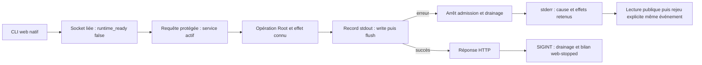
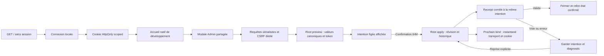
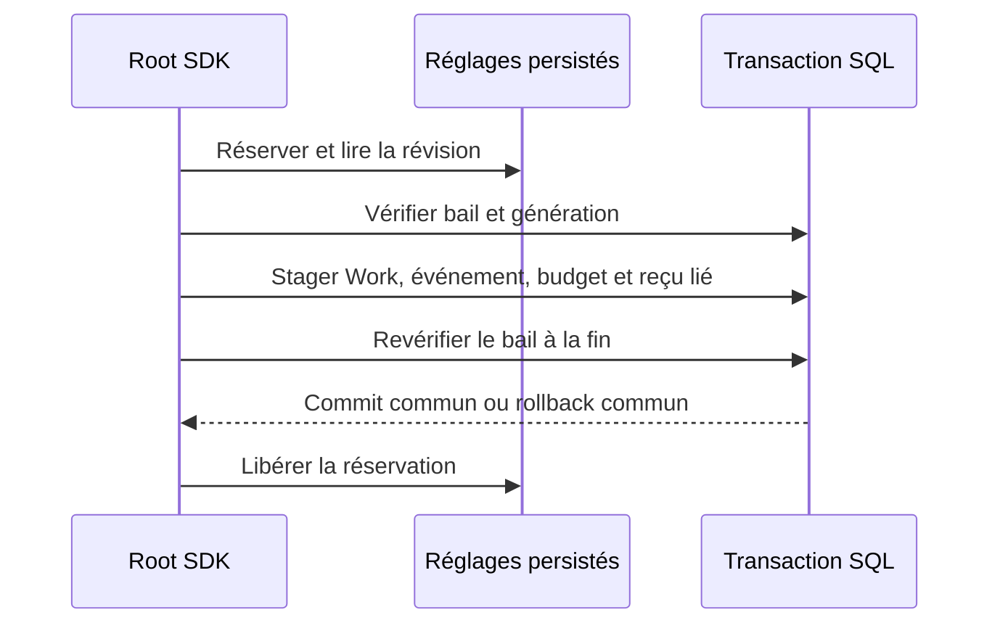

# Conservation et rejeu des recettes

Les références historiques marquées « original absent » ci-dessous ne peuvent pas être rejouées ni réutilisées comme preuves courantes. Leurs identifiants et résultats anciennement rapportés sont conservés ; aucune restauration n’est revendiquée. Les archives sources et preuves151 actuelles restent distinctes.

L'outil permanent est [`tools/verification/recipe.py`](../../../tools/verification/recipe.py),
avec [contrat et commandes](../../../tools/verification/README.md),
[recette de régression du lanceur](../../../tools/verification/recipes/runner.json)
et [tests persistants](../../../tools/verification/test_recipe.py).
`CLAUDE.md` relaie la règle commune `AGENTS.md`. Ces fichiers persistants ne
modifient ni contextes natifs embarqués ni sessions déjà lancées.

L'instantané local de 1 306 fichiers (`replay/20261019-current-tests-recipes-67.json`; original absent)
référence l'archive `.tar.gz` voisine et leurs empreintes : tests et recettes au
19 octobre, y compris les travaux67 non qualifiés. Il ne transforme pas ces travaux
en résultat accepté. Les qualifications antérieures conservent leurs propres
`sources.tar.gz`, dépendances, commandes et sorties dans `evidence/` ; les échecs
historiques restent distincts. Les scripts cache historiques ne sont pas encore
tous convertis au lanceur permanent : relire leurs chemins de sortie exclusifs,
contrats et préconditions avant tout rejeu. Ne jamais écraser une preuve existante
ni extraire un snapshot sur le checkout courant ou le toolchain.

Conservation **locale**, non committée et sans sauvegarde distante établie ; aucune
garantie de toutes les versions intermédiaires ou de disponibilité future des
fournisseurs/toolchains. Les archives qualifiées lient les résultats à leurs sources ;
le lanceur générique ne découvre pas seul le graphe effectif de compilation.
Migration globale toujours partielle. La conversion des recettes restantes se fait
lors de leur maintenance, en conservant leurs preuves et couvertures originales.

### Catalogue et comptabilité — incrément70

Recette permanente : [pricing-accounting.json](../../../tools/verification/recipes/pricing-accounting.json).
Preuve locale permanent-pricing02 (`evidence/20261019-70/permanent-pricing02/result.json`; original absent) :
17 tests Go ciblés, sources déclarées stables et archive vérifiée. La première
capture garde son échec de source modifiée malgré les tests verts.
La recette navigateur [pricing_ui.cjs](../../../tests/pricing_ui.cjs) vérifie Admin
et Budget, sauvegarde/relecture, CLI/API, anciennes versions et conflit ; résultat
browser02 (`evidence/20261019-70/browser02/result.json`; original absent), FR/EN, deux thèmes, cinq largeurs.
Chrome installé explicitement sélectionné après refus du cache Puppeteer absent.
Les commandes et limites de rejeu figurent dans le [guide du lanceur](../../../tools/verification/README.md).
Ce lot Go ne qualifie pas le portage tarifaire Rust ou le serveur installé.

## Socle du parcours agent natif

Recette persistante `tools/verification/recipes/agent-runtime.json` :15tests moteur
(lifecycle SQL, historique complet, arrêt/reprise et refus SQL silencieux),4parcours
CLI agent, régression de sortie tarifaire et smoke CLI commun. Les sources, SQL,
configurations et textes incorporés sont déclarés ; garde read-only
`test_rust_recipe_inputs.py` vérifiée contre tous les includes Rust littéraux.

```sh
python3 tools/verification/recipe.py run --recipe tools/verification/recipes/agent-runtime.json --output CHEMIN_NEUF
python3 tools/verification/recipe.py verify --evidence CHEMIN_NEUF
python3 tools/rust-migration/verify_agent_runtime.py --output AUTRE_CHEMIN_NEUF
```

La parité couvre48documents/projections Go/natif. La recette prouve les contrôles
déclarés, pas un graphe effectif complet ni une mission exécutée. Aucun fournisseur
ni arrêt de processus ; les échecs originaux72 restent conservés.

Increment73 adds five supervisor-claim and six cancellation tests, including
actual concurrent SQLite connections, partial historical settlement repair and
replay without duplicate events/logs. CLI includes four agent journeys plus
17common and three pricing checks. No provider or full-mission claim.

## Résolution native des limites avant lancement

`tools/verification/recipes/runtime-limits.json` rejoue26tests moteur et26CLI
(sources déclarées et SQL/textes inclus archivés, aucun watchdog global).
`agent limits WORK ROLE TASK --root ROOT --input FILE --json` utilise schema_version1
avec provider/mission/précédent optionnels ; ces identifiants sélectionnent les
portées, sans prouver existence, éligibilité ni autorité d'une mission.
Le rejeu couvre adoption explicite v14→v15, défauts/plafonds nullables, durcissement,
reprise, observation Admin, surcharges persistées, refus JSON/révision/motif et
erreurs de sortie/flush. L'Admin se rejoue par la recette existante
`tests/rust_engine_settings_admin_ui.cjs` avec ses binaires/probes reconstruits ;
les dix champs sont sauvegardés/réouverts et chaque plafond refusé puis retiré
explicitement pour vérifier l'effet sur la CLI de production. Ce transport est
une fixture navigateur, sans authentification HTTP ni lancement fournisseur.

## Préparation manuelle et garde77 — recette pérenne

`python3 tools/verification/recipe.py run --recipe tools/verification/recipes/agent-manual-admission.json --output CHEMIN_NEUF`

48tests moteur et25CLI couvrent préparation, observation, annulation, contention,
rejeu de politique figée et perte de sortie ; ni processus fournisseur ni mission native
complète. `verify --evidence CHEMIN` relit les empreintes, sorties et assertions.
La recette n'autorise aucun lancement, coût ou changement sur une mission réelle.

Parcours courant ciblé : `node tests/rust_agent_launch_admin_ui.cjs CHEMIN_CLI_RUST
DOSSIER_PREUVE_NEUF`. Quatre racines privées FR/EN×clair/sombre, onze réglages,
consommateur CLI réel, refus/reprise, plafond null, mobile et clavier ; aucun
appel fournisseur. Chrome est sélectionné par CHROME_BIN. Le helper d'états
terminaux a six régressions dédiées : `node tests/engine_settings_admin_state_test.cjs`.
Une erreur visible doit terminer l'attente en refus, sans watchdog arbitraire ;
voir l'apprentissage dans tools/verification/README.md. Ces commandes ne
remplacent ni HTTP natif ni authentification ni recette globale de mission.

76 ajoute l’identité courante, contrat propre, mappings/refus sans repli et
aperçu/hash périmé. Les preuves75 restent historiques ; exécuter la recette
courante sur une sortie neuve pour qualifier les nouveaux octets.

77 étend la même recette :48tests moteur (21factory+4snapshot+7garde+3trace
+4runtime+6annulation+3unitaires) et25CLI (4préparation/garde+4runtime+17communs).
Aucun seuil global ajouté. Sous writer tenu, les refus conservent la cause typée
et toutes les tables ; sa libération permet la reprise sans double intention.
Le parcours Admin ciblé couvre désormais11champs, facteurs1/4/null, refus0,
trois intentions sur trois Works privés et un ancien snapshot inchangé.
Les traces sont déclaratives : pas de preuve d'exécution, d'arrêt ou d'acceptation.
Résultats et sources finales à conserver dans un répertoire neuf ; les preuves
75/76 ne sont pas réécrites pour la nouvelle portée. permanent04 passe ; quatre cas lifecycle repassent après une correction de forme
d’assertion de test. Browser04 final passe les quatre parcours FR/EN×thèmes sur le binaire courant
par défaut ; empreinte exacte, archive et limites sont consignées dans les preuves77.

## Processus natif contrôlé78 — recette de raccordement

`python3 tools/verification/recipe.py run --recipe tools/verification/recipes/agent-controlled-process.json --output CHEMIN_NEUF`

La recette courante sélectionne6cas unitaires du runner possédé,8cas des vrais
consommateurs Git et1cas réel de sortie de validation. Elle vérifie entrée
explicite, refus de contrôle, terminaison et dernières sorties, causes originales,
reprise d’enfant non récolté, réveil sans délai global et consommateurs existants.
Elle ne prouve aucune autorisation fournisseur, enregistrement durable Agent ou
mission native. Aucun watchdog global ; vérifier l’archive avec le même outil
pérenne. La qualification des entrées courantes reste suivie dans le lot78.

## Parcours manuel natif78

`python3 tools/verification/recipe.py run --recipe tools/verification/recipes/agent-native-runtime.json --output CHEMIN_NEUF`

Recette dédiée, sans watchdog global :41unitaires +21admission +13CLI +30contrats
figés/budget/identité/catalogue, générateur3tests et traduction. Les nombres
attendus sont à vérifier sur la sortie retenue, pas une preuve d’exécution de
cette page. Exécutables locaux privés, aucun appel modèle payant ni mission live.
Elle exige explicitement une durée observée sans arrêt puis un stop opérateur ;
le test antérieur qui attendait un arrêt à ce seuil reste historique et invalidé.
Le noyau partagé a maintenant8cas, dont vrai ENOEXEC sans shell et récupération ;
la petite recette précédente couvre donc17cas avec Git/validation. L’acceptation
globale, usage fournisseur réel et restauration après crash restent distincts.

79 étend la même recette aux déclarations fournisseur : absence/0, caches, modèle
non authentifié, erreurs sans faux succès, flux incomplet et reprise sur un même
processus actif. L’erreur metadata ne masque pas l’outil valide ; prévol contrôlé
avant chaque injection de données de sortie anticipées. Les empreintes et
résultats78 restent historiques ; les nouveaux105cas attendus ne deviennent
PASS qu’après exécution effective. Aucun coût facturé ni service HTTP qualifié.

La recette inclut aussi trois diagnostics CLI purs : cause de garde imbriquée,
les deux branches cleanup CLI et source typée à adresse identique au wrapper,
avec cycle réel et refus d’exposer du texte privé. Total déclaré108tests Rust
plus générateur3 et i18n ; le résultat d’exécution reste distinct de ce compteur.

80 ajoute le compilateur d’arguments de modèle à la même recette permanente :
47unitaires,21admission,13CLI,3diagnostics et30contrats =114tests Rust attendus,
plus4générateur et i18n. `evidence/20261019-80/permanent03/result.json` conserve
PASS effectif et son archive vérifiée ; les compteurs79 ci-dessus sont historiques.
Aucun routage natif nouveau, appel payant ni contrôle navigateur prétendu.

81/permanent05 PASS121Rust+4générateur+i18n après correction de génération de
fixture (03FAILconservé). CLImodel-check est sans mutation ; automatique doit
être fourni. Cataloguev3/settings19, historique18 et groupes vides/incomplets
sont couverts. Browser07 :4parcours/23champs ; rendu11 :4parcours/24captures,
contraste et attributs littéraux. Commande de supplément dans le README Admin.
Ces recettes ne lancent aucun modèle payant et ne prouvent pas le routage natif.

82 rejoue les6cas provider_model_arguments::tests et le programme public81
identique contre la nouvelle rlib ; après03PASS, avant08RED conservé. Profil
défaut02 sans fixtures, aucune nouvelle recette navigateur requise pour cet
unique garde de valeurs d’argv non encore consommé par le lancement.

83 : la recette native commune attend125tests Rust (51unitaires moteur),
4générateur et i18n. La recette supplémentaire pérenne est
`python3 tests/rust_agent_model_route.py --binary CHEMIN_CLI_DEFAUT --output CHEMIN_NEUF --case all`.
Elle qualifie8parcours locaux nommés, garde chaque requête/sortie/fixture et
son image SHA, sans watchdog. Construire et vérifier le graphe/profil sans
fixtures avant ces parcours ; un test workspace avec toutes les features ne
qualifie pas l’image livrée. Cas : choix/argv/stdin/budget, cache changé et reprise,
règles Admin et révision sans rapport, erreurs/cacheFIFO/plafond, hash/défaut
automatique/probeAPI, environnement effectif, configuration sans cache ni effort
inventé, et argument générique -mode préservé. Aucun Codex commercial ni dépense
réelle, seule l’interface d’un exécutable local nommé codex est exercée.

83/permanent14,qualification15,native16,browser17 sont PASS :125Rust+4générateur+i18n,566workspace,8natifs,4Admin. Archives et limites :83/result.json.

84 : recette commune attend128Rust (54unités moteur). `--case all` du rejoueur Python comporte neuf parcours ; `--case api-catalogue` isole coexistence/collisions/refus/reprise. Ne pas compter les566tests workspace83 comme rejoués84.

84/permanent03 PASS128Rust+4générateur/i18n ; native05 PASS9, même empty-catalogue01 avant/après, Clippy/Rustdoc/default04 et contrat Go ciblé PASS1. Source/ELF archivés ; UI83 historique explicitement bornée.

85 ajoute bootstrap CLI `providers config init|show` et publication create-only. Recette partagée :140Rust attendus (57unitaires sans fixtures,4stockage fixture,3Root config,2CLI en plus des lots précédents),4générateur/i18n ; Python all comporte10parcours, provider-configuration seul est sélectionnable. Préserver03FAIL (zéro test),04PASS3Root, et distinguer le profil test-fixtures du CLI normal.

85/permanent07 PASS140Rust+4générateur/i18n ; workspace08 PASS593nommés avec tous features (profil de test) ; default08 sans fixtures et native09 PASS10. Sources/ELF archivés, same before01/after09 PASS, échec03 original conservé.

85-cache :886artefacts exemple Cargo archivés/vérifiés puis copies cache retirées ; inventaire et archive retenue dans85/example-cache-recovery10.json. CLI normal/source inchangés, aucune donnée ni test interrompu ; archive de preuve non jetable.

86 :150Rust attendus dans la recette partagée (59défaut,6stockage fixture,7Root config,4CLI),4générateur/i18n ; Python all a12parcours. Sélecteurs configuration-update-restore et configuration-repair : agent préparé périmé/réservation/restauration réelle et corruption/réparation sans perte des originaux. Pas de watchdog ajouté ; les délais métier de préflight restent actifs.

86-scope :150tests06/12natifs08 précèdent le correctif de portée. RootA→RootB09 réellement accepté (RED). La recette corrigée attend151Rust/8Root,13natifs, avec le même contre-exemple et un contrôle permanent configuration-scope. Ne pas promouvoir les preuves pré-correction.

Qualification86 locale vérifiée :151tests Rust nommés dans la recette pérenne,
4tests du générateur et i18n ; Clippy workspace/all-targets et Rustdoc privé passent.
Le CLI normal reconstruit est sans test-fixtures dans ses73artefacts. Ses13parcours
natifs passent, dont modification puis restauration exacte d’un fournisseur et
reprise de la même intention/réservation, réparation d’une source invalide et refus
d’un token étranger à son Root. Les mêmes programmes publics preview01 et scope09
passent après correction. Les originaux150tests06/12natifs08 et scope09RED restent
historiques ; le binaire antérieur07 est conservé, sans requalifier ces preuves.
Huit tests Root, six de stockage et quatre CLI couvrent notamment12injections
backup/remplacement et les erreurs de sortie/flush. Le no-op confirmé fait un vrai
fsync du fichier et du répertoire. Aucun plafond/retry/délai nouveau ; limite Admin
par fichier inchangée, token public lié aux octets/réglages et au descripteur Root.
Sources/ELF/profil/revue : `docs/plans/migration-rust/evidence/20261019-86/result.json`.
Les593tests workspace85 et quatre parcours Admin83 sont des preuves historiques
bornées, pas des exécutions86. Aucun nouveau rendu Mermaid ni revue indépendante,
aucune installation/bascule/HTTP/auth ou identité authentifiée acquise. Les API/
probes, bootstrap UX par défaut, hiérarchie et reprise crash/drain, données,
recette globale, unique bascule et RETEX restent ouverts. Migration globale partielle.

87 ajoute deux tests unitaires de choix/requête stricte (155Rust attendus) et le parcours Python task-model (14natifs attendus) ; résultats à produire, acteur local non authentifié.

Qualification87 locale vérifiée :155tests Rust nommés dans la recette pérenne,
4tests du générateur et i18n ;10tests WorkEngine supplémentaires passent, dont refus
SQL/rollback/reprise du même événement. Clippy workspace/all-targets et Rustdoc privé
passent. Profil normal sans test-fixtures dans ses73artefacts,14parcours natifs PASS.
Le processus reçoit réellement le choix « simple » de la tâche, bien que le
fournisseur et la demande « auto » choisiraient « standard ». Choix/rejeu/réouverture,
divergences et politique périmée avant admission/après mise en attente, refus d’un
changement actif, réservation conservée et restauration/reprise sont observés.
Inherit retire seulement le choix ; tentatives et consommation restent conservées.
Le seul changement après15/16 est la correction d’alias dans le rejoueur Python ;
les octets compilés restent identiques (rust-evidence-reuse18.json).
Les mêmes programmes publics before01/after18 et compat-before12/after18 passent.
L’oracle13 compilé à partir des définitions Go confirme nulls/casse/doublons ; la
projection commune les préserve, avec refus des champs inconnus/types/multi-JSON.
Cli04 conserve son FAIL1/2 : la fixture avait modifié le schéma protégé, le Root
refusait avant la transaction. Les tests corrigés CLI et WorkEngine prouvent chacun
leur contrat ; aucune suppression du garde. Clippy10FAIL d’ordre des fonctions est
conservé, corrigé sans suppression de lint.155tests09 restent pré-codec, pas la
qualification finale15. Sources/ELF/revue : `docs/plans/migration-rust/evidence/20261019-87/result.json`.
Aucune installation/bascule ni nouvelle preuve navigateur/Mermaid rendu ; revue de
même session, non indépendante. Le choix n’authentifie ni l’acteur ni le modèle et
ne donne pas la permission de lancer. API/probes, profils initiaux/UX par défaut,
hiérarchie/mémoire sélectionnée et reprise crash/drain, HTTP/auth, migration des
données, recette globale, unique bascule et RETEX restent ouverts. Migration partielle.

88 : recette pérenne161Rust attendus (65unitaires moteur et2CLI policy ajoutés),4générateur/i18n ; rejoueur Python all a15parcours. Le cas policy-import inclut35fournisseurs, fichier>64KiB, aperçu, règles Admin, refus de droits d’exécution distincts et vrai enfant local. Nouveau composant navigateur : node tests/rust_provider_policy_submit_ui.cjs CLI_NORMAL DOSSIER_NEUF ; transport fixture vers vrai CLI, pas HTTP/auth natif. Résultats finaux encore attendus.

Qualification88 locale vérifiée :161tests Rust nommés de recette,4générateur et
i18n ; Clippy workspace/all-targets et Rustdoc privé PASS. Profil normal sans
fixtures dans ses73artefacts ;15parcours natifs PASS. Import/preview/apply/export
passent sur politiques explicites,35fournisseurs et fichier99037B, sans plafond
métier32/64KiB caché. Champs commandes/env conservés par comparaison des DTO Go,
sauvegarde exacte des octets, refus de données/caches/règles/tokens périmés et
reprises sont observés. Stocker des politiques reste possible quand le droit
d’exécuter est refusé ; l’admission séparée refuse puis le vrai enfant local ne
part qu’après restauration explicite de cette politique. Aucun appel IA payant.
Quatre parcours navigateur FR/EN×thèmes passent sur ce même CLI : soumission réelle,
nonce natif, refus visibles sans écriture, enregistrement/réouverture, choix exigeant
conservé, règles Admin resserrées/refus puis reprise. Import/éditeur capturés à320/
1440px, focus/Escape et erreurs console/requêtes vérifiés. Composant et bridge CLI
de fixture, pas cockpit complet ni serveur HTTP Rust/auth. Les8corps legacy sans
token passent aussi le vrai strict/PolicyChange Go extrait ; pas un serveur Go lancé.
Before01/after19 est PASS. Browser11 conserve RED (exigeant affiché simple), corrigé
sans plafond UI autonome ; release14 conserve RED d’agrégation, puis test final
PASS garde Published et causes lors d’une release tardive simulée, pas panne OS.
Native06FAIL était une comparaison JSON brut/DTO canonique ; corrigée07 sans
abandonner la conservation exacte du snapshot. Browser09FAIL de fixture gardé.
Sources/binaire/revue : `docs/plans/migration-rust/evidence/20261019-88/result.json`.
Aucun modèle implicite nommé ajouté, catalogue Claude/installation/HTTP/auth ou
identité compte/modèle acquis. Export limité aux politiques enregistrées ; un Go
ancien peut encore refuser >32. Les catalogues non pris en charge refusent, jamais
réputés disponibles. Revue même session, non indépendante ; schémas relus, pas de
nouveau rendu Mermaid ni audit WCAG exhaustif. Anciennes traductions conservées,
assets/styles Admin83 inchangés hors ajout de3traductions vérifié séparément.
Le serveur reste Go ; migration globale, données, mission hiérarchique/reprise,
recette complète, unique bascule et RETEX restent ouverts.

89 : recette commune `tools/verification/recipes/agent-native-runtime.json`,169tests
Rust nommés +4générateur/i18n (`permanent16`). Complément réel :
`python3 tests/rust_manual_mission.py --binary CLI_NORMAL --output DOSSIER_NEUF`
(sur une ligne),4scénarios. Racines isolées, commandes/entrées/diagnostics et sources
conservés ; aucun watchdog global, appel IA payant ou DB live. Le vrai enfant
produit son rapport ; gate/acceptation sont des décisions contrôlées de fixture,
pas une revue indépendante. La branche alias injecte une seule ligne incohérente
ajoutée dans sa fixture et la retire après preuve de refus ; aucun historique ou
budget réel n’est effacé. Refus et reprise conservent les états observés.
Profil normal18 sans fixtures ;15routages,4missions,contre-exemples corrigés,
Clippy et Rustdoc passent. Résultats/empreintes/limites :
evidence89 (`evidence/20261019-89/result.json`; original absent). Échecs originaux et pré-correctifs
sont conservés et distingués des preuves finales. Application en service Go ;
migration globale, HTTP/auth, hiérarchie/reprise, données et bascule restent ouverts.

90 : la même recette permanente inclut le paquet `swarm-web`, les cas Root/CLI
après échec tardif et le binding de datastore. Vérifié192Rust nommés :69unitaires
moteur,6CLI et17HTTP inclus dans les étapes,4générateur/i18n à part. Les requêtes
HTTP restent typées/en mémoire avec vrai Root isolé ; aucune preuve de listener
ou serveur navigateur. IPv6 réseau est indisponible (preuve06), jamais compté PASS ;
la représentation IPv6 unitaire est nommée distinctement. Les RED08/15/17 et leurs
sources restent conservés ; qualification commune finale32–36 PASS dans dossier90.
La nouvelle règle AGENTS.md est persistante/relayée par CLAUDE.md, pas injectée dans
les processus ou prompts déjà lancés. L’archive cache14 est une preuve conservée,
pas un cache à effacer ; seules29anciennes dérivations .rlib/.rmeta propres ont été
retirées après vérification. Sources, binaires et preuves antérieures intacts.

HTTP90 qualifié localement : recette32 PASS192tests Rust nommés,4générateur et i18n ;10WorkEngine supplémentaires,15routages natifs et4missions manuelles PASS. Clippy et Rustdoc privé PASS. Builds33 CLI/libHTTP sans test-fixtures transitives ; pas de listener, session persistée ni installation. Preuves finales : evidence/20261020-90/result.json ;23–27 restent historiques avant le correctif IO30. IPv6 réseau indisponible, critère ouvert ; format IPv6 unitaire distinct. Revue Codex même session seulement. Prochaine étape : création/relecture sûre de session puis transport HTTP natif. L’application en service reste Go ; migration globale et RETEX restent ouverts.

91 : recette permanente étendue, attendu202Rust nommés (71unitaires moteur,19HTTP,5persistance et1fixture publication). Session persistée issue du vrai Root/listener ; transport TCP/login/expiration non implémentés. Failles de publication séparées du profil normal. Originaux de compilation01/02/05 et défaut de donnée fixture03 conservés ; aucune de ces erreurs ne prouve un défaut sécurité produit. Qualification en cours.

Session91 qualifiée localement : recette07 PASS202tests Rust nommés,4générateur/i18n ;10WorkEngine,15routages et4missions manuelles supplémentaires PASS. Clippy/Rustdoc privé et profils normaux08 sans test-fixtures PASS.5tests publics de session,2nouveaux unitaires moteur et2HTTP incluent création/réutilisation, refus/reprise, concurrence forcée et bootstrap.1test compile-gaté couvre6défauts de publication ; ce ne sont pas6incidents OS réels. Sources, binaire, revue et limites dans evidence/20261020-91/result.json. Session persistée raccordée au service typé, sans serveur TCP/login/expiration ni installation. Revue même session, application Go maintenue. Suite autorisée : parcours Admin/API puis transport HTTP natif avec politiques persistées et consommateur réel ; bascule globale et RETEX ouverts.

92 : recette permanente étendue à206Rust nommés, dont7diagnostics CLI et3tests de sortie réglages. Témoins réels avant write/flush, FR/EN×JSON/texte, initialisation/apply/rejeu, refus préalable et lectures sans faux marqueur. Qualification en cours ; RED01/02/03 conservés.

Sortie92 qualifiée localement : recette06 PASS206tests Rust nommés,4générateur/i18n ;10WorkEngine,15routages et4missions manuelles PASS. Clippy/Rustdoc privé et builds normaux07 sans test-fixtures PASS. Trois contre-exemples RED01/02/03 deviennent verts : init/apply/rejeu conservent leur état après write/flush, refus/show/preview ne créent pas de faux marqueur. Fixtures de sortie et agrégation de close sont distinguées de fautes OS réelles. Preuves, source/binaire et revue : evidence/20261020-92/result.json. Original01 de test conservé depuis son générateur et le préfixe identique capturé03, provenance explicite. Serveur Go inchangé, migration/HTTP/Admin/bascule/RETEX restent ouverts. Suite : raccordement API des réglages puis transport natif et politiques persistées.

93 : recette permanente attend211Rust nommés,24HTTP dont5unitaires/3réglages. Les routes native-settings servent le même contrat Admin/CLI avec Root réel et métadonnées connues séparées du body ; aucun listener HTTP ni navigateur raccordé. Contre-exemples routes absentes01 et statut Runtime03 conservés. Qualification en cours.

API93 qualifiée localement : recette05 PASS211tests Rust nommés,4générateur/i18n, dont24HTTP (5unitaires,7accès,9service,3réglages). Clippy/Rustdoc privé et builds normaux06 sans test-fixtures PASS. WorkEngine10,15routages et4missions de92 réutilisés explicitement, sans réexécution :1211entrées pertinentes identiques, profil et ELF CLI identiques. Routes Admin natives, plafond sauvé consommé, rejeu/refus/Root remplacé et état indépendant du body vérifiés ; aucun réseau/navigateur raccordé. Preuves/source/binaire/revue : evidence/20261020-93/result.json. Archives cache01–03 conservent102anciens tests natifs,926567800B, relus par SHA avant retrait des seules dérivations ; fichiers sources, données et preuves intacts. L’espace libre est remonté vers1GiB, pas de nettoyage supplémentaire nécessaire. Suite : politiques réseau persistées/Admin et transport réel. Migration/bascule/RETEX restent ouverts, application en service Go.

94 : recette permanente étendue à220Rust nommés, dont6politiques réseau et3contraintes réelles de bibliothèque. Navigateur dédié `node tests/rust_web_policy_admin_ui.cjs NATIVE_CLI OUTPUT` : FR/EN×etat/sombre,5largeurs, refus/reprise puis sauvegarde/relecture. Pont CDP/CLI, pas transport Rust natif ; watchdogs globaux/page/protocole désactivés, erreurs terminales prises en charge. Original navigateur12 conservé ;14 passe4cas. Qualification commune en cours.

Réseau94 qualifié localement au niveau configuration/Admin : recette15 PASS220Rust nommés,4générateur/i18n,10WorkEngine,15routages et4missions. Clippy/Rustdoc privé et profils16 sans test-fixtures/test-util PASS. Navigateur14 PASS4 FR/EN×2thèmes,5largeurs et4captures ; deux captures mobiles inspectées. ELF normal13=16, journal19 original conservé octet-identique. Sources/binaire/bibliothèques exactes/revue : evidence/20261020-94/result.json. Aucun consommateur TCP/enforcement/redémarrage prouvé. Limite de méthode retenue pour95 : finally du nouveau navigateur peut masquer cause primaire si browser.close échoue ; cas non observé14, à reproduire/corriger avant fautes transport. Application Go inchangée, migration/bascule/RETEX ouverts.

Transport95 : recette permanente attend230Rust et6cleanup Node. Sources des nouveaux
scénarios dans rust/crates/swarm-web/tests/server_{bootstrap,transport}.rs et
session_bootstrap.rs ; replay via recette native commune. TCP réel lecture,
100-continue comme barrière, pas timeout global. État qualification dans
evidence/20261020-95 ; pas de mutation HTTP/login/bascule prouvée.

Les diagnostics en file conservent maintenant leur réservation de connexion jusqu’à consommation par le propriétaire ; le drop client ne libère plus cette capacité avant remise. Garde de régression sous double local, qualification finale en cours.

Transport95 qualifié localement en lecture : preuve composée230Rust (193inchangés
de permanent29 PASS,37HTTP requalifiés33 après correction des capacités),4générateur/
i18n,6cas cleanup, navigateur04 réutilisé4parcours CDP/CLI aux empreintes identiques.
Clippy/Rustdoc privé/profil web34 et contrôle des contextes34 PASS ; profils normaux
sans test-fixtures/test-util, ELF CLI30 identique94. Dépendances31 :85packages et
5236fichiers réels vérifiés. Sources/artefacts/revue : evidence/20261020-95/result.json.
Aucun POST réseau/login/acceptation globale ni installation. Critères ouverts et
suite mutations96 conservés ; Go continue de servir, bascule et RETEX non clos.

Transport96 qualifié localement : recette13 PASS240Rust nommés dont47web et8scénarios
TCP,4générateur/i18n et6cas cleanup. Clippy/Rustdoc privé/profils14 PASS ; aucune
feature test-fixtures/test-util en profil normal. CLI ELF14 identique95, graphe
dépendances inchangé et5236sources de85packages rehashées contre31. Sources,
artefacts et revue : evidence/20261020-96/result.json. Mutations task/settings et
observation des effets vérifiées ; commande CLIweb, login/Admin natifs, sink
progress-safe et précision Root sans document restent ouverts. Application Go
non redémarrée ; aucune acceptation globale/bascule/RETEX. Suite autorisée97 :
consommateur public CLI et traitement de ses sorties/arrêt, sans publier de faux
ready ni assimiler un flux écrit à une réception durable.

CLI97 : la recette publique `tests/rust_native_http_cli.py` passe ses deux scénarios
sur le vrai binaire normal08 (preuves97/public10). Socket annoncée avant runtime,
session protégée, preview sans mutation, apply et rejeu sans doublon, lecture par
CLI séparé et bilan après SIGINT sont vérifiés. Une vraie rupture stdout après
commit conserve le refus d’observation, le receipt et les causes dans stderr ; la
reprise explicite du même événement ne duplique pas l’historique. Les refus
pré-Root sont text/plain à code fixe ; les réponses Root sont JSON. Le bilan
web-stopped est transmis et toute erreur de sa sortie conserve les effets connus.
Ce flux n’est pas un journal durable ; Write bloqué sans retour, UI/login/Admin
natifs, couverture globale et bascule restent ouverts. Qualification statique et
recette permanente97/11–12 en cours ; serveur Go non remplacé.

CLI97 qualifié localement : recette11 PASS244tests Rust nommés (48web et2bootstrap),
4générateur/i18n et6cas cleanup ;2parcours processus/HTTP réels public10 PASS.
Clippy CLI/web, Rustdoc privé et profil normal12 PASS ; binaire12 identique08
exercé en public10, aucune feature fixture/test-util. Sources dépendances95
rehashées (5236fichiers), aucun nouveau package registry. Contrôle méthodes14
PASS après isolation du cache Go ;13 interrompu reste une preuve incomplète.
Sources/binaires persistés et revue sémantique liée aux SHA dans97/result.json.
Cela ne clôt pas la migration : login/Admin natifs, sortie sans blocage, supervision
autonome, autres routes et recette globale/bascule/RETEX restent ouverts. Go
reste le serveur installé ; aucune installation, publication ou revue indépendante.



Connexion98 en développement : page et assets canoniques embarqués par allowlist
GET/HEAD, Host exact conservé ; POST login exige Origin exact unique et clé locale
comparée sans sortie anticipée. Pas de cookie/CSRF requis avant login. Formulaire
strict (percent/UTF8/champs uniques), erreur401 générique sans clé, causes typées
retenues. Cookie scoped, HttpOnly, SameSiteStrict, Path/ ; durée depuis settings20
au démarrage, null cookie de session navigateur. Pas de nouvelle borne de politique
ni limite4096/année cachée. Redirect local contrôlé, JSON ou303. Page FR/EN et
thèmes réutilisés ; routes cockpit/Admin non portées. Ancienne surcharge Go
web-session.json à importer/arbitrer avant bascule ; aucune expiration de clé ou
authentification agent prouvée. Tests typés/TCP/UI encore à vérifier ; Go inchangé.

Recette connexion native98 (preuve navigateur distincte des tests typés) :
```sh
python3 tests/rust_native_login_browser.py --binary "$PWD/rust/target/r97/debug/swarm-rust" --output DOSSIER_NEUF
```
Le vrai CLI démarre sur Root0700 neuf ; Chrome reçoit la clé via stdin, pas argv
ou logs. Les sorties d’outcomes sont drainées pendant les chargements ; tous les
processus propres sont fermés, les fixtures en échec restent conservées. Vérifier
le profil normal via les artefacts cargo avant usage, aucune feature fixture.
Tous les fichiers émis sont examinés pour absence de la clé exacte ; le profil
privé Chrome n’entre pas dans les preuves. Aucun watchdog global/page/CDP. La
recette fixe next=/api/v1/works pour tester l’accès protégé ; le cockpit au chemin
/ n’est pas encore porté (la redirection par défaut du formulaire reste /).

Connexion98 qualifiée localement :53tests web +10CLI ciblés frais,2scénarios
HTTP14 et4parcours navigateur15 réels PASS ; Clippy/Rustdoc privé/profil normal13
PASS, aucun fixture/test-util. Les186contrôles moteur/non-web antérieurs restent
historiques sur sources pertinentes inchangées, pas une nouvelle recette globale.
Le binaire13 est celui de14/15 ;8captures finales identiques aux09 inspectées,
contraste mesuré minimal7.89clair/9.10sombre pour les textes vérifiés. Revue/SHA,
archives sources/binaire et limites : evidence/20261020-98/result.json. Origines
du favicon404, mélange de snapshots et template400 conservées ; reprises vérifiées.
Go non remplacé. Suite99 : accueil protégé et modale Admin via vraie API native,
car le formulaire redirige par défaut vers / dont le cockpit reste non porté ;
la recette98 choisit /api/v1/works et ne prouve pas ce parcours d’accueil.

Accueil99 en développement : / sans session affiche seulement la page de connexion
(Host exact ; ambiguïtés refusées). Une session valide ouvre l’accueil natif de
développement et la modale de réglages partagée ; /native-runtime.html et ses assets
sont privés. Connexion conserve langue/thème. Les lectures Admin sont sérialisées
dans cette instance, sans relever la capacité du serveur ; preview/apply utilisent
CSRF dédié et les validations Root existantes. Autres vues cockpit/Admin non portées.
Vérification réelle de l’Admin en cours ; aucune installation ni bascule.

Recette accueil/Admin natif99 :
```sh
python3 tests/rust_native_login_browser.py --binary CHEMIN_ELF_NORMAL --root-workers 1 --scenario admin --output DOSSIER_NEUF
```
La valeur1 est une entrée de fixture persistée par CLI, pas un défaut produit. Le
CLI lit ensuite état/revision, puis notre seul serveur fixture redémarre pour
vérifier le cookie de session sans Max-Age. Aucun serveur Go ou mission active
n’est arrêté.21cas ACK,5adaptateur,2échecs de helper sont rejouables dans les
fichiers tests dédiés et restent distincts des parcours HTTP réels.


La confirmation IHM n’authentifie pas un humain, un agent ou une décision métier.

Accueil/Admin99 qualifiés localement : recette26étapes PASS253tests Rust sélectionnés
(57web),21cas ACK,5adaptateur et6cleanup, générateur/i18n. Deux assertions de test
reprécisées après Clippy19 :18unités refaites20, partie production byte-identique
et autres entrées inchangées ; ce périmètre réutilisé est explicite. Clippy/Rustdoc
privé20 PASS. ELF normal-dev sans fixture/test-util séparé en copie0500, SHA
00e75fb09fb21ba972582c9241444c4cad306192604661a6a88c7087d3a9efe9,
exercé par2parcours HTTP22,4parcours Admin natifs23(Root1),4composant/CLI24 et
2gardes erreurs helper25. Cookie null relu en CLI puis consommé au prochain bind
sans Max-Age ; interruption client après vraie publication et rejeu sans doublon.
ACK vide ne ferme plus la modale ; canonicalisation des programmes vient du Root.
Artefacts/source/revue/profils : evidence/20261020-99/result.json. Go non remplacé,
aucune version installée ni performance release revendiquée. Supervision, autres
parcours, identité/autorités complètes, restauration, recette globale, bascule et
RETEX restent ouverts. La limite Write synchrone sans progression reste ouverte.

Lot100 : recette `agent-native-runtime.json` ajoute9tests de bail mission natif, sans watchdog global. Le parcours Admin natif exerce aussi sauvegarde/relecture CLI des3réglages v21. Une preuve de bail ne prouve pas le raccord des mutations métier ni la boucle de conduite.

Supervision100 : prise/renouvellement/arrêt natifs et3réglages v21 qualifiés
localement.27étapes/262tests Rust sélectionnés(57web) PASS11 ; après Clippy11,
seules deux représentations de cause de commit ont changé (Box, aucun allow).
Les9tests de bail ont repassé17 ;253autres sont réutilisés avec inputs pertinents
byte-identiques, pas une nouvelle recette globale. Clippy toutes cibles et Rustdoc
privé moteur/CLI/web17 PASS. ELF normal-dev séparé sans fixture/test-util, SHA
4e29d533de6e5c9fd6ef5b3ae2ce14450d840afe22bce09a4b0d014185bd48e7 :
4parcours Admin19 FR/EN×2thèmes (Root1),3valeurs v21 enregistrées/reluCLI,
2parcours HTTP20 PASS. Preuves/source/revue : evidence/20261020-100/result.json.
Compte OS de confiance ; aucun modèle/humain authentifié par ce bail. Journal
des cycles, lecteur de reprise, fencing métier dans chaque transaction et boucle
de conduite restent ouverts. Erreurs noyau close/commit incertain non injectées ;
pas de conformité globale de la gestion des erreurs. Aucun serveur installé ou
remplacé, aucun appel payant/commit/push/orchestration. R6/R7 et RETEX ouverts.

Lecteur101 : même étape permanente mission-supervision-leases portée à14tests (9baux conservés+5lectures), causes SQL/horloge et absence sans mutation ; qualification en cours. Aucun RED runtime historique revendiqué pour une API auparavant absente.

Lecteur101 qualifié localement :14tests de bail/lecture PASS08, dont témoin natif
présent puis collision d’une vue au nom réservé, horloge illisible, erreur SQL
réelle et reprise, lecture seule sans création de table. Le RED02 initial avait
une liaison source incomplète ; preuve dérivée07 liée aux octets, garde seule
retirée puis restaurée exactement, RED ciblé et GREEN14 conservés. Aucun binaire
historique exact reconstruit revendiqué. Clippy moteur/CLI/web03, moteur08 après
renforcement du test, Rustdoc privé03 PASS. Binaire normal-dev sans fixture, SHA
369c7d956653a63b7bf88d2c574cbffccad2e07f93a3bba9b68e0126de6b7ceb,
2parcours HTTP05 PASS ; sources de production byte-identiques après la preuve
dérivée. Pas de nouvelle recette globale : preuves100 conservées, parcours Admin
non rejoués car leurs sources/contrats n’ont pas changé. Preuves101/result.json.
Lecture Root de confiance, sans DTO HTTP approuvé, sans identité authentifiée ni
révision de politique inventée. Fencing métier, journal/conduite, R6/R7 et RETEX
restent ouverts. Serveur Go et données utilisateur conservés, aucune installation.

102 : étape mission-supervision-leases portée à18tests, incluant4commandes Work sous bail avec causes exactes, course par canaux et rollback budgétaire. Rejouer la recette globale runtime car le chemin transactionnel partagé change. Pas de watchdog global.

Fencing Work102 qualifié localement :27étapes runtime/271tests Rust nommés et
22tests Work/budget supplémentaires (293sélectionnés, pas toute la workspace).
18cas de bail/lecture/commande, causes exactes et mobilité Send inclus. Clippy
toutes cibles et Rustdoc privé moteur/CLI/web09 PASS. Binaire normal-dev isolé,
sans fixture/test-util, SHA
c3d81b69e65a989d99f377f258871b7d935745d84194c9f8879696b8d8a0a810,
2parcours HTTP11 PASS et inputs effectifs de compilation couverts avant/après.
L’arrêt Python de04reste invalide car aidé extérieurement ; reprise09 autonome
après correction du seul rendez-vous de fixture,2variantes de signal. Le code
production du runner est byte-identique. Compile-contract Send négatif06 et
positif09 conservés ; aucun allow de lint ni timeout ajouté. Preuves102/result.json.
Ces preuves portent sur le SDK Root et commandes supportées ; agent/process
launch/stop, journal par action, provenance persistée de politique et boucle
complète restent ouverts, ainsi que R6/R7 et RETEX. Go et données utilisateur
conservés ; aucune installation, aucun appel payant, commit/push ou orchestration.


### Provenance persistée et traces de commandes — incrément103

Chaque nouvelle prise native conserve un reçu normalisé dans la transaction du
bail : génération, conducteur déclaré, observations du processus, politique figée
et révision exacte de ses réglages. Les anciens baux v1 restent à révision inconnue ;
une preuve connue incohérente refuse la lecture plutôt que devenir une absence.
Ces observations locales ne constituent pas une identité authentifiée d’agent.

`RootStore::read_mission_work_receipts` expose les liens validés entre événements
Work et générations. Une commande nouvelle sous bail stage son lien dans la même
transaction que Work, budget et événements, avant le contrôle final du bail.
Le rejeu conserve l’attribution originale. Révision de prise et révision de commande
restent distinctes ; le lecteur vérifie chaque lien et l’historique exact. Il tient
la réservation des réglages jusqu’au rollback du snapshot SQL : Admin doit attendre
sa libération par une nouvelle opération explicite, sans publication partielle.
Une liste vide signifie aucune trace de ce type, pas une absence d’activité.



Les reçus sont insert-only dans les chemins SDK ; ils ne protègent pas contre
la modification du stockage par le même compte système. Le DTO SDK n’est pas
un DTO HTTP autorisé. Aucun plafond, délai ou choix opérateur nouveau. Le journal
des cycles, les processus agents et la boucle de conduite restent à raccorder.
Recette mise à jour :72tests unitaires moteur et23cas de supervision attendus ;
la qualification locale103 est maintenant vérifiée ci-dessous. Preuves négatives conservées
pour la perte d’ancrage epoch et la réservation libérée trop tôt.

Provenance103 qualifiée localement :27étapes/277tests Rust nommés, plus22Work
/budget (299sélectionnés),23cas de supervision et72unitaires moteur. Clippy
toutes cibles/features moteur/CLI/web et Rustdoc privé08 PASS. Binaire normal
dev isolé sans fixture/test-util transitive, SHA 6cda663924c7650dae07c059c962d693175453c5c00c32e207e355e78580c4ff.
2parcours CLI/HTTP11 PASS ; entrées effectives de compilation couvertes.
RED03/05 conservés, refus sans mutation puis reprise vérifiés. Preuves103/result.json.
Ces résultats ne prouvent ni identité authentifiée des agents, ni boucle complète,
ni installation/bascule ; R6/R7 et RETEX restent ouverts.

104 :26cas supervision attendus, avec3nouveaux cycles (transitions/rejeu de diagnostic, refus sans mutation et panne réelle INSERT puis reprise). Qualification ciblée du contrat partagé de propriétaire ; aucun watchdog. Résultats locaux vérifiés ci-dessous.

104 qualifié localement :26cas de supervision et22Work/budget PASS02 (48tests
ciblés, pas une nouvelle exécution de la recette complète). Transitions d’erreur
identique/différente/reprise, première réconciliation, refus sans mutation, panne
INSERT puis reprise et réouverture vérifiés. Clippy toutes cibles/features et
Rustdoc privé moteur/CLI/web02 PASS. Binaire normal-dev isolé SHA
4fb6946117966dc3d76839a3595819812f66e5b24854d3c7f91bdb8928895d32, sans fixture/test-util transitive ;
2parcours HTTP11 PASS, contexte intégré5tests/subtests et diff vérifiés.
Preuves104 (`evidence/20261020-104/result.json`; original absent). Cycle déclaré
par le caller seulement : boucle autonome, identité agent, processus, R6/R7 et
RETEX restent ouverts. Aucune installation, donnée utilisateur ou Go modifié.

105 : admission manuelle sous bail,3nouveaux cas ;24tests agent_launch attendus. La fabrique partagée change : recette runtime complète à rejouer, sans watchdog. Origine opérateur conservée, pas de consentement automatique prouvé.

105 qualifié localement :27étapes/283tests Rust nommés plus22Work/budget, soit
305sélectionnés (pas toute la workspace),24admissions et26cas de supervision.
Prévisualisation et rollback de toutes tables, panne du ledger, expiration après
staging et reprise, autre Root et rejeu sous génération suivante vérifiés.
Clippy toutes cibles/features et Rustdoc privé moteur/CLI/web04 PASS. Binaire
normal-dev isolé SHA 5adb5bc819911cead437dbc471554db578cf73837d857cb9b049ca7f67aa9ab4, sans fixture/test-util
transitive.2parcours HTTP11 PASS et5tests/subtests de contextes intégrés.
Preuves105 (`evidence/20261020-105/result.json`; original absent). Cela qualifie une intention manuelle
sous bail ; consentement automatique, gate/process/stop sous bail et boucle
complète restent ouverts, ainsi que R6/R7 et RETEX. Aucune installation.

106 :29cas mission attendus,3nouveaux lecteurs de consentement/contrôles. Rejouer aussi les3admissions sous bail et la réservation de snapshot, car le rollback de lecture est partagé. Pas de watchdog global ni autorisation automatique produite.

106 qualifié localement :29cas de mission,3admissions sous bail et1réservation de
snapshot,33tests ciblés PASS03 ; pas de nouvelle recette complète. Consentement
absent/révoqué/illisible, pas de repli sur une ancienne autorisation, contrôles
corrompus, panne SQL puis reprise/réouverture et absence de mutation vérifiés.
Clippy toutes cibles/features et Rustdoc privé moteur/CLI/web03 PASS. Binaire
normal-dev isolé SHA 181d0249f4a01de591631de4bf8527057b32ade6814ef5eea6ea8a607352c87c, sans fixture/test-util
transitive ;2parcours HTTP11 PASS et5tests/subtests de contextes intégrés.
Preuves106 (`evidence/20261020-106/result.json`; original absent). Faits déclarés seulement : pas de
consentement authentifié ou d’autorisation automatique. Configuration/capacité,
conduite complète, exécution sous bail, R6/R7 et RETEX restent ouverts.

108 :3contrats organisation/capacité et1nouveau parcours Root de refus planifié ;25admissions attendues. Garder un témoin canonique avant invalidation, origine et branches non portées explicites. Oracle Go pur via preuve effective/baseline107 ; pas de watchdog.

## Rejeux planification native et publication118–122

Ces drivers permanents prennent `--binary BINAIRE_RUST_NORMAL --output DOSSIER_NEUF`
et utilisent des Roots inactifs possédés. Aucun fournisseur/modèle ne démarre.
Les anciens binaires optionnels sont les versions réelles conservées, pas des
documents courants amputés pour simuler une ancienne version.

| Driver | Contrat observable | Dernière qualification locale |
| --- | --- | --- |
| `tests/rust_planning_call_preview.py` | Fences/sources/caps sans mutation ; ancien binaire116 v25 sans binding via `--legacy-binary`, numéro d'incrément distinct de schéma |120 preview11 |
| `tests/rust_planning_call_contract.py` | Éditions next/blocker propres refusent ; restauration conserve binding immuable |121 contract24 |
| `tests/rust_planning_output.py` | CLI hors exécution consomme cap0/fini/null, UTF8 strict et vrai25→26 (`--legacy-binary`120) |121 output23 |

`planning_proposal`, `planning_response_policy`, `planning_output` sont des cibles
Rust d'intégration permanentes :9/4/9tests nommés dans recette native. Driver
Admin navigateur `--scenario admin` :121Admin22 couvre sauvegarde/réouverture/aide/
consommateur2048 en FR/EN, deux thèmes et3largeurs. Relire ses prérequis Chrome/npm ;
pas de watchdog global, appel payé ou redémarrage du serveur réel. Ces preuves
portent sur données/politiques, pas gate actif ni agent authentifié. Conducteur,
registre/gate/reprise, migration complète, R6/R7/RETEX restent ouverts.

Le [garde de publication](../../../tools/verification/go_publication_inventory.py) requiert Git/Python, avec 10 tests isolés.
Sa [recette unitaire](../../../tools/verification/recipes/go-publication-guard.json) ne remplace pas le contrôle de l’index réel. Il
contrôle les octets de l'index candidat sans supprimer originaux ou historique.
Les snapshots Go conservés localement peuvent être absents de l'arbre publié ;
empreintes/blobs gardent la provenance. Les liens de preuves existants sont locaux,
pas une garantie de sauvegarde distante/disponibilité publique. Refaire après staging final.

123 : `tests/rust_native_parent_death.py --binary NORMAL --output DOSSIER_NEUF` vérifie témoin sain puis perte brutale du superviseur possédé. Linux pidfd/subreaper/socket credentials ; exige reap SIGKILL du vrai leader, jamais simple fermeture de socket. Aucun compte modèle. Réservations conservées ; règlement après crash et descendants non vérifiés. Qualification parent17, binaire normal16.

124 : `tests/rust_planning_context_evolution.py --binary NORMAL --legacy-binary NORMAL_AVANT124 --output DOSSIER_NEUF` vérifie le contexte créé par un vrai ancien binaire, son refus pur, puis resume/nouveau claim sans réécriture de preuve ni remise à zéro des réservations ; activation nouvelle comptée. Aucun fournisseur lancé.

125 : transport partagé consommé réellement par gate worker ;95tests lib dont4 transport, plus13contrôles snapshot/runtime/claim. Normal07 manual09/recovery10/parent11 PASS ; le dernier exige SIGKILL/reap réel. RED04 garde la classification Root des doubles erreurs. Planner non branché.

126 : rejeu permanent `tests/rust_planning_wait.py` sur binaire normal, avec ancien normal125 pour adoption native26→27. Contrôle valide avant chacun des cinq refus, fichiers/état inchangés, absence de fuite de valeur invalide, conservation historique, bail explicite9 distinct du défaut8. Origine correcte : `last_model.at`, même instant producteur que `lease_until`, pas publication ultérieure du binding. Tests Rust ciblés wait09 :129 exécutions dont cinq nouveaux contrôles wait. Aucun provider ni timer réel qualifié. Admin réel vérifie libellés FR/EN et réouverture des quatre valeurs.

127 : `planning_boot_clock` contient trois tests noyau ; comparer la lecture BOOTTIME aux lectures directes qui l’encadrent, observer un vrai timerfd absolu passé, vérifier flags/consommation unique/désarmement et refus de représentation sans perdre le timer armé. Aucun sommeil ni borne globale. Le futur60s est une donnée de fixture immédiatement annulée, pas un watchdog. Suspension réelle et raccord runner/bail non prouvés.

128 : filtre exact `validation_run::` couvre9tests répartis entre tests(3) et controlled_process_tests(6). Le nouveau test de réveil noyau exige un vrai child silencieux, KILL/reap, puis HUP refusé/nettoyé, puis témoin de reprise. Ne pas confondre owned02(3anciens) avec qualification nouvelle owned03(6nommés). Les drivers normal CLI manuel/reprise de reçus/perte parent couvrent les callers existants à fdNone. Pas de planner ou timeout global ajouté.

129 — `tests/rust_planning_native_run.py`, mêmes arguments binary/output neufs décrits dans tools/verification/README.md. run24 PASS normal seulement ; extension28 en cours pour reprise appliquée, cap0, transport, témoin retenu/verrou SQL et renouvellement. Ne pas présenter les branches nouvelles comme PASS avant result.json du pilote et de sa recette. Aucun provider réel ni serveur utilisateur.

129 clôture locale : scripts permanents `rust_planning_native_run.py` (onze
parcours), `rust_planning_call_preview.py`, workers manual/completion_recovery/
parent_death et `rust_native_login_browser.py --scenario admin`. Les scripts
conservent leurs Roots de preuve après succès. Sorties, sources originales,
recettes et hashes sont dans evidence/20261020-129 ; fixture-data44 est une
archive privée vérifiée, sans clés de session ni profils Chrome. Rejouer les
scripts crée de nouvelles fixtures ; l'archive n'est pas une Root active portable.
Ne pas utiliser les dossiers historiques absents comme preuve actuelle. Trois
politiques d'attente ont un consommateur run vérifié ; le défaut de bail des
futurs claims automatiques reste à raccorder dans la suite.

130 : `python3 tests/rust_planning_step.py --binary NORMAL --output FRESH`
rejoue quatre scénarios inertes Linux : défaut Admin7/idle sans dépense, claim
original replay puis nouveau claim refusé après échéance avec owner/provider
vifs, FIFO enfant avant root, pause/reprise et refus même génération sans
réinférence. `--case step|guard|fifo|state` isole un diagnostic. Aucune borne
globale ; seule l'échéance du produit est attendue dans guard. Tous les Roots
et erreurs originales restent conservés. Le scénario multi-appels conserve
un témoin create-only par processus ; il n'efface pas le témoin129 mono-appel.
Les preuves130/late-release-red04 et fixture-repeat-diagnosis11 conservent les
contre-exemples ; typed-assertions21 valide les quatre scénarios et leurs originaux. Aucun compte
fournisseur, service utilisateur ou preuve d'acceptation globale.

131 : `python3 tests/rust_planning_rejection_recovery.py --binary NORMAL --output FRESH`
conserve quatre groupes : réception du diagnostic puis tâche corrigée, répétition
équivalente sans nouvel appel, pièce altérée/cap0/restauration et opération sans
ID. Les budgets six et valeurs de fixture sont explicites, aucun watchdog global.
`regression09` rejoue aussi step (4) et run/recovery (11). Les anciens refus
métier reçoivent maintenant une entrée : ne pas hériter de l'assertion130 « Work
inchangé » ni de son blocage même génération pour cette branche. Reprise via
receipt vérifie aussi la pièce remise. Origine RED : red-recipe01.

132 : `python3 tests/rust_planning_failure_recovery.py --binary NORMAL --output FRESH`
conserve cinq groupes sous fournisseurs inertes. Proposal absente=null, cause et
receipt corrélés, aucune opération/ACK, reprise de receipt sans appel, tâche
corrigée ; répétitions identiques sans dépense. Reportcap0 bloque la publication
sans régler l’usage ; valeur sauvegardée restaurée puis remise atomique vérifiée.
Native run : renouvellement attend l’expiration initiale via pidfd/cadence
configurée sans lecteur SQL de recette pendant l’appel ; après fin, décision,
génération finale+1, row native et requêtes renouvelées d’origine sont vérifiées.
Les autres cas conservent le refus d’un reconcile sur owner vivant. Zéro timeout
global. Les résultats FAIL05/06/08 restent conservés et ne prouvent pas la suite
entière ; seuls public10 et regression11 qualifient le binaire132 final.

133 : `python3 tests/rust_planning_unadmitted_recovery.py --binary NORMAL --output FRESH`
exige strace disponible. Témoin tracé sans injection avant clone/fork EAGAIN ;
retirer admission sans affirmer absence de fork/reap, conserver errno/stage sûrs,
puis reprise sans réinférence du premier appel et création de tâche.
`python3 tests/rust_planning_unadmitted_legacy.py --binary NORMAL --original OWNED_OLD_RED --output FRESH`
vérifie la fixture RED originale issue du binaire132 : sans observation embarquée,
le refus reste sans mutation ni lancement. Vérifier d’abord l’intégrité de la
recette qui a conservé cet original ; ne fournir aucune mission active.
Retained-fixtures07 :104Roots référencées131–133, archive privée relue, originaux
non supprimés, aucune restauration comme Root active. Les fichiers de test sont
permanents ; les archives de données ne valent pas autorisation d’exécution.

134 : `python3 tests/rust_planning_worker_public_flow.py --binary NORMAL --output FRESH`
réalise le parcours délégué public, worker explicite puis handoff relu et acquitté ;
la variante sans contrôles refuse sans mutation. Aucun seed SQL/Go, contrôle de
validation exécuté, revue indépendante ou acceptation. Les budgets de fixture
sont persistés publiquement ; le délai omis du contrôle déclaré vient du réglage
sauvegardé, pas d’un watchdog. Public-final09 cible le binaire final après aide.
Lanceur : `python3 -m unittest tools.verification.test_recipe -v` couvre7tests
dont aliases absolu/relatif/PATH/répertoire symbolique relatif. La cible SHA est
observée séparément du chemin argv0 préservé ; RED06 reste intact.

135 : `cargo test --manifest-path rust/Cargo.toml --offline --locked -p swarm-engine --lib native_diagnostics::tests::`
couvre cinq tests du projecteur. Le parcours public délégué134 exige désormais
la raison statique du refus sans contrôle. La vérification du texte privé reste
un test typé, pas un dump d'erreur libre. RED01 est un FAIL de collecte (panic
dans stdout), conservé ; typed-red02 vérifie ses originaux puis le RED public
sans relancer l'unité inchangée. Public04/profile05 qualifient le nouveau binaire.
Catalogue115unités ≠115exécutées par ce lot ciblé5.

136 : préparation native : `python3 tests/rust_native_task_validation_preview.py
--binary /chemin/absolu/swarm-rust --output /nouveau/repertoire` conserve commandes,
sorties, empreintes et assertions du vrai worker puis aperçu/refus/reprise, sans
Go ni appel payant. Le catalogue lie les sources, pas leur exécution automatique.
Le driver `rust_native_task_validation.py` est la cible complète encore RED ;
ne pas le déclarer PASS tant que task validate n'est pas implémenté et vérifié.

## Contrôles de tâche natifs137

`tools/verification/recipes/native-task-validation.json` compile le profil normal
et rejoue huit unités ciblées, quatre scripts CLI publics et Clippy/Rustdoc.
La recette conserve les sous-parcours dans un répertoire neuf
`.cache/native-task-validation-*`, dont le chemin est annoncé en sortie.
Preuve courante : evidence/20261021-137/final32, profil/revue33 ; les échecs et
reprises27–31 restent séparés. Aucun Go ou fournisseur payant, aucun watchdog
global. Perte de stdout /dev/full, révocation et abandon explicitement vérifiés ;
aucune revue indépendante, acceptation globale ni installation n’en est déduite.

## Vérificateur des contextes natifs138

`python3 tools/agent-workflows/check.py --evidence DOSSIER_NEUF` rejoue sept gardes
Python puis neuf intégrations Rust réelles via la recette permanente
`tools/verification/recipes/agent-workflows-native.json`. Preuve native02 PASS,
archive vérifiée ; baseline Python et diagnostic de signal conservés à part.
Aucun Go lancé. Les anciennes preuves/deltas Go sont historiques : le paramètre
--evidence-baseline refuse explicitement leur réutilisation comme preuve native.
La recette native globale référence désormais les neuf noms ; elle n’a pas été
exécutée intégralement par ce lot.

## 141–142 — vérification native et refus d’outils en planification

141/coverage10 relie41 contrôles positifs et leurs entrées inchangées ; originaux
en échec conservés, pas une exécution unique ni un graphe hermétique. Le contrat
de génération versionné évite désormais lectures/appels Go. Extraction legacy08
distincte,32 types, régénération exacte après rustfmt ; cinq gardes natives.

142/unit-red03 reproduit le défaut ; unit-green04 PASS13. public-quality06
PASS7 sous piège Go non invoqué :13 tests de flux,8 unités contrôles, buildnormal,
six parcours publics de contrôle, parcours planning sain + quatre familles
refusées, Clippy strict et Rustdoc. Source-compat08 conserve les valeurs/hash du
preview137 sans mutation. profile05 observe110 artefacts, quatre principaux hors
test/features vides et binaire e947257be4f3b27f99bd372ffff4a506f9a31c17e580a4543a058dcde315adb0.
workflow07 mesure réellement les quatre rôles sous plafond32000 inchangé.
Les fixtures figent les octets exécutés ; aucune installation ni acceptation
globale. Les événements absents/inconnus ne prouvent pas l’absence d’outils.

## 143 — adaptateur de données reviewer

source01 FAIL4/5 conserve l’ambiguïté Go dernier-gagnant. source02 puis quality03
PASS5 nouveaux +4 historiques, Clippy strict et Rustdoc ; piège Go non invoqué.
Les entrées natives refusent doublons/casse non canonique, citations/indices
invalides, manque EOF/erreur IO/outils. Faits observés conservés après refus métier ;
usage incomplete/null avec dernière déclaration historique après perte IO.
profile04 :110 artefacts, quatre principaux features vides/hors test, binaire
6f0d2c107267057a17fda7e4727639bb6d384e6eb3a7eccdfc4a5bbee40ff31f.
Revue locale05 liée aux octets. Aucun processus fournisseur pour ce lot, ni
route Root de revue, réservation ou acceptation ;42étapes de recette sont
définies mais pas revendiquées comme une exécution globale42 sur ce lot.

## 144 — identité/preuves des contrôles avant revue Root

public03 échoue en observation SQL pendant transaction : original conservé.
public04 puis08 corrigent par readiness stdout post-close Root, sans polling.
quality05 conserve six scripts contrôles PASS puis Clippy FAIL ; final06 PASS8
unités/buildnormal/preview/Clippy strict/Rustdoc, piège Go non invoqué. Le nouveau
sélecteur ne matérialise plus toute l’histoire. profile07 normal110 artefacts,
quatre principaux features vides/testfalse, SHA
3b8fb7414e237505cb8fb9e1c6a4dadf734f3a6c77603f873d164fc2c86098f7.
public-policy10 PASS sur ces octets : deux jobs publiés/sélectioncourante, faults
et restauration, acteur refusé, /dev/full sans mutation, cap workflow sauvegardé/
rechargé/effectif/restauré, owner réellement vivant sans transfert. Source scope11
vérifie les anciens consommateurs contrôles inchangés pour leur preuve antérieure.
Help FR/EN et15originaux Go locaux ignorés vérifiés09 ; pas de publicationGitHub.
Aucun appel reviewer, plein contexte, permission ou acceptation acquis ; CLI only.

## 145 — Quotas natifs et politique de motif v28

Recette versionnée : `tools/verification/recipes/native-mission-quotas.json`,
12 étapes déclarées (sources, environnement, commandes, assertions). Elle utilise
les scripts persistants `tests/rust_native_quotas.py` et
`tests/rust_native_quotas_ui.cjs`, plus le pilote navigateur existant scénario
`--scenario quotas`. Chaque wrapper fige son binaire avant le parcours ; aucun
provider, live Root, Go ni watchdog global n’est requis/autorisé par la recette.

Qualifications réellement exécutées sous piège PATH Go :145/quality25 PASS9
étapes (26 tests Rust nommés,5 gardes JS, build/Clippy/Rustdoc) ; public27 PASS
CLI/HTTP, refus sans mutation, policy sauvegardée effective et sortie échouée ;
browser29 PASS4 parcours/8captures,153 jobs HTTP observés,4 sauvegardes réglages
et4 Works, zéro échec transport/console. Motif min9..12 sauvé/réouvert en Admin,
refus réel à8bytes. Contraste normal échantillonné minimum6,68:1, Tab/Escape/focus,
état vide et entiers JS non représentables refusés. Pas d’audit WCAG exhaustif.
profile24 :110 artefacts,4 principaux features vides/testfalse, binaire SHA
cb1bbc2f6673aa8a02c8bcf2ee6e349e96f0292a6fa4eb3e4ec3b64bc6d2281a.
Le seul changement déclaré après quality25 est le script browser quotas corrigé,
réellement exercé par browser29 ; dépendances de build inchangées, voir revue30.
La recette12 étapes complète n’a pas été rejouée d’un trait. Échecs historiques
transaction/fixtures/classificationHTTP/catalogue/méthode conservés dans145.
Aucun service utilisateur installé, reviewer lancé ou acceptation globale.

146A — `tools/verification/recipes/native-review-inputs.json` :8étapes déclarées,
composants séparément exécutés. public20 PASS (originaux, quotas et politiques
réels, refus/restauration, confidentialité, troncature,PNG requis non porté) ;
public10 PASS pour non-régression de review-preview144. Aucun appel reviewer
ou providerpayant, pas d'acceptation. red01/red13 et échecs de fixture conservés
sous evidence/20261021-146. Binaire normal et contrôle3axes distincts dans le plan.

147 — recette `native-review-response-policy.json`,7étapes déclarées/composants
séparémentvérifiés : green03(14tests),public05(v28→29etconsommateur),browser08
(4langues/thèmes,positif/0/null,8vues),quality07(lint/doc/i18n),profile04 normal
SHA57fee0c9… sansfeaturesfixtures. Bibliothèque etpréparationseulement, pasappel
reviewer/réservation/acceptation. red01absenceAPIetgreen02cataloguenull conservés.

148–149 — `native-reviewer-claim-candidate.json` : neuf étapes déclarées : cinq gardes
collecteur du profil normal, trois tests stockage (deux emprunts), quatre tests
registre, un TTL initial, un contexte
cohérent, deux tests material planner, disponibilité nouvelle/réservée, fixture SDK avec
enfant Unix réel puis exec inerte avec quota public réduit à un.
Le dernier pas crée une preuve neuve sous .cache/native-review-claim-* et utilise
le binaire immuable du collecteur ; le SDK reste cfg(test), aucun reviewer lancé.
Le collecteur seul se lance par `python3 tools/verification/verify_native_profile.py
--output CHEMIN_NEUF` ; il vérifie les dépendances .d réellement compilées et
les features/artifacts Cargo, puis conserve une copie SHA du binaire, sans installer.
Aucun watchdog global. Échecs originaux claim23/guard25 conservés dans le plan.
Les six étapes ensemble ont passé dans evidence/20261021-148/replay30 ; profil
normal conservé dans profile30. Le candidat reste hors production.

149 : storage01 (3 cas × emprunts adaptés), record02 et transitions03 (deux SDK)
PASS. La recette courante à9 pas est encore à rejouer en entier ; replay30 était
un ancien lot à6 pas. replay40 à8 pas s'est arrêté sur un changement de fichier
métriques pendant build, sans qualifier son binaire. Les SDK restent test-only.

149/replay05 :9 étapes complètes PASS, profil normal SHA2afec2de… (110 artefacts,
quatre principaux features[]/testfalse), deux SDK. public07 : premier scénario CLI
PASS, enveloppe FAIL sur changements locales/i18n non consommés ; historique gardé.
public08 : inputs et preview PASS avec binaire immuable + scripts/fixtures réellement
consommés. Ce lot ne reconstruit pas les sources actuelles. Pour ce parcours figé,
utiliser les scripts publics `rust_native_review_inputs.py` / `rust_native_review_preview.py`
avec `--binary CHEMIN_QUALIFIE --output CHEMIN_NEUF` ; le build et ses sources restent
qualifiés séparément. Les imports locaux statiques ont été relus (15 modules).

150-B : recette permanente native-reviewer-controlled-process.json : un oracle normal qualifié puis quatre cas SDK de processus (complete/duration/source/output-error), pas une commande task review publique. controller11 est l’exécution sur fixture source isolée (quatre PASS) ; quality12 conserve quatre unités de calendrier, retention13 les quatre copies et le refus de mauvais marqueur. Profils, sources effectives et observations originales sont conservés. Voir NATIVE-REVIEWER pour préconditions de checkout stable et snapshot explicitement choisi. La recette complète par défaut est fournie pour les rejeux suivants ; elle n’est pas assimilée à controller11 isolé.

151-A : native-review-original-retention.json et tests/rust_review_original_retention.py conservent trois gardes d’originaux de réponse. permanent03 a exécuté le CLI avec la fixture source retenue explicite et qualification réelle du profil test/archives ; mode checkout par défaut distinct. Un original invalide/incomplet reste une preuve privée, pas une revue réussie.

151-B : native-reviewer-private-journal.json exige un reçu privé sur six cas, dont changes_requested valide (appel réussi, aucune tâche acceptée). journal10 exécute six cas SDK isolés ; required11 exige le reçu, missing-receipt12 refuse un exec historique pourtant réussi sans journal. rust_review_required_receipt_guard.py distingue exécution fraîche et relecture de preuves14. Variantes corruption/contradiction/create-only/lecture seule et restauration d’original vérifiées ; aucune mutation terminale Work/ledger ni provider payant. Recette par défaut sur checkout stable et rejeu source retenue restent distincts.

Capture brute reviewer152 : [CLI permanent](../../../tests/rust_review_raw_capture.py), [recette](../../../tools/verification/recipes/native-review-raw-capture.json). Sept tests purs sélectionnés par nom, sans provider/Go/DB/watchdog ; qualification du profil SDK et des octets réellement compilés. La recette vise par défaut le checkout stable ; le CLI accepte --sdk-source-root pour la fixture immuable retenue. Résultats isolés et limites dans PLAN, sans qualification implicite du serveur installé.

153 — [capture en direct et reçu2](../../../tools/verification/recipes/native-reviewer-streaming-capture.json), [CLI des onze cas](../../../tests/rust_review_streaming_capture.py). Six cycles de vie et cinq variantes de politique sauvées via preview/apply/reopen ; six barrières datagramme prouvent feed avant fin du provider, sans sleep. La recette normale qualifie son oracle puis le SDK courant ; l'invocation isolée utilise --sdk-source-root et conserve sa portée distincte. Le [garde historique](../../../tests/rust_review_required_receipt_guard.py) dispose de --raw-capture : un ancien SDK avec reçu mais sans capture doit échouer pour cette raison précise après exec réussi. Les unités de capture comptent désormais neuf tests ; le lot152 conserve son historique sept.

153 : `--existing-run` du garde historique fonctionne depuis les copies vérifiées, sans Root `/tmp`. Vérification réelle des archives08/09 dans le suivi ; quatre tests d’intégrité permanents avec `python3 -m unittest discover -s tests -p rust_review_retained_evidence_test.py -v` (aucun provider/Root). Octets altérés, témoin manquant et chemins échappés/symlinks refusent. Aucun nouveau SDK n’est revendiqué lors d’une relecture.

154 — [publication depuis l'original](../../../tools/verification/recipes/native-reviewer-publication.json), [CLI huit cas](../../../tests/rust_review_publication.py). Le mode SDK --publish-review exige --execute-reviewer --require-raw-capture ; son résultat distingue publication réelle et refus. Quatre publications et quatre appels défaillants refusés attendus ; rollback SQL, certificats/privé altérés, source/domaine refusés puis reprise sans provider. Les markers153 restent pour le mode sans publication ; le mode154 n'annonce plus NO_PUBLICATION. Ne pas confondre les observations privées prises avant publication avec l'état final contrôlé. Recette par défaut checkout stable ; --sdk-source-root sélectionne l'archive de compilation isolée et vérifiée.

### Rejeu154 — contexte natif et archives

La recette `native-reviewer-publication.json` enchaîne qualification normale, huit parcours inertes, `tests/rust_review_public_context.py` sur leur fixture `complete`, trois unités `tests/rust_review_context_units.py` et deux gardes synthétiques `tests/normal_profile_archive_test.py`. Elle exige les marqueurs de ces étapes, sans watchdog global. Le témoin de certificat public est suivi des variantes de modification et de dépassement exact, puis restauration. Les unités d’archives ne constituent pas un appel du moteur.

Pour rejouer une preuve immuable, fournir explicitement `--sdk-source-root` aux deux lanceurs SDK et construire le binaire normal avec `verify_native_profile.py --root <sources> --target-dir <sources>/rust/target/<cache-propre> --output <nouvelle-preuve>`. Le binaire de test SDK et le binaire normal qualifié sont distincts. Le test public de contexte exige ce binaire normal, son `result.json`, un `fixture.json` existant et son marqueur privé correspondant ; il réserve réellement un appel de planification dans cette fixture, sans le lancer ni acquitter l’événement. Utiliser une nouvelle fixture pour un nouvel essai ; ne pas réinitialiser les budgets. Si un cache propre déplacé contient un depfile référant à l’ancien chemin, le conserver comme preuve puis le laisser régénérer, sans affaiblir le refus des entrées externes. Aucune recette actuelle complète sur l’arbre partagé de Claude n’est déclarée exécutée par ces preuves immuables.

Résultats nouveaux octets11 : campagne24 PASS8cas (4publications/4refus), dépassements publics et restaurations31, profil normal26 PASS255sources effectives archivées, aperçu public28 PASS,3unités29 et Clippy/Rustdoc30 PASS. Sources complètes et exécutables32 conservés dans le plan. Le profil normal est figé, sans feature de test et non installé. Les décisions actives planning.decide depuis independent_review restent refusées : aucune réception modèle/décision/application n’est démontrée par l’aperçu. Réconciliation des pannes/propriétaires partis et règlement financier restent ouverts.

### Lot155 — continuité après checkpoint indépendant (vérification en cours)

Le contrat visé conserve les entrées de revue identiques après une mise à jour indépendante de summary/next par checkpoint public. La recette `tests/rust_review_revision_continuity.py` réserve une revue sur de vrais originaux de worker/contrôles puis attend cette continuité et le refus d’un rapport changé, avec restauration. Elle ne lance pas de reviewer et ne démontre donc pas encore la continuité d’un processus réel. Le garde reste inchangé pendant le contre-exemple initial ; aucune correction n’est déclarée acquise. Historique, profil et canaux originaux sont conservés dans le plan, dossier155.

Le candidat155 conserve l’intention originale du registre et autorise une révision courante supérieure ou égale à celle du claim, seulement après reconstruction complète des sources, contrôles, tâche/tentative/contrat, workflow/prompt/provider et réserve. La génération globale des paramètres doit toujours être exacte ; une révision antérieure au claim refuse. Ce contrat porte sur le SDK non câblé en production. Le cas rouge03 puis vert05 prouve la continuité après checkpoint public indépendant, avec rapport modifié/refus/restauration. Le cas06 ajoute pause publique/refus/reprise publique ; sa preuve finale reste suivie dans PLAN. Le lanceur conserve aussi les échecs secondaires de rétention sans masquer la cause initiale.

Recette permanente : `native-reviewer-revision-continuity.json`, qualification normale de l’oracle puis observation de continuité et huit parcours de publication affectés. Aucun reviewer réel ne tourne dans le témoin de checkpoint ; les huit parcours séparés exercent les processus inertes. Ne pas transformer ces preuves distinctes en affirmation de mise à jour concurrente pendant un appel réel. L’échec01 conservé concernait la fiche dérivée et un verrou de fixture, pas le défaut de source ; le checkpoint déjà enregistré a été réparé par rejeu public exact après libération du verrou, Work inchangé (recovery02).

155 : le scénario06 a réfuté notre attente de restauration automatique après pause/reprise. Les générations root/child passent2/4→3/5→4/6 ; les tâches restent identiques, mais le hash de source des contrôles change et `review-native-controls-stale` refuse leur réemploi. Ce refus est correct. Source05 corrige uniquement l’oracle de test : checkpoint indépendant accepté, rapport modifié refusé puis restauration, pause refusée, reprise publique autorisée mais anciens contrôles encore refusés. Aucun garde de fraîcheur n’est réduit pour faire passer la recette. Reprise de cette ancienne revue : nouveaux contrôles/preuves et réconciliation appropriée, jamais transfert implicite de l’ancienne permission. Vérification finale suivie dans PLAN.

Lot155 vérifié : final10 PASS (checkpoint indépendant ; rapport changé/refus/restauration ; pause et reprise d’anciens contrôles refusées), huit parcours08 PASS et Clippy09 PASS. Quatre unités11 de rétention synthétique PASS ; le succès du lanceur exige désormais les14originaux avant publication. Les sources/SDK12 sont archivés ; les255entrées du profil normal15426 sont identiques dans l’instantané05, sans nouvelle installation. Le témoin de checkpoint ne prouve pas une mutation concurrente pendant un reviewer actif. Réconciliation des appels échoués/propriétaires partis et raccord normal restent ouverts.

### Candidat156 — finalisation explicite des appels échoués (vérification en cours)

`publication::reconcile_failed` est distinct de l’application d’un verdict. Il exige un reçu2 exact d’appel échoué, permission déjà enregistrée, propriétaire OS original courant, attente connue et enfant absent ; il n’adopte pas un processus orphelin. La préparation ne revendique aucune fraîcheur des sources pour un avis : les sources peuvent précisément expliquer l’échec. Elle conserve l’état de production de la tâche, prépare une revue `error` sans critères applicables, puis partage la transaction Work/événement/inbox/registre avec la publication normale. Le job terminal est `refused`, la réserve financière reste `estimated`, les causes complètes et faits déclarés restent privés et non vérifiés. Un résultat enregistré n’est jamais une acceptation.

Le lecteur normal distingue registre `recorded`/verdict et `refused`/appel échoué, liés au reçu/événement/certificat. Le contexte expose explicitement `unavailable_reports[event_id] = native-review-failed-no-applicable-verdict` et l’erreur de revue ; il ne charge pas un fichier actuel comme rapport de verdict et ne déduit aucune permission d’agir. Le certificat reste vérifié et référencé. Le format compact partagé détermine toujours la taille exacte de lecture publique ; les tableaux privés inutiles restent ignorés au décodage. Ces changements sont candidats : contre-exemple02 d’un appel durée réellement attendu conservé, vérification03 et recette à suivre dans PLAN. Pas de commande produit ni installation déduite.

Recette156 permanente : `native-reviewer-failure-reconciliation.json` et `tests/rust_review_failure_reconciliation.py`. Quatre Roots frais, appels inertes durée/source/sortie/domaine ; chaque original atteint un terminal `error` après rollback/reprise/rejeu, sans nouvel exec. Le scénario exige un reçu structurellement valide sans attente et son refus ; un deuxième processus OS réel est refusé tant que le propriétaire original existe, puis attendu. Les compteurs du SDK couvrent son enfant gate/reviewer et ce helper, séparément des processus de préparation publique. Les originaux privés/publics, contexte d’erreur et preuves des refus sont conservés et vérifiés par empreinte.

Le rejeu public `rust_review_public_context.py --expected-review-state error` exige l’état, l’absence d’artefact de rapport et l’indisponibilité déclarée dans la livraison du scope, avec aperçu pur et aucun processus provider. Claim d’une seule fixture neuve, aucun reset de budget. Les quatre cas finaux10 et les deux aperçus07/09 passent ; publications valides/qualité restent suivies dans PLAN. Les sources05 ne changent que le SDK depuis03 : les255entrées normales06 restent celles du lecteur qualifié c546. Le propriétaire disparu, le reçu manquant, l’enfant non attendu/vivant et le succès périmé restent des besoins distincts ouverts.

Validation finale156 :4pannes finalisées10,8régressions11,3tests scope13, Clippy/Rustdoc12 PASS sur05 ;06 ne modifie que deux Rustdoc, nouvelle qualité20 et profil17 PASS (c546 inchangé). Aperçus publics18error/19changes_requested PASS sans modèle/acquittement. Sources/exécutables21 et revue22 dans PLAN ; contrôle final ne clôt ni propriétaires partis ni raccord produit. Le hash des contrôles porte l’événement d’autorité enable/pause/resume, pas la génération de bail informative : les décisions/claims ordinaires ne révoquent pas seuls les sources inchangées.

## Réconciliation après départ du propriétaire — candidat157

La voie `publication::reconcile_departed` sépare la preuve d’exécution originale
de l’instance qui reprend. Elle exige l’original2 connu/attendu et la même
identité host:boot:PID-namespace. L’ancien PID doit être absent ou porter un autre
startstamp ; son enfant attendu doit être absent aussi. Un owner vivant, host
changé ou observation incertaine refuse. Aucun signal, reaping supposé, nouveau
grant, exec ou remplacement des scalaires owner/child n’est effectué.

Un original sain suit la même reconstruction complète, réserve, génération des
paramètres, redécodage et publication atomique que la voie owner courant. Un
original échoué suit la finalisation non verdict156. La frontière d’owner est
vérifiée avant préparation et après IO ; elle est un fait de cycle, pas une
politique opérateur désactivable. Un owner encore vivant refuse aussi depuis
un autre processus. Le préflight `inspect_departed` est une observation, jamais
une permission réutilisable. Le rejeu terminal est historique et ne réaffirme
aucun départ/fraîcheur actuels.

Le premier parcours complet04 passe avec vrais processus distincts et originaux
conservés ; six cas et régressions restent suivis dans PLAN. Le lecteur normal
reste inchangé (255inputs identiques au profil15617). L’identité OS du nouvel
applicateur est vérifiée dans la recette, sans prétendre à une identité d’agent
authentifiée ni à sa trace persistante liée au résultat métier : I157-ACTOR
reste une exigence avant de revendiquer cette traçabilité complète au raccord
produit. Reçu manquant/legacy, attente inconnue, enfant vivant et succès périmé
restent des besoins ouverts ; aucun modèle réel, installation ou acceptation.

157 vérifié : six originaux05 récupérés après départ réellement confirmé (2avis valides,4appels échoués), owner vivant06 refusé depuis parent et helper,8régressions de publication07 et Clippy08 PASS. Les scalaires originaux du job restent strictement identiques hors terminal/hash/révision ; une seule exécution provider par cas, aucune à la reprise. Les aperçus publics10passed/11error passent avec le binaire normal15617 inchangé (255sources identiques, preuve09). Recette `native-reviewer-departed-owner.json`, lanceurs `rust_review_departed_owner.py` et `rust_review_departed_owner_cases.py`, originaux conservés avant PASS. La qualification couvre les instantanés explicitement sélectionnés, pas l’arbre partagé Claude ou l’installation. Départ confirmé n’est ni attente inventée ni identité d’agent authentifiée. I157-ACTOR et succès périmé/journal absent restent ouverts avant clôture produit.

Lot158 : recette permanente `native-reviewer-certificate-compat.json`. Deux unités de format (dont des octets v1 réellement capturés), deux originals réels puis publication v1 ou rollback v1/commit v2, sans nouvel exec ; chaque résultat est présenté au binaire normal qualifié via claim/aperçu publics. Les sources immuables sélectionnées et profils réels sont conservés ; recette au checkout partagé courant non prétendue exécutée. Aucun modèle reçu, acquittement, acceptation ou règlement financier établi.

158 vérifié : deux unités de format05, publication v1 réelle06 et rollback v1/commit v2 07 PASS ; même source04, sans nouvel exec en reprise. Normal08 (SHA578697) qualifie255entrées effectives sans feature fixture/testfalse, non installé. Aperçus publics10v1/12v2 PASS. Six reprises13, quatre pannes14, huit publications15, trois unités scope17, Clippy strict/Rustdoc16 PASS. Sources323/SDK18 retenus, binaire normal distinct. Recette permanente validée structurellement ; ses étapes sont exercées individuellement sur entrées immuables, pas sur l’arbre concurrent Claude. Identité applicateur/I157-ACTOR, succès périmé, journal absent/attente inconnue, raccord produit, décisions/acceptation/règlement, parité/R6/R7/RETEX restent ouverts.

159 candidat : recette permanente `native-reviewer-stale-original.json`, quatre Roots
réels (rapport changé, paramètres changés par preview/apply publics, pause publique,
pause/reprise renouvelant l’autorité). Chaque original est attendu puis relu sans
second exec ; refus des sources fraîches/manquantes/illisibles, rollback d’un avis
puis rollback du non-verdict, corruption/reprise/rejeu et estimation conservée.
Le binaire normal qualifié doit ensuite préparer un contexte stale explicite par
claim/aperçu publics ; la fixture paused est explicitement reprise par CLI avant
ce claim. Pas de décision modèle ni acceptation/règlement. Preuves encore en cours.

159 vérifié : quatre non-verdicts09 et quatre claim/aperçus publics stale PASS (rapport, paramètres, pause, autorité renouvelée). Avant chaque injection, original frais ; refus sans mutation pour original encore applicable, rapport manquant/illisible ; rollback avis puis non-verdict, corruption privée/publique, reprise et rejeu sans exec supplémentaire, tâche et réserve estimated conservées. Normal08 SHA9c20b0,255sources archivées identiques dans04 (10), non installé. Six reprises12, quatre erreurs11, huit publications13, trois unités scope15 et Clippy/Rustdoc14 PASS. Sources325/SDK16 conservés. Recette permanente structurée, étapes individuelles sur entrées immuables ; pas de prétention au checkout concurrent entier ni de réception modèle/acceptation/règlement. I159-FUNDING est la prochaine hypothèse à reproduire ; I157-ACTOR, journal absent/attente inconnue, voies encore refusées, raccord produit, parité/R6/R7/RETEX restent ouverts.

160 : `native-reviewer-budget-result.json` exécute les cinq tests existants
reserved_planning_start_ sur la bibliothèque normale réellement compilée, puis
deux origins réels (avis/rapport périmé) après changement de tarif par budget apply
public. Le SDK exige refus pour démarrage, ligne étrangère/manquante, usage
corrompu et absence de transaction, conservation exacte de la réserve et contexte
public normal. Profil du test d’intégration et libtest SDK sont distincts du
binaire normal. Aucun nouveau provider en reprise ou règlement n’est établi.

160 vérifié : défaut02 original réel/budget apply, diagnostic03 valeurs réellement1→2 (note provisoire corrigée). Source05 distingue remise d’un résultat et autorisation de départ, sans nouvelle réserve ni changement d’historique. Deux cas09 (avis/stale) et deux contextes publics PASS ; réserves étrangères/manquantes/usage corrompu/sans transaction refusés, montant/état estimated exacts conservés, nouveau départ toujours refusé. Cinq gardes de départ normaux07, quatre stale10, huit publications11 et Clippy/Rustdoc12 PASS. Normal06 cc2e88,255sources archivées identiques05 (08), non installé. Sources327/SDK14 conservés ; recette structurée, pas d’affirmation sur l’arbre Claude entier. I160-PLANNER-FUNDING à reproduire, I157-ACTOR et comparaison persistante, journal absent/attente inconnue, règlement, raccord produit/parité/R6/R7/RETEX ouverts.

161 : recette `planning-result-budget.json`, binaire normal qualifié sans fixture.
Trois appels inertes réels : témoin et nouveau tarif réconcilient chacun leur
original une fois ; pause après original bloque l’application sans second exec.
Les trois cadres privés réels/programmes/propositions/observations sont conservés
avec empreintes et lignes scalaires avant PASS. Les marqueurs Root/binaire sont
exigés ; un cas croisé refuse avant copie. Les preuves ne sont ni un export DB
restaurable, ni une facture, ni une identité humaine/agent authentifiée.

161 vérifié : contre-exemple public02 ; normal04 e7c023/255sources archivées sans features fixture, non installé. Recette renforcée06 PASS : témoin/nouveau tarif appliquent deux décisions une fois, troisième original après pause refusé ; trois originaux réels conservés avant PASS, aucun exec de reprise ni acceptation, réserves inchangées. Aperçus07, recette native08 (reprise/renouvellement/arrêts), cinq gardes financiers normaux10 et Clippy/Rustdoc09 PASS. Corps non financier partagé identique11 ; sources327/binaire12 conservés. Audit13 en échec diagnostiqué (schéma absent du cas non admis, marqueur work initial distinct du planning) ; audit13-fixed conserve les10cadres attendus de cette invocation native08 sans reconstruire/rejouer une preuve ni modifier l’historique. Généralisation de conservation commune requise avant R7. Le garde de résultat est compilé normalement pour ce consommateur ; reviewer encore candidat. I157-ACTOR/comparaison persistante, journal inconnu, règlement, raccord reviewer/acceptation/parité/R6/R7/RETEX restent ouverts.

Lot162 : `native-reviewer-normal-cli.json`, `tests/rust_native_reviewer_cases.py` et le lanceur public existant `rust_native_reviewer.py`. Profil normal sans test-fixtures obligatoire ; sept processus reviewer inertes après vrais worker/contrôles, conservation framing/hash des originaux avant PASS. Erreurs originales restent nonzero ; réconciliation/rejeu ne relancent rien, ne règlent aucune facture et n’acceptent aucune tâche. `changes_requested` bloque la tâche pour correction, les autres issues la laissent soumise. Refus des altérations privées/publiques après témoin valide et reprise après restauration exacte ; stdin helper régulier refuse sans écriture. Le checkout concurrent complet, Web et installation restent distincts.

Lot163 : `native-recorded-diagnostics.json` et option `--verify-event-conflict` du lanceur normal. Avant l’assertion du diagnostic, refuse sans mutation Work/réserves/invocation. Le même parcours poursuit ensuite un vrai reviewer inerte normal et sa reprise, altérations/restauration, capture et rejet stdin privé. Les neuf unités `native_diagnostics::tests::` vérifient aussi les branches SQL indépendantes/codes et l’absence de texte privé. Les erreurs de lint sont conservées ; la qualification finale doit lier sources/profil aux octets corrigés. Pas d’installation ni preuve d’identité/acceptation/règlement.

Lot164 : `native-reviewer-task-acceptance.json` et tests/rust_native_review_acceptance.py. Témoin positif séparé puis six origines d’altération (reviewer privé/public, job/step contrôle privé, contrôle public, rapport), restauration et reprise ; deux vrais non-verdicts doivent refuser. Le contrôle fait une relecture des originaux effectivement liés par le job reviewer, pas un nouveau grant au tarif/politique actuel. Tous cadres privés des contrôles sont copiés/hachés avant mutation. L’acceptation concerne seulement les fixtures ; I157-ACTOR et l’acceptation globale restent distincts.

164 HTTP : tests/rust_native_review_acceptance_http.py ajoute deux vrais serveurs privés avec cookie/CSRF hérités, `/api/v1/action` inchangé : témoin accepté puis original privé altéré refusé400 sans mutation, restauration, rejeu identique et arrêt SIGINT/drain/wait des seuls enfants créés. Pas d’identité humaine prouvée ni de navigateur revendiqué.

Lot165 : `native-reviewer-active-decision.json`, lanceur tests/rust_native_review_decision.py, paramètre de fixture child_task_budget explicite et persisté dans la délégation initiale (défaut historique1, cas2 pour deux tâches). Un modèle planner inerte consomme une revue passed vérifiée, crée une suite, puis le worker dépendant est refusé avant réservation sur contrôle privé altéré et exécute après restauration. Ne pas confondre les commandes de recette avec un conducteur autonome. La preuve 08 fonctionnelle est renforcée10 par la conservation des originaux completion/rapport/witness/programme du nouveau worker avant PASS. Contextes historiques passed/error/stale restent vérifiés séparément09.

165 final11 rejoue positif et deux refus actifs : changements demandés et erreur de protocole, chaque fois un modèle-programme natif et son original réel conservé avant assertion, aucune création/acceptation implicite. La recette permanente exige les trois marqueurs. Les champs real_model=false et inert_provider=true empêchent de confondre le processus avec une intelligence/modèle payant réel.

Lot166 : `native-scope-closure.json` et `tests/rust_native_scope_closure.py` qualifient un profil normal puis trois recettes. Témoin enfant/racine avec originaux natifs réellement produits et acceptés ; provider retenu par socket/peer/PIDfd, refus de close extérieur/pending/champs/mixage sans mutation puis fin/close du même appel ; racine bloquée sur contrôle descendant altéré, original retenu, refus sans mutation sur wait/grant inconnus, restauration et réconciliation sans nouvelle réserve/process. Chaque clôture rejoue son résultat historique sans exec. Extent SR1 conserve son format20digits ; un simple rejet de framing ne prouve pas une garde de grant. Scripts inertes, pas de modèle réel, d’identité humaine ou d’acceptation globale.

Lot167 : `scoped-worker-retry-admission.json` et `tests/rust_scoped_retry_admission.py` : vrai premier worker/contrôles/revue changes_requested, nouveau preview/prepare refusé explicitement avant tentative/réserve/process et sans mutation. Ce n’est pas une reprise autorisée réussie. Le test Rust `scoped_blocked_worker_requires_retry_gate_without_mutating_history` reproduit séparément la transition commune manquante après start/stop valides, garde pure sans autorité fabriquée ; limites sauvegardées et incidents de protocole restent protégés. Le profil normal02 réutilisé dans04 exige comparaison des270entrées effectives (seul le test change).

Lot168 : `native-production-retry.json` / `tests/rust_native_production_retry.py`. Témoin `control10` sans injection, puis `faults13` sur même binaire/valeurs persistées/contrat : vrai avis défavorable, planner retry sur même tâche, refus sur décision canonique négativement altérée et contrôle privé abîmé avant préparation, puis contrôle antérieur abîmé après archivage avant claim/exécution. Les octets exacts sont restaurés, le même agent queued finit son vrai second worker ; rapport distinct soumis, original/revue/historique préservés, aucune acceptation du nouveau rapport. Planning_calls et réservations worker sont deux registres différents. Les recettes génèrent leur propre témoin sain avant les injections, sans watchdog global ni SQL positif. Origines, prompts, witnesses/completions et causes/restaurations sont conservés. Le rejeu de décision ne crée aucune exécution.

Lot169 : `native-worker-failure-retry.json` et `tests/rust_native_worker_failure_retry.py` conservent premier témoin worker0 avant cas worker17. Reprise décidée depuis l’originale native de fin vérifiée et réellement présente dans le contexte, correction et acquittement canonique, deuxième worker réel/rapport distinct soumis, aucune acceptation. Cinq altérations privées avant claim/modèle (wait/gate/projection/codec/original absent) puis wait inconnu au préflight refusent sans effets ; restauration et même agent queued exécuté, originales et tentatives conservées, rejeu du planner sans nouvelle consommation. Les constructeurs de fixture attribuent les Roots avant init ; `rust_fixture_ownership.py` vérifie cette attribution et un vrai init refusé par un double négatif, sans preuve positive inventée. Les résultats intermédiaires et la correction Clippy restent historiques, pas des PASS hérités du profil final.

Lot170 : intégration du checkout partagé sans exclusion162, cible vierge après refus cache01. `native-profile-cache-integrity.json` rejoue les trois gardes archive/origine et la compilation normale réelle sans fixture dans sa propre cible. Le profil renforcé14 doit conserver les273sources et le même SHA binaire que02 avant réutilisation des parcours publics03–11 ; les faits historiques de02 restent inchangés. Les règles du qualificateur interdisent qu’un ancien depfile devienne source d’autorité. Les programmes de reprise/revue/clôture/recovery/HTTP sont les recettes existantes, pas des doublons. Aucun serveur utilisateur redémarré ni état de mission modifié.

Lot171 : `native-review-protocol-routing.json` rejoue témoin favorable puis vraie erreur de domaine et refus de nouvelle production orienté vers la reprise de revue. `--retry` du driver sert au contre-exemple du port incomplet : conserver SR1 original avant assertion, pas de faux second avis. Signal absent/présent et3états error/running/queued sont gardés au lifecycle commun, Work immuable ; la cause de reprise de revue précède une décision production manquante.

Lot172 : `native-review-protocol-decision.json` porte un stade explicite PASS_DECISION_ONLY. Une réponse de domaine connue autorise une correction du reviewer sur preuve actuelle ; rapport/control/private abîmés refusent avant claim/model/spending. Une capture malformée garde unavailable_reports, l’acceptation et la création active restent refusées. Le SHA privé est celui du corps SR1 ; cadre et corps sont vérifiés et nommés séparément. Le prompt réel transmet les opérations implémentées, le routage et la disponibilité structurelle. La deuxième revue et la reprise d’incident acquitté restent à porter ; ne pas interpréter ce PASS partiel comme une exécution ou clôture.

Lot173 : `native-review-protocol-full.json` fournit contrôle et fautes sur même binaire/settings/contrat/autorité renouvelée. Nouveau vrai reviewer, même worker/attempt/rapport/control, olderror archivé, nouveau call/reservation et dépenses anciennes conservées. Après pause/resume, freshadmission diffère de controlsource ancien ; une décision ordinaire conserve au contraire son epoch et peut produire le même hash, sans réutiliser une permission. Quatre fautes avant claim refusent sans mutation, restauration et exécution ; actualDirective reçue hors preuves de critères, source/prompt hash et PID/parent comparés. Le résultat reste soumis jusqu’à une acceptation de fixture distincte. Pas de campagne de races après registration avantgrant revendiquée ; l’incident déjà acquitté dans nouvelle activation reste ouvert.

Recette ajoutée174 : `native-review-protocol-acknowledged.json` qualifie le profil normal puis exécute un témoin complet et sept altérations avant claim. L’option `--acknowledged` utilise quatre activations enfant autorisées dès la délégation ; elle ne réinitialise aucun compteur existant. Recette validée structurellement, exécution complète encore en cours ; ne pas confondre recette écrite et PASS.

174 vérifié : full22 et faults23 sur normal12, sept fautes avant claim et cap public appliqué/refusé/restauré sans consommation. Nouvelle décision/digest réellement reçus par second reviewer, ancien acquittement immuable et rejeu sans exec. Recette validée au schéma ; étapes réalisées sur profil figé, pas lancement global de cette recette sur le checkout concurrent.

175 ajoute `native-review-interruption-recovery.json`, variante `--interrupted` de la recette publique. Une vraie terminaison du reviewer inerte par SIGTERM remplace le défaut de format, en conservant les contrôles et le rapport. Couvrir pending et acknowledged, témoin positif puis fautes ; recette validée structurellement, résultats natifs encore attendus.

175 vérifié sur normal07 : interruption réelle08/09 puis déjà acquittée10/11, quatre puis sept refus/restaurations et cap public, nouvelle revue sur même production avec nouveau call/réserve sans effacement d’historique ni exécution au rejeu. Régression protocole12 PASS. Recette validée et étapes exercées individuellement sur instantané figé ; pas de lancement global de la recette sur le checkout concurrent.

176 ajoute `native-review-recovery-cause-context.json` : cause code/owner de l’original vérifié réellement reçue par le nouveau reviewer, pour protocole et interruption déjà acquittés. La méthode courante ajoute deux altérations de routage (mauvaise classe/mauvais owner avec hash de contexte recalculé) : neuf refus avant claim, en plus de la limite publique de contexte. Les anciennes preuves174/175 à sept fautes restent historiques et inchangées. Recette structurée, exécution176 encore en qualification.

176 vérifié : normale04, deux classes réellement reçues05/07 et pending09, neuf fautes06/08 avec cap public restauré. Qualification34tests/Clippy/Rustdoc02 sur les octets source01. Recette validée ; étapes exercées séparément sur binaire figé, aucune prétention à son lancement global ou à une installation.

177 : recette durable `native-global-judge-cycles.json` contrôle/fautes/enfant. Normal06/47tests ; control11/faults12 sept refus et reprise légale, child13 avec histoire racine non vide non divulguée. Legacy14 : utiliser `tests/rust_native_planning_judge_legacy.py --binary NEW --profile NEW_PROFILE --legacy-binary OLD --legacy-profile OLD_PROFILE --output OUT` avec deux profils qualifiés ; l’ancien claim non exécuté reste identique, reprise sans remboursement/backfill. Résultat ancien déjà en vol non couvert, à rapprocher/drainer avant R7. Vérification complémentaire du frame14 sans nouvel appel, puis même garde explicite pour les replays futurs. Ni acteur authentifié ni acceptation globale de mission.


178 : même recette étendue aux commandes directes et au propriétaire natif actif. `rust_native_planning_judge_direct.py` couvre quatorze refus, inbox/compteurs/dépenses préservés et rejeu sous limite abaissée. `rust_native_planning_judge_held.py` refuse judge/renew pendant un vrai appel inerte bloqué sur socket puis libère/attend ce même appel et exige son résultat original. Arguments --binary/--profile/--output, profil normal05 figé ; direct06, cycles07 et held08 PASS, aucun watchdog global, aucune identité ou installation prouvée. HTTP planning reste à porter.


179 : recette native-planning-http.json, tests/rust_native_planning_http.py --binary BIN --profile PROFIL --output NEUF et driver HTTP commun. Profil normal11/276sources, quality09/18tests, HTTP14 huitcommandes+16refus+HEAD/caps/événementscanoniques/rejeu, driver13normal/EPIPE PASS. Précondition serveur : fournir le même environnement catalogue isolé que CLI par Server(environment=owned.environment), jamais modifier le catalogue hôte pour fabriquer une admission. Échecs05/06/12 originaux conservés, aucun watchdog global. Manifeste validé, étapes exécutées séparément sur binairefigé ; pas de navigateur/installation prouvés.


180 : native-mission-controls.json et tests publics rust_native_mission_controls.py/rust_native_mission_pause_held.py. Profilnormal08 25674010/279sources ;40tests04 réellementpassés (qualifCLI17 réparéesansréexécution), Clippy/Rustdoc06, public09, held10 et HTTP11PASS. Vrai planner bloqué sursocket puis pausepublique, finnativeparrevocation/knownwait/originalsanssignalrecette, refusphysiquecanonique, unpause/nouveauclaimpreview sansmodèle/refund. Preflightworkerpause/refus/reprise,17créneauxdepuisAdminconservéssousnouveaucap4,aucuntrueconsent. tests/test_sdk_artifact_depfiles.py conserve4régressionsduqualificateur : binairecompagnonSDK exigeuniqueinodehashé,pasalias.dhistorique. Manifestevalidé, étapesdistinctesfigéesexecutées, pasdeconducteurcomplet/installations.


180 final : normal16/2e3c5199,42 tests Rust uniques (19 moteur04 inchangés,22 CLI13+1 web14),4 gardes Python05, Clippy/Rustdoc moteur06/CLI13. Public18/held19/HTTP20/EPIPE17 PASS. EPIPE17 conserve recorded_work/révision en JSON et vérifie rejeu/état/finance ; original-root21 reprend exactement le vrai Root12 et sa requête sans reset ni double événement. Le formatteur commun couvre les trois wrappers typés, inconnus non inventés. Recette mise à jour pour inclure rust_native_mission_output.py. Les preuves08–12 historiques restent conservées, pas promues en preuve du correctif final.


180 original-root22 : recette permanente rust_native_mission_output_replay.py, événement canonique exact existant exigé avant rejeu ; comparaison Work/événements/contrôles/finance sur le vrai Root12. Root absent = échec, aucune restauration inventée ; disponibilité/sauvegarde intégrale reste R6. Inclus au manifeste, contrôles22 exécutés séparément.

Nettoyage local du 22 octobre : seuls les intermédiaires incrémentaux inactifs de `.cache/rust-build-live/debug/incremental` ont été supprimés sous verrou Cargo, après inventaire SHA256 ; binaires et preuves de rejeu conservés (témoins comparés). Gain observé ~8,2Go ; une prochaine compilation reconstruira ce cache et pourra prendre plus de temps. `evidence/20261022-cache-cleanup/` conserve méthode, inventaire, espace avant/après et vérification des témoins. Cette opération n'exécute pas de recette applicative ni ne modifie sa validité historique.

Consolidation du 22 octobre :51 anciens instantanés immuables de sources seules, lots150–175, sont maintenant conservés dans `evidence/20261022-cache-cleanup/snapshots03/source-snapshots.tar.gz`, avec `index.json` (chemins, SHA256, modes) et `archive-verified.json`. Tous les contenus archivés ont été relus/vérifiés ; deux copies ont été restaurées avant le retrait des32877 fichiers dépliés. Les instantanés177+ et ceux contenant target/binaires/éléments supplémentaires restent présents. Pas de gain disque significatif : les sources partagent déjà beaucoup d'inodes ; l'objectif obtenu est le nombre de fichiers actifs. Les anciens chemins cités par les preuves restent historiques et demandent restauration explicite avant utilisation. Exemple depuis la racine, destination absente uniquement :

```sh
python3 docs/plans/migration-rust/evidence/20261022-cache-cleanup/snapshots03/method.py restore --archive docs/plans/migration-rust/evidence/20261022-cache-cleanup/snapshots03/source-snapshots.tar.gz --index docs/plans/migration-rust/evidence/20261022-cache-cleanup/snapshots03/index.json --snapshot rust-sdk-source-150-11 --destination .cache/rust-sdk-source-150-11
```

La commande vérifie le SHA de l'archive et chaque fichier, refuse l'écrasement, ne relance aucune compilation ; un parent de lineage absent doit aussi être restauré depuis son entrée indexée. Restauration CLI après retrait et refus sur destination existante vérifiés séparément (`restore-cli-result.json`). Garder méthode, `editlib.py`, index et archive ensemble. La première méthode snapshots02 a été interrompue avant retrait : recherche quadratique des hardlinks ; ses limites et son archive initiale restent conservées. La méthode03 lit séquentiellement les membres et résout les liens précédemment lus. Pas de preuve historique modifiée ni de qualification applicative renouvelée.

Nettoyage ciblé de `deps` le22 octobre : `.cache/rust-build-live/debug/deps` passe d'environ22 à11Gio après retrait de462 anciennes variantes de compilation (12039622656octets alloués, environ12Go décimaux). Verrou Cargo exclusif ; plus récente de chaque famille/type, hardlinks, fichiers ouverts/mappés observés, depfiles et noms inconnus conservés. Les413 artefacts retenus et les témoins binaires/preuves externes sont inchangés par SHA256 ; inventaire dans `evidence/20261022-cache-cleanup/deps04/before.json`, méthode et résultat à côté. L'observation des processus reste limitée aux droits OS (386 inspections refusées, sans prétendre une absence globale de références). Aucun processus utilisateur interrompu, aucune compilation ni redémarrage ; le cache restant n'est pas réputé complet pour un profil donné. Cargo reconstruira les dépendances manquantes lors du prochain build. Ce sont des artefacts régénérables supprimés, pas une archive de leurs anciens exécutables ; sources/tests et preuves historiques hors cache conservés.

182 : start/resume configurent profil et consentement, pas de boucle watch. Normal04 d3ce0fa5/280inputs sansfixture,48 Rust ciblés/Clippy-Rustdoc moteur CLI, CLI start13 + contrôles06/held07/output08/HTTP09/review-pause10/replay11 PASS. API SQLite réelle atomic-api24, reproduite par tests/rust_native_mission_start_atomicity.py (atomic-replay25) ; SDK default engine183 sources identiques, helper Clippy23 PASS. Tests intermédiaires de qualification et start12 incomplet conservés. Contrat et commandes : docs/architecture/NATIVE-MISSION-START.md.

## Workers automatiques — lot183
Recette permanente `tools/verification/recipes/native-mission-worker.json` : deux étapes, garde du qualificateur puis vrai worker sous lease. `evidence/20261022-183/permanent31/result.json` PASS et intégrité vérifiée ; normal26/SDK28 archivés. Instructions et limites : `docs/architecture/NATIVE-MISSION-WORKER.md`. Les échecs18/21 restent FAIL, conservés et vérifiés ; aucune acceptation, installation ni watch complet.

183 complément : candidat intégré normal41/SDK43, recette permanent44 deuxétapes PASS avec intégrité vérifiée ; integration-quality45 sept tests de réglages PASS. Ancien candidat35/revue39 conservé, pas de qualification globale UI41. Les fichiers de Claude restent préservés et le serveur n’a pas été redémarré.

## Cycle du conducteur — lot184
Recette `native-mission-cycle.json` : sept tests de cycle + un conflit provider réel, preuve cycle-permanent22 PASS avec intégrité vérifiée ; le diagnostic de panic attendu est capturé par son test. Recette worker actualisée : permanent17 PASS sur normal14/SDK16, deux planners puis worker réel sous heartbeat, aucune acceptation. quality19 treize tests nommés/Clippy/Rustdoc ; planner-held24 pause/reprise réelle. Les erreurs01/02/03/04/10/12/18 et sources originales restent archivées. Architecture FR/EN `NATIVE-MISSION-CYCLE.md`, contrôleur/watch complet toujours ouverts.

Lot185 : la recette native-mission-cycle ajoute deux tests de restitution structurée des erreurs (dix noms requis au total), sans inférer les révisions depuis la valeur générique réussie. Voir NATIVE-MISSION-CYCLE FR/EN et le lot185 du plan pour les preuves et limites ; aucune installation de watch n’est établie.

186 : `costs show` et `RootStore::reported_costs` distinguent montants rapportés/absents sur toute l’histoire. Voir REPORTED-COSTS FR/EN ; la recette worker vérifie aussi la lecture CLI normale après un vrai worker inerte. Aucun seuil Admin/dispatch n’est encore appliqué.

186 résultats : costs09 PASS6noms, ignore16 PASS3noms, worker21 PASS2étapes incluant coûts partiels réelsduprocessusinert ; trois intégrités vérifiées. Worker10 FAIL conservé (attente0 alorsque programmehérité déclare25), sans rejouer le Root déjàmodifié. Normal06/SDK20 et preuves distinctes ; gitignore ne purge ni historique ni objetsGit existants et ne prouve pas le comportement interne de captureCodex.

Lot187 : reported-costs rejoue neuf tests nommés (lecture/CLI, bornes exactes, catalogue et absence historique/null). native-mission-worker vérifie désormais le seuil configuré et sa relecture avant départ, sans fournisseur payant. reported-cost-admin utilise SWARM_REPORTED_COSTS_BINARY (binaire qualifié) et vérifie huit combinaisons FR/EN × thèmes ×390/1280, aperçu non mutant, sauvegarde/réouverture, aide/focus et absence de débordement. Le composant utilise la vraie CLI ; cela ne prouve pas une autorisation HTTP ou une installation. Sources permanentes sous tests/ ; preuves fraîches et runtime npm/Chrome conservés, aucun watchdog global.

reported-cost-admin : témoin chargé puis erreur JavaScript injectée → refus immédiat avec cause conservée, sans watchdog ; nouvelle exécution saine des huit parcours. Les erreurs de fermeture sont conservées indépendamment. Admin17 PASS et intégrité vérifiée.

Lot188 : launch-profile-level, variable SWARM_PROFILE_LEVEL_BINARY vers un binaire qualifié. Trois cas nommés : héritage intentionnel, niveau explicite, sélection de modèle propre à la tâche. Chacun vérifie aperçu non mutant, profil tâche/Work, réouverture et rejeu sans doublon de réservation ; aucun fournisseur démarré. Before02 conserve le témoin hérité passant puis le vrai défaut sur standard ; before01 est une erreur distincte de recette sur le libellé reserved. Les preuves en échec restent conservées et ne valent pas PASS.

Contrôle des ressources embarquées : embedded-settings-locale utilise SWARM_EMBEDDED_LOCALE_BINARY et SWARM_EMBEDDED_LOCALE_PROFILE (result.json du profil qualifié). Après un témoin API protégé valide, la recette lit le vrai script anglais servi, compare son empreinte à after.json et exige les traductions du label et de l’aide du réglage de coût. Un fichier workspace à jour ne suffit pas. L’ancien candidat188/normal03 échoue sur ce contrôle, preuve conservée ; aucune installation n’est revendiquée.

embedded-settings-locale exige aussi SWARM_EMBEDDED_LOCALE_BASELINE : script anglais réellement servi par le candidat précédent, conservé dans les preuves. Pour cette évolution additive, aucune de ses clés ne doit disparaître. Locale-compat-before18 échoue sur le mélange de nouvelles traductions avec l’ancien consommateur Live. La fixture finale188-02 conserve les5092 clés précédentes et ajoute seulement les deux clés du nouveau réglage, générées avec scripts/i18n/build.cjs ; les sources parallèles de Claude restent intactes. Normal21 est ce candidat figé, pas le build combiné du checkout actuel. Locale-after24 et profile-after25 PASS sur le binaire final.

Lot189 : mission-task-profile consomme quatre chemins qualifiés via
SWARM_TASK_PROFILE_NORMAL_BINARY, SWARM_TASK_PROFILE_NORMAL_PROFILE (result.json),
SWARM_TASK_PROFILE_SDK_BINARY et SWARM_TASK_PROFILE_SDK_PROFILE (profile.json).
La recette exerce un vrai premier worker inerte sain, un échec dans un Root neuf,
une décision native de reprise et le choix de modèle public. L'exemple SDK
exerce la priorité du profil tâche, le Binding v2, les refus avant grant après
corruption du champ audit actor parent/tâche, puis le vrai worker automatique
sous heartbeat. Le registre conserve ses triggers ; la vraie UDF de projection
est enregistrée sur la connexion négative. Aucun watchdog, modèle payant,
acceptation ou modification d'une mission vivante. Les résultats/limites sont
consignés au lot189 du plan ; les preuves FAIL restent conservées.

Lot190 : mission-legacy-intent requiert SWARM_LEGACY_NEW_BINARY et
SWARM_LEGACY_NEW_PROFILE (normal189), SWARM_LEGACY_OLD_PROFILE (normal188),
SWARM_LEGACY_SDK et SWARM_LEGACY_SDK_PROFILE (exemple qualifié contre188).
Les deux profils normaux sont des result.json ; le profil SDK est profile.json.
L'ancienne source est intentionnellement figée ; ne pas appeler cet exemple une
compilation de la production actuelle. Témoin de vrai départ v1→nouveau binaire
puis EOF négatif sur fixture neuve, sans watchdog, appel payant ou acceptation.

Lot191 : mission-task-order requiert SWARM_TASK_ORDER_BINARY et
SWARM_TASK_ORDER_PROFILE (result.json du normal qualifié). La recette crée
Work/tâches par CLI, vérifie profondeur/ID puis les priorités i64 extrêmes
comme métadonnées de fixture, refuse type SQL invalide et tâche orpheline,
restaure puis vérifie le même ordre. Snapshot de toutes les tables avant/après
lectures/refus ; aucun provider ni événement produit. Ces priorités SQL ne sont
ni droit de départ ni preuve d'un setter natif ; édition UX/CLI et sélecteur
exécutable restent ouverts. Before01 conserve le refus Usage de l'ancien normal
sur mission order, après création publique du graphe valide.

Lot192 : mission-priority consomme SWARM_PRIORITY_BINARY/PROFILE (normal
qualifié result.json) et SWARM_PRIORITY_AUDIT_TEST_BINARY/PROFILE (exécutable
mission_control figé + sdk.profile.json). Deux étapes nommées : vrai échec SQL
après UPSERT sur Root déjà ouvert, rollback/reprise/replay ; puis CLI persistée
avec limites i64 exactes, refus/stale/event conflict, reopen/replay, neutralité et
préservation consentement/claims/finance/agents. Les bornes numériques sont de
représentation, aucune politique0..9 nouvelle. Huit tests Rust distincts et
Clippy/Rustdoc complètent cette recette, sans fournisseur payant ni watchdog.
Le helper flow dispose d'un return_fixture optionnel seulement avec before_worker
pour transmettre le contexte réel sans reconstituer son environnement.
Compatibilité mission-legacy-intent : SDK de fixture ready-v2 obligatoire,
contenant la vraie demande publique mission.start. Rejeu par le nouveau CLI
sans modifier Work/audit/consentement avant vrai départ v1 puis EOF négatif.
legacy13 conserve l'échec de méthode (reçu interne ≠ entrée publique) ; ne pas
le compter PASS ni affaiblir le parseur. SDK15 est qualifié sur les sources188 ;
normal192 demeure la production candidate distincte. Source/staging Live parallèle
conservé ; aucune acceptation du checkout combiné ni installation.

Lot193 — workspace-root-overlap : deux étapes, exécutable Rust unitaire figé
et profil sdk.profile.json via SWARM_WORKSPACE_GUARD_TEST_BINARY/PROFILE ;
binaire natif normal et result.json via SWARM_WORKSPACE_GUARD_BINARY/PROFILE.
Le test unitaire nommé couvre les deux requêtes agents/intégrations. Le parcours
natif crée une vraie intention disjointe avant injection négative de metadata '/'
dans sa seule fixture : refus sans mutation, restauration exacte, puis admission.
Il ne prouve ni un projet filesystem-root légitime ni une intégration native.
Before01 conserve l'ancien succès incorrect de preview. Permanent07 deux étapes
PASS/source stable/intégrité VERIFIED ; quality05 trois tests nommés, Clippy et
Rustdoc PASS. Worker10 rejoue native-mission-worker sur SDK09 et normal04 même
core/default, deux étapes PASS. FIFO et acceptation globale restent ouvertes.

Pilotage194 : tools/rust-migration/probe_cli_surface.py --inventory FICHIER
--binary BINAIRE --binary-sha256 SHA --expected-code CODE --output NOUVEAU_JSON.
Lit les noms CLI absents, vérifie les refus sur fixture vide et l'empreinte avant/
après. CODE vient du contrat source effectivement qualifié, jamais d'un fallback.
Normal193 attend command_not_ported ; ancien collecteur command_failed rouge
conservé.27 cas PASS. Aucun test de parité positive/HTTP ni estimation de charge.

Pilotage195 : recette migration-behavior-matrix.json, variables SWARM_MATRIX_INVENTORY et SWARM_MATRIX_NORMAL_DIRECTORY, sortie fraîche. Trois tests nommés refusent source périmée/doublon/inventaire vide puis collecte137 entrées +45 opérations. Référence historique non complète, scanner borné ; ne prouve pas la parité positive. Voir MATRICE-COMPORTEMENTS.md.

196 : workspace-queue-observation.json exige SWARM_QUEUE_BINARY/PROFILE (normal04/result.json), SWARM_QUEUE_TEST_BINARY/PROFILE (queue-tests + qualité06/root-guards/sdk.profile.json). Deux étapes :5+1tests projetés et parcours natif sans mutation/refus/restauration. parallel-migration-inventory.json utilise SWARM_HTTP_INVENTORY ;9+4tests et38opérations CLI/93contratsHTTP. source-reference-capture.json utilise SWARM_SOURCE_REFERENCE_EVIDENCE vers source15 ; témoin/ajout concurrent/refus/reprise et archive exacte887membres. Origine01 limitée et rouge13 conservés. Aucun testGo, provider, watchdog ou installation.

### Cycle FIFO natif —197

`workspace-fifo-lifecycle.json` lie un binaire de tests Rust conservé à son
profil et un exemple SDK au vrai moteur normal. Définir SWARM_FIFO_BINARY,
SWARM_FIFO_PROFILE, SWARM_FIFO_SDK_BINARY, SWARM_FIFO_SDK_PROFILE,
SWARM_FIFO_TEST_BINARY et SWARM_FIFO_TEST_PROFILE avec les fichiers qualifiés.

```sh
python3 tools/verification/recipe.py run --recipe tools/verification/recipes/workspace-fifo-lifecycle.json --output PREUVE_NEUVE
python3 tools/verification/recipe.py verify --evidence PREUVE_NEUVE
```

Deux étapes :5 tests writer+2sélection+3binding et scénario public deux Work,
vrais baux de processus, connexions concurrentes, refus et rollback, épuisement
contrôlé de séquence journal, nettoyage après pause sans changer propriétaire
acquis/réservations, annulation, réinscription, fin du worker inerte et réouverture
CLI. La version enrichie ajoute pannes tardives cleanup/cancel et progression
sur le même workspace. Aucun watchdog global, appel payant, permission créée
par SQL, installation ou acceptation de tâche. Les échecs originaux et profils
restent dans 20261022-fifo-197 ; permanent25 précède l’extension, permanent31
vérifie SDK28 et final43 vérifie SDK40 avec normal39. Leur intégrité a été
vérifiée ; ne pas attribuer une ancienne exécution à un fichier modifié.

`mission-legacy-v2-intent.json` prend SWARM_LEGACY_NEW_BINARY/NEW_PROFILE et
SWARM_LEGACY_V2_OLD_PROFILE/V2_SDK/V2_SDK_PROFILE. Compiler ce SDK contre le
moteur192 conservé, afin de produire un vrai Binding2 : le nouveau197 ne peut
pas fabriquer ce témoin historique. La recette v1 mission-legacy-intent demeure.
Les deux utilisent vrai heartbeat propriétaire, rejeu exact de demande publique
et refus EOF. Aucune protection FIFO rétroactive. L’option de fixture
`--binding-schema 1|2` choisit explicitement le témoin, sans politique produit.

La recette permanente `workspace-fifo-completion-recovery.json` prend
SWARM_FIFO_BINARY/PROFILE et SWARM_FIFO_COMPLETION_SDK_BINARY/PROFILE. Elle
vérifie fin réelle du processus inerte, panne SQL avec propriété conservée,
refus propriétaire vivant, reprise publique après sortie, libération/rejeu exacts,
refus si preuve released manque et restauration. Aucun appel payant/watchdog.
normal65/SDK68 : completion-after70 PASS/intégrité VERIFIED ; final71–74 couvrent
worker, vraies intentions v1/v2 et FIFO avec10 gardes unitaires (18 tests Rust
nommés distincts dans quality69). Les sorties imbriquées ont leur propre archive/
inventaire vérifié retained76 ; recipe verify ne les couvre pas seul. Les échecs
52/60 restent originaux. `native-production-retry-bound.json` réutilise scénario
témoin/refus existant avec SWARM_FIFO_BINARY/PROFILE explicites, sans recompiler
le checkout concurrent ni utiliser le target r97 d’autrui. production-retry61 PASS/
stable/intégrité VERIFIED sur normal55 : code d’observation inchangé, pas réexécuté
sur65. Conducteur/watch, crash inconnu sans reçu et acceptation globale ouverts.

### Incrément198 — admission suivante

Recette permanente `mission-worker-dispatch.json` ; renseigner SWARM_DISPATCH_BINARY/PROFILE avec normal-native24/normal24/result.json, et SWARM_DISPATCH_SDK_BINARY/PROFILE avec sdk-profile26/sdk-binary et profile.json, dans les preuves198. Run puis verify dans une preuve neuve. Public28 PASS/intégrité VERIFIED :4scénarios et3conflits d'origine (7cas regroupés en5marqueurs SDK). Le SDK ne démarre pas de provider ; préparation publique exit0/17 inerte, coûts simulés conservés et retry natif réel, aucune autorité SQL positive. Le lanceur n'archive pas automatiquement REPLAY_EVIDENCE ; retained29 conserve116sorties imbriquées vérifiées sans base Root.

Les20 tests10 sont réutilisés sur les mêmes corps exécutables ; la modification finale est exclusivement Rustdoc (doc-only22). Les deux binaires finaux sont identiques aux précédents (binary-equivalence24), mais leurs profils et Rustdoc/Clippy27 portent sur les octets documentés courants. Aucune injection réelle EPIPE/BUSY n'est déduite de ces résultats.

Rétention avant nettoyage : les profils ne conservent pas seuls les exécutables. L'incident198 et l'échec initial before04 restent dans le plan. before-retained13 a reconstruit l'exécutable à empreinte originale ; before-test13 et unit-tests10 restent hors cible Cargo. Vérifier existence+SHA des binaires promis AVANT nettoyage des seules cibles possédées ; garder originaux, source, argv et causes. La garde pré-clean est exécutée dans la méthode doc198 archivée en cache23. Cela n'autorise aucun nettoyage des données/preuves d'autrui et ne prouve pas une garde universelle automatisée.

## Lot199 — worker indépendant après sortie du conducteur

Recette `mission-watch-worker.json` : fournir `SWARM_WATCH_BINARY` et
`SWARM_WATCH_PROFILE` avec les fichiers qualifiés normal198/24, puis
`SWARM_WATCH_SDK_BINARY` et `SWARM_WATCH_SDK_PROFILE` avec SDK199/10.
Lancer `python3 tools/verification/recipe.py run --recipe
tools/verification/recipes/mission-watch-worker.json --output PREUVE_NEUVE`
sur une même ligne, puis `verify --evidence PREUVE_NEUVE`. En présence de travaux
concurrents, utiliser `tools/verification/snapshot.py` sur les vrais inputs
compilés et les helpers figés ; les profils effectifs restent requis séparément.

Public23 PASS deux étapes, intégrité VERIFIED : douze gardes puis arrêt gracieux
et SIGTERM après entrée réelle du provider. Originaux de fin copiés avec hash et
correspondance publique ; PID/stamps/session, survie, waitpid CLI, règlement,
libération FIFO et rejeu vérifiés sans acceptation. Retained24 conserve les 115
sorties imbriquées ; `verify` seul n'archive pas les dossiers REPLAY_EVIDENCE.
Aucun watchdog global ni appel payant. SDK de preuve, pas watch produit ; le futur
bootstrap produit sûr devra être compilé et exercé séparément.

## Lot200 — même recette, bootstrap produit sans unsafe

`mission-watch-worker.json` utilise maintenant normal200/05 (normal-native05 et
normal05/result.json) et SDK200/10 (sdk-binary et profile.json) avec les mêmes
variables SWARM_WATCH_BINARY/PROFILE/SDK_BINARY/SDK_PROFILE et run/verify ci-dessus.
Public14 PASS deux étapes, intégrité VERIFIED : quatorze gardes, quatre refus
publics avant tout provider puis mêmes preuves de survie gracieuse/SIGTERM,
réglage FIFO/réserve et originaux de fin. Retained15 conserve 129 sorties.

Le spawn brut du helper privé remplace le pre_exec archivé199 ; il conserve une
phase session pending, vérifiée seulement après entrée réelle. Les tests Rust
CLI06 (cinq) et SDK11 (trois), Clippy/Rustdoc12 et profils effectifs sont séparés.
Normal03 a compilé mais sa qualification a refusé 41 chemins d'une ancienne
fixture dans les depfiles : preuve et exécutable non qualifié conservés. Lors du
déplacement d'une cible Cargo, invalider tous les paquets workspace possédés,
après conservation des exécutables promis ; nettoyer seulement la CLI laisse
des chemins compilés de l'ancien root. Le registre externe peut être conservé.
Pas de nouvelle borne de test, service installé ou preuve du driver watch.


## Lot201 — recettes d’identité et compatibilité sous profils explicites

- `mission-root-instance.json` : normal65/SDK77, Binding4 et probeschema2 ;
  témoin avant substitution directory ou database ; refs88/89,16 gardes,
  refus du vrai bootstrap avant provider, restitution et annulation publique.
- `root-bootstrap-busy.json` : initializer45 + normal65, rôle candidate ;
  12 gardes puis observation92/Prepare et reprise ; aucune borne temporelle.
- `mission-watch-worker.json` : mêmes65/77,14 gardes et vrais départs normal/
  SIGTERM98 ;129 sorties retenues99. Le conducteur produit reste ouvert.
- `mission-legacy-intent.json` / `mission-legacy-v2-intent.json` : nouveau65,
  currentSDK77 comme témoin v4 frais, anciens binaires/profils et bundle95
  obligatoires. 11 gardes, vrais anciens grants refusés, lecture/cancel/replay/
  réouverture et EOF103/104 ;367+367 sorties105. Aucun anciencompleted ni v3
  déduit. Les Roots historiques sont créées par l’ancien normal ; le nouveau
  défaut de settings serait incompatible avec leurs SDK.
- [`mission-legacy-v3-intent.json`](../../../tools/verification/recipes/mission-legacy-v3-intent.json) :
  témoin v4 frais normal65/SDK77, puis Root créée par normal200/05 avec les
  11 helpers exacts du bundle106 issus de public14 PASS ; ancien SDK201/probe04
  conservé, lié à ce normal200, dispatch FIFO3 réel arrêté à queued. Le
  [run118](evidence/20261022-root-instance-201/legacy-v3-118/result.json)
  est PASS, sources stables, 12 gardes nommées et parcours public réussi : CLI65
  refuse `agent run` avec exit2 et `mission-agent-instance-required`, sans
  mutation métier ni lancement du worker historique. Sous propriétaire vivant,
  stop enregistre seulement le désir ; reconcile annule, libère le tour acquis
  exact et la réservation, conserve le binding et le préfixe du journal. Rejeu
  d’annulation puis réouverture vérifiés. L’EOF intentionnel avant tout resume
  produit le refus structuré `watch-fixture-input-protocol` en phase action,
  une vraie récolte nonzero et un arrêt de bail persisté observé séparément :
  aucun succès CLOSED/graceful déduit. La fin légitime du cycle peut ajouter
  de l’audit ; pas de revendication de SQL intégral inchangé à travers cette fin.
  [Rétention119](evidence/20261022-root-instance-201/legacy-v3-retained119/result.json) :
  169 sorties imbriquées archivées et vérifiées, pas un clone des Roots ni un
  rejeu exécuté par la rétention. Le canonical start est conservé ; faute de
  requête publique publiée par l’ancien SDK, replay public mission.start non
  prouvé. Ni ancienne reprise completed, ni nouvelle génération, ni admission
  sous bail mort, ni acceptation indépendante. Voir le
  [contrat v3](evidence/20261022-root-instance-201/legacy-v3-contract106.md).

Les paramètres exacts et valeurs sûres d’environnement sont conservés dans les
launch JSON du lot ; les contrats permanents201 décrivent les variables. Un
snapshot de recette ne qualifie pas le compilateur et verify ne retient pas
seul les sorties imbriquées. Les refus80/60, zérotest35 et défauts avant08/26/61
restent historiques. Une recette dérivée doit relire ses commandes, compteurs,
profil et effets attendus ; un flag de phase hérité faux a été reproduit puis
corrigé avant92. Python optimisé est refusé pour l’adaptateur legacy à assert.

[Contrats et preuves201](evidence/20261022-root-instance-201/PLAN.md).


## Ledger de continuation — preuve séparée de l'exemple SDK

Recette permanente `tools/verification/recipes/mission-worker-continuation.json` :
sept gardes Python puis un test libtest ignoré explicitement sélectionné, sur Root
inerte fraîche. Fournir `SWARM_CONTINUATION_BINARY` et `SWARM_CONTINUATION_PROFILE`
pour le CLI normal, `SWARM_CONTINUATION_TEST_BINARY` et
`SWARM_CONTINUATION_TEST_PROFILE` pour le libtest default contenant le test nommé.
Le profil de test doit porter `COMPILED_DEFAULT_TEST_ARTIFACT`, profile.test=true,
features=[] et l'empreinte réelle ; un profil de CLI ne le remplace pas.
Le harnais refuse zéro test, mauvais nom, profils incohérents et sorties existantes.
La recette crée sa fixture par CLI ; ne fournir aucune base de mission utilisateur.
La preuve185 et sa rétention186 établissent deux observations de toutes lignes
réelles typées, réservation cible positive, projections publiques et total_changes
inchangés ; la libération est observée séparément après la comparaison.
Cela ne change pas le champ SDK reservation_rows_verified=false. Le défaut188 de
transmission des causes du harnais est distinct et en correction ciblée ; la
preuve185 ne qualifie pas son diagnostic. Ces résultats ne prouvent pas watch
produit, restauration après crash, revue indépendante ou acceptation globale.


## Premier banc différentiel de contrats

`tools/rust-migration/differential_bench.py` exige deux binaires explicites,
deux Roots inertes distinctes marquées et un dossier de preuve neuf. Le corpus
`differential-corpus.json` couvre work list/show ; le Work attendu doit être
présent, deux résultats vides identiques sont refusés. JSON typé, code de sortie,
stderr, table works complète et stabilité des binaires sont comparés, sans délai
global. Les différences admises exigent un chemin exact, les deux valeurs et une
raison ; aucun écart n'est actuellement admis. Ce n'est pas une comparaison de
toutes tables, fichiers ou effets processus.
[Handoff192](evidence/20261022-root-instance-201/differential-bench192.md) :14 tests
avec doubles PASS. [Premier témoin194](evidence/20261022-root-instance-201/differential-public194/bench/result.json) :2 lectures réelles PASS sans différences,
works inchangé. Le Go est précompilé bin/swarm, identifié par hash et métadonnées
sans révision VCS ; la source de référence reste non qualifiée. Pas d'acceptation
indépendante ni de parité des commandes absentes du corpus.


## Conducteur public initial — mission-watch-public

Fournir SWARM_PUBLIC_WATCH_BINARY et SWARM_PUBLIC_WATCH_PROFILE pour le même CLI
normal sans features de fixture. Recette permanente mission-watch-public.json :
préflight corps des méthodes sous politique initiale, garde de types de schéma,
dix gardes de projections, puis trois missions réelles à fournisseurs inertes.
Pause+SIGINT/SIGINT/SIGTERM exigent entrée provider authentifiée, survie après
sortie conducteur0, helper récolté0, reçu, FIFO et réservation libérés, nonacceptation.
Les appels setup planning sont explicites dans le harnais ; aucun provider payant.
La preuve213 a trois étapes (avant ajout de la garde de type214), toutes PASS ;
intégrité verify0, sorties imbriquées216 retenues. La garde214 est vérifiée à part,
avec témoin et refus/récupération ; ne pas prétendre une quatrième étape exécutée213.
Les échecs205 (contexte trop gros) et211 (omission desired du harnais/cleanup)
restent archivés, jamais réécrits PASS. Les chemins du replay restent des fixtures.
Le cap32k n'est pas augmenté : APEX route sa référence migration conditionnelle,
les corps réels planning/worker passent sous le cap initial. Le lecteur conserve
la limite d'absence de référence pour rôle tool-free. Reprise queued ancienne,
Go status JSON, web et rôles automatiques ne font pas partie du succès213.

### Reprise worker W2 — recette224 vérifiée

`tools/verification/recipes/mission-watch-restart.json` vérifie huit gardes, les
huit contrôles API/refus/replay sur une Root, la reprise queued sur une Root
fraîche distincte, puis trois parcours W1 sur le nouveau binaire. Cinq Roots,
quatre vrais parcours fournisseur fictif. [224](evidence/20261022-g3-watch-restart/public224/result.json)
PASS et intégrité vérifiée ; sorties [225](evidence/20261022-g3-watch-restart/retained225/result.json)
conservées. Échec223 préservé : pause/unpause ne rafraîchit pas le contexte figé.

Déclarer six chemins absolus qualifiés : `SWARM_WATCH_RESTART_BINARY`,
`SWARM_WATCH_RESTART_PROFILE`, `SWARM_WATCH_RESTART_SDK_BINARY`,
`SWARM_WATCH_RESTART_SDK_PROFILE`, `SWARM_WATCH_RESTART_REFUSAL_SDK_BINARY`,
`SWARM_WATCH_RESTART_REFUSAL_SDK_PROFILE`. Les deux SDK doivent être liés aux
mêmes sources moteur du profil normal ; leurs noms d'exemples sont
mission_watch_restart_seed et mission_worker_adoption_refusals. SQL n'observe
que les lignes réelles ; aucun seed privé. Les refus gardent leurs causes,
les snapshots publics ne remplacent pas le ledger individuel et une adoption
ne vaut pas autorisation du gate. Voir [W2](evidence/20261022-g3-watch-restart/PLAN.md)
pour les limites et le retour de revue, sans acceptation globale ni installation.

### W3 watch planifie puis lance — recette244

`tools/verification/recipes/mission-watch-planning.json` consomme
`SWARM_WATCH_PLANNING_BINARY` et `SWARM_WATCH_PLANNING_PROFILE` (normal232/result.json).
Exécuter avec `tools/verification/recipe.py run --root ROOT --recipe MANIFEST --output FRESH`,
puis `verify --evidence FRESH`. Les trois étapes vérifient16 gardes planning,
12 gardes publiques et trois Roots isolées : watch réalise root→child→tâche→worker,
puis copie SQLite Applied refusée/restaurée ; deux autres Roots couvrent un
échec sauvegardé, témoin de règlement et copie refusée avant feedback puis reprise.
Aucun planning step dans le setup du premier parcours, aucun SQL seed, provider
payant ou watchdog global. Les fixtures utilisent des renommages, jamais des
hardlinks ; gardes ciblées de restauration après erreur.
[244](evidence/20261022-g3-watch-planning/public244/result.json) PASS, intégrité vérifiée ;
[237](evidence/20261022-g3-watch-planning/retained237/result.json) conserve les sorties
234/235/236 et leurs échecs originaux, sans base Root. Profil232 sans fixture,
25 tests ciblés231 réutilisés et Clippy/Rustdoc233 ; sources docs/version ultérieures
non prétendues embarquées. Voir [contrat et limites](../../architecture/NATIVE-MISSION-WORKER.md).

La [régression243](evidence/20261022-g3-watch-planning/public243/result.json)
passe8 gardes W2,8 contrôles API réels et reprise queued, puis3 parcours W1
pause/SIGINT/SIGTERM : cinq Roots fraîches. SDK241/242 sont liés aux mêmes204
entrées moteur que native232. Le validateur hérité accepte désormais seulement
les événements planner idle exacts ; applied et formes invalides restent refusés.
Le contre-exemple avant correction et la lacune sont conservés dans replan240
et HANDOFF-recipe. La [recette244](evidence/20261022-g3-watch-planning/public244/result.json)
rejoue W3 avec16+12 gardes et trois Roots fraîches ; les deux intégrités passent.
Les [sorties245](evidence/20261022-g3-watch-planning/retained245/result.json)
conservent341/215 fichiers sans base Root. Les preuves236/239 restent historiques
sur leur périmètre ; revue finale des octets et verdict indépendant dans le plan W3.

## W4 — lecteurs et projections du bilan historique (partiel)

`tools/verification/recipes/mission-status-contract.json` consomme quatre chemins
qualifiés : `SWARM_STATUS_CONTRACT_BINARY`, `SWARM_STATUS_CONTRACT_PROFILE`,
`SWARM_STATUS_CONTRACT_SDK_BINARY`, `SWARM_STATUS_CONTRACT_SDK_PROFILE`. Le SDK
est l'exemple `mission_status_observation`, jamais le binaire produit.

La recette crée un Root inactif par `init`, `work create`, `task add` ; vérifie
les deux API de lecture et la projection dépenses,11 refus purs et7 observations
/refus entourés d'un hash de toutes les tables SQLite typées et du fichier.
Elle restaure le marqueur avant chaque reprise. Aucun SQL positif, fournisseur,
agent, visite enregistrée ou acceptation n'est fabriqué. Le JSON historique
`mission status --json` reste explicitement Unsupported ; cet état est vérifié.

[262 PASS](evidence/20261023-g1-status-contract/public262/result.json),
[intégrité](evidence/20261023-g1-status-contract/public262-verify.json),
[68 sorties conservées sans base Root](evidence/20261023-g1-status-contract/retained263/result.json).
Profil normal260 sans fixture et SDK261 à210 entrées moteur identiques ;
48 tests255 et1 nouveau garde Root258 sont distincts de cette recette API.
Les horodatages Go à virgule et les clés JSON répétées ont des contre-exemples
conservés ; les erreurs originales restent dans le [suivi W4](evidence/20261023-g1-status-contract/PLAN.md).

## Association du matériel et de la base ouverte — lot201

`tools/verification/recipes/mission-material-path.json` rejoue l'exemple public
`mission_material_path_refusals` sur deux Roots inactifs créés par API ; aucun
Root fourni par l'appelant, SQL positif, fournisseur ou permission de revue.
Configurer `SWARM_MATERIAL_SDK_BINARY`, `SWARM_MATERIAL_NORMAL_PROFILE` et
`SWARM_MATERIAL_SDK_PROFILE` avec les sorties des qualificateurs. Le pilote
vérifie le nom d'exemple, le profil normal sans fixture et les octets du SDK,
puis conserve argv, horodatages, flux et hash avant/après sans watchdog global.
Les deux marqueurs exigent contrôle valide, substitution, refus sans effet et
reprise ; une sortie non nulle ou un marqueur absent échoue. Les originaux264/267 établissent le défaut du lecteur, pas du writer.

Qualification corrigée : profil normal279, SDK280 sans fixture (211 entrées
moteur identiques), [recette282](evidence/20261023-g1-status-contract/public282/result.json)
PASS/intégrité vérifiée. Gate et revue : Root remplacé, Root absent, DB seule
remplacée, sans effet puis reprise. Writer : refus préexistant préservé.
La recette de bilan affectée284 passe aussi ; sorties285 (4+68 fichiers), sans DB.
Le refus283 ne lançait aucun test : pilote déclaré absent de l’instantané,
ajouté octet pour octet depuis le pilote maintenu déjà vérifié262.

### Extension résultats ordinaires et sortie saturée —299

Le même SDK qualifié298 (212 entrées moteur identiques au profil normal292)
consomme `mission_status_results`. La recette exige désormais13 gardes et11
lectures/refus entourés des hashes SQLite complets : gate réelle par CLI, preuve
périmée avec cause Gate, `/dev/full` avec causes Gate et ENOSPC, restauration et
reprise. Le champ optionnel `gate_id` est comparé au vrai gate.name persistant ;
aucune clé n'est ignorée. Seul spending.observed_at est exclu de la comparaison
de reprise, car il s'agit d'une nouvelle observation de temps.

[Rouge296](evidence/20261023-g1-status-contract/red296/result.json) conserve le
défaut original ; [vert299](evidence/20261023-g1-status-contract/green299/result.json)
et son intégrité passent. [301](evidence/20261023-g1-status-contract/retained301/result.json)
retient100+100 fichiers sans DB. `/dev/full` est un transport de fixture Linux,
pas un timeout ni une politique moteur ; le fichier stdout témoin est vide par
construction, les preuves sont argv/transport, erreur réelle et état avant/après.
Il n'y a ni appel fournisseur, Agent fabriqué, acceptation ou status CLI complet.

## Raccord public du bilan historique ordinaire (23 octobre)

La recette permanente `mission-status-contract` est étendue dans le même
incrément que la CLI : enveloppe historique21champs, Work vide/todo, lecture sans
mutation, mission inconnue, sortie `/dev/full` et reprise. Les anciennes preuves299
gardent le contrat SDK partiel et le refus CLI d'alors ; leur version n'est pas
remplacée rétroactivement. La nouvelle recette prépare aussi des seuils stockage
via `engine-settings preview/apply/show`, observe le blocage réel du bilan puis
restaure les valeurs et vérifie la reprise. Elle ne prouve ni interaction Admin
dans un navigateur, ni lancement Agent, ni origine du binaire Go ni installation.
Qualification/commande finale : suivi W4 et dossiers publics304 et suivants ;
zéro test collecté et échec du catalogue306 restent des exécutions incomplètes.

Parcours worker terminé/soumis : normal331/SDK331 qualifiés ; public332
VERIFIED/PASS13gardes/25lectures. Le driver permanent crée un second Work,
configure un fournisseur local via preview/apply, exécute réellement son worker
et soumet le rapport par chemin/SHA. Résultat à examiner, aucune acceptation.
Le témoin stdout completed est désormais exigé par le manifeste. Revue finale
indépendante et acceptation globale restent distinctes. Voir le suivi public332
et glm-migration330/INTEGRATION.md dans les preuves du23octobre.

### Cooldowns — public336 (23 octobre 2026)

Recette permanente mission-status-contract :31lectures/13gardes, active/expiry/
clearance/corruption/restauration puis absence, après vrai worker local soumis.
20tests lecteurs +1admission PASS, Clippy/Rustdoc PASS ; natif335 défaut et SDK336
qualifiés, inventaire effectif335 conservé. Public336 VERIFIED/PASS. Sources et
preuves sous evidence/20261023-g1-status-contract/{cooldown335,public336}.
Échec attendu334 conservé ; faux zéro du parseur admission335 expliqué à partir
du stdout original (test nommé et1passed), sans réexécution. Pas d'installation.

### Supervision native — recette étendue340 (candidat)

La recette mission-status-contract conserve ses31lectures CLI/cooldown et ajoute
un cas nommé API Root publique : véritable prise de bail, seuils exacts stale/
future, cycle en erreur puis reprise et arrêt, aucun agent lancé ni SQL seed.
Ce cas de bibliothèque n'est pas présenté comme un bail créé depuis la CLI.
Candidat339 :22lecteurs PASS ; Clippy/Rustdoc et qualification finale en cours.

Cadence corrigée après question utilisateur : aucune recette340 complète exécutée.
Le manifeste étendu est maintenu pour la prochaine clôture G1 ou une dépendance
justifiant un rejeu. Résultats ciblés339 et normal339 conservés ; recette336 ne
prouve pas les nouveaux octets. Une vague GLM n'est pas une fin de lot.

339/341 final local :22lecteurs, Clippy/Rustdoc PASS ; natif339 qualifié et revue
GLM341 approve borné après réduction du contexte d'une revue340 tronquée.
Recette complète étendue maintenue, non exécutée à cette vague ; aucun faux PASS.

### Unicode15 — contrôles ciblés344/345/347

615cas Go0.4.7,1112064scalaires largeur SHA :8tests Rust PASS ; trace cellule
345PASS,23lecteurs344PASS. Clippy345PASS, Rustdoc347PASS après liens générés
corrigés. Données et code générés347 identiques octet pour octet à345 hors
commentaires doc (preuve doc-only-data-equivalence.json) : tests réutilisés
explicitement, pas annoncés réexécutés.6tests outils de génération/refus/ENOSPC/
fdopen+close/sources imprévues PASS ; oracle offline régénéré avec chemin à espaces
et environnement Go explicite, JSON égal à la fixture retenue. Source Python et
fixture permanentes, Go produit non restauré. Manifeste ajoute8tests au rejeu
final G1 ; aucune recette complète lancée à cette campagne, profil production
des nouveaux octets encore à qualifier à la fin du parcours.

### Historique terminé349→350

Ancienne completed derrière latest completed/submitted ou failed/blocked :
contre-exemple349 rouge,23lecteurs350PASS, Clippy/RustdocPASS ; GLM351approve
borné. Nouveau job de recette permanente cible cette projection pure avec
contrôle/réfus/reprise ; pas présenté comme un scénario CLI multi-workers réel.
Qualification production/rejeu final G1 restent ouverts ; aucune recette globale
à cette campagne.

353/355 : statut v39, fenêtres explicites agents/événements et comptabilité
complète. Regression nommée `mission_status_changes_recent_window_preserves_complete_inputs`
avec contrôle valide,201lignes, ordre, zéro/null, catégories avant affichage,
codec refus/récupération, coût de la201e tentative. Deux tests settings couvrent
absence/null/zéro/invalides et preview/adoption/reopen/replay/refus périmé.
353 ne déclenche aucune recette globale ; collecter en ciblé, G1 reste ouvert.

Admin fenêtres v39 : `tests/rust_native_login_browser.py --scenario status-windows`
avec binaire normal qualifié ; `tests/rust_embedded_settings_locale.py --field
work_view_status_recent_agents --field work_view_status_change_events` compare
la ressource HTTP protégée à l’inventaire effectif et conserve les anciennes clés.
Les deux recettes exigent leurs arguments binary/output et, pour locale,
profile/baseline explicites. Aucun redémarrage d’installation ni appel fournisseur.

357 PASS Admin4cas et locale protégée ;358 PASS garde hors fenêtre. Revue
359résout les deux interrogations de356 par code exact ; revue racine360 liée
aux octets, collecteur global actuel toujours ouvert (cfg(test) ajouté après355).

### Soumis hors fenêtre et démarrage helper (361–370)

Recette ciblée permanente `tests/rust_status_submitted_window.py --binary B
--profile P --output O` : exige normal qualifié, réutilise le worker local
completed, puis règle publiquement la vue Agent0, vérifie revue/processus
inconnu/identités absentes/rapport et comptabilité identiques, restore et reprend.
La fixture modèle est d’abord normalisée par preview/apply providers public ;
pas de SQLseed, SDK ou fournisseur payé. Root owned conservé, snapshots complets
autour des reads, causes primaires/restauration/publication préservées.

Régression nommée `pending_gate_observes_stop_without_heartbeat_writes` : pulse
normal témoin, aucune écriture avant EOF, owner invalide refus/reprise, heartbeat
repris après EOF et stop observé sans écrire pendant startup. Canal/SQLite privés,
pas de grant. Refus369 prouve l’écriture indue, distinct des échecs de fixture364
(normalisation) et365 (bootstrap helper BUSY). Recette globale enrichie de ces
deux étapes mais non lancée entre campagnes ; profils/SDK courants et G1 final
restent requis pour sa clôture.

Le parcours autonome possède aussi le manifeste ciblé
`tools/verification/recipes/mission-status-submitted-window.json` : réutilise la
même étape publique que le manifeste G1, sans dupliquer le code de test. Fournir
SWARM_STATUS_CONTRACT_BINARY/PROFILE qualifiés, puis lancer recipe.py run dans
un dossier neuf et recipe.py verify sur ce dossier. Cela clôt seulement le
parcours soumis hors fenêtre/son garde de startup, pas la recette globale G1.

Qualification courante375 (322inputs effectifs,featuresnativesvides) et parcours
public376 PASS ; manifesteciblé378 PASS + recipe.py verify integrityVERIFIED.
Les31tests ciblés antérieurs portent le code runtime inchangé, réutilisation
exacte des seuls Rustdoc dans final375/reader-source-reuse.json. RecetteG1
globale/SDK/revue indépendante globale restent distincts, non clôturés.

### Décision d’abandon sans Agent

`mission-status-abandoned.json` exige les mêmes variables de binaire/profil que
le parcours soumis. Aucun fournisseur : init/create/add/update publics, témoin
configure, abandon inspect/nonvalidé sans Agent, reads purs, réouverture configure
avec nouvelle révision/motif conservés. Le manifeste G1 réutilise cette étape,
mais n’a pas été relancé entièrement. normal385 qualifié, ciblée388 PASS et
verify VERIFIED ;386 FAIL intègre conservé (attente erronée recovery_preview).
Gardes Agent associé/accepted/waived/reprise non portée :25lecteurs382 PASS.

### Statut actif ordinaire —400
Recette permanente `tools/verification/recipes/mission-status-active.json`, code `tests/rust_status_active.py`, auxiliaire fenêtres existant `rust_status_submitted_window.py`. Fournir `SWARM_STATUS_CONTRACT_BINARY` et `SWARM_STATUS_CONTRACT_PROFILE` d’un même profil normal qualifié ; exécuter `recipe.py run --recipe tools/verification/recipes/mission-status-active.json --output <dossier-neuf>` puis `recipe.py verify --evidence <dossier>`. Aucun watchdog global.
Témoin public : configure→prepare queued/incertain→fenêtre0/refus/restauration→rapport précoce→annulation→réouverture→vrai worker local→soumission en revue.8 lectures/refus purs. Gel SIGSTOP/SIGCONT limité au Popen détenu et identifié pour stabiliser le writer heartbeat ; reprise et libération du programme local en finally. Ce témoin confirme le superviseur, sans déclarer le progrès fournisseur ni accepter le résultat. Recette400 PASS et intégrité VERIFIED ;399 FAIL conservé (ready ≠ pulse running),392/394 refus terminal conservés. Recette G1 globale non relancée. Profil398 et archives/revue dans active401 ; candidat non installé.

### Résultat accepté et fraîcheur —411
Recette permanente `tools/verification/recipes/mission-status-accepted.json`, code `tests/rust_status_accepted.py`, réutilisation du worker complété et des réglages de fenêtre existants. Variables `SWARM_STATUS_CONTRACT_BINARY` et `SWARM_STATUS_CONTRACT_PROFILE` du même profil qualifié ; `recipe.py run --recipe tools/verification/recipes/mission-status-accepted.json --output <dossier-neuf>` puis `recipe.py verify --evidence <dossier>`. Aucun watchdog global.
8 lectures/refus : résultat soumis réel, sortie pleine/refus/reprise, acceptation locale opérateur/gate, preuve modifiée/stale, restauration/frais, Agent hors fenêtre et réglages restaurés. Dépendant explicitement abandoned : sa décision ne change pas, son waiting_on reflète la fraîcheur réelle du parent. Cette recette ne qualifie pas la disponibilité d’un todo profilé ni une revue indépendante. Profil normal407 non installé ;411 PASS/VERIFIED,408–410 FAIL/VERIFIED conservés dans412. Les contrôles PASS fixture ne sont pas une acceptation globale. Réutiliser le publisher de remplacement pour modifier un artefact possédé ; shared.publish exige une preuve neuve. Consommer `waiting_on`, nom wire du membre Rust waits, sans fallback inventé.

### Extension de la recette accepted : profil todo manuel/pause —418
Même manifeste `mission-status-accepted.json` et même script maintenu, ajoutés au contrat G1 existant. Fournir le binaire et le profil normal416 appariés ; run dans un dossier neuf puis verify.10 lectures/refus : résultat soumis réel et sortie pleine/reprise, accepted frais, pause/reprise du dépendant todo avec profil réel, preuve stale/restaurée, fenêtre masquée/restaurée et coûts complets. Aucun nouveau worker pour le todo, aucun Ready ni autorisation automatique.29 lecteurs414 incluent modes absent/assisté/pause, refus automatique et politique coût manquante. RED408 historique prouve le défaut profile-dispatch initial ;418 PASS/VERIFIED. Les preuves411 à dépendant terminal gardent leur portée historique.

424 : recette permanente mission-status-accepted étendue au statut du planning initial, sans nouveau script/manifeste.19 lectures/refus purs : anciens contrats accepté/fraîcheur/dépendances/profil manuel, puis configuration vide, autorisation sans conducteur, pauses/reprises mission et planning, cooldown refusé/restauré. Profil normal423 sans fixture,30 lecteurs422 et statiques PASS. Outil verify : VERIFIED/PASS. RED420 valide le refus antérieur ;421 compile FAIL (membre lease_until corrigé) conservé. La recette n’exécute pas le planificateur et n’établit ni disponibilité automatique ni acceptation globale. Détails et archive hors cache : evidence/20261023-g1-status-contract/planning426.

- G1 cooldown430 : recette permanente mission-status-accepted étendue à26 lectures/refus ; inconnue/UTC/pause/expiration/clearance/invalide/restauration du quota. Normal429 qualifié,30 lecteurs428 et Clippy/Rustdoc PASS. Preuves et archive : evidence/20261023-g1-status-contract/cooldown431. Ni installation ni recette G1 globale.

### Planning taskless activations —437
Recette mission-status-accepted maintenue :38 lectures/refus sans mutation, claims/renew/empty decisions/pause/saved cap. Normal435 qualifié sans fixture ; source434 (30 lecteurs+Clippy/Rustdoc). RED433, FAIL436 conservés ;437 PASS (vérification d’intégrité dans438). Ni recette G1 complète ni déploiement. Réutiliser le manifeste existant avec binaire/profil qualifiés, sans watchdog global.

### Premières tâches planning —444
Même recette mission-status-accepted,43 lectures/refus purs et création publique de deux todo liés, sans profil/Agent/revue. Témoin vide et claim avant RED441 ;444 PASS sur normal443, integrity vérifiée445.30 lecteurs442 et statiques PASS. Pas de recette G1 globale, de watchdog ni de déploiement.

### Délégation multi-périmètres —450
Recette mission-status-accepted maintenue,50 lectures/refus purs ; cas root précédent conservé et mode delegated avec noms/event_ids propres. RED447 sur normal443 après vraie délégation ;450 PASS sur normal449, intégrité vérifiée451.31 tests lecteurs448 et Clippy/Rustdoc PASS ; aucune recette G1 complète ni installation.

### Décisions initiales hiérarchiques —458
Recette mission-status-accepted maintenue :54 lectures/refus purs, six refus de décision sans mutation et deux rejeux purs. Root et enfant conservent scope/exigences/consommation. RED453 writer command_not_ported ;457 attente de rejeu ancien erronée conservée ;458 PASS sur même normal456, intégrité vérifiée459.31 lecteurs455+9 tests lifecycle, Clippy/Rustdoc PASS. Les conflits de contrôleurs natifs ne sont pas de nouveaux scénarios exécutés ici ; aucune recette G1 entière ni installation.

### Vague460 — essai huit GLM

[Résultats et reprise Root](evidence/20261023-g1-status-contract/wave460/integration.md) :8 appels simultanés,6 complets/2 length, zéro retry. Conserver request/response/result et sources hachées ; aucun replay produit, build ou acceptation déduit de cette analyse.

### Vague461 — reprise de huit GLM

[Preuves461](evidence/20261023-g1-status-contract/wave461/integration.md) :8/8 stop, contexts de fonctions et réponses réduits. Reproducteur standalone workspace-proposal.rs :compile échoue ; workspace-corrected.rs :compile/run et7cas PASS. Ce contrôle de proposition ne remplace pas la recette moteur ; normal456 inchangé.

### Automatic initial462–472

La recette maintenue mission-status-accepted couvre maintenant le mode automatique
des premières tâches planifiées (start public requiert une organisation valide),
budget tenu/restauré, dépendance waiting, pause/reprise sans départ ;60lectures/refus.
44tests lecteurs467,Clippy/Rustdoc PASS,normal468 sans fixture ;preuves470/471 et
revue472. Copies gérées/histoire et parité globale non qualifiées. 466 est le vrai
RED ;463–465 sont échecs de préconditions du harnais conservés.

### Rejeu475 — automatic délégué
La recette mission-status-accepted existante couvre désormais66lectures/refus ;6nouveaux enfant après transfert public des exigences, pause/reprise et budget tenu/restauré. Normal468 conservé, aucun build/install neuf. Preuves decision475-recipe et revue decision476 ; archive durable des canaux/fixture et intégrité vérifiée.

### Rejeu483 — rapport réel d’un worker délégué
La recette mission-status-accepted existante importe le parcours public de délégation/worker ; ses14modules Python réellement chargés sont hashés, stables et déclarés dans le manifeste.73Driver.read purs,7nouveaux planned-worker ; outputs/roots propres archivés en decision484. Red478 conservé ; normal482 qualifié sans fixture et46lecteurs481, Clippy/Rustdoc. Ni Go seed ni SQL privé ni fournisseur payant. Fenêtre0 supprime la présentation de l’Agent, pas les coûts complets ni l’éligibilité sur historique complet.

### Rejeu488 — candidat final corrigé
Recette accepted existante,73lectures/refus sans mutation et indicateur explicite planned_submitted_hidden_agent_keeps_costs. Normal487 sans fixture,47lecteurs486 ; intégrité vérifiée et tous roots publics/RED archivés dans489.483/484 sont preuves du candidat antérieur, pas du correctif486.

### Recettes496/497 et réutilisation499
Accepted77lectures/refus (dont4queued nouveaux), active8observations et vrai processus ordinaire. Vérification d’intégrité des deux recettes et archives/root dans500.499 ne change qu’une ligne de Rustdoc depuis495, même SHA binaire ; preuves publiques réutilisées sans prétendre une nouvelle invocation ni le nouveau chemin.49unitaires/Clippy494 sur corps identiques, Rustdoc498 courante.491/492 RED préservés et reliés.

### Rejeu507/508 — cycle délégué complet observé
82lectures/refus accepted +8ordinary active, intégrité vérifiée, profils normal506 et preuves/root archivés en509. Callback test run_observed conserve les anciennes assertions de route/stdin/PID/usage de Fixture.run_and_assert au lieu de les dupliquer ; chemin par défaut toujours exécuté dans completed_case. Nouveaux états nonmanaged seulement ; pas de SQL seed.

### Recette522 — historique des journaux
agent-log-history.json conserve CLI/Root/manifestes et3helpers Python ;23lectures/refus purs, export exclusif, EFBIG partiel et ENOSPC/reprise. Normal518,2lecteurs/2CLI/7causes517. Frontière200 en unité250lignes,4lignes lifecycle publiques. Originaux RED511/515/519/521 et Roots archivés524 ; aucune SQL runtime seed.

### Relais601 — recette mission-report-relay
Manifest `tools/verification/recipes/mission-report-relay.json`, code maintenu
`tests/rust_mission_report_relay.py`, deux guards de la barrière running.
598PASS sur normal597 : producteurs natifs réels, reprise, ambiguïté/zero/refus
et marge2/récupération ; sans tâche acceptée. Source/argv/stdout/stderr retenus
et intégrité vérifiée601. Admin5884parcours inchangés, ressources actuelles599.
Copies des Roots publics/données601 ; empreintes effectives et profil séparés.
Les recettes556/558/560/563 gardent leur binaire555, ne sont pas relabellées597.

### Contrôles659 — recipes mission-native-controls / mission-controls-revocation
657/6583étapes chacune,4guardsPython et vrais workers/contrôles ; binaire normal643.
Rejeu terminal637contre-exemple/638correction, receipt sans nouveauprocess/Work.
Témoin socket tenu puis mission stop : peer noyau lié slotpermis, wait/TERM15,
claim connu et journal framedSHA intacts ; pas de receipt PASS ni acceptation.
656préserve causes indépendantes des lecteurs de fixture, tests dédiés2PASS.
Archives659 contiennent Roots inactives et sorties exactes ; les liaisons physiques
historiques ne s'adoptent pas depuis une copie restaurée. Rejouer la recette dans
une Root fraîche, jamais fabriquer un nouveau bail depuis un ancien tuple.
636six parcours manuels sur634 restent historiques ; pas de relabel643.

### Reviewer702 — recettes permanentes avec binaire qualifié fourni
`mission-review-refusal` : témoin complet favorable puis citation absente réelle,
static reason/dernière révision/journal/1appel/financement ; replay historique du
positif après sortie sans bail neuf. `mission-report-once` : contrôle tenu valide
puis échec réel, reprise sans rapport ni financement supplémentaire.
`mission-controls-revocation` : témoin avant mission stop, TERM/wait/claim retenus.
`native-reviewer-regression` réutilise sept scénarios publics sur le même binaire,
sans nouveau build ; `native-task-validation-regression` six parcours manuels.
696–699/701 PASS et intégrité vérifiée sur profil693 ; aucun watchdog global.
Archives702 = sorties et Roots inactives, jamais capacité physique réutilisable.

###709 — reviewer tenu et ancien planner après reconsentement
`mission-reviewer-revocation` : même peer réel aprèspermission, positifG puis
mission stop ; receipt reviewer propre (pas receipt contrôle), TERM/wait et
financement retenus, aucun verdict favorable. `mission-planner-reconsent` refuse
ancienne scopelease après stop/start ; scénario initial703resume refusait déjà.
705/707/7083étapes PASS+verify sur693 ; aucun délai global, fixtures avantpreflight.
Réponse originale invalide708 maintenant comparée aux octets durables du journal.

###711 — automatic review puis acceptation explicite et fraîcheur
`mission-auto-review-acceptance` réemploie observe/acceptance existants sur vrai
report docs/task.md (paramètre fixture, ancien handoff.md préservé). Avant action
status review, puis taskupdate explicite→validated ; mutation report→stale,
restauration→validated ; lectures DB bytes immuables, financement/process inchangés.
3étapes PASS+verify sur693, aucune acceptationmission/humain authentifié déduite.

###730 — producteur manuel et provenance avant permission
`mission-manual-origin` : vrai worker manuel, submit/validate publics puis
watchreview ; positif puis copieinactive mêmeDir/autreSQLiteinode, refus ciblé
avantclaim/débit. Deuxfichiers retenus/restaurationinode, aucun SQLwrite.729PASS
3étapes+integrité sur722.725/726 PASS,727sixcontrols/728septreviewers PASS.
Absencetable review aprèsrefus compte0 seulement si sqlite_schema absent ;
SQL/typefailures refusés. Premiers contrôles de cette variante encore explicites.

###743 — mission-manual-automatic-controls
7393étapes PASS+integrité sur737 : premier control etreviewer viawatch après
manualworker/submit, aucun taskvalidate manuel, ordre etreceipt exacts. Témoin
puiscopieinactiveDB byteidentical/otherinode : refusavantclaimcontrôle/revue,
Work/planningcalls inchangés ; bailsupervisionmetadata peutécrire, pasabsenceSQL
mutationsglobale.740/741/742 autooriginsPASS.155missiontests+2runtimeguardsPASS,
1ignoredledgerfixture explicite. Les anciennes727/728 bornéesà722conservées.

###24octobre — candidat natif905 et restauration froide924
`recipe906-native-version` :2étapes PASS/intégrité,12assertions (version/alias/
texte/JSON/runtimeforgery/refus/Rootpersisté/corruption/reprise/ENOSPC).
`recipe907-manual-automatic-controls` et `recipe908-review-refusal` :3étapes
chacune PASS sur905, parcours conducteur consolidés sans installation.
`recipe924-cutover-fixture` :2étapes PASS/intégrité ;6gardes +Rootpublic schema37,
50tables/9entrées,mutationoriginale etrestaurationneuve avecnouvelleécriture.
905 qualifie334entrées/110artefacts,4coresansfeatures/test/fixture ; gardePATHGo
noninvoquée, faitscompilésréels.90479tests/Clippyall-targets/Rustdoc PASS.
Échecs847(attenteENOSPC),849(defaultidentity),850(commentaire/lint),902(édition/
chaînage interrompu) et921(manifestesymlink) conservés ; aucuneacceptationglobale.

### Foreground signals1005–1007
Default native profile `normal1005` (335 entrées, aucune feature fixture),
recette `mission-foreground-signals.json` : six témoins/injections réels,
preuves dans `evidence/20261024-g3-auto-review/recipe1006-foreground-signals`.
Recettes1007 contrôles/reviewer et quote invalide PASS, intégrité VERIFIED.
Régression1001 FAIL conservée puis1002 :12 tests watch PASS ; Clippy/Rustdoc1003
PASS. Arrêt du conducteur ne signifie ni succès du rôle ni acceptation de tâche.

### Reprise registered1015–1028
Recette `tools/verification/recipes/mission-watch-registered-observer.json`,
profil1015 sans fixture : témoin complet puis deux conducteurs successifs sur
le même worker réel, aucune nouvelle admission/réservation/turn/call, reçu final.
1013 reproduit le refus avant patch ;1028 PASS, quatre étapes, intégrité VERIFIED.
1011 témoin starting et1022–1025 doubles incomplets restent des preuves invalides
pour leurs injections ;1026 original avec double complet échoue exactement aux
deux refus de ressources,1027 corrigé passe deux tests.1017 zéro test ne vaut pas
PASS ;1018 huit vrais tests PASS après --list. Ne pas supprimer ces échecs.

1030 rejoue le parcours registered avec les deux gardes ressources corrigées,
sur le candidat1029 (notes FR/EN actualisées, code CLI identique1015). Quatre
étapes PASS, intégrité VERIFIED ; archives et revue liées dans decision1031.

### Planner asynchrone1040–1058
`mission-async-planner.json` : quatre étapes, six rôles/signaux dont deux cas
planner avec progression main (deux waits terminés observés après entrée),
provider tenu, reçu failed/TERM/wait/financement/consentement ;1054 PASS sur1053.
Régressions registered1054 et contrôles/reviewer/quote1055 PASS. Tout est vérifié
par recipe.py verify puis archivé dans decision1058.15 tests CLI/job,6 engine,
Clippy engine+CLI tous targets/Rustdoc PASS.1051 FAIL conservé avant max sameWork.
La trace est une observation liée au source, pas une attestation autonome de
stack/SLA ; contrôles/reviewer restent foreground, pas de parité Go globale.

### Phases asynchrones ordonnées1060–1072
Profil1066, recette1067-async-roles :4 étapes,6 couples rôle/signal,6 témoins main
avec provider retenu et reçus d’échec. Registered1067 :4 étapes. Manual1070 :4 étapes
dont nouvelle garde d’attente métier ; refus quote1070 et révocations1071 PASS.
Intégrité des six recettes vérifiée, originaux/fixtures conservés1072.16 tests CLI
et Clippy/Rustdoc PASS.1064 FAIL diagnostic registered précède correction1065 ;
1067 FAIL du helper au stop prématuré précède correction1069. Les appels publics
attendent désormais événement rôle ET dispatch synchronisé ; aucune erreur moteur
masquée. La matrice1067 utilise les fonctions rows/work/prepare inchangées du
helper ; archive originale et portée AST conservées, pas de prétention de rejeu
avec ses nouveaux octets entiers. Aucun watchdog/installation/acceptation globale.

### Huit vagues1080–1150 : pont natif mission1170
64 appels GLM/55 complets/9 tronqués,384029 tokens déclarés,2HTTP/0retry.
Recette native-http-mission1165 PASS2étapes,4 gardes et17 assertions sur1156 ;
intégrité vérifiée et fixtures archivées1170 hors credentials. Sources337,
110artefacts/4cores sans fixture.33web+2CLI1142,3mission1155,Clippy/Rustdoc PASS
avec portée de réutilisation explicite. Les cinq échecs1132/1152/1154/1157/1161
restent : diagnostics ancillary mal classés, horodatage dépenses indépendant,
Work inconnu masqué500, organisation de fixture absente, révocation attendue.
Chaque reprise change code/précondition observée ; aucun succès vide ou garde
affaiblie. Guard1131 RED avant restauration indépendante, puis variantes PASS4.
Les réponses de modèle sont des avis statiques, pas une acceptation globale.

##1190 — consommateur automatique mission web
`native-http-mission.json` remplace sa seconde étape historique sans conducteur
par `rust_native_web_conductor.py`. Le manifeste garde4gardes Python et vérifie
start HTTP seul, worker inerte réel, CLI/second serveur concurrents, six writers,
refus/reprise, drain avec worker survivant et changement de datastore/refus puis
restauration et nouveau serveur. Aucun watchdog global. Les mesures1156/1170
restent historiques ; leurs assertions no-conductor ne sont pas reconduites.

##1230 — reprise du journal natif sous bail
`mission-worker-completion-recovery.json` utilise les variables
SWARM_STATUS_CONTRACT_BINARY et SWARM_STATUS_CONTRACT_PROFILE (profil normal
qualifié correspondant). Témoin réel avant refus SQL fixture ; journal absent
attendu, quatre mutants refusés, original restauré finalisé par mission watch
sous génération nouvelle, réservation estimée/FIFO libéré, un seul agent/provider.
Reopen HTTP show et status-native CLI lisibles ; status HTTP historique reste
explicitement refusé500 pour blocked/completed sans revue courante. Cette limite
reste ouverte : aucun succès de récupération ne prouve sa parité. Pas de watchdog,
provider payant, seed SQL positif, installation ou acceptation implicite.
Le mode --baseline-probe du script exige la reprise à la première synchronisation
sur l'ancien binaire ; sa défaillance est un RED, jamais une recette PASS.

1266 : la recette recovery exige désormais status CLI/HTTP lisible après reprise.
Elle remplace l'assertion de refus historique1256 par dix lectures de résultat
absent/frais/ambigu/ancien/vide/restauré, marge persistée0→2 et refus hors Root.
Chaque lecture compare Agent/Work/réservation/FIFO/financement/provider avant/après.
Le binaire7292e5 reste le témoin RED1262 ; ne pas rejouer ce manifeste courant en
attendant PASS sur cet ancien profil. Sources/profil actuels requis ; aucun watchdog.

### Cockpit natif / Native cockpit UX
`tools/verification/recipes/native-cockpit-ux.json` : variable
`SWARM_STATUS_CONTRACT_BINARY` = binaire Rust normal identifié. Une recette en fin
de tranche, Root isolé, lectures HTTP réelles ; réponses client invalides/retardées
explicitement simulées. Aucun fournisseur, écriture de mission par le navigateur
ou watchdog global.70assertions pour le candidat dev18 ; le nombre courant est
produit par le runner, pas un critère à reconduire après évolution.
Final UX-slice recipe on an isolated Root; real HTTP reads and separately marked
client-response fixtures, no provider, browser mission writes or global watchdog.
No global migration, independent acceptance or actual network-fault claim.

### Raccord de l’UX existante / Existing UX connection
`recipes/existing-cockpit-rust.json` : binaire normal identifié via
`SWARM_STATUS_CONTRACT_BINARY`, Root privé, vrais Work/tâche créés par CLI,
lecture navigateur du HTML/CSS canonique sous Rust. Refus client malformé
identifié ; aucune écriture de visite/mission ni fournisseur. Les parcours
non raccordés ne sont pas déclarés compatibles par cette recette de lecture.
Normal Rust binary, isolated Root, canonical existing UI and actual native reads.
No full Go snapshot/graph/actions parity or global acceptance implied.

- 24octobre2026, raccord1466 budgets/agents : recette `existing-cockpit-rust` étendue,
 164 assertions navigateur et9contrôles HTTP (budget CLI réel, null, refus, reprise),
 profil natif dev22. Agent non vide et malformed DTO : fixtures client explicites.
 Sources et résultats retenus sous `evidence/20261024-cockpit1466`; pas d’acceptation globale.

- 24octobre2026, raccord1467, installé dev26 : même recette permanente avec3étapes,
 185assertions navigateur (dont défilement clavier),13assertions noms/indices sur
 dagre réel et régression cache canonique ;9contrôles HTTP. Intégrité VERIFIED.
 Projection graphique en lecture, pas parité du pilotage interactif ni acceptation
 globale. Reproduction prototype/candidats intermédiaires conservés,38assets servis
 comparés aux sources réelles ; evidence/20261024-cockpit1467.

- 24octobre2026, budget1468 : même recette complète,229assertions navigateur,
 13contrôles budget HTTP (preview sans effet, CAS/replay, invalides/stale/CSRF et reprise),
 9lectures protégées,13identifiants et cachegraph. UI écrit uniquement ses fixtures.
 Échec initial HTTP500 sur date invalide conservé ; correction typée et reprise.
 Réponse client perdue après vrai apply, relecture UI malformed après apply et refus
 client simulé restent explicitement localisés. Preuves evidence/20261024-budget1468.

- 24octobre2026, raccord1469 installé dev31 : recette existante273assertions navigateur,
 lecture/preview/apply/relecture de quotas sur troisième Work isolé, montage par
 bouton existant et montage Admin par défaut, malformed client/reprise, FR/EN,
 thèmes, clavier/aide/focus et390/1440pour nouveaux dialogues ; cockpit5largeurs.
13contrôles budget HTTP,9lecture,13identifiants/cache conservés. Premier500de statut
provenait d’une organisation de fixture sans contrôle ; second refus de programme
traité avec programme déjà autorisé, sans lever de limite. Originaux, capture initiale269,
traduction Apply et candidat final : evidence/20261024-quotas1469. Aucun fournisseur.

Raccord1470 : existing-cockpit-rust inclut le catalogue tarifaire natif et les helpers permanents rust_pricing_http_contract.py/rust_existing_pricing_flow.cjs. Écritures sur Root isolé, aucune facture/appel fournisseur ; dev34 :321assertions navigateur et10HTTP tarifs PASS ; original FAIL .cache/existing-cockpit1470-first, correction PASS .cache/existing-cockpit1470-corrected, intégrité VERIFIED. Originaux/effectifs/GLM archivés dans evidence/20261024-pricing1470 ; aucune acceptation globale.

Raccord1471 : recette existing-cockpit-rust étendue au dialogue Version réel, helper permanent rust_existing_version_flow.cjs ; identité/notes comparées au GET compilé, loading/malformed/reprise explicites et absence de sonde Go, aucun POST nouveau. Recette .cache/existing-cockpit1471-first PASS366 assertions dont45Version ; intégrité VERIFIED. Vérification réelle après installation : tests/rust_installed_version_read.cjs reçoit uniquement via stdin privé base/cookie/expected/output et vérifie14assertions, aucun POST. Originaux et source/profile archivés dans evidence/20261024-version1471. Recette fonctionnelle dev35, seul commentaire ajouté ensuite (patch conservé), livraison dev36 et dialogue réel14assertions PASS ; aucune logique fonctionnelle modifiée après la recette.

Raccord1472 : existing-cockpit-rust étend les contrôles à rust_resume_http_contract.py et rust_existing_resume_flow.cjs. Comparaison CLI readonly et hashes des vues avant/après, refus et anti-réponse tardive ; aucun Root réel utilisé en écriture. Premier PASS398 .cache/existing-cockpit1472-first, réponse drainée PASS398 .cache/existing-cockpit1472-drained, mode explicite enregistré PASS400 .cache/existing-cockpit1472-recorded, clavier final PASS404 .cache/existing-cockpit1472-keyboard, intégrité VERIFIED. Dev39 livré ; lectures réelles21assertions, Version14, limites batch/provenance historiques conservées dans evidence/20261024-resume1472.

### Journaux historiques1473
`existing-cockpit-rust.json` ajoute le parcours permanent
`tests/rust_agent_logs_http_ui.py` / `tests/rust_agent_logs_ui.cjs` : fixture CLI
propre, un exécutable local inerte (aucun compte modèle), pages HTTP=CLI, curseurs,
association/refus, octets Agent/Work/budget inchangés, FR/EN/thèmes/mobile, filtres,
NDJSON produit et réponses retardées. La capture230sorties est distincte des
4entrées de cycle de vie : ne pas en déduire230lignes de journal. Pagination200
reste couverte par `historical_pagination_and_isolation` existant. L’export est
vérifié comme Blob NDJSON exact ; l’écriture finale par le gestionnaire de
téléchargements du navigateur n’est pas attestée par ce contrôle.
Test codec ciblé : `cargo test --manifest-path rust/Cargo.toml --offline --locked
-p swarm-engine --lib persisted_observation_escaping_and_lexemes -- --nocapture`
(profil de test distinct du binaire servi ; aucune feature fixture de production).
La branche terminale de status reste refusée ; le retour depuis Journaux vérifie
ce refus explicite, sans le masquer comme succès. Lectures installées par
`tests/rust_installed_agent_logs_read.cjs`, cookie/messages uniquement stdin privé,
preuves limitées à comptes/empreintes sans texte des journaux réels.
Preuves : evidence/20261024-logs1473 ; historique d’échecs et avis GLM conservés.

### Transcript typé1474
Recette `existing-cockpit-rust.json`, même binaire identifié, entrées figées.
`tests/rust_agent_transcript_http.py` vérifie l’agent queued sans reçu avant
l’exécution publique locale inerte, puis les234événements typés (231messages
masqués,1appel avec tokens déclarés, début/result) après capture230sorties.
`tests/rust_agent_transcript_flow.cjs` ajoute35assertions au lecteur existant :
lecture explicite, omission du contenu, vide/absent/partiel/malformed/reprise et
réponse tardive réellement consommée après changement de source. Variantes
malformed/partielles navigateur sont des injections client déclarées, pas des
corruptions SQL de données réelles. Les erreurs de reçu stocké sont vérifiées
par le helper Rust de décodage et sa vraie classification HTTP500.
Commandes unitaires : `cargo test --manifest-path rust/Cargo.toml --offline
--locked -p swarm-web --lib service::agent_transcript::tests -- --nocapture`
et `cargo test --manifest-path rust/Cargo.toml --offline --locked -p swarm-engine
--lib agent_transcript::tests -- --nocapture`. Profil test distinct du produit,
sans watchdog global. Les40assertions installées couvrent les journaux réels et
l’absence explicite de reçu sur2agents historiques (4cas Work/langue), pas une
lecture disponible sur ces anciens agents. Aucun texte réel retenu dans preuves.
Preuves : evidence/20261024-transcript1474 ; échec compilation original conservé.

## Statut ordinaire après terminaison1475
Recette existing-cockpit-rust, preuve .cache/existing-cockpit1475-corrected :
PASS, intégrité VERIFIED. Original FAIL .cache/existing-cockpit1475-final conservé.
Test permanent tests/rust_status_completion.py : lectures CLI/HTTP et pureté
Work/Agent/réservations, rapport absent/attribuable/ambigu/reprise. Les deux
observed_at sont les seules différences admises, validées puis neutralisées ;
originaux JSON conservés.11tests mission_status_reports PASS après RED réel.
dev44 : binaire noyau égal au candidat,46assets/notesFR-EN,40lectures et14Version.
Sources/échecs/GLM/recette archivés localement dans evidence/20261024-status1475 ;
aucune acceptation globale ni statut legacy complet établi.

## Livraison ordinaire incomplète1476
Recette existing-cockpit-rust, .cache/existing-cockpit1476-final : PASS et VERIFIED.
Code de régression tests/rust_status_incomplete.py et _ui.cjs : public task.update,
comparaison CLI/HTTP sauf deux heures validées, état non validé/rapport absent,
stabilité des lectures, FR/EN/deux thèmes/mobile, restauration publique.
12tests Rust,64HTTP logs/completion/incomplete,14transcript et513navigateur PASS.
Installation dev45 : identité noyau/SHA candidat,46ressources protégées et notes,
40lectures historiques/14Version. Les anciens agents restent sans reçu natif,
les missions restent suspendues ; aucune écriture métier sur l’instance réelle.

## Abandon ordinaire avec historique1477
Recette existing-cockpit-rust, .cache/existing-cockpit1477-final : PASS/VERIFIED.
verify_abandoned dans tests/rust_status_incomplete.py vient de GLM avec DTO réel,
normalisation des deux horloges seulement ; commandes publiques, agent/tentative
conservés, comparaison CLI/HTTP et pureté des lectures.14assertions navigateur
FR/EN/deux thèmes/mobile sur abandon, en plus des14incomplete.13tests du lecteur
et1historique PASS ;527navigateur,84HTTP logs/completion/incomplete/abandon et
14transcript. dev46 : binaire noyau=candidat,46assets/notes,40lectures/14Version.
Les preuves n’établissent pas la qualification complète du SDK results séparé.

## Lot1478 — lectures Préparations et mesures de statut

Recette `tools/verification/recipes/preparation-reads-rust.json` :
`SWARM_STATUS_CONTRACT_BINARY=/chemin/binaire` puis `recipe.py run --recipe
tools/verification/recipes/preparation-reads-rust.json --output /dossier/neuf`,
puis `recipe.py verify --evidence /dossier/neuf`. Le fixture SQL historique explicite
prouve les lecteurs, pas un writer Rust.58assertionsCLI/API+40Admin navigateur.
`agent-logs-status-rust.json` réutilise le parcours permanent de journaux seul :
102HTTP+14transcript/123navigateur après validation des mesures statvfs volatiles ;
identités/états/décisions/budgets restent comparés strictement. Cockpit404vérifié
séparément par `existing-cockpit-rust.json`, entrées produit inchangées ensuite.
Preuves1478 : défaillances originales, archives et revue d’octets ; binaire dev48
c60770468fdca72698b8f98d2fa102d95c6f9f5aa69534bf4e39dce6eb4b1ce2.
Installation locale distincte : quatre préparations/cinq méthodes réelles relues,
politiques explicitement adoptées par CLI, aucun lancement ni conversion.
Aucun watchdog global, fournisseur métier ou acceptation globale/indépendante.

## Lot1479 — distribution Rust

Recettes : distribution-native-rust (gardes/liens/install native),
distribution-docker-rust (image CLI/API et persistance),
distribution-rust-docs (gardes/liens sur documentation finale).
Utiliser recipe.py run avec --recipe tools/verification/recipes/NOM.json et
--output /dossier/neuf, puis recipe.py verify --evidence /dossier/neuf.
Le natif peut réutiliser SWARM_RUST_TARGET_DIR sans concurrence sur le target.
Docker demande un moteur local ; aucune publication ou appel fournisseur.
Sources persistantes : tests/rust_native_install.py, rust_docker_install.py,
test_rust_distribution.py et rust/crates/swarm-cli/tests/version_no_repository.rs.
Voir evidence/20261024-install1479/AUDIT.md pour preuves, réutilisations bornées
et limites. Les échecs initiaux ne sont ni écrasés ni transformés en acceptation.


##1480 — Changements et dépenses en CLI Rust

Recette permanente : `tools/verification/recipes/mission-insights-rust.json`.
Fournir `SWARM_INSIGHTS_BINARY` avec le binaire qualifié ; sortie de recette neuve.
Chaque rejeu crée une fixture distincte, conserve argv/canaux/empreinte et43assertions
nommées : DTO historiques, FR/EN, lectures/refus sans mutation, visite malformée et
reprise. Les6tests ciblés du module CLI vérifient aussi sortie/flush et causes.
Preuves : `evidence/20261024-insights1480/`. La base figée dev50 exclut le portage
Biba concurrent ; ces résultats ne qualifient pas le checkout commun ni son
installation, les missions configurées ou une parité globale Go.


##1481 — budget historique show/preview

Recette permanente : `tools/verification/recipes/budget-history-rust.json`, avec
SWARM_BUDGET_HISTORY_BINARY explicite et sortie neuve. Init/Work/budget/settings
par opérations publiques ; registres de planification explicitement injectés dans
une fixture inactive seulement. Montants, coûts absents/zéro, révision, refus sans
mutation et reprise ; seuil Admin persistant lu par le consommateur. Deux tests
Rust `budget_history::tests` couvrent les quatre registres et JSON/JSONB corrompu.
Aucun fournisseur réel, acceptation indépendante ou parité globale déduits.

## Préparations : création/sauvegarde et adoption des réglages v42

`tools/verification/recipes/preparation-writes-rust.json` : fournir
`SWARM_PREPARATION_WRITES_BINARY` (binaire Rust exact), sortie neuve et sources
figées.49 assertions CLI/API,8 identifiants historiques, deux tests SDK (transaction et reçu)
(deux injections SQL et cohérence du reçu courant après ouverture valide) ;45 contrôles Admin FR/EN par parcours.
`preparation-upgrade-rust.json` demande en plus
`SWARM_PREPARATION_BASELINE_BINARY` : ancien binaire réel créant une Root v41.
Il prouve le refus avant adoption explicite, l’historique préservé et l’écriture
après adoption via Admin ; il ne migre jamais une base live.
Exécuter `recipe.py verify --evidence DOSSIER` après chaque recette. Résultats et
limites : [lot25 octobre](PREPARATION-WRITES-20261025.md). Les binaires de preuve
et fixtures privées ne constituent pas une livraison ou une acceptation indépendante.

Préparations : la recette `preparation-writes-rust` inclut désormais la sélection de méthode CLI/API, refus sans mutation, conservation historique et reprise du même événement après réparation des seules sources de fixture.

Le parcours `public-brief-adoption` ajoute adoption CLI/API, hash/besoin périmés, reçu historique, défaut sortie et reprise, sans compte fournisseur ni base vivante.

La recette préparations ajoute public-plan-validation et atomic-plan-verdict ; preparation-plan-upgrade-rust vérifie refus sans politique v43, adoption Admin et consommation des valeurs par la CLI.

Réponses aux questions du plan : `preparation-answers-rust`, `SWARM_PREPARATION_WRITES_BINARY` = binary normal qualifié ; CLI/API, CAS/hash, provenance, limites, rollback, rejeu et sortie.

Interface manuelle de préparation : `preparation-ui-rust`, variable `SWARM_PREPARATION_UI_BINARY` vers le profil normal figé. Parcours navigateur FR/EN, thèmes, CAS, décisions longues, historique, refus et reprise.

- `preparation-conversion-rust`: new-work CLI/API/UI, unreleased locks, exact replay, fresh Admin policies and rollback after receipt-trigger damage. `SWARM_PREPARATION_UI_BINARY` selects the frozen normal-profile binary; no global watchdog.
