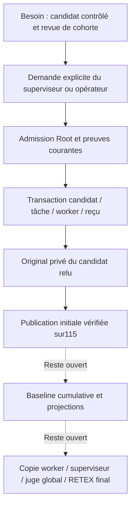

# S2 — première publication native protégée — 26 octobre 2026

Le commit demandé est **a3be338b4df2df9e672cdb87c199ea3d628a4ae5** : prépublication vérifiée précédente,19fichiers. Les108entrées indexées étrangères ont été préservées. Pas de push. Le présent développement est postérieur et n’est pas committé par cette reprise.

La nouvelle commande explicite `task publish` publie le premier candidat géré contrôlé et accepte sa tâche dans une transaction avec la ligne worker et le reçu canonique. Elle ne termine pas la mission. Livraison locale vérifiée en **v0.1.1-dev.115**, commit déclaré `079635b295b68c9422c1276f31f87488aa849c50`, modifications non committées affichées. Empreinte réelle : `3635bd296a419b7d7c8f5c845a5caa87efea689b028358ec228c43c36d9fae62`. Le profil normal exclut `test-fixtures` et les artefacts core de test. Une livraison parallèle a fait évoluer113 vers115 ; les dix sources des consommateurs de cette tranche ont été comparées exactement, puis le parcours complet et les altérations ont été exécutés sur les octets du binaire réellement servi.

## Contrat réalisé

- Enveloppe native stricte : tâche, événement et révision ; pas de commande, producteur, preuve ou booléen d’autorité fourni par l’appelant.
- Candidat retenu et rafraîchi hors verrous SQL ; association physique Root maintenue avant/après l’opération. Comparaison finale du Work et des réglages, originaux privés, contrôles, cohorte, producteurs/tentatives, rapports, gate, contexte projet et prérequis.
- Une preuve interne opaque lie les entrées exactes au mécanisme commun d’acceptation ; le `task update` générique ne peut pas accepter une simple prévisualisation.
- Pointeur `repository.candidate_commit`, statut accepté, ligne `managed_attempts` intégrée et événement `managed.publication` sont transactionnels. Le reçu contient le Work accepté ; le stockage existant conserve la même requête dans `request` et `payload`. Aucun branchement Git consultatif n’est réécrit.
- Rejeu canonique sans nouveau fournisseur, contrôle ou débit. Les lectures courantes rapprochent les empreintes, contrat de cohorte, résultat, producteur et tentative du candidat contenu dans l’original privé des contrôles, puis vérifient les blobs Git et artefacts typés.
- La lecture historique d’un worker intégré exige le reçu réel ; l’exécution physique exige toujours sa ligne `ready`. Rollback explicite, incertitude de commit et état Work connu après échec de fermeture/sortie restent distincts.

Le protocole initial exige l’absence de tâche déjà acceptée et un pointeur encore égal au commit de base. C’est une frontière de portage explicite, pas une limite opérateur de cohorte ou une règle « une tâche par job ». Aucun délai, plafond, budget ou chemin opérateur n’a été ajouté. Les paramètres enregistrés Admin restent les consommateurs réels de Git, contexte, qualité, admission et reprise du stockage.

## Preuves et limites

| Vérification | Résultat / preuve retenue |
| --- | --- |
| Avant : commande non portée sur vrai avis favorable | `before-public/`, refus sans changement Work |
| Erreurs intermédiaires originales | `logs/`, `pre-fix-receipt/`, `public-1/`, `METHOD-REPLAN.md` |
| Quatre pannes SQL temporaires | `rollback-sdk.stdout` :1test Rust nommé,4cas passés ; aucun Work/événement/worker partiel |
| Parcours complet profil113 | `recipe-final/` PASS et intégrité VERIFIED ; source_stable vrai |
| Trois altérations canoniques / restauration | `current-recipe2/` PASS et intégrité VERIFIED |
| Binaire installé115 | `activation/installed.json`, profil normal, ressources protégées, Works conservés |
| Version FR/EN réelle | `activation/installed-ui.json` :14assertions nommées, aucun POST ni erreur page |
| Nouveau parcours sur ce binaire installé | `activation/public-flow/result.json` :10obligations, vraie publication et lecture courante, reprise worker, refus/restauration, rejeu sans appel/débit |
| Empreinte, cohorte et résultat altérés sur115 | `activation/current-recipe/` PASS et intégrité VERIFIED ; ligne worker altérée aussi dans le cas résultat |
| Rustdoc | `logs/swarm-first-final-rustdoc.stdout`, compilation réussie après nouveau lecteur d’original |
| Revue du dernier delta112→113 | `source-review.json`, `formal-review-closure/` :4fichiers,4axes, références archivées ; revue locale, aucune acceptation indépendante |
| Revue de la portée initiale | `local-source-review.json` : octets/candidats lexicaux et revue sémantique des contrats modifiés ; aucune garantie globale d’absence de défaut |

Les workers, contrôles et reviewers de ces parcours sont des **programmes inertes possédés en fixtures isolées**. Ils créent de vrais originaux natifs et transactions ; ils ne prouvent ni identité d’un modèle, ni bac à sable OS, ni travail autonome sur une mission réelle. Aucune base de mission vivante n’a servi de fixture. Aucun worker natif de développement ou Claude n’a été lancé pour écrire le code. La mission suspendue et les données locales ont été préservées.

GLM/SKYNET a reçu deux requêtes HTTP SSE (`model` API `glm-5.2`, sans plafond client ni effort réduit). La première portait sur27ko et est devenue périmée après correction ; la seconde ciblait le reçu courant sur7ko. Aucun contenu final ni verdict n’a été reçu. Les clients possédés ont été arrêtés après absence persistante de résultat exploitable ; streams et décisions sont conservés dans `glm-review*` et `glm-record-review*`. La consommation finale et l’arrêt effectif de calcul serveur sont inconnus. Cela ne prouve pas une panne générale du service. **La revue indépendante n’est pas obtenue** ; pas de nouvel appel inchangé ni d’acceptation inventée.

`git diff --check` sur le dépôt signale encore deux blancs de fin hors périmètre, dans `DELIVERY-PREPARATIONS-20261025.md` et `task_validation/managed_receipt.rs`, déjà présents et conservés. Le contrôle ciblé de ce lot est distinct ; aucune conformité générale du checkout n’est annoncée.

## Diagnostic et RETEX de l’incrément

1. Le stockage d’événement a été relu : son payload est la requête, pas un Work. Le reçu porte maintenant son vrai préimage Work ; aucun événement historique n’a été réinterprété.
2. `candidate/`, `candidate-link/` et `cohort/` sont des références typées. Le premier lecteur Root simple produisait NotFound ; les lecteurs Git/cohorte appropriés ont été raccordés et la preuve de refus conservée.
3. Une injection permanente de trigger était rejetée avant l’opération par le schéma Root : elle ne prouvait pas le rollback. Le SDK opt-in utilise des triggers TEMP de la même connexion après un témoin valide. L’invocation initiale sans variables de fixture a échoué sans accès ; le nouveau contexte explicite est conservé.
4. Une empreinte déclarée dans le reçu était acceptée sans rapprochement au préimage : `unbound-binding-before.*` reproduit l’erreur. Le lecteur relit désormais l’original des contrôles et toutes les coordonnées du candidat. Les trois cas de corruption et les restaurations passent. L’accord entre deux lignes SQL n’est jamais une preuve indépendante de l’original.
5. La projection publique `work show` vérifie elle aussi les preuves : pendant une corruption elle doit refuser. Le test attendait à tort une vue réussie ; il vérifie désormais le refus sûr et l’absence de changement des octets Work en SQL. Les deux premiers échecs de recette restent conservés.
6. Les appels GLM sans verdict n’ont produit aucune preuve d’acceptation ; la boucle de méthode a conservé cette limite au lieu de compter du raisonnement privé comme une revue. Prochaine précondition : réponse finale complète sur sources courantes via un service/mode vérifié, sans simple reformulation ou budget augmenté.
7. Disque observé à1,8Go libres :304Mo de doublons possédés ont été remplacés par des liens vers leurs octets immuables identiques, après contrôle SHA. Tous les chemins et preuves restent lisibles ; aucun cache tiers, travail ou original n’a été supprimé. Les copies binaires et streams privés sont exclus de Git localement ; tests et recettes maintenus résident dans les sources.

Les contrats corrigés vivent dans le moteur commun, les tests/recettes permanents et les pages FR/EN, pas dans une exception de mission. Les prochains lecteurs natifs exécutant ce binaire reçoivent le nouveau contrôle déterministe ; cela ne modifie pas le contexte d’un agent déjà démarré. Les fichiers de recherche/plan transmettent l’apprentissage à la prochaine reprise documentaire. Aucun prompt seul ne constitue l’effet vérifié.

## Suite conservée

- **S2, owner Codex** : preuve de baseline cumulative et projection de revue/contrôles sur chaque tâche acceptée, sans réécrire les originaux ; provenance des anciens workers encore lisible après plusieurs publications. Le garde initial reste fermé jusqu’à ce contrat et ses contre-exemples.
- **S2, owner Codex** : vérifier une vraie nouvelle copie worker issue du nouveau pointeur. La valeur SQL publiée et l’inspection du consommateur ne prouvent pas cette copie. Puis raccorder explicitement la décision de publication au parcours du superviseur ; la tranche actuelle est CLI/Root, sans nouvelle route autonome ou bouton web.
- **S3/S4** : juge global et mesures de la boucle réelle ; aucune clôture de mission ou conformité Cursor générale déduite de cette publication initiale. Le RETEX final du projet reste ouvert.
- **Revue, owner SKYNET/méthode** : verdict final manquant, preuves et consommation inconnue conservées ; reprise sur précondition vérifiée de convergence, pas d’appel inchangé supplémentaire.
- **Amélioration UX conservée** : l’activité historique du worker réconcilié dit encore « tâche non acceptée » à son ancien instant. Sa valeur historique n’est pas réécrite ; une future projection devra distinguer explicitement cette activité du statut accepté courant. Critère : lecture sans ambiguïté, sans falsifier l’historique.

Contrats : [architecture FR](../../../../../architecture/NATIVE-REVIEWER.md), [EN](../../../../../en/NATIVE-REVIEWER.md), [plan Scaling](../../../SCALING-AGENTS-20261025.md). Recettes : [première publication](../../../../../../tools/verification/recipes/native-managed-first-publication.json), [lecture courante](../../../../../../tools/verification/recipes/native-managed-publication-current.json). Les preuves brutes sont retenues localement ; les recettes reproductibles et ce rapport sont versionnables.

