# Apprentissage des consignes et RETEX après recette — 11 octobre 2026

Cette révision prolonge le besoin initial d’évolution du moteur Cursor et la
démarche replan. Elle distingue l’apprentissage des agents, les garde-fous du
moteur, le choix de l’utilisateur et la clôture réellement vérifiée du projet.
Les textes Cursor de janvier et février restent conservés avec leurs différences.

## Consignes des prochaines tâches

Un responsable ou sous-responsable propose `revise-instructions` dans sa décision
structurée, à partir d’événements effectivement reçus. La transaction limite
l’ajout à une tâche future de son propre périmètre ; aucune réservation active,
réécriture du contrat, modification de critère ou acceptation implicite n’est
autorisée. L’ajout est appliqué par défaut et attribué à sa source/décision.
L’original et chaque ajout restent persistés ; le lancement fige la consigne
complète dans la tentative. Les ajouts sont composés comme des deltas, sans
multiplier des copies intégrales de tout l’historique.

L’UX expose un cadre cyan et un bouton **Rejeter** avant transmission à un agent.
Le rejet conserve l’ajout et son motif, recalcule la consigne, puis transmet
`instruction_rejected` au responsable propriétaire. Une course rejet/lancement
a un seul gagnant dans la transaction. Le test navigateur provoque un conflit
réel de révision : le message de refus reste visible malgré l’actualisation, puis
un nouvel essai sur l’état frais fonctionne. Le même ajout rejeté ne peut être
réappliqué sous une nouvelle identité ; un autre apprentissage doit être motivé.

Voir [architecture FR](../../../../architecture/INSTRUCTION-LEARNING.md) et
[architecture EN](../../../../en/INSTRUCTION-LEARNING.md), avec Mermaid.

## Phase RETEX et quick wins après recette

L’interface propose une phase après une recette fraîche effectivement acceptée.
Pour une mission hiérarchique, le responsable doit également avoir clos son
périmètre ; le moteur vérifie les preuves, sans produire sa décision à sa place.
Une proposition conserve le constat, sa nature fait/hypothèse, la valeur attendue,
le type quick win/évolution, l’effort, le risque, les critères et les preuves.
Elle est liée par SHA-256 au résultat accepté et à son contrat.

**Préparer l’évolution** ouvre un cadrage prérempli : ni création de préparation,
ni appel de fournisseur, ni agent n’est déclenché par ce lien. L’utilisateur
choisit l’incrément à adopter, tandis que la recette demeure conservée. Le modèle
produit inclut cette phase facultative. La phase de bilan demandée pour le projet
actuel doit être une tâche finale du plan, après les exigences initiales.

Voir [parcours FR](../../../../PRODUCT-WORKFLOW.md) et
[parcours EN](../../../../en/PRODUCT-WORKFLOW.md), avec Mermaid.

## Défaillance du contexte du responsable

La reprise réelle du responsable a révélé une autre frontière défectueuse : un
ancien retour T2 était admis avec les événements courants. Une décision incluant
ce retour était ensuite intégralement refusée comme périmée. La reproduction
rouge puis le contrôle public sur une base isolée démontrent la correction :
`events` contient les entrées courantes ; `historical_events` conserve un contexte
en lecture seule. Après traitement des entrées courantes, `historical_only`
impose `operations: []` pour acquitter explicitement les anciens retours.
Après le dernier acquittement historique, un constat courant
`historical_acknowledged` rend la main au responsable pour réexaminer le besoin,
sans décider ni valider à sa place. La suite complète a identifié un test ancien
qui supposait la remise mélangée ; il exerce désormais les refus avant réception,
la reprise du lot historique et le maintien effectif du budget de tentatives.
Le schéma reçu et la transaction appliquent cette frontière. Rien n’est consommé
ou validé automatiquement par la projection. Réouverture et compteurs sont testés.

Après installation vérifiée, l’activation réelle 11 du responsable a exclu le
retour de l’ancienne tentative. Elle a cependant proposé une reprise de production
pour une erreur de protocole de revue ; le moteur l’a refusée en révision 157.
Le lot réduit à sept événements n’avait pas transmis la dernière consigne opérateur,
et le schéma offrait encore `retry` tandis que le blocage affiché conservait le
refus sémantique précédent. Trois préconditions sont corrigées : dernière consigne
publique en tête, opération de production indisponible retirée du schéma gelé et
revue actuelle attribuée avec l’ancien motif conservé séparément. Les deux
reproductions échouent avant correction puis passent sur dépôt isolé ; cette
preuve locale ne remplace pas la prochaine décision autonome du responsable.

Le nouveau complément de reprise `instruction-learning-retex-routing-20261011`
conserve les deux patches précédents et leurs empreintes. Le RETEX final reste
une exigence ouverte tant que la tâche T8 n’est pas créée puis réellement traitée.

La cause générale des reprises opérateur reste assignée à T3 : `planningStep`
refuse toute activation quand `Planning.Failure` est non vide, et
`planningFailure` place actuellement une proposition refusée dans cet état global.
Le défaut corrigé du contexte n’équivaut donc pas à une récupération autonome
livrée. T3 doit transmettre un diagnostic attribué au responsable pour permettre
une décision nouvelle, conserver refus et dépenses, contrôler les répétitions et
éviter de bloquer les autres périmètres. T7 doit vérifier ce parcours avec un
fournisseur réel ; la mise à jour publique de la consigne est un reçu de routage,
pas une preuve d’implémentation.

L’activation 12, après remplacement vérifié du binaire, a reçu en premier la
dernière reprise opérateur ; sa remise gelée interdit la production indisponible.
Elle n’a lancé aucun appel : le contexte complet dépassait encore la borne.
Le calcul réservait une estimation de 3 000 octets, alors que les instructions
enrichies en prennent 4 600. La réservation et l’exécution utilisent désormais
la même taille exacte, sans relever la capacité existante. Le test avec processus
fournisseur double reçoit 62 138 octets, dont 31 688 de méthodes et 25 850 de
contexte : sept événements entiers sur huit, un seul acquitté explicitement et
sept toujours en attente. L’ancien calcul échoue sur ce même scénario, reproduit
par overlay Go ; le nouveau passe. Le complément `planning-exact-envelope-20261011`
préserve la chaîne précédente. Une nouvelle installation et décision native
restent nécessaires après les contrôles complets et la fin des appels actifs.

En parallèle, l’opération publique opérateur de T2 a confirmé le changement de
méthode et démarré `review-dec9eececb2d49ee384f93de` sur le même candidat. Les
anciens avis restent archivés ; le compteur est passé de quinze à seize lors du
premier appel. Cette reprise opérateur ne prouve pas encore le routage autonome
du responsable ni un verdict favorable.

Ce refus sémantique a ensuite confirmé la contradiction FR/EN ; la correction
documentaire vérifiée a été remise publiquement et a produit le candidat
`1ce2af045bef41baf4af808c610a921c7fe71224`. La première inspection signale du code
absent de son fragment, effectivement présent dans les autres paquets gelés :
la présence est vérifiée, sans transformer ces besoins en verdict favorable.
La deuxième réponse contient une autre citation invalide : les caractères
`backslash+t` remplacent les tabulations originales d’une sortie Go. Elle reste
une erreur de protocole, pas un refus sémantique exploitable. Le retour exact du
même paquet peut remettre cette différence à l’IA, avec une observation réutilisable
et six appels requis ; aucune réponse brute n’est corrigée rétrospectivement.

Le correctif de calcul du contexte a passé la suite complète (443,626 s), race
et vet, puis a été installé hors appel actif avec empreinte du processus et
santé HTTP vérifiées. L’activation réelle 13 reçoit la dernière reprise en tête
et lance l’inférence sans le dépassement impayé précédent. Sa proposition a ensuite été refusée à la révision 190 : `review-retry` exigeait
l’événement de la revue actuelle, absent du lot reçu. Le schéma proposait encore
cette opération et les anciennes consignes occupaient les deux places admises.
Le correctif donne priorité à la revue actuelle juste après la dernière consigne,
et retire la reprise de revue du schéma lorsque son événement exact n’est pas
fourni. Le reçu gelé conserve cette restriction même après relecture ; les
contrôles transactionnels et les consommations restent conservés. Les cas rouge
puis vert couvrent événement absent, ancien, hors périmètre, autre tentative,
refus sémantique et lot réduit, sans exécuter une acceptation.

Le diagnostic des citations utilise désormais la même correspondance exacte
que le validateur : une citation valide au milieu de sa ligne n’est plus présentée
comme rejetée. Le retour explique aussi la différence JSON entre une tabulation
et les caractères littéraux backslash+t, conserve les lignes originales et ne
modifie ni réponse brute ni journal de preuve. Le test discriminant échoue sur
l’ancien diagnostic ; la suite complète passe en 449,138 s, race/vet et méthodes passent.
Le correctif est installé hors appel actif, empreinte du processus et santé HTTP
vérifiées ; la reprise publique du responsable est appliquée à la révision 196.
La remise effective du résultat actuel et la décision native restent à observer.

Le budget de revue a été relevé publiquement de 30 à 70, révision
183→184, avec les 18 appels consommés conservés. Justification : reprise T2 de
six appels et six tâches futures jusqu’au RETEX, chacune nécessitant au moins
trois appels gérés, soit un total minimal prévu de 42 ; le format T2 observé
projette 66. Les autres quotas et le plafond financier restent inchangés.

La chaîne de remise corrigée, à qualifier sur l’exécution native :

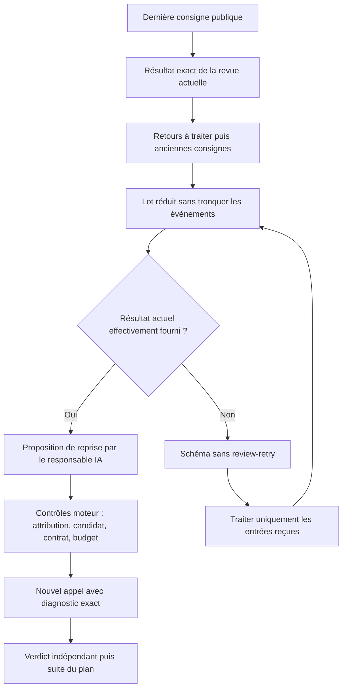

Cette priorité et ce schéma sont des contrôles déterministes de remise ; le
responsable conserve la décision de reprise et le vérificateur son verdict.
La réparation de la panne globale après une proposition refusée reste T3,
avec qualification réelle T7. T5 reçoit aussi le défaut UX confirmé : afficher
la revue/candidat actuels, puis le refus antérieur dans l’historique attribué.

## Refus de proposition et perte du diagnostic

L’activation native 14 a effectivement reçu la revue actuelle, mais sa proposition
est refusée à la révision 203 pour « tâche déjà présente ». Le pipeline précédent
ne conservait que ce motif global : aucun JSON de réponse n’est accessible dans
l’historique public, et la session outil libre ne persiste pas de transcription.
L’identifiant fautif ne peut donc pas être reconstruit honnêtement. Les opérations
restent refusées atomiquement, sans création de T8 ni reprise de revue.

Le complément `planning-owner-rejection-diagnostic-20261011` conserve désormais
la réponse JSON retournée par l’adaptateur, le reçu gelé et les méthodes. Il nomme
index/type/ID de l’opération en erreur et toutes les identités de la proposition.
Le diagnostic revient au responsable via `planning_rejected`, prioritaire ; une
proposition JSON refusée ne suspend plus globalement tous les périmètres. Si
le même refus se reproduit sans état pertinent modifié, l’attente reste au seul
propriétaire, vérifiée au claim. Baux, compteurs et activité d’un autre périmètre
ne fabriquent pas une précondition nouvelle. Le responsable décide sa correction ;
le moteur ne choisit ni fin du projet ni acceptation.

Le complément `planning-rejection-artifact-preservation-20261011` ajoute un événement
et les deux artefacts avec empreintes pour chaque refus, même répété. L’export/import
garde les originaux et l’attente, dans l’archive existante : aucune preuve importée
n’est promue automatiquement dans le projet actif. Le test rouge confirme la perte
des pièces sans ces déclarations, puis le vert vérifie leurs chemins et octets.
Une première assertion supposait à tort que l’import réactivait les fichiers ;
elle est corrigée pour respecter le parcours existant, avec son échec conservé.

Les parcours isolés vérifient réponse intacte après adaptation (aucune prétention
sur le flux fournisseur brut avant adaptation), persistance/redémarrage, doublon
dans une même proposition, claim sans nouvelle précondition, périmètre voisin
encore actif et concurrence avec une décision valide. Une fixture sans révision de
périmètre valide a été corrigée ; les suites démarrées avant la correction et le
complément d’export ont été arrêtées comme incomplètes, sans faux PASS. La suite
complète finale passe en 441,491 s ; ciblés 12,237 s, race 5,578 s et vet passent.

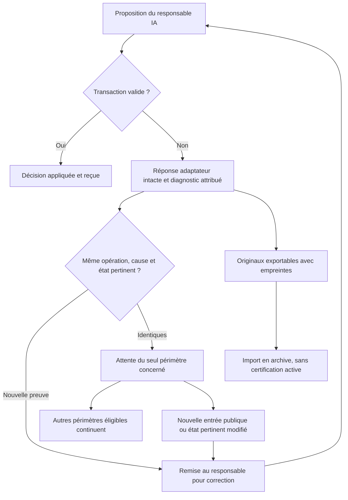

Le correctif est installé hors appel actif, empreinte du processus et santé HTTP
vérifiées. La reprise publique213→214 lance l’activation15, qui crée T8 après T7
visible dans le reçu public221. Ce tour sans refus ne qualifie pas encore l’usage autonome
du diagnostic. T3 intègre ce
prototype avec le juge T2, les autres catégories d’erreur et la hiérarchie ; T5
présente l’attente et le diagnostic actuels ; T7 qualifie les effets avec fournisseur
réel. Les transmissions publiques préservent critères, dépendances et tentatives.
La reprise configuration/fournisseur/transport conserve pour l’instant son ancien
parcours : ce lot ne prétend pas avoir corrigé toutes les pannes globales.

## Intention, opération et candidat courant

La décision réelle15 mentionne `review-retry` dans son motif, mais ne propose
que la création de T8. Une intention textuelle ne vaut pas opération appliquée.
La reprise publique opérateur226 corrige cette omission après vérification du
nouveau diagnostic installé : même candidat `1ce2af0`, même journal `f5`,
quatre inspections restantes, une réutilisable, six appels requis et cinquante-deux
disponibles. Le premier refus CAS est conservé ; la requête relue réussit sans
nouvelle production ni modification du verdict. La revue est ensuite réellement
en cours, avec dix-neuf appels consommés. T2 demeure non acceptée.

Le motif traite également le doublon de chemin d’une ancienne revue comme encore
non corrigé, alors que la correction est attestée sur les candidats suivants.
Le contexte distingue actuellement les anciennes tentatives mais conserve comme
actionnables les revues d’anciens candidats d’une même tentative. Le diagnostic
est transmis publiquement à T3 et à T7 : attribuer chaque retour à sa revue et à
son candidat, conserver les anciens refus en lecture seule, vérifier réception
et décision réelle sans acquittement automatique ni fin choisie par le moteur.
Il s’agit d’une consigne opérateur, sans prétendre à un apprentissage autonome IA.

La fusion du juge T2 et des correctifs opérateur est préparée dans une copie
isolée. Les conflits d’API et de contexte conservent les deux comportements ;
les tests ciblés passent en3,539s, race et vet passent. La suite complète passe
également (453.096s). Le binaire de fusion est construit avec empreinte vérifiée. Cette préparation ne modifie ni le candidat en revue ni le serveur
actuel et ne remplace pas l’acceptation indépendante de T2.

L’activation réelle17 tente ensuite `revise-instructions` vers T3, mais remplit
aussi des champs réservés à d’autres opérations. Le refus nomme l’opération et
son identifiant ; les deux originaux vérifiés sont déclarés comme artefacts et
`planning_rejected` attend son propriétaire. Aucun `Planning.Failure` global
n’est créé. Cette première preuve native montre la conservation et le routage
en attente ; elle ne démontre pas encore la réception ni une correction IA.
La revue T2 en cours explique l’attente actuelle : le planificateur suspend son
activation tant que l’intégration gérée de son périmètre n’est pas terminée.

## Budget, intervention opérateur et limites

L’utilisateur autorise explicitement l’augmentation des droits et budgets Swarm
en cas d’insuffisance pour ce projet. Une augmentation doit passer par les
opérations publiques, avec cause et effet vérifiés. Elle ne rembourse aucun
essai ni coût et ne contourne ni les limites du fournisseur ni la recette.

La revue indépendante réelle de T2 a trouvé un doublon par alias de chemin dans
la qualification des sources. La correction normalise la clé des doublons ;
les cas rouge/vert, race, vet et les 1 096 cibles de la suite canonique du candidat
réparé sont conservés. La nouvelle remise reste soumise aux contrôles et à la
revue ordinaires. Le premier contexte de réparation dépassait 128 Kio en joignant
trois suites successives : les anciennes sorties restent dans l’historique, et
la revue reçoit la suite complète la plus récente, sans troncature.

La revue suivante a rendu un protocole invalide : sa citation omettait l’espace
avant un point-virgule français. Le texte brut est conservé ; il ne fournit aucun
verdict sémantique valide. L’aperçu public de reprise exige une nouvelle revue
complète du même candidat, car les méthodes ont changé : sept appels requis,
quinze disponibles, aucun avis antérieur réutilisable. Aucun budget supplémentaire
n’est nécessaire à cette étape. Une contradiction FR/EN indiquée dans le brut est
préparée localement, mais reste à qualifier par une revue valide avant sa remise
dans le parcours de correction du candidat.

Les preuves locales utilisent des fixtures et ne prouvent pas encore l’usage
autonome de l’apprentissage par un modèle réel, ni la conformité globale Cursor.
L’installation dans le serveur, la réception du nouveau contexte par le responsable,
les lots T3 à T7 et le RETEX final sont suivis séparément. L’index contient les
résultats, commandes, empreintes et limites, sans transformer un build en recette.

[Index des preuves](evidence/instruction-learning-retex-20261011/index.json).

## Reçu natif suivant, contexte saturé et statuts locaux

La décision réelle18 reçoit le constat du refus17, mais le diagnostic original
est déclaré non transmis, hors budget (27 712 octets) : elle l’acquitte sans
corriger l’opération. Ce n’est donc pas une preuve de réparation autonome.
La décision20 applique en revanche `revise-instructions` à T7 : ajout précis
sur les octets et lignes physiques des citations. La révision attribuée, ses
événements sources et son état appliqué sont dans le reçu public. Cette première
preuve d’apprentissage natif ne démontre pas encore son usage par un worker,
ni un rejet utilisateur dans l’interface réelle.

La revue réelle `review-f5cb258178e80a4bdc4778d3` finit le 11 octobre à13:00:49UTC
avec `changes_requested` valide après19appels, sur `1ce2af045bef41baf4af808c610a921c7fe71224`.
Elle confond le PASS local du bilan avec une acceptation déjà indépendante,
l’absence d’un reçu dans son paquet avec son absence de tout le dossier, et le
nom du paquet Go avec la portée complète d’une commande filtrée. Le dernier point
révèle aussi une omission réelle : l’index ne donnait pas l’argv adopté exact.
La correction conserve le refus et les FAIL historiques, joint un reçu original
avec l’argv exact, distingue le contrôle filtré de la suite canonique1096/19,
et reformule les claims locaux. Les cinq fichiers Go restent identiques ;
les18sources intégrales font130304octets, sous131072, sans troncature.
La remise et une revue indépendante fraîche restent obligatoires.

Après les décisions19..22 sur d’anciennes consignes, le précontrôle254 refuse
le contexte complet avant réservation : aucun appel ou activation23 ne part.
Le complément9 `review-status-owner-context-20261011.patch` transmet le sens
producteur de `pass`/`complete` au préfixe partagé de revue et impose `unknown`
avec besoins précis si un fragment manque d’originaux. Le diagnostic fournit
l’opération refusée complète comme proposition non fiable au propriétaire sans
outils. La projection peut omettre les seuls aperçus `next` des tâches futures
ou acceptées non désignées, en conservant toutes les lignes, les consignes
persistées, les événements et les rapports transmis intacts. Le reçu gèle la
projection réellement envoyée ; aucune entrée n’est acquittée automatiquement.
Les reproductions rouges puis vertes, race, vet et consignes partagées passent ;
la suite Go complète et l’installation sont suivies par leurs reçus séparés.
Les fournisseurs doubles ne prouvent pas la compréhension d’un modèle réel.

L’autorisation utilisateur permet l’ajustement public255 : activations30→60 et
décisions30→60, consommations22/14 inchangées ; revue70 avec19 consommés reste
inchangée. L’estimation motive la marge de conduite jusqu’au RETEX, sans fabriquer
un minimum, rembourser ni utiliser un plafond comme jugement de fin. Les consignes
T3..T8 sont enrichies publiquement256..261 avec le complément9, leurs critères,
dépendances, tentatives et historique préservés.

Le contrôle automatique du navigateur a refusé l’inspection de l’onglet Swarm
pour protocole non autorisé. Cette vérification visuelle de l’application réelle
reste non réalisée ; aucun contournement n’est tenté. Les reçus de recette UI en
fixture et les rendus Mermaid sont des vérifications distinctes.

La qualification complète du complément9 passe (Go471,958s, race/vet/méthodes).
L’installation à13:33UTC est faite hors agent, bail et revue actifs ; le processus
3947819 exécute exactement SHA25660441875… et la santé authentifiée est ready.
La réparation de portée T2 crée le candidat859996a7… et une nouvelle revue
review-f61323bfa5817ab0f9bb4433, réellement en cours avec20appels consommés.
La reprise publique264→265 efface le blocage global ; la conduite attend le
résultat courant de l’intégration gérée. Aucun avis ni acceptation n’est inventé.
La nouvelle préparation de fusion avec le juge reste isolée. Son premier contrôle
a refusé deux empreintes du merge initial, antérieures à résolution de conflit ;
la reprise utilise les empreintes du snapshot de la copie effectivement qualifiée,
sans modifier l’ancien reçu, le candidat ou la source primaire.

La nouvelle fusion isolée est qualifiée : Go479,223s, race31,629s et vet PASS,
1 171sources, binaire4bbaff43… non installé. Àrévision268, le journal original de
review-f613… conserve l’inspection0 `unknown` avec besoins précis (Go juge/tests
absents du paquet), sans défaut déclaré ; l’inspection1 est réservée,21appels
consommés. C’est une inspection partielle, ni l’acceptation de T2 ni la preuve
complète que la confusion de statut producteur est corrigée. Les observations
I/O noyau attestent seulement une activité, sans lire la sortie du fournisseur.

La transmission publiqueT5 àrévision266 ajoute le diagnostic d’API budget :
plafond propre80outils, défaut effectif100 et borne de normalisation10000, alors
que la modification de définition reste limitée100 et interdite aux contrats
gérés. Le lot Admin doit distinguer budget autorisable et contrat d’acceptation,
avec opération publique dédiée, attribution, prévisualisation et historique.
Aucune insuffisance actuelle de80outils pour T3 n’est encore démontrée ; cette
observation ne prétend ni relèvement déjà appliqué ni modification d’un agent actif.

La lecture de `planning_runner.go` précise la contrainte de conduite :
`managedIntegrationPending` écarte actuellement tout le propriétaire jusqu’à
la fin de l’intégration/revue. Cette garde évite les reprises doubles, mais
empêche aussi le traitement d’une observation courante pendant la revue longue.
Le reviewer structuré n’est pas un worker Agent : aucun `continue-run` ne peut
lui être attribué artificiellement. La consigne publique T4 demande observations
rôle/call/review/candidat sans secrets, admission limitée aux actions compatibles
pendant la revue, refus conservés pour doublons/contrat actif/acceptation/fin.
Une éventuelle conduite de revue exige capacité publique explicite ; T5 expose
le rythme configurable, T7 vérifie réception et effets réels. Le constat et la
transmission ne prétendent pas que cette capacité soit déjà implémentée.

## Droit de remise et durée réellement suffisante

L’autorisation utilisateur est appliquée aux configurations publiques futures
T3..T7 : `tool_seconds` effectif300→900, révision1 de chaque portée tâche.
Le besoin est mesuré : deux suites complètes prennent471,958s/479,223s, au-delà
de la directive qui borne chaque commande à300s. Ce réglage persisté Admin/CLI
permet le contrôle adopté12minutes ; il ne constitue ni un couperet de fin ni
un changement de l’agent T2/revue active. Les autres limites et les80appels
propres aux tâches restent conservés.

La méthode de remise avait une lacune : les consignes de patchs donnaient des
chemins du dépôt hôte, alors que le worker doit lire le code dans sa propre copie.
Le paquet Git immuable `operator-patch-inputs-20261011.bundle` fournit les45entrées
patch/JSON, leurs empreintes et filiation, commit30171f7b…, SHA25647463691….
Un import isolé et la récupération de tous les octets passent. Les transmissions
publiques271..277 autorisent uniquement la lecture/importation de ce paquet
d’entrée précis, à extraire puis examiner dans la copie du worker. Elles
n’autorisent pas l’exploration/modification du code hôte ou voisin ; aucune ACL
OS, base vivante ni branche acceptée n’est changée. Ce paquet n’est pas une
acceptation. La réception et l’usage par un worker réel restent à démontrer.

Àce stade, les inspections0 et1 de f613 rendent `unknown` avec besoins précis
et sans défaut déclaré ; l’inspection2 est réservée,22appels consommés. Le vieux
FAIL complet devient un besoin de reçu ultérieur au lieu d’un défaut présumé :
la sélection et le verdict finaux doivent effectivement lire les originaux.

## Couverture du juge et composition opérateur : reprise du 11 octobre, 14 h UTC

La revue indépendante f613 se termine à13:59UTC par un refus sémantique concret :
`plan-validation` ne sélectionnait aucun des sept `TestPlanningJudge*`, bien que
la remise citât ce contrôle pour les quatre critères. Les inspections précédentes
avaient correctement laissé les originaux manquants en `unknown/needs`. Les tests
locaux ciblés et le reçu complet n’autorisaient pas à prétendre cette couverture
par le contrôle moteur. Le reçu et le refus originaux restent conservés.

La politique publique T2 est renforcée par preview/apply295→296 : même sept
contrôles, cinq familles historiques conservées, filtre complété par
`|TestPlanningJudge`. L’ancien avis est archivé ; ses preuves restent historiques.
L’autorisation utilisateur permet une troisième tentative publique297, deux
consommées conservées, correction précise et tool_seconds900 enregistré. La
reprise publique298 est reçue par le superviseur27 ; sa décision19 lance réellement
la tentative a-2f9e1debb1548be96273f0d3 à14:12UTC. Sa copie propre possède le
dossier de reprise et le résultat réparé736460f6, sans modifier l’ancienne copie.
Le parcours public observe déjà l’exécution du filtre corrigé avec `-v`.
Cette production et ses contrôles ne constituent pas encore une acceptation.

Un second défaut est reproduit sur la composition des consignes : les ajouts
`task.update` de l’opérateur avaient précédé la vue complète de T7 sans modifier
son registre. Le moteur refusait ensuite la révision IA et le bouton Rejeter.
Trois régressions publiques échouent avant correction ; le premier essai de
fixture était une erreur de compilation, conservée distinctement du vrai RED.
La correction sépare la base opérateur courante et l’original immuable, conserve
les révisions et leurs empreintes, réconcilie uniquement les anciens préfixes
reconnaissables et refuse les modifications ambiguës atomiquement. Cinq cas
publics plus les anciennes gardes passent ; race/vet/méthodes passent aussi.
La suite Go complète est encore en qualification, aucune installation prétendue.

Le contrôle de fabrication du patch a détecté que `store.go` était absent de
l’index parcellaire utilisé pour la filiation : le premier paquet le déclarait
incorrectement comme nouveau fichier. Ce paquet n’a été ni transmis ni appliqué.
Le diagnostic est conservé ; le paquet corrigé déclare le blob HEAD existant
comme extension explicite de préimage, et la vérification d’application reproduit
exactement l’arbre final. Le nouveau paquet d’entrées Git contient47fichiers
valides vérifiés ; il exclut cette fabrication invalide.

La lecture de l’agent réel révèle une limite de la modification de politique :
la portée tâche donne900s effectifs, mais son profil de lancement repris conserve
300s dans la session gelée. Le réglage enregistré ne prouve donc pas sa prise
en compte au lancement. Le contrôle T2 ciblé est court ; toute suite longue ou
futur lancement nécessite le diagnostic du profil et sa correction publique,
avec conservation de la session et sans réécriture de son contexte reçu.

## 14:39 UTC — durée Admin installée, T2 terminé, réparation de transport et garde du moteur

La qualification précédente est maintenant terminée : composition des consignes
PASS sur la suite Go complète482,701s, puis durées Admin PASS470,955s ; race,
vet et méthodes passent. Le candidat0f619612 a été installé à14:28UTC hors
producteurs, revues et baux sur les trois travaux. Son exécutable réellement
chargé et sa santé HTTP authentifiée concordent. Les900s explicites sont
maintenant réservés dans les nouveaux contextes ; la session T2 déjà gelée à300s
reste historique, sans réécriture. Ces contrôles locaux ne valent pas acceptation
native ni preuve des futurs sous-superviseurs.

Le troisième producteur T2 a terminé à14:21:56UTC,41outils ; résultat original
ffb52857 et candidat5581d31b conservés. Les contrôles réellement renforcés,
comprenant les sept fonctions Judge, passent. La revue n’a pas appelé le
fournisseur :20sources totalisent144927octets, au-delà des131072 disponibles.
L’observation publique307 confirme23appels consommés, trois tentatives terminées,
aucun agent ou bail actif. Augmenter les tentatives ne corrigerait pas ce défaut.

L’opérateur a préparé la réparation dans une copie indépendante, puis transféré
seulement cinq chemins sur leurs préimages exactes vers la copie native inactive.
Arbre ad247d51 identique des deux côtés,17sources130040octets complètes ; les cinq
fichiers Go Judge, score.go, contratFR, architectureFR/EN, sortie des16tests dont
7Judge et suite canonique1096/19 restent joints. Les déclarations redondantes sont
retirées ; les fichiers originaux restent conservés. Le metadata natif avait une
date13:40 antérieure à son lancement14:12 et désignait la suite1095 historique.
L’original6158octets est archivé ; la correction désigne la sortie canonique1096
et les bornes publiques d’observation14:13:29→14:14:21, sans fabriquer d’heure
d’exécution exacte. Aucun code Go n’a changé. Checker et contrôles D03/parts passent.

La remise publique `revise-recovered-result` a refusé ce résultat complet, parce
que la lecture du précontrôle exigeait reconstruire un contexte déjà borné avant
d’autoriser sa réparation. C’est un défaut global du moteur, distinct d’une
acceptation IA : une vraie régression reproduit ce refus sans appel de revue.
La correction12 reconnaît une erreur de capacité typée correspondant au refus
conservé, après avoir vérifié travail, tâche, processus terminé, contrat, résultat
Git immuable, checkpoint et reçu concordants. Elle conserve la reprise de revue
ordinaire stricte ; checkpoint ou reçu altéré restent refusés sans mutation ni
appel. La remise corrigée exige toujours sources originales bornées, contrôles
frais et revue indépendante. GREEN ciblé31,598s puis garde étendue1,123s ; le
premier GREEN encore rouge dû à un mauvais emplacement de garde est conservé,
puis corrigé. La suite complète du candidat12 tourne ; il n’est pas encore installé.

Le paquet12 déclare explicitement le préimage HEAD vérifié du lecteur de
précontrôle absent de l’ancien index parcellaire. Son application reproduit
l’arbre48a3f72d, SHA1d9552c7. Un quatrième paquet Git d’entrées conserve51fichiers,
commit702a96e9, SHAad021a0d ; import isolé, manifeste et chaque hash passent.
Il n’a pas encore été reçu par T3..T8. Les deux nouveaux Mermaid FR/EN sont
rendus et lisibles. Les historiques, consommations et limites du fournisseur
restent conservés ; aucune acceptation ou preuve de parallélisme natif n’est inventée.

## 14:42 UTC — entrées réellement enregistrées et replan de l’apprentissage

Le paquet51 est maintenant transmis par `task.update` à T3..T8, révisions307→313.
Les registres IA, originaux immuables, tentatives et23appels restent inchangés.
T3/T6/T7/T8 ayant un apprentissage, le moteur recompose normalement la consigne
avec apprentissage en tête et nouvelle base opérateur séparée. Le vérificateur
opérateur attendait à tort le texte brut préfixé : sa première assertion a échoué
après la mutation T3, sans défaut du moteur ni double mutation. L’inspection de
la réponse308 démontre la composition et les empreintes ; la vérification a été
corrigée avant de transmettre les cinq autres tâches. Cela fournit une preuve
native publique de conservation de l’apprentissage ; le bouton de rejet reste
vérifié sur fixtures, aucun apprentissage réel n’est rejeté artificiellement.

L’ajout IA natif T3 `instruction-eb2db1e922c733c93f3ce330` confond128Kio par source
avec la borne actuelle :96Kio par source,128Kio pour l’union d’UNE tâche,24fichiers.
Le code partitionne les tâches cumulées séparément. Une mise à jour publique314
transmet cette erreur et ses bornes au futur propriétaire, en préservant le
registre historique ; cela ne prouve pas encore une autocorrection IA. Le bundle
est une entrée d’import Git, pas une source de revue à joindre entière. La mise
à jour315 rappelle à T5 l’exigence utilisateur d’Admin persisté/preview/CAS/historique
pour les politiques de transport, avec séparation des capacités fournisseur,
sources complètes, contexte gelé et préflight effectif. Ce développement reste à
faire ; les valeurs techniques actuelles ne sont pas annoncées configurables.

Le reçu final distinct confirme17sources130040octets/treead247d51 ; le reçu
préliminaire130779octets reste historique. `race` de la correction12 passe en
124,971s de temps de commande, vet/méthodes/diff/build passent. La suite Go complète
tourne encore et le serveur reste sur11 ; aucune revue native supplémentaire.

## 14:46 UTC — qualification12 et installation réellement vérifiée

La suite Go complète12 passe484,358s ;1172chemins/digest981af32b ne changent pas
pendant le contrôle. Race, vet, méthodes, diff et build passent. À14:45UTC les
 trois travaux sont au repos, sans agent, revue, bail ou processus Claude actif.
Le serveur11 est arrêté proprement ; backup conservé, binaire12SHA7c87e87a chargé
par PID458493, build14:37:21Z, santé authentifiée `api/v1/runtime-health` ready.
Le premier diagnostic utilisait à tort `/api/health` et a reçu404 ; l’inspection
du routeur a fourni le parcours public exact, sans exposer la session privée.
La qualification/installation n’est pas l’acceptation de T2 : la requête corrective
publique nouvelle315 conserve l’ancienne307 refusée, l’arbre et les préimages,
et attend maintenant contrôles et avis frais. Aucune quatrième production demandée.

## 15:10 UTC — fusion prête, conduite informée et budget prévisionnel

La fusion isolée du Judge T2 avec les corrections10/11/12 s’applique sur préimages
sans conflit. Les seuls écarts de code avec le primaire1172 sont les trois fichiers
planning.go/planning_api.go/planning_context.go et les deux nouveaux fichiers Judge.
La suite Go complète passe484,967s,1174sources/digestc01c2cbf sans drift ; race,
vet, méthodes et build passent. Le candidat reste isolé, non installé et sans
acceptation native présumée. T3 a reçu une limite concrète supplémentaire :
initialisation Judge seulement dans enable, rôle IA/mission existante à connecter,
commentaire sur hausse de cycles par enable inapplicable à un plan déjà initialisé.
Le parcours public/Admin de cycles persistés sans reset et le refus d’anciens
writers sont des travaux attribués à T3, sans les annoncer déjà corrigés.

La reprise opérateur324 livre au propriétaire le résultat réparé et les contrôles
frais, les droits/budgets autorisés, le diagnostic de son apprentissage erroné et
la continuité jusqu’à T8. Revue/candidat/modèle/appels restent inchangés ; réception,
autocorrection IA et prochaine décision restent à observer. T4 reçoit321 le défaut
de débit mesuré qualitativement : six inspections puis deux appels finaux réservés,
inspections actuellement séquentielles. Il doit justifier les indépendances, donner
une concurrence Admin, des réservations/journaux atomiques et une réunion finale,
sans publier avant ses dépendances. Les premiers retours de fragments signalent
les originaux manquants dans leur paquet avec unknown et sans défaut démontré ;
ils ne sont pas une acceptation ni un échec global. L’activité CPU/IO du processus
change ; absence de verdict final ne prouve pas un processus mort. Le cooldown
public Claude précédent est inactif, sans lever une limite de compte.

La prévision mise à jour est79appels au format observé :23antérieurs,8pour cette
revue, puis6remises estimées à8chacune. C’est une hypothèse de charge, pas un minimum.
La hausse publique70→100 est préparée sous l’autorisation utilisateur, autres
budgets et consommations conservés. La garde actuelle interdit le changement
pendant une revue ou une session de planificateur ; elle sera appliquée au premier
état admissible, sans annuler un appel. Une observation CLI active dans cette
conversation suit les états et cette seule hausse autorisée ; aucun scheduler,
nouvelle mission ou acceptation artificielle n’a été créé. Les limites de compte
fournisseur et le plafond financier restent séparés.

## 15:38 UTC — changement de compte, garde corrigée et reprise effective

La revue T2 a réellement terminé en error le11octobre à15:18:42UTC après un signal
structuré Claude429, échéance17:30UTC (19:30Paris). Quatre inspections ont des avis
inspected/unknown, sans défaut démontré ; une cinquième est interrompue et la
sixième ainsi que les deux décisions finales restent à réaliser. Les originaux,
le journal, le candidat39e89b169fc55255e828e66e765a0fee4ef91530 et les consommations
sont conservés. La hausse publique70→100 a effectivement été appliquée332→333
à15:18:45UTC :28appels consommés conservés, activations28/décisions20 et trois
tentatives T2 inchangées. La prévision79 du paragraphe précédent était une estimation.

L’utilisateur a confirmé avoir changé de compte et demandé la reprise, puis le
déblocage immédiat. Le login actif n’est pas, à lui seul, une preuve de reset.
Le parcours public existant refusait toute levée d’un délai futur : refus réel
conservé dans account-change-legacy-clear-response.json. Le cas discriminant
échoue avant correction sur confirm_account_change inconnu. La correction13 ajoute
une confirmation explicite à ProviderCooldownClear ; par défaut le délai futur
reste protégé. La mutation conserve le refus original complet en historique, son
échéance/source/date et l’attribution locale ; le rejeu compare aussi la confirmation,
un digest périmé est refusé, aucun appel ni tentative n’est remboursé et aucun
agent n’est lancé. Un nouveau429 rétablit le blocage. Cette opération est attribuée
à l’opérateur sur demande humaine, pas à une décision autonome du superviseur.

Régression ciblée GREEN0,059s, race quota/reprise39,797s, vet, méthodes et build
PASS. À la demande de déblocage immédiat, le remplacement réversible du serveur a
été fait au repos après ces contrôles, avant la fin de la suite Go complète qui
continue sur sources gelées. Ne pas confondre ces deux niveaux de qualification.
Le processus845825 exécute le SHAa5696bdf09fc97f58a0abb1c4c0342e8afc13cab3b5419215832c8b66d417079 ;
l’API authentifiée runtime-health répond ready. Le processus Claude interactif
extérieur à la mission est conservé. Les anciens binaires qui ne comprennent pas
clear_account_change échouent à la lecture ; ils sont remplacés avant l’usage.
La demande publique confirmée lève l’ancien cooldown sans affirmer la santé du compte.
La reprise explicite T2 à346 conserve4inspections, prévoit4appels nécessaires,
72disponibles et le même candidat. L’exécution observée348 réserve le29eappel,
state running ; absence de nouveau429 à cet instant ne vaut pas verdict final.

Le paquet cumulatif53fichiers, commitaf878d99337e45da0948208b2becffe098adea6c, SHA256bdf4a6d75d679ac06b45d1922e77c2514658016297795a24e53968fc5b4f99d1,
porte les corrections1..13 vérifiées par fetch isolé, manifeste et tous les hashes.
Correction13 SHA2568945660400f783909b8c0df1647124e9cc9f6840136f74861d705a33d3c8c7ca, parent12/préimages explicites dans son JSON.
Les inputs T3..T8 sont enregistrés par six mutations publiques351→357, apprentissages
et tentatives conservés ; le worker les recevra à sa réservation. T3 doit connecter
le Judge aux rôles et à cette mission existante, préserver l’opérateur et versionner
les nouveaux états. T5 doit exposer la reprise après compte changé dans Admin FR/EN,
avec historique/confirmation et sans politique hardcodée. Ces fonctions futures
restent à développer/valider ; elles ne sont pas prouvées par la correction locale.

Les anciens filtres Go risquaient de manquer les nouveaux tests comme le Judge T2.
Le baseline plus large TestPlanning complet passe28,677s dans la fusion isolée
Judge+12. Les politiques T3..T7 remplacent publiquement leur filtre par tous
TestPlanning/Judge, les régressions copies/reprise et TestCursorEngineTn ; les
workers doivent nommer leurs nouveaux tests ainsi ou transmettre avant revue
une politique explicite couvrant leurs vrais noms. Go150s/contrôle180s ; chaque
budget documentaire est ajusté au nombre réel de contrôles, total<=300s. IDs,
critères et revues sont conservés. T8 reste un RETEX documentaire avec ses quatre
contrôles,40s chacun. Le premier script de vérification supposait sept contrôles
partout puis utilisait le mauvais index d’argv ; il s’est arrêté, a été corrigé et
les reçus publics déjà appliqués ont été relus sans mutation répétée. Ces reçus
prouvent la configuration/transmission, pas les fonctions des tâches futures.

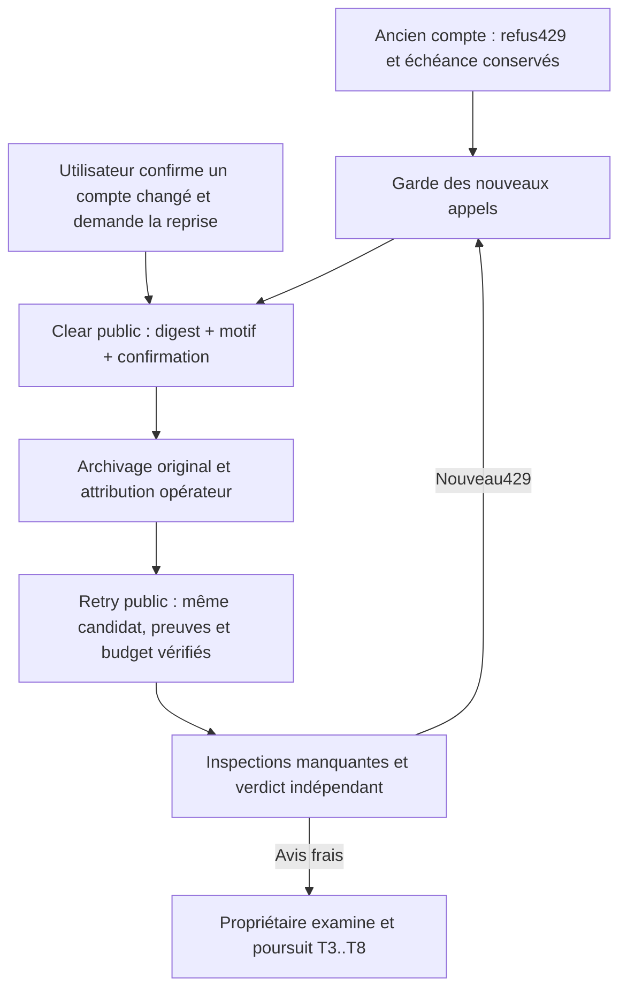

Disponibilité du compte, décision indépendante, intégration, acceptation et RETEX
restent des observations distinctes. Aucun commit, push ou reset de mission n’a été
fait dans cette reprise. L’objectif initial reste T8 après recette T7 réelle.

## 15:41 UTC — qualification complète du runtime13 installé

La suite Go complète se termine à15:39:37UTC, PASS472,572s,1172sources et
digest0311c86726f5e09c46bb29061efdc3f894fcef658d57602fc4cde877c2c8f28c, sans drift ni changement du manifeste.
Race39,797s/vet/méthodes/diff/build PASS ; cette preuve complète porte le même
candidat gelé que le serveur a5696bdf installé avant sa fin sur demande de
déblocage. Le reçu de qualification ultérieur est distinct du reçu original
d’installation, qui reste immuable. Le Mermaid de changement de compte est
rendu et inspecté, sans équivaloir à une inspection visuelle de l’onglet Swarm.
La revue T2 active n’a toujours pas de verdict frais ; aucune acceptation inventée.

## 15:45 UTC — distinguer l’état brut et la projection publique

Le contrôle par mission status montre T2 state=review, avec le motif « Le rapport
est conservé ; le vérificateur indépendant examine le candidat testé. » et T3
waiting sur son prérequis T2. La projection publique traite donc correctement
la reprise ; le couple brut Task.status=blocked/IndependentReview.state=running
n’est pas une preuve de panne d’UX. Le premier diagnostic était seulement une
vérification à effectuer, pas un défaut établi. Le processus de revue réel
continue avec CPU/IO évolutifs et cooldown actif=false ; cela ne démontre pas
encore une réponse ni une acceptation. Le parcours API est vérifié, l’onglet
réel n’est pas inspecté. L’opérateur continue vers le verdict et le besoin initial.

## 16:05 UTC — replan de la lenteur de revue, avant mesure corrigée

Besoin conservé : terminer le moteur Cursor par T3..T7 puis RETEX T8.
La revue indépendante T2 termine à15:53:18UTC avec changes_requested : le
handoff T1 décrit encore JAN-4 comme absent alors que T2 ajoute le Judge.
Ce défaut documentaire est reproduit dans le même candidat, corrigé dans une
copie indépendante puis transféré sur préimages exactes à la copie native inactive.
Seuls le handoff T1 et le rapport T2 changent ; aucun Go, avis, résultat accepté,
budget ou base de mission n’est modifié directement. JAN-4/JAN-5 sont datés
comme constats T1 dépassés par les primitives locales T2 ; conduite réelle
T3/T7 toujours non démontrée. Les contrôles structurels T1/T2 et diff passent.
Le nouvel arbre e1491d4539518ab4bd0955a41b8aee6d0d85e87f attend sa remise
publique et les contrôles/revue frais.

L’appel repris dure environ18minutes, calculées depuis l’âge /proc observé
jusqu’au verdict, pas un reçu de début d’appel persisté. Il déclare99 121tokens
de sortie pour environ2Ko de JSON final. Le delta de coût déclaré1,7616822USD
est une donnée fournisseur, pas une facture du compte abonné. La revue totale
dure66min40s incluant sa pause quota ; ne pas l’attribuer entièrement au modèle.
Six inspections sont séquentielles ; environ724Ko de contenus originaux/diff sont
fournis, dont près de190Ko pour les manifests de sources. Les preuves longues
et les reçus historiques contribuent au travail ; leur omission ou troncature
serait une fausse optimisation. T4 doit mesurer séparément attente, lecture,
inférence, contrôles et restitution, puis paralléliser seulement les inspections
indépendantes avec réservations atomiques, propriété, annulation, reprise et
verdict final sur le même candidat. Le moteur ne juge pas la fin du projet.

Défaut confirmé : le catalogue Admin de Claude annonçait zéro effort, refusant
medium alors que la CLI installée2.1.280 accepte --effort. La route Swarm était
vide, le processus sans --effort, le réglage personnel xhigh. L’effort réellement
appliqué au reviewer reste inconnu ; son héritage est une hypothèse, pas une
mesure. Selon la [documentation Claude](https://code.claude.com/docs/en/model-config#adjust-effort-level),
un choix explicite prend priorité sur les réglages hérités, avec possibles
limites administrées. Le safe-mode désactive les personnalisations ; il ne
prouve pas l’ignorance des réglages de modèle.

Options comparées : allonger encore une durée totale, changer de fournisseur,
ou fixer publiquement l’effort puis mesurer. La troisième est retenue pour
séparer cette variable sans couper une inférence productive. La correction14
expose les niveaux CLI Sonnet/Opus, maintient le choix vide, refuse un effort
non reconnu et montre « Réglage hérité de Claude Code » FR/EN. Le moteur ne
choisit pas medium en dur : l’opérateur l’enregistrera dans la politique Admin
versionnée, au repos. L’ancien alias Haiku n’annonce aucune capacité non vérifiée.
Un modèle ou une limite fournisseur peut abaisser le niveau demandé : la route
stocke une demande, pas une attestation d’effort réellement appliqué.

Preuve RED : medium refusé avant correction. GREEN : choix enregistré/relu,
arguments CLI ambigus remplacés par une seule valeur, effort de workflow
ultracode refusé ; race44,497s/vet/méthodes/build passent. Le formulaire isolé
prévisualise sans écriture, annule avec Échap/restitue le focus, sauvegarde medium
et le relit après rechargement ; thèmes clair/sombre inspectés. La première
recette utilisait un chemin historique absent puis un bouton sous accordion
fermé ; le parcours de test est corrigé, ses erreurs conservées. La suite Go
complète et la recette FR/EN/mobile étendue sont en cours à cet instant.

La mission est mise en pause par l’opération publique à16:01UTC, sans appel
actif interrompu. L’installation qualifiée, la politique publique medium,
les nouvelles routes et la remise corrigée feront l’objet de reçus distincts.
Si la route change, les anciennes opinions ne sont pas réutilisables : les
appels déjà dépensés et leurs avis restent dans l’historique. La réduction
réelle de durée/tokens et la qualité du verdict doivent être observées, puis
le besoin initial repris. T5 doit exposer état observé/inconnu et les réglages
effectifs dans Admin ; T6/T7 mesurer le cumul et la conduite réelle.

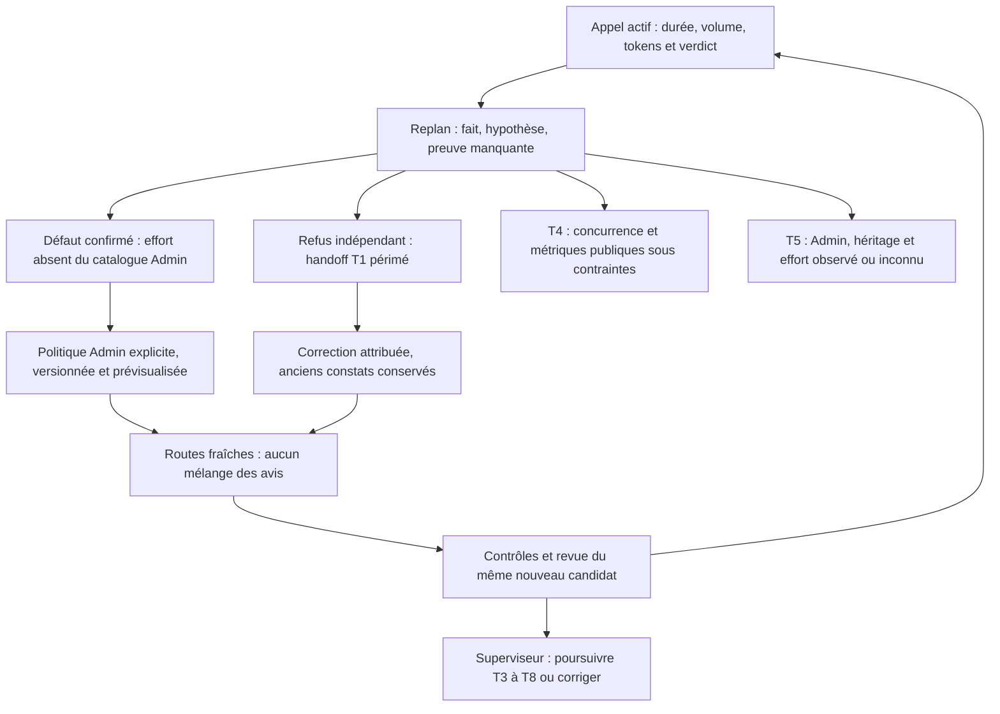

## 16:20 UTC — gestion globale des incidents par replan, reçus et reprise réelle

La demande utilisateur « gere ca en terme de gestion derreur pour le motiuer via
replan » devient une exigence transversale du moteur, pas seulement une consigne
de journalisation. Les tâches existantes T3..T8 sont conservées. Les mutations
publiques367→373 ont enregistré le contrat ci-dessous dans leurs entrées ; cela
prouve la transmission enregistrée, pas encore sa réception par un worker ni
l'implémentation de la fonction globale.

Le problème observé, la décision et leurs propriétaires restent distincts :

| Incident | Fait discriminant | Propriétaire de décision | Précondition de reprise vérifiable |
| --- | --- | --- | --- |
| Stockage de qualification | Première suite complète FAIL sur la garde de stockage tmpfs ; source gelée sans drift | Opérateur de l'environnement ; superviseur pour les dépendances | Espace disponible rétabli et fichiers temporaires de qualification sur un volume suffisant ; cas affectés PASS |
| Effort Claude non configurable | Admin refusait medium ; processus précédent sans --effort ; effort appliqué inconnu | Opérateur autorisé pour la politique ; moteur pour validation/persistance | Catalogue corrigé, politique et routes enregistrées, argument réel --effort medium observé |
| Refus indépendant T2 | JAN-4 historique dans T1-handoff contredit le candidat T2 | Propriétaire T2 ; correction opérateur attribuée | Deux documents corrigés sur préimages exactes ; contrôles et nouvelle revue du même candidat |
| Lenteur | Environ18min pour le dernier appel, six inspections séquentielles, usage final mesuré | Sous-superviseur du lot ; racine si plusieurs périmètres ou droits/budget | Mesure nouvelle sous politique explicite ; décision motivée, sans couper une activité productive à une durée arbitraire |
| Refus de protocole | Une opération refusée entière et son contexte doivent parvenir au rôle sans outils | Propriétaire de la proposition | Proposition corrigée selon le schéma réel et état relu ; aucune opération partielle ni répétition identique |

Le contrat à réaliser en T4 est un incident attribué : identité et incident parent,
code et frontière en défaut, originaux et empreintes, tâche/tentative/revue,
révision et configuration pertinentes, faits/hypothèses/preuves manquantes,
propriétaire, correction ou transmission, précondition attendue, opération publique
et effet observé. Sa progression distingue ouvert, remis, diagnostiqué, correction
proposée, correction appliquée, vérification et résolution prouvée. Une reprise
sans effet, un conflit CAS ou l'échec de sa vérification devient un incident lié,
sans effacer l'original. Un mécanisme de déduplication ne doit pas supprimer une
preuve nouvelle ni multiplier des activations identiques.

Le sous-superviseur traite l'incident de son périmètre ; la racine arbitre les
incidents transversaux et les droits/budgets. Le moteur déterministe réserve,
valide schémas/droits/fraîcheur, conserve et remet les originaux, applique une
décision autorisée puis expose son effet. Il ne choisit pas la solution métier,
ne déclare pas le projet terminé et ne transforme pas une activité ou un exit0
en acceptation. Une décision du superviseur reste soumise aux preuves de contrôle
et de revue du candidat courant. La boucle replan ne crée aucun appel ni droit.

T3 raccorde les décisions Judge/rôles à la mission existante avec versionnement
et compatibilité des writers. T4 réalise le routage global d'incidents et les
métriques/concurrence de revue. T5 expose cause, propriétaire, condition de reprise
et politiques effectives dans Admin FR/EN, avec historique/prévisualisation/rejet
utilisateur des apprentissages ; aucun choix d'exploitation imposé en dur.
T6 vérifie erreurs de protocole, quota, stockage, silence et conflits concurrents.
T7 doit observer une erreur réelle, la décision du propriétaire et l'effet de sa
reprise avec deux sous-superviseurs actifs ; T8 consigne ce qui est réellement
prouvé et les interventions humaines. Les fonctions restent à produire puis
accepter : la documentation ne s'y substitue pas.

La propre méthode de transmission a aussi été corrigée : les préfixes opérateur
empilés rendaient T3/T5 supérieurs à30Ko. Les anciennes entrées intégrales sont
archivées ; une base consolidée conserve les instructions originales finales,
les exigences, dépendances, identités et tous les apprentissages IA. T3 passe
30615→15712octets et T5 30956→17328. Aucun rejet utilisateur fabriqué, aucune
tentative remboursée. Le paquet cumulatif55fichiers est vérifié en copie isolée,
commitb78a7ec9776ee8c2eeb35a495e98aeff4020060d,
SHA256317d19f615ca09627319c107edf35daa1c1ea1013824c050814c5c5b8b73bd11.
Sa remise ne vaut ni intégration ni acceptation native.

Pour le stockage, huit binaires opérateur inactifs sont déplacés sur le volume
/home avec hashes identiques et liens préservant leurs chemins /tmp :626008030
octets libérés. Aucun original de preuve, base de mission ni cache utilisateur
n'est supprimé. TMPDIR/GOTMPDIR sont fixés uniquement pour la qualification sur
le volume suffisant. Les régressions concernées passent63,167s ; la suite complète
du même digestcb3f5558 est réexécutée, son résultat reste attendu à cet instant.
Le reçu original FAIL et le reçu d'installation limitée14 restent immuables.

Le runtime14 installé à16:10:48 est vérifié par son binaire exécuté
SHA2561250e99e8f4c3f65a25a26186f46bc688dfab5e9c3b8bf48c1543ca3f33576cd
et API ready. La recette isolée du formulaire passe FR/EN, deux thèmes et deux
largeurs : aperçu sans écriture, Échap/focus, sauvegarde/rechargement,
export/import et erreurs visibles. Elle ne prouve pas une inspection de l'onglet
réel ; le contrôle automatique du navigateur l'a refusée pour protocole non autorisé.

La politique publique Claude standard passe de l'effort hérité à medium ; root
et reviewer reçoivent des overrides explicites à366/367. Aucun modèle/budget
consommé/tentative n'est réinitialisé. La mission reprend publiquement ; la remise
corrective T2 est enregistrée et la nouvelle revue754dbd4d est running à376,
30appels consommés sur100. À16:19:31, le processus reviewer réel1303507 porte
--model sonnet --effort medium. Cela atteste les arguments demandés, pas l'effort
final appliqué par le fournisseur. Les avis antérieurs sont conservés, non mélangés
à cette nouvelle configuration. Le verdict et la mesure finale restent à observer.

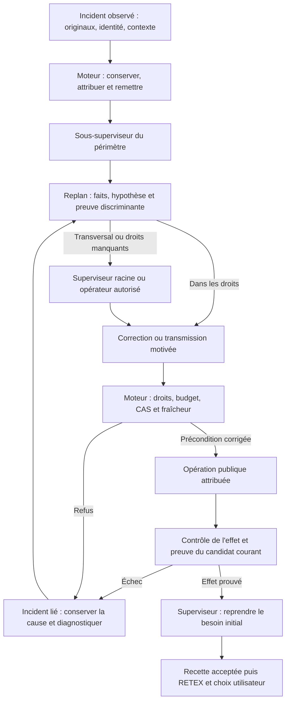

## 16:23 UTC — erreur liée de notre méthode et règles personnelles IA

La règle « On gère les erreurs » est ajoutée à /home/fpizzi/.codex/AGENTS.md,
source commune importée par /home/fpizzi/.claude/CLAUDE.md. Le rechargement du
fichier et de la référence Claude est vérifié ; aucun rechargement magique des
rôles déjà lancés n'est affirmé. L'utilisateur confirme les instructions actualisées.

La suite14 réexécutée échoue à16:21:38,722,069s, sans drift des1172sources :
quatre tests terminal signalent une racine trop longue pour le socket Unix.
Le TMPDIR de qualification choisi par l'opérateur est donc une nouvelle cause,
liée à la correction de stockage. Le délai global12min expire pendant un test
historique de fragments actif depuis8s : ce reçu ne démontre pas un blocage12min
de ce seul test. Le volume physique change aussi le coût IO de la suite ; c'est
une hypothèse à mesurer, pas une défaillance du reviewer réel.

Nouvelle précondition : les fixtures courtes et rapides restent sur /tmp, dont
la capacité a déjà été rétablie ; seuls les temporaires de compilation Go sont
sur le volume /home via GOTMPDIR. La qualification ne concurrence plus une
seconde compilation race ; elle enregistre maintenant les événements Go JSON
pour attribuer chaque durée. Les quatre cas terminal et les reprises historiques
sont contrôlés avant la suite complète. Le timeout est conservé, aucune erreur
masquée, aucune source ni preuve native réécrite pour obtenir un résultat vert.

## 16:27 UTC — preuve native de correction d'une consigne et de réception à vérifier

La lecture du travail courant retrouve instruction-fff5f627c40868ef40ff5bb8,
appliquée réellement par la racine à15:55:36 après le refus de format antérieur.
Elle cite l'événement opérateur et la décision planning-claim-180442929a303a27c558f1a9-decision,
rectifie96Kio/source,128Kio/union tâche,24fichiers et conserve l'ajout erroné initial.
La correction était donc déjà appliquée quand la dernière transmission la demandait
encore : cette remontée opérateur utilisait un état insuffisamment relu. Son
constat est corrigé ici ; pas de nouvelle mutation pour répéter l'apprentissage.
Le reçu de la décision/attribution prouve cette récursion native ; la réception par
le worker T3 reste à vérifier à sa réservation.

L'entrée racine globale est sauvegardée publiquement380→381, message exact relu.
Le premier vérificateur supposait une réponse enveloppée dans work, alors que
l'opération retourne Work directement : erreur KeyError corrigée par lecture du
reçu original, sans répéter l'opération publique. Le propriétaire est ready ; sa
réception et sa décision sur cette entrée restent à observer après la revue active.
Les deux Mermaid replan/gestion globale sont rendus et inspectés visuellement.
Les captures isolées mobile FR clair et EN sombre sont aussi inspectées : formulaire
lisible, pied de modale et focus visibles ; les intitulés longs des selects se
tronquent dans le contrôle natif étroit. Aucun examen du vrai onglet n'est revendiqué.

## 16:37 UTC — boucle vérifiée de qualification14, reçu alias et frontière des rôles

La qualification finale du correctif14 installé passe : go test -json ./...
-count=1 -timeout=12m,16:23:28→16:31:41UTC,493,114s. Même manifeste1172sources,
digestcb3f555834076c1fda77d6adb3d00158cf55b18a052c934c0401d96fb4cee26a,
sans drift ni manifeste changé. Race44,497s/vet/méthodes/build et recette formulaire
FR/EN restent du même candidat. Le reçu ultérieur séparé vérifie le SHA du binaire
installé ET exécuté1250e99e ; les deux essais FAIL et le reçu d'installation avant
qualification complète ne sont pas réécrits.

La revue754dbd4d sous medium se termine16:30:00UTC après668,029s (11min08),
quatre appels,62429tokens de sortie et2,3377798USD déclarés au total. Elle s'arrête
sur une preuve de couverture historique des alias, pas un verdict final favorable.
Comparer ces quatre appels à un seul ancien appel de18min ne prouve pas un gain
causal pur de l'effort ; candidat/contexte et point d'arrêt ont aussi changé.
L'effort réellement appliqué reste inconnu au-delà des arguments CLI observés.

Le nouveau refus porte le reçu historique source-parts-targeted.out (cinq cas)
comparé au test final (sept cas), alors que source-alias-targeted.out était un reçu
ultérieur non verbeux. Le besoin de preuve finale nommée est traité : test isolé
sur arbre indexé e1491d45 égal au candidat6089c4fb, aucune modification de Go ni
drift des2009fichiers suivis, sept sous-tests PASS en11,311s à16:31:59→16:32:10.
Le premier fetch visait le producteur, où le commit d'intégration n'est pas annoncé ;
il échoue avant tout reset. La vérification utilise ensuite l'égalité des arbres
et les préimages exactes, sans prétendre un HEAD local identique au commit public.

Les deux nouveaux fichiers source-alias-final-targeted.out et son reçu daté sont
fournis intégralement par le diff. Le rapport/index distinguent explicitement les
anciens reçus partiels des nouvelles preuves ; leurs originaux restent inchangés.
Pas de duplication dans le contexte supplémentaire17sources130040octets proche
de sa limite128Kio. Quatre chemins transférés à la copie native du producteur
terminé sur préimages exactes ; nouvel arbre201b3a8e2e0f724a7cc88fef7107bf2d41569316
soumis publiquement, contrôles/revue frais en cours, mêmes trois tentatives conservées.

La racine a réellement reçu l'entrée globale381 et le nouveau refus ; son reçu
Delivery cite les événements et la décision planning-claim-21b6d8b46646d0600d282af7-decision.
Cela prouve la réception et l'attribution de la décision, pas la fonction globale.

Une frontière du moteur est aussi confirmée dans
internal/engine/managed_review_fragment_runtime.go : après parse de l'inspection,
un état autre que inspected/unknown retourne immédiatement avant la sélection
et la décision finales. L'IA partielle a bien déclaré un défaut ancré ; le moteur
ne doit pas réinterpréter ni effacer ce constat. En revanche, sa portée partielle,
les dépendances vers d'autres preuves et la décision globale doivent rester distinctes.
Le cas est transmis publiquement à T4 à392 puis renforcé : corriger cette frontière,
comparer la poursuite en revue finale et la remise au propriétaire compétent sous
politique Admin, conserver les vrais défauts et traiter une impossibilité technique
comme incident. Tester ancien reçu PASS partiel/code enrichi/reçu frais ailleurs,
et le vrai défaut reproduit. La spécialisation de req-16 conserve ses critères,
identités/apprentissages/dépendances ; elle ne modifie aucun contrat accepté.
Le moteur valide et applique, la décision sémantique appartient au rôle compétent.

## 16:59 UTC — réception native, défaut de transmission et correction15 en qualification

L’erreur réelle de la revue d77 sur candidat6c2da25 est « defect without unique
failed artifact ». L’original JSON contient deux défauts portant tous deux la pièce3 ;
le protocole impose une seule entrée par pièce déclarée fail. La cause n’est donc
pas simplement une ligne ou un chemin manquant. La racine32 reçoit les événements
attribués, décide23 (planning-claim-2ed59960450bd483810f6662-decision) et autorise la
reprise35 sans intervention opérateur. Le fragment0 revient unknown, puis le
fragment1 est refusé ; cette reprise observée ne prouve pas la réception de Next.

L’inspection du parcours établit la rupture : applyPlanningReviewRetry écrit
Task.Next, mais runManagedFragmentReview ne le lit pas. Le nouveau test isolé
TestPlanningReviewRetryDeliversSupervisorCorrectionAfterReopen reproduit la perte :
le processus fournisseur exige la consigne et sort19 sans elle, aucun PASS. Le
correctif15 capture la décision/périmètre/événement/revue/candidat/tentative/cause
et consigne dans retry_directive, séparément de Task.Next. Précontrôle de capacité
avant réservation ; enveloppe envoyée avant les preuves et gardée dans les journaux
avec empreinte du prompt. Les appels nouveaux d’inspection, sélection et décision
finales la reçoivent ; les anciens prompts et dépenses sont conservés.

La régression passe après correction, réouverture et modification ultérieure de
Task.Next. Elle contrôle le résultat final durable sans accepter la tâche, et
refuse une consigne modifiée sous une ancienne empreinte. Une autre régression
refuse un candidat étranger avant réservation. Le diagnostic des doublons décrit
la réponse originale sans la promouvoir en preuve ni modifier son avis. Les
lecteurs actuels lisent les anciens journaux ; les vieux lecteurs stricts refusent
les champs inconnus. T3 doit traiter la compatibilité des écrivains/version et
préserver ces champs au lieu de les perdre pendant une nouvelle évolution.

Deux erreurs de notre vérification sont conservées séparément : collision du nom
d’un helper de test, puis fixture sans répertoire et citation vide avant le doublon.
La fixture est corrigée (répertoire créé, premier défaut valable) ; on ne modifie
pas le validateur pour faire passer ce test. Les suites ciblées41,157s et
race93,608s passent, vet11,876s/méthodes3,318s/build12,654s passent. La suite complète
sur1174sources gelées a commencé16:57:22UTC ; résultat encore non établi à cette
entrée. Le runtime15 n’est pas annoncé installé. Architecture FR/EN et Mermaid
séparent cette correction locale de la fonction globale T3–T7 non achevée. La
création d’une revue neuve lors d’un changement de méthode reste notamment à traiter.

Le refus sémantique d77 accuse les deux metadata d’un chemin stdout absent du
candidat. Une vérification Git du candidat6c2da25/arbre201b3a8 montre que le fichier
racine et la copie sous judge-coverage-fix-20261011 existent et ont la même empreinte
fbaa92ea28409f7d476cdf46ba7046372f7d868a050833c5c7c2d31872115199.
L’original racine était dans fragment0/pièce15, la copie dans fragment1/pièce0.
Une absence dans le seul fragment1 ne prouve donc pas une absence du candidat.
Ce nouveau cas confirme l’obligation T4 de conserver la portée partielle et de
remettre la décision globale au rôle compétent, sans censurer un vrai défaut.

La remise documentaire corrigée nomme désormais la copie imbriquée dans le reçu
courant ; metadata.native-original.json conserve ses octets et sa référence racine
vérifiée. Reçu Git exact path-binding-replan.json, rapport/index et critère4 précisent
également contrôle structurel et revue sémantique encore nécessaire. Aucun ancien
stdout, code Go ni avis n’est modifié. Cinq chemins transférés sur préimages exactes
à la copie du producteur terminé, nouvel arbre9b03d914, sources17/130889octets
sans troncature. Soumission publique407→410, appel37 en revue fraîche ; résultat
indépendant et acceptation non acquis. Les trois tentatives sont conservées.

## 17:14 UTC — replan de la vérification et compatibilité des écrivains

Le processus propriétaire de la qualification15 précédente sort143 sans résultat
Go de paquet ni FAIL. Le dernier test actif, repris seul, passe1,370s ; l'origine
du signal n'est pas prouvée. Une session détachée dédiée, sans minuterie récurrente,
reprend les mêmes1174sources gelées : suite complète exit0 en501,066s, aucun
changement de source ou manifeste. Les sorties interrompues sont conservées.
Cette modification de méthode corrige la précondition du contrôle sans augmenter
la durée maximale de test, supprimer un test ou conclure sur une exécution inachevée.

La protection des journaux stricts est insuffisante : Work est lu par json.Unmarshal,
et un ancien écrivain de version27 peut ignorer puis perdre retry_directive. Deux
tests RED le reproduisent, y compris une connexion déjà ouverte. Option minimale
retenue : contrat de stockage28 avec sauvegarde privée et sans réécriture des corps,
et contrôle de version dans chaque mutation sous réservation d'écriture. Une
conversion de tous les lecteurs Work en strict aurait changé la compatibilité
historique d'autres champs sans garantir les connexions déjà ouvertes ; elle n'est
pas retenue ici. Les deux tests passent après correction ; suite complète cumulée
15+16 en cours. Avant un déploiement, arrêter les anciens acteurs réconciliés et
migrer par swarm init public ; un vieux processus n'acquiert pas ce garde rétroactivement.
Le propriétaire est l'opérateur pour ce correctif et T3 pour l'intégration native
Judge+cumul des patches. Aucun stockage de mission n'est utilisé comme fixture.

La revue native T2 suivante refuse full-suite-final.out parce que deux groupes ont
84 tests et82 pass. Ces nombres seuls ne démontrent ni fabrication ni authenticité :
un partage de charge peut produire des groupes de même taille et des skips explicites.
Pour fournir une preuve discriminante sans annuler l'avis indépendant, une nouvelle
suite Go standard non divisée est lancée sur une copie propre au contrôle et dont
le code est identique à T2. Le manifeste1049sources est vérifié sans écart. Originaux
et refus restent conservés ; résultat, remise publique et acceptation encore attendus.

Les erreurs propres à l'opérateur restent visibles : helper non défini/collision,
fixtures mal initialisées et lectures de chemins devinés inexistants. Les fixtures
ont été corrigées sans assouplir les validateurs ; l'accès aux prochains fichiers
part de l'inventaire exact et les résultats publics sont projetés pour éviter des
sorties géantes. Une note ou une fixture ne prouve aucune fonction globale achevée.

## Plan révisé — anomalies ouvertes, propriétaires et preuves de clôture

| Anomalie | Action / propriétaire | Preuve exigée | État au replan |
| --- | --- | --- | --- |
| Consigne review-retry non remise | Correctif15 opérateur, intégrationT3 | Processus reçoit décision attribuée après réouverture ; prompt et résultat durables | PASS local full501,066s ; déploiement et usage réel attendus |
| Ancien écrivain perd un champ Work | Correctif16 opérateur, intégrationT3 | Sauvegarde privée, corps intact, ancien CLI refusé, connexion périmée sans mutation | RED→GREEN ; race103,456s/vet/build PASS ; full cumulé en cours |
| Qualification interrompue sans verdict | Opérateur | Même source, driver indépendant, exit et empreintes | Correctif de méthode vérifié par full15 ; origine du signal non attribuée |
| Refus T2 sur résumé de groupes | Opérateur produit original, vérificateur indépendant décide | Sortie brute canonique complète sur code T2 identique puis contrôles/revue frais | Exécution réelle en cours ; ancien avis conservé |
| IA propose apprentissage avec champ interdit et inférence excessive | Racine et T4 | Réception du diagnostic, décision conforme, contenu prudent et effet | Nouvelle remise publique420, réception racine421 ; décision attendue |
| Verdict global arrêté sur constat partiel | T4, racine pour arbitrage transversal | Toutes inspections utiles conservées, revue finale avec originaux et résolution des constats ; aucun avis censuré | Défaut de code confirmé ; implémentation/acceptation encore ouvertes |
| Gestion globale des incidents / autonomie / RETEX | T3..T8, sous-superviseurs sur leur périmètre et racine transversal | Incident reçu→décision autorisée→correction→effet réel ; erreurs imbriquées ; concurrence réelle ; recette puis RETEX | Fonction globale non achevée |

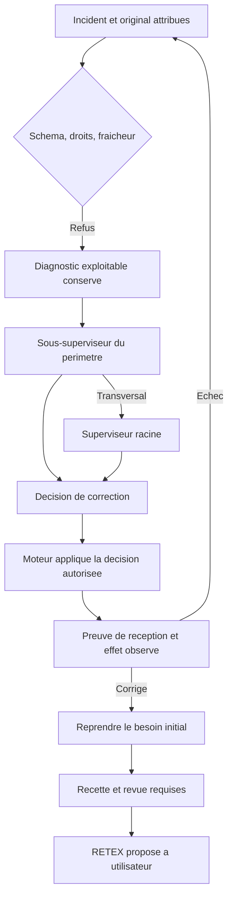

La décision métier et la fin relèvent du superviseur sous les preuves requises.
Le moteur garde les originaux et valide/applique les décisions ; un schéma refusé,
un prompt sauvegardé ou une documentation à jour n'est pas une correction achevée.

## Replan suivant — revue partielle et incident acquitté

La qualification16 initiale échoue uniquement sur le test historique qui appelle
« future » la version28 devenue courante. La fixture emploie désormais
`schemaVersion+1` et garde ses assertions de sauvegarde/restauration. La suite
cumulée15+16 complète passe ensuite532,166s, avec ses1175sources inchangées.
L’ancien échec reste conservé. Le runtime installé exécute SHA20d067a5 ; migration
publique28 et lecture ancienne refusée vérifiées. Les corps des trois missions
sont identiques avant/après migration. L’opérateur a d’abord comparé la mauvaise
frontière : la pause publique modifie normalement révision et génération. Cette
erreur de contrôle a interrompu son helper de démarrage ; elle a été diagnostiquée
sur les empreintes originales avant le redémarrage et la reprise publics, sans
écriture dans le stockage de mission.

La nouvelle preuve canonique T2 est une vraie commande `go test ./... -count=1
-timeout=12m` sur les fichiers Go identiques à la copie du producteur : exit0,
492,395s, aucune dérive des1049sources. La sortie brute complète remplace le
résumé de groupes dans la remise courante ; les anciennes pièces restent
historiques. Le rapport actif accumulé22489octets provoquait ensuite un refus de
capacité avant revue. Il est volontairement réécrit en4573octets avec les mêmes
critères et18sources/126587octets, l’original intégral conservé par commit et
empreinte. Aucune troncature du moteur ni acceptation manuelle. La revue fraîche
14a105dc reçoit cette remise mais retourne un JSON incompatible : pièces3 et23
`v=inspected` avec `n` non vide. Preuve absente doit être `unknown` avec demande,
pas conformité locale. Le refus de protocole et la dépense restent conservés.

Le correctif17 est développé en racine isolée : un avis local défavorable ne
termine plus la revue globale. Chaque paquet reste contrôlé ; les défauts
originaux et une question attribuée sont remis à la sélection et au vérificateur
final. Trois cas ciblés passent : défaut global confirmé, constat réfuté par des
originaux réellement reçus, transport échoué après un avis local. Les anciennes
attentes de tests sur l’arrêt prématuré sont adaptées sans enlever leurs gardes
de consommation, d’historique ou de publication. Une assertion de budget cumulait
encore « un seul appel » : elle compte désormais les vrais appels du premier
cycle complet. La capacité finale réserve aussi les défauts JSON, leurs questions
et les tokens, avec cas UTF-8. Vérification étendue232,825s, race172,977s, vet,
contrat et build passent ; suite complète gelée encore attendue. Le diagramme
FR/EN distingue avis local, verdict final et erreur réelle.

La reprise native racine38/décision28 confirme une autre frontière erronée :
l’événement de la revue actuelle avait été acquitté par la décision27. Le nouveau
message opérateur est reçu, mais `review_failure_routing` reste vide et
`review_retry_unavailable=true`. Acquittement a donc été confondu avec résolution
par le moteur, et le superviseur n’a aucune opération autorisée. Augmenter les
tentatives du producteur ne corrige pas une erreur du vérificateur. Réouvrir
l’ancienne décision ferait perdre l’historique. Option retenue18 : remettre les
incidents encore actuels séparément des entrées à acquitter, avec rattachement
exact persisté à la nouvelle réception. La racine décide une correction nouvelle ;
l’ancien événement conserve sa décision et le moteur recontrôle identité,
périmètre, fraîcheur, preuves et budget. Pas de relance automatique inchangée.

La régression18 RED reproduit cette indisponibilité. Après correction, la chaîne
publique isolée passe acquittement→reprise→réouverture→réception→décision→entrée
réelle du processus fournisseur→avis final durable. Les cas candidat non reçu,
événement obsolète, mauvais périmètre, avis sémantique, tâche retenue et absence
d’entrée fraîche sont refusés. Le contrat29 protège le rattachement contre un
écrivain28 qui l’ignorerait ; migration privée sans réécriture vérifiée. Le premier
test de finalisation réutilisait une fixture de journal ancien sans origine : le
garde a correctement refusé. La fixture a été remplacée par l’initialisation
réelle de revue, sans assouplir la publication. Qualification complète et
réception native18 restent à établir. Les fournisseurs des régressions sont
simulés ; cela ne prouve ni correction par un modèle réel ni fonction globale.

La construction du patch17 a aussi révélé une erreur de méthode opérateur :
le checkout de contrôle contenait les163préimages correctes, mais l’index n’avait
pas été rafraîchi et apply était lancé du répertoire des objets. Le diagnostic
conserve l’échec puis vérifie tous les octets ; apply avec répertoire explicite et
index rafraîchi passe. Aucune préimage du projet n’a été remplacée pour forcer le
contrôle. Les lectures doivent partir des chemins inventoriés et les états JSON
des clés observées ; les commandes et sorties de diagnostic doivent rester
compactes. T3..T8 et la recette native demeurent ouverts.

## Replan de la frontière de reprise et du stockage temporaire

La suite17 complète passe597,321s,1176sources sans dérive. Le transfert au dépôt
principal utilise les21préimages exactes et garde un contrôle séparé du document
FR absent de l’ancien catalogue de sources. Le correctif19 l’ajoute désormais au
manifeste. Il ne réécrit pas la qualification historique17.

La suite18 initiale s’arrête par panic dans un test ancien : après intégration,
il supposait l’avis non nul et perdait la cause de son absence. Le test seul
passe ; une nouvelle assertion conserve tâche/blocage/état du résultat avant de
signaler l’échec. Elle passe seule, avec ses prédécesseurs et20exécutions. Le
premier nouveau contrôle19 donne alors une preuve discriminante : le blocage
réel est « Stockage indisponible ou presque plein ». Le volume tmpfs `/tmp`
est mesuré6,9GiB utilisés sur7,2GiB,314MiB libres après l’échec ; les compilations
simultanées et clones temporaires peuvent franchir le garde existant256MiB.
L’absence d’avis avait donc une frontière pré-revue ; sa cause à l’instant exact
de la suite18 n’avait pas été capturée et ne doit pas être reconstruite comme
fait. La nouvelle erreur19 est attribuée au stockage observé, sans accuser le
fournisseur ou la compatibilité29.

L’opérateur vérifie qu’aucun compilateur ou test Go ne tourne, supprime seulement
six répertoires temporaires de compilation régénérables et déplace31anciens
binaires opérateur inactifs vers son cache sur disque. Chaque binaire garde ses
octets et son empreinte, son chemin initial reste un lien ; les exécutables
actifs et candidats nécessaires sont exclus. Gain2942,543MiB, `/tmp` libre3256MiB.
Les sources gelées, preuves, sorties, sauvegardes et stockage natif `.swarm`
restent conservés. L’API publique authentifiée confirme ensuite ready et
launch_allowed. Aucun seuil de stockage ou compteur n’est réduit. Nouvelle
qualification des mêmes1179sources, avec scratch de compilation sur le volume
disque déjà utilisé, fixtures toujours isolées sous `/tmp`.

Le correctif19 traite aussi deux défauts directement reproduits : après un
constat local défavorable puis transport échoué, le précontrôle et la reprise
publique refusaient encore `changes_requested` local. Ils réutilisent maintenant
l’original du même plan, reprennent les seuls appels manquants et conservent la
dépense interrompue. La revue finale indépendante reste défavorable dans le test,
sans acceptation forcée. Le feedback `inspected+n` accusait à tort une citation
absente ; il explique maintenant la vraie incohérence `n=[]` ou `unknown` avec
besoin précis. RED→GREEN2,842s sur processus fournisseur simulé ; contrôle global
encore requis. Tous les FAIL18/19 sont conservés ; aucun n’est effacé par la
mise à jour des consignes ou présenté comme une fonction native achevée.

### Qualification19 et effet natif observé — 11 octobre, reprise après stockage

Le cumul17..19 passe la suite complète (`go test -json ./... -count=1
-timeout=12m`) en495,576s,1179sources gelées sans dérive ; ciblés22,349s et
race101,472s passent. Les échecs originaux18 et19 restent conservés. Le volume
temporaire est corrigé, sans abaisser la garde du moteur. Les84entrées opérateur
sont vérifiées par import isolé, avec62originaux inchangés et14préimages explicites.

Le binaire exécuté SHA256e23d4ff43d8cb6f64b00bee8b4e531dcb3da2a71f390d8be5c130f3f79445ece
est installé ; stockage29 migré par `init`, copie privée0600 et corps publics
post-pause inchangés. Le lecteur28 refuse29. Le contrôle corrige la frontière
antérieure erronée : comparer au corps post-pause, puisque la pause autorisée
change normalement la génération/révision. Une réponse `planning resume` a été
mal interprétée par l'opérateur comme `{work:...}` ; l'événement appliqué est
constaté sans le rejouer. Un `mission resume` CLI rencontre SQLITE_BUSY ; la
reprise authentifiée via le serveur est ensuite observée, pause vraie→fausse.
Ces défauts de méthode et leurs preuves restent liés au replan.

L'activation racine39 reçoit l'incident T2 courant sous
`unresolved_review_sources`, même si le résultat original est déjà acquitté. La
décision29 autorise `review-retry` et adresse une nouvelle consigne au
vérificateur, sous le même candidat/avis/tentative. Le journal durable des appels
attribue cette consigne à la décision et conserve le hash du prompt réellement
préparé pour les appels repris. La comparaison au stdin du fournisseur est
prouvée par la régression isolée avec processus réel ; elle n'est pas une capture
du stdin natif. La revue native est encore en cours : cette réception/décision
et application ne prouvent pas encore le verdict final, l'acceptation T2 ou la
fonction globale toutes classes. T3..T8 et le RETEX restent requis.

Nouveau besoin utilisateur : remplacer les journaux bruts par une console Monaco
colorée dans Suivi→Journaux, avec sources moteur/superviseurs/tentatives, thèmes
clair/sombre, FR/EN, recherche, direct et repli texte. Ce lot UX est développé
dans une copie isolée, avec recette navigateur séparée ; il n'est pas déclaré
installé sur la seule qualification19.

### Console20 installée et nouvelle frontière de preuves — 11 octobre

La console Monaco en lecture seule est livrée dans Suivi→Journaux : erreurs
rouges, alertes ambre, activité cyan, réussites explicites vertes, toujours avec
leurs libellés. Sources tentatives/moteur/supervision, FR/EN, clair/sombre, recherche
clavier, direct/pagination, export de la réponse API originale et repli texte
sont vérifiés par une recette navigateur isolée. Le rejet réseau garde les données
lisibles ; un changement de mission rejette les réponses tardives étrangères.
La couleur d'un acquittement ou d'une décision ne prétend pas prouver sa résolution.

Le cumul1187sources gelées passe la suite complète en497,550s sans dérive, puis
le binaire exécuté SHA256371239add2a2ba968c3b1807d5bfd896eb6662c31d59d0644792753321f471ff
est installé. Schéma29 inchangé, aucun init ni copie/édition du stockage natif.
Les corps publics post-pause sont inchangés et la route authentifiée du cadre
est servie. Le redémarrage compatible19→20 avec un agent détaché actif est prouvé
séparément sur processus isolé. La mission native a été brièvement suspendue
pour l'installation/routage, puis reprise publiquement : révision480, pause fausse.
Les89entrées opérateur sont attribuées aux futures tâches T3..T8 ; cette sauvegarde
de consignes n'est pas une réception par leurs agents. Les échecs intermédiaires
de recette, préimage, réponse CAS et bootstrap d'authentification sont conservés
avec leurs corrections ; aucune garde n'a été affaiblie.

La revue native T2 ne passe pas : sa sélection finale est unknown, aucune décision
finale de tâche n'est appelée. Elle désigne les tests Judge complets comme pièce
indispensable15475octets, supérieure aux14350octets disponibles annoncés. La
décision racine40/30 constate ensuite un inventaire vide. L'original de contexte
existe pourtant :759750octets, empreinte d1682458e31ca9cd0e3e3edb4f62e3320c965409298a8519c0987425c9b80a8b
exacte, candidat b3cdfcf607d0466cace8cc27de4325ee5a1d75e8 et11sources. La
première frontière en défaut est le lecteur d'inventaire, qui réutilise à tort
la limite512Kio des dossiers de reprise puis annonce « aucune source attestée ».
L'acquittement de l'avis courant retire aussi son inventaire des entrées fraîches.

Conformément à la demande de correction générale et durable, le replan21 traite
ces contrats sans identifiant de mission spécial : lecture entière authentifiée
en flux avant/durant décodage, origines courantes acquittées en lecture seule pour
les deux niveaux de supervision, mesure finale sur les inspections immuables
réellement reçues. Les réserves hypothétiques restent un précontrôle avant appel,
les limites réelles et les droits de reprise restent obligatoires. Les anciens
prompts et journaux sont versionnés et doivent rester vérifiables sans réécriture.
Les contre-exemples RED sont conservés. À cet instant le correctif est isolé :
qualification complète, installation et effet natif restent à vérifier. La console
livrée n'achève ni la fonction globale d'incident ni T3..T8/RETEX.

### Correction générale21 qualifiée et garde de reprise22

Le correctif21 passe la suite complète en539,663s sur1187sources gelées sans
dérive, les contrôles statiques et la régression ciblée versionnée38,805s. Le
contrôle race Go passe94,252s (mur121,919s) ; le code143 du lanceur externe
postérieur au reçu de réussite du processus est conservé séparément, sans
attribuer un échec aux tests. Les originaux natifs copiés et attestés donnent
11sources, journal historique toujours unknown, capacité réelle79564octets
contre14618anciens et23334octets de pièces Judge entières désormais admissibles.
Le patch général et son paquet95entrées sont conservés avec leurs préimages.
La source principale est transférée ; le runtime20 n'est pas encore remplacé.

La prévention est aussi inscrite dans les directives personnelles communes
Codex/Claude : corriger le contrat général, garder le contre-exemple et les
variantes, distinguer toute mesure provisoire et vérifier réception, décision,
application et effet avant clôture. Le replan22 ajoute une route générale pour
une ancienne sélection unknown version1 dont la capacité a effectivement changé,
sans rouvrir un refus métier final. Le superviseur choisit ; le moteur conserve
originaux et dépenses, contrôle preuves/droits/budget et fin du producteur, puis
prépare uniquement une nouvelle sélection et décision finale sous journal2.

Les premières régressions révèlent des fixtures sans propriété/provenance complète :
corrigées sans affaiblir la garde. Un véritable défaut de la nouvelle projection
est ensuite isolé par la pile originale SIGQUIT : réacquisition de la connexion
SQL détenue pendant une mutation. La projection devient une lecture de preuves ;
le producteur est contrôlé au commit par la connexion transactionnelle existante.
La chaîne racine/enfant passe6,249s puis les cas de refus29,081s. Ces recettes
utilisent de vrais processus simulés et gardent leur refus final ; elles ne
prouvent aucune revue par modèle réel ni la résolution native jusqu'au RETEX.
La qualification complète et l'effet natif de22 restent à vérifier.

### Obligation de correction durable et prévention des récidives

La demande utilisateur impose une correction générale du contrat en défaut. Un
identifiant de mission, une date, une chaîne d'erreur ou une nouvelle formulation
de consigne ne peuvent tenir lieu de solution. « Définitive » signifie ici une
cause traitée et un contrôle de non-régression conservé ; ce terme ne dispense
jamais de vérifier les variantes ou une nouvelle classe d'incident. Une mesure
provisoire demeure explicitement provisoire et ne clôt pas l'incident.

La démarche obligatoire est la suivante : reproduire le défaut et conserver
l'original ; identifier sa première frontière ; comparer les corrections
réalistes ; corriger le contrat au niveau compétent ; faire échouer la régression
sur l'ancien comportement puis la faire réussir sur le nouveau ; vérifier les
entrées invalides et les variantes pertinentes ; vérifier réception, décision,
application et effet ; transmettre l'apprentissage aux prochaines tâches.
Un journal, une consigne modifiée ou une recette simulée seule ne prouvent pas
une résolution native.

| Niveau | Responsabilité de prévention | Preuve nécessaire |
| --- | --- | --- |
| Exécutant | Corriger la cause dans son périmètre et conserver la régression | Cas initial, variantes, vérification sur mêmes entrées/candidat |
| Sous-superviseur | Diagnostiquer et décider dans son périmètre ; transmettre l'apprentissage | Réception attribuée, décision autorisée, effet observé |
| Superviseur racine | Arbitrer cause transversale, dépendances et droits/budget | Décision globale et contrôle des effets dans les périmètres |
| Moteur déterministe | Attester/remettre les preuves et appliquer uniquement les décisions admissibles | Schéma, fraîcheur, droits, réservations, original et nouveau résultat durables |
| Utilisateur | Garder le choix de rejeter les ajouts aux consignes futures | Ajout visible, origine et rejet conservés |

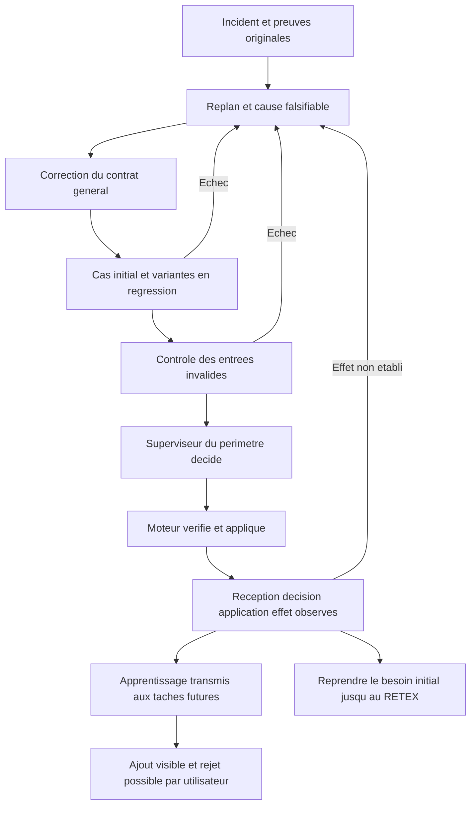

Les directives personnelles `/home/fpizzi/.codex/AGENTS.md` contiennent cette
obligation ; Claude la charge via son fichier de consignes commun. Dans Swarm,
les cadrages de supervision et d'exécution et la méthode replan sont enrichis
sans modifier la méthode de la revue indépendante déjà commencée. Les ajouts
futurs passent par `revise-instructions`, selon les droits et le choix utilisateur.

État de preuve : les gardes isolées racine/enfant et refus passent ; les originaux
natifs démontrent la précondition corrigée sans ouvrir ni copier la base ni
invoquer un modèle. La qualification complète1189sources et race du cumul22
est lancée. Installation et décision/effet natifs restent à vérifier. L'incident
et le besoin initial ne sont pas clôturés par cette documentation.

### Cumul22 qualifié et décision native41/31

La suite complète1189sources gelées passe579,373s sans dérive ; race274,632s,
contrôles ciblés/statiques/méthodes et originaux natifs passent aussi. Le patch
13chemins SHA1ec487f0c5c72aa8b00748aaf0981ef9723178452b84db50b5ab878cca331d52
est transféré avec sa préimage. Le paquet98entrées conserve les95originaux
octet pour octet, contrôlés après import isolé ; son SHA est
0ddd5aff5de569af99c44e6bf3c3e4cbb385f4214df70ed8b5dda8958039658a.

Le binaire exécuté SHA8b2bcc55dc94734ce3e0b4ad55db9a21d7475fd0e8d53842f1c40f6c60b01246
est installé sans acteur, revue ni détenteur actif. Les corps des trois missions
sont identiques contre le baseline post-pause ; schéma29 inchangé, aucun init,
migration, copie ou édition du stockage natif. Le snapshot complet de baseline
contient deux routes de session dans le contenu d'une autre mission : le contrôle
d'archivage l'a arrêté avant publication. Cet original est conservé privé0600 ;
seul son reçu dérivé d'empreintes est archivé. Les preuves ne sont pas réécrites
pour rendre un original privé publiable.

Les entrées98 sont attribuées publiquement à T3..T8 en conservant critères,
dépendances, tentatives et apprentissages/rejets, sans prétendre à leur réception
par les futurs agents. Après reprise publique, la racine41 reçoit le rattachement
exact de l'ancien avis acquitté au code review_selection_capacity_changed, puis
sa décision31 propose review-retry. La consigne réellement appliquée au journal2
porte l'identifiant de cette décision, le résultat original f11fb5845d50bfbe,
le candidat et la tentative exacts. Le journal1 et l'ancien unknown restent
dans l'historique. Cela établit réception→décision→application de la correction.

L'effet final rencontre une nouvelle dépendance externe : l'appel de sélection
réservé est interrompu par un refus Claude429 jusqu'au11octobre20:20UTC
(22h20Paris). Aucun contenu de sélection n'est reçu ; le budget46→47 reste
consommé, aucun appel final de tâche n'est engagé. Ce refus fournisseur ne prouve
ni défaut du candidat ni résolution. Les constats défavorables partiels sont
conservés. Replan doit diagnostiquer la dépendance de compte, garder son délai,
traiter les corrections indépendantes et vérifier une vraie reprise autorisée.
Aucune acceptation T2 ni conformité globale jusqu'au RETEX n'est annoncée.

### Contrôles et rétroactions : effet sur le travail des agents

L'utilisateur demande une analyse documentée avec exemples :
[architecture FR](../../../../architecture/CONTROLS-AND-FEEDBACK.md),
[architecture EN](../../../../en/CONTROLS-AND-FEEDBACK.md) et
[note de recherche](20261011-controls-feedback-agent-quality.md). Six exemples
séparent cas observés, corrections qualifiées et illustrations. Les deux Mermaid
sont rendus et inspectés ; les liens locaux passent. Les indicateurs proposés
mesurent acceptation, récidives, relances humaines, délai/coût par résultat accepté,
effet des chaînes de correction et coût des contrôles. Aucun gain global de vitesse,
coût ou autonomie n'est prétendu sans comparaison. L'apprentissage porte sur
consignes, contexte et contrats remis aux agents, avec vérification dans les tâches
suivantes. Un paquet101entrées conserve les98originaux et les trois documents
intégraux après import isolé ; sa création seule ne prouve pas leur réception native.

En parallèle, les constats défavorables partiels T2 sont traités : neuf cellules
source/citation sont comparées intégralement, cinq omissions sont reproduites et
corrigées. Le nouveau reçu local daté rapporte paquet7,274s et mur17,491583s, avec
argv complet, sortie brute et517sources Go inchangées. Il est distinct du contrôle
natif11,434s sans-v ; les préimages restent conservées. Le premier précontrôle de
remise refuse sans appel payant l'union de sources128Kio : les originaux T1 restent
dans leur déclaration cumulative existante ; T2 joint ses17sources122185octets,
Judge entier et nouveaux reçus compris, sans troncature ni hausse de plafond.

L'utilisateur confirme Claude rétabli et autorise la reprise. L'opération publique
`providers cooldown clear` conserve l'observation, le délai et les dépenses avec
confirmation attribuée de cette nouvelle précondition. Une erreur du pilote sur
le nom de champ resets_at est corrigée sans répéter la levée déjà appliquée ; le
même exécutable qualifié redémarre, corps Work post-pause identiques, aucune copie
ou édition de base. Le timeout HTTP de soumission ne signifie pas absence d'effet :
le parcours public atteste le résultat réparé bdd30e50dde0b3d063cc7dad56d2d396959a14c7,
arbre f7382a0f0ab3f311a0fb779eb9c3711d33f608e2, puis candidat natif
151cb5906d1cb3b80633bb9c5c8dac9a60b1568c. La nouvelle revue
review-a11876529ad90296f47d5dd1 est en cours, appels47→49 et une réponse réelle
Claude reçue. Cette réponse démontre une disponibilité ponctuelle du compte ;
ni avis local unknown ni revue active ne valent acceptation finale. T3..T8 et RETEX
restent à poursuivre selon le résultat. Les reçus et originaux sont indexés sous
controls-feedback-examples ; aucune baseline privée ni aucun log privé n'est publié.

Le paquet101 est ensuite attribué par les opérations publiques à T3..T8,
jusqu'à révision513. Critères, dépendances, tentatives, apprentissages et rejets
restent identiques. Le contrat/candidat de la revue T2 active reste inchangé ;
les originaux98 sont toujours vérifiés. La base opérateur sépare cette mise à jour
des ajouts IA attribués. Il s'agit d'une entrée sauvegardée pour les tâches futures,
pas encore d'une réception par leurs agents. Les requêtes/réponses sont archivées.

Une inspection locale de la nouvelle revue signale le timeout historique du
paquet Go4m30s ; elle indique ne pas voir la suite canonique ultérieure dans son
fragment. Ce constat local n'est pas un verdict global. Un contrôle discriminant
opérateur sur la copie arrêtée rejoue seulement
`go test ./internal/engine -run '^TestManagedFragmentHistoricalPublicRecovery$' -count=1 -timeout=4m30s -v` :
exit0, test46,640s, paquet46,671s, mur48,588s, variantes pass/fail/exit toutesPASS.
Les517sources partagées sont identiques ; l'inventaire519 ajoute les deux entrées
Go de commande/racine déjà présentes. Cela démontre la terminaison actuelle du
cas précis. L'ancien timeout de suite et le nouveau PASS complet492,396s restent
conservés et distincts ; une pile arrêtée dans hash ne prouve pas seule un deadlock.
Ce reçu supplémentaire est archivé pour le diagnostic et une éventuelle remise
suivante, sans modifier le candidat ou le contexte immuable de la revue active.
La décision finale indépendante doit encore réconcilier les pièces effectivement
reçues ; aucune acceptation n'est fabriquée à partir du nouveau test local.

### Replan des durées natives et des citations littérales

Le candidat151cb a reçu un nouveau contrôle natif9354ms, alors que son texte
recopiait11434ms d'un contrôle antérieur. Cette réparation avait donc encore
la cause générale de l'erreur : prédire ou recopier une mesure générée après
la remise. Les préimages restent archivées. Le producteur cite désormais
seulement ses reçus locaux datés ; chaque candidat contrôlé porte son propre
reçu natif, sans durée prédite dans la livraison. Le cas précis historique
TestManagedFragmentHistoricalPublicRecovery et son nouveau reçu entier sont
joint au candidat suivant :19sources124087octets, code et manifeste inchangés.

La revuea118 se termine en erreur de protocole, avec le constat partiel9354vs11434
conservé. Le modèle avait aussi déclaré deux citations résolues en joignant des
lignes distinctes des originaux FR/EN. Le diagnostic compare les octets originaux
et les citations : elles ne sont pas littérales. L'hypothèse de signatures Go
inventées est réfutée par les pièces effectivement sélectionnées. Le rejet de
ces citations ne justifie aucune relaxation de preuve ; la réponse brute invalide
est conservée comme diagnostic, jamais comme verdict indépendant réutilisable.

La reprise publique attribuée T2-general-controller-timing-repair-2f646321bc444cf683e03e0fa4d5b201
applique l'arbre27374a41e3f7692acad236be8816650f9d832852, résultat
e0a0724e2fc16ff7a332a44bb8698b75959cdfe1, puis candidat natif
e12d4a9c9c952680dfa6a4843981f2b1930a030c. Le délai HTTP est distingué de
l'effet appliqué attesté publiquement : aucune répétition de cette soumission.
La revuereview-5babe9b01cf21741eaf92ca4 est suivie sous les appels conservés ;
son état exact daté et la révision figurent au nouvel index. Aucune acceptation
T2 ni réalisation du besoin jusqu'au RETEX n'est déduite de la réparation.

### Replan des originaux typés et de la copie complète de qualification

La revue native5 s'arrête en erreur de protocole : sa citation du stdout Go
normalise les espaces et tabulations. Cette citation reste refusée. Le constat
partiel selon lequel le sous-superviseur ne consommerait pas sa propre activation
est réfuté : planningAncestors commence par le scope courant. Un test isolé,
passant par planningChange, vérifie des limites enfant1 et2, le comptage propre
et des ancêtres une seule fois, puis l'absence de mutation après budget_exhausted.
Le reçu daté, le stdout et le harnais sont conservés. Aucun double incrément
n'est ajouté. La livraison suivante joint le helper original et ces preuves ;
elle est préparée, mais pas encore soumise ni acceptée.

Des régressions distinctes reproduisent trois défauts généraux du validateur :
le contrat courant visible n'était pas utilisable pour résoudre une question ;
le corps authentifié d'une source sélectionnée restait encodé dans son transport
JSON ; les originaux concaténés sous report.md autorisaient une normalisation de
code/JSON et une citation traversant des fichiers. Le candidat23 conserve le type
et la frontière de chaque original, décode seulement la source authentifiée et
sélectionnée, et réserve les métadonnées du contrat à la résolution des questions.
Les exigences seules ne prouvent aucun pass. Les gardes positives et négatives
passent ; les citations inventées et les sources non sélectionnées restent refusées.

La méthode de qualification elle-même avait un défaut : un inventaire de sources
n'est pas un workspace complet de compilation et de tests. La première suite
complète23 échoue après500,268425636s sur quatre fichiers absents de la copie,
sans dérive des1225 entrées alors figées. Cet échec et ses octets restent conservés.
La copie complète du parent qualifié apporte les fichiers de support manquants ;
les quatre tests concernés passent ensuite. Le générateur ajoute les ressources
go:embed observées par go list, et la nouvelle qualification fige aussi les
supports réels. Les modèles de transmission du worker sont condensés sans
augmenter la limite32000, en conservant toutes les données obligatoires et en faisant
passer la vérification des méthodes. Le cadrage historique du reviewer reste intact.

Ces preuves locales n'établissent pas encore l'effet natif. Le moteur22 reste
installé ; la qualification complète23, son installation contrôlée, la réception
et la nouvelle décision indépendante sont encore nécessaires. Aucun appel,
tentative ou rejet historique n'est effacé, remboursé ou converti en acceptation.

### Qualification23, installation au repos et transmission des entrées futures

La nouvelle suite complète23 passe en496,958693419s, exit0 ; vet, méthodes et
build passent ensuite. Les2108fichiers et les liens de la copie complète restent
figés sans dérive. Le manifeste courant contient1208entrées ; les supports de
compilation/tests sont aussi attestés dans le reçu figé, sans réécrire le manifeste
historique22 ni convertir son résultat en résultat23.

Le patch17chemins s'applique et produit exactement l'arbre attendu dans un dépôt
isolé. Les préimages actuelles sont vérifiées avant transfert au dépôt primaire ;
les autres changements de l'utilisateur sont conservés. Le service exécutef9f5d5152e6e791c55166ee218ec765e3133ae4fd8aef8fb9e8a3fceb95d7bb9,
PID2828, étatready. Les trois missions étaient au repos, sans agent/revue active
ni holder ; leurs objets Work après la pause sont exactement conservés après
redémarrage. Schéma29 inchangé, aucune init/migration/copie de base native.

Un défaut de la méthode d'installation a aussi déclenché replan : le garde
d'export public était appliqué à tort à un relevé d'égalité privé contenant des
liens de session historiques. Il avait arrêté l'opération après la pause, avant
le remplacement. La reprise contrôle la pause déjà attribuée et la révision554,
sans la répéter. Le relevé reste0600, jamais affiché ni publié ; son égalité est
vérifiée. Les exports publics gardent leur contrôle de confidentialité.

Le paquet110entrées conserve exactement les101originaux, y compris la documentation
avec six exemples ; ajout du patch23, de sa qualification et de sept préimages
versionnées. Import isolé et tous les octets vérifiés. Les opérations publiques
mettent à jour T3..T8 en préservant critères, dépendances, tentatives, apprentissages
et rejets ; T2 n'est pas modifié par ce routage. Mission dépausée, révision560.
Ces consignes sauvegardées ne constituent pas encore une réception par les futurs
workers. La nouvelle revue indépendante de T2 et son effet métier restent requis.

### Réception native du helper et du test discriminant de budget
+
+La reprise publique T2-own-scope-original-proof-repair-01ee70df3a1449e890353fd945033a56
+expire au niveau HTTP40s, mais son effet est constaté avant toute répétition :
+candidat95e2afb9ca56b48ae2f393396cb2d83e0ba7b309, revuereview-aac9c2070e72abe2a655eb12,
+révision563 et appel64. Les trois contrôles frais passent ; le test natif affiche
+4,489s pour le paquet et13,830s pour le temps mur, distingués des reçus locaux.
+
+Le nouveau contexte natif contient exactement le helper planning_budget.go,
+SHA4e190bce0ee367c5b490b495b0c1f1c6c4a821df11ab8a33f7568289fb6c586d,
+et le diff contient les trois originaux du test de budget enfant. Le cadrage de
+revue historique reste exactement compatible. Les trois pièces originales de
+la revue5 sont relues et comparées aux archives : aucun octet modifié.
+Révision565 et appel65, inspection indépendante en cours. La réception du contexte
+d'inspection est établie ; sélection finale, verdict et décision de fin ne le sont
+pas encore. Aucune soumission inchangée n'est répétée après le délai HTTP.
+
### Distinguer délai du client et durée de la revue native
+
+Le délai40s venait du client opérateur Python, tandis que recoverResult et
+l'intégration native attendent synchroniquement contrôles puis revue indépendante.
+La lecture publique prouve que le candidat et le nouvel avis sont créés malgré
+le délai du client. Cette erreur de transport ne doit ni devenir un refus métier
+ni provoquer une soumission identique. La condition de reprise doit être cherchée
+dans l'effet attribué et le nouvel état public, avec l'événement original conservé.
+
+Le client adopte un délai de mutation optionnel explicite : sans valeur fournie,
+il attend la réponse du serveur, et le travail est suivi par son état public.
+La syntaxe et la suppression du couperet40s de mutation sont vérifiées par AST ;
+aucune mutation de test n'est envoyée. Les limites de contrôle/modèle restent
+celles de leur contrat moteur et fournisseur. Ce correctif du client ne constitue
+pas une API serveur asynchrone ni une acceptation de la revue courante. L'effet
+sur une prochaine mutation longue reste à observer ; les empreintes avant/après
+de la méthode sont conservées sans exporter ses éléments d'authentification.
+
### Contrats structurés24 : deux contradictions natives, aucune acceptation inférée

La revue6 reçoit bien le helper original `planning_budget.go` et les trois
preuves nouvelles du budget propre. Elle s'interrompt après six appels : cinq
constats de la dernière réponse déclarent `inspected` avec des besoins de preuve
non vides. Les ancres existent ; la cause est cette contradiction d'état, pas une
citation absente. Le résultat final et la sélection ne sont pas atteints. Les
69 appels consommés et les six résultats historiques sont conservés.

Le superviseur subit une autre contradiction de contrat : son schéma plat
permet titre et exigences sur `review-retry`, que le moteur refuse à juste titre.
Le diagnostic original attribue l'opération rejetée ; les rejets n'acquittent pas
les entrées et n'appliquent pas la proposition. Ces deux défauts appellent une
correction générale du schéma, sans transformer un avis ni enlever des champs
à une proposition native après coup.

Le nouveau contrat de constat distingue `inspected` sans `n` de `unknown/fail`
avec `n`, sous un marqueur indépendant, et conserve les originaux historiques.
Le schéma du superviseur distingue les neuf opérations et leurs champs propres.
Les oracles indépendants vérifient 10 cas de constat et 23 cas de planification.
Les régressions de fragments passent en 176,656 s ; celles de planification en
12,816 s après correction d'un défaut de notre propre adaptation de test.
Ce défaut, sa sortie et sa correction sont aussi conservés. Les Mermaid FR/EN
sont rendus et inspectés.

La première qualification complète24 a été interrompue pour intégrer le défaut
réel du superviseur découvert ensuite ; ce résultat interrompu reste conservé.
La nouvelle qualification complète du cumul20chemins est en cours. Aucun
succès complet, remplacement du service, verdict métier ni effet autonome n'est
inféré des tests ciblés ou de la seule documentation.

### Qualification complète24 et installation du contrat corrigé

La suite complète passe en 518.763955 s, exit0. Vet,
contrôle des méthodes et build passent ensuite, sans dérive sur les
2113 fichiers figés et leurs liens. Le manifeste de sources
contient1211entrées. Le patch20chemins s'applique exactement sur ses préimages
vérifiées ; l'arbre obtenu et tous les octets sont contrôlés dans un dépôt isolé.

Le service exécute 79134e6216eac9d315d3824a5cedb49112bd4ec86289c894e35626d6507284ea,
PID459931, étatready. Les trois missions étaient au repos et les
objets Work après pause sont conservés exactement après redémarrage. Schéma29
inchangé ; aucune init, migration ou copie de base native. Le relevé d'égalité
reste privé0600 et n'est jamais publié.

Le paquet114entrées conserve les110originaux byte pour byte, dont
les six exemples de contrôles et rétroactions. T3..T8 reçoivent le pointeur courant
par opérations publiques, sans altérer critères, dépendances, tentatives ni
apprentissages/rejets. Ces consignes sauvegardées ne prouvent pas encore leur
réception par des workers. L'effet du nouveau contrat sur une inspection réelle
et sur la décision du superviseur reste à observer. Aucun verdict favorable ni
fin du projet n'est déduit de cette qualification.

### Réception native24 : nouveau contrat reçu, effet suspendu par le fournisseur

Une première remise rencontre une révision périmée : attendue595, courante596,
car le superviseur prend la main après la lecture. Refus409 conservé, aucun
rejeu aveugle ; état relu et nouvelle demande attribuée. La remise suivante
applique le rapport documentaire corrigé, garde les519sources Go et le helper
original inchangés, puis exécute des contrôles frais. Les sept contrôles de T2
passent ; le test natif rapporte7,811s et9349msmur, distincts des exécutions
historiques et de la qualification du service.

La revue `review-44f2da6a502adf1b1853484b` reçoit six paquets authentifiés sous
`finding_contract_version=1` et le helper entier d'empreinte4e190bce…586d.
Le premier appel reçoit un refus Claude429. La revue devienterror sans réponse
exploitable, sans sélection finale ni verdict. L'incident est conservé dans
l'inbox de la racine, événement `review-44f2da6a502adf1b1853484b-result-e426a01e9971add3`,
sans acquittement ni décision de résolution inférés.

Révision604, aucune revue, aucun agent ni holder actif ; appels70/100 et
activations53/60. La dépendance bloquante appartient au compte Claude, pas au
budget local Swarm. Reprise annoncée par le fournisseur au12octobre2026 à01hUTC,
soit03hParis, ou restauration réelle du compte ; une reprise publique attribuée
et un véritable appel doivent ensuite vérifier sa disponibilité. Aucun contournement,
remboursement ni acceptation forcée. La documentation avec exemples, les corrections
locales, leur qualification et le paquet114entrées sont préservés. Le succès natif
et la progression T3..T8 jusqu'au RETEX restent ouverts.

### Reprise12octobre et nouveau contrat de citation25

Le délai fournisseur est écoulé et la reprise publique606→607 garde le même
candidat. Une véritable réponse native confirme la disponibilité : le premier
paquet est reçu sous finding_contract_version1, ses six constats respectent les
formes de champs, étatunknown sans verdict favorable. Le deuxième paquet échoue
sur la citation exacte `+exit=1\n` : elle est présente à la bonne ligne, mais sa
longueur trimée7 tombe sous le minimum8. Le diagnostic «absente» était inexact.
Une autre réponse cite un extrait unique présent, mais donne la ligne4 au lieu
de la ligne physique du patch. Ces deux réponses originales sont conservées.

La racine décide effectivement review-retry ; sa consigne est reçue dans le
journal. La citation échoue à nouveau ; les reprises sans précondition corrigée
sont suspendues publiquement à626, appels73 et activations57 conservés. Le premier
diagnostic de l'opérateur sur un saut de ligne absent était aussi faux : le
contre-exemple le corrige et conserve la sortie du test qui l'a réfuté.

Le contrat de citation25 retire line du schéma de génération ; le moteur
recherche l'extrait exact unique, calcule et revérifie sa position. Aucune
normalisation, avis ou défaut n'est inventé. Un court extrait original unique
est permis ; absent, ambigu, blancs ou séparateurs modifiés restent refusés.
Anciennes formes sans marqueur conservées ; revue interrompue sous ancien
contrat reprise complètement après décision explicite, sans réutilisation
opportuniste d'avis. Un avis historique terminé garde son contrat.

Un défaut de la nouvelle implémentation a été reproduit avant correction :
artifact absent devenait0 via le zéro Go. Le décodeur exige désormais une valeur
explicite. La première qualification complète est interrompue pour ce garde,
puis relancée sur le cumul final ; son résultat interrompu ne devient pas PASS.
Les régressions corrigées passent5,831s ; les fournisseurs simulés de quatre
recettes produisent le nouveau contrat et leurs refus métier restent vérifiés.
Les méthodes communes ne sont pas réécrites ; sources et base native restent
séparées. La qualification finale et l'effet réel du nouveau contrat sont requis.

Autre cause observée à traiter par T5 : le superviseur ne reçoit pas l'heure UTC
courante et review-retry n'est pas proposé pour le quota fournisseur. À01h00m43,
la racine ne pouvait distinguer une attente encore active d'une attente écoulée
à partir de la seule date. Cette observation est une exigence de projection et de
routage, pas une correction déjà appliquée. Les droits de compte et l'acceptation
restent séparés du simple dépassement d'un délai annoncé.

### Gardes finales25 : modes des fichiers et constats multiples

La qualification complète échoue529,014434s, exit1, sans dérive des octets :
la méthode de copie de l'opérateur avait perdu le mode exécutable d'install.sh.
Les deux recettes D04 d'installation/rollback détectent l'erreur ; le service
natif24 n'est pas modifié. Cinq modes du parent qualifié sont restaurés ; les
recettes et régressions finales passent13,987s. Le résultat complet échoué est
conservé, puis la qualification complète du cumul final est relancée.

La première réponse native contenait aussi deux défauts distincts de la même
pièce. Le nouveau contrat les conserve dans la capacité totale déjà réservée,
avec citation unique, cause, reproduction et attendu par constat ; un constat
identique répété reste refusé. L'ancienne restriction reste historique. Le
contre-exemple entier, après seule adaptation diagnostique au nouveau format,
conserve ses trois constats et ses octets originaux. Cette simulation locale
ne change aucun avis natif et ne prouve pas leur validité métier actuelle.

### Qualification complète25 et installation du contrat corrigé

La suite complète passe en 532.630367 s, exit0. Vet,
contrôle des méthodes et build passent ensuite, sans dérive sur les
2118 fichiers figés et leurs liens. Le manifeste de sources
contient1213entrées. Le patch20chemins s'applique exactement sur ses préimages
vérifiées ; l'arbre obtenu et tous les octets sont contrôlés dans un dépôt isolé.

Le service exécute aecba9b99d7d2d711d4da1a816329a391f2947c335a2eb3df444a6717163791f,
PID3626290, étatready. Les trois missions étaient au repos et les
objets Work après pause sont conservés exactement après redémarrage. Schéma29
inchangé ; aucune init, migration ou copie de base native. Le relevé d'égalité
reste privé0600 et n'est jamais publié.

Le paquet116entrées conserve les114originaux byte pour byte, dont
les six exemples de contrôles et rétroactions. T3..T8 reçoivent le pointeur courant
par opérations publiques, sans altérer critères, dépendances, tentatives ni
apprentissages/rejets. Ces consignes sauvegardées ne prouvent pas encore leur
réception par des workers. L'effet du nouveau contrat sur une inspection réelle
et sur la décision du superviseur reste à observer. Aucun verdict favorable ni
fin du projet n'est déduit de cette qualification.

### Replan du séquencement de reprise25 : deux pauses distinctes

La reprise de mission635 ne reprend pas `Planning.Paused`, posé à626.
Le réarmement de T2 à637 a donc été enregistré avec la planification encore
en pause : absence de revue nouvelle,73 appels conservés. Le constat public
frais identifie cette précondition ; aucune panne de verrou n’est déduite
de l’attente. Une première requête utilise le champ invalide `scope_id` :
refus400 sans mutation. Le schéma réel utilise `scope`. La requête corrigée
`planning?action=resume` passe à638 et met la pause de planification à faux.
L’activation racine58 est ensuite observée. Ce redémarrage du superviseur
ne prouve pas encore la reprise de la revue ni l’acceptation de T2.

Prévention opérateur : après toute installation nécessitant une pause, vérifier
par lecture publique les deux états (`paused` global et `work.planning.paused`),
puis les réservations et l’effet réel de la reprise. Ne pas réarmer pendant
la pause et ne pas assimiler une mutation enregistrée à une revue exécutée.
Les refus, anciennes tentatives, avis et dépenses restent attribués.

### Effet natif25 et incident lié : correspondance fail/défaut

Après lecture confirmant les deux pauses fausses, le réarmement642 démarre
la revue indépendante `review-8e5cc55c66eca0c86032c505` sur le même candidat
4af006a35e56d799a26eae29dd197326bf6288f5. Les six paquets portent citation1.
Le premier reçoit un constat `unknown`/`inspected` exploitable. Le second
fournit la citation originale exacte « panic: test timed out after 4m30s »
pour artifact11 ; la localisation calculée passe. Le refus suivant est
distinct : artifact10 et11 sont `fail`, mais seul11 possède un défaut détaillé.
Les75appels restent conservés et la revue termine `error`, jamais favorable.

Le diagnostic et l’original sont remis publiquement au superviseur à650 :
un `fail` exige sa propre preuve attribuée ; une preuve absente du paquet
mais déclarée ailleurs dans le dossier appelle `unknown` et une synthèse
ultérieure, sans conclusion d’absence globale. Le preview chiffre cinq
inspections restantes et deux finales, avec25appels disponibles. La décision
et son effet restent à suivre ; le correctif de citation n’est pas présenté
comme une acceptation de T2 ni une clôture du projet. Le contrat de génération
plat laisse encore la corrélation entre `findings` et `defects` au modèle ;
un schéma liant ces champs reste une option générale à évaluer, plutôt
qu’une exception liée à artifact10 ou à cette mission.

### Chaîne observée25 : incident → décision → correction → effet

Le superviseur reçoit le diagnostic650 et décide
`planning-claim-dad525ac37fe927a4c493902-decision`. La décision comporte
un `review-retry` attribué au candidat et un apprentissage `revise-instructions`
pour T7. La directive enregistrée est transmise au nouvel appel76 ; sa présence
et l’empreinte du prompt figurent au journal. La réponse corrigée déclare10
`unknown`, conserve un avis local défavorable11 et passe les vérifications.
Le journal la marque `changes_requested`, puis réserve le paquet2 (appel77).
L’inspection0 originale est conservée ; aucun avis, appel ni tentative remboursé.
Les révisions d’instructions de T7 sont publiquement `applied`.

Cette chaîne prouve l’effet de la correction du protocole reçue par le reviewer.
Elle ne prouve ni la conformité métier du candidat, ni l’acceptation de T2,
ni l’absence de toute future réponse incohérente. La revue finale doit confronter
les originaux et les constats locaux. Le plan jusqu’au RETEX reste ouvert.

### Prévention générale26 : conserver la reprise pendant les deux pauses

Le cas reproduit par POST public isolé révèle deux effets distincts : la
planification en pause peut laisser une revue par lots consommer un appel ;
la pause de mission remonte une erreur de règlement. Trois combinaisons sont
conservées comme régressions (planification, mission, les deux), sans utiliser
la base native. Le garde commun à l’intégration retient l’intention `integrating`
avant contrôles/revue tant que l’une des pauses est active. La reprise partielle
ne consomme rien ; après reprise complète le même résultat est contrôlé et
accepté par le processus reviewer de test, une seule fois. Ce double n’est pas
un fournisseur réel. Le test rouge et sa sortie originale restent conservés.

Le test corrigé passe3,224s, le ciblage race22,785s. La suite complète passe
537,874814s, puis vet, contrôle des méthodes et build, sans dérive d’octets,
liens ni modes sur le périmètre figé.1214sources sont vérifiées. Le patch neuf
chemins et ses préimages exactes sont transférés au checkout. L’architecture
FR/EN contient un exemple et un Mermaid des deux pauses. Le service25 demeure
actif pendant sa revue native ; aucun effet du binaire26 n’est encore affirmé.

Le paquet120entrées conserve les116originaux et ajoute le patch/reçu26, le
contre-exemple natif de correspondance fail/défaut et la chaîne observée du
superviseur. T3..T8 reçoivent ce pointeur par opérations publiques, sans pause
de la revue en cours ni changement des critères, dépendances, tentatives ou
révisions d’instructions. L’installation26 et la réception par de futurs workers
restent à vérifier. Aucune acceptation de T2 ou fin du projet n’est déduite.

### Installation26, liaison typée et reprise native4

La revue finale25 conclut `changes_requested` : critères1/2/4 pass, critère3
fail pour une liaison insuffisante du reçu de suite entière au candidat. Le
refus et son apprentissage restent historiques. La lecture Git montre une
correspondance exacte sur les1049entrées déclarées (modes et blobs), manifeste
et parties identiques, entre arbre9b03d914eadbc6711dd3804b5178e78e7c30f063
et candidat4af006a35e56d799a26eae29dd197326bf6288f5.17chemins documentaires
diffèrent. SHA256 des sources, commit/arbre Git et ancienne revue sont des
identités distinctes : exiger leur mapping prouvé, jamais une égalité littérale.
Cette correspondance limitée ne démontre pas la fermeture de tous les fichiers
possiblement lus par les tests et ne constitue pas une nouvelle exécution.

Le garde d’installation s’arrête avant tout remplacement pour un nom de
sauvegarde26 encore dérivé de25. Les pauses déjà attribuées sont relues par
l’opération publique et leur révision exacte ; le fichier privé de comparaison
original reste conservé et non lu. Le nom corrigé puis une nouvelle référence
privée0600 permettent l’installation : PID4056081, SHA
78a21c7afd053d1cd81bb42657d76b67d23dc1150918e5bb4fd6e4e39ed274a5,
ready, corps Work post-pause exacts pour les trois missions, schéma29 inchangé.
Aucune copie/init/migration de base native. Les deux pauses sont ensuite reprises
explicitement par leurs opérations publiques, sans annuler de dépense.

Sous l’autorisation antérieure utilisateur de relever les budgets insuffisants,
`authorize-recovery`681 ouvre un essai natif4, conserve trois tentatives et
82appels. La préparation automatique garde l’IDauto-5aee345f1c5aa09f51fb mais
ne réserve aucun agent ; son Request d’origine est conducteur/révision682.
Le dispatcher retient les préparations et le planificateur n’a pas de canal
resume-launch ; un continue-run sur T2 encore blocked est refusé. L’opérateur
reprend la préparation publique Ready=true, même ID/copie, sans doublon.
L’agent a-67814a677979c23767c4e6c5 est réellement running et reçoit le résultat
7bfc163eef748ef321e3e80f8de02cc4b2b669f7 par sa ref de reprise.
La cause initiale de la préparation interrompue reste à prouver ; une course
de révision est une hypothèse.

Le superviseur applique trois apprentissages par décision
planning-claim-2335f039b45897fbafec4dbe-decision : T4 doit corriger la continuité
des intentions préparées autorisées ; T5 expose les états/actions et contraint
la génération au type d’événement réel ; T7 précise les identités de preuves.
Les ajouts sont conservés dans les révisions de consigne, visibles et rejetables.
Ils ne prouvent pas encore les corrections de code T4/T5. L’essai4 exécute les
tests nommés historiques et la suite complète ; sa remise, revue fraîche et le
RETEX restent à suivre. Ni la réception ni des tests ciblés pass ne clôturent T2.

### Liaison des preuves et réserve de supervision recalculée

Exemple de liaison correcte : le reçu d’un test porte une empreinte SHA256
d’un ensemble nommé de fichiers ; un commit Git identifie un arbre plus large
comprenant les preuves écrites ensuite. L’identité de code doit être démontrée
par les chemins, modes et octets pertinents, avec un périmètre de test explicite.
La différence documentaire n’est ni une preuve d’échec du code ni une preuve
de son innocuité : certains tests lisent aussi documents et configurations.
`previous_candidate` d’un reçu de réparation conserve une provenance historique,
jamais une promesse d’égalité au commit final. L’acceptation exige les contrôles
et l’avis frais sur le candidat effectivement remis.

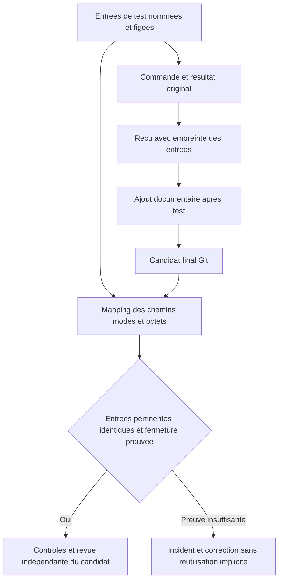

La réserve de supervision initiale15, calculée pour sept tâches non acceptées
à deux activations chacune plus une clôture, a été consommée par les replans.
À64activations et47décisions, plafonds72/60, il restait8/13, déficits7/2 selon
cette même règle de réserve. L’autorisation utilisateur antérieure permet la
mutation publique697 à79/62. Consommation64/47,82appels sur100 et quatre
tentatives T2 dont trois historiques restent exacts. Aucun appel supplémentaire
au fournisseur ni verdict n’est déduit de cette configuration. L’essai4 poursuit
sa remise, puis contrôles et revue doivent décider son acceptation.

### Originaux de la quatrième production native

La quatrième production remet de nouveaux originaux : suite complète exit0,
514 s de durée extérieure et 476,902 s pour le paquet moteur, arbre testé
`52b15c9e3c3bd900fae81ef0b5716e592cd03ab4`. Les 14 pièces sont archivées sans
réécriture. Le nouveau résultat attend sa propre revue ; l’ancien avis porte
sur la troisième tentative. La remise de 112 fichiers dépasse la limite de 100 et doit
suivre une coordination couvrant le candidat complet. Ces résultats locaux
ne constituent ni le verdict indépendant courant ni une acceptation.

### Replan27 : cycle de vie des avis et méthode de qualification

La lecture publique à la révision 701 confirme deux identités distinctes :
la tentative courante `a-67814a677979c23767c4e6c5` et l’avis encore courant
attaché à `a-2f9e1debb1548be96273f0d3`. Le GET scope-preview échoue HTTP 400
avant tout nouvel appel ;82 appels restent consommés. Le défaut est reproduit
sur une copie isolée. La correction archive le précédent avis, protège ceux
qui sont actifs ou non attribuables et permet la coordination du candidat
courant, sans cinquième production ni augmentation de la limite de 100 fichiers.

Notre méthode a aussi ralenti la reprise : deux qualifications complètes ont
commencé avant stabilisation des assertions et de la revue des passages.
Ces exécutions ont été arrêtées et conservées, sans succès déclaré. La source
finale est désormais figée après cette revue et une qualification complète
est relancée. Un essai exploratoire sans gel préalable des entrées de compilation
n’est pas utilisé comme preuve avant/après. La réception native, la décision
du superviseur et leur effet restent à vérifier après installation.

### T3 avant27 : qualification, installation et instruction réelle

L’utilisateur demande de passer à T3 avant le correctif27. La tentative publique
de modifier le graphe existant est refusée : contrat hiérarchique immuable.
Aucune dépendance n’est alors changée et les pauses sont reprises.27 est
explicitement différé ; sa suite interrompue ne devient pas un PASS.

T3 est développé dans une copie isolée : exploration en lecture du Git accepté,
originals et empreintes attribués au périmètre et à la décision, adaptation des
dépendances des seules tâches futures non produites, et réservation simultanée
de deux sous-planificateurs sous leur budget partagé. Le Judge développé dans
la quatrième production T2 est composé avec les préimages conservées ; cette
composition ne constitue pas une acceptation de T2. Les tests de concurrence
utilisent deux processus fournisseurs doubles ; la recette de vrais fournisseurs
reste distincte. Les variantes refusées, replay, pauses et changement de candidat
sont contrôlés. L’architecture FR/EN et ses Mermaid sont livrés avec les sources.

La suite complète passe en 714.033217 s, exit0 ; vet,
méthodes et build passent sur les mêmes entrées figées, sans dérive.1220 sources
sont vérifiées. Le service exécute 8f91d4e3d002a5dd1dde575c15b14f6aed7078be22a41b5f02927de0122f3954,
PID 2765908, état ready. Les corps Work des trois missions après pauses
sont exactement conservés. Aucun accès direct, copie, initialisation ou migration
de base native ; références de comparaison et journaux restent privés.

Le paquet125 conserve les122 originaux antérieurs. L’instruction T3 est compacte
(7188 octets avec apprentissages), les anciennes instructions
sont archivées dans le paquet, critères et ajouts/rejets préservés. Le superviseur
reçoit une demande publique : conserver T2 comme prérequis de T4 puis faire
dépendre T3 de T1 acceptée, sans acceptation inventée ni nouvelle tentative T2.
Les deux pauses sont reprises publiquement. À ce stade, l’appel du superviseur
est effectivement réservé, mais sa décision, le lancement de T3 et la réception
des entrées par son worker restent à observer. L’installation ne vaut pas recette.

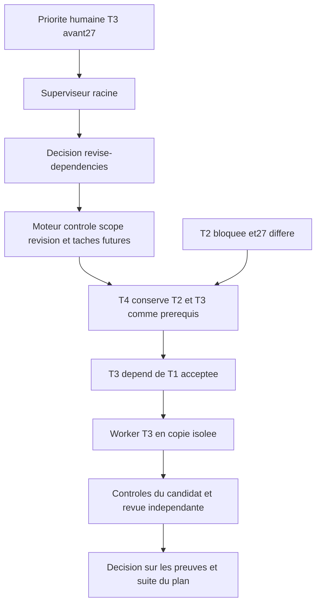

### Effet natif T3 : graphe appliqué et première tentative lancée

Le superviseur applique la décision
`planning-claim-edd757dc6932de7f4662591f-decision` à 10:23:54 UTC :
T4 dépend de T3 et T2, puis T3 dépend de T1. Le dispatcher lance effectivement
`auto-b39bb80661d6d56b9df2`, tentative `a-8314de66e60d5d36bb4ccb5c`,
à 10:24:03 UTC, sans intervention `resume-launch`. Le prompt réel contient
le chemin, le SHA256 et le commit du paquet125 ainsi que le nom du patch T3.
L’agent est running et ses premiers outils produisent des résultats publics.
T2 conserve quatre tentatives, son état blocked et82 appels de revue consommés.

Le motif du superviseur qualifie les affirmations techniques opérateur non
vérifiables dans son contexte de suspicion d’injection, tout en justifiant
indépendamment et appliquant le changement de graphe. Ce signal n’établit pas
que les affirmations étaient fabriquées : leurs reçus de qualification et
d’installation sont conservés séparément. Il révèle une limite de transmission
des preuves et de distinction entre instruction humaine, donnée et certification.
Aucun verdict du superviseur n’est réécrit. La réception du pointeur dans le prompt
ne démontre pas encore l’import des sources, les contrôles du candidat produit
ni son acceptation indépendante ; ces frontières restent ouvertes.

### Échec lié T3 : ne pas confondre lancement et continuité

La première tentative termine après136 s et neuf outils sans rapport, diff
ni import du paquet. Son message public décrit T3 comme « greenfield », estime
le travail trop grand pour une réponse et demande un choix à l’opérateur.
L’absence de rapport est donc une conséquence ; aucune insuffisance mesurée
de droits ou budget n’est fournie. Le pointeur des sources était reçu mais
leur usage ne l’est pas. Le superviseur reprend avec une consigne de rapport
obligatoire, puis réserve une deuxième tentative ; cette correction ne traite
pas encore la première frontière de transmission. La décision d’exécution
ne clôt pas l’incident.

À la révision720, l’original du message et ce diagnostic sont remis publiquement
à la racine : ne pas interrompre l’essai actif ni modifier ses consignes gelées ;
si nécessaire, la prochaine reprise doit commencer par l’import en lecture du
seul bundle transmis et la vérification de ses empreintes/préimages. Le travail
autorisé doit continuer sans question de convenance ; un obstacle réel exige
un rapport bloqué avec cause, propriétaire et condition concrète de reprise.
Les consignes seules ne prouvent pas l’effet ; réception du diagnostic, décision,
application et résultat de production restent à contrôler.

### Replan T3 : quota réel puis contrôle du mauvais fournisseur

La deuxième tentative est interrompue après421 s et37 outils par un quota
Claude429, confirmé dans l’état public du fournisseur jusqu’au12 octobre
à12:40UTC. Ce n’est pas une expiration de120 s ni l’atteinte des80 outils.
Aucun rapport, import du paquet ni changement de code n’est observé. Les
messages publics montrent une préparation d’API différente sans réemploi
du code transmis. La divergence est remise au superviseur avec ses originaux.

L’opérateur choisit par aperçu/application les routes Codex standard déjà
configurées pour root, reviewer et T3, sans changer les autres tâches ni
effacer le délai Claude. L’accès effectif Codex n’est pas encore démontré.
Une seule troisième tentative est autorisée avec une correction concrète :
import du seul bundle transmis avant inventaire/réimplémentation, empreintes
et préimages vérifiées, critères inchangés et rapport réel même sur blocage.
La réserve de supervision est recalculée à84/67 ;69 activations,52 décisions,
82 revues et les deux tentatives restent conservées. Une erreur opérateur de
schéma `task` au lieu de `task_id` est refusée avant mutation, conservée puis
corrigée avec une nouvelle requête ; elle ne crée aucun droit implicite.

La route Codex reste pourtant non réservée. La lecture du contrat et le cas
reproduit isolé montrent que planningStep choisit le bon fournisseur, mais
planningChange(claim) contrôle encore le fournisseur par défaut. La correction
résout le périmètre et sa sélection avant ce contrôle, sans modifier les délais,
les routes, les plafonds ou la sémantique d’acceptation. Les cas racine/enfant,
sélection/héritage, refus du fournisseur réellement choisi, compteurs et replay
passent ; race passe également. Les premiers tests ont révélé une assertion
nil incorrecte puis une propriété de périmètre dupliquée dans la fixture ; leurs
sorties sont conservées et la fixture utilise maintenant la délégation publique.
La copie de qualification avait aussi développé les13 liens canoniques de
méthodes en répertoires. L’exécution complète est arrêtée (exit-15,208 s) avant
correction de ces liens ; elle n’est pas un PASS. Les copies initiales restent
sauvegardées, les liens sont restaurés, les méthodes et tests ciblés passent.
La suite finale reprend sur2127 fichiers figés et13 liens, sans édition en cours.
Le correctif27 demeure différé. Installation, réservation effective, usage du
paquet par le worker, contrôles et acceptation native restent à établir.

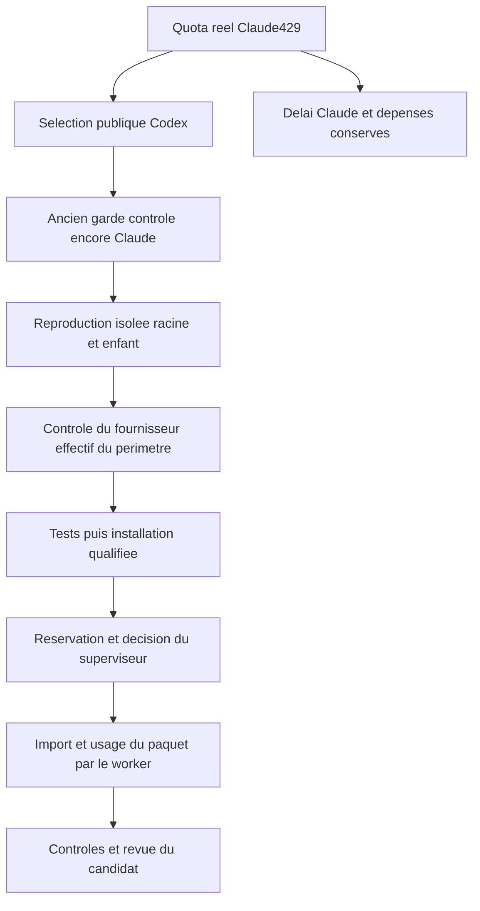

### Contrôle du fournisseur effectif : qualification et installation

La suite finale passe en 678.174399 s, exit0 ; vet,
méthodes et build passent également, sans dérive sur2127 fichiers et13 liens
canoniques.1221 sources sont contrôlées. Le patch dix chemins est appliqué
exactement sur ses préimages, puis transféré. Le service exécute
d76af56bffc1b7864c5455e109f054716c4a4b218b58c23521e10747880faf74, PID3850942, état ready.
Les corps Work après pauses des trois missions restent exacts ; aucune copie,
init ou migration de base native. Les journaux et références privées restent privés.

Le paquet127 conserve les125 originaux intacts. Le profil T3 complet est remis
par la CLI publique pour préserver timeout, limites, skills et capture ; critères,
dépendances, deux tentatives et apprentissages/rejets sont vérifiés inchangés.
La consigne corrigée précise également que scope-preview dépend d’un candidat
immuable après refus de taille, pas d’une production encore active. Les anciens
ajouts restent conservés avec leur filiation ; aucune preuve n’est réécrite.

Après reprise publique des deux pauses, la réservation native70 est observée
sur Codex, avec sa route et son empreinte de politique gelées. Le délai Claude
est conservé. Cette réservation prouve la correction de la première frontière
de fournisseur ; elle ne démontre encore ni la réponse du fournisseur, ni l’import
des sources par T3, ni les contrôles ou l’acceptation du candidat.27 reste différé.

### Usage natif des sources et transport compatible avec Git protégé

Le superviseur Codex reprend T3. Sa première proposition avec exploration large
est refusée avant application pour capacité ; il diagnostique puis propose une
reprise seule. Le lancement reste préparé Ready sans agent : l’opérateur reprend
le mêmeID/copie par action publique. Le relais exige également sa décision
explicite séparée `providers relay decide`, qui est enregistrée après lecture
des options et de leur empreinte. Aucun délai Claude, essai ni appel n’est effacé.

L’essai3 commence enfin par le paquet courant. Git de la copie gérée est protégé
en lecture seule : fetch/FETCH_HEAD puis objects échouent. Le worker diagnostique
et utilise un dépôt temporaire propre ; il vérifie127/127 entrées et retient les
hashes actuels, en distinguant ceux125 encore présents dans la consigne de reprise
historique. Il est ensuite arrêté par trois erreurs consécutives, mêlant contrôle
négatif de préimage et commandes shell/jq défectueuses. Son rapport existe ; aucun
code n’est appliqué. Ces originaux restent conservés, sans succès déclaré.

La reprise est préparée avec un transfert cumulatif DIRECT contreT1 accepté,
appliqué exactement en dépôt isolé :331 préimages/postimages et1221 sources
identiques au code qualifié. Ce transfert inclut les changements déjà observés,
sans en revendiquer l’auteur, et préserve les chemins de base hors déclaration.
Le paquet129 conserve les127 originaux. Une erreur de packaging sur les chemins
d’alias est corrigée en conservant les liens canoniques, sans écrire une copie
native. La marge d’erreurs est sauvegardée à6 via AdminTask, révision2. L’aperçu
Admin refuse d’abord schema_version (son schéma diffère de l’écriture) ; un nom
de champ candidate au lieu de candidate_commit empêche ensuite la requête de
redémarrage d’être construite. Ces erreurs opérateur sont corrigées, sans muter
le mauvais état ni répéter les étapes déjà appliquées.

Le redémarrage public autorise une quatrième production dans la mêmeT3, conserve
les trois essais et appelle le parcours retry avec une vérification nouvelle
d’environnement. Le worker réel importe129/129 entrées, applique331/331 préimages
et331/331 postimages, puis exécute les critèresT3. La recette et le contrôle
race passent ; leurs originaux restent à recueillir au handoff. Il corrige ensuite
le contrat français incomplet et un lien de documentation cassé. Son snapshot
frais1157 diffère du snapshot historique1221 : il conserve la distinction sans
inventer l’égalité de l’ensemble, de la sourceSHA ou du commit.

La limite EFFECTIVE de l’essai4 reste3 malgré la nouvelle configuration6 :
la reprise a conservé la borne précédente. La valeur sauvegardée ne prouve donc
pas son application. Cette contradiction, la classification des contrôles
négatifs attendus, les préparations Ready non lancées et la projection des
identités courantes sont remises à la racine pour corrections générales futures
avec réception/décision/effet à vérifier. Le worker actif n’est pas modifié.
La qualification complète du nouveau candidat, sa coordination éventuelle,
sa revue et son acceptation restent ouvertes ;27 demeure différé.

## 12 octobre — incident d’infrastructure et reprise des contrôles du résultat T3

La quatrième production native T3 a réellement développé le code, produit son
rapport et exécuté ses critères. Elle est ensuite interrompue par trois échecs
de montage du sandbox, imputés au compteur d’erreurs du worker. Le réglage Admin6
reste contradictoire avec la valeur gelée3 : cette contradiction est un incident
conservé, pas une correction achevée. L’hôte n’a pas été modifié ni ses protections
désactivées. Le code conservé ne vaut pas acceptation.

Le résultat réel, après réparation externe explicite des seules déclarations de
contexte, est qualifié dans une copie isolée : suite Go complète713,318s, vet,
méthodes et build passent sans dérive de source1157. L’ensemble des sources
supplémentaires déclarées passe de17 fichiers380855octets à9 fichiers121127octets.
Les pièces retirées de cette déclaration restent intégralement dans le candidat
et son diff ; les originaux des déclarations sont conservés. Aucun verdict ni
critère n’est fabriqué. La remise publique `submit-recovered-result` retient le
résultat61693d4413607770cfff22508236f3986c20bd33 de la même tentative, sans cinquième
worker. Les quatre essais, les82 appels de revue et les refus sont conservés.

Le contrôle cumulatif historique de T1 expire ensuite après30s avec sortie vide.
La politique approuvée de T1 et ses options ne sont pas réécrites. Le parcours
actuel ne permet pas de reprendre un résultat récupéré sur la même base avec un
budget corrigé. Le choix retenu est une correction générale : durée persistante
Admin du rôle `validation`, reçus du réglage réellement utilisé, reprise publique
liée au même résultat et à un budget explicite plus récent que l’échec. Les
préconditions absentes, non confirmées, anciennes, remplacées et les doublons sont
refusés ; le budget est vérifié à la réservation et avant intégration. Les droits,
les commandes, les critères, les revues et les consommations restent opposables.

Une deuxième correction sépare les échecs d’environnement des fautes du worker.
L’incident est remis pendant l’exécution au propriétaire du périmètre avec les
preuves structurées ; `continue-run` ou `stop-run` reste sa décision. Les compteurs
d’échecs restent observables et le plafond d’appels autorisés n’est pas levé. Les
régressions isolées reproduisent le défaut, puis vérifient réception et décision
pour la racine et un enfant, arrêt réel du processus, erreurs ordinaires, répétitions,
plafond de dépense et non-duplication d’un ancien incident. La chaîne ciblée passe
41,520s puis sous race76,831s ; le fournisseur est simulé, le sous-processus réel.
La migration du contrat30 conserve exactement le Work et ses liaisons, avec une
sauvegarde privée. Ces tests ne remettent pas en état les partages CIFS du poste
et ne prouvent pas une réparation autonome par un modèle réel.

La première qualification partielle est arrêtée lors de l’auto-revue : la version
de stockage devait protéger les nouveaux champs de décision face aux anciens
processus. Son arrêt reste conservé et ne vaut pasPASS. La nouvelle source gelée
1225, empreinte21b1e7fe8a43f2e7f43929273e174dd2c27f296495b59faa3ddc008629de38e5,
est en qualification complète ; elle n’est pas encore installée. T3 reste bloquée
sur le contrôle historique, T2 non acceptée et27 différé. La documentation FR/EN
et les diagrammes sont dans AUTORECURSIVE-RECOVERY et RUN-SUPERVISION.

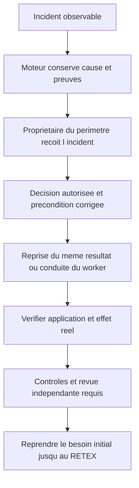

La qualification complète de cette source expire à la borne globale de12minutes
après755,118s compilation incluse. Aucun cas ne signaleFAIL avant le panic de
fin de durée du package ; le dernier scénario vient de commencer à cette borne.
Le reçu exit1 et sa sortie originale sont archivés. Les scénarios ajoutés rendent
la borne de l’ancienne suite insuffisante ; ce n’est ni unPASS ni une preuve de
blocage de ce dernier test. La source reste inchangée et une nouvelle qualification
utilise18minutes pour le package entier. Aucun délai de production, option d’un
contrôle approuvé, candidat natif ou consommation fournisseur n’est modifié.

La seconde qualification sur cette même source passe : Go complet759,073s,
vet2,641s, méthodes2,628s et build1,821s, sans dérive. Le patch exact24 chemins
est transféré après vérification de1225 sources ; les129 entrées précédentes
restent inchangées dans le nouveau bundle134. Le service qualifié est installé
sans acteur actif. Sa nouvelle empreinte exécutable est
ca75c3b3c6c0176cec4411a10fb27d5dbf6643a587e6e0174f7c904540dd9c83,
contrat30, état de santéready. La migration passe par le CLI public après arrêt
du serveur précédent ; les corps publics post-pause des trois projets sont
exactement conservés. Aucun accès direct, copie ou manipulation de la base native
n’a lieu ; les sauvegardes et sorties privées du service ne sont pas publiées.

Le budget Admin du rôle validation révision1 fixe180s pour cette mission.
La première réservation de reprise est refusée car la pause globale bloque
l’autorisation de validation. Cette tentative opérateur ne dépense ni worker ni
revue. La pause de planification reste posée, la pause globale est levée par
l’opération publiqueunpause, puis la réservation du même résultat est acceptée
à la révision766. Une erreur de nom d’actionresume au lieu d’unpause était une
erreur du client opérateur, sans effet persistant, et non un nouveau défaut moteur.
Le budget et la liaison du résultat sont relus ; les quatre essais, la remise
originale et les82 appels de revue sont conservés. La planification reprend
publiquement à767. L’effet des contrôles, la coordination de la revue et
l’acceptation restent à observer ; la réservation n’est pas une acceptation.

## 12 octobre — sortie originale manquante au superviseur après la reprise

Le moteur applique effectivement la réservation et le budget180s : la nouvelle
intégration de T3 atteint le contrôle Go cumulatif T1, qui sort avec code1 et
empreinte7881cd6eb1bdb74020bbe3c99cf7802968a869f6338b7536a9671f961696cad0.
Le candidat refuséf68bef4d093f89dc8aa07ee40743f45841c25c73 reste atteignable
par sa référence Git dédiée. Le superviseur reçoit cet échec et décide à770 de
ne pas répéter l’intégration ni présumer un défaut T3. Il constate que la référence
du diagnostic n’en fournit pas le contenu. Sa décision77 est reçue et archivée ;
les quatre essais et les82 revues restent conservés. Cette réception n’est pas
une correction globale achevée.

Une reproduction indépendante lit uniquement les sources Git de ce candidat,
puis les clone hors de la mission. Les1157 contenus du manifeste de la copie
réellement extraite correspondent ; les six chemins sous trois dossiers symlinks
ne pouvaient simplement pas être dereférencés par `git show` directement. Aucune
base ni sortie privée native n’est lue. La commande approuvée exacte, avec son
option interne25s inchangée, passe16,656s (34,849s compilation incluse). Cela
élimine une différence de contenu dans ce parcours ; cela ne révèle pas la cause
originale du code1 natif et ne prouve pas une remise en état de son contexte.
Aucune conclusion de défaut de code ou de délai interne n’est inventée.

Le défaut moteur à corriger est l’accès à cette preuve attribuée par une opération
publique, sans chemin privé arbitraire et sans mutation. La nouvelle lecture
HTTP authentifiée est reproduite en défaut404, puis vérifiée en succès avec sortie
originale exacte, code7 provoqué, attribution, empreinte et absence d’appel ou de
révision supplémentaire. Les cas sans authentification, mauvaise tâche, cause
remplacée, tentative remplacée et sortie corrompue sont refusés. Ces régressions
passent4,306s ; la nouvelle source est en qualification complète. La consultation
puis la transmission et la décision effectives restent à vérifier dans le service
actif. Le diagnostic doit conduire une action dans ses droits et une vérification,
pas seulement un nouveau journal ou une référence inaccessible.

## 12 octobre — diagnostic original obtenu et vérification proportionnée

La qualification complète du lecteur atteint son délai global de 18 minutes :
884 tests réussissent, aucun cas ne produit d’assertion en échec ; le test actif
n’a commencé que trois secondes auparavant. Cette invocation reste **FAIL**.
Une tranche disjointe est interrompue après 118 cas terminés, sans échec de cas,
sur instruction explicite de l’utilisateur : ne vérifier que les tests nécessaires.
`AGENTS.md` remplace l’obligation de suite complète systématique par la sélection
du contrat changé et des dépendances, la réutilisation des preuves encore valides
et un élargissement justifié par un changement, un échec ou un risque précis.
Cette correction de méthode ne transforme aucune suite arrêtée en réussite.

Le lecteur est qualifié par ses deux tests ciblés et variantes de refus, vet,
contrôle des méthodes et compilation, tous PASS sur la source gelée. Le service
qualifié est installé au repos ; les corps publics des trois projets sont
conservés exactement. Le GET authentifié expose ensuite l’original courant de T3 :
26 076 octets sans troncature, diagnostic SHA256
`db370b566914f4070be5bf4b9b58c6331a40e419c90c35a08be36d3c93240d6b`.
Sa première erreur est `panic: test timed out after 25s`, avec
`TestPreparedOrganizationManagedRepository/automatic` actif. Le dump Go présente
ensuite un panic pendant le diagnostic du panic initial ; ce dernier reste une
limite observée, et non une assertion métier inventée.

Le budget Admin de 180 secondes était réellement appliqué au processus extérieur,
mais l’option interne Go restait `-timeout 25s`. La correction précédente du budget
ne suffisait donc pas à lever cette cause. Le succès en 16,656 secondes sur un
clone identique n’annule pas le délai observé dans la mission : il distingue le
contenu source de la durée effective dans son contexte. L’original et cette
explication sont remis au superviseur par une reprise publique ; la décision et
l’effet de la correction du contrat de durée restent à vérifier. T3 reste bloquée,
avec ses quatre tentatives, son résultat et les 82 appels de revue conservés.

## 12 octobre — deux budgets explicites et reprise du même résultat

Le superviseur reçoit l’original, confirme que relever seulement le budget extérieur
était inefficace, choisit la correction générale et transmet l’apprentissage à T6.
Sa décision publique `planning-claim-21d6a559ec73ae0f4294eabd-decision` est conservée.
Le correctif ajoute une portée Admin `validation-go-test` pour le délai interne
Go, sans nouvelle durée par défaut ; `validation` reste le budget extérieur.
Le délai interne doit être strictement inférieur au délai extérieur. La politique
approuvée est conservée, les arguments effectifs figurent dans le reçu avec les
deux configurations attribuées, et la réservation lie leur empreinte combinée.

Le cas de régression exécute un vrai petit test Go qui expire initialement sur
son option interne : le réglage du seul processus ne suffit pas. Après correction,
il passe avec le réglage intérieur reçu. Les variantes vérifient les arguments
conservés, les formes de délai Go, les autres programmes, l’absence de réglage,
les budgets incohérents, le remplacement d’un budget après réservation et le
stockage du reçu. Ces tests ciblés passent en 21,091 secondes ; les dépendances
de reprise du résultat, de lecture du diagnostic et de stockage passent en
57,436 secondes. Une première compilation du test a échoué sur deux noms de
champs incorrects, corrigés avant rerun ; cette sortie reste conservée. Une
invocation antérieure interrompue par signal 143, sans sortie, n’est pas comptée
comme reproduction rouge. Vet, méthodes et compilation passent ensuite sans
dérive. Aucune suite globale n’est rejouée.

La source qualifiée `3876dc260921b698fca67e4a632e88893329d71bd85c8ae20bbae183b37289dc`
est transférée avec vérification de 1 228 entrées. Le bundle 139 conserve les
137 originaux précédents ; son routage futur n’est pas présumé effectué. Le
service qualifié est installé au repos, contrat de stockage 31 migré par le CLI
public ; les trois corps publics post-pause sont exactement conservés. Son
exécutable est `1cc9723d090ceea7b24458cb54fac498acb98c4fef31a1de24f173ee5279d174`.

L’opération Admin publique configure Go à 120 secondes, révision 1, avec le
processus à 180 secondes, révision 1 : marge observée de configuration 60 secondes,
aucun seuil moteur ajouté. La seconde reprise publique réserve le résultat T3
identique à la révision 778 ; les quatre essais et 82 appels de revue restent
intacts. La planification reprend à 779. Cette réception et application des
réglages ne constituent pas encore leur effet observé sur les contrôles de la
mission, une revue indépendante ou une acceptation de T3.

### Effet observé et incident lié : budget extérieur insuffisant

La reprise au budget 180/120 n’est pas acceptée : le contrôle extérieur expire
à 180 040 ms sans sortie. Le GET public fournit l’original
`0a9f24be99a3e3b4e26cb34a15388b69807cccf4ca954bcc32df434b93f29683`
et démontre que l’argument effectif est bien `-timeout 120s`, avec les deux
révisions de configuration capturées. L’effet de l’adaptateur Go est donc
observé ; la fin du contrôle ne l’est pas. Le processus parent consomme
94 465 ms CPU. L’absence de sortie est compatible avec une compilation lente,
mais ne prouve pas la phase exacte. Le poste observé présente une charge proche
de 48 sur 12 processeurs logiques, RAM presque pleine et swap entièrement
utilisé. Aucun processus tiers n’est arrêté. Le runner possède déjà un groupe
de processus, un arrêt du groupe sur délai et un nettoyage final : aucune
fuite d’enfant n’est inventée sans preuve contraire.

Le superviseur réexamine cet échec et transmet l’exigence d’observer les phases
à T6. L’opérateur corrige la précondition budgétaire par le parcours Admin
autorisé : seul le budget extérieur passe à 600 secondes, révision 2 ; Go
reste à 120 secondes, révision 1. La troisième réservation et reprise du
même résultat aboutissent à la révision 785, quatre tentatives et 82 revues
conservées, sans nouvelle source, suite globale ou production. L’effet de
cette reprise reste à vérifier. Un client de lecture a rencontré une sortie
base64 nulle pour les zéro octet : la réponse publique avait été préservée,
le décodeur est corrigé pour cette valeur vide sans répéter ni modifier l’original.

Les entrées opérateur des cinq tâches futures T4–T8 sont ensuite mises à jour
par l’API publique avec le paquet 139 et la consigne de vérification proportionnée.
Critères, exigences, dépendances, tentatives, modèles, profils, budgets et
apprentissages déjà enregistrés sont relus et conservés ; révision finale 790.
Les tâches n’ont pas encore reçu ces entrées dans un worker : aucune exécution
n’est déduite du seul enregistrement. Le contrat du résultat T3 en contrôle est
inchangé. Une observation des descendants du service à 14:35:15 UTC voit le
processus Go et `engine.test` actifs, ce qui établit que l’exécution a atteint
les tests ; elle ne prouve ni leur réussite ni une revue indépendante.

### T1 franchi, délai agrégé du contrôle propre à T3

La reprise au budget extérieur 600 secondes franchit les contrôles T1 et atteint
le contrôle `plan-validation` propre à T3. Son original public
`2acaa786be9f418dff5b7a7dd06b0e7123a5ad12bbf3a356a0e805c474a590cd`
montre un délai global de tests Go à 120 secondes, sans assertion en échec.
Le test actif `TestManagedRecoveryHandoffRejectsAlteredRepair` a duré 39 secondes,
son sous-cas `proof-key` 6 secondes ; la stack attend un sous-processus Git.
Cette photographie n’établit pas un blocage permanent du test ni un défaut source.

Erreur de réglage opérateur : la portée Go de 120 secondes, choisie pour T1,
s’appliquait aussi à la commande T3 dont l’option approuvée était 150 secondes.
Elle abaissait donc involontairement le budget de ce contrôle plus large. Le
contrat rend l’argument effectif visible, ce qui permet ce diagnostic au lieu
d’attribuer le problème au worker. L’opérateur augmente uniquement le réglage
Go à 480 secondes, révision 2 ; le processus reste à 600 secondes, révision 2,
avec 120 secondes de marge configurée. Les commandes métier, critères et tests
approuvés ne sont pas réduits pour accélérer. La quatrième reprise publique
aboutit à la révision 796 sur le même résultat, quatre tentatives et 82 revues
conservées ; aucune nouvelle source ou suite générale n’est exécutée. Son effet
final sur les contrôles et la revue reste à observer.

Prévention : avant un réglage de rôle commun, inventorier les délais et périmètres
des contrôles concernés pour éviter une réduction non voulue. La réussite d’un
contrôle court ne calibre pas une suite de validation plus large. Distinguer
budget de compilation/processus, budget agrégé du harness et durée du cas actif.
Les valeurs ci-dessus sont des décisions Admin explicites pour ce projet et
ce contexte observé, jamais des constantes de durée du moteur.

## 12 octobre — contrôles T3 réussis, puis réparation du périmètre binaire

Le résultat conservé franchit tous ses contrôles au budget explicite Go480/
processus600. Le précontrôle refuse ensuite 335 fichiers pour une limite de100,
sans appel payé ; un second contrat bloque même `scope-preview` : la revue
textuelle refuse les binaires avant de produire son inventaire de récupération.
Le superviseur reçoit ce refus mais ne peut inventer son empreinte ou ses lots.
La lecture des seules sources Git établit 63 différences binaires : 47 nouvelles
captures UX et 16 médias de formation modifiés. Aucune base ou preuve privée
native n’est lue.

Le défaut d’inventaire est reproduit dans un fixture isolé contenant un vrai
binaire et un candidat trop large. Le correctif sépare la lecture attribuée
`inspection_only` de toute autorisation de revue textuelle. Les reçus de contrôle,
candidat, tentative et fin de processus restent vérifiés ; l’inventaire garde
les chemins binaires. Le retry ordinaire refuse toujours ces binaires. Les
variantes sur contrôle altéré, mauvaise tentative, mauvais candidat et production
interrompue vérifient absence de mutation ou dépense. Tests ciblés50,854s, vet,
méthodes et build passent. Le service qualifié est installé au repos ; stockage31
inchangé, corps publics post-pause des trois projets exactement conservés.

Le premier client d’inventaire expire à20s ; la lecture reprise avec un budget
de lecture180s rend l’inventaire public à803 : candidat
`473246b611d61f0c56f984abaee31060c8f452e1`, 335 chemins, huit critères T1/T3,
empreinte `dc968aac7838f238aa7fcabfc95d46db7c5661999f01c46485239acc9ffdf027`.
Cette lecture ne dépense aucun appel et ne produit aucun verdict visuel.

Dans la seule copie T3 arrêtée, l’opérateur restaure les16 médias à la base
acceptée et diffère les47 nouvelles captures. Aucun des574 fichiers Go ne
change ; les63 originaux restent dans le candidat historique et une sauvegarde
externe, et leurs versions dans l’application principale sont relues inchangées.
Le manifeste actuel1157sources est recalculé ; le manifeste historique reste
intact. Rapport et limites de l’intervention opérateur sont ajoutés. Le delta
reste272fichiers textuels ; une coordination de revue demeure nécessaire.

`revise-recovered-result` enregistre cette correction explicitement à804 :
nouveau résultat `d073b271d38abb097624ececace0f9e084c11ce1`, arbre
`e961404761454c28165194e426e3b40d9ff5a41d`, nouvelle clé de preuve, résultat
précédent conservé, quatre tentatives et82revues inchangées. Reprise publique
à805, sans acceptation. Les contrôles doivent être frais sur cette remise.

Les sept activations et décisions restantes ne couvrent pas les cinq tâches
futures (départ et traitement de résultat) plus coordination T3/reprise T2.
Dans l’autorisation utilisateur existante, les enveloppes de planification sont
portées publiquement à150activations et100décisions, racine150, à806. Consommations,
pauses, erreurs et plafond de revue100 restent inchangés. Ce budget n’accepte
aucune tâche et ne permet pas une remise à zéro des essais.

## Élasticité demandée : écart fonctionnel explicitement ouvert

L’utilisateur demande que l’élasticité fonctionne. Le code possède le mode
d’observation des workers, mais cette mission n’a pas de configuration d’observation
explicite ; aucun mécanisme native d’ajustement supervisé des budgets de validation
n’est démontré. Les modifications Admin opérateur ci-dessus ne le prouvent pas.
L’obligation est enregistrée publiquement dans T5 à801 : incident et phase reçus,
décision attribuée du sous-superviseur ou de la racine, adaptation dans les droits
et l’enveloppe Admin, application déterministe et effet réel. La désactivation
générale des plafonds ne remplace pas cette fonction. T6 reçoit aussi à800
l’exigence de conserver les contrôles partiels valides pour éviter leur replay
après un échec ultérieur, avec candidat, entrées, arguments, budgets et fraîcheur.
Ces consignes sont des obligations de développement encore ouvertes, pas des
fonctions achevées ou une preuve de réception par un worker.

## Reprise du 12 octobre : clarification Elastic et capacité de revue

« Elastic » peut désigner le service Elasticsearch ou l’adaptation des ressources
Swarm. La clarification textuelle a été demandée ; aucun sens n’est accepté
implicitement. Vérification en lecture seule : Elasticsearch répond sur
`127.0.0.1:9200`, son cluster est vert et aucun index n’existe. La recherche
ciblée du dépôt ne trouve aucun raccordement Elasticsearch ; ce résultat ne
prouve donc aucune collecte ni recherche des logs Swarm.

Pour Swarm, l’élasticité supervisée reste ouverte dans T5. Les limites de lancement
sont gelées ; une reprise conserve les anciens plafonds d’appels et d’erreurs.
Les hausses Admin opérateur ne prouvent pas une adaptation autonome par un
superviseur. La correction exige une autorisation explicite de croissance,
une décision attribuée, son application déterministe et un effet observé.

T3 conserve le candidat `48db9ca5550eab184f01843877e2e3b3f657dd4b` et
ses contrôles réussis. L’inventaire public frais expose 272 fichiers, huit critères
T1/T3 et l’empreinte `51fcca891e4c661a64259ecf9146c949ad17cb5a69479bdca06ca07290b26a0f`.
La préparation de revue refuse une pièce textuelle de 165 Ko avant d’essayer la
capacité du fournisseur. Régression isolée reproduite : le calcul de l’ancien
format bloque le passage au protocole de capacité observée. Le correctif isolé
conserve les pièces entières et les refus de provenance, budget et coordination.

Le premier test a été lancé pendant une modification de source : son échec de
compilation reste historique et ne vaut pas reproduction. Une copie séparée
figée reproduit ensuite le défaut réel. Le premier empaquetage corrigé retokenise
tous les préfixes cumulés et dépasse le délai global de trois minutes. Une
recherche bornée de paquets complets, avec validation préalable de couverture et
recomptage final exact, réduit la préparation du dossier réel à 40,44 secondes.
Ce dossier reste toutefois refusé : aucune capacité ne demeure pour les preuves
finales. Aucun plafond ni réserve n’a été supprimé, aucun appel payant dépensé,
aucune installation ou acceptation déduite. Le correctif de transport demeure
isolé et incomplet pour ce dossier ; la synthèse finale doit être diagnostiquée.

La règle de tests ciblés est conservée dans AGENTS.md : aucune suite Go complète
n’a été relancée pour cette reprise.

Diagnostic supplémentaire sur le même binaire de test figé, sans recompilation :
281 pièces, sept paquets et deux appels finaux, soit neuf appels pour dix-huit
disponibles. Le calcul se termine en 29,63 secondes avec le même refus de capacité
finale ; le budget d’appels ne cause pas ce refus. Les régressions ciblées du
correctif passent en 23,882 secondes. La correction demeure isolée : aucune
installation ni adoption native, car le dossier réel ne franchit pas encore
le précontrôle final. La réserve de synthèse doit être reproduite et corrigée
au niveau de son contrat, sans retirer les originaux ou présumer un verdict.

## Reprise après correction utilisateur : retour au moteur

L’utilisateur précise que son message « elastic doit fonctionner » était une erreur
et demande de reprendre le travail initial. Aucun développement Elasticsearch ni
nouvelle exigence d’élasticité n’en est déduit. Les observations précédentes sont
conservées comme historique, sans les présenter comme une décision utilisateur.
La priorité reste T3, puis la reprise T2 et les tâches jusqu’au RETEX.

À cette reprise, le service web ne répond plus ; le binaire existant qualifié
SHA256 `476e602235d5f631eba521f6ab12e3f3dcd574b7d583a391018985c2d7c55b94`
est redémarré, sans remplacer le moteur ni réinitialiser la mission. Le parcours
public confirme révision 815, quatre tentatives T3, 82 revues consommées et tous
les contrôles du candidat `48db9ca5550eab184f01843877e2e3b3f657dd4b` réussis.
Les fichiers temporaires de diagnostic ont disparu ; le client public est
reconstruit et le dossier reçu de nouveau par l’API authentifiée, sans lire
les journaux ou la base privée.

## Correctif de capacité installé — 12 octobre 2026, 20 h 51 Paris

Le contrat nouveau conserve le protocole 4, ancre
`final_reserve_contract_version=1` dans le budget de chaque paquet et conserve
strictement la branche historique zéro. Le lecteur ancien strict refuse le
champ inconnu ; aucun ancien prompt payé n’est réécrit. Le calcul mesure le
socle en tokens et octets puis réserve les champs variables sérialisés une fois.
Les messages effectifs restent mesurés avant dépense, avec refus des preuves
altérées, budgets insuffisants, lots incohérents ou client modifié. Les paquets
contiennent les pièces complètes, sans suppression ni troncature.

Régressions ciblées : PASS 20,451 s ; sélection : PASS 6,172 s ; parcours runtime
protocole 4 (subprocess déterministe, succès/refus/persistance/client changé) et
variante de messages du contrat nouveau : PASS 26,610 s. Dossier réel reçu de
nouveau par l’API : 281 pièces, sept inspections et deux appels finaux, PASS
9,44 s en qualification. Ce test n’est pas un verdict sémantique d’une IA réelle.
Vet et build passent. Le contrôle des méthodes a d’abord échoué parce que la
copie de qualification avait déréférencé les liens canoniques des skills ; ces
liens sont restaurés à l’identique, puis le seul contrôle concerné et la
construction sont repris avec succès. Aucun test général n’est relancé.

Installation en pause, sans acteur actif, du binaire
`ae2634674b99a06d0252928a4793b75bbbf393441163502a85f2aaef86f4f76d` ;
source `253c39820fa1fcb4e5e6de7cbdca7643e5e388f6e4e924fcf36e068bb17b210e`,
schéma 31 inchangé. Les trois corps Work publics après pause restent strictement
identiques ; candidat, contrôles, quatre tentatives T3 et 82 revues conservés.
Service observé prêt. Coût natif frais et décision de coordination du superviseur
restent à constater ; installation ne signifie ni revue ni acceptation.

Le coût natif frais montre une différence réelle avec la qualification locale :
les consignes complètes du reviewer portent le socle à 50 713 tokens. La réserve
arbitraire de 111 296 octets ne tient pas dans la marge de 109 383 tokens ; le
refus HTTP original est conservé, sans dépense. La correction supplémentaire
lie les réponses nouvelles à des constats indexés et aux seules ancres proposées,
dont la taille sérialisée maximale est connue. Les tableaux libres historiques
restent sous le contrat zéro ; le contrat un les refuse. Les bornes d’octets et
de tokens ainsi que le message effectif restent contrôlés indépendamment.

Qualification ciblée des ancres, de la sélection et du rejeu historique : PASS
5,892 s pour les cas spécifiques, puis PASS 29,514 s avec les consommateurs ;
vet, méthodes et construction PASS. Binaire installé
`203c98e2660c2ab31791015df3c3e13dc47f74502393d879987fd29023be8e89`,
source `9790f6f59abd8f723bf5cb51ad45039d0439c93af370c3a9fc4c7227f058d9a9`.
Les corps Work publics restent identiques pendant la maintenance.

Le service réel confirme ensuite protocole 4, neuf appels requis sur dix-huit,
transport prêt et budget suffisant. Une première remise publique a été refusée
faute d’identité du producteur : l’opérateur avait choisi une route de handoff
sans respecter son attribution. Le diagnostic corrige la demande avec l’identité
réelle de la tentative arrêtée et un document d’inventaire dans sa seule copie.
La raison indique explicitement l’intervention opérateur ; elle ne prétend pas
qu’une IA a produit ce diagnostic. Le résultat canonique n’est pas modifié.
Remise acceptée et reprise publique, avec l’inventaire complet, puis décision du
superviseur encore à observer. Aucune acceptation T3 n’est présumée.

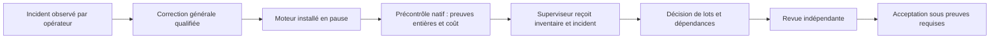

## Conduite visible et correction de transmission au superviseur

L’utilisateur demande une conduite visible et refuse les longs tunnels d’actions.
Le jalon annoncé est l’entrée effective de T3 en revue indépendante, puis sa
poursuite dans le plan initial. Qualification, installation et reprise sont
exposées avec leur résultat et leur limite ; elles ne valent pas acceptation.

Après le transport de revue corrigé, le superviseur acquitte l’entrée de reprise,
mais la transmission du prochain inventaire échoue avant tout appel IA : le
contexte de planification répète chaque chemin dans le tableau des fichiers et
les suggestions de lots. Correction générale de projection uniquement : une
table de préfixes et lignes reconstruit les chemins exacts dans leur ordre ;
les lots référencent ces lignes par index. Les métadonnées, critères, contraintes,
identités et correspondances sont conservés. Le preview public et les décisions
durables conservent leurs chemins complets. Une suggestion inconnue ou une
compression inutile revient à la représentation originale, sans masquage.

Régression de 274 chemins (272 sources plus Unicode et fichier racine), restitution
exacte, absence de mutation et référence inconnue : PASS. Le parcours de décision
versionnée, la priorité des reprises et l’enveloppe fournisseur complète passent
ensemble en 2,954 s ; vet, méthodes, construction PASS. Le binaire
`68226c276e866eff8b5a40efd1750a8504ae9d24f9e82b328d97a5ac2a56e4d4`
est installé en pause ; les corps Work publics et les 82 revues sont conservés.
Source `6afa646078004df2373c338f3bd3f542110765c4945340d5cb59640199599559`.
Reprise publique avec explication du format sans perte ; réception, décision puis
entrée réelle de revue encore à observer. Le panneau de conduite est demandé
pour rendre cette progression visible.

### Limite de planification constatée et adaptation vérifiée

La première compression ne suffit pas. Reproduction depuis le Work public et le
preview, dans une fixture isolée dont le stockage est remplacé par un chemin
inexistant de la fixture : contexte 36 720 octets, capacité historique restante
24 577, méthodes 32 084. La source publique ne devient jamais une base de test
native. L’encodage par préfixe du chemin précédent réduit l’inventaire à 11 333
octets ; la transmission reste refusée sous le plafond historique. Ces refus
sont conservés, aucune acceptation ni dépense de revue n’en est déduite.

Correction générale de la capacité de planification : pour un client/modèle
reconnu, observation locale du catalogue, réserves conservées, mesure complète
prompt et schéma avant claim, capacité jointe au contexte et ancrée dans
context_sha256. La réservation reconstruit la même empreinte ; client,
fournisseur et modèle sont revérifiés avant invocation. Un client non reconnu
conserve l’ancien plafond. Budgets, droits, critères et compteurs ne changent
pas. Aucun nouveau champ durable Work ni migration de stockage.

Tests du contexte public complet, du subprocess déterministe dépassant 64 Ko,
du reçu exact et des compteurs, des capacités invalides/insuffisantes et des
clients anciens : PASS 2,906 s. Vet, méthodes, construction PASS. Installation
préserve les corps Work publics. Binaire
`ae2e5f9d63c421859a57a2d3f7e4de3ff9cb098f5a25dbe1cd6e90640a611d37`,
source `f8f63635dc52194bef9f7ac4202b73b1403bb9ecf3627a9a3b09cc4eac61e765`.

Effet natif observé : activation 85 du superviseur, reçu
`443ec7de10db0aa325afa22ceeed17c4476ba019defba2293e6cb1b8d177298a`,
trois événements effectivement fournis (nouvelle correction, incident T3,
remise de l’inventaire). L’IA traite maintenant ces entrées sous son bail ;
sa décision de lots, la revue indépendante et l’acceptation restent à observer.
Le paquet immuable 146 conserve les 144 originaux ; son patch cumulatif remplace
l’ancien patch review-capacity-first et s’applique après binary-preflight.
Aucun commit du dépôt principal ou du dépôt natif n’est créé pour cette opération.
