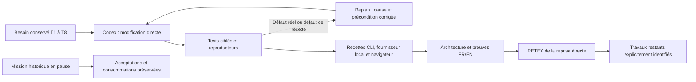

# Développement direct du moteur : vérification et RETEX de reprise

## Périmètre et état réel

L'utilisateur a choisi le développement direct par Codex seul, sans Claude ni
orchestration de ce développement par Swarm. Le dépôt canonique est
`/home/fpizzi/Documents/ChatGPT/swarm`. Les sources et modifications antérieures
sont conservées ; aucun nouveau checkout complet n'est créé pour chaque correction.
La mission historique reste en pause, révision 839, une tâche au statut historique
`accepted` sur huit,
aucun agent actif et 82 appels de revue historiques. Ce constat natif reste distinct
des résultats de développement ci-dessous. La lecture publique du rapport
attribué à cette tâche est refusée après le déplacement du dépôt ; le statut
historique ne démontre donc pas une revalidation actuelle de sa preuve.
Le [diagnostic des chemins](../../../../plans/engine-cursor-contract/repertoires-20261012.md)
décrit la correction source ciblée, ses 22 tests/sous-cas PASS et les limites
opérationnelles restantes. Le reçu de vérification ci-dessous précède cette
correction : ses empreintes ne désignent pas les sources modifiées ensuite.

Cette note accompagne le [plan direct](../../../../plans/engine-cursor-contract/developpement-direct-20261012.md)
et les [preuves locales conservées](../../../../plans/engine-cursor-contract/evidence/direct-20261012/).
Elle ne clôt pas la recette avec fournisseur réel ni la revue indépendante T7.
Le RETEX porte sur cette reprise directe après ses recettes isolées ; il ne
remplace aucune exigence originale encore non démontrée.

## Fonctions corrigées et observables

| Contrat | Défaut observé | Effet vérifié |
| --- | --- | --- |
| Remise concurrente T4 | Une revue occupait la voie ; le second commit terminé n'était pas figé | Le résultat et son rapport sont conservés pendant la revue, puis intégrés sans nouveau worker ; aucune revue supplémentaire ni acceptation prématurée |
| Jugement global T2 | API judge/renew présentes, opérations absentes de la réponse du superviseur | Schéma racine reçu, décision sous bail, verdict durable, renouvellement et contexte du cycle suivant réellement reçu |
| Fin du besoin | Une acceptation locale pouvait entraîner une clôture déduite par le moteur | Le superviseur propose la fin ; le moteur vérifie les preuves fraîches, les événements et les processus, puis applique cette décision explicite |
| Réglages T5 | Plafonds fixes supplémentaires et champs non exposés | Tâches, activations, décisions, revues, périmètres, niveaux et cycles utilisent les politiques persistées ; modale Admin et mêmes valeurs CLI/API |
| Retour de rejet des consignes | Réponse serveur reçue et état correct, carte encore « en cours » | Succès/refus répercutés dans l'inspecteur ; refus visible avant une relecture lente, puis nouvelle décision explicite sur état relu |
| RETEX dans le produit | La recette doit rester une source, pas une autorisation de nouvelle exécution | Proposition sourcée après recette, préparation de l'évolution et absence de lancement implicite ; original et rejet conservés |

Le cache de l'inspecteur inclut désormais les retours locaux des consignes.
Le résultat d'une mutation ne dépend plus du seul rafraîchissement général du
graphe pour mettre à jour la carte. Les preuves originales de refus (HTTP 409)
et de succès (HTTP 200), avec état reçu et message périmé affiché, sont conservées.
L'anomalie concernait le consommateur UX ; elle ne justifiait ni de rejouer
automatiquement la décision ni de changer les protections transactionnelles.

Les architectures FR/EN décrivent [les cycles](../../../../architecture/JUDGMENT-CYCLES.md),
[le parallélisme](../../../../architecture/AGENT-PARALLELISM.md),
[les consignes](../../../../architecture/INSTRUCTION-LEARNING.md)
et [les réglages](../../../../BUDGETS.md). Les Mermaid distinguent conservation,
contrôle, décision et publication.

## Vérifications nécessaires

Environnement : Go 1.24.3, Linux amd64 ; Node 22.23.2 ; navigateur Chrome local.
Les tests utilisent des racines isolées. Le fournisseur de protocole est un
sous-processus déterministe local, même lorsque son nom historique de fichier
est `claude` ; aucun modèle Claude ou autre modèle réel n'est appelé.

- Conservation/publication : 20 tests et sous-cas passent avec `-race`, y compris
  rejeu immuable, pauses, identité étrangère, revue vivante et conflit de fusion.
- Jugement reçu et appliqué : 19 tests et sous-cas passent ; sept autres contrôles
  vérifient la décision partagée, son atomicité, le schéma et les contrats Cursor.
  Le test de transport émet explicitement tous les champs exigés par le schéma.
- Fin et RETEX : les sous-cas de fin avec preuve fraîche, de processus actif et
  les contrôles de phase post-recette passent. Une racine réellement close par
  décision explicite expose la phase RETEX ; un processus actif empêche la fin.
- Modale : valeurs sauvegardées puis relues, aperçu sans mutation, consommations
  conservées, révision périmée refusée, FR/EN, thèmes clair/sombre, mobile et focus.
  La présentation compacte distingue utilisation et plafond sans long bloc initial.
- Consignes/RETEX : quatre parcours FR/EN × thèmes passent au clavier, avec
  persistance après rechargement, mobile, refus de révision sous relecture lente,
  préparation sourcée et absence d'agent ou de préparation adoptée implicitement.
- Compilation de l'exécutable `./cmd/swarm`, traduction et contrôles statiques
  ciblés. Le résultat final des contrôles et les empreintes figurent dans le
  [reçu de vérification](../../../../plans/engine-cursor-contract/evidence/direct-20261012/verification-receipt.json) ;
  un contrôle interrompu ou non exécuté n'est jamais PASS.

Les échecs de vérification sont conservés : une assertion de compteur fichier
placée avant son écriture par le script bloqué ; un lecteur de schéma supposant
tous les enums textuels ; une comparaison d'état retourné plutôt que d'état
persisté ; une assertion temporelle exigeant un chevauchement après une inférence
trop courte. Ces erreurs de recette sont corrigées après diagnostic, sans
assouplir les protections de production. La barrière contrôlée prouve le
chevauchement ; la mesure répétée observe les durées sans leur imposer un gain.
Les sources rouges ne disposent pas toutes d'une empreinte séparée : ne pas
présenter le manifeste final comme l'identité de leurs anciennes exécutions.

La suite Go entière n'est pas relancée : les anciens échecs/expirations restent
historiques et ne deviennent pas PASS. Les contrôles portent sur les contrats
modifiés et leurs dépendances identifiées, conformément au choix de l'utilisateur.

## Mesure T6 : deux niveaux de concurrence

Chaque essai publie les mêmes deux résultats compatibles, avec les mêmes
contrôles et une revue de sous-processus comportant un délai fixe de 80 ms.
Trois essais par niveau, deux résultats acceptés et deux appels de fixture dans
chacun des six essais. La production précède la mesure ; seuls remise, contrôle,
revue et publication sont observés. Le cache et la charge de l'hôte ne sont pas
isolés ; cette série ne démontre pas une accélération du projet réel.

| Niveau d'admission | Durée min / médiane / max | Remise pendant la revue | Appels et résultats par essai |
| --- | --- | --- | --- |
| 1, intégrations successives | 0,860 / 0,996 / 1,087 s | Pas de remise concurrente | 2 appels, 2 résultats |
| 2, remise concurrente | 0,834 / 0,881 / 1,024 s | 3 essais sur 3 ; remise en 49–85 ms | 2 appels, 2 résultats |

Les plages se chevauchent. Le résultat solide est la remise conservée pendant
une revue, avec qualité et nombre d'appels identiques dans ce scénario. Les
tokens, le cache du modèle, le coût du fournisseur réel et le coût de la session
Codex restent non mesurés. Le délai de fixture et les temps de test ne sont pas
des mesures de performance d'une IA.

## RETEX et prochaines actions

1. **Une fonction doit être raccordée à son consommateur.** Un endpoint de juge
   ne suffit pas si le superviseur ne reçoit pas son opération. Prévention :
   vérifier contexte, schéma, décision, persistance et contexte suivant avec le
   transport réel de protocole, puis séparer les preuves de modèle réel.
2. **La remise et la publication ont des contraintes différentes.** Conserver
   tôt un résultat immuable permet d'avancer ; des revues concurrentes sur des
   bases périssables peuvent dépenser des appels inutilisables. Prévention :
   gardes partagées, propriété de tentative et publication liée au candidat exact.
3. **Un état moteur correct peut être masqué par une UX périmée.** Prévention :
   tester succès, refus, cache de présentation, relecture lente et reprise
   explicite ; conserver les états reçus et l'affichage comme deux preuves.
4. **Les recettes peuvent aussi être fautives.** Une course de fixture, zéro
   test collecté ou un format supposé ne prouve pas un défaut du moteur.
   Prévention : source productrice lue, sorties structurées, compte réel des
   tests et diagnostic avant nouvelle tentative. Les règles communes de
   `AGENTS.md` et `CLAUDE.md` reprennent cette discipline adaptée de Wattson.

La revue indépendante du candidat et la recette avec fournisseur réel T7
restent **NOT TESTED** pour cette reprise. Le développement direct n'autorise
pas implicitement une délégation ou une reprise de l'orchestration native.
Le moteur historique installé n'est pas remplacé par la réussite de ces tests.
L'autonomie, la fiabilité globale sous charge réelle et le débit avec modèle
réel restent à établir ; aucun statut d'acceptation natif n'est forcé.

## Complément T5 : preuve de réception des réglages navigateur

Les délais 15/60/65 secondes ont été déplacés vers une configuration persistante
avec modale Admin et producteur Go/API/CLI commun. Les trois tests du contrat,
sept contrôles partagés avec détection de courses, le transport JavaScript et
quatre parcours navigateur FR/EN × thèmes passent. La recette observe une
expiration et un appel sans délai sur probes interceptées, sans fournisseur réel.

Deux écarts sont corrigés après recette : perte de focus pendant la relecture du
réglage sauvegardé et libellé de fermeture coupé sur mobile. Les preuves originales
sont conservées ; un affichage ou une réponse HTTP correcte ne suffisaient pas
pour conclure. Le reçu `web-requests-verification-receipt.json` conserve les
empreintes de cette correction ; le reçu antérieur reste historique.

L'apprentissage porte sur toute politique configurable : vérifier le producteur,
la persistance, la réception par les différents consommateurs et l'effet sur une
requête, puis inspecter la présentation. Aucun zéro-hardcoding global n'est
affirmé : les délais serveur des connexions et le chargement de l'éditeur restent
à administrer. Cette étape ne remplace ni la recette fournisseur réel T7 ni son
avis indépendant et ne clôt pas l'objectif T1–T8.
