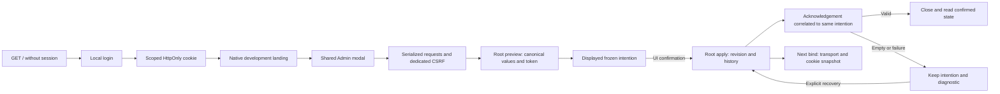

# Shared engine settings Admin candidate

Current delivery (October24): Admin is served by Rust. Go/server statements in dated qualification records below describe historical checkpoints, not the current installation. See the active migration plan and INSTALL.md for current prerequisites.


`admin.js` mounts a reusable native-settings editor without project/process navigation dependencies. Load shared theme/base/design styles, `admin.css`, the generated EN locale and this script. Call `SwarmEngineSettingsAdmin.mount(host, transport, {translate})`; `translate` defaults to the shared SwarmI18n function. `destroy()` removes its own card/dialog, `reload()` reads confirmed state, and `open()` opens the form.

The transport exposes asynchronous `describe()`, `show()`, `preview(change)` and `apply(change)`. The first two return the native CLI `engine-settings describe` catalogue and `show` document. Preview returns current/proposed revisions, effective values and token. Apply returns `{document, replayed}` and must reject unconfirmed/failed writes. Errors carry a safe `code` and `message`; CLI errors nest these under `failure`, not the top level. An API adapter must preserve this contract and authenticate/authorize each operation.

Every editable value and installation default comes from Rust. Counts remain canonical decimal strings, supported unlimited values are explicit `null`, and the form adds no numeric ceiling. The catalogue contains labels, units, nullability and help. Programs use one name per line. A reason is mandatory; the engine validates its content. Input changes invalidate preview; confirmation uses the frozen revision, token and event ID. A lost response retains this same intention for safe replay. Conflict never silently rebases a request or resets consumption.

History is read from confirmed storage. Loading/refusal states disable editing, preserve valid user input and show errors. Preview/error regions receive focus and become visible; native dialog Escape/close restore focus. The title and footer stay visible while the body scrolls. Longer help uses disclosures, essential refusal stays visible. Shared semantic tokens cover `etat`/`sombre` and keyboard focus.

Retained component recipes use private Roots and the real Rust CLI via a **CDP test transport**; their static fixture server does not establish native API authentication. The native development landing now mounts this same component through the actual cookie/CSRF-protected HTTP API, with serialized requests and correlated apply acknowledgements. Its browser recipe is documented below. The component is not installed in the serving Go application; full cockpit/other Admin integration, final packaging and global acceptance remain open. No production Go proxy is introduced.

From repository root, after building matching native binaries:

```sh
node tests/rust_engine_settings_admin_ui.cjs \
  "${CARGO_TARGET_DIR:-rust/target}/debug/swarm-rust" \
  "${CARGO_TARGET_DIR:-rust/target}/debug/examples/root_store_probe" \
  /absolute/fresh/evidence \
  "${CARGO_TARGET_DIR:-rust/target}/debug/examples/project_context_probe" \
  "${CARGO_TARGET_DIR:-rust/target}/debug/examples/git_report_probe" \
  "${CARGO_TARGET_DIR:-rust/target}/debug/examples/baseline_files_probe" \
  "${CARGO_TARGET_DIR:-rust/target}/debug/examples/review_reply_probe"
```

The recipe disables global browser watchdogs, observes progress, rejects unexpected page/network errors, and binds actual UI sources and all six binaries before/after. It covers FR/EN × themes, 1440/1024/760/390/320 px, keyboard/Escape/focus, pure preview, exact integers beyond JS precision, explicit unlimited, save/reopen/WorkEngine effect, output loss/replay, stale edits and failed-load recovery. Test-only CLI input files live in the owned private fixture, not a live mission.

The optional catalogue `input_transport` describes the reader’s immutable framing
constraint, displayed under transport details in read-only form. This is separate
from editable execution policies. R3r exposes the inherited Go 16 MiB document
boundary, regular named-file descriptors and explicitly selected stdin streams.
The qualification runner archives actual frontend source contents before execution,
in addition to comparing their hashes and native binaries.

Program input now splits on line endings only. Internal spaces/tabs stay part of
the proposed name so authoritative validation refuses them, instead of silently
adding programs. Empty lines are separators; an empty textarea means an empty list.
The browser recipe records and archives installed npm inputs and Node/Chrome
binary identities, explicitly sets launch/CDP/page/navigation waits to zero,
and keeps progress/error supervision. This is verification configuration, not
operator execution policy. OS/shared-library/font context is not fully archived.

Settings document v1 remains readable. Newly introduced fields display as
unconfigured; editing visibly proposes catalogue defaults, and only preview plus
explicit save adopts the current catalogue document version (v10); v2 originally
introduced output retention. Historical entries/digests are preserved.
Output retention accepts an exact byte count, zero for count-only or explicit
null for unlimited retention (memory risk); it is separate from process timeout.
The transport remains injected; this component does not establish an installed
native HTTP Admin or authenticated session.

Settings v3 adds five editable whole-point quality thresholds. Catalogue-supplied
supported versions/field introduction versions govern legacy v1/v2 display and
explicit adoption. Historical method-2 thresholds are shown separately without
inputs. A change/revert advances policy generation, observable through the native
read-only `engine-settings quality-profile` command. This binds data only; native
Root recording/evidence checks use an observed profile under reservation, while
public Work/gate and ordinary review/dependency reads now have separate native
coverage; authenticated identity, hierarchical task acceptance and runtime execution
remain pending. The browser recipe
checks ordered-band refusal without publication, persisted quality edits and
change/revert generations with the actual CLI.

The browser recipe also runs actual native method-3 scoring before adoption,
after the Admin saves threshold75, and after reverting to70. A score72 rejects
under75 and allows under70, with changed policy/config digests; legacy journals
refuse until explicit adoption. These are real CLI calculations under saved
settings, not a provider run, installed HTTP Admin or task acceptance.


R3ae adds the seven context/review caps from native settings v4 (28 fields total).
Labels/help/defaults come from the backend catalogue; zero is zero capacity and
null is explicit unlimited policy. Legacy journals require complete preview/apply
adoption. The browser recipe tests the actual native project-context reader
before adoption, after saving a cap of1byte, and after setting null; no installed
HTTP service or complete independent review is implied. R3ae qualification passes all four28-field journeys; see
`docs/plans/migration-rust/evidence/20261018-29/qualified-01/result.json`.
Context freshness work continues separately without changing these settings.


R3ag exercises the actual Root document reader with the saved review cap, alongside
the context reader. The fourth recipe argument is the matching private context/
document probe; all three binary hashes bind to the qualified backend. Saving
cap1 refuses a nonempty document; explicit null restores the read. Legacy policy
requires adoption. This is no attachment selection or review authorization.
Build the probe with `--features test-fixtures --example project_context_probe`
and use the same `CARGO_TARGET_DIR` for the build and recipe.


R3aq41 introduces v5 `git_command_timeout_seconds` (29 fields). The initial90s
default preserves Go; zero expires immediately, null has no deadline. Legacy
v1..4 need explicit preview/apply adoption. The shared catalogue supplies labels,
units and translated help; no frontend ceiling or fallback is added. The browser
recipe additionally requires GIT_REPORT_PROBE and verifies saved/reopened zero and
null against the real Root Git reader in all four language/theme journeys. This
remains candidate UI with fixture transport, without installed HTTP authorization.


R3as43 adds v6 baseline depth (30 catalogue fields).128 means128 historical
links below root depth0; zero forbids ancestors, null removes this cap. Original
v1..5 journals preserve history/replay and need explicit adoption for baselines.
The browser recipe now also requires BASELINE_FILES_PROBE. Saving/reopening zero
then null exercises the actual historical-files guard under saved Root settings.
Its supplied review fixture is not a stored Work or identity/acceptance proof;
the real Work/Git consumer is covered separately by native stored-row tests.

Settings v7 adds three reply byte limits (33 fields), with explicit v1..6 adoption.
The recipe saves/reopens each new field, then calls the actual stored-task parser
with supplied original text; that text is not authenticated. Minimum zero and
maximum null have visible weakening/memory consequences in FR/EN help. Parser
observations do not mutate Work or establish reviewer identity/acceptance.
The historical v7 cumulative recipe is `tools/rust-migration/verify_review_reply.py`;
older qualification reports preserve their historical source and field counts.

When a fixture changes settings through the CLI outside the component, reload
through its public control before opening a new editor. A stale revision must
still refuse. Preview/apply success waits in the reply-policy recipe fail
immediately on an unexpected visible alert; an error must not become an indefinite
wait for a successful preview. This fixes test supervision, not operator policy.

The quote/reply/Git Python runners publish child stdout/stderr to new
evidence files during execution; final bytes are read only after completion.
Observe browser progress through its stdout artifact instead of parsing a JSON
report while it is being rewritten. Original evidence names cannot be reused.
Two handshake/refusal/recovery checks cover this helper; they do not rerun or
claim installation of the engine or browser integration.


Settings v10 adds `managed_receipt_max_bytes`, separate from delivery text. The
catalogue proposes 1048576 bytes (existing Go boundary); zero rejects nonempty
receipts, null permits uncapped allocation. Older journals require visible
preview/save adoption without rewriting history. Pass `WORK_PROJECTION_PROBE`
and `MANAGED_RECEIPT_PROBE` after the original arguments to verify save/reopen
and actual stored-row Root reads at exact/over/zero/null caps, corruption refusal
and recovery. The seeding transport remains marked-fixture-only; receipt IDs and
controls are supplied data, not authenticated execution or independent approval.
The native server/API integration and complete managed projection remain open.

The v10 qualification uses `.cache/rust-git-port/qualify59.py` preserved in the
qualified source archive; its four browser journeys require both optional probes.
See `docs/plans/migration-rust/evidence/20261019-59/qualified03/result.json` and
`admin02/result.json`. Original historical field counts stay scoped to their
increments. The cap bounds this structured receipt reader; it does not silently
impose a cap on every historical hash or machine-context read. Complete managed
projection is the next scoped step, with batch/fragment support still unported.


R3bd60 qualifies simple managed projection with the existing v10 receipt policy.
`production-cap/result.json` under `docs/plans/migration-rust/evidence/20261019-60`
records five actual default-feature CLI observations after preview/save/reopen:
default/exact/under/zero/null recovery. This supplements the historical59 GUI
journeys; no GUI change or fresh GUI verdict is claimed for60. Production CLI
and fixture probe are separate binaries, with exact matching profile hashes.
Workspace all-features results do not establish the delivered feature profile.
Extended batch/fragment projection, identity, execution and HTTP remain open.


R3be61 introduces settings v11 and `planning_resume_max_reason_bytes` (39 catalogue
fields). Installation proposes 4000 bytes, preserving Go's existing behavior;
zero rejects a nonblank resume reason, null removes this policy cap. The reason
is measured in UTF-8 bytes. Valid older journals permit pause and reasonless
resume, but a nonblank reason requires explicit preview/apply adoption.
The setting does not stop processes, reset budgets or grant identity/authority.
Three native CLI tests cover save/reopen, legacy adoption, zero refusal and null
recovery at the actual planning consumer, plus replay and committed output errors.
Four fresh browser/Admin journeys now pass for this field: FR/EN × etat/sombre,
save/reopen then actual production CLI, valid witness, zero refusal without
mutation, null recovery/replay, exact four UTF8 bytes and overflow. See
`docs/plans/migration-rust/evidence/20261019-61/admin01/result.json` and
`qualified01/result.json` (391 Rust tests,34 default-feature CLI tests). Previous
v10 results retain their historical scope. No server installation or independent
acceptance is claimed.


R3bf62 introduces v12 canonical planning request bytes and requirement count
policies (41 catalogue fields), initial65536/100. Zero rejects new mutations or
enablement respectively; null removes that cap. Canonical bytes include escaping,
not input whitespace; transport16MiB remains distinct. Legacy adoption is explicit;
durable replay precedes new policy checks. Four fresh FR/EN × theme journeys
save/reopen both fields and observe the production CLI: exact/under/zero/null,
replay under tightening and public creation/enablement at requirement caps0/1/2
and null. See evidence/20261019-62/admin01 and qualified01 (397 Rust/35 CLI tests).
The separate default-cap02 recipe verifies Go escaping and indented source bytes.
Zero request cap also rejects NEW pause/resume until settings are changed; it does
not remove recorded replay. Candidate fixture transport is not installed HTTP/auth.


R3bg63 introduces v13 agent_workflow_max_body_bytes (42 catalogue fields). It
measures compiled base role BODY bytes, excluding manifest/project context;
initial32000 follows Go, zero refuses and null removes only this cap. Legacy
absence needs explicit adoption. Four targeted Admin journeys now pass FR/EN × themes, using the actual production
CLI to verify exact/under/zero/null, v12 adoption, settings revision and no mutation
by read. Keyboard/focus, five widths and actual backend parse-error recovery pass.
See evidence/20261019-63/admin02 and qualified01 (404 Rust/37 CLI tests). Earlier
cumulative UI62 stays historical; other consumers are covered by shared regressions.
The static component JS/CSS is unchanged. No installed native HTTP/auth is claimed.

V14 adds planning_report_max_bytes (initial64000 bytes, zero refuses every report,
null removes cap; v13 absence requires adoption). Actual consumer: Root reservation
→ complete planning report read → UTF8/nonempty/NUL/SHA. CLI planning-report reads
supplied event data without authenticating labels or acknowledging an event.
Transport JSON/model capacity/review_delivery_max_bytes remain distinct.

V15 adds ten persisted runtime defaults/definition ceilings (53fields). Shared
Admin renders/saves them through the same authoritative validation. The native
`agent limits` preview consumes saved values and SQL scope overlays; it grants no
launch authority. Strictly positive defaults, nullable definition ceilings and
legacy explicit adoption preserve frozen attempt budgets/history. See the FR/EN
migration contract; complete launch and native HTTP remain unported.

## Model rule lists (candidate81)

Catalogue v3 adds `strings` controls; older clients that support only v1/v2
refuse the new catalogue. Programs retain their own unit and validation. Unknown
units or malformed string-array values refuse during loading instead of rendering
as numeric input. New string lists use one literal value per line, preserving
whitespace and case; empty lines are separators, an empty editor saves `[]`.
The server validates duplicates, level names and exact/prefix/contains syntax.

Settings v19 expose automatic eligible levels, flagged-model eligible levels and
flagging predicates. Defaults live only in engine-settings.json and appear in
Admin. `engine-settings model-check --input FILE` reads the saved generation and
checks these rules without publication, provider execution or pricing. Automatic
intent is mandatory; success is `candidate_rules_only`, not launch permission.
The current candidate tests save/reopen all three fields, observe their actual CLI
effect, refuse an invalid rule without mutation and recover, then verify empty
lists. This shared component remains a CDP candidate, without an installed HTTP
API. Provider catalogue/routing and fresh native pre-exec receipts stay open.

Read-only visual supplement (after the completed native admission recipe):
`node tests/rust_model_policy_render_ui.cjs NATIVE_CLI PRIOR_BROWSER_RESULT FRESH_OUTPUT`.
It requires the same CLI/assets, reads the four inactive owned fixture roots, and
captures each model field at320/1440 in FR/EN and both themes. Only describe/show
are available in this transport; Escape/cancel preserves exact settings bytes.
It supplements the full save/refusal/recovery recipe and proves no HTTP authority.

Literal program/model lists disable spellcheck, autocapitalization and autocomplete
without rewriting supplied values. The rendering supplement checks those explicit
attributes and observed opaque foreground/background contrast (WCAG AA text),
not every OS keyboard or an exhaustive accessibility audit. The CLI remains bound
to the prior native proof; an editor-only source change gets its own snapshot.

Native Rust service93 implements the same response/request contract on GET/HEAD `/api/v1/native-settings/describe` and `/api/v1/native-settings`, POST `/api/v1/native-settings/preview` and `/api/v1/native-settings/apply`. All routes require the trusted local gate; POST also needs Origin/CSRF. These are typed/in-process routes, not a running HTTP endpoint: the TCP/session-login adapter and browser connection remain pending. The component code/layout is unchanged. Configuration-state error markers require readback before another apply; a failed transmission never proves rollback.

API93 locally qualified: recipe05 PASS211named Rust tests,4generator/i18n, including24HTTP (5units,7access,9service,3settings). Clippy/private Rustdoc and normal builds06 without test-fixtures PASS. WorkEngine10,15routing and4manual missions from92 explicitly reused, not reexecuted:1211relevant inputs and CLI ELF/profile identical. Native Admin routes, saved cap consumed, replay/refusal/replaced Root and state independent of body verified; no network/browser hookup. Source/binary/review: evidence/20261020-93/result.json. Cache archives01–03 retain102obsolete own native tests,926567800B, SHA-read back before removing only derivatives; sources/data/prior proofs preserved. Free space recovered near1GiB; no further cleanup needed. Next: persisted/Admin network policies and real transport. Migration/cutover/RETEX stay open; Go still serves.

Catalogue v4 adds address units, optional technical_maximum, null_label and application=server_restart. Values/validation come from Root; technical maxima are visible metadata, never frontend max/clamps. Session-cookie null differs from an unlimited cap. Address fields use plain text and backend canonical-loopback validation. Network settings are saved now and take effect on server restart; the component does not assert an active server. Browser recipe: `node tests/rust_web_policy_admin_ui.cjs NATIVE_CLI OUTPUT` (CDP fixture, not native TCP/auth). All verification watchdogs are disabled, terminal UI errors remain observable.

Network94 locally qualified at configuration/Admin level: recipe15 PASS220named Rust tests,4generator/i18n,10WorkEngine,15routing and4manual missions. Clippy/private Rustdoc and profiles16 without test-fixtures/test-util PASS. Browser14 PASS4 FR/EN×2themes,5widths/4captures; two mobile captures visually inspected. Normal ELF13=16, original19journal byte-identical. Source/binary/actual dependency bytes/review: evidence/20261020-94/result.json. No TCP enforcement/restart consumer proven. Method limit retained for95: new browser finally may mask a primary error when browser.close fails; not observed14, reproduce/fix before transport faults. Go unchanged, migration/cutover/RETEX remain open.

Verification cleanup95 aggregates primary/browser/server/evidence failures and attempts all owned shutdowns. Failed scratch roots remain; success cleanup alone does not establish an application restart or TCP enforcement.

Transport95 locally qualified for reads: composed230Rust proof (193unchanged from
PASS permanent29,37HTTP requalified33 after truthful-capability repair),4generator/
i18n,6cleanup assertion cases; browser04 reused4CDP/CLI journeys with identical input
hashes. Clippy/private Rustdoc/normal web profile34 and embedded-context check34 PASS;
normal profiles exclude test-fixtures/test-util, CLI30 ELF identical94. Dependency31
capture verifies85packages/5236actual files. Source/artifacts/review: evidence/
20261020-95/result.json. No network POST/login/global acceptance or installation.
Open criteria and mutation96 follow-up retained; Go still serves, cutover/RETEX open.

Transport96 locally qualified: recipe13 PASS240named Rust tests, including47web
and8TCP cases,4generator/i18n and6cleanup assertion cases. Clippy/private Rustdoc/
profiles14 PASS; normal graph has no test-fixtures/test-util. CLI14 ELF matches95;
dependency graph unchanged and5236actual source files for85packages rehashed
against31. Source/artifacts/review: evidence/20261020-96/result.json. Task/settings
mutations and effect observation verified; CLIweb command, native login/Admin,
progress-safe sink and precision of Root errors without a document remain open.
Go was not restarted; no global acceptance/cutover/RETEX. Authorized97 continuation:
public CLI consumer with output/shutdown handling, without false readiness or
treating written output as durable receipt.

Login98 locally qualified:53fresh web +10targeted CLI tests,2actual HTTP14 scenarios
and4real browser15 journeys PASS; Clippy/private Rustdoc/normal profile13 PASS, no
fixture/test-util. Prior186kernel/non-web checks remain historical on unchanged
relevant inputs, not a new full recipe run. Binary13 is exercised by14/15;8final
screenshots match09inspected images; measured verified text contrast minimum7.89
light/9.10dark. SHA-bound review/source/binary archives and limits:98/result.json.
Original favicon404, snapshot mix and template400 evidence retained; recovery
verified. Serving Go unchanged. Next99: protected landing/shared Admin modal via
actual native HTTP; the form defaults to / whose cockpit remains unported. The98
recipe chooses /api/v1/works and does not prove that default landing journey.

Landing99 under development: / without a session displays only login (exact Host;
ambiguities refused). A valid session opens the native development landing and
shared settings modal; /native-runtime.html and its assets remain private. Login
preserves language/theme. This instance serializes Admin reads without raising
server capacity; preview/apply use dedicated CSRF and existing Root validation.
Other cockpit/Admin views remain unported. Actual Admin verification pending;
no installation or cutover.

Apply replies are now checked by the shared `verifyApplyReply(reply,pending)`
consumer before the dialog closes. Empty/wrong/duplicate/unrelated acknowledgements
keep the pending intention and visible error. Exact decimal revisions and history
event/request values must correlate. Historical replay can return a newer document;
this is UI correlation, not Root hash-chain/authorship/durability validation.

Native landing/Admin99 recipe:
```sh
python3 tests/rust_native_login_browser.py --binary NORMAL_ELF_PATH --root-workers 1 --scenario admin --output FRESH_DIRECTORY
```
One worker is private fixture input persisted through CLI, not a product default.
CLI readback confirms state/revision; only our fixture server restarts to observe
the session cookie without Max-Age. No Go server/live mission is stopped.21ACK,
5adapter and2helper-failure guards have permanent test files and remain distinct
from actual HTTP journeys.


UI confirmation does not authenticate a human/agent or business decision.

Landing/Admin99 locally qualified:26step recipe PASS253selected Rust tests (57web),
21ACK,5adapter and6cleanup cases, generator/i18n. Two test assertions were clarified
after Clippy19:18units rerun20, production bytes identical and other inputs unchanged;
reused scope is explicit. Clippy/private Rustdoc20 PASS. Separate0500normal-dev ELF
without fixture/test-util, SHA
00e75fb09fb21ba972582c9241444c4cad306192604661a6a88c7087d3a9efe9,
is exercised by2HTTP22journeys,4native Admin23variants(Root1),4component/CLI24
variants and2helper-error25guards. CLI readback and next bind prove null cookie
omits Max-Age; client loss after actual publication replays without duplication.
Empty ACK keeps the dialog; program canonicalization comes from Root. Source/
artifacts/review/profiles:99/result.json. Serving Go unchanged; no installation or
optimized release/performance claim. Supervision, other journeys, complete identity/
authorities, restore/global acceptance/cutover/RETEX remain open. Non-progressing
synchronous Write remains an open limit.

## Grouped Admin and portable AI advice

The shared component now uses logical accordions and nested help dialogs with
Escape and focus restoration. Settings remain mounted while groups are closed.
`groupFor` is presentation classification, never an execution policy. Unclassified
future fields remain in Other; browser coverage checks the current catalogue.

Advice buttons per group/field prepare a portable prompt from catalogue contracts,
saved values, draft values and exact revision. Unknown live/provider/budget values
stay unknown. No provider is invoked by this component. Paste a JSON reply with
exact keys `expected_revision`, `explanation`, `changes`. Revisions and numeric
values are decimal strings. Only target fields are accepted, and users select
changes before they enter the draft. Unknown/malformed/stale replies preserve
inputs; native preview and confirmed apply remain required. Group boundaries are
presentation metadata; semantic validation belongs to Root. This does not connect
a native Admin provider or grant a mission budget to global advice.

`node tests/admin_settings_groups_ui.cjs RUST_CLI EVIDENCE_DIRECTORY` verifies
browser behavior plus real public native settings publication in isolated Roots.
No provider, live service restart or current Rust build qualification is implied.

## Native dedicated advice budget

Hosts may pass `budget: {show(), preview(change), apply(change)}` to mount the
separate Admin envelope dialog. All three methods return the native budget DTOs.
No monetary defaults are invented, missing configuration stays explicit, and
converted amounts use integer micro-USD without floating point. Confirmation is
correlated by event/revision/policy/token before closing. Late failures preserve
inputs/pending request, allowing explicit replay after response loss.

The native host supplies protected `/api/v1/admin-advice-budget` routes. See
[contract](../../docs/en/ADMIN-AI-ADVICE.md). This implements the envelope and native
accounting method; it does not make direct provider execution available.

### Status windows — v39 candidate (campaign353/355)

Persisted `work_view_status_recent_agents` and `work_view_status_change_events`
bound recent Agent rows and raw events inspected before category filtering.
Explicit installation defaults200, zero empty view, null unlimited. Missing or
partial groups adopt no defaults and refuse at the consumer. Existing Admin
Presentation and evidence grouping exposes catalogue metadata. The Agent view
borrows recent rows; spending/coherence/ownership keep complete retained data.
`more` signals omitted raw events; visits and history remain unchanged. Tasks
outside the view needing unported readiness still refuse. Complete input reads
remain required; this does not reduce collection memory/IO.

Control354 passes before the201-event original refusal.355–359:24reader and
10settings tests, Clippy/Rustdoc and the201-row outside-window refusal PASS.
Actual served Admin357 passes FR/EN×themes, preview/save/reopen, history,
help/focus and desktop/mobile; protected English asset matches effective inputs.
Initial review context gaps are retained and resolved with actual guards/SQL.
Default native355 is qualified without fixture features; later358 changes only
cfg(test) assertions. Current-byte increment qualification, final G1 recipe,
outside-window readiness,201-agent CLI proof and installation/global acceptance
remain open. These targeted outcomes do not establish full migration parity.

### Submitted result outside the recent window — campaign361/363

A submitted result stays reviewable without a recent Agent: unknown process,
no projected Agent identity; the last retained Task attempt remains visible,
with report and gate read from the Task.
Full retained history still feeds accounting/ownership/coherence. The result
branch does not consume launch readiness, explicitly NotObserved; it establishes
neither active execution nor acceptance. Review/recovery guards remain; other
outside-window tasks needing readiness still refuse. Original362 failure follows
a valid control.24readers, Clippy/Rustdoc and public373 PASS: actual local process
completed, submitted report, zero Agent view, retained Task attempt, no Agent
identity, identical costs and restored settings. Local fake provider declarations
are neither invoices nor authenticated identity. Broader G1 acceptance remains open.
