# Swarm Rust workspace

Native replacement under construction, with one final cutover selected by the user.
This workspace provides identity data validation and enrollment challenge proofs,
including a Go-compatible signed JSON envelope, plus a native transaction-owning
Work engine, native fresh-root initialization and persisted settings CLI.
The basic Work CLI and manual, ordinary and simple managed read views are implemented;
extended managed protocols, hierarchical mutations, old migrations, automatic task execution,
Admin service and server remain under construction.
The Go engine remains the working reference.

Candidate78 connects foreground manual `agent prepare`→`agent run`, private gated
helper, actual Linux process registration, sealed prompt stdin, explicit execve,
stream guards and atomic manual settlement. Operator stop/tool guards can signal
the owned process; duration/silence/tool waiting remain observations. Provider
exit never accepts a task. Model routes, hierarchy, dialogue, real-provider usage,
HTTP integration and crash recovery still need completion. The migration remains
partial; default-profile proofs and original failures are in the plan.

Candidate79 observes declared usage/caches/model independently from tool guards,
with current opaque `native_provider_facts` at heartbeat and settlement. Missing,
invalid and incomplete fields remain explicit; no invoice, route, identity or
financial settlement is inferred. Local refusal/recovery cases are verified, including active heartbeats and
pre-start claims. The549named workspace tests, private Rustdoc and Clippy pass;
the plan retains original RED/setup failures and the bounded production profile.

Historical bounded component77:
 frozen native guard policy and strict read-only
`agent guard ID --input TRACE --root ROOT --json`. V17 settings expose the positive
interleaved-failure window multiplier (initial4) or explicit no-expiry in Admin;
new manual intentions bind it and its revision into their full context digest.
Unknown native constraints survive storage but refuse consumption. Declared
traces prove no actual tool execution, provider vitality, authentication or stop.

Preparation/claim/stop/cancellation share persisted SQLite timeout/retries/delay;
only direct BUSY with confirmed autocommit and clean reservation release retries.
Uncertain commits and cleanup failures never retry automatically. Targeted
permanent04 passes48engine/25default CLI cases; four lifecycle cases pass again
after a test-only assertion style change. Clippy and Rustdoc pass. Final Admin
binary/evidence is recorded in the migration plan. No provider starts, no server
is installed, no task is accepted. This describes77 only; candidate78 execution is documented above.

R3bj66 component verified: durable scope budgets reject negative consumption and
local limits. Zero inheritance and positive consumed history are preserved; no
counter is reset. Public CLI refusal/recovery uses private corrupted fixtures,
not a real mission repair or authenticated actor. Ancestor admission is next.

Qualified66 passes413Rust/40default CLI tests and30fresh Go/native report checks,
8437stable inputs/73packages; separate production profile excludes fixtures.
No new Admin journey in66; prior65 UI proofs remain historical on their65 binary.
Global migration remains partial; ancestor admission, reservations and claim open.

R3bi65 component verified: `planning-report --root ROOT --input EVENT.json --json`
reads a complete selected report under persisted/Admin v14 planning_report_max_bytes
(initial64000,zero refuses,null unlimited). Explicit handoff/historical .md fallback,
UTF8/NUL/digest/contained-path checks preserve causes and reject truncated proof.
Event labels are untrusted data. No claim, acknowledgement or model execution.

Qualified65:411Rust/39default CLI tests,30Go/native comparisons,4targeted Admin
journeys;8437stable inputs/73packages. Production excludes fixture features and
matches its rebuilt profile. Global migration remains partial.

Current increment R3bh64 adds frozen worker-only QUALITY guidance without raising
Go's body limit: measured31955/32000 bytes (complete prompt32155). Go fixture
checks prepared, adapter stdin and reopened bytes; Rust checks embedded source
and role isolation. This proves transmission, not AI compliance, identity or
real-provider execution. Capacity and claim remain open. Qualification64 passes404Rust/37CLI,15Go comparisons,4Admin journeys with
8432 stable inputs/73packages. Global migration remains partial. The historical63
baseline follows.

Current verified component: R3bg63 qualified01 — compiled canonical role framing,
ordinary project composition, full-prompt freshness and saved v13 body policy.
`agent-workflow ROLE --root ROOT --json` observes planner/subplanner/worker/reviewer
without agent creation or authority. Policy initial32000 measures base BODY only,
not manifest/project/model capacity; exact/under/zero/null and v12 adoption pass.
Workflow.SHA and full prompt_sha256 remain distinct; Root compares actual complete
text/digest/metadata/count, refusing altered observations and current policy errors.
404 workspace tests,37 default-feature CLI tests,15 actual Go/native comparisons
and4 fresh targeted Admin journeys pass; 8430inputs/73crates stable. Production
excludes test-fixtures and matches its exact profile hash. Go privacy notice now
truthfully distinguishes filtering and absence; no server is restarted.
Claim/delivery/capacity/leases, providers, execution, identity, managed memory, HTTP,
installation and cutover remain open. Next R3bh64 ports context/capacity before
claim, preserving existing receipts and errors. Go remains the usable server.

See the [French contract](../docs/architecture/RUST-MIGRATION.md),
[English contract](../docs/en/RUST-MIGRATION.md) and
[migration plan/evidence](../docs/plans/migration-rust/PLAN.md).

From the repository root:

```sh
cargo test --manifest-path rust/Cargo.toml --offline --locked --workspace --all-targets
cargo fmt --manifest-path rust/Cargo.toml --all -- --check
```

Go comparison tools are test-only; the Rust product must not call them at runtime.
No new service, execution policy, authority or dependency on an identity provider
is introduced by the validation library.

swarm-enrollment-proof uses locked cryptographic/encoding dependencies. Its
test-fixtures feature exposes deterministic entropy injection solely for fixtures;
it is off by default. Run tools/rust-migration/verify_proof.py with a fresh evidence
directory for interoperability, concurrency and default-feature checks. Signed
historical bytes still require current authorization and revocation checks.

The native signed enrollment journal (swarm-enrollment-state) is verified on isolated R2.2
fixtures. It uses bundled SQLite, explicit cancellation and independent
checkpoints. swarm-wire-json shares Go string encoding with the proof crate;
protocols keep their own schema and exact canonicality checks. See FR/EN contracts
for callback restrictions and current limitations. Run verify_enrollment.py with
a fresh evidence directory and an isolated TMPDIR with observed free capacity.

R2.3 adds swarm-enrollment-authority: versioned authority documents and context/time
checks on authenticated statements. Source-bound qualification passes 73 named Go tests, 40 native Rust tests
with fixtures and 39 without, and 4,334 Go/Rust cases. Publication now has a native immutable descriptor. R2.3b source-bound qualification
passes 135 named Go cases, one Go race test, 48 Rust tests with fixtures and 47
without, plus 10,990 matching Go/Rust cases; 5,707 inputs stayed stable. Identity JSON serialization is
an optional serde feature; its actual principal keys are principal_id/principal_kind.
Human identity, current authority, final-use reservations and publication integration
are still separate obligations. time 0.3.55 is locked; it adds no TTL or policy.


R2.4a adds swarm-enrollment-config for pure installation configuration formats,
exact decimal u64 revisions, linked history and view/preview validation. Source-bound
qualification passes 55 Rust tests with fixtures and 54 without, plus 10,337
configuration and 10,990 authority comparisons; 5,727 inputs stayed stable. The
75 named reference Go cases include 12 Go storage tests. A native protected Store
is now implemented; see the R2.4b contract below. Shared dates
now live in wire-json's optional timestamp feature; authority uses the same codec.
Run tools/rust-migration/verify_config.py with a fresh evidence directory and a
qualified authority reference. Use an isolated private TMPDIR with safe ancestors
and observed free capacity. Coordinator/witness is ported below; service integration remains to port; no data constructor
authenticates an operator.


R2.4b adds the native protected Linux Store: nonblocking reservations, owned
callbacks, exact replay, cancellation and atomic durable writes. Error handling
retains primary/cleanup causes and refuses usable results on cleanup failure.
A storage error can occur after commit; do not infer no mutation from its code.
Ordinary diagnostics avoid echoing private input; detailed causes remain available
to authorized diagnostics. Current tests include synthetic write/sync/close/cleanup
faults behind the optional test-fixtures feature, off by default. Source-bound
qualification passes 71 Rust tests with fixtures and 66 without; 101 Store operations
match Go, including cross-language read/write/replay. All 10,337 format and 10,990
authority cases match after rebuilding. External deadline outcomes remain distinct
from cancellation without starting a timer or adding a policy. The witness/Coordinator is ported below; confinement, login and full engine remain open.
Run tools/rust-migration/verify_config_store.py with a fresh evidence directory,
qualified config and authority evidence directories, an isolated private TMPDIR
with safe ancestors, and CARGO_TARGET_DIR pointing to an owned compilation cache.
Optional fourth argument reuses matching Go test/race evidence after source,
graph and environment checks; vet is executed afresh. No global watchdog is imposed; Go uses -timeout=0.


R2.4c adds `store::Coordinator`: distinct protected config/witness directories,
durable intent before config, committed confirmation and reauthorized recovery
using the original event and timestamp. Read/preview refuse an outstanding intent;
exact retries may recover it. Config-only or witness-only rollback is refused;
restoring both together remains a local limitation. No witness is inferred from
config. Fixed operation labels retain storage phase without private input. The
same qualification recipe covers both storage layers and actual cross-process,
cross-language recovery. Fixture hooks are absent by default. The service, human
bootstrap, OS confinement and Rust engine remain open; no server is replaced.


Final R2.4c qualification: 82 native tests with fixtures / 73 without, 57 named Go
cases (26 parents), two race checks, 101 Store + 143 Coordinator operations and
both cross-language directions pass. All 10,337 config and 10,990 authority cases
match. See evidence/20261017-08/qualified-02 in the migration plan. PendingCause
retains cancellation independently of cleanup failure; no reset, timer or new
execution policy is introduced. Integration and full cutover remain unverified.


R2.5 adds `swarm-enrollment-bootstrap`: canonical immutable installation data and
read-only Linux Load, independently pinned by SHA-256. It reuses the protected
directory opener, checks file metadata before/after reading and closes all handles
explicitly. No lock/account/service is created. Declared UID separation is not
human authentication or confinement. `verify_bootstrap.py` uses a fresh evidence
directory and a qualified Store reference; old components are reused only under
source, toolchain and registry-lock guards. Fixture injection is absent by default.


The `swarm-cli` package now builds the development `swarm-rust` executable. Its
only migrated public command is `identity bootstrap-check`; FR/EN help explicitly
states the partial scope and other commands are refused. Build with
`cargo build --manifest-path rust/Cargo.toml --locked --offline -p swarm-cli --bin swarm-rust`.
The check runs before any project, uses an independently approved digest, and
reports storage observation while human/confinement/service flags stay false.
It creates no account, lock or server. Output/diagnostic errors remain distinct;
private causes are retained for authorized diagnostics. Full engine, CLI and
cutover remain open. The active Go binary is unchanged. See FR/EN contracts for
CARGO_TARGET_DIR and the supported check syntax.

R5a source-bound public-flow qualification passes 8 native tests and 67 Go/Rust
cases. Actual /dev/full output failure, empty PATH and an execve trace are checked;
no Go child launch is observed. Full root/embed inputs are retained (274 assets).
Three summarized protected-path diagnostics differ intentionally; exit status and
classification match, with detailed causes retained for authorized callers.
The partial executable remains a construction milestone, not a full migration.


R3a adds native Request/ValidationPolicy/ValidationControl DTOs generated from the
actual Go AST and custom serializer. The shared Go-compatible JSON projector is
used by Request, config and active journal replies. Strict decoding handles signed
-0 and duplicate slice backing reuse. This library executes no task; Work/Task,
SQLite migrations and supervision remain open. Expanded qualification passes (106 native tests / 96 default, source-bound).

A local release performance experiment is available in
`tools/rust-migration/benchmark_request.py`; it compares actual Request codecs,
not the complete engines. See the FR/EN migration contracts for measured scope,
CPU control, repetition, memory semantics and source-bound evidence.


R3b source-bound qualification passes for the persisted Work/Task/Event data
graph: 83 new DTOs plus 2 reused validation types, 771 Go fields. The arena decoder
preserves Go duplicate/null/slice semantics and original opaque JSON; floats use
Go-compatible formatting. The row codec validates UTF-8, schema, identity and
revision. Recursive anchor serialization, clone, equality, Debug and Drop are
iterative; deserialization uses stack adaptation. Tests include Go's 10,000 JSON
levels and rejection at 10,001. Results: 59,576 differential cases, 19 deep cases,
35 Go public row reads plus 2 trigger refusals, 29,662 Request regressions; 111/100
native tests. This is not a native SQL reader or Rust work-show command. Identity
plan projection/UDF and SQLite transactions/migrations remain next prerequisites.


R3c adds native identity plan projection, per-connection deterministic SQLite
registration and the exact generated v37 schema fragment. The projection retains
unknown fields and lexical numbers; it does not authenticate or authorize agents.
Five native component tests cover generations, stamp tampering, transaction and
DDL rollback, representation overflow and empty-BLOB refusal/recovery.
Qualification reports native component PASS and overall PARTIAL: 2,795 Go/Rust
comparisons match, while the reference Go SQLite driver crashes on empty BLOBs.
116/105 native tests and Work/Task/Request regressions pass. A second confirmed
limit remains in v1 runtime-result exclusion keys; correction requires explicit
projection/stamp version migration. Neither full Store nor cutover is complete.
Local include_str/include_bytes/include resources are now hash-bound by the
qualification collector; unsupported dynamic expressions are refused.


R3d adds explicit `identity_plan_digest_for(..., IdentityPlanProjection::V2)`;
legacy `identity_plan_digest` stays v1. V2 excludes actual Task result tags
`automatic_validation`/`manual_override`. Both SQLite UDFs are registered per
connection. `read_identity_plan_stamp` requires the expected version and returns
data only. `upgrade_identity_plan_projection(&mut Transaction)` checks the v37
component, keeps transition history, advances every generation and swaps triggers
inside a recoverable savepoint. It never commits the outer transaction, changes
the global schema version or creates authority. Root Store migration, current
registry/permit checks and an external rollback witness remain prerequisites.
Local history alone does not protect whole-DB restore or deleted-ID reuse.
The ten targeted tests pass; source-bound qualification passes for the native component (126/115 tests, 2,852 v2 cases); the Go empty-BLOB driver exception remains OPEN.
The fixture-only upgrade probe is gated by `test-fixtures` and an owned marker;
it is not a production migration command. See FR/EN RUST-MIGRATION R3d.

Stamp reads explicitly target `main`; conversion refuses TEMP contract shadows.


R3e provides `read_recorded_work(&Connection, id)` and
`list_recorded_works(&Connection)` on a caller-owned connection/transaction.
They target `main.works`, preserve rowid DESC order, validate every envelope and
refuse partial lists. Go SQL numeric conversions, original causes and statement
finalization are handled. Five targeted tests and 412 Go comparisons pass at
candidate stage; source-bound native qualification passes (31/30 engine tests, workspace compilation, public Go fixture). No root opener, migration,
policy or public Work command is provided by these data readers.

Go work-list output failure remains OPEN: it ignores printJSON errors and exits
0 on /dev/full. Native fixture output fails correctly; native public Work command
is not implemented. The runner now checks reused-proof toolchains/environment/
workspace/lock, with a separate positive and six stale-input refusal/recovery
checks. This guard was added after native qualification, without native changes.

Qualification runners retain large fixtures in repository `.cache` and report
the actual device/free space. Check Go's temporary filesystem separately; a full
`/tmp` tmpfs can fail linking even with free repository disk space. Use an owned
process-local compiler scratch as needed; preserve proof bytes/hashes before
removing only identified regenerable caches. No product policy changes follow.


R3f adds caller-owned `list_recorded_events` and separate
`encode_recorded_events`. Raw headers/payloads remain bytes; the actual Go scanner
accepts BLOB payloads only (empty BLOB becomes nil). SQL read and JSON output errors
are separate and explicit, without partial results or silent repair. Raw payload
lexemes and invalid UTF-8 bytes inside strings follow Go RawMessage behavior;
headers escape invalid bytes. HTML escaping is an explicit transport option.
The shared revision scanner also serves Work, whose SQL comparisons are rerun.
The gated probe/oracle are qualification tools, not a public Work CLI or full
Store. See FR/EN RUST-MIGRATION R3f and the source-bound evidence in the plan.

Source-bound R3f qualification: native PASS / overall PARTIAL, 36/35 engine tests,
1,684 event comparisons, 412 Work regressions, two public event fixture comparisons;
8,140 stable inputs and 72 dependencies. Go work-show still exits 0 with no output
on malformed payload; native fixture output and payload failures are explicit.
No native public Work CLI or full Store is claimed.


R3g adds `reserve_recorded_command` on a caller-owned transaction: valid event
name, writer reservation even without a Work, global storage epoch 37, exact
work/kind/request replay comparison, then the current validated Work. `None`
means only absence, never permission or business validity. Existing triggers
can execute; the caller must end the transaction. Extended BUSY diagnostics
are preserved without retry policy, including stale-snapshot refusal. Full
business guards, atomic mutation/event writes and root migrations remain open.
The oracle extracts only the actual Go prefix; fixtures are not product commands.

R3g source-bound qualification passes: 43/42 engine tests, 324 Go-prefix
comparisons, four named Go tests plus two subtests, one targeted Go race test,
and public Go create/update/replay compared with the native observation.
8,146 stable inputs, 72 dependencies. Unix disk fixtures own their 0700 roots;
other platforms remain unverified. Full mutation/Store/cutover remain open.


R3h provides `stage_recorded_change` for atomic Work/event storage in a caller-owned
transaction. It reuses reservation/replay, checks revision/envelope/overflow,
performs INSERT or CAS, writes identical payload/request bytes and verifies actual
rows after triggers. `Staged` still requires the outer commit; business guards,
permissions, hooks, root migration, ID/clock generation and retry policies remain
caller/Store responsibilities. Failures roll back the local savepoint where
possible; transaction-wide rollback is explicitly reported. See FR/EN docs and
source-bound qualification; no public Rust mutation command is claimed.

Writer reservation, atomic staging and projection conversion reject stale
Transaction handles whose SQLite transaction has ended, before creating a new
savepoint or writing. Exact SQL identity bytes are checked after writes and
before replay, including case-insensitive collations. Behavioral RED/GREEN
regressions are retained; broader source-bound qualification is recorded in
the migration plan. This does not attest arbitrary schemas or create authority.

Final R3h source-bound native PASS / Go reference and whole migration PARTIAL:
55/54 engine tests, 324 replay regressions, 65 storage cases (58 parity and 7
explicit Go integrity counterexamples), plus actual Go-created fixture persistence,
Go reading native writes, rollback/recovery, v2 conversion and lost-response replay.
8,155 stable inputs, 72 dependencies; 12 stale-reference refusals recover correctly.
MaxInt64 overflow remains an open Go defect, refused without mutation natively.
Business guards/hooks, complete Store/root migration and public mutation CLI
remain to be ported. No active Go server or deployed binary was replaced.


R3i adds inspect_recorded_mutation: reservation/replay before revision, hierarchical
immutability, active agents, public pause and confirmed blocked-task amendments,
preparation locks, plus Go-compatible task_review_contract hashing with memory
references. Null and empty definition lists differ; unreadable pause fails closed.
main tables are explicit, error causes are retained and callers own transaction
termination. Results are data, not permits. Mutation closures, full plan validation,
hooks, clock/IDs, Store and public mutation commands remain pending. See FR/EN
migration docs and verify_mutation_guard.py for source-bound qualification.

R3i source-bound native PASS / overall PARTIAL: 66/65 engine tests, 374 guard
comparisons (209 controls), 324 replay and 65 storage regressions, six selected
Go tests, compilation/clippy/vet, and refusal/metadata/replay/recovery on a real
Go-created database through revision 4. 8,162 stable inputs and 72 dependencies.
Earlier Go proofs pass exact reuse guards including twelve stale-proof refusals.
Full Store, mutation closures, complete planning validation, hooks and public
Rust mutation CLI remain open; the Go runtime is unchanged.


R3j adds durable planning/prerequisite/judge validation and staged acceptance-change
signals. Trees and prerequisite graphs use explicit traversal; configured limits
are preserved. Signals validate before traversal and leave Work unchanged on refusal,
including duplicates. Go RFC3339 parsing is shared with configuration, whose canonical
checks and error adapter remain. No clock, actor or evidence freshness is authenticated.
Full mutation/SQL/hooks/Store integration remains pending; qualification and actual
Go-created planning fixtures are documented in FR/EN migration pages.

R3j source-bound native PASS / overall PARTIAL: 115/106 tests across engine,
wire-json and enrollment-config, 1,051 parity cases plus two explicit Go signal
counterexamples, 113 positive controls, 10,337 config, 324 replay and 374 guard
regressions. Real public Go planning and native data validation pass. 8,171 stable
inputs, 72 dependencies. Protected filesystem fixtures use checked private scratch
under the safe actual home; repository 0775 ancestry is correctly refused.


R3k adds pure Work creation/reframing, task addition and OODA, plus the Go schema/
kind check. Errors preserve the original candidate; envelope/time/Git/authority
are caller responsibilities. Internal mutation-intent bytes preserve explicit
empty collections lost by Go's legacy request DTO; legacy encode_request stays
unchanged. Tests compose the new encoding with actual reservation/storage to
refuse ambiguous replay; public Store integration remains pending. See FR/EN
docs for the Go public reproductions, invalidations, fixtures and qualification.

R3k native PASS / overall PARTIAL: 82/81 engine tests, 283 parity cases and four
separate memory counterexamples (144 controls), 324 replay and 1,053 planning
regressions; four Go tests, compilation/clippy/vet and public Go/native data
comparison. 8,178 stable inputs, 72 dependencies. No public Rust mutation or
native clock/ID/Git generation claimed. Intent consumer integration remains pending.


R3l adds Go-compatible canonical roots, owned paths and regular local files,
plus atomic in-memory checkpoint validation. Unix resolution preserves lexical
cleaning and Go's technical 255-link bound; non-Unix parity is unqualified.
Returned paths are observations, not authority or substitution-resistant handles.
Checkpoint copies supplied Git and distinguishes absent/empty memory; full Store,
clock/Git generation and task.update remain pending. Shared Go TrimSpace semantics
replace three duplicated predicates. Proof collection binds declared method scripts;
Go reuse checks actual normal/race Import closures and fourteen stale-proof faults.
See FR/EN docs and verify_local_path.py for qualification and retained counterexamples.

R3l native PASS / overall PARTIAL: 172 parity cases, 7 memory counterexamples, 75 controls; 88/87 engine tests, four regression corpora, two named Go tests, workspace/clippy/vet and public recovery flow pass. 8,187 stable inputs, 72 dependencies. FR/EN diagrams rendered and inspected.


R3m adds pure task-definition changes, metadata-only updates, policy normalization/
coverage and attributed instruction composition. Explicit limit inputs include
allowed programs; legacy_go constructors are compatibility fixtures, not runtime
fallbacks. Persisted defaults, FR/EN Admin and actual API/CLI/Rust setting consumers
remain mandatory and unimplemented. Contract changes archive opinions selectively,
retain attempts and invalidate current checks. Deep dependency graphs avoid stack
recursion; metadata/instruction failures retain original candidates. Supplied
actor/time are data, not authority. Launch/acceptance and full Store are pending.
See FR/EN documentation and verify_task_definition.py for scope and evidence.

R3m native PASS / overall PARTIAL: 94/93 engine tests; 829 parity cases, 3 memory counterexamples, 416 controls. Ten named Go tests, workspace/Clippy/vet, 179 path and 324 prefix regressions pass. Public Go edits, non-mutating refusal, explicitly corrected same-event request, replay and reopening at revision 6 match native helper candidates. 8196 stable inputs, 72 dependencies. Admin integration and public native mutations remain pending.


R3n adds a trusted SQL hook between the Work write and new event. Actual Work
bytes are checked before/after the hook; epoch and transaction remain checked,
then event postconditions run. Replay never invokes the hook. Local refusal
preserves outer-owner writes and error causes; early transaction termination is
reported as actual loss, not claimed rollback or automatic retry. No external
hook effects or untrusted request callbacks are supported. Full Store/authority,
transitions and persisted Admin consumers remain pending. Archive checks now
require fresh destinations; historical-report rewrite and its limits are recorded.
See FR/EN docs and verify_recorded_hook.py for qualification and actual Go cases.

R3n native PASS / overall PARTIAL: 99/98 engine tests, 91 parity cases and 20 Go integrity counterexamples, 71 controls; 324 prefix regressions, four named Go tests, workspace/Clippy/vet pass. The actual Go-created database recipe checks native writes, Go reopening, refusal/recovery, output loss after commit, duplicate-free replay and v2 conversion. 8,200 stable inputs, 72 dependencies. Four archive-helper call paths and historical preservation are checked separately.


R3o adds transaction-owning WorkEngine::execute_external on a supplied v37
connection, joining strict external decoding, cleared origin, safe intent,
reservation/guards, five Work commands, task metadata/definitions, validation,
checked revision and explicit commit/rollback. SystemEnvironment provides actual
system entropy/time/Unix UID/hostname/Git observations. Git failures remain
explicit; civil time/UID establish no human authority or monotonic deadline.
Native invalid OS bytes preserve decoded Go text; initial JSON escape bytes may
differ and are separately recorded. Replay invokes no environment and distinct
empty-collection intentions are refused by the assembled engine. Root opening/
migrations, status transitions, public Work CLI/API and persisted Admin settings
are still pending. Changed dependency edges/features receive fresh workspace and
Go reference/race checks. See FR/EN docs and verify_work_engine.py.

R3o native PASS / overall PARTIAL: 210 workspace and 108 default engine tests executed in qualified-01, reused in qualified-02 after exact comparison of 4,303 native inputs, tools and resolved graph/features; qualified-01 remains FAIL for the Go probe. Ten stale-proof faults refuse and recover. Fresh Go reference/race, 324 prefix, six Git cases and 65,759 environment values match; 18,525 encodings agree bytewise and 47,234 invalid-UTF-8 lexical variations are retained explicitly. Actual native environment/database commands, Go reopening, ambiguous-intent refusal and duplicate-free replay after response loss pass through revision 9. 8,212 stable inputs, 72 dependencies. Probe success establishes no public Work CLI/API or Admin integration.


R3p adds a Unix native root library and persisted engine settings. Installation
defaults are versioned in the engine config JSON; exact decimal-string counts,
pure preview, revision/token checks, immutable history and atomic publication
feed the actual WorkEngine limits and SQLite busy retry policy. A valid legacy
Go storage-retry override is imported once. Existing schema versions 1–36 are
refused pending their real migrations. Admin/API and public Work CLI remain
pending; do not infer UI acceptance from these library tests. See FR/EN R3p
contracts for error recovery, zero/unlimited semantics and remaining boundaries.

Development Unix CLI commands now call the root/settings library directly:

```sh
swarm-rust init --root /absolute/owned/root --json
swarm-rust engine-settings show --root /absolute/owned/root --json
swarm-rust engine-settings preview --root /absolute/owned/root --input change.json --json
swarm-rust engine-settings apply --root /absolute/owned/root --input previewed-change.json --json
```

`apply` requires the token returned by preview and exact revision/intent. All
these commands return JSON. They grant no HTTP session or agent authority. The
installation allowlist adds cargo/rustc; historical Go parity fixtures do not.

R3p source-bound qualification passes 227 workspace / 121 default engine tests,
fresh Go reference/race, schema equality, actual CLI settings persistence and
WorkEngine consumption. 8,219 stable inputs, 72 dependencies; full migration is
PARTIAL. See evidence/20261018-13 in the migration plan. Admin is still open.

R3q adds `engine-settings describe` (no root required) and a shared Admin component
in frontend/engine-settings. Catalogue coverage/nullability use real validation.
Browser recipe transport and eventual native HTTP/Admin integration are distinct;
no production Go proxy or authenticated Rust server is implied. Counts stay exact.

R3q paired backend/browser qualification passes 229 workspace / 122 default
engine tests, fresh Go/race, actual shared Admin CLI-backed flows, exact counts,
unlimited, stale revisions and response-loss replay. Supplemental rendering
checks malicious history text, keyboard outline and measured contrast. Evidence:
20261018-14; native server/authenticated installed Admin remain open.

R3r hardens command input: Go-compatible 16 MiB document framing, checked regular
file descriptors, bounded reads/checked close and explicit stdin (`--input -`).
Named FIFO/device/directory inputs refuse; links to regular files stay supported.
Admin distinguishes this read-only transport property from editable policies.
No new timeout, identity authority or authenticated server is implied.

R3r paired qualification passes 236 workspace / 127 default engine tests and
real Go/native CLI framing at the exact boundary, overflow and finite stdin.
Named nonregular inputs refuse, valid recovery preserves state, and four Admin
journeys pass with a read-only transport disclosure. Evidence: 20261018-15.
Actual frontend sources are archived before execution, not just their hashes.

R3s corrects Admin program parsing: one name per line; internal spaces are refused
by the common validator, never split into additional allowed programs. Browser
verification explicitly disables its launch/CDP/page/navigation watchdogs, records
actual Node/Chrome/npm inputs and preserves installed npm source contents. Product
deadlines and the native backend stay unchanged; qualified backend checks may be
reused only with exact source/environment/inventory guards.

R3s source-bound qualification passes four fresh browser journeys. Backend
236/127 tests and four Go/race checks are reused only after exact compiled-input,
context, command and inventory comparison. Fourteen stale-proof/context faults
refuse and recover. The 4,341-entry npm source archive is checked against actual
contents/links. Evidence: 20261018-16/qualified-02; full migration remains PARTIAL.

R3t checks existing-root SQL objects and definitions before successful opening.
Schema tag/SQLite quick_check alone are insufficient. Inspection preserves data,
checks type/name namespaces and permits the supported v1/v2 projection profiles.
Unexpected core triggers/indexes refuse; old migrations remain pending.

R3u adds explicit settings v1→v2 adoption and configurable output retention.
Old journal entries/digests/replay retain their original representation. No
silent default is applied to v1; pure preview/CAS/token append v2. New roots use
v2. Shared Admin edits retained byte count (zero: count only; null: unlimited
memory risk), with a versioned initial 65,536-byte default. The capture sink
counts every byte while retaining the configured prefix. Automatic process
authorization/launch remains pending; this is not a complete executor claim.

R3u qualified-02 passes 244 workspace / 135 default-engine tests, fresh Go/race
and four 16-field Admin journeys, including explicit v1 adoption in FR/EN and
5/zero/null retention. Persisted-policy sink and unchanged history/replay are
verified; native HTTP Admin installation/full migration remain PARTIAL.

R3v builds a Linux control primitive with persisted policy, normalized command,
actual in-project directory, dedicated process group, pidfd/OS poll and declared
monotonic timeout. Shared output drains under configured retention. Unreaped
leader ownership and original/cleanup causes survive group-signal refusal.
No implicit shell, periodic polling cutoff or hidden WaitDelay is introduced.
Per-child CPU is measured with locked wait4 0.2.0. Current identity/supervisor
authorization and public execution flows
remain pending; groups and path observations are not full confinement.

R3v qualified-02 passes 252 workspace / 143 default-engine tests, fresh Go/race,
six actual-Go control comparisons and configured 5/zero/null process retention.
Concurrent per-child CPU, stable descendant lifecycle observation and four Admin
journeys pass. Source closure: 8,252 entries, 73 registry packages. Supervision,
current authority and native public execution remain open; full migration PARTIAL.

R3w adds settings v3 with five quality thresholds and a journal-derived policy
generation/digest. Original v1/v2 entries and replay remain unchanged; adoption
is explicit. Current defaults are versioned and editable through shared Admin;
historical method 2 is a separate read-only profile. The local read-only command
`engine-settings quality-profile` reports binding data, not authority/acceptance.
Reverting a threshold advances generation; unrelated settings preserve the digest.
Evaluator/gate binding and task acceptance freshness remain under construction.

R3w qualified-01 passes 256 workspace / 146 default-engine tests, Go/race and
four 21-field Admin journeys with pure preview, invalid-band refusal, saved
thresholds and change/revert generations. V1/v2 bytes/replay remain exact.
Evaluator/acceptance integration and the separately reproduced Go status defect
remain open. Configuration component PASS does not close the full migration.

R3x separately fixes exact Go score-result status validation. Targeted tests,
static check/build and CLI reject composed statuses without changing valid ones.
This source fix is not deployed to the observed running service. Its preserved
counterexample must also guard the native evaluator; migration remains open.

R3y qualifies Go numeric aggregation/output guards with 31 named checks, vet/
build and real CLI including /dev/full refusal/recovery without disk fill.
Finite inputs can overflow intermediate aggregates; successful computation
does not imply successful output. Native evaluation must carry these guards.
Existing service delivery remains separate and pending.

R3z implements read-only native `evaluate --input FILE --phase delivery --json`.
Method 2 is historical compatibility; method 3 returns `{evaluation, policy}`
from the persisted native root quality profile. All five Admin-editable quality
thresholds affect calculation/bands and digest; supplied snapshot consistency
is not proof of currentness or authority. Exit 0/1 represents allowed/refused
JSON, exit 2 represents invalid input/IO, including output errors. Artifacts are
stream-hashed with regular-file/checked-close guards and no new size policy.
Initial local checks and 144 actual-Go differential journeys pass; complete
source-bound qualification is pending. Gate acceptance is still unported.

R3z qualified-01 passes 261 workspace / 149 default-engine named tests, Go/race,
static checks/builds, 144 actual-Go score comparisons and four 21-field Admin
journeys with matching source/binaries. The 8265-entry source closure and 73
registry packages are preserved. Native server/acceptance remain open; the next
R3aa correction addresses Go required-plan-check decoding divergence reproduced
through actual public gate admission. Full migration remains PARTIAL.

R3aa separately repairs Go required-plan-check decoding to match evaluated map
keys, backed by original public gate counterexamples and targeted regression
guards. Full source/public-CLI qualification and native gate integration remain
pending. This fixed-schema rule is distinct from Admin-editable policy.

R3aa source/public admission qualification passes 47 named Go checks, vet/build
and 48 public operations. Rejected aliases preserve state; valid controls and
recovery pass. The Go service is not deployed; continue the native gate port.

R3ab adds gate-evidence preparation/checking on supplied Task/profile data.
It shares exact scoring keys, rereads artifacts, checks scope/revalidation and
compares the complete saved evaluation to the observed calculation. Historical
method 2 requires compatible generation zero; policy change/revert cannot revive
an old method-3 receipt. Three named local tests pass, including fresh controls,
refusal/recovery and Task codec round-trip. Store transaction/current policy,
identity/review/dependencies and public task acceptance remain pending.

Verification now uses target/r25 with CARGO_PROFILE_DEV_DEBUG=0,
CARGO_PROFILE_TEST_DEBUG=0 and CARGO_INCREMENTAL=0, captured as build inputs.
Only our old incremental compiler cache was removed; proof binaries/SHA and old
compiled artifacts remain. This keeps debug assertions, omits DWARF line data
and adds no test watchdog or product execution limit. Full requalification pending.

R3ab qualified-01 passes 264 workspace /152 default-engine tests, Go/race, static
checks/builds, 144 score comparisons and four Admin journeys. The 8268-input/73-
package closure stays stable. The completed compact target measures under1GiB;
this is build-footprint evidence, not an engine benchmark. Continue R3ac Store
integration; supplied-profile evidence checking is not task acceptance.

R3ac connects strict raw GateRequest data to Root/WorkEngine transactions. Root
supplies journal-derived policy under its settings reservation; request fields
cannot supply authority/profile or an arbitrary Task. Replay/CAS, Work/event
commit and cleanup use the common pipeline. Stamps occur after validation.
`inspect_gate_evidence` returns the observed profile and Work revision, not task
acceptance or a guarantee of future freshness. Seven named Root cases and codec/
evidence checks pass; provisional actual-Go CLI comparison passes30 operations,
including replay in both directions with opaque numbers. Full qualification and
Admin-save→actual score72 under75/revert70 checks are pending. Public Work/gate
CLI, authenticated server, identity/review/dependencies and acceptance remain open.

R3ac qualified-01 passes272 workspace/160 default-engine tests, Go/race/static
checks/builds,144 score comparisons,30 bidirectional gate operations and four
Admin journeys. Actual saved75 rejects score72, restored70 allows with new
binding, and legacy configuration refuses before adoption.8273 inputs/73packages
stay stable. Replay ends with explicit rollback, new mutation with commit.
Public Work/gate CLI, task transitions and acceptance remain pending.

R3ad prerequisite reproduces Go closure panic for running tasks with empty
attempt history; source now refuses with stable `attempt_state_invalid`. Public
CLI proof uses an explicitly malformed private fixture and actual identity
triggers, not ordinary public creation of this state. Fixed qualification and
native lifecycle port are pending; no history is fabricated or live service changed.

R3ad Go guard qualifies52 named checks, vet/build, i18n and actual CLI refusal/
fixture restoration.8275 inputs stay stable; prior store.go changes are exactly
preserved. This is not runtime deployment or production data repair. Continue
native lifecycle/acceptance dependencies, keeping incomplete hierarchy explicit.

R3ad adds a bounded operator lifecycle for Work without Planning, through the
actual Root/WorkEngine transaction. It records attempts, requires outcome and
current attempt on closure, current gate on acceptance, and fresh dependencies/
business prerequisites. Reopening stale acceptance retains revalidation context
and all attempts. It launches no provider; `recorded` is not process evidence.
Hierarchy/review/identity paths explicitly remain unported rather than trusting
caller claims. Full Work/gate CLI and server remain open.

Local Root/dependency/transition checks and provisional41-operation actual-Go
replay pass. Root fixture transport now preserves opaque numbers via RawValue/
encode_model; an original post-commit response panic is retained with successful
same-event replay recovery. Full component qualification pending.

R3ad native qualified-02 passes277 workspace/165 default-engine tests, Go/race/
static checks/builds,144 score comparisons,41 cross-runtime operations and4Admin
journeys with saved-setting effects.8279 inputs/73packages stay stable. Interrupted
qualified-01 remains INCOMPLETE;02 freshly executes all checks. Hierarchy/review/
identity, full public Work CLI/server, cutover and final RETEX remain open.


## Native historical baselines and Admin policy — R3as43

The review-files guard now traverses historical baselines without Rust recursion.
Every receipt, context and report retains its own path/digest obligation even
when reviews share a context. Context hashing and parsing use the same buffer.
Baseline versions0/1/2, previous/current candidates, passed historical reviews
and immediately cyclic references are checked. Batches/fragments still refuse
at every level until their protocols are ported. These file checks establish
neither acceptance nor identity.

Settings journal v6 adds `managed_review_max_baseline_depth` to the shared Admin
catalogue (30 fields). Its initial128 default preserves the Go number: root
depth0,128 links or129 contexts along one chain. `0` refuses every ancestor;
`null` disables the depth cap and may increase read cost. Original v1..5 journals
remain exact/replayable; explicit v6 adoption is required before baseline
inspection without inventing a fallback. A review without a baseline can still
use its corresponding earlier policy.

With an active cap, depth is part of the memoized subcalculation's key: a subtree
first checked near the root cannot hide a deeper path exceeding policy. Without
a cap, identical contexts are not expanded again. `reviews_checked` and
`max_depth` describe entries actually checked, not acceptance counts or a graph
height recomputed when an already verified subgraph is reused without a cap.

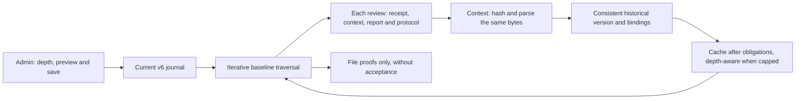

The stored Work/Git consumer uses this guard with actual Work and current saved
settings. The browser probe receives supplied fixture review data and real files,
reads the real journal and calls the same guard; it simulates no stored Work,
identity or authorization. Go comparison executes the actual private engine
method through a compiled test explicitly enabled on a marked owned root,
without protocol stubs. Unported branches are not claimed as parity.
Source-bound [qualification43](../docs/plans/migration-rust/evidence/20261018-43/qualified-01/result.json): component PASS, 310 named workspace tests, 197 default-engine tests, 30 Git and 30 baseline Go/Rust comparisons (22 valid, 8 refused), with controls and recovery. Four FR/EN×theme Admin journeys pass with 30 fields; saved/reopened zero then null changes the actual file guard. That probe's review data remains supplied, not authenticated as stored Work. 8333 inputs/73 packages remain stable. Compilation, Clippy, Rustdoc, executable example, methods, translations and rendered/inspected diagrams pass. Overall migration stays PARTIAL: batches, fragments and authority remain open; no server replacement.


Current quote/reply/Git qualification runners stream stdout/stderr to fresh
evidence files while a command runs. Final bytes and exit status remain checked
after close; reused names refuse instead of overwriting original evidence.
Two targeted tests use a descriptor handshake without an arbitrary deadline to
verify visibility before completion, original nonzero exit/output preservation,
exclusive-file refusal and recovery. These [runner proofs](../docs/plans/migration-rust/evidence/20261018-45/stream-capture/result.json)
are separate from engine qualification45; product source bytes remain unchanged.
This tooling change installs neither an engine nor a setting.

## Typed review context and stored Work binding — R3ar42

`RootStore::inspect_managed_review_git` rereads stored Work and current policy
under a shared settings reservation. Repository/review/automatic-validation
candidates and each path/digest obligation must agree. The context is then read
into a buffer whose digest is checked; strict decoding and Git citation selection
use that same buffer. Later file changes cannot alter already parsed bytes;
another inspection rereads current evidence. An observation is no freshness lease.

The codec covers actual Go context, task-context, accepted-baseline, delivery
and delivery-criterion DTOs, using existing proof model types. It preserves key
case matching, null effects, duplicate fields, slice reuse, nil/empty and opaque
receipt JSON, including numbers outside floating-point range. Strict mode
rejects unknown fields in every structured descendant; compatible mode follows
json.Unmarshal. Existing Work decoding retains compatible mode. Decoding data
authenticates neither origin nor authority.

Artifact readers now share checked local/regular opening and close handling.
Ordinary hashing remains streaming; only context bytes needed by the parser are
retained fallibly without truncation or an implicit cap. Conflicting digest
obligations for the same path remain independently enforced.

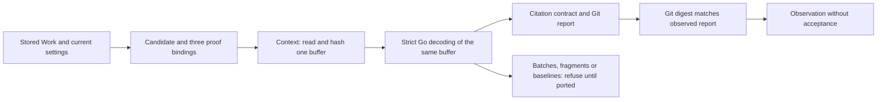

Batches and fragment journals still refuse. Historical baseline files now
follow the R3as43 guard and its explicit policy. Even a successful observation does
not establish all task criteria/contracts, reviewer identity or current authority.
Managed acceptance remains unported. Initial real-SQL-row tests cover tampering,
unknown fields, wrong candidate/version/Git report, unported protocols, no mutation
and recovery. Source-bound [qualification42](../docs/plans/migration-rust/evidence/20261018-42/qualified-03/result.json): 307 named workspace tests, 194 default-engine tests and 31 codec vectors in both modes (62 Go/Rust comparisons), each preceded by a valid control. Ten real-SQL-Work tampering/refusal/recovery variants pass without mutation or acceptance.8322 inputs/73 packages remain stable. Compilation,Clippy,Rustdoc and the executable example pass; FR/EN diagrams were rendered and inspected. No new browser journey was run: settings/frontend retain their increment 41 evidence. Complex protocols and authority remain open; overall migration stays PARTIAL.


## Native Git reads and configurable deadline — R3aq41

Settings journal v5 adds `git_command_timeout_seconds` to the shared Admin
catalogue (29 fields). Its explicit initial default is 90 s from Go; `0` expires
immediately and `null` disables the deadline and may wait forever. This product
policy differs from a verification watchdog: recipes impose no arbitrary global
deadline. Journals v1..4 remain readable/replayable without inventing Git policy;
explicit v5 preview/apply adoption is required for this consumer. History,
reservations and consumption are preserved. The running Go service still has
its previous behavior.

`RootStore::inspect_git_report` reads actual saved policy under a shared
reservation, then natively hashes a `candidate:report` blob in a root-relative
local bare repository. Only full 40/64 hexadecimal object IDs and relative Git
paths are supported. Citation version 2 hashes exact stdout; legacy 0/1 merge
stderr and apply Go Unicode TrimSpace without repairing invalid UTF-8 bytes.
Other versions refuse.

The Linux runner shared with validation retains pidfd, a dedicated process
group, an unreaped leader until cleanup, wait4 and read/write/close causes.
Both streams drain; leader exit triggers group signaling. The fixed read adds
no shell, pager or text conversion. Inherited GIT_* overrides are removed to
prevent redirecting the named repository. This is not Git confinement: local
configuration and alternate objects still require a protected repository
contract. Path resolution grants no authority.

All bytes contribute without truncation or a hidden output ceiling; memory
therefore follows output size. Refused allocation or incomplete output remains
an error. Original failure bytes remain available for explicit diagnosis, while
Debug/Display exclude their contents. Refusal never becomes a successful empty
report.

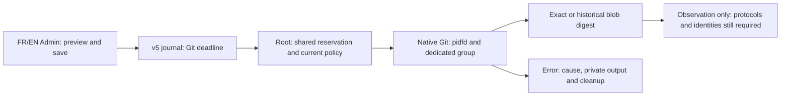

This component grants no managed acceptance. Current Work binding, review
protocols, batches/fragments/baselines and identity/authority remain required.
`git_report_probe` requires a marked owned fixture and is no agent/HTTP API.
Qualification results are retained in the migration plan.

[Evidence](../docs/plans/migration-rust/evidence/20261018-41/qualified-01/result.json). Source-bound qualification:304 named workspace tests, 191 default-engine tests, 30 Go/Rust comparisons,five refusal/recovery cases and four 29-field Admin journeys pass.8321 inputs/73 packages remain stable. The saved deadline changes actual Git behavior; original v4 journals/replay survive explicit v5 adoption. Supplementary SHA256-repository and inherited-Git-environment checks pass. This is component evidence; the full migration remains PARTIAL.


## R3ae — configurable context limits (October 18)

Settings v4 add seven persisted caps: profile name100 bytes,16 sources, path512 bytes,
profile document16000 bytes, general context16000 bytes, worker context32000 bytes,
and review delivery48000 bytes. The native catalogue drives FR/EN Admin labels
and help; explicit `null` removes the operator cap and `0` means zero capacity.
Path, format and authority protections remain separate. Journals1..3 preserve
exact serialization and replay; complete adoption requires preview and explicit
application, without a hidden fallback.

`project-context ROLE --root ROOT --json` reads the actual journal under a shared
reservation and loads ordinary project sources using saved limits, including the
separate worker budget. Files must be relative, regular, UTF-8 without NUL and
inside the root. Refusals preserve input files and error causes. The review-file
reader consumes its cap but does not establish independent review. Recognizable
secret detection is a heuristic, not proof of absence. Physical managed-memory
sources under `.claude/field-guide/`, including relative aliases, explicitly
refuse until the versioned-memory guard is ported.

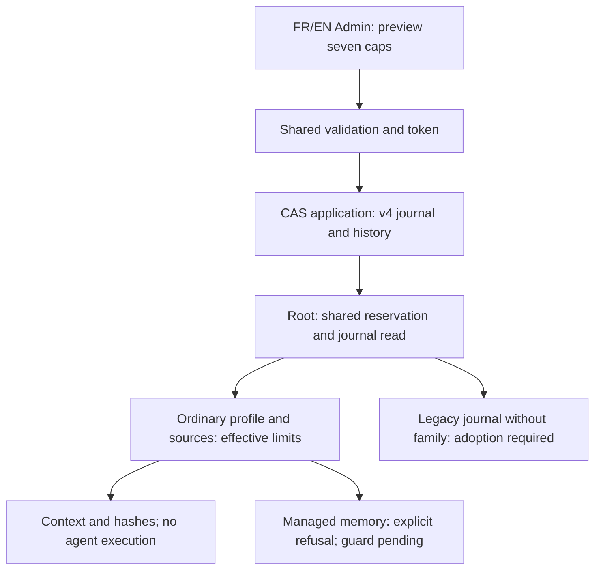

Targeted context_policy1, project_context3 and CLI1 checks pass; the provisional
Go/native ordinary-source corpus passes155 commands. Full source-bound qualification
and four browser journeys with saved-setting effects are pending. The Go oracle
extracts actual declarations and uses an explicitly ordinary-source adapter;
it does not validate memory authorization. Installed Admin HTTP, full identity/
review, overall migration and cutover remain unproven.

R3ae [full qualification](../docs/plans/migration-rust/evidence/20261018-29/qualified-01/result.json): component PASS,282 workspace/169 default-engine tests,155 Go/native context commands,144 score comparisons,41 lifecycle/gate operations and four Admin journeys across FR/EN and both themes. All28 fields are present; saving a1byte context cap blocks the actual reader, while explicit null restores it. Legacy adoption preserves history/replay.8288 inputs/73 packages stay stable, with source and binary archives. Overall migration remains PARTIAL; installed HTTP Admin and complete memory/review authorization remain open.


## R3af — project-context freshness observation

`check_project_context_freshness` rereads ordinary sources before comparison.
`RootStore.check_project_context` supplies current journal limits and holds the
shared reservation through comparison and checked close. Both absent contexts
pass; creation, removal or a changed digest refuses with `project-context-stale`.
Read/policy failures remain errors, never a successful absent result. Legacy
journals without context policy refuse even when no profile exists. No freshness
cache is retained.

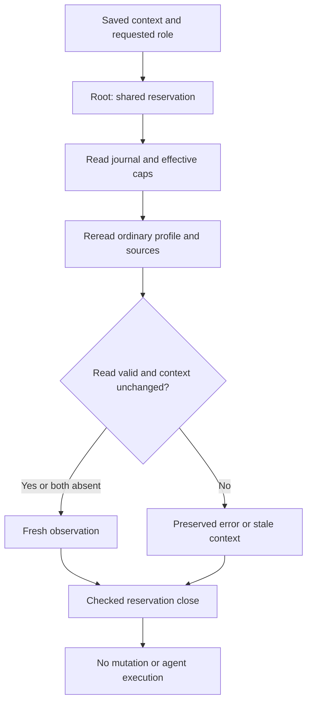

This guard prepares future resume/review paths; it is not wired into agent
execution or hierarchical acceptance yet. An equal digest proves neither identity
nor authority nor protection against later file changes. Managed-memory sources
remain explicitly unsupported. Root tests cover profile/source/role/presence
changes, invalid JSON, cap1/0/null, persistence and legacy policy without fallback.
Actual-Go guard comparison and complete candidate qualification are pending.

R3af [full qualification](../docs/plans/migration-rust/evidence/20261018-30/qualified-01/result.json): component PASS, 285 workspace/172 default-engine tests, 221 context commands including 26 freshness cases, 144 score comparisons, 41 lifecycle/gate operations and four 28-field Admin journeys. 8290 inputs/73 packages stay stable; source/binary archives are retained. Current AST inspection confirms fields, order, tags and methods for all 85 Work/Task/Event types: score.go alone has a different file digest after function fixes, without a type-contract change. This observation still grants no resume authority or hierarchical acceptance.


## R3ag — document cap read from the Root journal

`RootStore.review_delivery` loads current policy under the same shared reservation
as context readers, then reads the ordinary local file using
`review_delivery_max_bytes`. The installation value is 48000 bytes; zero permits
no bytes and explicit null removes the operator cap. Path, regular-file and
UTF-8/non-NUL text checks remain mandatory. Read/close failures never become
a successful empty result.

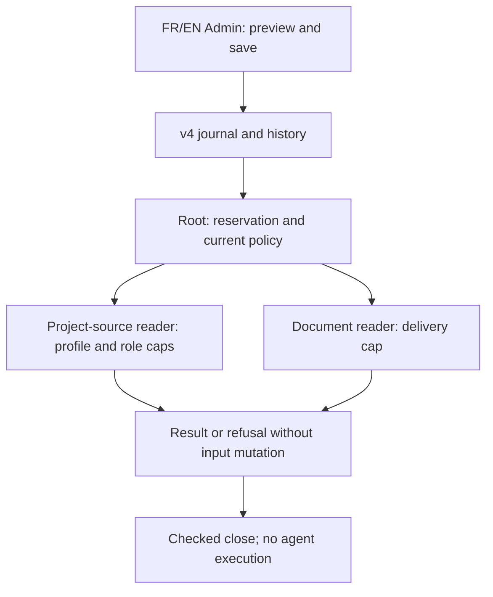

This low-level reader selects no task attachments and grants no disclosure or
review authority. `independentDeliveryDocuments` selection, authorization and
complete review lifecycle remain unported. Two new Root tests cover cap1/0/null/
default, refusal/recovery, missing/invalid files, legacy journals and reopening.
The Admin recipe also saves this cap and invokes the actual reader through a
marked private probe; full candidate qualification is pending.

R3ag [full qualification](../docs/plans/migration-rust/evidence/20261018-31/qualified-01/result.json): component PASS, 287 workspace/174 default-engine tests, 221 context/freshness commands, 144 score comparisons, 41 lifecycle/gate operations and four Admin journeys. A saved1byte document cap refuses the actual Root reader, then null restores it; refused reads preserve source/configuration. All three binaries match their archives; 8291 inputs/73 packages stay stable. Task-authorized attachments and complete review remain unported.


## R3ah — review instruction contract digest

`review_contract(Task)` natively matches Go instruction binding:
`SHA256(JSON([title, deliverable, criteria, dependencies, plan_brief_hash]))`.
For nonempty memory references the result becomes
`SHA256(JSON([first_digest, memory_references]))`. Order is retained; null and
empty criteria/dependency arrays differ, while empty memory references add no
layer. The existing codec preserves Go escaping and encoding failures propagate
as `WorkError`.

This binds data without proving reference validity/currentness/permissions,
reviewer identity or independent review. Status/owner and other excluded fields
are not implicit checks. The complete guard must also validate attempt, current
context, report and receipts. This addition wires no product caller and adds no
operator policy constant. Its reference extracts the actual Go functions and uses
the real compiled `engine.Task` type rather than a replacement. Exact targeted
qualification is pending.

R3ah [targeted qualification](../docs/plans/migration-rust/evidence/20261018-32/qualified-01/result.json): component PASS, one named test and 28 Go/native cases (21 valid, seven invalid), with byte-identical outputs, workspace compilation and Clippy. Covered fields, order, null/empty, memory and type errors are verified. Previous Admin/Root tests are not counted as new execution; the three R3ag-qualified binaries are preserved. Complete review remains open.


## R3ai — ordinary review evidence consistency

`check_review_evidence` selects a unique task from supplied Work and checks reviewer
configuration, declared state, reread current context, latest attempt and recalculated
contract. Ordinary report/artifact files are reread and hashed using the existing
streaming reader; failures retain causes. Transmitted-text budgets remain separate
from file hashing, which adds no new cap. Current-mode checking exposes no switch
that skips freshness.

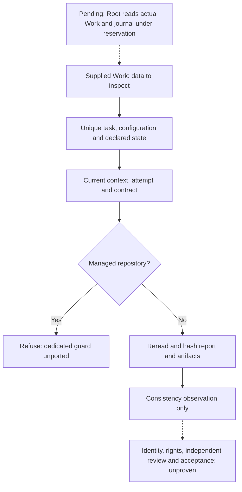

Without planning the result is None, without inventing a review. A plan lacking
a reviewer refuses. Managed repositories explicitly refuse; their receipts and
candidate checks are not replaced. This observation proves no producer identity/
independence or memory permissions/currentness and is not wired into hierarchical
acceptance. Integration must still replace supplied Work with the actual Root row
and retain its reservation.

The oracle extracts actual Go methods and now uses actual compiled profile, context,
Work and Task types. Memory/managed adapters refuse excluded scopes rather than
simulating approval. Fixtures declare a fictional review solely to exercise data
consistency; no actual independent review is established. Full qualification pending.

R3ai [qualification](../docs/plans/migration-rust/evidence/20261018-33/qualified-02/result.json): component PASS; six native checks/compilation/Clippy results from01 are reused after equality of4369 native inputs and build context. Go comparisons run freshly:221 context commands and69 review-consistency scenarios, including saved context policy. qualified01 remains FAIL for Go vet; fixture literals now use field keys derived from actual AST. A deliberately faulted reference copy demonstrates that a matching outside-file digest makes the path test discriminating. Actual Root Work sourcing and review authority remain pending.


## R3aj — review observation from the actual stored Work

`RootStore.inspect_review_evidence(work_id, task_id)` rereads the actual row and
revision. It loads the current journal and retains its shared reservation through
context, attempt, contract, report and artifact checks. Callers supply neither
Work nor effective policy. Results explicitly carry `scope: data-consistency-only`,
Work/settings revisions and an optional observation. Without planning, no review
verdict is fabricated.

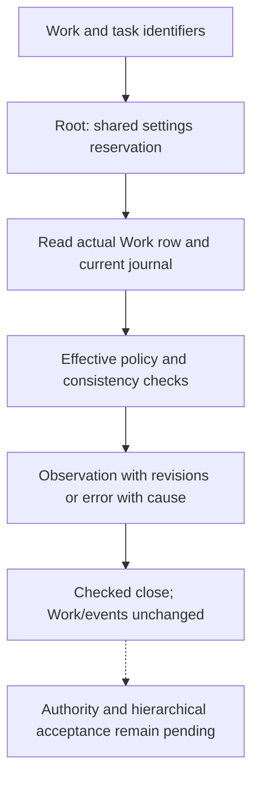

The reservation stabilizes policy during this read; observed revisions grant no
lease for a later action. Files/Work may change afterwards. This SDK API is not
an authenticated independent review, authority or new HTTP/CLI route. Hierarchical
mutation still refuses even after a positive observation.

Two Root tests use private fixtures: API-created Work/task followed by a fictional
review injected solely for consistency testing with actual UDFs and foreign keys
enabled. Row/file changes, cap1/0/null, persistence and non-mutation are checked;
no actual reviewer call is proven. Transverse Root/Admin qualification is pending.

R3aj [transverse qualification](../docs/plans/migration-rust/evidence/20261018-34/qualified-01/result.json): component PASS, 292 workspace/179 default-engine tests, Go/race/compilation/Clippy, 221 context commands, 144 score comparisons, 41 lifecycle/gate operations and four Admin journeys across languages/themes. Root observations reread actual row/current policy without mutation or acceptance authority. Saved context/document caps affect the actual readers and survive reopening; 8302 inputs/73 packages stay stable. Authenticated server/API, current identity, memory/managed review and hierarchical acceptance remain open.


## R3ak — managed-review candidate and file bindings

`inspect_managed_review_anchor(root, work, task_id)` observes candidate and
three-file bindings only. It requires one unambiguous task, a repository, a review
and automatic validation, with the same nonempty candidate. Receipt, context and
report are reread as regular local files contained by the root, each compared to
its own nonempty digest. Causes of read errors are retained; no file is written.

`RootStore.inspect_managed_review_anchor(work_id, task_id)` reads the actual Work
row and settings journal under a shared reservation and returns their revisions.
Its scope is `candidate-and-file-bindings-only`; `git_report_verified`,
`protocol_verified` and `authority_verified` remain false. Receipt/context JSON,
batches, fragments, historical baselines, report contents in Git, general
freshness, producer and authority are outside this observation. It makes no
provider call or acceptance decision. It reserves neither files nor a future
action. Complete managed review and hierarchical acceptance remain refused.

A reproduced Go defect used file paths as map keys in both proof loops, losing
contradictory or empty digests when proof paths coincided. Both loops now check
all three bindings independently. Equal paths remain valid when every digest
matches. Rust follows the same contract. Reusable lesson: deduplication keys must
not erase independent evidence obligations. The source correction does not
replace the binary serving the existing Go application.

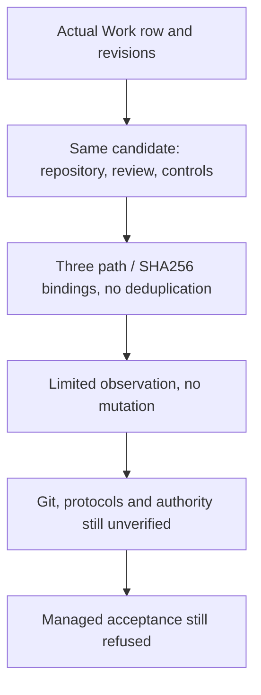

The existing Go constants of 90 seconds for Git and 128 baseline levels are not
introduced here. A persisted, validated policy editable through Admin is required
before the corresponding consumer is ported; this increment adds no hidden cap
or replacement default. Existing 28-field Admin policy and consumers are unchanged.
`tools/rust-migration/verify_managed_anchor.py` checks named tests, failure/recovery,
no mutation, comparisons against two phases extracted from actual Go source and
source stability. This oracle explicitly excludes the other guard phases and
cannot prove complete review. Qualification results are detailed below.

R3ak [qualification](../docs/plans/migration-rust/evidence/20261018-35/qualified-02/result.json):
component PASS; 297 workspace/184 default-engine tests and compilation/Clippy
results reused from qualified01 after equality of native inputs, compiler, Cargo
graph, environment and literal assets. qualified01 remains FAIL: the Go oracle
omitted safeReport's actual nonempty dependency; extraction is corrected and
build/vet prerequisites pass. Three Go tests and 29 comparisons (116 commands
including valid controls) run freshly in qualified02; 8305 inputs/73 packages
stay stable. Admin is not rerun here; R3aj remains historical with unchanged UI
sources. Git/protocol/authority checks and the overall migration remain open.


## R3al — evidence integrity during a review-method restart

`prepareReviewMethodRestart` had the same overwrite defect: its receipt/report
map could lose the receipt digest when both paths coincided. A test of the actual
restart preparation, using persisted fragments and a valid control under the same
preconditions, reproduces two missing refusals (empty/wrong digest). The loop now
checks both obligations independently, like R3ak's three bindings. Consistent
aliases remain valid. Refusal preserves Work, decisions/consumption, originals
and history. This fixes the Go reference source without replacing its live service.

Native binding inspection is unchanged, with Git/protocol/authority verification
explicitly false. Complete method restart remains unported in Rust. Go journeys
use a local simulated provider and prove no real provider. The enriched
`verify_managed_anchor.py` targets preview, explicit repair, refusal for semantic/
budget/original-evidence faults and history preservation. Results follow below.
The R3ak diagram still applies; this adds no new flow, policy or API.

R3al [qualification](../docs/plans/migration-rust/evidence/20261018-36/qualified-02/result.json): component PASS; six Go tests and 29 comparisons/116 commands executed freshly. Native297/184 results are reused after checks back to their actual35/01 execution. qualified01 remains FAIL: the initial reuser did not follow an already reused proof. It now follows the chain, refuses cycles and checks inputs, environment, tools and outputs. 8305 inputs/73 packages stay stable. Rust method restart, Git, protocols and authority remain open.


## R3am — cumulative reviewed-task contract

`managed_review_contract(work, selected_task)` ports actual Go `managedReviewContract`.
It visits tasks in stored order and includes the selected identifier and tasks
whose status is exactly `accepted`. Each entry binds task ID, latest attempt ID
(or an empty string), ordinary review contract and validation policy; the full
array is Go-compatible JSON hashed with SHA256. No selected entries hash `[]`,
not `null`.

Changing an older attempt or excluded task leaves this contract unchanged;
changing the latest attempt, an accepted task, order, criteria, memory references
or policy changes it. Go semantics are retained without inventing validation:
missing selection and duplicate identifiers are not rejected by this calculation.
It proves neither the Git candidate nor Work ID/state, owners or current rights.
It is not yet integrated into complete native candidate preparation.

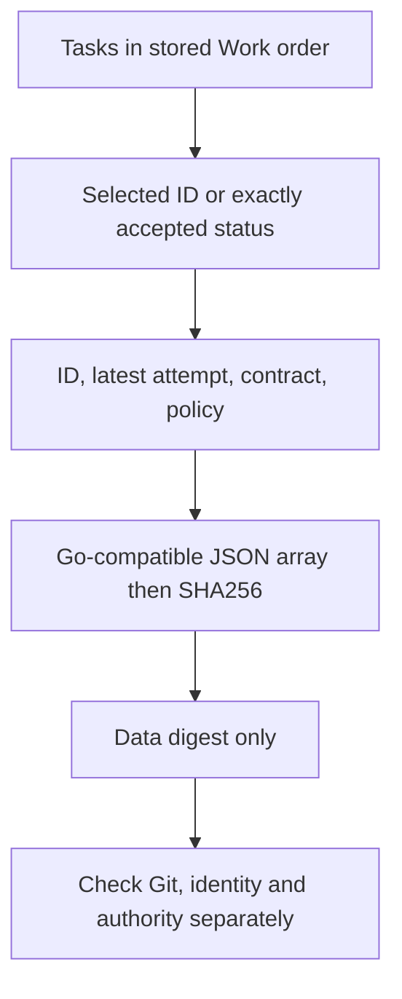

`python3 tools/rust-migration/verify_managed_contract.py FRESH_OUTPUT_PATH` uses a
fresh evidence area, functions extracted from actual Go source, compiled Work/Task
types, named tests and invalid decoding cases. It checks input stability and
preserves sources/binaries/original outputs. It calls neither providers nor Root
and adds no policy. Earlier Root/Admin journeys remain historical evidence; this
pure addition receives targeted verification and workspace-wide compilation/Clippy.
Complete engine and cutover remain open.

R3am [qualification](../docs/plans/migration-rust/evidence/20261018-37/qualified-02/result.json): component PASS; three named native tests and32 Go/Rust comparisons (24valid/8invalid), workspace compilation/Clippy,8308stable inputs/73packages. qualified01 is INCOMPLETE, deliberately stopped before qualification tests after observing a failed Clippy prerequisite (Box::default in a test). No timeout occurred. The recipe now checks compilation/Clippy/build/vet before tests;02 started only after exit0 from the corrected prerequisite. Earlier Root/Admin totals are not counted as freshly executed.


## R3an — function documentation and rule transmission

Rustdoc for the R3ak/R3am contract/observation APIs now describes inputs,
preconditions, results, errors, effects and limits, as do comments on the three
corrected Go functions. The cumulative contract includes an executable empty-cohort
example. No business guard changes. Shared personal rules imported through
`~/.claude/CLAUDE.md` and repository rules require documentation for new/modified
public or nontrivial functions. FR/EN method pages distinguish persistent rules
for later contexts from already running processes and unchanged embedded engine
instructions. Rustdoc generation, doctest and method checks are pending; previous
functional evidence remains historical.

R3an: Rustdoc with warnings denied PASS, doctest1/1 PASS, method checks5 PASS and unchanged non-comment code verified. Personal/project imports and mode600 verified; no running Claude context or embedded contract replaced.


## R3ao — memoize baseline traversal only

`managedReviewFilesIntactSeen` checked a context path/digest once, then skipped
other reviews sharing that context. An actual baseline chain reproduces a second
review's empty/wrong receipt digest being accepted, with matching context hashes
and a preceding valid control. Context identity does not identify all obligations
of a review.

Go now checks each review's protocols, three file/digest bindings and context JSON
before consulting the memo. Only traversal of baselines embedded in that immutable
context is shared. The memo stays local to one inspection; identical reviews and
valid shared contexts remain valid. No Admin policy or new limit is introduced;
the existing Go depth bound remains unchanged. Native baseline execution stays
refused.

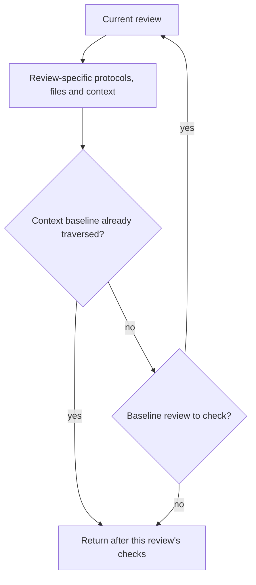

`verify_managed_baseline_memo.py` preserves actual normal/race Go graphs, root
sources and embedded resources, named results and before/after input stability.
Receipt, report and unexecuted-batch faults must be refused; recovery must pass
and refusal must preserve originals. Go publication/restart tests use local
simulated providers and prove no real provider, deployment or native acceptance.
Results follow below.

R3ao qualified01: Go component PASS, seven named tests including five baseline fault variants, Go vet and 8308 stable inputs/73 packages. Refusal preserves originals; valid shared contexts and recovery pass. FR/EN diagrams rendered and inspected. Earlier Rust/docstring results are not counted as rerun; no service replacement or native acceptance.


## R3ap — tool docstrings and invalid fixture argument

New review/anchor recipes, Go generators, probes and tests document their
contracts, effects, errors and limits. The cumulative-contract probe used
std::env::args, panicking with exit101 on a non-UTF8 argument. A valid control
passes, then the exact37 archived binary reproduces the fault (SHA checked).
The probe now uses args_os and explicitly refuses non-UTF8 task IDs with the
usual exit2. This affects private fixture transport, not a public command or
Admin policy.

The recipe preserves actual argument bytes instead of stringifying them before
subprocess; the manifest records their hexadecimal value. Three native checks
(missing, extra, non-UTF8 argument), each preceded by a valid control, supplement
Go/Rust contract comparisons. They do not claim Go invalid-argument parity.
Qualification results follow below. Earlier
architecture diagrams still apply; no business flow or acceptance authority is added.

R3ap qualified01 component PASS: three native tests,32 Go/Rust cases (24/8), three native argument checks with preceding valid controls, compilation/Clippy/vet and 8309 stable inputs/73 packages. The manifest records raw argument hex ff, refused with exit2 without panic. Business libraries are unchanged since38 docstrings; no server activation or acceptance.

## Original quotes and code-fence closure — R3at44

Native `review_evidence_present` first checks an exact substring for every artifact
kind. Fallback applies only to `.md` names of kind `source`/`diff`: remove backticks
and normalize Go whitespace within one prose paragraph. It crosses no code block,
diff hunk/header or addition/deletion/context boundary. A closing fence must use
the opening marker, at least its width and a whitespace-only suffix. This
conservative guard does not claim to parse all Markdown.

The actual Go reply parser accepted a nonliteral quote after a false closing
fence: six counterexamples were reproduced, with a valid literal control before
each fault. The shared Go guard is corrected alongside the native port.
Qualification44 retains the original red and recovery results; parsing tests
establish no complete task acceptance.

The normalized minimum is an explicit argument, not an implicit Root default.
Actual Go parser bounds (8..4000 UTF-8 bytes) remain distinct from provider-schema
hints and the citation catalogue. Persisted/Admin policy adoption is still required
before an integrated native parser consumes these bounds. The predicate even
accepts an empty literal quote: its caller must enforce completeness and lengths.
It proves no provenance, identity, authority or verdict. No state changes occur;
allocation failure is an explicit error, never an absent match. Rust inputs are
valid UTF-8 text; this probe does not qualify invalid UTF-8 bytes. Memory follows
the supplied texts without a hidden cap.

Recipe: `python3 tools/rust-migration/verify_review_quote.py FRESH_DIRECTORY`.
It compares an oracle extracted from the actual Go predicate, runs actual Go
reply-parser tests and checks effective input stability. It deploys nothing.
Source-bound [qualification44](../docs/plans/migration-rust/evidence/20261018-44/qualified-01/result.json): component PASS, 23 targeted Rust tests, 6 actually executed top-level Go tests, 47 matching vectors with a literal control and recovery each, and 4 native transport refusal/recovery cases. All 8334 inputs and 73 registry packages remain stable. Compilation, Clippy, Rustdoc, executable example, methods and diff checks pass. This pure guard changes neither Admin nor configuration; browser recipe43 remains historical evidence, not a check of the new code. Complete reply parsing, batches, fragments, identity and acceptance remain open; no server replacement.


## Structured replies and Admin settings v7 — R3au45

The native parser reads `reason` and `criteria` through the strict Go-compatible
codec: case matching, null, duplicate keys and slice reuse retain their contracts.
Unknown fields refuse; each index1..N must occur once and criterion count must
match. `pass` requires an original quote under guard44; `fail` or `unknown` gives
`changes_requested` without requiring missing-evidence descriptions to be quotes.
The result is structured declared data, not an accepted independent review.

Journal v7 adds three Admin fields (33 catalogue fields):

| Field | Initial default | Unit and effect |
| --- | --- | --- |
| `review_reply_min_text_bytes` | 8 | Trimmed UTF-8 bytes using Go whitespace, rationale and evidence |
| `review_reply_max_text_bytes` | 4000 | Raw UTF-8 bytes per rationale/evidence field; null removes this cap |
| `review_quote_min_normalized_bytes` | 8 | Bytes after Markdown normalization, without affecting literal substrings |

Zero removes a minimum; a zero maximum admits only empty text when the minimum
is also zero. Lower minima can admit weak text or quotes; removing the maximum
increases memory risk. These bounds differ from provider character-length hints
and the shared16MiB transport constraint. The complete v7 group is required and
maximum must not be below minimum. Original v1..6 journals remain replayable;
adoption is explicit without hidden defaults.

`RootStore::inspect_review_reply` rereads the actual task and settings journal
under a settings reservation. Caller-supplied reply/original texts remain
unauthenticated. Observed revisions are no future task reservation. No mutation,
identity or acceptance authority is granted; batch/fragment protocols remain
pending. Refusals use safe diagnostics without private excerpts and retain codec,
allocation and close causes. The pure API requires explicit limits and valid
UTF-8; zero-criterion DTOs follow Go data semantics without granting acceptance.

Current recipe: `python3 tools/rust-migration/verify_review_reply.py FRESH_DIRECTORY`.
Source-bound [qualification45](../docs/plans/migration-rust/evidence/20261018-45/qualified-02/result.json): component PASS, 319 workspace/206 default-engine Rust tests, 75 Go/Rust reply scenarios with control/recovery (225 comparisons), 30 Git and 30 historical-baseline comparisons. Four FR/EN×theme Admin journeys pass with33fields: each new value is saved, reopened and changes parsing against an actual stored task. Supplied text remains unauthenticated; no acceptance is granted. All8347inputs/73packages remain stable. Compilation,Clippy,Rustdoc/executable example,methods,translations,diff PASS. The first recipe remains FAIL: it reused a stale editor after its own CLI change and CAS correctly refused. The corrected recipe reloads the component and propagates unexpected preview/apply alerts without adding a watchdog. Four FR/EN×theme captures inspected at1440/320; interactions also cover1024/760/390. No server replacement.


## Work control history — R5a46

Native `read_validation_control_history` returns controls for attempts owned by
the task, newest receipt first, without retention caps or truncation. It excludes
the current receipt and duplicates; absent measurements stay unknown. Historical
receipts never become current verdicts. `RootStore::inspect_control_history`
supplies the actual stored task and receipt under reservation; caller-supplied
pure-function data grant no authority or identity evidence.

An attempt-free task returns an empty history without querying. Otherwise SQL,
row-reading, decoding and finalization errors refuse the whole observation with
their cause, without mutation or partial success. This explicitly strengthens
the legacy Go reader, which ignores these errors; no Go repair is claimed.
Recipe: `python3 tools/rust-migration/verify_control_history.py FRESH_DIRECTORY`.
The probe reads a marked private SQLite fixture through the actual compiled Go
reader; a separate Root test uses a stored Work and attempt. [Qualification46](../docs/plans/migration-rust/evidence/20261018-46/qualified-01/result.json): component PASS, 24 named Rust tests, 12 valid scenarios with control/recovery, 52 comparisons, four corruption cases and one SQL failure with recovery. All 8349 inputs/73 packages stay stable; compilation/Clippy/Rustdoc/vet/methods pass. Complete public Work CLI validation projections and rendering still
need integration. No Admin or UX change in this increment; visual journeys45
are therefore not rerun.


## Public Work listing — R5b47

The Rust binary supports `swarm-rust work list --root ROOT --json`.
It opens an already initialized root read-only and returns complete Work objects,
newest first. Only a successful empty read produces `[]`. Storage/decoding and
checked-close errors refuse before any success output; failed output remains a
command failure. This command initializes no root, grants no acceptance and
starts neither Go nor a provider. Unrelated arguments refuse before opening.
FR/EN JSON data match; Unicode separators are escaped and HTML characters kept.

R5e51 adds text listing, show/resume and native basic mutations; see the current
FR/EN contract for supported commands and remaining limitations.
Recipe: `python3 tools/rust-migration/verify_work_list.py FRESH_DIRECTORY`.
Three actual-binary tests pass after failing on the missing command: empty/full
lists, damaged private DB refusal with recovery and original preservation, and
arguments/missing-root/output failures. [Qualification47](../docs/plans/migration-rust/evidence/20261018-47/qualified-01/result.json): component PASS, 20 named CLI tests and six actual Go/Rust binary comparisons (FR/EN, empty then two Work objects). Workspace compilation/Clippy, Rustdoc, Go vet and methods pass; all 8352 inputs/73 packages remain stable. Overall migration remains PARTIAL; no installation is claimed.

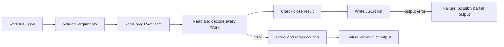


## Current validation receipts — R3av48

`check_validation_evidence` checks receipt consistency with the latest attempt,
policy digest excluding attribution, ordered commands/results, output sharing and
the actual bytes of every artifact. Automatic mode also recalculates the gate
using the observed quality profile. No configured controls returns explicit
absence; inconsistent data or inaccessible files return errors with their causes.

Only nonempty, complete, policy-shared output becomes a quote source. A consistent
truncated prefix is not a complete source. The UTF-8 byte limit uses Admin's
existing `validation_max_output_bytes`: null is unlimited, zero retains no bytes.
Changing this limit may make an older receipt incompatible with the read policy.
`RootStore::inspect_validation_evidence` reloads the actual task and settings under
reservation, accepting no caller-supplied freshness flag. Successful inspection
checks data; it authenticates no controller URI author, proves no execution
provenance and grants neither review approval nor acceptance.

Recipe: `python3 tools/rust-migration/verify_validation_evidence.py FRESH_DIRECTORY`.
Associated Go source repair: a policy without controls must neither index nor share an older receipt’s results; the case reproduced a panic before correction. [Qualification48](../docs/plans/migration-rust/evidence/20261018-48/qualified-03/result.json): component PASS, 31 named Rust tests, 5 Go tests, 35 scenarios and 111 comparisons with controls/recovery. Changed/missing files refuse then recover; saved cap feeds the consumer after reopening. All 8357 inputs/73 packages stay stable. Compilation/Clippy, Rustdoc/example, Go vet and methods pass. Initial failures remain retained; overall migration PARTIAL. Existing Go service preserved. Tests also cover the real automatic gate/profile,
changed/missing/escaped files, preserved errors and recovery, then saved-setting
effects on a stored task after reopening. The Admin component is unchanged; its
existing exposed cap is consumed here. Public TaskEvidence/validation/rendering
integration remains pending.


## Work projections and persisted presentation v8 — R5c49

`RootStore::inspect_work_validation` derives `TaskEvidence` and validation state
from the stored Work, actual current files and checked history under reservation.
Acceptance without a current gate stays stale; a reviewed report proves no
execution. Neither `unknown` nor an empty list becomes `passed`. Current and
historical controls stay separate; measured durations use stable sorting.
Historical SQL/JSON errors refuse the entire observation. Human-control mismatches
stay visibly stale with a safe reason in `limits`, explicitly extending Go.

| Admin v8 setting | Default | Meaning |
| --- | --- | --- |
| `evidence_longest_measured_count` | 5 | Measured controls displayed; 0 none, null all |
| `work_view_recent_decisions` | 10 | OODA decisions displayed; 0 none, null all |
| `work_view_wrap_characters` | 80 | Unicode characters after tab expansion; positive or null without wrapping |

These settings delete no receipt/event and limit no execution. Journals1..7 remain
readable/replayable; adopting the complete v8 group is explicit. New installations
receive v8 defaults. Output retention still uses the existing Admin setting.
Callers provide no freshness flag to the Root consumer.

Recipe: `python3 tools/rust-migration/verify_work_projection.py FRESH_DIRECTORY`.

[Qualification49](../docs/plans/migration-rust/evidence/20261018-49/qualified-01/result.json): component PASS, 337 named Rust tests, 138 Go/Rust comparisons across 23 FR/EN scenarios and four Admin journeys with36fields. All three settings save/reopen with observable effects: actual stored Work for ranking, saved-policy helpers for OODA/wrapping. All 8369 inputs/73 packages stay stable; workspace compilation/Clippy, Rustdoc/example, vet, methods, translations and diff pass. Four new-field captures inspected at1440px; interactions also cover1024/760/390/320. OODA selection and wrapping helpers consume saved
values through the probe; complete public Work rendering still needs integration.
Hierarchical Work explicitly refuses with `command_not_ported` until its authority
is ported. No server replacement, identity evidence or acceptance is claimed.


## Controlled Git metadata — R5d50

On Linux, native metadata readers now share checked execution: read configured
filter names without their values; neutralize every clean/process/smudge/required
family; disable hooks/fsmonitor, inherited `GIT_*` overrides, prompts and optional
index writes. This prevents a `git status` read from executing repository/global
filters. Reads remain separate observations, proving neither a Git snapshot nor
actor identity or authority.

`RootStore::inspect_git_metadata` uses saved `git_command_timeout_seconds` per
command. Root creation/checkpoints also pass their locked settings through the
configured environment. Legacy journals without Git policy produce explicitly
unavailable optional metadata without executing commands or inventing a deadline;
the strict reader refuses. The historical library `observe_git` API remains
explicitly unbounded and shares filter neutralization; it does not replace the
configured Root boundary.

Original output stays in private typed causes; public diagnostics expose only
fields, reasons, codes and hashes. A failed command never makes an empty field a
cleanliness proof. Launch/read/protection/cleanup/policy failures remain retained.
The test filter actually executed by unprotected Git is reproduced under50;
[Qualification50](../docs/plans/migration-rust/evidence/20261018-50/qualified-01/result.json): component PASS, 341 named Rust tests and four Admin journeys. Real Git and an isolated shim verify nominal data, prevented filter execution, unchanged index, saved deadlines reaching reads/creation, refusal without mutation then recovery, zero Git launches without policy and history-preserving adoption. All8373inputs/73packages and external Git/Python binaries stay stable; compilation/Clippy, Rustdoc/example, methods, translations and diff pass. Overall migration PARTIAL. No Go service was replaced. Its
legacy `gitState` remains identified work before any complete-cutover claim.


R5e51 routes basic public Work commands through actual Root observations and
atomic Markdown publication. Saved Admin presentation settings reach the renderer
after reopen; post-commit view failures explicitly retain state and permit replay.
The new parity recipe is `tools/rust-migration/verify_work_view.py`; this is source
work under qualification, not service installation or complete migration.

R5f52 exposes native `gate ID --input FILE` with the saved quality policy and
strict task binding. Exit0/1 distinguish allowed/denied recorded evaluations;
errors return2 with committed state preserved. Qualification remains in progress.

R3aw53 under qualification: new manual tasks bind every nonblank criterion to
the existing mandatory gate mapping. Root creation consumes saved task_max_criteria;
pure data constructors impose no operator fallback. Existing historical rows
without mappings still require explicit adoption before cutover/new acceptance.

## Continuous migration review

`tools/rust-migration/review_increment.py` checks declared four-axis reviews
(policies, functions, errors, documentation) against exact effective-input
snapshots and current evidence hashes. Missing/stale coverage refuses; open
findings remain BLOCKED with owner/resumption. Lexical candidates do not prove
semantic correctness or independent review. Invoke explicitly with `--root`,
`--baseline`, `--current`, `--review` and a fresh `--output`; the JSON declaration
uses schema_version1, reviewer, baseline_sha256, current_sha256 and a files map
whose entries contain sha256 and all four axes (state, reason, evidence path/hash).
Allowed states: reviewed, not_applicable (reason required), open (also owner and
resume_when). Exit0 covers the declaration only;1 means open findings;2 invalid
or stale coverage. The shared qualification collector now requires
SWARM_MIGRATION_REVIEW_BASELINE (prior input inventory) before expensive checks
and a fresh source-review.json in its output before closing qualification. Missing,
stale or open reviews refuse and preserve source-review-result.json. This checks
only the declared increment; historical findings remain in the plan until resolved.
No runtime-engine or independent-review enforcement is claimed. See the FR/EN
migration architecture for the process and limits.

R3ax54 under implementation: persisted v9 manual gate-default phases, retaining
existing mappings and criterion coverage; legacy settings require explicit adoption
for new manual task creation. Root uses saved policy, while the pure Go-reference
constructor retains its documented historical fixture profile. No runtime fallback
or removal of adopted requirements; Admin and broad qualification remain pending.

R3ax54 qualified05: component PASS, overall migration PARTIAL. Native361 and Go46
checks are explicitly reused on unchanged compiled sources/environment; four Admin
journeys rerun,60public comparisons/four gate replays revalidated.8387inputs/73crates
stable. Eight phase-control images inspected FR/EN×themes at320/1440. Catalogv2
announces choices; journalv9 persists them. Missing/malformed/open source reviews
refuse qualification. No deployment, provider, independent review or full migration
acceptance. See qualified05/result.json and visual-review.json in evidence54.

R3ay55 in verification: shared operation-field protocol rejects meaningful ignored
parameters after replay/revision guards and before new application. Task creation
does not accept budget overrides; use supported task.update validation. Historical
receipts remain replayable and do not retroactively apply ignored values. See the
FR/EN migration contract and evidence55; no deployment or complete migration claim.

R3ay55 qualification01 retains a BLOCKED error review despite passing native364,
Go49 and four Admin journeys. A scoped follow-up tests the Go trailing JSON cause
and actual public refusal/recovery; native evidence may be reused only after exact
source/assets/environment/binary checks. Prior UI/views remain explicitly attributed.

R3ba57:42 tests on9 affected Rust targets and33 actual-Go/native data vectors,
34 named Go probe runs,8398inputs/73crates stable. No fresh GUI claim. Next R3bb58
is ordinary hierarchical read projection; managed protocols/acceptance remain open.


R3be61 preparation inventories `PlanningRequest` using
`go run ./tools/rust-migration/work-layout PlanningRequest`. With no arguments,
the producer retains its original Work/Task/Event contract. JSON-private fields
are excluded from dependency traversal; custom marshalers stay explicit and need
semantic handling. PlanningOperation's empty dependency revision is one such
contract. Actual-source witness/guard outputs are retained under61; planning
pause/resume execution is not yet implemented by this preparation.

R3bk67 numeric budget APIs are component-qualified (418Rust/40default CLI tests,
49Go/native comparisons,8457stable inputs/73packages), not yet wired
into claim/task mutations. Five targeted Rust checks and49actual Go/native fixture
comparisons pass. `planning_scope_ancestors`, `planning_scope_task_count`,
`check_planning_activation_budget` and `check_planning_task_budget` validate the
supplied immutable Work. Zero local limits inherit globals and every ancestor is
checked; equality denies. Invalid trees/scopes refuse, not empty success. No IO,
reservation, authority or freshness guarantee is created. Replay via
`python3 tools/rust-migration/verify_planning_budgets.py --output NEW_PATH`.

R3bl68 is component-qualified:423Rust/40default CLI tests, production without
fixtures. It adds pure rejected-proposal fingerprint/wait comparison APIs.62
Go/native fixture comparisons match exact SHA256 and unchanged data, including
nullable shapes, Unicode, reviewer policy and refusal/recovery. No diagnostic is
persisted/routed, no retry authorized; full claim remains unported. Native errors
retain causes rather than inventing an empty fingerprint. Replay with
`python3 tools/rust-migration/verify_planning_rejection.py --output NEW_PATH`.

R3bm69 adds `budget apply` through the existing native Work transaction, preserving
all reservations and excluding submitted actor/time from replay identity. Eight
engine tests and three real CLI journeys pass. Component qualification passes434
Rust tests,43default CLI tests and67Go/native comparisons on8459stable inputs
and73locked packages; production excludes fixtures. This is not full migration.
Public financial admission/reservation APIs use the caller-owned transaction and
combine all four estimated ledgers. Zero/absent policy remains unlimited; no real
cost is inferred from estimates. Native budget views/preview, UI, reported costs
and complete claim remain unported. See FR/EN migration docs for error/recovery.

## R3bo71 native pricing (component verified)

Project pricing list/save/estimate now uses the actual versioned Go-shaped file,
explicit category volumes and immutable price versions. No prices are bundled.
Root checks digest, owned anchored files, metadata observations and atomic publish;
CLI reports nonzero output/flush errors after committed configuration. Fault
injection is test-only and production must be built separately without it.
Go-initialized catalogue JSON is preserved, including omitted fields versus null.
Targeted8engine/3CLI checks pass. Qualified03:445Rust tests,46default CLI tests,
18targeted Go tests,101comparisons,8476stable inputs and73packages; production
excludes fixtures. Same-session review only. Legacy finite arithmetic is protected
by an archived Go source witness; only overflowing intermediate products rescale.
Native HTTP/Admin, live Go-root cutover and price/reservation coupling are open.
See [budget contract](../docs/en/BUDGETS.md) and the retained migration plan.

Agent-runtime prerequisites now include strict launch/provider DTOs, retained-agent
SQL lifecycle projection and complete history. `agent show|stop ID --root ROOT`
observes storage or records an idempotent stop intention; it never confirms
termination or authenticates retained PIDs. Native launch/supervision remain open.

Linux `RootStore.claim_agent` now records one actual supervisor atomically with
starting state, verifies SQL/body/host/epoch and detects silent SQL refusal.
The registration receipt grants no execution or authentication authority; native
launch and complete supervision remain open.
`agent reconcile ID --root ROOT` atomically cancels an unregistered manual agent,
settles its matching attempt and estimate, and supports idempotent replay or
historical partial-settlement repair. Registered/hierarchical cases refuse.
No process is signalled and no task is accepted; see the FR/EN migration contract.

Runtime settings v15 now expose ten default/definition-ceiling values in Admin.
`agent limits WORK ROLE TASK --root ROOT --input FILE --json` reads saved policy
and SQLite scope overlays for a diagnostic preview. It does not authenticate
supplied provider/prior values or start a process. No hidden normalization fallback;
legacy settings require explicit adoption. Full native launch remains open.

Linux manual admission now has `agent preview|prepare WORK --root ROOT
--input FILE --json`. The strict schema1 launch names event_id, expected_revision,
task_id and provider; defaults/ceilings come from saved v16 settings. Preview
rolls SQL back; prepare records a queued intention, matching Work attempt, event,
financial estimate when configured and log atomically. Neither starts a child.
Replaying the same canonical original intent is idempotent even when the provider catalogue is
no longer present; a changed intent with the same event identity refuses.

Host checks are compatible/unverified, not provider authentication or sandbox
proof. Only the manual worker path is currently supported; API catalogue,
hierarchy, selected memory/skills, dialogue, model route and field-guide context
explicitly refuse pending their ports. The command file digest does not cover
interpreters or dependencies. Lost output after admission remains nonzero and
tells callers to reread/replay; preview host write probes are temporary.
See FR/EN migration documentation and the permanent manual-admission recipe.
Full native supervision and global acceptance remain open.

New manual preparation now composes current identity from the post-transition
Work/task/attempt candidate, including its durable revision and the latest own
plan contract. Sibling task bodies and superseded contracts are excluded;
ambiguous mappings refuse without fallback. Preview and commit use the same full
prompt digest. Historical replay stays immutable and grants no execution receipt;
future supervision must check freshness before using a retained context. Native
provider execution, delegated/corrective context and global acceptance remain open.

Increment80: explicit model/effort argv compiler is available as a pure engine
API; six targeted scenarios and114tests in the native recipe pass, plus4generator
and i18n. Clippy, private Rustdoc and default CLI build pass. This does not enable
routed native execution; saved policy/catalogue/Admin and execution revalidation
remain open. No server was installed. Evidence: migration-rust/evidence/20261019-80.

Increment81 in progress: settings v19 and Admin catalogue v3 expose explicit model
restriction lists. `engine-settings model-check --input FILE` observes their saved
effect without mutation or provider execution; automatic intent is mandatory.
Model routing/catalogue/pre-exec integration and browser qualification remain open.

Increment81 qualification:121Rust recipe tests plus4generator/i18n and562named
workspace tests pass. Model-rule Admin save/reopen and read-only current rendering
pass in FR/EN×themes. These are component proofs, not native model routing or a
server installation. The next argument-prefix correction is tracked with a RED
public API reproducer; no provider consumed that ambiguous candidate.

82: flag-like effort values now refuse for both CLI syntaxes. Six tests and the
identical public before/after reproducer pass; Clippy/private Rustdoc/default CLI
build pass. The compiler remains a pure candidate API pending native routing.

Local qualification83 verified:125Rust permanent-recipe tests,4generator and
i18n;566named workspace tests, no failures/ignored tests. Clippy and private
Rustdoc pass. Eight native journeys pass on the default/no-fixtures CLI: actual
argv/stdin, retained estimate, changed cache/rules, malformed/FIFO/capped cache,
v1 format, effective environment and recovery. Original -mode and identifier
counterexamples retain before/after receipts. Four Admin FR/EN×theme journeys
pass with23fields, save/reopen, visible refusal and recovery, at widths
320/375/768/1024/1440. Their fixture transport uses the actual CLI, not an
authenticated Rust HTTP server. The normal binary and sources are archived in
`docs/plans/migration-rust/evidence/20261019-83/`; see `result.json`.
Diagrams were checked against actual calls; no new Mermaid rendering is claimed.
Review is same-session, not independent. Overall migration stays PARTIAL:
provider bootstrap/UX, API/probes, hierarchy, crash/drain recovery, HTTP/auth,
existing data migration, cutover and RETEX remain open. No installation,
authenticated model identity or real invoice is established.

84 candidate: checked API-connection namespace permits unrelated configured CLIs, while collisions/invalid sources/selected unported APIs refuse. Same existing saved per-file cap; no API execution or paid call. New qualification pending.

Local qualification84 verified:128Rust permanent-recipe tests,4generator and
i18n pass, with workspace/all-targets/all-features Clippy and private Rustdoc.
Nine native journeys pass on the normal/no-fixtures CLI, including an API
catalogue coexisting with an actual local CLI fixture. The same original01
program now passes after correction. Conflicts, selected APIs, malformed/types/
unknown fields, secret redaction, caps, FIFO/symlinks and recovery are verified
without Work/agent/reservation mutation. The callback-source-change admission
case also preserves its SQL snapshot. Existing Go TestAIConnectionsLifecycle
runs and passes on its fixture, without Go production edits or a provider call.
Evidence: `docs/plans/migration-rust/evidence/20261019-84/result.json`.
The default CLI and sources are archived. No API execution, service replacement,
identity/invoice proof or overall acceptance is established. All13Admin83 source
assets/settings match; those four browser journeys remain historical, not a
browser run on CLI84. Likewise566workspace83 tests are not a fresh84 execution.
Diagrams were checked against code; no new Mermaid rendering is claimed.
M1 still needs provider bootstrap/configuration, API/probes, crash/drain recovery
and hierarchy; HTTP/auth, existing data migration, cutover/RETEX remain open.

85 candidate adds explicit `providers config init --input FILE` and readonly `providers config show`. Create-only atomic NOREPLACE publication preserves existing files; no defaults/discovery/model readiness/execution are inferred. Full Go bootstrap/merged-view compatibility and native editing/restore remain open.

Local qualification85 verified:140Rust permanent-recipe tests,4generator and
i18n;593named all-features workspace tests, no failures/ignored tests. That test
profile contains fixture devices and does not qualify the normal image. Workspace
Clippy and private Rustdoc pass. The rebuilt normal CLI has no test-fixtures in
its73artifacts; ten native journeys pass, including public file creation/readback,
no-overwrite/cap/schema refusals and an actual local child. The identical original
before01/after09 program now passes. Three Root, four storage and two CLI tests
cover refusal/recovery, concurrent creation, ENOSPC/sync/close/rename/cleanup,
visibility without guaranteed durability and output/flush after publication.
Initial03 remains a compilationFAIL/zero tests; selected original sources/stderr
are retained, with correction04 verified without adding a dependency.
Sources/binary/profiles/review: `docs/plans/migration-rust/evidence/20261019-85/result.json`.
No fresh browser journey: Admin83 source assets/settings match and remain historical
scoped evidence. Diagrams were checked against code without a new Mermaid render.
Review is same-session, not independent; no installation/cutover. Typed configuration
is not an admission receipt and does not make nested declarations executable.
API/probes, native edit/restore, installation/default-model UX, hierarchy, crash/
drain, HTTP/auth, existing data migration, global qualification/cutover/RETEX stay open.

86 candidate adds provider config inspect/backups/preview/apply and source-bound snapshot restoration. Public tokens bind data/policy, not identity; snapshots are content history only. Explicit no-change apply syncs existing data after uncertain publication. Native update/recovery qualification is pending.

111 locally qualified: explicitly launched scoped worker, terminal/SHA report delivery only to its owning scope, no automatic acceptance.157 selected Rust names (including80library on31),8Go references,5actual scoped flows,6receipt refusals/idempotent recovery and2HTTP flows PASS. Clippy/Rustdoc and normal profiles without fixture/test-util verified; final32 changes only Rustdoc, public33 exercises the new bytes. Sources and original failures retained in evidence/20261020-111/result.json. No installation. Next112: public plan creation/adoption and conduction, then full parity, data migration, R6/R7 and RETEX.

112 locally qualified for public provider/reviewer bootstrap and four persisted v23 Admin defaults:9CLI refusals/recovery,22→23 adoption,4actual Admin variants/5consumers without a model,81engine units and remaining selected checks, Clippy/Rustdoc,8Go references and normal profiles pass. Six receipt refusals,5scoped worker flows and2HTTP flows remain verified on the same ELF. No installation/publication; full conduction, runtime identity/authority and parity remain open. Go removed from local index with bytes preserved; publish with the final Rust candidate. Evidence evidence/20261020-112/result.json. Next113: claim/decide, delegation and conduction under verified contracts, then R6/R7 and RETEX.


Git preparation25:366Rust files including321sources, plus the literal closure of
64compile assets, are now staged with Go removal. Staged Rust source/asset blobs
were compared to local bytes; no Go source/module remains tracked. This supersedes
the earlier untracked-Rust observation without rewriting it. No commit/push.
CI and install/build still need porting before coherent publication: the current
CI uses setup-go, make build/test-install, go vet and the Go suite. Do not publish
this as completed migration or remove requirements to manufacture green checks.
Local files, history and evidence archives remain. Single cutover and full
qualification remain required.
