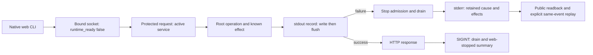
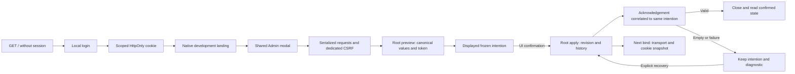

# Recettes permanentes / Permanent verification recipes

Précontrôles archive/Git en lecture seule : [contrats et commandes](PREFLIGHTS.md).
Read-only archive/Git preflights: [contracts and commands](PREFLIGHTS.en.md).

Pour les paramètres des prochaines compilations Cargo et le garde d'admission
disque, voir [Stockage des compilations](BUILD-STORAGE.md).
For future Cargo settings and the disk admission guard, see
[Local build storage](BUILD-STORAGE.en.md). This is not a filesystem quota.

Le lanceur Python standard `recipe.py` exécute des commandes explicites sans shell
implicite, relance ni watchdog global. Les recettes JSON version 1 résident dans
`recipes/`. Elles déclarent sources, environnement explicite, commandes, code de
sortie attendu et textes observables obligatoires. Un code zéro sans assertion
est refusé. Ne placer aucun secret dans une recette ni dans les sorties de test.

```sh
python3 tools/verification/recipe.py run --recipe tools/verification/recipes/runner.json --output /CHEMIN/NEUF
python3 tools/verification/recipe.py verify --evidence /CHEMIN/NEUF
```

Le parent du répertoire de preuves doit exister ; le répertoire final doit être
neuf. `{root}` est la seule substitution, dans arguments et valeurs d'environnement.
Les chemins `inputs` sont des globs relatifs au dépôt ; aucun motif vide ou sortant
n'est accepté. Le lanceur conserve recette et runner originaux, archive des sources
déclarées, empreintes avant/après, substitutions d'environnement, exécutable lancé,
arguments, sorties intégrales, durée, code et cause d'échec. Il ne journalise pas
l'environnement hérité. Les processus reçoivent EOF sur stdin. Arrêt à la première
anomalie ; aucun prochain pas après un échec. Écriture exclusive et atomique des
preuves ; une panne disque peut laisser un lot incomplet, jamais un PASS confirmé.

**Conserver les échecs.** Ne jamais supprimer un dossier FAIL/incomplet pour
réutiliser son nom : choisir un nouveau dossier frère et consigner le prédécesseur,
la cause et la précondition corrigée dans le suivi existant. Le refus d'une
sortie existante ne doit pas être contourné par effacement. Les empreintes et
`verify` ne restaurent ni ne prouvent l'existence d'un original supprimé.
Une perte reste déclarée ; un PASS ultérieur ne remplace pas l'ancien FAIL.

`run` retourne 0 pour PASS, 1 pour FAIL, 2 pour refus/prérequis impossible.
`verify` contrôle empreintes, archive et cohérence ; il retourne 1 pour un FAIL
intact et 2 pour une preuve incohérente. Il ne rejoue rien. Les empreintes locales
ne constituent pas une signature d'auteur. L'inventaire est **déclaratif** : il
ne remplace pas la qualification des entrées effectives Go/Rust, des features,
dépendances, binaires de production, droits ou revues indépendantes. Aucun accès
à une mission, appel fournisseur ou déploiement n'est autorisé par le manifeste.
L'adaptateur de recette doit être relu quand son contrat change.

---

The standard-library Python runner executes explicit argv without an implicit
shell, retries or a global watchdog. Version-1 manifests in `recipes/` declare
source globs, environment overrides, commands, expected exits and required output
assertions. Use the commands above with a **fresh directory and existing parent**.
`{root}` is the only substitution. Never put credentials in recipes or test output.

It retains original manifest/runner, declared source archive and before/after hashes,
explicit environment overrides, launcher hash, argv, complete stdout/stderr, duration,
exit and failure cause. Inherited environment is not recorded; stdin receives EOF.
The first anomaly stops subsequent steps. Atomic exclusive publication preserves
old evidence; disk failure can leave an incomplete batch, never a confirmed PASS.
**Retain failures.** Never delete a FAIL/incomplete directory to reuse its name.
Choose a fresh sibling and record predecessor, cause and corrected precondition
in the existing tracking record. Do not bypass destination refusal by deletion.
Hashes and verify cannot restore or attest the historical existence of a deleted
original. Declare the loss; a later PASS never substitutes for the original FAIL.

Run exits: 0 PASS, 1 FAIL, 2 refusal/prerequisite failure. Verify checks archive,
hashes and consistency without executing tests: intact FAIL remains exit 1,
inconsistent evidence exits 2. These are local self-consistency checks, not signed
authorship or independent acceptance. Declared sources do not replace effective
compiler graph, feature, dependency and production-binary qualification. A manifest
grants no live-state, provider or deployment authority. Review a recipe whenever
its consumed contract changes.

### Nettoyage concurrent des caches / Concurrent cache cleanup

Un scan de processus seul laisse une course avec un nouveau build. Préparer les
empreintes et copies hors verrou, puis obtenir sans attente le verrou réel du
producteur avant de revalider inode, taille, mtime et références actives et de
supprimer. Conserver les fichiers si le verrou est occupé ou l’identité a changé ;
ne pas supprimer le verrou. Qualifier d’abord ce protocole avec l’outil installé.
Cargo 1.96.0 a été observé via strace : `.cargo-build-lock` exclusif et
`.cargo-lock` partagé ; un verrou exclusif sur le `.cargo-lock` existant a bloqué
un Cargo témoin puis permis sa reprise. Ce verrou ne protège pas contre tous les
lecteurs directs non coordonnés : leurs références doivent rester préservées.
Cette méthode ne change aucune politique produit et ne qualifie pas les tests
d’un build concurrent. Le 6 novembre 2026, un build a démarré après le scan initial
du ménage ; le refus de rmdir a préservé ses nouveaux fichiers. La revue et les
preuves conservées portent sur la portée exacte, pas sur une absence globale
d’impact non mesurée. Voir le module officiel des verrous Cargo :
https://doc.rust-lang.org/stable/nightly-rustc/cargo/util/flock/index.html.

A process scan alone races a new build. Prepare hashes and copies outside the
lock, then nonblockingly acquire the actual producer lock and revalidate file
identity and live references before unlinking. Retain busy/changed/uncertain
candidates; never remove a lock file. Qualify the installed tool’s protocol first.
Observed Cargo 1.96.0 uses an exclusive `.cargo-build-lock` and shared `.cargo-lock`;
an exclusive lock on its existing `.cargo-lock` blocked a control Cargo invocation
and allowed completion after release. This does not exclude all uncoordinated
direct readers. Preserve their references. It adds no product retention policy
and proves no other build’s test verdict. Retain original races and exact proof
scope; a directory-removal refusal preserving new files is not a complete purge.

### Stockage USB préféré / Preferred USB storage

Décision utilisateur du 4 novembre 2026 : privilégier les futures preuves sur la
clé identifiée (actuellement Lexar, `/media/fpizzi/Lexar`) si elle est montée,
inscriptible et suffisamment libre. Contrôler le support monté avant l’écriture ;
un répertoire existant ne prouve pas la présence de la clé. Garder un index local
avec emplacement, inventaire/empreintes et restauration. Le paramètre `--output`
reste explicite et le dossier de sortie doit être neuf. Vérifier la compatibilité
du parcours avant une sortie directe : FAT32 ne conserve pas les permissions/liens
Unix et limite la taille d’un fichier. Si nécessaire, conserver fixtures et staging
sur le stockage Unix configuré puis transférer les preuves dans des archives
préservant les métadonnées, fractionnées selon la limite réelle du support.
Synchroniser, relire et comparer intégralement avant de retirer les seuls originaux
inchangés dont le déplacement est autorisé. Ne pas déplacer sources versionnées,
missions ou travaux actifs ; conserver les FAIL. Si la clé est indisponible ou
inadaptée, signaler explicitement le repli local et vérifier l’espace disponible.
Cela ne modifie ni `runtime_temporary_directory`, ni une exécution déjà démarrée.

User decision, 4 November 2026: prefer the identified USB drive (currently Lexar
at `/media/fpizzi/Lexar`) for future evidence when mounted, writable and with
adequate free space. Verify the mounted device, not merely the directory. Keep a
local location/inventory/hash/restore index. `--output` remains explicit and its
output directory must be fresh. Check flow compatibility before direct output:
FAT32 lacks Unix permission/link semantics and limits individual file size. Where
needed, keep fixtures and staging on configured Unix storage, then transfer
metadata-preserving archives, split to the actual filesystem limit. Sync, read
back and compare all copied content before removing only authorized unchanged
originals. Preserve tracked sources, missions, active work and historical FAILs.
Report any local fallback and check free space. This changes neither the configured
`runtime_temporary_directory` nor an already running execution.

### Interdiction /tmp et aire de fixtures — /tmp interdiction and fixture area

Interdiction opérateur (2026-10-31) : aucune donnée du projet sous `/tmp` (tmpfs
perdue au redémarrage ; les preuves conservées pointeraient vers des racines
disparues). Tout root de fixture, scratch et scratch de preuve est alloué sous
le **réglage Admin `runtime_temporary_directory`** (« Dossier temporaire », v51 ;
défaut d'installation `<repo>/.swarm-fixtures/`, 0700, gitignored, chemin court
pour rester sous la limite noyau des sockets AF_UNIX). Valeur enregistrée lue
dans `.swarm/engine-settings.json`, sinon défaut livré ; `/tmp` refusé. Le moteur
exporte aussi ce dossier comme `TMPDIR` au démarrage de chaque commande et de
`web`. Le contrat unique est `tests/fixture_area.py`
(`fixture_root(prefix)`, `fixture_area()`) et son miroir Node
`tests/fixture_area.cjs`, et le miroir Rust
`rust/crates/swarm-engine/src/fixture_area.rs` (`crate::fixture_root(prefix)`
dans swarm-engine ; `swarm_engine::fixture_root(prefix)` dans swarm-web,
swarm-cli et les tests d'intégration). Deux niveaux de couverture : (1) à la source —
`tools/check_tmp_interdiction.py` scanne les allocations tempfile sans `dir=`
et échoue s'il en reste (garde de non-récidive ; les lectures gettempdir sont
signalées pour revue) ; depuis la migration D04 du 7 novembre 2026, il scanne
aussi les sources Rust : tout `env::temp_dir()` hors carte d'exemptions
documentée `RUST_EXEMPT` (sondes lecture-seule du volume système, chemins
assertés inexistants, assertions de composition, assertion du pinning TMPDIR)
est une violation ; les mentions dans commentaires/doc sont ignorées ; depuis la
migration D05 du 7 novembre 2026, toute allocation Rust `tempfile::tempdir()` /
`TempDir::new()` (y compris la fenêtre `Builder::new().…tempdir()`) est aussi une
violation : la forme gouvernée est `tempdir_in(<aire>)`/`new_in(<aire>)` —
`swarm_engine::fixture_area()` (aire de dépôt) ou `swarm_engine::fallback_area()`
(`~/.local/state/swarm-fixtures/`, 0700) pour les contrats qui refusent un
dépôt Git ancêtre ou exigent une chaîne entièrement privée (fixtures
`open_private_directory` : crates enrollment, git_metadata,
version_no_repository, les modules identity swarm-cli qui appellent
`provisioning::prepare`/`Documents::open` et les suites swarm-cli
trust_enrollment + identity_checkpoint/control/initial/personal/
operator/provisioning dont le parcours lit ancres/déclarations via le
walk privé) ;
les crates sans dépendance swarm-engine répliquent l'aire de repli inline ;
**règle décisionnelle** (8 novembre 2026, obtenue en trois vagues de rouges) :
le critère est le parcours, pas le crate — toute suite ou module dont le code
(allumé ou enfant CLI) relit une ancre ou une déclaration via
`open_private_directory` (walk NOFOLLOW des ancêtres, refus de tout ancêtre
inscriptible groupe/autres), via `Documents::open`/`authenticated_startup::open`
ou via `load_authenticated` exige l'aire de repli, même sous swarm-cli ; les
crates enrollment exigent la repli d'office ; les autres allocations prennent
l'aire de dépôt ; un enfant CLI qui relit un fichier de fixture suffit à
déclencher la règle ;
(2) au runner — `recipe.py` épingle `TMPDIR` sous
`<dossier temporaire configuré>/runner-tmp` pour la durée de chaque run, couvrant Python
tempfile, Rust `env::temp_dir()`/TempDir, Node `os.tmpdir()` et Go
`t.TempDir()` qui l'honorent. `mkstemp(dir=destination.
parent)` est un échafaudage d'écriture atomique adjacente à la destination,
pas une allocation de fixture : exempté.

Operator interdiction (2026-10-31): no project data under `/tmp` (tmpfs dies on
reboot; retained evidence would point at vanished roots). Every fixture root,
scratch and evidence scratch is allocated under the **Admin setting
`runtime_temporary_directory`** ("Temporary directory", v51; installation default
`<repo>/.swarm-fixtures/`, 0700, gitignored, short path keeping AF_UNIX sockets
under the kernel limit). The saved value is read from `.swarm/engine-settings.json`,
else the shipped default; `/tmp` is refused. The engine also exports it as
`TMPDIR` when every command and `web` start. The
single contract is `tests/fixture_area.py` (`fixture_root(prefix)`,
`fixture_area()`) and its Node mirror `tests/fixture_area.cjs`, plus the Rust
mirror `rust/crates/swarm-engine/src/fixture_area.rs`
(`crate::fixture_root(prefix)` inside swarm-engine;
`swarm_engine::fixture_root(prefix)` in swarm-web, swarm-cli and integration
tests). Two coverage
levels: (1) at source — `tools/check_tmp_interdiction.py` scans tempfile
allocations without `dir=` and fails if any remain (non-regression guard;
gettempdir reads are reported for review); since the 7 November 2026 D04
migration it also scans Rust sources: any `env::temp_dir()` outside the
documented `RUST_EXEMPT` map (read-only system-volume probes, paths asserted
not to exist, pure path-composition assertions, the TMPDIR-pinning assertion
itself) is a violation; mentions inside comments/docs are ignored; since the
7 November 2026 D05 migration, any Rust `tempfile::tempdir()` /
`TempDir::new()` allocation (including the `Builder::new().…tempdir()` window)
is also a violation: the governed form is `tempdir_in(<area>)`/`new_in(<area>)`
— `swarm_engine::fixture_area()` (repository area) or
`swarm_engine::fallback_area()` (`~/.local/state/swarm-fixtures/`, 0700) for
contracts refusing an ancestor Git repository or requiring a fully private
chain (`open_private_directory` fixtures: enrollment crates, git_metadata,
version_no_repository, the swarm-cli identity modules calling
`provisioning::prepare`/`Documents::open`, and the swarm-cli
trust_enrollment + identity_checkpoint/control/initial/personal/
operator/provisioning suites whose flow reads anchors/declarations
through the private walk); crates without a swarm-engine
dependency replicate the fallback inline;
**decision rule** (8 November 2026, obtained through three red waves): the
criterion is the flow, not the crate — any suite or module whose code (in-process
or CLI child) reads an anchor or declaration back through
`open_private_directory` (NOFOLLOW ancestor walk, refusing any
group/other-writable ancestor), through
`Documents::open`/`authenticated_startup::open`, or through
`load_authenticated` requires the fallback area, even inside swarm-cli;
enrollment crates take the fallback outright; all other allocations take the
repository area; a CLI child re-reading a fixture file is enough to trigger
the rule; (2) at runner — `recipe.py` pins
`TMPDIR` under `<configured temporary directory>/runner-tmp` for each run, covering Python
tempfile, Rust `env::temp_dir()`/TempDir, Node `os.tmpdir()` and Go
`t.TempDir()` which honor it. `mkstemp(dir=
destination.parent)` is adjacent-to-destination atomic-write scaffolding, not
fixture allocation: exempt.

### Instantané figé des entrées déclarées / Frozen declared-input snapshot

Quand un autre travail modifie le checkout pendant un run (`source_stable: false`),
`snapshot.py` copie **uniquement** les fichiers sélectionnés par les `inputs` de la
recette (même sélection et mêmes refus que `recipe.py`), la recette, le lanceur et
`tests/fixture_area.py` (l'aire d'interdiction /tmp que le lanceur résout à
l'exécution, embarqué même s'il n'est pas déclaré ; refus
`snapshot-fixture-area-missing` s'il manque),
dans un répertoire neuf ; il lie les dossiers de dépendances nommés (`--link`,
jamais copiés ni déclarés) puis lance `recipe.py run --root <instantané>`. Une
entrée non déclarée échoue visiblement au lieu d'être lue dans le checkout vivant.
Placer l'instantané sur le disque principal (le cache de build de la recette y est
créé ; `/tmp` en tmpfs peut saturer). Codes : 0 PASS, 1 FAIL, 2 refus.

```sh
python3 tools/verification/snapshot.py --recipe tools/verification/recipes/live-monitor-native.json \
  --snapshot .cache/<nom-neuf> --link node_modules --link frontend/node_modules --output /CHEMIN/NEUF
```

When concurrent work changes the checkout during a run, `snapshot.py` copies only
the recipe's declared inputs (same selection/refusals as `recipe.py`), the manifest,
runner and `tests/fixture_area.py` (the /tmp interdiction area the runner resolves
at run time, shipped even when undeclared; refusal `snapshot-fixture-area-missing`
when absent) into a fresh directory, symlinks named dependency directories and runs
the recipe with `--root` there; an undeclared input fails visibly. Before copying,
it refuses (exit 2, `snapshot-embedded-input-undeclared: <chemins>`) a declared
`.rs` whose literal `include_str!`/`include_bytes!` target is not declared, so a
missing embedded file is named at once instead of after a full build; `concat!`/
`env!` forms are not resolved and still fail at compile time. Use the main disk
(tmpfs may fill up). Tests: `python3 -m unittest tools/verification/test_snapshot.py`.

Pour une qualification Swarm qui retourne3REVIEW_REQUIRED après les tests,
voir [la fermeture différée](QUALIFICATION-CLOSURE.md). Cette phase distincte
vérifie sources, archives, graphes, profils et revue sans rejouer les tests ni
transformer une preuve locale en acceptation indépendante.
For a Swarm qualification returning3/REVIEW_REQUIRED after tests, use the
[deferred closure contract](QUALIFICATION-CLOSURE.md). This separate method
checks inputs/archives/graphs/profiles/review without relabelling old tests as new.

Recette catalogue/coûts : `recipes/pricing-accounting.json` conserve les régressions
Go retenues (pagination, erreur/cause sûre, tarifs, concurrence et historique).
La recette navigateur existante `tests/pricing_ui.cjs` accepte un binaire Go de
fixture construit depuis les sources courantes et un nouveau répertoire de preuve.
Exemple depuis la racine :

```sh
go build -o .cache/swarm-pricing-fixture ./cmd/swarm
PUPPETEER_EXECUTABLE_PATH=/CHEMIN_CHROME_VERIFIE node tests/pricing_ui.cjs .cache/swarm-pricing-fixture NOUVEAU_REPERTOIRE_DE_PREUVE
```

Inspecter le navigateur réellement installé avant de remplacer le chemin ; ne pas
supposer que le cache Puppeteer existe. Aucun watchdog global de cette recette ;
progression par langue/thème/largeur, serveur privé, tarifs fictifs, aucun fournisseur.
Ne modifier aucun des inputs déclarés pendant une capture, même une recette non
exécutée par cette étape : le refus `recipe-declared-inputs-changed` est correct.
Pricing/accounting replay uses the manifest above; the browser command builds its
own fixture binary and requires an observed Chrome path plus fresh evidence output.
Local results are not deployment, effective-graph qualification or acceptance.

Recette Rust tarifaire : `recipes/pricing-native.json` (8tests moteur sous fixtures,
3CLI par défaut). La parité permanente `tools/rust-migration/verify_pricing.py`
compare101cas, dont le témoin numérique de la vraie ancienne source Go. Les
qualifications enregistrent leur référence de parité et vérifient les tests Go
frais/nonvides/nominatifs. Réutiliser une preuve seulement sur ses entrées exactes.
Rust pricing replay:8fixture-engine +3default-CLI tests; the101case parity includes
legacy finite-rounding and rescaled-overflow witnesses. No provider/billing claim.

Recette `recipes/agent-runtime.json` : socle natif (15moteur,4CLI agent, régressions
CLI communes/tarifs), pas mission complète. `verify_agent_runtime.py` compare48cas
Go/natif de données et d'état SQL, sans processus/fournisseur. Les recettes Rust
archivent désormais aussi SQL, JSON et textes réellement incorporés. Vérifier
`python3 -m unittest discover -s tools/verification -p test_rust_recipe_inputs.py -v` :
inventaire nonvide de tous les includes littéraux et de toutes les recettes Rust.
Les anciennes archives ne sont pas réétiquetées ; la qualification effective71
incluait déjà ces assets, contrairement à la sélection déclarée de quatre recettes.
Ce garde de recette n'est pas une qualification des dépendances externes.
Native agent replay is bounded, not full mission acceptance. Literal embedded SQL,
configuration and context sources are archived; existing historical evidence keeps
its original declared scope and effective qualifications remain separate.

Increment73 adds five supervisor-claim and six cancellation tests, including
actual concurrent SQLite connections, partial historical settlement repair and
replay without duplicate events/logs. CLI includes four agent journeys plus
17common and three pricing checks. No provider or full-mission claim.

`recipes/runtime-limits.json` :26engine+26default-CLI checks for saved runtime
settings, hierarchical SQL readback, legacy adoption and strict preview/error
recovery. `agent limits` is diagnostic, never launch admission. Shared Admin
recipe now saves all ten runtime fields and observes each default/ceiling/null
choice through that actual production command, in FR/EN and both themes.
The complete workspace is run only when the changed shared settings contract
justifies it; incremental recipe checks are not a new full dependency qualification.

## Terminal browser states instead of swallowed predicate errors

Swarm75 found a visible Admin refusal while a zero-watchdog Puppeteer wait
remained pending: an optional undefined CDP argument became null and the CLI
correctly refused the extra input. Omit absent arguments at the transport.
A polling predicate must return a terminal success/refusal observation; raise
the error outside polling. Use `tests/helpers/engine_settings_admin_state.cjs`
for settings loaded/preview/saved states, without adding an arbitrary timeout.
`node tests/engine_settings_admin_state_test.cjs` verifies six DOM cases with
valid controls and recovery. Preserve displayed refusal, original CLI streams
and the interrupted run; a closed browser is not a completed acceptance check.
The helper does not detect every possible stall or replace progress diagnosis.

### Apprentissage77 : contrat complet et concurrence

Une lecture tronquée peut masquer une validation plus bas dans une fonction.
Avant de déclarer une protection absente, rechercher le symbole et lire son
producteur, la transaction et les postconditions, puis tenter le contre-exemple.
`epoch-before`77 a falsifié une hypothèse : le garde existait déjà. Conserver le
test et l'apprentissage, pas une correction redondante. La règle commune de
lecture du vrai contrat couvre ce cas ; aucune nouvelle consigne parallèle.

Une attente SQLite finie ne garantit pas que deux appels concurrents réussissent
immédiatement. Vérifier l'unicité, la cause typée d'un épuisement autorisé et le
rejeu après commit réellement confirmé. Pour isoler une contention, tenir un
vrai writer sur fixture avec politique zéro attente/reprises explicites ;
ne pas augmenter un seuil de test pour dissimuler un contrat non consommé.
Les exceptions de commit/cleanup ne sont pas des erreurs BUSY à réessayer.

Native extensions must not inherit Go zero/default projection: retain opaque
values, require nullable-field presence, preserve unknown constraints and refuse
consumption. Snapshot77 regressions cover absent nullable fields, unknown
constraints and deep raw JSON. Fixture Admin flows must respect provider ceilings
and queued workspace ownership; use public cancellation with blocked/unaccepted
tasks, never private SQL cleanup. These are persistent repository lessons; they
do not update already running agent contexts or establish native supervision.

`recipes/agent-controlled-process.json` exercises the shared Linux runner and its
actual Git/validation consumers. Its17selected cases distinguish caller-supplied
wakeups from process deadlines and retain control/signal/cleanup refusals. Input
gating in a local fixture is not durable Agent registration or authorization.
No global watchdog, paid provider, live mission or running-server change occurs.
The core alone remains a prerequisite. `recipes/agent-native-runtime.json` now
covers actual manual Root/CLI supervision, including threshold observation without
automatic stop, private execve refusal, stop/guards, budget and Admin concurrency.
Its execution and limits are recorded in the migration plan.

Signal fixtures must not reenter Python buffered stdout from a TERM handler while
that buffer may still be producing the READY marker. Increment78 reproduces the
reentrancy with a deliberately occupied buffer: safe handler0 → buffered handler1
with RuntimeError → safe handler0, without timed sleeps. Use the owned raw FD for
the fixture handler and explicit fixture exit; the Rust guard keeps READY/TERM,
exit status and actual drain assertions. This is fixture synchronization, not a
provider stop policy. The first isolation attempt blocked again in Python final
flush and needed its identified own child killed; retain that intervention and
never count its -9 as clean exit evidence. The noninstrumented original Rust
failure remains historical without exact status attribution.

Executable fixture writers must not leave writable executable descriptors in a
concurrent test parent that forks other children. The shared-runner recipe now
includes an actual open-writer ETXTBSY refusal between valid controls and prepares
its scripts in a separate writer process that has exited before use. This adds no
product retry and does not identify the lost errno from engine-wide01. Unexpected
valid-control failures preserve stage, IO kind and errno without arbitrary cause
text. Sources and historical failures remain in increment78.

For manual setup outside the recipe runner, abort dependent work immediately
when an edit or prerequisite fails. Stage exact source anchors, check the edit
exit status and changed bytes before launching verification; use separate checked
steps or fail-fast shell execution. An unchanged run accidentally continued after
a failed edit is retained as a method failure, never a fresh recovery attempt.

The native manual recipe now also covers the pure model argv compiler (47engine
units,114Rust tests overall,4generator tests). It preserves sandbox/tool args and
stdin, refuses empty/dangling overrides, and replaces attached short model flags.
The recipe does not qualify routed execution, catalogue availability or billing.
Recover real helper/test paths with an inventory and symbol search before reads;
a failed guessed-path read is a method issue, never production/test evidence.

Increment81 extends the same native recipe with five model-rule integration cases
and two actual CLI checks (121Rust tests expected,4generator and i18n). It tests
explicit adoption, legacy history, empty lists, safe refusals and the read-only
model-check consumer; it does not qualify provider availability or routed launch.
Do not count the expected totals as PASS before the retained execution completes.

A fixture using current installation values must derive its change schema from
those actual values. A historical-generation fixture must exclude later fields
explicitly; do not relabel current data with an inherited numeric version.
Increment81 retained a real pre-lock refusal caused by that mismatch, then verified
actual lock refusal/recovery. Named-test counters must include spaces in doctest
names and agree with suite totals; zero suites do not add passed tests.

Native requested routing83 has a separate permanent Python recipe documented in
the FR/EN replay pages. It uses an explicitly qualified default CLI image and
private program/cache/work/budget roots, retaining requests and original output
atomically. Its scenario count is separate from125Rust tests in the shared recipe.
The CLI named codex is a local script, not a real provider/account/model proof.

Increment83 actual receipts: permanent14 PASS125Rust+4generator/i18n; workspace15 PASS566named; native16 PASS8; browser17 PASS4×23fields. Default profile15/no fixtures and source archives are retained; no native HTTP or deployment is qualified.

84 candidate adds three pure API-namespace units (128Rust total expected) and a ninth permanent native-model Python scenario. Empty/unrelated catalogues permit CLI routing; active collisions and selected APIs refuse. Source guards, no-state-change, secret and recovery checks remain required.

84 actual qualification:128Rust+4generator/i18n,9native journeys, default04 without fixtures, Clippy/private Rustdoc and one Go namespace contract test pass. Sources and binary archived. UI83 and workspace83 remain historical scoped evidence.

85 candidate adds configuration format, real create-only race/refusal, Root fault/uncertainty and CLI output-failure tests. Shared recipe expects140Rust+4generator/i18n, plus10Python native journeys. NOREPLACE fixture tests require test-fixtures; the normal CLI must separately show no fixture feature. Initial verifier03failed to compile (unlisted tempfile), corrected with existing owned-root primitives.

85 actual receipts: permanent07 PASS140Rust+4generator/i18n; all-features workspace08 PASS593named; default08/no fixtures + native09 PASS10. Original03compilationFAIL preserved; corrected04Root3, storage05/CLI06 and same original public program after09 pass. Archives bind source bytes and profile; no installation/native HTTP or new browser proof.

85-cache recovery preserved all886identified example artifacts in a verified retained archive before unlinking only their r25 example-cache copies. Original metadata/hashes and normal CLI identity are retained; no source/mission/dependency-library cache was removed. Do not purge the retained archive as cache.

86 candidate: shared recipe151Rust+4generator/i18n;13native Python journeys, including queued model changes/restoration and malformed config repair. Targeted Root8/CLI4 contracts cover stale token/policy/lock,12update fault stages and output failures. Reuse85global publication evidence only for unchanged consumers; no new full example recompilation is justified by these additive helpers.

Local qualification86 verified:151named Rust permanent-recipe tests,4generator
tests and i18n; workspace/all-targets Clippy and private Rustdoc pass. The rebuilt
normal CLI has no test-fixtures in its73artifacts. All13native journeys pass,
including exact configuration restoration and recovery of the same queued intention/
reservation, malformed-source repair and cross-Root token rejection. The identical
public preview01 and scope09 programs pass after correction. Original150tests06/
12native08 and scope09RED remain historical; pre-fix ELF07 is retained separately.
Eight Root, six storage and four CLI tests cover12backup/replacement fault variants
and output/flush errors. Explicit no-change apply really fsyncs file and directory.
No new count/retry/deadline policy; existing Admin per-file cap is unchanged and the
public token binds source/settings bytes and the actual Root descriptor.
Sources/ELF/profile/review: `docs/plans/migration-rust/evidence/20261019-86/result.json`.
The593workspace85 tests and four Admin83 journeys are scoped historical evidence,
not fresh86 runs. No new Mermaid render or independent review, installation/cutover,
HTTP/auth or authenticated identity is established. APIs/probes, default-model
installation UX, hierarchy and crash/drain recovery, existing data migration,
global qualification, single cutover and RETEX remain open. Overall migration partial.

87 candidate adds strict task-model DTO/binding tests and a permanent native task-model scenario. Selected model must affect actual argv and preserve budget/history; missing/native branch refusal is retained before01.

Local qualification87 verified:155named Rust permanent-recipe tests,4generator
and i18n;10supplemental WorkEngine tests pass, including SQL failure/rollback/same-
event recovery. Workspace/all-targets Clippy and private Rustdoc pass. Normal
profile has no test-fixtures in its73artifacts; all14native journeys pass. The
process really receives the task's simple choice while provider/default auto
would choose standard. Choice/replay/reopening, conflicts and policy drift before
admission/after queueing, active-change refusal, retained reservation and exact
source restoration/recovery are observed. Inherit removes only choice, retaining
attempts and consumption. Only the supplemental Python fixture changed after15/16;
compiled inputs stay byte-identical (rust-evidence-reuse18.json). Identical public before01/after18 and compat-before12/
after17 programs pass. Extracted Go definitions compile as oracle13 and confirm
scalar nulls/case/duplicates; common projection preserves those while refusing
unknown/type/multiple-JSON input. Cli04FAIL1/2 remains: the fixture changed protected
schema, so Root refused before the transaction. Corrected CLI/WorkEngine tests
prove their separate contracts without disabling guards. Original Clippy10FAIL
item ordering remains, corrected without suppressing lint.155tests09 are pre-codec,
not final qualification15. Sources/ELF/review: `docs/plans/migration-rust/evidence/20261019-87/result.json`.
No installation/cutover, new browser/Mermaid-render proof or independent review.
Task choice authenticates neither actor nor model and grants no launch permission.
APIs/probes, initial/default-model UX, hierarchy/selected memory, crash/drain recovery,
HTTP/auth, existing data migration, global qualification/single cutover/RETEX stay
open. Overall migration remains partial.

88 policy-only import/export adds4engine units and2CLI tests to161Rust expected. Python policy-import is the15th native scenario. Browser submit/editor recipe uses shared modal sources and real native CLI with fresh owned roots, FR/EN and both themes; Go tokenless wire bodies are separately parsed by extracted Go definitions. No native HTTP/auth, implicit default-model migration or model/account identity follows from those fixtures.

Local qualification88 verified:161named Rust recipe tests,4generator and i18n;
workspace/all-targets Clippy and private Rustdoc PASS. Normal profile has no fixture
feature in its73artifacts; all15native journeys PASS. Explicit policy preview/apply/
export works for35providers and a99037Bfile without hidden32/64KiB cutoffs. Go DTO
command/env fields are preserved, exact original snapshot bytes retained; invalid
input/cache/rules/stale-token refusals and recovery are observed. Policies can be
stored while execution is denied; separate admission refuses and the actual local
child runs only after explicit restoration of that policy. No paid model call.
Four FR/EN×theme browser journeys pass on that same CLI: actual submission/native
token, visible no-write refusals, save/reopen, retained demanding choice and narrowed
Admin rule refusal/recovery. Import/editor captures at320/1440, focus/Escape and
console/request failures checked. This is a component/fixture CLI bridge, not full
cockpit/native HTTP/auth. Eight legacy tokenless bodies also pass actual extracted
Go strict/PolicyChange; no legacy Go server is launched. Identical before01/after19
passes. Browser11RED retained (demanding shown as simple), fixed without a frontend
policy ceiling; release14RED aggregation retained then corrected Published/causes
PASS, modeling a late release refusal rather than an actual OS failure. Native06
JSON-vs-canonical-DTO verifierFAIL is retained and corrected07 without dropping
exact snapshot checks; browser09 fixtureFAIL remains. Sources/binary/review:
`docs/plans/migration-rust/evidence/20261019-88/result.json`.
No implicit named model, Claude catalogue/installation/HTTP/auth or model/account
identity is established. Export includes saved policies only; an old Go reader may
still reject >32. Unsupported catalogues refuse, never become available by fiat.
Same-session review, not independent; diagrams checked against code, no new Mermaid
render or exhaustive WCAG audit. Old translations are preserved; historical Admin83
styles/assets match except separately verified additions of3translations. The
serving app remains Go; overall migration, data, hierarchy/recovery, full acceptance,
single cutover and RETEX remain open.

89: common `tools/verification/recipes/agent-native-runtime.json` has169named Rust
checks +4generator/i18n (`permanent16`). Actual child complement:
`python3 tests/rust_manual_mission.py --binary NORMAL_CLI --output FRESH_DIRECTORY`
(single line),4scenarios. Isolated roots, exact commands/inputs/diagnostics/sources;
no global watchdog, paid model call or live DB. The actual child produces its report;
gate/operator acceptance are controlled fixture decisions, not independent review.
The alias branch injects/removes one added malformed fixture row only; it never
removes real history or budget. Normal profile18 has no fixtures;15routing,4mission
journeys, corrected counterexamples, Clippy and Rustdoc pass. Results/hashes/limits:
`docs/plans/migration-rust/evidence/20261019-89/result.json`. Original failures and
pre-fix proofs remain distinct from final evidence. Serving app stays Go; overall
migration, HTTP/auth, hierarchy/recovery, data and cutover remain open.

90: the same permanent recipe includes `swarm-web`, late-failure Root/CLI cases
and datastore binding. Verified192named Rust tests, including69engine units,6CLI
units and17HTTP tests;4generator/i18n separate. HTTP requests are typed/in-process
with actual isolated Root, not a TCP/browser server. Actual IPv6 is unavailable
(evidence06), never counted PASS; the synthetic address unit is named separately.
RED08/15/17 and original sources remain; final common qualification is pending in
`docs/plans/migration-rust/evidence/20261020-90`. Persistent AGENTS.md rules are
relayed by CLAUDE.md without changing already-started prompts/processes. Cache14
archive is retained proof, not disposable cache: only29verified old owned rlib/rmeta
copies were removed, preserving all sources/binaries/earlier proof archives.

HTTP90 locally qualified: recipe32 PASS192named Rust tests,4generator and i18n;10additional WorkEngine tests,15native routing and4manual missions PASS. Clippy and private Rustdoc PASS. CLI/HTTP-library builds33 have no transitive test-fixtures; no listener, persisted session or installation. Final proofs: evidence/20261020-90/result.json;23–27 are historical before IO fix30. Actual IPv6 remains unavailable/open; synthetic IPv6 formatting is separate. Same-session Codex review only. Next: secure session creation/reuse then native HTTP transport. Serving application remains Go; global migration and RETEX stay open.

91: permanent recipe additionally runs native session persistence and compile-gated atomic publication faults. Expected202named Rust tests;71engine units and19HTTP tests. Bound listener metadata and typed HTTP request proof remain distinct from actual TCP HTTP traffic/login. Normal builds must exclude test-fixtures. Qualification pending in evidence20261020-91.

Session91 locally qualified: recipe07 PASS202named Rust tests,4generator/i18n;10additional WorkEngine tests,15routing and4manual missions PASS. Clippy/private Rustdoc and normal profiles08 without test-fixtures PASS.5public session tests plus2new engine and2HTTP units cover creation/reuse, refusals/recovery, forced concurrency and bootstrap.1compile-gated test covers6publication faults, not6actual OS incidents. Source/binary/review/limits: evidence/20261020-91/result.json. Persistent session is wired to the typed service, without TCP server/login/expiry or installation. Same-session review, Go still serving. Authorized next: Admin/API journeys then native HTTP transport with persisted policies and actual consumer; global cutover and RETEX stay open.

92: settings-output-state checks real dispatcher/Root with failing output doubles, successful witnesses and replay/readback. Expected206named Rust tests; no provider call/global watchdog/actual OS close fault. Prior failures01–03 retained.

Output92 locally qualified: recipe06 PASS206named Rust tests,4generator/i18n;10WorkEngine tests,15routing and4manual missions PASS. Clippy/private Rustdoc and normal builds07 without test-fixtures PASS. RED01/02/03 now pass: init/apply/replay retain known state after write/flush, while refusals/show/preview do not claim saved operations. Output doubles/close aggregation are separate from actual OS faults. Source/binary/review: evidence/20261020-92/result.json. Initial test01 retained from its generator and identical captured03 prefix with explicit provenance. Go server unchanged; migration/HTTP/Admin/cutover/RETEX stay open. Next: settings API then native transport and persisted policies.

93: protected-http-boundary additionally checks native settings describe/show/preview/apply, saved report-cap consumption, replay/refusal/Root replacement and known-state metadata independent of response body. Expected211named Rust tests. Typed/in-process proof only; no actual HTTP transport/browser delivery. Archived obsolete test executables under cache inventories are retained proof, not disposable archives.

API93 locally qualified: recipe05 PASS211named Rust tests,4generator/i18n, including24HTTP (5units,7access,9service,3settings). Clippy/private Rustdoc and normal builds06 without test-fixtures PASS. WorkEngine10,15routing and4manual missions from92 explicitly reused, not reexecuted:1211relevant inputs and CLI ELF/profile identical. Native Admin routes, saved cap consumed, replay/refusal/replaced Root and state independent of body verified; no network/browser hookup. Source/binary/review: evidence/20261020-93/result.json. Cache archives01–03 retain102obsolete own native tests,926567800B, SHA-read back before removing only derivatives; sources/data/prior proofs preserved. Free space recovered near1GiB; no further cleanup needed. Next: persisted/Admin network policies and real transport. Migration/cutover/RETEX stay open; Go still serves.

94: web-policy-values and actual pinned-library transport probes extend the native recipe to220named Rust tests. Catalogue4/network document20, v19 byte/history preservation, source-only defaults and typed address/count errors. Browser recipe `node tests/rust_web_policy_admin_ui.cjs NATIVE_CLI OUTPUT` verifies the shared editor via CDP/actual CLI, not native TCP/auth or active policy. Fresh evidence directory required; no global watchdog and terminal UI errors end waits. Production profiles must exclude test-fixtures and test-util across artifacts.

Network94 locally qualified at configuration/Admin level: recipe15 PASS220named Rust tests,4generator/i18n,10WorkEngine,15routing and4manual missions. Clippy/private Rustdoc and profiles16 without test-fixtures/test-util PASS. Browser14 PASS4 FR/EN×2themes,5widths/4captures; two mobile captures visually inspected. Normal ELF13=16, original19journal byte-identical. Source/binary/actual dependency bytes/review: evidence/20261020-94/result.json. No TCP enforcement/restart consumer proven. Method limit retained for95: new browser finally may mask a primary error when browser.close fails; not observed14, reproduce/fix before transport faults. Go unchanged, migration/cutover/RETEX remain open.

95: `node tests/verification_cleanup_test.cjs` verifies original/secondary/finalizer failure aggregation before transport fault injection. The shared browser harness attempts every owned cleanup, closes its own Node connections, and retains failed scratch roots. Thrown undefined remains failure. `cleanup-before01` retains the extracted original finally counterexample; doubles are distinct from actual Chrome/OS faults.

95: the permanent native recipe adds ten Rust cases (230 expected total) and six
Node cleanup tests. `cargo test --manifest-path rust/Cargo.toml --locked --offline
-p swarm-web --all-targets` covers real isolated TCP, limits413/431, connection and
Root/Admin saturation/recovery, pre-Root shutdown, same-Root bootstrap and dedicated
CSRF. Read-only native TCP is distinct from the prior CDP/CLI browser bridge; no
network mutation, browser login, actual Root-mutation drain, network deadline, IPv6
or installation claim. Evidence:20261020-95; original failures retained.

Queued refusal diagnostics now retain their connection reservation until the owner consumes them, including after client-future drop. Local ownership regression guard; final qualification pending.

Transport95 locally qualified for reads: composed230Rust proof (193unchanged from
PASS permanent29,37HTTP requalified33 after truthful-capability repair),4generator/
i18n,6cleanup assertion cases; browser04 reused4CDP/CLI journeys with identical input
hashes. Clippy/private Rustdoc/normal web profile34 and embedded-context check34 PASS;
normal profiles exclude test-fixtures/test-util, CLI30 ELF identical94. Dependency31
capture verifies85packages/5236actual files. Source/artifacts/review: evidence/
20261020-95/result.json. No network POST/login/global acceptance or installation.
Open criteria and mutation96 follow-up retained; Go still serves, cutover/RETEX open.

Transport96 locally qualified: recipe13 PASS240named Rust tests, including47web
and8TCP cases,4generator/i18n and6cleanup assertion cases. Clippy/private Rustdoc/
profiles14 PASS; normal graph has no test-fixtures/test-util. CLI14 ELF matches95;
dependency graph unchanged and5236actual source files for85packages rehashed
against31. Source/artifacts/review: evidence/20261020-96/result.json. Task/settings
mutations and effect observation verified; CLIweb command, native login/Admin,
progress-safe sink and precision of Root errors without a document remain open.
Go was not restarted; no global acceptance/cutover/RETEX. Authorized97 continuation:
public CLI consumer with output/shutdown handling, without false readiness or
treating written output as durable receipt.

97storage: current native recipe uses `{root}/rust/target/r97`, presently an owned
symlink to private tmpfs build outputs. Inspect ownership/link/free space before
reuse; tmpfs may disappear. This is disposable build cache, never persistent proof.
Source/binary evidence stays in the repository evidence area. The prior r25 cache
was not moved; only two inventoried obsolete derivatives were persistently archived,
SHA-read back and then removed after the observed ENOSPC. See97/storage05-result.json
and build-cache05.json. No source copy or live Root was cleaned.

CLI97: public driver `tests/rust_native_http_cli.py` passes both scenarios using
normal binary08 (97/public10 evidence). Bound-before-runtime announcement, protected
session, read-only preview, actual apply/exact replay, separate CLI readback and
SIGINT summary are verified. Real broken stdout after commit preserves observer
failure, exact receipt and safe causes in stderr; explicit same-event recovery
does not duplicate history. Pre-Root refusals use fixed-code text/plain; Root
responses use JSON. web-stopped is emitted and its output failure retains known
effects. The stream is not a durable journal; non-returning Write, native UI/login/
Admin, global parity and cutover remain open. Static/permanent qualification97/11–12
is pending; serving Go is unchanged.

CLI97 locally qualified: recipe11 PASS244named Rust tests (48web and2bootstrap),
4generator/i18n and6cleanup assertions;2actual process/HTTP journeys public10 PASS.
CLI/web Clippy, private Rustdoc and normal profile12 PASS; binary12 matches08
exercised by public10, no fixture/test-util features. Retained95dependency sources
rehash successfully (5236files), no new registry package. Method check14 PASS with
isolated Go cache; interrupted13 remains incomplete evidence. Persistent source/
binary archives and SHA-bound semantic review are in97/result.json. Global migration
remains incomplete: native login/Admin, progress-safe output, autonomous supervision,
other routes, global acceptance/cutover/RETEX remain open. Serving Go is unchanged;
no installation/publication/independent review.



Native login98 browser recipe (separate from typed tests):
```sh
python3 tests/rust_native_login_browser.py --binary "$PWD/rust/target/r97/debug/swarm-rust" --output FRESH_DIRECTORY
```
The actual CLI starts on a new0700Root; Chrome receives the key on stdin, never
argv/logs. Outcomes are drained during resource loads. All owned processes close;
failed fixtures survive. Check cargo artifacts for a normal non-fixture profile
before use. Every emitted raw artifact is scanned for the exact key; the private
Chrome profile remains outside evidence. No global/page/CDP watchdog. The recipe
sets next=/api/v1/works to exercise protected access; the / cockpit remains
unported (the form's default redirect is still /).

Login98 locally qualified:53fresh web +10targeted CLI tests,2actual HTTP14 scenarios
and4real browser15 journeys PASS; Clippy/private Rustdoc/normal profile13 PASS, no
fixture/test-util. Prior186kernel/non-web checks remain historical on unchanged
relevant inputs, not a new full recipe run. Binary13 is exercised by14/15;8final
screenshots match09inspected images; measured verified text contrast minimum7.89
light/9.10dark. SHA-bound review/source/binary archives and limits:98/result.json.
Original favicon404, snapshot mix and template400 evidence retained; recovery
verified. Serving Go unchanged. Next99: protected landing/shared Admin modal via
actual native HTTP; the form defaults to / whose cockpit remains unported. The98
recipe chooses /api/v1/works and does not prove that default landing journey.

Native landing/Admin99 recipe:
```sh
python3 tests/rust_native_login_browser.py --binary NORMAL_ELF_PATH --root-workers 1 --scenario admin --output FRESH_DIRECTORY
```
One worker is private fixture input persisted through CLI, not a product default.
CLI readback confirms state/revision; only our fixture server restarts to observe
the session cookie without Max-Age. No Go server/live mission is stopped.21ACK,
5adapter and2helper-failure guards have permanent test files and remain distinct
from actual HTTP journeys.


UI confirmation does not authenticate a human/agent or business decision.

Landing/Admin99 locally qualified:26step recipe PASS253selected Rust tests (57web),
21ACK,5adapter and6cleanup cases, generator/i18n. Two test assertions were clarified
after Clippy19:18units rerun20, production bytes identical and other inputs unchanged;
reused scope is explicit. Clippy/private Rustdoc20 PASS. Separate0500normal-dev ELF
without fixture/test-util, SHA
00e75fb09fb21ba972582c9241444c4cad306192604661a6a88c7087d3a9efe9,
is exercised by2HTTP22journeys,4native Admin23variants(Root1),4component/CLI24
variants and2helper-error25guards. CLI readback and next bind prove null cookie
omits Max-Age; client loss after actual publication replays without duplication.
Empty ACK keeps the dialog; program canonicalization comes from Root. Source/
artifacts/review/profiles:99/result.json. Serving Go unchanged; no installation or
optimized release/performance claim. Supervision, other journeys, complete identity/
authorities, restore/global acceptance/cutover/RETEX remain open. Non-progressing
synchronous Write remains an open limit.

Native runtime batch100: permanent recipe includes9mission lease cases (frozen policy, concurrency, stale epoch, checked SQL rollback/recovery and historical settings). Native Admin browser exercise saves/reopens3v21 values and checks actual CLI readback. Global conductor runtime remains incomplete.

Supervision100: native claim/renew/stop and3v21 settings locally qualified.
27steps/262selected Rust tests(57web) PASS11; after Clippy11 only two commit-cause
representations changed to owned Boxes, without lint suppression. The9mission
tests passed again17;253others reuse byte-identical relevant inputs, not a new
full recipe. All-target Clippy and private engine/CLI/web Rustdoc17 PASS. Separate
normal-dev ELF without fixture/test-util, SHA
4e29d533de6e5c9fd6ef5b3ae2ce14450d840afe22bce09a4b0d014185bd48e7:
4actual Admin19FR/EN×themes journeys(Root1),3v21 values saved/read back by CLI,
2HTTP20journeys PASS. Evidence/source/review:100/result.json. OS account remains
trusted; this lease authenticates no model/human. Cycle journal, recovery reader,
fencing within every business transaction and conductor loop remain open. Kernel
close failures/uncertain commit not injected; no global error-handling conformity
claim. No installation/server replacement, paid calls/commit/push/orchestration.
Global R6/R7 and RETEX remain open.

Reader101 adds5read-only observations to the existing9lease cases. Same permanent step now expects14named tests and validates no-schema-creation, unknown Work refusal, effective/recorded deadlines, legacy absence of policy, original SQL causes and recovery.

Reader101 locally qualified:14lease/reader tests PASS08, including explicit native
Present witness then a view collision at the reserved name, malformed clocks, real
SQL refusal/recovery and readonly no-schema-creation. Initial RED02 had incomplete
source binding; derived07 is byte-bound, removes only the kind guard and restores
it exactly, retaining targeted RED and14GREEN. No exact historical binary claim.
Engine/CLI/web Clippy03, engine08 after stronger test, private Rustdoc03 PASS.
Separate normal-dev CLI without fixture, SHA
369c7d956653a63b7bf88d2c574cbffccad2e07f93a3bba9b68e0126de6b7ceb,
2HTTP05journeys PASS; production source bytes unchanged after derived replay.
No new global recipe:100evidence retained, Admin journeys not rerun because their
sources/contracts did not change. Evidence101/result.json. Trusted Root library
read only, no approved HTTP DTO, authenticated identity or guessed policy revision.
Business fencing, cycle journal/conductor, globalR6/R7 and RETEX remain open.
Serving Go/user data preserved, no installation.

102:18mission lease/reader/fenced-command cases. Shared Work transaction change justifies runtime recipe plus standalone Work/budget checks. Ad hoc normal builds reuse recipe.snapshot and verify every normalized actual depfile path is in the pre-build manifest; Rust directories alone miss embedded resources.

Work fencing102 locally qualified:27runtime steps/271named Rust cases plus22
standalone Work/budget cases (293selected, not the full workspace). Includes18
lease/reader/command cases, exact refusal causes and Send mobility. All-target
Clippy and private engine/CLI/web Rustdoc09 PASS. Separate normal-dev CLI without
fixture/test-util, SHA
c3d81b69e65a989d99f377f258871b7d935745d84194c9f8879696b8d8a0a810,
2HTTP11journeys PASS; actual compiler inputs covered before/after. Assisted stop
run04remains invalid;09 completed autonomously after changing only the fixture
signal rendezvous,2variants. Production runner prefix byte-identical. Negative
Send compile-contract06 and positive09 retained; no lint allow or timed guard.
Evidence102/result.json. Scope is Root SDK and supported controls; separate agent
launch/stop/process paths, per-action journal, persisted policy provenance and
complete conductor remain open, alongside R6/R7/RETEX. Go/user data preserved;
no installation, paid calls, commit/push or orchestration.

Native runtime103:72engine lib tests,23mission cases, including exact claim/command settings provenance, transactional receipt rollback and settings reservation held through SQL read rollback. No global watchdog. Full103 local qualification recorded below.

Provenance103 locally qualified:27steps/277named Rust cases plus22Work/budget
(299selected),23mission cases and72engine units. Engine/CLI/web all-target,
all-feature Clippy and private Rustdoc08 PASS. Isolated normal-dev binary without
transitive fixture/test-util, SHA 6cda663924c7650dae07c059c962d693175453c5c00c32e207e355e78580c4ff. Two real CLI/HTTP11
flows PASS; effective compiler inputs covered. Original RED03/05 retained, refusal
without mutation and recovery verified. Evidence103/result.json. This does not
establish authenticated agents, a complete conductor or installation/cutover;
R6/R7 and RETEX remain open.

104:mission-supervision-leases now expects26named cases including3cycle journal checks; no new global timeout. Local qualification recorded below.

104 locally qualified:26mission and22Work/budget cases PASS02 (48targeted tests,
not a new full recipe run). Equal/changed errors, recovery, first reconciliation,
refusal without mutation, real INSERT fault/recovery and reopen verified. Engine/
CLI/web all-target/all-feature Clippy and private Rustdoc02 PASS. Isolated normal-dev
binary SHA 4fb6946117966dc3d76839a3595819812f66e5b24854d3c7f91bdb8928895d32, no transitive fixture/test-util;
2actual HTTP11 flows PASS,5embedded-context tests/subtests and diff checks PASS.
[Evidence104](../../docs/plans/migration-rust/evidence/20261020-104/result.json). Cycle status
is caller-reported only. Autonomous conductor, agent identity/processes, R6/R7 and
RETEX remain open. No installation, user data or Go modification.

105:manual-admission expects24cases (3new lease-fenced cases); rerun full native runtime recipe because common Root/admission/replay paths changed. No global watchdog; automatic consent/execution remains unwired.

105 locally qualified:27steps/283named Rust cases plus22Work/budget,305selected
(not the full workspace),24admission and26mission cases. Preview/all-table rollback,
ledger failure, expiry after staging/recovery, foreign Root and replay under a
later generation verified. Engine/CLI/web all-target/all-feature Clippy and private
Rustdoc04 PASS. Isolated normal-dev binary SHA 5adb5bc819911cead437dbc471554db578cf73837d857cb9b049ca7f67aa9ab4,
no transitive fixture/test-util.2actual HTTP11 flows and5embedded-context tests/
subtests PASS. [Evidence105](../../docs/plans/migration-rust/evidence/20261020-105/result.json). This qualifies a
manual intention under a lease. Automatic consent, lease-fenced execution gate/
process/stop and complete conductor remain open, along with R6/R7 and RETEX.
No installation.

106:mission-supervision-leases expects29named tests, including3consent/control cases. Targeted replay also covers3leased admissions and1snapshot-reservation unit. No global watchdog; facts remain SDK observations.

106 locally qualified:29mission cases,3leased admissions and1snapshot reservation,
33targeted tests PASS03; no new full recipe run. Missing/revoked/malformed consent,
no fallback to older authorization, corrupt controls, SQL fault/recovery/reopen
and no read mutation verified. Engine/CLI/web all-target/all-feature Clippy and
private Rustdoc03 PASS. Isolated normal-dev binary SHA 181d0249f4a01de591631de4bf8527057b32ade6814ef5eea6ea8a607352c87c,
no transitive fixture/test-util;2actual HTTP11 flows and5embedded-context tests/
subtests PASS. [Evidence106](../../docs/plans/migration-rust/evidence/20261020-106/result.json). Declared facts only,
not authenticated consent or automatic authority. Configuration/capacity, complete
conductor, lease-fenced execution, R6/R7 and RETEX remain open.

### Native context evidence138

`python3 tools/agent-workflows/check.py --evidence NEW_DIRECTORY` uses permanent
recipe `agent-workflows-native.json`: eight checker guards (controlled harness
results and one actual owned signal helper) and nine real native integration
tests. Four named role contracts require the complete engine-built bytes, hashes,
worker-only templates, diagnosis/reviewer separation and PDCA membership. Empty,
incomplete, filtered, duplicate, failed or ignored evidence refuses. No Go/model
runs. Signed signal status is preserved diagnostically and converted to the
conventional POSIX CLI exit code; a compilation exit is retained unchanged.

Cargo uses offline/locked dependencies and the caller's cache/toolchain. The
current Root integration profile needs Linux. The recorder retains declared
native/embedded inputs and original channels before/after; that alone does not
qualify a production binary, external graph, authentication or acceptance.
`--evidence-baseline` explicitly refuses old Go delta reuse: omit it for a complete
native archive. Old Go retention tools and their artifacts remain historical.

### Historical Go107 context evidence

107 locally qualified:4Python retention/replay tests and29Rust consumers
(24admission+5workflow cases) PASS. After an actual body-size regression, exact
sizes are31970/31973/31970/18605bytes with saved32000cap unchanged.5real Go tests/
subtests PASS on1163project sources plus1generated test-main, retained archives/
original JSON and stable before/after inputs. A second run reuses the base with
zero new files.274previously missing inputs are now covered without rewriting
historical evidence. Isolated normal-dev binary has no fixture/test-util;
2actual HTTP flows PASS, no installation. Unsupported GOFLAGS/overlays refuse
this profile; external C/system hermeticity and independent review are unproven.
Original parent-only false coverage and failures retained in107/result.json.
This evidence correction does not complete migration. Next: hierarchical
organization/reviewer guard, configuration/slots/consent and managed actor/gate
before automatic conduction. R6/R7 and RETEX remain open.

108 adds3mission-organization contracts and raises manual-admission to25cases. Hierarchical metadata/typed cause and reviewer consumption checked; no provider/automatic permission implied.

108 locally qualified:30steps,295named Rust cases plus22Work/budget;2HTTP flows and6reference Go tests/subtests PASS. All-target/all-feature Clippy and private Rustdoc PASS; isolated normal-dev binary without fixture/test-util, no installation. Causes and archives: docs/plans/migration-rust/evidence/20261020-108/result.json. Configuration/slots/consent, managed branches and automatic conduction remain open, as do R6/R7/RETEX.

Native replay109 adds two explicit mission-slot policy cases and two Root
consumer cases (31mission-supervision cases);30recipe steps remain. Native Admin
browser recipe edits saved slots17/33, reopens and tests explicit null through
actual HTTP in FR/EN and both themes. No mode/consent or managed dispatch follows.

109 locally qualified:30steps,299named Rust cases plus22Work/budget executions;51targeted cases and4actual Admin flows in FR/EN/both themes with17/33 then null PASS.2HTTP flows and6reference Go tests/subtests PASS. All-target/all-feature Clippy and private Rustdoc PASS; normal-dev binary without fixture/test-util, no installation. Evidence docs/plans/migration-rust/evidence/20261020-109/result.json. Managed execution, runtime verified consent/identity/authority, full conductor and R6/R7/RETEX remain open.

Native replay110 adds3scoped worker fragment unit cases (75library cases).
Root/child metadata isolation, adopted brief and invalid index/ownership/identity
refusal/recovery are pure checks. The public admission case still requires an
unported-hierarchy refusal; no managed execution is enabled by these fragments.

110 locally qualified:75library+25admission cases PASS, including3scoped fragments and public unported-hierarchy refusal. Clippy/Rustdoc, normal-dev binary without fixture/test-util,2HTTP and7Go tests/subtests PASS; stable sources, no installation. Permanent recipe updated without claiming a full110replay; no extra budget rerun. Evidence docs/plans/migration-rust/evidence/20261020-110/result.json. Complete hierarchical prompt/launch, runtime verified authority/identity and managed handoff remain to port, followed by full conductor and R6/R7/RETEX.

111 replay adds strict cooldown clearance, scoped lifecycle/assistant adapter checks and durable completion recovery. Current selection expects80native library cases,26admissions,8lifecycle and3assistant-adapter cases. `tests/rust_native_completion_recovery.py` uses an actual local provider/socket barrier, fixture-only terminal SQL refusal, six invalid/missing receipts, public replay and idempotence with no provider rerun. `tests/rust_scoped_worker.py` exercises scoped completed/handoff, pre-start cancellation, failed provider exit and public operator stop. It requires the separate test-only `cargo build --manifest-path rust/Cargo.toml --offline --locked -p swarm-engine --example scoped_worker_fixture` sidecar via `--seeder PATH`; this sidecar preserves real identity projection/triggers on an explicitly marked owned temporary fixture and is never part of the delivered CLI. Both recipes require `--binary PATH --output FRESH_PATH`, retain original failures and have no global watchdog. Final111 qualification and source review are retained below; fixtures do not prove public plan adoption, automatic dispatch or independent acceptance.

111 locally qualified: explicitly launched scoped worker, terminal/SHA report delivery only to its owning scope, no automatic acceptance.157 selected Rust names (including80library on31),8Go references,5actual scoped flows,6receipt refusals/idempotent recovery and2HTTP flows PASS. Clippy/Rustdoc and normal profiles without fixture/test-util verified; final32 changes only Rustdoc, public33 exercises the new bytes. Sources and original failures retained in evidence/20261020-111/result.json. No installation. Next112: public plan creation/adoption and conduction, then full parity, data migration, R6/R7 and RETEX.


Browser npm evidence reuse (112): `tests/rust_native_login_browser.py` accepts
`--npm-source-baseline PATH_TO_PASS_RUNTIME_INPUTS_JSON`. The shared collector
compares the current installed source map and lock, validates the archived hash,
and reads every tar entry using `verify_npm_archive.py` without extraction.
Mismatch fails rather than silently recollecting. The new report references the
original manifest/archive; Node and Chrome execution are observed anew. This
reduces duplicate archives on constrained disks; it proves neither OS-library
coverage nor global migration acceptance. With no option, a new archive is
collected and its contents are also read back. There is no global watchdog.
Run `node tests/browser_npm_baseline_test.cjs` for six refusal/recovery cases,
including wrong archive content with a matching updated archive digest.
The original failed archive must remain retained as failure evidence.


Migration repository policy: legacy `.go` sources and Go module/workspace files
are ignored for new additions. Existing tracked files remain in Git until an
explicitly authorized index removal; this rule neither deletes local references
nor proves the Rust migration complete. Historical evidence is retained.

112 locally qualified for public provider/reviewer bootstrap and four persisted v23 Admin defaults:9CLI refusals/recovery,22→23 adoption,4actual Admin variants/5consumers without a model,81engine units and remaining selected checks, Clippy/Rustdoc,8Go references and normal profiles pass. Six receipt refusals,5scoped worker flows and2HTTP flows remain verified on the same ELF. No installation/publication; full conduction, runtime identity/authority and parity remain open. Go removed from local index with bytes preserved; publish with the final Rust candidate. Evidence evidence/20261020-112/result.json. Next113: claim/decide, delegation and conduction under verified contracts, then R6/R7 and RETEX.

Planning claim/decision replays: `tests/rust_planning_activation.py` and
`tests/rust_planning_decision.py` accept a normal `--binary` and fresh `--output`.
The optional `--legacy-binary` must actually create the expected historical Root
(v23 for claims, v24 for decisions); they exercise public adoption without SQL
seeding. Both preserve failures and exact CLI records and start no model process.
The permanent native recipe includes named policy tests and native lease/decision
clock guards. Admin browser proof consumes persisted policy through actual CLI
claims/decisions; capability metadata proves no authenticated agent authority.

Explicit scope-lease replay: `tests/rust_planning_lease.py --binary NORMAL --output FRESH`.
Healthy controls precede holder/generation/revision/policy failures; saved bounds,
pause/replacement, replay and counters are observed. No provider or renewal timer
is started. The Root unit fixture for mission pause explicitly seeds legacy
control rows and is distinct from a Rust public pause-writer acceptance test.

Planning financial/cooldown replays: `tests/rust_planning_budget.py` and
`tests/rust_planning_provider_guard.py`, each with `--binary NORMAL --output FRESH`.
The financial test adopts finite policy through public budget operations and
reads the ledger without SQL mutation. The cooldown test seeds only an owned
legacy cooldown fixture; configuration remains available while claims refuse.
Original RED and fixed artifacts are separate under migration evidence116.

Immutable planning inputs: `tests/rust_planning_call_inputs.py --binary NORMAL --output FRESH`
checks complete context/workflow/model documents against their persisted hashes,
renewal/replay preservation and append-only generations. SQL observation is
read-only. Auxiliary-schema corruption and whole-TX rollback are exercised by
the named Root unit `planning_claim_input_schema_refuses_atomically_then_recovers`.
These prove no process identity, launch permission or provider execution.


## Candidat de publication sans références Go / Go publication candidate

`go_publication_inventory.py --repo CHEMIN_DEPOT --output CHEMIN_JSON_NEUF`
contrôle l'index Git effectif et les octets physiques des candidats suivis :
*.go/modules, métadonnées tar/zip et en-têtes de patches/diffs. Il n'extrait ni
n'exécute une archive, ne retire aucun fichier/index et ne réécrit pas l'histoire.
Les bundles de récupération Git restent locaux selon le contrat du dépôt.
Format inconnu/corrompu, symlink, erreur read/close ou index changeant ne valent
jamais PASS ; conteneurs imbriqués restent explicitement non vérifiés.
Sortie0 = PASS dans cette portée ;1 = source legacy/conteneur à revoir ;2 =
inventaire incomplet. Le JSON est écrit exclusivement et atomiquement : choisir
un nouveau chemin, ne pas remplacer une preuve précédente.

```sh
python3 -m unittest discover -s tools/verification -p test_go_publication_inventory.py -v
python3 tools/verification/go_publication_inventory.py --repo . --output /CHEMIN/NEUF/inventory.json
```

Rejouer après le dernier staging avant commit/publication. Ce contrôle n'établit
ni absence d'un encodage arbitraire de code, ni absence dans l'historique, ni
publication effective. Une suppression de l'index conserve les originaux locaux ;
le manifeste de préservation122 donne blobs Git/empreintes et sauvegarde d'index.
Les références Go sources et archives ne doivent pas être réajoutées pour rejouer
un oracle : utiliser les originaux locaux conservés ou l'historique approprié.
Le hook de CI Rust complet reste à intégrer au lot de bascule R7.

The same command inventories the effective Git index and physical tracked
candidate bytes: Go paths/modules, tar/zip member metadata and patch source
headers. It never extracts, executes, untracks or rewrites history. Git recovery
bundles remain local. Malformed/unknown formats, symlinks, read/close errors and
index changes cannot become PASS; nested containers remain unreviewed. Exit0
covers only this scope,1 flags legacy/review and2 incomplete inspection. Output
is fresh exclusive atomic JSON. Run again after final staging before publishing.
This does not prove absence of arbitrary encoded source or erase Git history.
Cached-only retirement preserves original local proofs; preservation122 records
Git blobs/hashes and the original index. Do not re-add Go references to replay an
oracle. Rust cutover CI integration remains an R7 requirement.

Les fixtures refusent les contextes Git hérités avant initialisation : variables
Git de dépôt/index/objets jamais effacées implicitement. Les appels de vérification
désactivent fsmonitor à la commande seulement ; fixtures désactivent aussi hooks,
sans changer la configuration utilisateur. Recette unitaire isolée :
`recipes/go-publication-guard.json` (10tests). Elle ne remplace pas l'inventaire
réel sur l'index final.

Fixtures reject inherited Git repository/index/object contexts before initialization.
Verification calls disable fsmonitor per command; fixtures also disable hooks,
without modifying user configuration. `recipes/go-publication-guard.json` runs
10isolated guards, separate from the real final-index inventory.

Parent-loss replay: `python3 tests/rust_native_parent_death.py --binary NORMAL --output FRESH` uses an inert provider, owned supervisor, Linux pidfd/subreaper and socket credentials. A healthy control precedes SIGKILL. PASS requires actual child reap with SIGKILL; socket EOF/reset alone is insufficient. Reservations remain unchanged; crash settlement, descendants and real-provider isolation remain unproved. Local qualification:123 parent17.

Context evolution replay: `python3 tests/rust_planning_context_evolution.py --binary NORMAL --legacy-binary PRE124_NORMAL --output FRESH` uses an actual old binary and healthy old claim, then requires pure refusal and explicit resume/new claim. It checks unchanged bindings/reservations and a new charged activation. No provider starts.

Shared exec transport125: native library guards verify actual seals/CLOEXEC/input bytes and invalid transport/error layering. Reuse normal-binary manual, completion-recovery and parent-death drivers; qualification125 manual09/recovery10/parent11. These cover the worker gate, not a planner runtime.

Planner wait policy27: `python3 tests/rust_planning_wait.py --binary NORMAL --legacy-binary ACTUAL_NORMAL125 --output FRESH` verifies complete settings, five precise refusals without mutation, explicit lease duration and actual native26 adoption with history. This starts no provider. Recipe `agent-native-runtime` includes five named Rust policy guards. Actual Admin driver additionally rejects renewal100 after a valid preview, shows a translated actionable reason, saves/reopens all four values and distinguishes ownership lease from model maximum. Real clock/runner renewal, Go wait-file adoption and remote cancellation remain unqualified.

Clock127: `cargo test --manifest-path rust/Cargo.toml --locked --offline -p swarm-engine --test planning_boot_clock -- --nocapture` runs three real-kernel guards. Includes a past absolute timerfd deadline, no test-wide watchdog/sleep; the future60s fixture is immediately disarmed, never used as a test stop condition. Tests verify CLOEXEC/NONBLOCK, read-once expiration, disabled readiness and pre-syscall overflow refusal preserving a valid armed deadline. Actual suspend/resume, runner polling, renewal and child cancellation remain separate.

Owned wake128: `cargo test --manifest-path rust/Cargo.toml --locked --offline -p swarm-engine --lib validation_run:: -- --nocapture` selects nine runner tests across TWO modules. The new test is `controlled_process_tests::controlled_kernel_wake_and_bad_descriptor_cleanup_recover_without_timeout`. A filter ending `validation_run::tests::` runs only three older tests and cannot qualify the new path. Valid/HUP/valid actual silent children use no global deadline; check actual named tests, signal/reap, safe cause and recovery. DefaultNone worker behavior is additionally replayed through the normal CLI manual/completion-recovery/parent-death drivers. Planner renewal remains separate.

Planificateur natif : `python3 tests/rust_planning_native_run.py --binary /chemin/swarm-rust --output /dossier/neuf`. Linux, profil normal sans test-fixtures, roots inactives propres et fournisseur Python inerte. Vérifie run réel, cap0/transport régulier refusés, contrôle retenu, verrou SQLite sans modification de données puis reprise sans inference, renouvellement même claim. Cadence observée depuis la politique persistée ; aucun watchdog global. Les sorties originales et le binaire/source hashés restent disponibles ; FAIL n'est jamais installation ou acceptation. Qualification locale129 conservée ; voir le bilan ci-dessous.

129 clôture locale : scripts permanents `rust_planning_native_run.py` (onze
parcours), `rust_planning_call_preview.py`, workers manual/completion_recovery/
parent_death et `rust_native_login_browser.py --scenario admin`. Les scripts
conservent leurs Roots de preuve après succès. Sorties, sources originales,
recettes et hashes sont dans evidence/20261020-129 ; fixture-data44 est une
archive privée vérifiée, sans clés de session ni profils Chrome. Rejouer les
scripts crée de nouvelles fixtures ; l'archive n'est pas une Root active portable.
Ne pas utiliser les dossiers historiques absents comme preuve actuelle. Trois
politiques d'attente ont un consommateur run vérifié ; le défaut de bail a désormais un consommateur `planning step` qualifié130.

Activation130 : `python3 tests/rust_planning_step.py --binary NORMAL --output FRESH`
(cas isolables `--case step|guard|fifo|state`). Quatre scénarios réels inertes,
aucun modèle payant ni watchdog global ; source/binaire exacts et Roots retenus.
Vérifie la politique persistée par son consommateur, FIFO, garde commune de
claim expiré mais appel propriétaire, pause/reprise et non-répétition du refus.
Les trois tests Root incluent le RED/green d'erreur tardive préservant Work connu.
La recette générale attend112 unités réellement collectées. La conduite globale,
les incidents causaux, les données R6 et la livraison R7 restent distincts.

130 qualification : `typed-assertions21` vérifie les résultats originaux de16/20
et leurs octets exacts : quatre scénarios step,15 refus manuels récupérés, suite
run protégée, bail7 persisté. Les recettes16/20 restent FAIL de projection de
résultat, sans réécriture ; ne pas les présenter comme PASS. Default inchangé
après docstring CLI, profil19 réel sans fixture,32 Roots archivées/readback22.
La revue sémantique23 précise les erreurs d'IO tardives non injectées et les
critères globaux encore ouverts. Aucune livraison utilisateur par ces preuves.

Native planner refusal recovery: `python3 tests/rust_planning_rejection_recovery.py
--binary NORMAL --output FRESH` (single command, fresh output required). Four
owned inert-provider groups retain prompts and roots; no paid provider, global
watchdog, live Root or private SQL writes. The next prompt must contain the
original untrusted proposal, correction must create its task, equivalent repeat
and damaged/disabled diagnostics must not spend/start again. See migration
replays131; legacy rows without diagnostics require separate adoption.

Native output failures: `python3 tests/rust_planning_failure_recovery.py --binary NORMAL --output FRESH`.
Five owned Linux groups retain original CLI responses, prompt/source/binary
hashes and Roots; no global watchdog, live data or paid provider. Incomplete
output must stay missing, not become an empty successful proposal. Cap refusal
retains the receipt and unsettled usage for public reconciliation after restoring
the saved report setting. See132 replay contract for renewal observation that
does not itself hold a SQLite reader during zero-busy commits.

Unadmitted native failures: `python3 tests/rust_planning_unadmitted_recovery.py --binary NORMAL --output FRESH`.
Fixture-only strace syscall injection follows a healthy traced control. No grant
attempt plus exact original/current unadmitted row allows atomic revocation;
spawn errors alone prove neither absence of fork nor child termination. The
legacy companion `tests/rust_planning_unadmitted_legacy.py` takes --original
OWNED_OLD_RED; first verify its retaining recipe, never use a live Root. It
asserts missing grant observation is not retroactively invented. Safe causes
carry static labels and numeric errno/SQLite codes, never rendered private text.

Recipe launcher identity: keep the declared invocation name and symlink path,
anchoring relative executable/PATH entries to the fixture Root without resolving
them. Multicall tools such as Cargo proxies and virtual environments consume
that name/path. The resolved target and its SHA are recorded separately as
provenance; they never replace argv0. Absolute, relative, PATH and relative
symlink-directory variants are regression-tested after a real launcher control.

Public delegated workflow: `python3 tests/rust_planning_worker_public_flow.py --binary NORMAL --output FRESH`.
It creates Work, requirement controls, delegation and task through public native
operations; runs one explicitly prepared inert worker, submits its actual report,
and requires the next child prompt to contain exact decoded report text/SHA.
Missing authorized controls must refuse without mutation or reservation. It
neither executes the declared validation control nor proves autonomous dispatch,
independent review or acceptance. No Go-shaped SQL seed is used.

Safe error detail: classify a known error's static code/reason through the shared
projector; never render arbitrary Display text or private recorded failures just
to explain a refusal. Typed privacy/counter/budget guards and actual public
consumer assertions are distinct. After a collection-only failure, verify original
exit/name/count/stdout/stderr/source/archive instead of rerunning an unchanged
product test solely to repair evidence formatting (migration135/typed-red02).

### Native task-control preparation (migration136)

`tests/rust_native_task_validation_preview.py --binary /absolute/swarm-rust
--output /fresh/evidence-directory` replays public delegated planning, a real
inert worker, canonical handoff, preview, invalid authority/revision, missing and
changed artifacts, exact restore and planning pause/resume. It records argv,
raw stdout/stderr, binary/helper hashes and assertions. Choose a fresh output
path; no automatic retry, global watchdog, Go seed or paid provider is used.
The test fails if preview runs its create-only control witness or changes Work.
`tests/rust_native_task_validation.py` retains the full execution target: still
RED while task validate is unavailable. It is not a passing acceptance recipe.
The runtime catalogue records both sources; that inventory does not execute
these Python drivers or establish all116 engine units ran. Local API source
preview and controlled execution are distinct; no automatic conductor or
independent review is established by this fixture. Original pause counterexample
is retained in migration136/pause-red05 and pause-red-recipe05.

141: the broad native recipe no longer requires the tiny Go module used by the
historical archive tool. Its three tests remain in legacy-go-source-archive.json
(Go required; not executed by the native target). Public role-checker routing
migrated to an owned Cargo shim/Go trap, separate from nine actual Rust tests.
Embedded guidance now points to native evidence; rebuild future contexts while
preserving already issued prompts/processes. The change adds8bytes to the
31970-byte worker body under the unchanged saved32000cap. Actual normal142
CLI now measures worker/planner31978, subplanner31981 and reviewer18613 bytes;
these fit without increasing that cap. Existing issued contexts remain distinct.

Native141 portability: `python3 tools/verification/native_no_go.py --recipe
tools/verification/recipes/agent-native-runtime.json --output NEW_DIRECTORY` runs
the declared recipe with owned PATH traps for go/gofmt. Even an ignored Go refusal
blocks this wrapper's claim while preserving the component's original result.
Declared Go commands/inputs refuse before launch. Three finite wrapper guards
cover a positive witness, ignored tools, failed components and exclusive history.
This is PATH observation plus declared dependency checking, not a hermetic process
graph against absolute nested tool paths. No model, deployment or watchdog right
is created. Historical archive tests remain a separate explicit legacy target.

Native141 follow-up: five generator guards now use the versioned32-type wire
contract and exact rustfmt-normalized Rust regeneration, with .go reads denied.
Explicit legacy extraction141/legacy-schema08 remains outside the native target.
Coverage10 retains41 selected checks across bounded source-checked continuations;
original FAIL components remain FAIL. It is not a one-shot/hermetic claim.

`planning-tool-free-native.json` checks13 stream tests, the real CLI fixture
(healthy then four tool-event families), strict Clippy and Rustdoc. Public
fixtures freeze their binary before invoking it. They prove refusal/feedback/
known reap/no decision/no extra invocation on replay, not absence of unreported
tools, OS confinement, reviewer independence or installation. Actual normal
profile142, public-quality06 PASS7 and source-compat08 remain in migration proofs.

`native-review-preview.json` checks registered original controls before a future
reviewer call. It includes eight control units, normal build, six public control
scripts, the new preview fixture, strict Clippy and Rustdoc. The fixture covers
two published jobs/current selection, missing/corrupt originals and normalized
slot fault/recovery, saved workflow-cap preview/apply/reopen/consumer/restore,
/dev/full refusal without saved-mutation claims, and a real live published owner
held on a preconfigured pipe. Readable stdout follows CLI Root closure, so no
SQLite polling/deadline is invented. All roots/processes/faulted data are owned
fixtures; no reviewer model or installation occurs. The DTO grants no invocation.
144/final06 PASS5 plus public-policy10, profile07 and explicit unchanged-control
reuse11 preserve original failed03/05. Latest fixture flags distinguish actual
inert setup processes from absent reviewer/paid-provider calls.

Reviewer CLI normal : `native-reviewer-normal-cli.json` qualifie le binaire sans fixture, puis sept vrais appels inertes (avis favorables/défavorables, domaine/JSONL invalides, durée, source et capture0). Cadres/certificats conservés avant PASS, altérations refusées/restaurées, reprise/rejeu sans exec, stdin régulier refusé. Pas de modèle payant ni d’identité/acceptation/règlement établis.

Diagnostic des transactions : `native-recorded-diagnostics.json` qualifie le profil normal puis exige collision refusée sans mutation, code sûr event_conflict conservé et cycle reviewer normal/reprise/altérations. Les neuf unités Rust restent rejouables par `cargo test --manifest-path rust/Cargo.toml --offline --locked -p swarm-engine --lib native_diagnostics::tests:: -- --nocapture`. Aucun watchdog, retry, donnée privée publiée ni modèle payant.

Acceptation native : `native-reviewer-task-acceptance.json` qualifie le profil normal puis lance tests/rust_native_review_acceptance.py. Témoins worker/contrôles/reviewer réels inertes ; relecture des deux étages privés/publics, rapport, refus puis restauration et non-verdicts. Originaux de contrôles conservés avant toute mutation ; pas d’identité humaine, modèle réel, facture, mission ou installation acceptés. Le lecteur ordinaire sans réglages ne doit pas promouvoir un namespace natif déclaré.

La recette d’acceptation inclut aussi `rust_native_review_acceptance_http.py` : deux serveurs propres, refus/reprise/rejeu de l’action HTTP existante, arrêt contrôlé ; accès local cookie/CSRF distinct d’une identité humaine.

Revue → décision active : `native-reviewer-active-decision.json` qualifie le profil normal puis `rust_native_review_decision.py`. Budget de délégation2 choisi avant production, vrais programmes inertes ; refus de preuve avant nouveau claim, modèle crée une suite dépendante, preuve amont altérée bloque la réservation du worker, restauration et exec/handoff distincts. Originaux planner/worker conservés, aucun modèle réel, conducteur autonome ou acceptation implicite revendiqués.

La même recette vérifie désormais aussi deux décisions actives refusées après avis changes_requested/erreur, sous vrais programmes inertes. Leurs originaux sont conservés, aucune suite n’est créée et aucun reviewer n’est relancé.

Lot166 : `native-scope-closure.json` et `tests/rust_native_scope_closure.py` qualifient un profil normal puis trois recettes. Témoin enfant/racine avec originaux natifs réellement produits et acceptés ; provider retenu par socket/peer/PIDfd, refus de close extérieur/pending/champs/mixage sans mutation puis fin/close du même appel ; racine bloquée sur contrôle descendant altéré, original retenu, refus sans mutation sur wait/grant inconnus, restauration et réconciliation sans nouvelle réserve/process. Chaque clôture rejoue son résultat historique sans exec. Extent SR1 conserve son format20digits ; un simple rejet de framing ne prouve pas une garde de grant. Scripts inertes, pas de modèle réel, d’identité humaine ou d’acceptation globale.

Lot167 : `scoped-worker-retry-admission.json` et `tests/rust_scoped_retry_admission.py` : vrai premier worker/contrôles/revue changes_requested, nouveau preview/prepare refusé explicitement avant tentative/réserve/process et sans mutation. Ce n’est pas une reprise autorisée réussie. Le test Rust `scoped_blocked_worker_requires_retry_gate_without_mutating_history` reproduit séparément la transition commune manquante après start/stop valides, garde pure sans autorité fabriquée ; limites sauvegardées et incidents de protocole restent protégés. Le profil normal02 réutilisé dans04 exige comparaison des270entrées effectives (seul le test change).

Lot168 : `native-production-retry.json` / `tests/rust_native_production_retry.py`. Témoin `control10` sans injection, puis `faults13` sur même binaire/valeurs persistées/contrat : vrai avis défavorable, planner retry sur même tâche, refus sur décision canonique négativement altérée et contrôle privé abîmé avant préparation, puis contrôle antérieur abîmé après archivage avant claim/exécution. Les octets exacts sont restaurés, le même agent queued finit son vrai second worker ; rapport distinct soumis, original/revue/historique préservés, aucune acceptation du nouveau rapport. Planning_calls et réservations worker sont deux registres différents. Les recettes génèrent leur propre témoin sain avant les injections, sans watchdog global ni SQL positif. Origines, prompts, witnesses/completions et causes/restaurations sont conservés. Le rejeu de décision ne crée aucune exécution.

Attribution des fixtures : Fixture publie un marqueur owned-root-SHA.json avant init et crée son output parent, avec binaire/label/Root. Métadonnées de naissance, jamais identité/permission. tests/rust_fixture_ownership.py vérifie CLI réel/chemin chaîne/dossier absent puis init négatif2 avec canaux et owner conservés. Si l’init échoue avant retour du constructeur, exploiter ce marqueur ; pas de recherche/adoption par mtime/préfixe ni d’effacement de travaux d’autrui. Prochains imports seulement ; pas de mise à jour rétroactive de processus actifs.

`native-worker-failure-retry.json` conserve trois parcours natifs propres : premier worker0 témoin, premier worker17 puis vraie décision retry/deuxième worker0/rapport soumis même tâche, puis mêmes préconditions et original négativement altéré avant modèle et au préflight. Un témoin complet du même binaire/politiques/contrat est obligatoire avant les injections. Rejet sans mutation/claim/réserve/exec, restauration exacte et même agent queued vérifiés ; les deux tentatives et leurs originaux/prompts restent conservés. Aucun avis, acceptation ou modèle payé n’est fabriqué.

Qualification et caches Cargo (incident170) : une cible déplacée peut rester « fresh » tout en conservant des chemins absolus d’un ancien instantané dans ses depfiles, même après suppression du seul swarm-rust.d. Ce build ne prouve pas le checkout courant. Pour un graphe modifié/intégration canonique, utiliser une cible vierge ou invalider seulement les paquets locaux du cache identifié après conservation des preuves. Ne pas préadmettre les anciens chemins comme de nouvelles entrées ; vérifier la fermeture réelle et ses octets avant/après. Un cache réutilisé n’est acceptable que pour la fermeture explicitement établie ; conserver tout refus original. Aucun nettoyage des travaux/preuves d’autrui ni installation implicite.

`native-profile-cache-integrity.json` rejoue trois tests nommés (archive exacte, dérive/restauration, ancien depfile sans autorité) puis un vrai profil normal dans une cible neuve. La méthode n’admet plus les entrées récoltées dans un ancien depfile ; un include non découvert impose de diagnostiquer son producteur et de recommencer avec de nouvelles preuves. Le test synthétique ne simule aucune compilation ou permission positive ; le profil effectif est qualifié séparément.

`native-review-protocol-routing.json` produit un vrai contrôle reviewer passed avant un vrai domaine invalide/error, puis vérifie le refus sûr de production avec cause review-recovery, aucune tentative/réserve/appel nouveau ni mutation Work. Il ne prétend pas réussir review-retry : ce chemin de la recette Python reste une garde rouge explicite tant que le port n’est pas vérifié. Les originaux worker/contrôles/reviewer et toute proposition planner déjà exécutée restent conservés.

`native-review-protocol-decision.json` vérifie seulement la décision de correction, pas une deuxième revue : contrôlepassed puis véritable réponse invalide qualifiée, next/décision/acquittement avec mêmes tentative/contrôles/avis/dépenses, trois originaux privés/contrôle/rapport altérés refusés avant modèle puis restauration, et captureJSONL invalide non qualifiée refusée. Rejeu sans exécution, instructions et disponibilité réellement reçues, bodySHA distinct du frameSHA, PID/parent/input liés au témoin réel. Les origines et récits historiques restent conservés ; aucun verdict favorable, acteur authentifié ou appel payé inventé.

`native-review-protocol-full.json` / `tests/rust_native_review_protocol_full.py` vérifient la deuxième revue réelle après correction. Témoin sain puis quatre altérations privées/contrôle/rapport/décision refusées avant claim/réserve ; restauration exacte, appel reviewer compté/réservé, ancien avis archivé et contrôles/tentative préservés. Pause/resume public dans la seule fixture crée un nouvel epoch : admissionSHA recomputé distinct du vieux contrôle, directive et prompt réels/PID/parent/hash reliés. Retourpassed d’abord non accepté, puis acceptation opérateur explicite et rejeu sans nouvel appel. Aucun modèle réel, identité humaine, facture, mission/service utilisateur ou watchdog global.

`native-review-protocol-acknowledged.json` et `--acknowledged` couvrent l’erreur courante déjà acquittée sur entrée fraîche, sans remise de l’ancien ID en input_events. Quatre activations enfant sont explicitement autorisées avant délégation, le défaut historique3 reste inchangé. Témoin complet puis sept altérations privées/contrôle/rapport/décision/contexte reçu/ancien acquittement/entrée fraîche refusées avant claim, exact restore, cap public faible refusé sans consommation puis restauré. Le second prompt reçoit nouvelle décision/SHA, l’ancienne décision est conservée, même tentative/contrôles/rapport et dépenses, aucune acceptation implicite. Sources et originaux figés174 ; la recette écrite ne vaut pas installation ou exécution de tout le manifeste en un appel.

Recette candidate175 `native-review-interruption-recovery.json` : processus reviewer de fixture termine lui-même par SIGTERM, attente/capture/originale connues et rapport inchangé ; nouvelle correction reviewer seule, cas pending puis déjà acquitté. Le signal est une entrée de test ; aucune politique de timeout, retry ou remise à zéro n’est ajoutée. Témoin complet obligatoire avant injections, verdict initialement non accepté et rejeu sans appel. Qualification/exécution encore en cours.

175 : nouvelle classe interruption vérifiée sur binaire normal, sans fixturefeature. Les4/7 altérations avant claim et cap public sont refusés puis restaurés ; même historique/facturation, nouveau reviewer observé et rejeu sans appel. Une source modifiée, expiration, capture défaillante, EOF seul ou attente inconnue ne sont pas assimilés à cette classe. Le reviewer reçoit l’instruction canonique de reprise et les SHA originaux ; le planner reçoit le code/owner typés. Ne pas y lire une authentification des acteurs ou un port complet de toutes les erreurs runtime.

176 candidat `native-review-recovery-cause-context.json` vérifie le nouveau prompt code/owner et étend les fautes de reçu acquitté à neuf : mauvaise classe autorisée mais différente de l’original, et mauvais rôle responsable. Hash recalculé ne vaut pas provenance ni permission ; Root compare l’original réellement enregistré. Les recettes courantes réutilisant cette méthode exécutent désormais neuf fautes en mode acquitté ; les anciennes archives à sept ne sont pas réécrites. Ni actor-authenticity ni succès métier implicite.

176 vérifié : les champs de cause sont comparés aux deux couples réels dans les prompts de nouveaux reviewers, sans les confondre avec une preuve de qualité. Neuf altérations de reçu (classe/owner compris) sont refusées avant nouveau claim puis restaurées exactement ; ancienACK, essai, rapport, contrôles et dépenses conservés. Limite de prompt existante appliquée après sérialisation de tous les champs. Sources figées176 ; aucun acteur authentifié ni service livré revendiqué.

`native-global-judge-cycles.json` exerce le modèle racine réel inerte : ACK sain, continue/renew/continue et raisons5000UTF8bytes sous limite sauvegardée6000 puis historique lisible sous200. Témoin avant sept refus (end non porté, raison/cycle/champ/opmix, quota avec owner actif, quota atteint), pause publique avant modifications de quota puis reprise/nouveauclaim ; aucune consommation réinitialisée. Huit activations sont les entrées initiales calculées pour cinq appels modèle maximum et trois claims opérateur, pas un watchdog. Enfant : vrai motif privé racine puis délégation/ACK valide avant tentative de juge global refusée ; motif absent du prompt enfant. `rust_native_planning_judge_legacy.py` est une recette séparée à deux binaires/profils explicites pour un ancien claim non exécuté : refus sans modification, reprise publique, nouveau contexte réel ; aucune preuve de résultat ancien déjà en vol ni backfill. Manifeste courant validé, étapes exécutées séparément sur profil177 figé.


178 : la recette du juge global inclut désormais `rust_native_planning_judge_direct.py` et `rust_native_planning_judge_held.py` : commandes sans claim/modèle/ACK implicite, quatorze refus ciblés et rejeu ; propriétaire physique attesté par SO_PEERCRED/pidfd puis libération et résultat original appliqué. Aucun seed SQL positif, watchdog global, signal à autrui ou appel payé. Profil normal05 ; preuves direct06/cycles07/held08. Les étapes sont exécutées séparément sur le binaire figé ; manifeste validé, exécution globale sur checkout concurrent non revendiquée.


179 — native-planning-http.json vérifie le vrai endpoint Go /api/v1/planning : lecture/HEAD, huit commandes déjàportées, découverte des capacités,16refus ciblés sans changement de Work/événementcanonique/finance. Le Server de recette a un paramètreenvironment optionnel ; le catalogueisolé doitêtre transmis explicitement, aucunevariablesecrète ne doitêtre enregistrée. L’héritagepardéfaut et EPIPEaprèscommit/rejeu sontrevalidés par ledrivercommun13. Profilnormal11, HTTP14,18testsciblés09. Aucunwatchdogglobal ; stepsfigés exécutésséparément, manifestevalidé, pasderecettenavigateur ouinstallation.


180 — native-mission-controls.json : commandesglobalessansautorisationautomatiquefabriquée, truewaitd’unplannerinerteaprèsrévocationpublique, original/refus/reprisenouveauclaimsansrefund. La recette ne signaleaucunPID etn’ajouteaucunwatchdogglobal. LequalificateurSDKrésoutlesbinairescompagnonsdeCargotestviauniqueinodehashé et.dadjacent ; fichier.dglobalpeutêtrehistoriquemêmeaprèscompilationactuelle. Aucunmtime/substitutiondecheminextérieur/égalitédehashseulenefaitpreuve. Quatretestssynthétiquespuis17vraisCLIrequalifiéssansnouvelleexécution ; preuves sdk-depfile05. Profilnormal08/279inputs,40tests04+Clippy/Rdoc06/public09/held10/HTTP11. Lesfonctionnalitésconducteur/start/autoresume/watch restentouvertes.


180 I180-OUTPUT : tester le consommateur JSON après commit, pas seulement le message humain. Trois wrappers CLI conservaient Work/révision mais le formateur générique omettait recorded_work ; correctif commun typé, aucun parsing de texte. Contre-exemple12 original conservé ; sortie17 (pipe fermé avant exec sans course) puis relecture et rejeu exact, original-root21 sans reset. Normal16/42 tests Rust uniques/4 gardes Python ; native-mission-controls.json inclut cette recette. Encodage et fermeture Root spécifiques non injectés, branches et erreurs composées relues/testées dans leur portée exacte.

### SDK examples for native migration verification

`verify_sdk_example.py --source SNAPSHOT --cargo-log CARGO_STDOUT --normal NORMAL_PROFILE_DIRECTORY --example NAME --invocation PREBUILD_JSON --output FRESH_DIRECTORY` qualifies a verification-only CLI example. The prebuild record must contain exact offline/locked argv, source cwd, explicit debug/incremental environment and absence of compiler overrides. It checks actual default-engine features and source bytes against the normal profile, archives consumed sources and freezes the SDK binary. The invocation record is declared evidence, not execution authenticity. No build, provider, installation or acceptance is performed by this qualifier. The automatic-worker replay is `tests/rust_native_mission_worker.py`; its final native-worker path and invocation guards pass in migration evidence20261022-183/permanent31 (normal26/SDK28); the same-session source review and full-conductor limits remain separate.

Invocation refusal regression: `python3 -m unittest discover -s tests -p test_sdk_example_invocation.py -v`. One named test exercises a valid-shape witness up to the deliberately missing source snapshot, three pre-source refusals (extra all-features argument, compiler wrapper, altered profile environment), then restores the same valid input. The witness is not a qualified SDK; actual qualification and runtime replay remain separate.

### Conductor cycle and private planner gate

The permanent `recipes/native-mission-cycle.json` replays seven actual lease-cycle tests and a descriptor-level provider-lock refusal/recovery case. Set `SWARM_MISSION_CYCLE_SOURCE` to a retained in-repository compiler snapshot; the recipe verifies its path and source bytes before/after, refuses compiler overrides, and requires all eight test names. Guards use explicit exceptions, including under Python optimization. No provider, global watchdog, retry, deployment or acceptance is implied. Actual default-profile graphs remain separate (lot184 normal14/SDK16); cycle-permanent22 and actual-worker permanent17 pass with verified integrity. The caught panic’s diagnostic is expected. Full conductor/watch is still unported. See FR/EN NATIVE-MISSION-CYCLE architecture for the error/result contract.

La recette `native-mission-cycle` exige aussi les deux cas `cycle_diagnostics_*` : toutes phases et branches de fermeture, révisions connues, IO custom/rustix et données privées. Dix noms au total ; le diagnostic est une observation, pas une permission ou preuve de rollback.

`native-mission-worker` vérifie aussi `costs show` via le binaire normal : 25 USD simulés rapportés avec tentatives sans coût explicites, jamais une exécution dite gratuite. `reported-costs` couvre les refus/reprises de la projection stockée et les erreurs de sortie ; profils effectifs restent à qualifier séparément.

Les caches locaux `/.cache/` et `/rust/target/` sont exclus des ajouts Git, y compris les fixtures de compilation gelées. Les recettes et sources maintenues restent dans les répertoires versionnables, les preuves originales restent sur disque. Cela ne retire pas des fichiers déjà suivis, ne nettoie pas les objets `.git` existants et ne stoppe pas une capture déjà démarrée.

Lot187: reported-costs replays nine named tests (read/CLI, exact boundaries, catalog and historical absence/null). native-mission-worker now checks saved thresholds and pre-grant rereads with no paid provider. reported-cost-admin consumes SWARM_REPORTED_COSTS_BINARY (qualified binary) and covers eight FR/EN × themes ×390/1280 combinations, readonly preview, save/reopen, help/focus and overflow. The shared component uses the real CLI; no HTTP authorization or installed delivery is established. Permanent sources are under tests/; fresh evidence and npm/Chrome runtime inputs are retained with no global watchdog.

reported-cost-admin: valid loaded witness then injected JavaScript error → immediate refusal with retained cause, no watchdog; fresh healthy eight-path execution follows. Independent cleanup failures are retained. Admin17 PASS and integrity verified.

Lot188: launch-profile-level consumes SWARM_PROFILE_LEVEL_BINARY pointing to a qualified binary. Three named cases: intentional inheritance, explicit level, task-specific model choice. Each checks readonly preview, task/Work profiles, reopen and replay without duplicate reservations; no provider process. Before02 retains a passing inherited witness then the real lost-standard defect; before01 is a separate recipe mistake about the reserved state label. Failed evidence remains failed.

Embedded resource check: embedded-settings-locale consumes SWARM_EMBEDDED_LOCALE_BINARY and SWARM_EMBEDDED_LOCALE_PROFILE (qualified profile result.json). After a valid protected API witness it reads the actual served English script, compares its hash with after.json and requires cost-setting label/help translations. Current workspace files alone are insufficient. The earlier188/normal03 candidate fails this check, with original evidence retained; no installation is claimed.

embedded-settings-locale also requires SWARM_EMBEDDED_LOCALE_BASELINE: retained English bytes actually served by the previous candidate. This additive change must preserve all its keys. Locale-compat-before18 fails for mixed new translations/older Live consumer. Final fixture188-02 retains5092 previous keys and adds only the two cost-setting keys, generated with scripts/i18n/build.cjs; concurrent canonical Claude sources stay intact. Normal21 is this frozen candidate, not the combined current checkout build. Locale-after24 and profile-after25 PASS on the final binary.

mission-task-profile / lot189: actual saved task-profile precedence and native
automatic retry, separate qualified normal/SDK inputs, parent/task audit-hash
refusal and unchanged configured profiles. See FR/EN migration REPLAYS for the
four required environment paths and negative fixture limits. Neither SQL
corruption nor an opaque binding supplies positive launch authority.

mission-legacy-intent / lot190: historical default-engine SDK qualification
against188 and new normal189. Actual old-created v1 intention with owning live
lease is executed by the new normal CLI; fresh EOF control checks safe cause
retention/owner exit. See migration REPLAYS for the five explicit binary/profile
paths. No metadata SQL conversion, paid provider or implicit acceptance.

mission-task-order / lot191: qualified normal binary/profile, complete read-only
order with exact decimal priority/depth, invalid metadata refusals/recovery and
all-table fixture comparisons. This is ordering, not launch eligibility. See
FR/EN migration REPLAYS for explicit inputs and unported priority setters/UX.

mission-priority / lot192: two steps use qualified normal and frozen qualified
mission_control test binary. Actual audit-trigger rollback/recovery occurs on an
already-open Root; CLI proves persisted exact priority, replay/refusals and
unchanged execution controls. Four explicit environment paths in migration REPLAYS.
The legacy companion now has ready-v2 containing its actual original public
mission.start request, distinct from the internal canonical receipt. Never
relax public validation or reconstruct authority from internal receipt fields.

workspace-root-overlap / lot193: qualified normal binary/profile plus frozen
qualified Rust unit binary/profile, four SWARM_WORKSPACE_GUARD_* input paths
listed in FR/EN REPLAYS. Two actual SQL branches and public native no-mutation
refusal/restoration are distinct proofs. A negative corrupted metadata row does
not establish legitimate root-project authority, process identity or native
integration execution. The common admission dependency is also replayed through
native-mission-worker with a same-core default SDK. No global watchdog or provider.

migration-behavior-matrix: SWARM_MATRIX_INVENTORY and SWARM_MATRIX_NORMAL_DIRECTORY select a retained source inventory and qualified normal-profile directory. Three negative guards (stale source, duplicate entry, empty inventory) precede successful137-entry/45-operation collection. Exact reviewed syntax only; source observations and current normal CLI hashes do not qualify current HTTP or whole migration. FR/EN behavior matrix documents limits.

196 recipes: workspace-queue-observation (SWARM_QUEUE_BINARY/PROFILE/TEST_BINARY/TEST_PROFILE), parallel-migration-inventory (SWARM_HTTP_INVENTORY), source-reference-capture (SWARM_SOURCE_REFERENCE_EVIDENCE). FR/EN REPLAYS document exact profile types and proof boundaries. Queue observation is not turn acquisition; source inventories are not parity. Added-file race has a retained original failure, specific refusal and same-tree recovery guard; publisher source is retained too.

### Native FIFO lifecycle —197

`workspace-fifo-lifecycle.json` binds a retained default-profile Rust unit binary
and an owned SDK example to the qualified normal engine. Set SWARM_FIFO_BINARY,
SWARM_FIFO_PROFILE, SWARM_FIFO_SDK_BINARY, SWARM_FIFO_SDK_PROFILE,
SWARM_FIFO_TEST_BINARY and SWARM_FIFO_TEST_PROFILE to the retained files. Run:

```sh
python3 tools/verification/recipe.py run --recipe tools/verification/recipes/workspace-fifo-lifecycle.json --output FRESH_EVIDENCE
python3 tools/verification/recipe.py verify --evidence FRESH_EVIDENCE
```

The two steps assert5 writer+2candidate+3binding tests and a public two-Work
fixture: true process leases, concurrent Root connections, refusal/rollback,
owned journal ordinal exhaustion, pause cleanup/acquired retention, cancellation,
requeue, inert worker completion and reopened CLI queue. No global watchdog,
paid model, SQL-created permission, installed delivery or task acceptance.
Original failures and exact profiles remain in 20261022-fifo-197. permanent25
passes/stable/integrity VERIFIED on SDK19 before further SDK-only extensions;
never present old evidence as executing modified test inputs. Extended final
proof and historical v2 compatibility have separate retained outputs.
`mission-legacy-v2-intent.json` uses SWARM_LEGACY_NEW_BINARY/NEW_PROFILE and
SWARM_LEGACY_V2_OLD_PROFILE/V2_SDK/V2_SDK_PROFILE. Its SDK must be compiled
against retained engine192 to create a genuine Binding2. New197 cannot manufacture
that historical witness. v1 keeps the existing mission-legacy-intent recipe.
Both use actual live owner heartbeat, exact public request replay and EOF refusal;
neither gains retroactive FIFO protection. Helper --binding-schema 1|2 is an
explicit fixture selector, never a product/operator default.

Final197 retained outputs: final43 FIFO (2steps), final44 worker (2steps),
final45 v1 (1step), final46 v2 (1step), all PASS with verified integrity on
normal39 and SDK40/41, plus separately qualified historical SDKs. quality21's
17 named Rust tests bind pre-comment source19702; five final Rustdoc-only edits
are explicitly compared in doc-only-equivalence37. Changed executable hashes
in binary-equivalence42 caused all public recipes to be replayed. final-quality47
checks final Clippy/Rustdoc. This is scoped candidate qualification, not installed
delivery, full migration or combined concurrent Live/telemetry acceptance.

Additional permanent recipe `workspace-fifo-completion-recovery.json` consumes
SWARM_FIFO_BINARY/PROFILE and SWARM_FIFO_COMPLETION_SDK_BINARY/PROFILE. It
asserts real inert completion, failed SQL settlement with retained ownership,
live-owner refusal, post-exit public recovery, exact release/replay, missing
release-proof refusal and exact restoration. No paid model or global watchdog.
normal65/SDK68: completion-after70 PASS and integrity VERIFIED; final71–74 cover
worker, genuine v1/v2 and FIFO with10 unit guards (18 distinct Rust tests overall
in quality69). Retained nested outputs have their own checked archive/inventory
retained76; recipe verify alone does not include them. Failed52/60 remain original.
`native-production-retry-bound.json` reuses the maintained production retry
control/fault scenario with explicit SWARM_FIFO_BINARY/PROFILE, without rebuilding
the concurrent checkout or using another owner's r97 target. production-retry61
PASS/stable/integrity VERIFIED on normal55; unchanged observer code, not a final65
rerun. Full conductor/watch, unknown/no-receipt crash and global acceptance open.

Recipe `mission-worker-dispatch.json` (198) consumes qualified normal/SDK paths via SWARM_DISPATCH_BINARY/PROFILE/SDK_BINARY/SDK_PROFILE. It checks disjoint selection, exact same-event replay, mission-capacity stop, permission cleanup and3canonical-original conflicts. Setup uses public planning and inert processes; dispatch starts no provider. Nested REPLAY_EVIDENCE needs separate retention (198/retained29); recipe verify alone does not retain those directories. Preserve promised executables before cleaning owned Cargo targets (198 retention incident/recovery13).


Recipe `mission-watch-worker.json` (199): qualified normal/SDK paths through
SWARM_WATCH_BINARY/PROFILE/SDK_BINARY/SDK_PROFILE. Twelve pure harness guards
precede actual graceful/SIGTERM conductor departure after provider entry. Exact
kernel identities, independent supervisor waitpid, completion originals/public
facts, reservation/FIFO settlement and no-second-provider replay are checked.
Public23 PASS/two steps, integrity VERIFIED; retained24 preserves 115 nested
output files without cloning Root databases. No paid call or global watchdog.
The SDK uses example-only pre_exec; this is B1 proof, not product mission watch
or qualification of its eventual safe bootstrap. Compiler/default profiles and
nested retention remain separate from recipe-declared source stability.


Increment200: same mission-watch-worker recipe now uses actual safe private
bootstrap, no SDK pre_exec; normal05/SDK10 profiles required. Public14 has fourteen
guards, four pre-Root public refusals and actual graceful/SIGTERM survival; two
PASS steps, VERIFIED integrity, 129 nested outputs retained15. Keep initial
session-pending distinct from actual independent-session observation after entry.
Moving an owned Cargo target requires invalidating all local workspace packages
before qualification: CLI-only clean reused 41 prior-root paths in normal03;
that original failure and unqualified binary remain preserved. Never normalize
those paths away or silently omit compiler inputs. No product watch claim.


## Increment201 — identity and compatibility with explicit qualified profiles

- `mission-root-instance.json`: normal65/SDK77, Binding4 and probe schema2;
  witness before directory/DB-only replacement;88/89,16 guards, real bootstrap
  refusal before provider, restoration and public cancellation.
- `root-bootstrap-busy.json`: initializer45 + normal65, candidate role;
  12 guards then observed Prepare92 and recovery, without a time threshold.
- `mission-watch-worker.json`: same65/77,14 guards and actual graceful/SIGTERM98;
  129 outputs retained99. The product driver is still unfinished.
- `mission-legacy-intent.json` / `mission-legacy-v2-intent.json`: new65,
  currentSDK77 as fresh v4 control, mandatory old binaries/profiles and bundle95;
  11 guards, actual old grants refused, reading/cancellation/replay/reopening
  and EOF103/104;367+367 outputs105. This establishes neither old completed nor
  v3 behavior. Historical Roots originate from the old normal; current default
  settings would be incompatible with those SDKs.

Exact safe environment values and argv are retained in increment launch JSON;
permanent201 contracts document their variables. A recipe snapshot does not
qualify compiler inputs, and verify alone does not retain nested outputs.
Refusals80/60, zero-test35 and before defects08/26/61 remain historical. Inspect
final commands, counts, profiles and promised effects before deriving a recipe:
an inherited false phase flag was reproduced and corrected before92. Optimized
Python is refused for the assert-based historical setup adapter.

[Retained201 contracts](../../docs/plans/migration-rust/evidence/20261022-root-instance-201/PLAN.md).


Actualisation201, preuves118–125 : la compatibilité historique v3 est maintenant
vérifiée par `legacy-v3-118` (12 gardes et parcours réel), avec 169 sorties
conservées dans `legacy-v3-retained119`. Cela complète les preuves v1/v2 ; cela
ne vérifie ni ancien completed, ni replay public `mission.start` v3, ni nouvelle
admission. Le composant d'identité par descripteurs passe six tests116 mais reste
réservé aux tests Linux, sans raccord aux rôles. Après quatre lints de tests
conservés en FAIL121, les corrections122/123 et le gel124 passent Clippy strict125
(lib/tests engine, sans exécuter le reproducteur reviewer). Ce dernier reste
non exécuté et bloqué par l'outil115. `continuation-plan120.md` est adopté et en
implémentation pour observer les intentions avant dispatch ; pas encore qualifié.
Ces résultats n'avancent pas la baseline199 et ne clôturent aucun lot global par
simple décompte de tests. Les sources/profils65 et124 restent distincts.

### Version native / Native version

`native-version-public.json` vérifie les gardes metadata puis le parcours public
texte/JSON/alias/refus et l’absence de création du Root. Fournir les variables
`SWARM_STATUS_CONTRACT_BINARY` et `SWARM_STATUS_CONTRACT_PROFILE` vers un binaire
figé qualifié et son profil exact ; la recette ne compile et n’installe rien.
Le garde de refus vérifie qu’aucune valeur sensible passée en argv n’est renvoyée :
chaque appel de refus utilise un jeton unique par exécution (dérivé de l’empreinte
du binaire) et exige son absence exacte de stderr ; les placeholders de
documentation de l’usage statique (ex. «PRIVATE_ANCHOR») ne sont pas un écho
d’entrée et ne déclenchent plus le garde. Le build explicite
`tools/rust-migration/build_native.py` prépare séparément un candidat avec faits
Git/date compilés et preuve de consommation. La présence et l’empreinte
`native_build_metadata` du profil lient une entrée déclarée : elles ne prouvent
seules ni consommation, ni authenticité.

`native-version-public.json` requires an exact frozen qualified binary/profile
in `SWARM_STATUS_CONTRACT_BINARY` and `SWARM_STATUS_CONTRACT_PROFILE`. It verifies
metadata guards, cold text/JSON/alias/refusal and no Root creation without building
or installing. The refusal guard checks that no sensitive argv value is echoed
back: each refusal call uses a run-unique token (derived from the binary digest)
and requires its exact absence from stderr; static usage-text placeholders
(e.g. «PRIVATE_ANCHOR») are documentation, not an input echo, and no longer trip
the guard. `build_native.py` separately produces a native candidate with
observed Git/date facts and actual compiled-consumption proof. Metadata presence/
hash alone establish neither consumption nor authenticity.

### Restauration en fixture / Fixture restore

`cutover-fixture-restore.json` exécute6gardes puis un parcours natif public de
capture/mutation/restauration sur une Root inactive possédée par le test. Même
variables de binaire/profil exacts que `native-version-public`. Aucun processus
agent, fournisseur, Root live ou écriture directe de données métier par SQL.
La comparaison porte le schéma et toutes les lignes typées du corpus, ainsi que
Work/budget/réglages et les modes/empreintes. La recette ne vaut pas backup actif
ni transfert d’identité ; conserver snapshots et échecs dans un stockage privé.

`cutover-fixture-restore.json` runs6guards and a public native cold Root journey
using the exact binary/profile environment above. No provider, agent, live Root
or direct SQL authority mutation. Full typed row/schema and public data/settings
checks apply only to this idle corpus, not hot backup or identity transfer. Keep
snapshots and failures private.

`recipes/mission-foreground-signals.json` vérifie les trois rôles foreground
(planner, reviewer, contrôles) avec SIGINT et SIGTERM. Fournir les variables
`SWARM_STATUS_CONTRACT_BINARY` et `SWARM_STATUS_CONTRACT_PROFILE` d'un même
profil natif qualifié. Chaque cas commence par son témoin valide puis conserve
traces, reçu d'échec et état public dans un dossier neuf. Aucun délai global ni
retry ; suivre les marqueurs START/PASS et diagnostiquer une absence de progrès.
Cette recette ne prouve ni la parité asynchrone complète Go ni une installation.

`recipes/mission-watch-registered-observer.json` utilise les mêmes variables de
binaire/profil. Un témoin complet précède la reprise : premier watch fermé,
worker réel encore actif, second watch observateur puis arrêté, worker initial
libéré et réellement reaped. Vérifie ressources/financement inchangés et absence
de nouveau lancement/adoption. `children_still_running` décrit les handles du
watch, pas tous les agents actifs. Les fixtures décodent `desired` absent comme
chaîne vide selon le contrat de sérialisation ; ce n’est pas un défaut opérateur.

The registered-observer recipe uses the same exact binary/profile variables.
A full positive precedes first-watch exit, second-watch observation/departure and
actual completion of the same worker. No adoption, relaunch or global liveness
is inferred; evidence and resource comparisons remain explicit.

`recipes/mission-async-planner.json` ajoute à la matrice six signaux le flag
`--require-conductor-progress` pour les deux essais planner. Un témoin complet
précède chaque signal ; deux waits main complets après entrée autorisée encadrent
un tour supplémentaire, provider retenu et permission canonique vérifiée. Le
parser refuse anciennes lignes, lignes partielles, autre futex et délai NULL.
Le nombre deux justifie cet ordre logique ; il ne limite ni essais ni durée.
Interprétation liée au source/binaire qualifié, pas attestation de stack ou SLA.
Même variables SWARM_STATUS_CONTRACT_BINARY/PROFILE que les autres recettes.

The async-planner recipe runs six role/signal cases and requires main-loop
progress for both planner cases. Each has a valid control before the signal.
Two completed main timed waits after granted entry bracket another iteration
in the qualified source with the provider held. No global timeout, retry or
performance claim is introduced; binary/profile and canonical checks still apply.

Le scénario `mission-async-planner` couvre maintenant les trois phases : les six
couples rôle/SIGINT-SIGTERM exigent deux waits main complets postentrée pendant
que leur vrai fournisseur reste retenu. Ce témoin Linux lié aux sources ne prouve
ni une performance garantie, ni la concurrence simultanée des trois rôles.

Pour un conducteur asynchrone, `mission-watch-blocked` prouve une observation de
dispatch, pas la fin d’un rôle. Le helper de cycle exige la synchronisation réelle
et, pour contrôles/reviewer, l’événement métier explicitement demandé par son
appelant avant SIGINT. Un refus attend la sortie réelle et sa cause ; aucun arrêt
précoce ne doit fabriquer un témoin positif. Origine : contre-exemple1067, garde1069.

La recette mission HTTP conserve l’original avant sa substitution d’inode sur
une fixture quiescente possédée. La restauration est tentée indépendamment d’un
échec de conservation de la copie, avec causes groupées. Garde1131 : témoin réel
puis panne de rétention + panne d’observation, original restauré. Aucun fichier
de mission active ne peut être utilisé comme cette fixture.

`native-http-mission.json` rejoue le pont mission sur TCP protégé et le même
binaire/Root CLI. Deux fixtures distinctes : Work ordinaire pour status, puis
organisation ready préparée par commandes publiques inertes pour les écritures.
Quatre gardes utilisent Python3.11+ (BaseExceptionGroup) ;17 assertions publiques
couvrent contenu, rejeu, refus sans mutation, génération révoquée, financement,
inode/restauration et réouverture. Les deux horodatages d’observation et compteurs
libres sont comparés selon une liste explicite de variations, jamais normalisés
dans le produit. Credentials de fixture exclus des archives. Les diagnostics
secondaires d’un DTO valide ne doivent pas être transformés en faux refus.

Native mission HTTP: `native-http-mission.json` now checks the automatic
server-owned consumer using `tests/rust_native_web_conductor.py`, plus the four
existing comparator/restoration guards. The older bridge-only script retains
its1156 historical no-conductor assertions and shared helpers; do not treat those
assertions as the current web execution contract. Session JSONL is not exported
by this server adapter. Paid providers, installation and independent acceptance
remain outside this isolated inert fixture.


## Managed immutable-result recovery / Reprise du résultat géré

`recipes/managed-result-recovery.json` exécute cinq tests du collecteur/injecteur,
puis un témoin public valide avant le refus sur un Root isolé équivalent, projet
en sous-répertoire. Fournir `SWARM_STATUS_CONTRACT_BINARY` et
`SWARM_STATUS_CONTRACT_PROFILE` pour le même profil natif qualifié. La ref Git
doit survivre au refus ; la reprise retrouve le même commit et rapport avec la
copie du worker déplacée, sans nouveau worker ni publication/acceptation du candidat.
Un répertoire vide possédé remplace le futur chemin du rapport : ce refus de
forme ne prouve pas ENOSPC ou une panne pendant l'écriture atomique.

`recipes/managed-result-recovery.json` runs five collector/fault-device tests,
then a valid public control before the refusal on an equivalent isolated Root
with a subproject. Supply `SWARM_STATUS_CONTRACT_BINARY` and
`SWARM_STATUS_CONTRACT_PROFILE` for the same qualified native profile. The Git ref
must survive; recovery reuses the same commit/report with the worker copy parked,
without another worker, candidate publication or acceptance. An owned empty
directory occupies the future report path; this is not an ENOSPC or mid-write test.

Apprentissage commun : ne jamais attendre la fin d'un processus pour vider un
`stderr=PIPE` pendant qu'on lit son stdout. Diriger les diagnostics dans un fichier
de preuve dès le lancement, ou drainer simultanément les deux canaux. Conserver
les octets stdout avant décodage et la fin de flux ; préserver aussi une erreur de
restauration avec l'erreur initiale. Les régressions utilisent des diagnostics
non bloquants pour reproduire la contre-pression sans watchdog arbitraire.

Shared lesson: never defer draining `stderr=PIPE` until process exit while reading
stdout. Stream diagnostics into an evidence file from launch, or drain both
channels concurrently. Retain stdout bytes before decoding and the remaining tail;
keep restoration errors alongside the original failure. Nonblocking diagnostic
fixtures reproduce backpressure without an arbitrary watchdog.

### Managed Git snapshot / instantané Git géré

`managed-git-snapshot.json` runs a normal native Root control before a subproject
journey with an effective local Git clean filter. An executable fixture outside
the copy first proves the callback can run. A future tracked-source fixture mtime
forces racy-index rehashing during write-tree without changing report freshness.
This timestamp is not a verification deadline. Retention must preserve exact report
bytes and owner handoffs without invoking it, publishing a candidate, accepting a
task or launching an extra actor. Use the normal-profile binary and qualification
in `SWARM_STATUS_CONTRACT_BINARY` and `SWARM_STATUS_CONTRACT_PROFILE`. Outputs retain
the isolated Roots and process/financial assertions. This does not establish the
unfinished S2 candidate/reviewer integration or same-UID OS confinement.

La recette vérifie un témoin natif normal puis un filtre local effectif sur un
sous-projet, avec témoin du programme exécutable. Elle exige remise exacte sans
callback, acteur supplémentaire, publication ni acceptation. Profil normal et
binaire sont identifiés ; les Roots et assertions de ressources restent conservés.
Le composant S2 et le confinement OS ne sont pas qualifiés par cette recette.

`managed-candidate-custody.json` exercises the affected private managed-repository tests with
actual Git: cumulative-policy preflight, canonical ref recovery, index-hidden raw changes, executable clean
and textconv witnesses, refusal and byte restoration. No global watchdog;
`--lib` bounds collection. This is data-custody proof, not native control
admission, final review or publication.

`native-receipt-binding.json` checks the exact policy/slot/result mapping with
eight targeted Rust data tests, then uses the supplied normal native binary for
real control execution, failure/reconciliation and output-loss replay. It starts
only isolated local fixtures, with no global watchdog or paid provider. A data
fixture is not a native grant; these checks do not establish S2 cumulative-job
wiring, independent final review or task acceptance.

`native-source-origin.json` binds the changed native ledger/receipt contracts
to 26 targeted native Rust tests, 27 candidate custody dependency tests, a real new v2 job with missing-row refusal/restoration,
retained real v1 and prior-producer v2 originals replay, existing reconciliation cases, and automatic
watch controls followed by the native reviewer. Supply a verified normal binary
and profile through `SWARM_STATUS_CONTRACT_BINARY` / `SWARM_STATUS_CONTRACT_PROFILE`,
and an actual old public fixture directory containing `validate.command.json`,
`validate.input.json` and `validate.stdout` via `SWARM_ORIGIN_LEGACY_EVIDENCE`.
Supply the earlier actual v2 origin fixture through `SWARM_ORIGIN_PRIOR_V2_EVIDENCE` too. Its original frame, witness, SQL origin and terminal Job remain unchanged on replay.
These fixtures must retain their isolated Roots and originals; no fabricated legacy
SQL or receipt is a substitute. The Python fault injector's only direct SQL write removes/restores
one origin row after its real controller exited, strictly for refusal proof.
No live Root, global watchdog, paid provider, S2 candidate or acceptance is implied.

The earlier cumulative v3 reader increment provides data support: the source-bound recipe checks target-only projection, whole-cohort failure, strict versions/preimages and SQL rejection of resealed partial data. Actual managed admission/permissions are now checked separately by `native-managed-validation`; final review and acceptance remain unported. Ordinary new producers stay v2; successful prior-original replay does not backfill v3.

### Native managed candidate preparation

`native-managed-candidate.json` runs 26 targeted native source/receipt tests, an actual ordinary worker → controls → exact replay flow, and actual managed workers → immutable handoff → explicit candidate preparation in a project subdirectory. It checks checkpoint/stage reuse, unchanged Work/jobs, invalid requests, changed candidate source, read-only managed preview and the preserved final-review guard, public settings mutation during Git and exact-original recovery. Set `SWARM_STATUS_CONTRACT_BINARY` and `SWARM_STATUS_CONTRACT_PROFILE` to the same immutable normal no-fixture build. The helper's optional `--before-binary` retains an actual prior executable counterexample; the maintained recipe has eight named managed assertions without that optional case. No global test watchdog, SQL writes, paid provider, acceptance or installation claim is introduced. Run in a fresh evidence directory and verify retained evidence with recipe.py verify.

Dependent managed-worker recipes must use the existing `subreaper_scope` with checked restoration and carry the owned fixture `CODEX_HOME` into continuation/helper invocations. Read public wire representations before constructing injections: `SettingCount` values are decimal strings. The candidate helper retains a static local-import SHA256 closure and its exact normal binary/profile; its optional `--workers-evidence` reuses a real PASS worker setup bound to that binary without copying or rewriting runtime state.


### Native managed control execution

`native-managed-validation.json` runs 26 targeted native data tests, actual ordinary
source-origin/refusal/recovery compatibility, and real managed workers followed
by native controls in a candidate subproject. Three controls per job exercise
original-policy mapping, pinned cwd, private v3/full candidate, committed slots,
actual permissions and waited children. An actual `mission watch` lease runs an
intentionally failing second command and still executes the third. Publication
refusal follows a valid held-control witness; public reconciliation reuses original
observations without commands. Terminal replay works with candidate/admission
frame parked; retirement abandons rather than succeeding. SQL observations are
read-only. No global watchdog, paid provider, accepted-state seeding or independent
acceptance is introduced. Use the immutable normal binary/profile through
`SWARM_STATUS_CONTRACT_BINARY` and `SWARM_STATUS_CONTRACT_PROFILE`. Explicit legacy
v1/v2 public fixtures belong to `native-source-origin`; this recipe does not claim
their fresh replay. A current-task native cohort is distinct from multi-task
component proof: managed final review/acceptance and candidate publication remain
open. Run fresh and retain `recipe.py verify` output.

La recette couvre le vrai job géré, le bail automatique, les refus et reprises
sans réexécution, avec trois contrôles par job. Elle conserve les contrôles
ordinaires, sans acceptation fabriquée ni requête payante. Les politiques
sauvegardées restent autoritaires ; aucun plafond agrégé ni watchdog n'est ajouté.
Le validateur final complet et la publication du candidat restent ouverts.


### Gate numeric decoding — retained GLM counterexample check

`gate-nonnegative.json` runs the real CLI against an isolated Root with the
explicit normal binary/profile. Sixteen named assertions cover methods2/3,
valid pass, legitimate quality failure, negative penalty/cap/FAIL count refusal,
valid zero penalties and restored valid input. Proof file and saved settings
remain unchanged. This guards an existing decoder invariant, not a new operator
policy: `gate_json::Document::number` already rejects nonfinite/negative numbers.
A review of the caller alone had hypothesized acceptance; actual dev78 CLI and
the decoder body refute it. No production correction, threshold, retry, global
watchdog or rebuild is needed for this test-only addition. PASS is local evidence,
not task acceptance. Future review packets must include numeric/parser accessor
bodies before attributing missing validation to a thin consumer.

La recette conserve le contre-exemple à l'hypothèse GLM : les nombres négatifs
refusent déjà dans le décodeur commun, tandis que zéro reste valide pour les
pénalités. Seize assertions CLI sur les deux méthodes, sans modification du
produit ni des réglages ; aucune correction fictive n'est annoncée.


### Complete slot recovery without a combined original

`native-partial-validation.json` runs26 targeted native data tests and actual
ordinary/managed public fixtures. A valid batch precedes an owned empty-directory
fault on the future combined receipt. Every slot is waited and durable before
owner departure. Missing/unknown slots and changed managed source refuse; exact
restoration allows source-bound reconstruction, reconciliation, terminal replay
and separate retirement without commands or acceptance. It checks8 ordinary and9
managed named assertions, exact reconstruction provenance and unchanged command
witnesses. Uses `SWARM_STATUS_CONTRACT_BINARY` and `SWARM_STATUS_CONTRACT_PROFILE`
for an explicit immutable normal no-fixture binary. No global watchdog, paid
provider or direct SQL write. `--resume-from` on the helper can reuse an original
failed pre-fix fixture; the final recipe uses fresh Roots. Incomplete/unknown
process observations and historical absent origins remain refused, not solved.

La recette couvre la reconstruction d'un global absent à partir de tous les
créneaux réels, et ses refus/restaurations. L'heure conservée est celle de
l'assemblage ; aucune sortie de processus ni preuve d'acceptation n'est inventée.

### PAEA debt resolution and local delivery

`paea-payment-registry.json` checks four schema cases, seven pure resolution tests,
three public CLI tests (including write/flush causes), and the existing 17 v1
contract/eight CLI regressions: 39 named tests, without a global watchdog.
`paea-pilot-lab.json` now checks eight cases, including unresolved aliases as a
retained two-effect counterexample and resolved aliases as one cooperative effect.

`paea-local-delivery.json` reads the identified managed instance only. Set
`SWARM_PAEA_LIVE_STATUS` to a retained `./swarm.sh status` JSON and
`SWARM_PAEA_LIVE_EVIDENCE` to a fresh browser-output directory, then run/verify
through `recipe.py`. It checks PID/executable hash, eleven authenticated asset byte
sets, current notes and Version dialog FR/EN, actual commit/dirty disclosure, focus
and browser diagnostics (34 assertions, FR light/EN dark). It refuses non-GET/HEAD requests, never
restarts the service and does not use a live mission database as a fixture.
Private session material is read through an owned no-follow descriptor and never
logged. Private browser profiles remain excluded from publication. A fixed note
count is not content verification; compare the current catalogue and actual text.
Select binaries from observed service/build identity, not a historical pathname.
None of these recipes establishes a protected business registry or E2/E3.

The live recipe runs a successful control before `--fault-version-script`: this
blocks one script GET only in the owned browser and expects exit 1 with the
original diagnostic. Event-driven rejection interrupts pending DOM waits; no
server restart, sleep or global deadline is injected. Actual service PID changes
make an earlier observation incomplete, even with identical binary bytes.
`paea-payment-public.json` checks the production executable through 33 recorded
calls/two named tests, retaining the exercised binary hash and all fixture bytes.


### Managed candidate inspection before native final review

`native-managed-review-inputs.json` runs actual ordinary input/privacy and reviewer
compatibility journeys, and real
managed workers/three controls followed by full readonly source inspection.
Twelve text-source assertions cover complete retained tracked inventory/cohort,
literal symlink targets, no Root/untracked scan, public persisted cap refusal and
restoration, changed source/missing report, explicit zero limits and actual native
review refusal. Four nontext assertions require a valid control/preview before
UTF8 refusal. No business reviewer is invoked on either managed Root. The separate
ordinary reviewer uses the existing inert provider, never a paid model.
Use immutable normal `SWARM_STATUS_CONTRACT_BINARY` / `SWARM_STATUS_CONTRACT_PROFILE`,
fresh evidence and recipe.py verify. No watchdog, SQL write or acceptance.
The context explicitly remains inspection-only; final cohort verdict/accepted
baseline/acceptance/publication are not established.

La recette vérifie une projection complète du candidat et de la cohorte en
lecture seule, ses plafonds persistés et refus/restaurations. Les liens ne sont
pas suivis ; le binaire refuse avant appel. Le lancement géré reste protégé.

The targeted Rust input-coherence unit is selected separately with `--lib` and its
existing successful proof is reused while relevant executable inputs remain
unchanged; this public-journey recipe does not repeat that compilation.

### PAEA invoice resolution UI (increment 17)

`paea-payment-http.json` runs four schema/four HTTP tests, including the original
receipt boundary. `paea-native-ux.json` now covers both pages on an exact normal
binary: 12 receipt and 12 invoice-resolution configurations, FR/EN, both themes,
1440/390/320 px, protected embedded bytes, i64 maximum values, real completed
downloads and native refusals/recovery. Browser-only corrupt-response injections
are named separately and never establish server/sink correctness. Each follows a
real native control. A second recipe step blocks the script in its owned browser
after valid receipt controls and expects a diagnostic exit 1; event-driven
rejection interrupts DOM waits, without restarting the fixture server or using a
watchdog. Owned child exits are failures until deliberate teardown.

`paea-local-delivery.json` now verifies 34 read-only assertions on the managed
instance: menu-to-invoice empty inputs, explicit limits, eleven unique asset byte
sets, exact FR/EN notes, actual version/commit/dirty disclosure and focus. The
valid control still precedes its browser-only script failure. No live data POST.
The old component recipe remains a labelled HTTP double; its cockpit navigation
expectation now matches the independently verified increment-15 change. Native
UI and local-delivery proofs remain distinct from component tests and protection.


### Complete managed citation protocol (readonly)

`native-managed-review-protocol.json` retains four public journeys: ordinary
inputs, ordinary inert reviewer, full managed protocol and nontext refusal. The
managed protocol helper first runs the12 maintained inspection assertions, then
four named context/catalogue/schema/saved-Admin-policy assertions. The catalogue
is reconstructed byte-for-byte; schema shape is checked with jsonschema separately
from actual parser tests. A public minimum-quote mutation removes all admissible
pass references without dropping originals; restoration recovers the same prompt.
Use an immutable normal binary/profile via `SWARM_STATUS_CONTRACT_BINARY` and
`SWARM_STATUS_CONTRACT_PROFILE`. No paid model, SQL write, global watchdog,
managed reviewer call, final verdict or acceptance. New saved-quota fixture
intents use fresh UUID event namespaces when reusing an actual retained Root;
historical event conflict is a correct product refusal, not a reason to erase it.

La recette complète vérifie le protocole exposé par `task review-inputs`, ses
empreintes, les originaux reconstitués, les formes de réponse et la consommation
des réglages Admin avec restauration. Le parseur impose toujours les contraintes
d’octets et d’unicité ; la projection reste sans autorité de lancement/acceptation.
Les tests Rust ciblés du module sont exécutés séparément et leur preuve inchangée
est réutilisée, sans nouvelle compilation dans les quatre parcours publics.

The protocol fixture explicitly configures reviewer prompt quota0 through the
public API because complete context/catalogue/schema representation bytes count
against it. Original131072-byte refusal is preserved; no product default changed.
Saved Admin count requests use their actual decimal-string wire format. The
no-admissible-reference witness measures both literal and Go-escaped quote bytes
before choosing its minimum; a decoded quote length alone is insufficient.
Engine metadata remains in full materials/receipt, outside implementation-source
originals. Seven targeted protocol tests and the metadata regression run separately.

### PAEA GLM follow-up / Suite de revue GLM (increment 18)

`paea-glm-regressions.json` selects two exact named Rust integration tests:
canary/type and divergent/escaped duplicate envelope fields on both protected
PAEA routes, then i64 overflow and original BOM refusal on registry/request.
Valid controls precede each mutation, safe Display/Debug/HTTP bodies retain the
original typed cause, recovery returns exact previous data and Root bytes stay
unchanged. This checks existing behavior; no product fix or authority is implied.
The complete HTTP recipes now require five tests; the registry target has seven.
The full browser recipe requires 12 cases per view and 38 real expected refusals
(including the two BOM cases); prior increment results retain their old counts.

`paea-invoice-encoding.json` explicitly selects `payment-encoding` in the same
maintained native browser test. Supply `SWARM_PAEA_TEST_BINARY`, its observed
`SWARM_PAEA_TEST_BINARY_SHA256`, and a fresh `SWARM_PAEA_UI_EVIDENCE`. It starts
an isolated Root with that existing normal-profile binary, checks the embedded
PAEA script against current exact bytes, exercises one actual menu/download
journey, then proves both uploaded BOMs survive transport and receive native
refusals followed by recovery. It does not qualify all receipt/presentation
cases or unrelated asset changes. The ordinary full recipe explicitly selects
`full`; a caller's encoding selection cannot turn it into a partial pass.
No live POST, build, provider call, retry or global watchdog is added.

La revue GLM propose ; Codex reproduit ou réfute. Ces recettes conservent les
contre-épreuves, les causes typées et les reprises. La recette d’encodage observe
les octets reçus par l’API réelle du Root isolé ; elle ne remplace pas la matrice
complète FR/EN/thèmes/tailles. Les évolutions de tests/documentation ne changent
aucun octet produit et ne justifient pas de réinstaller des travaux étrangers.

The managed protocol helper requires Python `jsonschema` for the explicitly
structural schema checks (tested with the version retained in the increment's
verification-environment.json). It is a verification dependency only, with no
new runtime/provider dependency. Rust parser tests remain the authority for the
actual byte, unique-cohort and quote-membership contract.

The four broad Rust PAEA manifests now declare command-document, contract/fixture
families and nested `web/lib` assets referenced by current literal includes.
`snapshot.py` preflight refuses missing inputs before copying/Cargo; its lexical
check is conservative and is not effective build/profile qualification. Earlier
proofs keep their original inventories; use a fresh snapshot when shared version
notes change during a recipe.

Les inventaires des quatre recettes Rust PAEA sont complétés sans réécrire les
preuves antérieures. Le précontrôle et l’instantané figé réparent la méthode de
vérification ; ils ne prouvent ni installation ni conformité globale.


### PAEA comparison UI / Comparaison depuis le menu (increment 19)

`paea-comparison-http.json` runs two schema tests, then seven named native HTTP
tests, including both existing PAEA routes. Both action domains cover equality,
request-only changes, changed terms/context, formatting, i64 maximum values,
closed-envelope refusal, safe causes, exact CLI report parity and unchanged Root.
The schema test also binds all 19 translated UI field paths to the report schema.
`paea-contract.json` and `paea-payment-http.json` use the same seven-test HTTP
target; older increment counts above describe their historical results.

The complete `paea-native-ux.json` requires **12 cases per view, three views**,
FR/EN × light/dark × 1440/390/320 px, and **62 actual expected native refusals**.
Comparison checks both domains, six canonical/intent/request/source/formatting
variants, exact CLI/API bytes, completed downloads, stale-output clearing and
recovery. Eleven browser-only corrupt-response cases follow actual native
controls; their refusal establishes client validation only. A separate step
still requires the expected browser-script failure after successful controls.
No provider, live mission fixture, retry or global watchdog is introduced.

`paea-local-delivery.json` now checks **34** read-only assertions and **11**
protected asset byte sets, including menu-to-comparison empty inputs and visible
limits in both languages. It does not submit business documents on the live
instance. Candidate qualification, isolated browser proof, actual installation
and protected approval remain distinct. Run in a fresh evidence directory, then
use `recipe.py verify`; source inventory alone never proves the executable graph.


### PAEA downloadable examples / Exemples téléchargeables (increment 20)

`paea-example-assets.json` runs the exact eight-output generator check, two schema/
page/translation tests and one named native HTTP asset test. Normal receipt
admission precedes eight actual private GET controls, missing-session refusal,
HEAD, wrong-method refusal and exact recovery; Root stays unchanged. Downloaded
bytes also pass the real common receipt/comparison/invoice resolvers. These are
fictional v1 vectors, never protected approval or a sink-effect test.

Complete HTTP recipes now collect **eight** tests; historical counts above remain
attributed to their increments. `paea-native-ux.json` still requires 12 configurations
per view and 62 expected native refusals; it additionally requires **36 example
journeys** with real completed downloads of every displayed link, exact source bytes,
empty inputs until explicit selection, actual successful uploads and no authority.
`paea-local-delivery.json` now requires **40** read-only assertions and **19**
protected asset byte sets, with translated example links in all three views.
No live document submission, automatic form fill, paid call, retry or watchdog.
Run/verify in fresh evidence; snapshots retain their actual declared inputs.


### PAEA exact action inspection / Inspection exacte (increment21)

`paea-inspection.json` selects two schema tests, three pure core tests, two public
CLI tests and two exact native HTTP inspection tests on an isolated declared-input
snapshot. All frozen canonical identities, exact i64, source order/empty state,
strict refusals, safe original causes, recovery and unchanged Root are asserted.
The existing canonicalize seven-field output stays unchanged. Technical
serde_json raw_value is explicit; no fixture or authority is introduced.

Complete HTTP manifests now expect **10** tests, without rewriting earlier runs.
`paea-native-ux.json` requires **12 configurations per view, four views**, **48
example journeys** and **87 real expected native refusals** (old62 +24 inspection
JSON refusals +1 original BOM refusal). Inspection checks exact CLI/API/download
bytes, i64 terms/context, ordered/empty sources, stale-output clearing and recovery.
Browser-only corruption/unsupported-reader cases are separate from native evidence;
invalid UTF8 must never be sent. Valid controls precede faults. Existing script-loss
supervision stays required; no global watchdog or live business fixture.

`paea-local-delivery.json` now requires **46 read-only assertions** and **20 exact
protected asset sets**, including the empty inspection/menu/examples/limits in
FR/EN and actual Version/notes/commit/dirty/focus. It submits no business document.
Results remain in increment21, distinct from protected assurance or acceptance.


### PAEA supplied approval correspondence / Correspondance d’accord (increment22)

`paea-approval-check.json` runs2schema,3core,2CLI,2nativeHTTP tests, then10exact
fictional generation checks and2five-view schema/link tests on frozen declared
inputs. Original fourteen vectors, max revisions, request/terms/policy/declared
approver differences, safe strict failures/recovery and unchanged Root are covered.
A valid mismatch isCLI0/HTTP200 data with no authenticated approval or effect.
Full native HTTP manifests now name12tests; older proofs retain their original counts.

`paea-native-ux.json`:12configurations per view across5views,60example journeys
and113actual expected native400 responses (previous87+24approvalJSON+2originalBOM).
New view tests exact CLI/API/rawdownload,explicit negative reports,unverified
approver/loading/duplicate-gesture/stale-export behavior. Browser-only response
faults and local UTF8 failures are separate from actual native refusals.
`paea-local-delivery.json`:52read-onlylivechecks and23protectedassetsets,Version
FR/EN/currentnotes/commit/dirty/focus. No business POST or live database fixture.
No hidden build/retry/global watchdog; control precedes each fault. See increment22
for actual results, source review, profile/binary identity and remaining criteria.
The primary-control regression observes every real theme-transition frame (both
directions) and AA contrast, with no sleep or test-side animation disabling. A
reproduced1.28:1 intermediate frame required a shared PAEA primary CSS correction;
the original failed browser run is retained separately from its full replay.


### PAEA laboratory report reader / Lecteur laboratoire (increment23)

`python3 tools/paea/run_pilot.py --binary /ABS/BINARY --sha256 SHA256 --output /FRESH/DIR`
runs the maintained eight-case laboratory recipe, verifies its retained evidence,
and exports `paea-lab-report.json` only after PASS. No hidden build, provider,
watchdog or live Root. Wrong hash/existing output refuse without overwriting;
failed runs retain originals. The source checkout needs Python/Git.

`paea-laboratory-reader.json` first exercises that public command and refusal
paths, then the real protected native laboratory page on12FR/EN/theme/width
configurations and a script-loss negative check after the valid control. Supply
explicit `SWARM_PAEA_TEST_BINARY`, `_SHA256`, `SWARM_PAEA_LAB_EVIDENCE` and
`SWARM_PAEA_LAB_UI_EVIDENCE` fresh paths with existing parents. The report reader
checks shape/closed case names, never evidence authenticity or protected effect.
The alias counterexample is displayed as a refutation. Actual evidence and scope
are retained in increment23. `paea-local-delivery.json` now expects56read-only
checks and25protectedassetsets, including the empty laboratory reader/menu.


Increment23 results: real8-case campaigns and506nativebrowserassertions PASS,
12configurations/downloads;56read-onlylivechecks/25protectedassets PASS ondev109.
The earlier422-assertion component run used four explicit workspace browser
overlays and is not native evidence. Normal build/restart source failures remain
retained; the tested qualified normal dev109 was installed with the launcher's
supported one-shot `--binary`, preserving source configuration.


### PAEA laboratory contention / Contention laboratoire (increment 24)

`recipes/paea-pilot-contention.json` selects the one named T05/T17 test, including
ordered cases plus four real process contentions (payment/Git × both lock owners),
matched unopposed worker controls, raw separate oracles and explicit recovery.
The full `paea-pilot-lab.json` still runs eight named tests; the public wrapper
and report v1 remain compatible. Pin `SWARM_PAEA_TEST_BINARY` and its SHA256;
set fresh `SWARM_PAEA_PILOT_EVIDENCE` (targeted observations) and
`SWARM_PAEA_LAB_EVIDENCE` (public campaign) paths. The latter must not already
exist; its parent must exist. All three final steps run explicit commands: named
contention case, early-release assertion guard, public eight-case export/refusals.
No global watchdog/retry. Preserve lock failures and never infer applied
revocation from a failed contender. Explicit test-only early-release substitution
must fail after the valid control; normal runs must leave that variable unset.
Same UID, simulated authority and instrumented scheduling; no protected or
distributed concurrency guarantee. See FR/EN increment 24 for exact results.

La recette ciblée sélectionne T05/T17, quatre contentions réelles, témoins,
oracles et reprise explicite ; huit tests/rapport v1 conservés dans la recette
complète. Aucun watchdog, retry, autorité protégée ou preuve distribuée ajouté.


Increment24 actual result: final three-step recipe and inner public eight-case
recipe PASS/VERIFIED. Four process contentions and four intended negative failures
retained. Two original recipe-contract failures remain: PilotLab reports unittest
on stdout; LabCommand reports it on stderr; the new guard uses stdout. Inspect
each actual producer before deriving a manifest, and include every pilot input
in all caller inventories. Reader/component input lists were updated; their
unchanged browser paths were not rerun in24. Evidence and FR/EN slice RETEX are in
`docs/plans/actions-confiance/paea/INCREMENT-24.md`. No engine/UI build or restart
is attributed to this test-only qualification.

Résultat réel24 : trois étapes et huit tests internes PASS/VERIFIED. Les flux
réels des trois producteurs sont contrôlés avant dérivation, et le helper rejoint
chaque inventaire appelant. Définir aussi `SWARM_PAEA_LAB_EVIDENCE` sur un dossier
neuf pour la commande publique. Les deux échecs originaux restent conservés ;
aucune qualification navigateur ou installation nouvelle n'est déduite.


### PAEA retained evidence / Originaux de laboratoire (increment25)

`recipes/paea-laboratory-evidence.json` first runs the actual public eight-case
campaign/export/refusals, then eleven named companion-verifier regressions. Set
the existing pinned `SWARM_PAEA_TEST_BINARY`/`SWARM_PAEA_TEST_BINARY_SHA256`,
a fresh `SWARM_PAEA_LAB_EVIDENCE` campaign directory, and fresh
`SWARM_PAEA_LAB_VERIFIER_EVIDENCE` retained fixture directory; parents must exist.
The public LabCommand unittest summary is stderr, its campaign markers stdout;
the new verifier test summary is also stderr. No global watchdog/retry/build.
Keep the produced inventory digest separately, then use
`python3 tools/paea/verify_pilot.py --campaign DIRECTORY --inventory-sha256 HASH`.
No evidence argv is executed; originals unchanged, private recipe scratch removed.
Report v1 unchanged. Missing/changed required raw streams refuse before export;
exact recipe/observation membership is pinned afterwards. A newly forged bundle
and new pin still cannot establish author/authority/oracle truth. Historical
inventory-less proofs remain scoped to their original results.

La recette exécute une vraie campagne puis onze tests nommés : contrôles valides,
suppression/altération/ajout, liens/FIFO, JSON fermé, pins, erreur de publication
et de sortie, reprise et contre-exemple d'authenticité. Aucun provider, Root vivant,
nouvelle politique, compilation ou redémarrage. Les limites/reprise et résultats
FR/EN figurent dans l'incrément25 ; inventaires dérivés complétés dans le même lot.


Increment25 result: final recipe two steps/eleven verifier tests and actual inner
eight-case campaign PASS/VERIFIED;68CLI checks,1020observation/10recipe files bound
by197v2call records. Derived single-step24early-release guard PASS/VERIFIED on the
changed recorder. Missing raw oracle refuses before export. Pre-publication faults
leave no new report; post-publication IO may leave complete files, so producer
emits artifact UNKNOWN plus expected inventory hash and a verification action.
Retained-copy replay checks that consumer, not another actual campaign. Inventory
membership concerns regular files; no permission/empty-directory/oracle-truth claim.
Both original reproductions and initial PASS retained. FR/EN results/RETEX25 keep
the forged-new-pin counterexample and protected authority/E2/E3 limitations.

Résultat25 : deux étapes, onze tests et campagne huit cas PASS/VERIFIED ;68appels
CLI. Erreur après publication ne signifie pas absence de rapport : UNKNOWN,
empreinte attendue et vérification du dossier conservé. Garde24requalifiée sur
l'enregistreur modifié. Aucune authenticité, installation serveur ou acceptation
protégée déduite ; documents et preuves historiques conservés.


### PAEA private installation CLI / Installation privée (43–44)

`recipes/paea-service-installation-cli-library.json` runs50named cases/6steps:
6CLI input/output/wrapper units,14real root-publisher cases,6service-artifact,
5initial-material,10startup and9coordinator. It explicitly records its own
`CARGO_TARGET_DIR=.cache/paea-verification-target`, DEV/TEST_DEBUG=0 and
INCREMENTAL=0. These are compiler verification settings, not product policy;
assertions/debug assertions/features are not disabled. Test-fixtures remains a
separate profile from the default delivered CLI. After test-only Rustdoc comments,
a six-case supplement qualifies the new bytes;44unchanged authority cases retain
their original declared source/profile scope. Do not relabel old full evidence.

`recipes/paea-service-installation-cli-native.json` is the maintained template for
nine Python public journeys (since53). Derive a fresh manifest declaring the immutable
default binary, complete guarded build profile/archive, fixture-helper ELF and its
source/hash metadata, and the actual environment values:
`SWARM_PAEA_SERVICE_BINARY`, `SWARM_PAEA_SERVICE_BINARY_SHA256`,
`SWARM_PAEA_SERVICE_FIXTURE_HELPER`, `SWARM_PAEA_SERVICE_EVIDENCE` (fresh output).
The runner does not retain inherited environment, so copying only shell exports
is insufficient provenance. Run/verify the derived manifest. The helper is
`swarm-enrollment-authority` example `service_installation_fixture`, compiled with
its required test-fixtures feature, frozen before use. It never writes a business
seed. Four real helper process73 exits followed by default-CLI resume/reconciliation
are distinct from crashing the normal binary itself. Historical44 eight-case evidence performed
59child commands, including existing37personal lifecycle, bad input/signature,
forbidden flags before IO, existing destination and real stdout `/dev/full`.

An ENOSPC compilation executes zero tests.44preserved that failure, froze the
helper and existing proof ELFs, hashed/retired only the unused owned old Cargo
target, then measured recovery before using the explicit smaller debug profile.
Old recipes keep their historical environment; for another large CLI replay,
derive/retain the chosen compiler profile explicitly rather than silently inheriting
an old full-debug cache or changing production targets. Never delete retained
proofs, source, live data, active compiler outputs or another owner's cache.

La recette bibliothèque sépare les50tests et le profil test-fixtures du vrai binaire
sans fixture. Le modèle natif doit être dérivé avec ses chemins, empreintes,
profils et variables effectives déclarés ; huit cas/59commandes observés, pas une
acceptation humaine/OS/E2/E3. Les sorties73 concernent le producteur de fixture,
puis la reprise par la CLI normale. L'échec de compilationENOSPC initial conserve
son statut ; caches PAEA régénérables uniquement nettoyés après inventaire/empreintes
et préservation des artefacts. Le service personnel, les UID séparées et les
critères globaux restent ouverts. Voir les incréments43/44 pour preuves et limites.


### PAEA Linux prerequisite observation (45)

`recipes/paea-linux-prerequisites.json` runs5reader/metadata/publication tests then
actual current-namespace observation. Exit0 means collection, not protected launch.
The maintained tool executes no namespace/sudo/package/account/service command.
45retains separate actual ephemeral unshare/bwrap counterexamples and noninteractive
sudo refusal; no fallback grants authority. FR/ENhost guide records the bounded
administrator uidmap step and all still-unverified launch properties. This is a
repository verification tool, absent from the delivered Rust compiler inventory;
no new server/endpoint/interface or production installation is claimed.


### PAEA46 — guarded requests and personal service core

`recipes/paea-personal-service-core.json` checks8normal-profile packet/core cases,
1fixture-only actual pending-phase recovery case,10existing startup/lifecycle
cases and private Rustdoc with warnings denied. Explicit debug0/nonincremental
verification profile; no global watchdog. Default core tests and fixture hook
production are separate commands; no all-features production qualification.
The codec holds no listener or peer capability. Tests use actual isolated
installation, borrowed NUL/LF secrets, canonical Change refusals, wrong target
before initialization, wrong password/no configuration, pending intent recovery
and protected reopen. Typed nested outcomes are preserved, not flattened into
business success. This does not prove actual OS identities, channel admission,
physical recovery after advanced state, public UX, E2/E3 or human enrollment.


PAEA47 extends the same `paea-personal-service-core.json` recipe:13default-authority
cases +1fixture-only pending case +10startup cases =24named Rust cases, then
private Rustdoc. Earlier46receipts remain19historical cases; no relabelling.
Public-request digest excludes proof/password. Responses preserve actual personal
phases and known configuration data after explicitly synthetic nested failures;
write/partial-write/flush and unrepresentable synthetic timestamp errors retain
full original Reply. The JSON schema covers frame shape, not complete View history
or channel/request admission; configuration validators and a bound client remain
required. Dev-dependency fixture features are not a production-profile proof.


PAEA48 extends the same core recipe to18default-authority cases +1pending fixture
case +10startup cases =29Rust cases, plus3frame-schema cases and private Rustdoc.
The bound consumer adds canonical frame/request binding, operation/failure/phase
coherence and authoritative configuration-history/pins/exact-Change checks.
A sole AfterUse cannot lose its known inner result. Original canonical semantic
counterexample FAIL retained before the general correction; an earlier negative
serialized through generic JSON incorrectly exercised field-order rejection and
is retained as an invalid verification attempt. Semantic mutations now reencode
typed Observation. Raw Deserialize is untrusted data; only consumer decode creates
BoundResponse, still no sender/freshness/current-authority or OS proof. Public
adapter/default production binary and admitted transport remain separate.


### PAEA49 — actual native operator call

`paea-service-call-library.json` adds6adapter and4shared secret-reader regressions
to29core/startup cases:39Rust+3Python schema cases,8steps including private CLI and
authority Rustdoc-Dwarnings. Test graph devdependency fixtures remain distinct
from normal production. `paea-service-call-cli-native.json` is an explicit-env
native template: bind SWARM_PAEA_SERVICE_BINARY/_SHA256/_FIXTURE_HELPER/_EVIDENCE,
declare exact ELF/helper/profile/current inputs in a derived fresh manifest.
It runs5normal-CLI journeys: all7operations, preview/no-save/exact replay,
pin/frame/options/PTY before startup, password/key-mode refusal/recovery, actual
stdoutENOSPC after new configuration with exact no-duplicate read/replay, FR/ENhelp.
The installation driver is now importable without running its8cases; fresh direct
execution still runs them all. New helper prepare-control explicitly grants4fixture
permissions, older modes unchanged; frozen44helper/evidence unchanged. Native call
driver executes actual declared helper Python source bytes rather than relying
on imported pyc; no secret stdin logged. No daemon/peer/UID/human/E2/E3 proof.


### PAEA50 — raw-safe Linux connection credentials

`paea-linux-peer-credentials-library.json`:4focused engine tests (actual connected,
rawPID0/unconnected, real ENOTSOCK/recovery and safe customIO diagnostics),6operator
error-retention regressions and private engine Rustdoc-Dwarnings. All actual engine
sources retained; no test watchdog. The first engine libtest build is substantially
larger than its filtered test execution, so follow actual compiler progress.
`paea-linux-peer-credentials-native.json` requires explicit normal ELF/hash/fresh
SWARM_PAEA_PEER_BINARY/_SHA256/_EVIDENCE.3real private gates each have a same-profile
connected valid-peer/invalid-grant witness before invisible-creatorPID0 refusal.
Ephemeral unprivileged user/PID/mount namespace only; immediate parent visible,
Root stays absent, no grant accepted/provider/host policy/account change. Old175
counterexample refused without effect but reported errno0, not successful exploit.
New source preserves actual read errno versus invalid metadata. SO_PEERCRED is
not per-message attribution; personal channel/SCM_PIDFD/OS/human/E2/E3 remain open.
Dedicated ignored reviewer SDK recipes keep their explicit fresh Root prerequisites;
compiling the cfgtest consumer is not their functional acceptance.

`paea-linux-peer-credentials-rustdoc.json` is the maintained strict documentation supplement. When executable code is unchanged, retained named behavioural passes may be reused with a byte-bound comment-only comparison; the original failed aggregate recipe stays FAIL. Verify the supplement only after runner completion.

`paea-linux-identity-channel.json` runs nine named Rust integration cases and
strict private Rustdoc for the explicit Linux FFI crate. The supplemental recipe
builds only its declared `test-fixtures` example. Bind/freeze its actual compiler
artifact before deriving `paea-linux-identity-channel-native.json` with explicit
SWARM_PAEA_CHANNEL_PROBE/_SHA256/_EVIDENCE and binary/metadata inputs. The native
fixture configures before releasing a visible subject, then refuses a PID0 subject
in an ephemeral self-mapped user/PID/mount namespace. Both assert FD accounting.
Neither recipe grants admission, starts a daemon or qualifies the normal server.
Original failed aggregates stay FAIL; reuse unchanged tests only with exact
byte/source comparisons and a current independently completed supplement.

PAEA52 adds three default-authority cases: pinned controller role across refuse/
initialize/reopen, an exact borrowed kernel Zeroizing packet, and wrong-controller
kernel subject refusal with unchanged checkpoint. Current core recipe expects
21default +1pending-fixture +10startup =32Rust cases,3schema cases and Rustdoc.
Service-call library template consequently expects42Rust+3schema cases. Historical
47/48/49 counts above retain their original scope. The separate Linux channel recipe
covers9Rust cases. UID/namespace observations do not admit a peer or activate a daemon.

### PAEA UID representation and current personal driver (53)

`recipes/paea-linux-uid-contract.json` covers the shared Go/Rust raw UID
representation, canonical bootstrap consumers and provisioning before entropy:
29 named Rust tests, eight top-level Go tests plus subcases, strict private
Rustdoc. `u32::MAX` is a Linux invalid marker, never an operator ceiling; UID0
data are not an OS account/authority witness. Existing invalid declarations
refuse without private-state migration. Current installation-native adds a
ninth journey: valid decode witness before either reserved-role fault, no
target/stage effect, original input restoration and normal install recovery.
Retain actual command counts from its receipt rather than rewriting old results.

`recipes/paea-personal-cli-native.json` is a derivable template, requiring
`SWARM_PAEA_PERSONAL_BINARY`, `_BINARY_SHA256`, `_DRIVER_META`, `_EVIDENCE`.
The metadata contains `binary`, `sha256`, `test_source_sha256` for a freshly
frozen driver built from the maintained `identity_personal.rs`. Declare these
ELFs/metadata and the normal compiler inventory in the derived recipe. The
wrapper refuses mismatched bytes before launching; it requires all seven
actual named tests and retains stdout/stderr/argv without logging stdin. A
fixture-linked driver is never qualified as the production binary. New fixture
source bytes require new metadata/driver; historical37/49 proofs stay immutable.

Les modèles courants personal-cli/initial-provisioning utilisent explicitement
le cache PAEA conservé, debug0/incremental0, distinct du profil livré. La recette
UID conserve témoins/refus/reprise et l’absence d’entropie. Le neuvième parcours
natif vérifie les deux rôles réservés ; le wrapper personnel lie son driver à
la source maintenue avant les sept tests. Aucun humain, compte distinct ou
daemon n’est établi par ces fixtures ; les anciens reçus restent inchangés.

The current personal-native template also runs three byte-binding guards after
the positive journey: wrong normal ELF, wrong driver hash and stale maintained
source metadata. Each first checks matching original bytes, requires the static
refusal before any output directory/child and rechecks unchanged originals.
Ces trois refus de liaison ne constituent pas une authentification humaine.

### PAEA protected provisioning request preflight (54)

`recipes/paea-provisioning-request-check.json`: five public CLI data/FS/flags/
output journeys, three private read/release/close/custom-IO tests (explicit
test-fixtures), three schema tests and strict private CLI Rustdoc. Current
fixture-only example provisioning_request_fixture uses the real canonical
producer and no entropy; its separate manifest requires test-fixtures. Freeze
the actual helper ELF and source metadata before native use.

`recipes/paea-provisioning-request-cli-native.json` derives with explicit
SWARM_PAEA_PROVISIONING_BINARY, _BINARY_SHA256, _FIXTURE_HELPER,
_FIXTURE_SHA256, _EVIDENCE. Declare both ELFs and full normal profile/source
archive plus helper metadata in the derived recipe. Five actual normal journeys
cover FR/EN/help, pinned canonical/UID refusal, permissions/links, forbidden
flags before IO and stdout /dev/full followed by recovery. Python first verifies
the Rust-generated canonical roundtrip before mutations; wrong-key/empty JSON
is never success. All fixtures are private /tmp roots; no live DB, provider,
watchdog or authority. A completed preflight generates no material or service.

Le précontrôle natif ne crée aucun secret, mandat ou service. La lecture privée
acquitte seulement le FS local ; refus, causes de fermeture et validation connue
après erreur de sortie restent séparés. La génération/publication du paquet et
la séparation réelle des UID demeurent ouvertes. Conserver les échecs originaux
et vérifier l’intégrité des nouvelles preuves ; un profil fixture n’est pas livré.

### PAEA fixture role/source preflight (54)

The installation, service-call and provisioning native templates first run
`tests/paea_fixture_binding_check.py` for their explicit semantic fixture role.
In addition to their documented env, require SWARM_PAEA_SERVICE_FIXTURE_META
or SWARM_PAEA_PROVISIONING_FIXTURE_META, respectively. Derive with the actual
frozen metadata and ELF declared as inputs; current metadata binds the maintained
example through test_source_sha256 (legacy source_inventory is checked when
present). Require the selected ELF path/hash and expected example source bytes
before any fixture runs. A correct hash alone does not identify the fixture ABI.

`recipes/paea-fixture-role-bindings.json` uses both namespaces and metadata/ELFs
declared by its derived recipe. Valid same-role witnesses precede swapping the
service/provisioning fixture, static source-mismatch refusal and recovery. The
verifier runs no fixture. This is local fixture provenance, never production
authentication, signed provenance, confinement or a business permission.

Les trois modèles natifs exigent maintenant les métadonnées explicites du helper
et vérifient rôle, source maintenue et octets avant lancement. Deux échanges
volontaires refusent après témoin valide, puis la liaison correcte fonctionne.
Les anciennes preuves conservent leur script et leur portée historiques ; ne
les réécrire ni les présenter comme ayant exécuté cette nouvelle garde.

### PAEA operator package/handoff CLI (55)

`recipes/paea-operator-package-cli-library.json` binds six public Rust journeys,
six private package/target/nonce/IO-cause tests with explicit test-fixtures, three
closed-report schema checks and private CLI/authority Rustdoc. Data reflection
via Prepared::request never authenticates a caller. Default profile remains
separate from fixture builds.

The operator_package_fixture example requires test-fixtures and intentionally
writes synthetic business/personal seeds/proof only in its own private /tmp
operator vault. This differs from service and request-only helpers. Freeze the
actual ELF and bind source/hash metadata; the fixture gate has explicit operator
role/SWARM_PAEA_OPERATOR_FIXTURE_META and _FIXTURE_HELPER. No fixture script
is an operator package generator for a real identity.

The role regression takes explicit role arguments: current two-role template
selects service provisioning and checks both swaps; a derived three-role recipe
selects service provisioning operator and checks all six ordered swaps. Each
valid witness precedes refusal and recovery; no helper executes in this guard.

Ces commandes observent un paquet déjà épinglé puis créent/réconcilient le seul
artefact privé de service. Elles ne régénèrent aucune clé/preuve et n’installent aucun
service et ne prouvent pas un humain. Le pin de sortie vient de la source
protégée ; toutes phases connues et causes indépendantes doivent être retenues.
La génération/publication du paquet initial sous contrôle du pin reste ouverte.

The publication helper still uses temporary-name entropy. A valid-before-fault
regression verifies refusal before publication, then exact same-material retry;
this is distinct from key/proof generation. Original misleading wording and the
correction are retained in increment55 evidence, with no claim of zero OS randomness.

Operator55 uses `paea-operator-package-core.json` (five FS/cleanup/nonce cases,
three schema cases and strict kernel Rustdoc) and
`paea-operator-package-cli-library.json` (six public CLI cases, the same five
kernel cases, one CLI wrapper case, schema and strict CLI/kernel Rustdoc).
`paea-operator-package-cli-native.json` requires the explicit `operator` fixture
role bound to its source/ELF before six actual default-binary journeys. No
initial-package generation, human, real UID separation or service admission is
established. These are required local checks, not independent acceptance.

Incrément56 : `paea-trusted-anchor-read.json` vérifie5nouveaux lecteurs privés,
4cas épinglés et8substitutions FD, puis Rustdoc ; `paea-operator-anchor-core.json`
vérifie9cas d’ancre immuable/fermetures,3schéma et Rustdoc ;
`paea-checkpoint-cli.json` vérifie6CLI+3schéma/Rustdoc.
`paea-checkpoint-cli-native.json` utilise seulement l’ELF normal lié par SHA,
un dossier de preuves neuf et des métadonnées de pins synthétiques sous/tmp ;
5parcours réels, aucun helper ou paquet/clé/proof/service créé.
`paea-exact-digest-schemas.json` conserve5contre-exemples de newline final,
leurs témoins et9tests complets de trois schémas. Cela ne prouve pas E2/E3.

Increment56 explicitly distinguishes a caller-protected anchor locator from an
independent expected package digest: trusted durable reads never claim PinMatched
or locator trust. Exact64hex bounds are protocol representation, not policy.
Current native CLI acceptance and default-profile delivery remain required.

Incrément57 : `paea-initial-creation-core.json` conserve8parcours publics et
7cas privés de compteurs/pannes/cleanup ; `paea-initial-creation-cli.json`
couvre6parcours de création/relecture et erreurs de sortie.
`paea-initial-creation-cli-native.json` exige un ELF normal identifié et le
helper `initial_request` (préfixe `SWARM_PAEA_INITIAL_REQUEST_`) distinct du
helper `provisioning`, car celui-ci décrit l’UID actuel côté service. Le nouveau
helper ne génère aucune clé/proof/paquet : le binaire normal réalise cette étape.
Vérifier son rôle/source/empreinte avant6parcours natifs ; permutations des
quatre rôles :12refus, avec témoins valides/reprises, sans exécuter les helpers.
L’intention durable interdit toute régénération implicite après résultat incertain.
Les seuls fichiers factices `EXISTING` sont supprimés pour restaurer la fixture ;
une intention orpheline réelle du parcours reste conservée/refusée.

Increment57 keeps source/library tests, normal-profile delivery and actual native
acceptance distinct. Pin durability precedes package publication under retained
reservations; late cleanup keeps its refusal AND pinned private material. A local
anchor writer differs from a read anchor whose decoded pin is withheld on close
failure. Orphan-intent operator remediation remains open, not an empty success.


Incrément58 / Increment58 : `paea-controller-packet.json` nomme la comparaison
publique des domaines retenus, substitution privée des deux objets, quatre cas
privés ordre/décodage/Reply/cleanup et refus public Service mauvais UID avec
état réel inchangé. Les callbacks positifs sont synthétiques ; aucune réussite
métier sous deux UID ni panne OS réelle de close n’en est déduite. Positive
callbacks are synthetic; cleanup aggregation uses a real typed syscall cause
as test data, not a real failing close. Expected-anchor approval stays external.

Le vérificateur Rustdoc partagé dérive maintenant ses compteurs des listes réelles ; six/six pour57, trois/quatre pour58. Shared Rustdoc counters now reflect actual declared sources/pages; archived historical output remains unchanged.


Incrément59 / Increment59 : `paea-spawned-controller.json` couvre deux parcours
réels Child/pidfd/sender/reprise/fin, un objet nonpidfs privé après témoin, huit
cas composés (six antérieurs+deux nouveaux) et une route Service réelle UID avant
ancre expirée. Rustdoc strict/exact4sources/6pages. Positive dispatcher callbacks
remain synthetic; actual child/process binding is not launch approval, atomic
spawn, separate-UID business success or daemon activation. No new JSON/Admin
policy: non-serializable capability and technical poll-zero/type/width invariants.


### PAEA native prerequisite recipes

`paea-linux-prerequisites-core.json` uses a dedicated Cargo target for the small
read-only Linux observer. `paea-linux-prerequisites-ui.json` allocates a fresh
private output under explicit `SWARM_PAEA_PREREQ_UI_PARENT`; stdout anchors its
receipt. Verify nested outputs with `tests/paea_linux_ui_recipe.py --verify-sha HASH`
and `SWARM_PAEA_PREREQ_UI_EVIDENCE=PRINTED_DIRECTORY`, in addition to recipe verify.
Its HTTP double and script/integrity refusals are not a native backend proof.

`paea-linux-prerequisites-native.json` requires explicit source-managed frozen
`SWARM_PAEA_PREREQ_BINARY`, `SWARM_PAEA_PREREQ_SHA256`, `SWARM_PAEA_PREREQ_BUILD`.
The collector allocates under `SWARM_PAEA_PREREQ_NATIVE_PARENT`, retains binary/
qualified-profile inputs in an inner recipe and anchors safe top-level outputs.
Verify that inner recipe and `tests/paea_linux_native_recipe.py --verify-sha HASH`
with `SWARM_PAEA_PREREQ_NATIVE_EVIDENCE=PRINTED_DIRECTORY`. Private session material
and fixture Root/cwd are not public receipt artifacts. All four protection claims
remain false. A failed profile is refused before starting the fixture.

For concurrent development, one frozen **effective compiler-input capsule** may
verify a qualified candidate's exact sources without a second development checkout.
Do not edit its production inputs or install its test executable. Retain hashes of
separate canonical test overlays and any Cargo layout-only entry files; inspect
actual target/features to prove unused examples/scaffolds did not execute. Recipe
source stability and native candidate/profile proof stay separate. A partial
source archive alone is not a complete compiler graph. Preserve original failures,
including successful steps of failed recipes, and never relabel them all PASS.

The live Version helper optionally accepts paired `SWARM_PAEA_LIVE_SOURCE_INVENTORY`
and `SWARM_PAEA_LIVE_NOTES`: notes must hash to the retained qualified inventory,
and protected served assets must match its exact hashes. Default workspace mode
remains available. State which compiled snapshot was installed and which later
workspace edits are pending. This changes neither adoption nor execution rights,
embedded agent contexts, independent review or global assurance.

### Autorité exacte PAEA / Exact PAEA authority

`recipes/paea-exact-effect-authority.json` vérifie 8cas PAEA sous compte courant
et droit signé, 3régressions Trust du noyau commun, 3refus de compilation de la
capacité et Rustdoc strict. Fixtures privées seulement, sans watchdog global.
Le namespace distinct n’installe ni service d’effet ni séparation Linux.

The same recipe checks 8PAEA current-account/signed-grant cases, 3Trust shared-gate
regressions, 3capability compile refusals and strict Rustdoc. Isolated fixtures,
no global watchdog; no effect-service or Linux separation acceptance implied.

### Grand livre séparé PAEA / Separate PAEA settlement ledger

`recipes/paea-separated-settlement.json` : témoin courant puis12tests distincts
et Rustdoc strict, fixtures privées et deux RootStore physiques. Pas de watchdog.
Le profil positif configure explicitement require_separation=false ; les contrôles
activés refusent sans admission attribuée. La qualification66 conserve la capsule
immuable, sources, ELF test, profil normal et installation séparément.

The same recipe runs a valid control,12distinct tests and strict Rustdoc against
isolated two-store fixtures. Positive reference policy explicitly disables required
separation; enabled separation fails closed pending attributed admission. Local
kernel evidence never establishes OS custody, human enrollment or independent
acceptance. Preserve a failed source-stability result; requalify immutable inputs
without editing historical results. See PAEA increment66 for exact delivery scope.

PAEA67: the separate settlement recipe now runs13distinct tests. A valid stored
effect precedes each of four metadata faults (enrollment/time/project/policy),
then exact bytes restore historical replay. Before-fix failure and after-fix
PASS are retained separately; consistency does not authenticate a receipt.
PAEA67 :13tests, quatre altérations isolées puis restauration exacte ; aucune
authentification du reçu ou acceptation globale déduite de ces contrôles.

### Références Git PAEA / PAEA Git reference primitives

`recipes/paea-git-reference-transaction.json` runs6named Git2.51 fixture cases:
direct publication/abort, symbolic rejection, wrongOLD, competing writers,
decision error/recovery and the retained unsafe no-deref counterexample.
It records actual Git path/version/SHA and source stability. No global watchdog,
real mission, live checkout mutation, PAEA admission or native service implied.
Six cas Git réels, témoin avant fautes et reprise ; protocole seulement. Voir
`docs/architecture/PAEA-GIT-TRANSACTION.md` et l'incrément68 pour les limites,
le runner natif, l'intention durable et la réconciliation encore à intégrer.

### Protocole Git natif PAEA / Native PAEA Git protocol

`recipes/paea-native-git-reference-transaction.json` runs a valid native control,
8distinct named Rust cases and strict Rustdoc without a global watchdog. Real Git
covers direct CAS/abort/staleOLD/symbolic/competingwriters, typed decision errors,
preflight/cancellation under prepare, actual deadline expiry and commit followed
by fixture-only SIGKILL before ACK. Exact Git binary path/version/SHA are retained.
Eight Box/IO/Root/secondary-cleanup wrappers preserve abort/requested observations.
The one-second supplied deadline is an expiry fault with a same-duration valid
control, not a suite cap or product default. Runtime removes no Git lockfile;
fixture-only cleanup after pinned inode and confirmed reap is not service recovery.

Reusable lesson from69/core03: a stateful Write sink must never return retriable
Interrupted after consuming an ACK. write_all can replay bytes indefinitely,
bypass the process observer and grow capture memory. Preserve the original IO
cause behind a nonretryable error. The real cancellation case fails before this
fix and finishes afterwards; original hung ELF/process proof is retained. Related
existing sinks were semantically reviewed, not globally certified.

La recette couvre8cas natifs distincts/Rustdoc strict ; ni admission, ni daemon,
ni confinement, ni effet serveur public n'en sont déduits. La bibliothèque est
livrée dans222, avec preuves de profil et d'interface séparées. Garder l'état
incertain après COMMIT et réconcilier avant nouvelle tentative. Un sink Write
ayant consommé un ACK ne doit pas renvoyer Interrupted rejouable : conserver sa
cause dans une erreur nonrejouable. Voir les preuves originales et limites69.

Git durable intent kernel: `recipes/paea-native-git-intent.json` exercises explicit
provisioning, business-key uniqueness independent of transport/content, restart,
refusal, real SQL COMMIT uncertainty and corrupted-record recovery, plus strict
Rustdoc. This is not an installed protected publication service or effect proof.

Latest native managed Git publication: `recipes/paea-current-managed-git-publication.json`.
Requires an explicit newly owned inert cumulative fixture via
`SWARM_PAEA_CURRENT_PUBLICATION_FIXTURE`; the retained result must be PASS,
cumulative and unpaid with a real birth record. The recipe runs both the ordinary
Work refusal and explicitly ignored positive SDK test, then strict Rustdoc. No
service authority or effect publication is granted by this read.

### Biba : transport d’une intention enrôlée

`trust-enrollment-transport-rust.json` exécute le contrôle de présentation des décisions, puis quatre cibles Rust explicites (HTTP3, erreurs4, CLI2, Root3). Le serveur de fixture de la CLI exerce le navigateur réel dans huit contextes FR/EN, clair/sombre et1440/390px. Les empreintes déclarées sont comparées avant/après ; elles ne remplacent pas le profil effectif du compilateur ni la preuve de livraison. Aucun `test-fixtures`, watchdog global, fournisseur réel ou nouvelle permission opérateur. Les identités et mots de passe sont factices et circulent par stdin privé.

Le runner permanent se lance avec `python3 tools/verification/recipe.py run --recipe tools/verification/recipes/trust-enrollment-transport-rust.json --output PREUVE_NEUVE`, puis `verify` sur cette preuve. Son adapter crée un enfant neuf sous `test-results`, sans écraser une tentative passée. Le contrôle DOM/API doublé des messages est distingué du navigateur réel et ne prouve aucune authentification. Un résultat vert ne constitue pas une acceptation indépendante ni l’activation d’une source utilisateur.

Historical native publication through the normal public CLI:
`recipes/paea-historical-publication-cli.json` uses explicit
`SWARM_PAEA_MANAGED_GIT_BINARY`, `SWARM_PAEA_MANAGED_GIT_PROFILE`,
`SWARM_PAEA_CURRENT_PUBLICATION_FIXTURE` and a fresh
`SWARM_PAEA_HISTORICAL_PUBLICATION_EVIDENCE`. No binary/fixture path is inferred.
The normal profile/ELF and actual cumulative birth are required; it verifies
old/latest certificate refusal on latest replay, restoration, and unchanged
Work/event/worker/provider state. This does not verify a protected Git ref effect.

### Disponibilité Admin Biba

`trust-enrollment-availability-rust.json` vérifie les gardes JS de disponibilité et de résultat, puis le parcours public de gouvernance sur une racine de fixture avec navigateur réel. Le manifeste normal cible `bin/swarm` ; pour vérifier un candidat avant installation, conserver une copie concrète dont seul cet argument pointe sur l’artefact examiné. L’adapter `tests/rust_trust_availability.py --binary IMAGE --output-parent DOSSIER` crée un enfant neuf et retient l’image, les sources et sorties. Le profil effectif et l’installation restent des preuves séparées. Aucun fournisseur, watchdog global ou retry automatique.

Une assertion placée dans un callback dont le produit capture les exceptions peut être absorbée comme erreur d’action. Stocker l’observation puis l’asserter après le callback. Les traces busy-before et busy-discriminated-before du dossier Biba20261028 conservent ce contre-exemple de méthode ; un test vert avant cette distinction n’établit pas la garde busy.

Private Git repository binding: `recipes/paea-private-git-repository.json` requires
`SWARM_PAEA_CURRENT_PUBLICATION_FIXTURE` pointing at a genuine retained inert
cumulative project. It is read-only input; disposable service Roots/bare repos
exercise explicit journal provisioning, immutable declaration/reopen, exact
resource/candidate/pin/Root rejection, descriptor-preserving rebinding/symlink
refusal and canonical declaration corruption/recovery, plus strict Rustdoc.
Six named Rust tests must run (one normal, five explicitly ignored SDK cases).
No protected effect service, grant, object transfer or ref commitment is proved.

Actual Git writer and format: `recipes/paea-git-writer-format.json` runs three
selected lib-unit tests (including two explicit ignored SDK cases with newly
owned SWARM_PAEA_WRITER_FIXTURE from rust_native_first_publication.py). They
check actual SQLite Write state, independent writer BUSY/recovery, native reads
in one transaction and storage/OID compatibility. Unit cfg(test) evidence is
separate from the delivered library. The private-repository integration recipe
now additionally tests the public format method with normal-library cfg(test)
false, keeping real SHA1/SHA256 setup and no-intent assertion. No object transfer
or protected effect authority is proved by these readers.


Disk pack protocol: `recipes/paea-git-pack-protocol.json` requires explicit
`SWARM_PAEA_PACK_CLI` (qualified normal executable), `SWARM_PAEA_PACK_PROFILE`
(its profile result), `SWARM_PAEA_PACK_FIXTURE` (retained genuine cumulative
native fixture), and `SWARM_PAEA_PACK_EVIDENCE` (fresh output directory).
Six named real-Git assertions check disk-streamed export/import, exact commit,
unchanged references/repeated import, incompatible object format, truncated and
corrupt packs with valid recovery, and missing-object export refusal. The source
Work is read again and compared. Actual Git identity, command channels, failed
file inventories and original packs remain evidence. No watchdog or provider is
added. This verifies an experimental protocol, not native service transfer,
current authority, process custody or independent acceptance.


Native pack stream: `recipes/paea-native-git-pack.json` runs seven named integration
cases against the normal engine library: real commit pack export/import/repeat
without refs, corrupted checksum refusal/recovery, alias rejection before spawn,
nonempty output preservation/recovery, and missing OID with retained disk errors, and real read-only output IO failure with typed runner/recovery.
Strict Rustdoc follows. These are synthetic owned Git fixtures, without project
admission or protected effect. File-stream errors do not imply rollback; outputs
remain caller-owned, input uses standard File/Stdio drop. Production profile,
Root capability custody and service acceptance remain separate evidence.


Pack sync attribution: `paea-native-git-pack.json` additionally runs one pure
lib-unit composition case (healthy control, stdout/stderr/both sync errors after
successful status) and seven normal-library integration cases. The new real
kernel case uses separate read-only proc sinks, retaining primary process failure
plus both actual EINVAL sync causes/channel labels through boxed IO traversal,
then a valid pack recovery. No proc contents are read. Unit cfg(test) evidence
stays separate from normal integration and production; no successful-run fsync
syscall injection or complete protected-service transfer is claimed.

The pack recipe also reuses two existing common diagnostic regressions: the
direct/launch/custom-IO/Root-cleanup wrapper matrix and transparent typed IO source
with redaction. This extension is justified by the new shared native_error_links
handler, beyond the pack-specific primary/secondary channel witness.


Owned source lane: `recipes/paea-native-git-source.json` requires the immutable
`SWARM_PAEA_CURRENT_PUBLICATION_FIXTURE` for the six binding/format cases and a
separate newly owned `SWARM_PAEA_SOURCE_FIXTURE` produced by
`rust_native_first_publication.py --binary IMAGE --profile PROFILE --output NEW`.
Fixture lifecycle (verified 2026-10-31, operator interdiction): fixture roots
must NOT live in `/tmp` — tmpfs dies on reboot, the retained evidence then
points at a vanished root, and 16 recipes were found in exactly that state
(`RootStore::open` fails `Err value: path`). Fixture roots are created under
`<repo>/.swarm-fixtures/` (gitignored, 0700, short path so AF_UNIX sockets
inside the root stay under the 108-byte kernel limit) by
`rust_agent_model_route.fixture_root()`; that area holds fixture evidence, not
a disposable cache, and survives reboot. Never copy a live fixture root;
regenerate the fixture with `rust_native_first_publication.py` into a NEW
`--output` directory (the script refuses an existing path), then repoint the
recipe's `SWARM_PAEA_SOURCE_FIXTURE` env and `result.json` declared input.
Also watch the state-size bound: every `config-apply` on a shared retained
fixture appends a full-state reply (~100 KB), and `trust-actions.json` is
refused past `MAX_STATE` = 8 MiB with the typed code `format`
(`trust-state-format-bound`, root_store/trust_store.rs) — a saturated fixture
fails its recipes with `format` while `config-preview` still passes (verified
2026-11-01 on a 8.31/8.39 MiB root). Diagnosis: compare file size against
`MAX_STATE`, then regenerate per the rule above; do not raise the bound for
fixtures.
Until the Biba provider sandbox interacts with the managed-auto scenario
control socket (see PAEA-APEX Increment113), regenerate with the retained
sandbox-less binary `.cache/rust-migration-binaries/swarm-rust-b11b4baf…`
plus its own verified profile, the combination the original fixtures were
built from; recipe binary witnesses stay pinned to the delivered candidate.
Never run a live fixture's provider program against its control socket; that
collapses the scenario run. Remaining sweep: about 120 other test scripts
still create `/tmp` evidence dirs and must migrate to `fixture_root()`.

Attente causale du producteur managed-auto (correction du 2026-11-05, preuve
réelle `supervisor-source-fixture-missing-provider-replan.json`) : l'ancien
`select([listener, server_fd], [], [])` de `tests/rust_managed_auto_worker.py`
attendait indéfiniment alors que les deux agents canoniques du tour étaient déjà
terminal failed (cause réelle : le noyau Biba refuse `socket(AF_UNIX)` par
contrat — protection à ne PAS affaiblir). Le nouveau helper documenté
`await_provider_turn` remplace ce select : souscription inotify sur
`root/'.swarm'` (`worker.watch_directory`, `modifications=True`) AVANT la
première lecture publique, relecture publique après activité réelle de la base
ou socket lisible, BUSY SQLite structuré conservé comme refus avec sa raison
(jamais un succès vide), refus terminal structuré pour tout agent nouvellement
lancé qui n'est plus starting/running — exception typée
`ManagedAutoTerminalRefusal` : message rendu minimal et sûr (identifiant,
statut, exit code, code d'échec public seulement), payload public complet
conservé dans l'attribut possédé `payload` (exit code, `native_execution_result`,
cause réelle comme EPERM sur `socket(AF_UNIX)`, agent public intégral) pour un
accès programmatique exact —, agents des tours précédents ignorés par identité
(id + génération strictement croissante), refus immédiat si la socket
conducteur devient lisible (serveur sorti avant le provider), priorité du
terminal sur une connexion prête simultanément : relecture publique AVANT
`accept` après activité réelle, connexion refusée laissée non consommée dans le
backlog, fermeture contrôlée du descripteur en toutes sorties — succès rendu
seulement APRÈS fermeture et vérification des causes, refus de fermeture
conservé avec l'agent public sans jamais rendre un succès à erreur perdue ni
fuir la socket acceptée (`_close_watch_fd` cousu module-level pour la régression
ciblée). Aucun timeout global, polling temporel, plafond, retry ni attente sur
texte ; les `failure.json` et le cleanup publics existants restent inchangés.
Limites : la fenêtre sonde/acceptation reste causale, pas atomique ; sans aucun
événement l'attente se poursuit (pas de minuteur autorisé). Régressions ciblées :
`python3 tests/test_managed_auto_provider_wait.py -v` (lancement direct qui rend
`tests/` importable — la forme `python3 -m unittest
tests.test_managed_auto_provider_wait -v` échoue en ImportError réelle du
2026-11-05, 0 cas exécuté ; fixtures simulées clairement étiquetées, aucun
binaire produit ni fausse acceptation ; zone de fixtures explicite via
`SWARM_TEST_FIXTURE_AREA`, par défaut `<repo>/.swarm-fixtures`, jamais /tmp) ;
Codex l'exécute personnellement après stabilité des sources. (Phrase
historique 2026-11-05, remplacée depuis : « tant que le raccord managed-auto
du rendez-vous n'existe pas, régénérer les fixtures avec le binaire sans
sandbox ci-dessus » — ce binaire n'établit aucune preuve Biba et n'est plus
la route indiquée ; voir le raccord codé plus bas.)
FR — Rendez-vous de fixture par fichiers du provider (2026-11-05, module
standalone vérifié par Codex : 23 tests OK, exit 0, sans ResourceWarning) :
Biba refuse volontairement
`socket(AF_UNIX)` (protection à ne pas affaiblir) ; le nouveau module
`tests/rust_managed_file_provider.py` remplace la socket de contrôle des
providers de fixture par des fichiers réguliers DANS un workspace. Côté
enfant, `program(nonce, turn_name)` produit un provider Python inerte sans
aucune socket : vrai stdin jusqu'à EOF, `--model` en argv,
`model-received.json` hérité (champs pid/ppid/stdin_sha256/stdin_bytes/argv),
inotify du workspace SOUSCRIT AVANT la publication de `ready-<tour>.json`
(temp 0600 exclusif, fsync, rename ; champs nonce,pid,ppid,sid,pgid) ; chaque
requête de probe identifiée est répondue par un fichier reply atomique
portant la même identité ; `release-<tour>.json` doit porter exactement
`{'nonce':…,'release':True}` ou l'enfant refuse avec cause conservée et vraie
sortie non nulle ; release valide donne `handoff.md` puis les trois événements
JSONL usage 7/8, `total_cost_usd` 1, sans modèle payant. Les fichiers créés
par l'enfant (`model-received.json`, `handoff.md`) sont ouverts 0600 dès
`os.open` exclusif (pas d'umask ambiante, pas de chmod après coup) ; tous les
fichiers du protocole sont donc réellement 0600. Côté parent,
`FileRendezvous` reçoit workspace/nonce/nom de tour, une identité DÉJÀ validée
par l'appelant et un pidfd appartenant à l'appelant ; il ne valide ni ne
fabrique aucune autorité UID/root et ne signale aucun PID — les champs
nonce/PID déclarés doivent correspondre à l'identité fournie, un rapport
n'autorise jamais un PID. API explicite `ready()`/`probe()`/`release()` ;
souscription inotify avant première lecture ; `select(watch, pidfd)` causal :
la mort réelle de l'enfant avant ready/probe termine l'attente par refus, pas
de boucle infinie, sans délai, poll temporel, plafond, tentative ni watchdog.
Publication lue complète seulement après rename atomique ; refus lien
symbolique (O_NOFOLLOW), lien physique (st_nlink>1), traversée, hors
workspace, mauvais nonce et PID forgé, originaux préservés ; création
parente exclusive 0600/fsync sans suppression ni remplacement d'originaux ;
probes identifiées jamais réutilisées, sans plafond ; fermeture via un seam
module avec causes primaire+secondaire conservées et retour après erreurs
vérifiées. Limites : protocole de fixture seulement — ni confinement ni
acceptation ; les tests standalone ne prouvent PAS Biba réel, le prochain
raccord managed-auto (identité publique/pidfd et deux vrais tours) devra
l'établir. Régressions ciblées :
`python3 tests/test_managed_file_provider.py -v` (lancement direct qui rend
`tests/` importable ; témoin Popen réel stdin→ready→probe→release→exit0,
refus nonce/PID forgé/lien/traversée sans perte de preuves, mort réelle avant
ready/probe via pidfd, refus de fermeture injecté avec témoin valide avant ;
déterminisme causal sans sleep ni watchdog arbitraire ; fixtures via
`fixture_area.fixture_root`, jamais /tmp, aucune DB live) ; Codex l'exécute
personnellement après stabilité des sources (25 gardes protocole OK exit 0
sans ResourceWarning, vérifiées personnellement par Codex le 2026-11-05 :
23 initiales + garde 24 terminal externe + garde constructeur
`terminal_fds` ; les 9 gardes helper `await_provider_turn` le sont aussi —
le helper reste qualifié lecture inchangé mais n'est PLUS appelé par run).
Raccord managed-auto (2026-11-05, CODÉ mais NON EXÉCUTÉ) : `run()` de
`tests/rust_managed_auto_worker.py` utilise désormais le module vérifié
(`file_provider.program(nonce, turn_name)` + `FileRendezvous(workspace,
nonce, turn_name, identity, pidfd, terminal_fds=(('conductor', server_fd),
('helper', supervisor_fd)))) pour les deux vrais tours : bootstrap SANS
socket — le helper `_attach_canonical_agent` attend le nouvel agent via
public `mission status-native` + `agent show` (inotify Root/'.swarm' souscrit
AVANT le premier read, BUSY structuré conservé, refus terminal typé
`ManagedAutoTerminalRefusal`, aucun poll temporel/timeout/retry) puis
valide l'identité kernel (`_attach_agent_kernel` : stamps `supervisor_pid`/
`child_pid`/`supervisor_identity`/`child_identity` comparés au /proc réel,
chaîne provider→supervisor→serveur possédé, argv superviseur EXACT, hash
`/proc/<supervisor>/exe` == image, pidfds caller-owned, aucun pidfd
abandonné sur refus partielle) ; ready/probe causaux côté conducteur, stop
serveur réel puis adoption (`ppid == os.getpid()`), release physique après
le stop, settlement inchangé ; `release-<turn>.json` garde le nommage
protocole pour tous les tours, `model-received.json`/`handoff.md` restent
renommés par `disjoint_results` ; aucune revendication SO_PEERCRED sur
aucun canal ; un rapport (payload public ou fichier) ne fait jamais que
répéter une identité déjà établie du /proc réel — il n'autorise jamais un
PID. MAIS ce raccord n'a PAS encore été exécuté : Biba réel, producteur
normal et parcours HTTP positifs restent inconnus jusqu'à la vérification
personnelle de Codex (compatibilité 9 helper puis nouveau producteur normal
332/profile exact avant HTTP positif). Les vieux conseils « binaire sans
sandbox » du paragraphe sur la régénération de fixtures sont HISTORIQUES :
ce binaire n'établit aucune preuve Biba et n'est pas la route par défaut ;
un nouveau producteur réel sera produit par Codex après stabilité, sans
réutiliser une ancienne fixture failed/copie/faux result. Option
`terminal_fds` ajoutée au module vérifié : tuples `(role, fd)` appartenant
à l'appelant, observés par le même selector causal (erreur nommant le ROLE
si un terminal externe devient lisible, aucun fd de l'appelant fermé,
défaut sans option inchangé).
Correction refus terminal faux sur `queued` (2026-11-05, CODÉ mais NON
EXÉCUTÉ ; preuve réelle du premier refus par Codex :
`docs/plans/actions-confiance/paea/evidence/20261028-acquisition81-mvfdts57/glm-managed-public-identity-attach-20261105T054735Z/supervisor-source-fixture.stdout/.stderr/.exit.json`
et `supervisor-source-fixture-20261105T060141Z`, root privé conservé) : sur le
producteur réel, `_running_new_agent` a classé TERMINAL un agent public
`status=queued`, `exit_code=null` — erreur de protocole : l'état Queued est
légitime et validé par `agent_execution_preflight.rs` (PIDs 0, stamps vides,
`native_execution_result` None), et le contrat produit
`agent_contract.rs` `is_active` reconnaît `queued|starting|running|stopping`
comme membres actifs. Correctif appliqué dans
`tests/rust_managed_auto_worker.py` : `_running_new_agent` ET
`_observe_new_agents` suivent l'appartenance de cycle de vie — `queued`,
`starting`, `stopping` continuent d'observer (jamais terminal faux) ;
`running` n'est candidat qu'avec PIDs entiers positifs ET stamps chaînes
décimales non vides (`supervisor_identity`/`child_identity`), sinon l'activité
causale continue ; seuls les vrais terminaux `failed`/`completed` déclenchent
le refus typé payload-safe ; un statut inconnu/malformed (y compris un payload
sans statut) conserve la cause de phase via l'exception typée bornée
`ObservationRefusal` (message statique sûr rendant AUCUN champ de payload —
la valeur du statut elle-même pourrait porter un secret — payload public
complet conservé dans l'attribut possédé ``payload``, jamais de dump dans
message/repr/traceback, jamais succès vide, jamais classification terminale
fabriquée ; la classe `ManagedAutoTerminalRefusal` n'est ni affaiblie ni
réutilisée). Même incrément :
`_attach_canonical_agent` ne fait plus `return` dans le try après attachement
des 2 pidfds (l'ancienne faute déjà corrigée dans `await_provider_turn`) — le
résultat n'est rendu qu'APRÈS la fermeture watch contrôlée ; si la fermeture
watch échoue après attachement réussi, les 2 pidfds sont explicitement rendus
avec leurs erreurs secondaires groupées et aucun succès n'est rendu ; le
pending BUSY est effacé (`pending=None`) par la fresh read valide. Trois
nouvelles régressions ciblées dans `tests/test_managed_auto_provider_wait.py`
(9 gardes existantes préservées, 12 au total) : queued→running après vraie
activité (attachement kernel EXPLICITEMENT simulé — deux descripteurs réels
possédés comme stand-ins, aucun droit signal, aucun fait /proc revendiqué),
queued→failed préserve la cause sans faux premier refus, fermeture watch
refusée après attachement rend les 2 pidfds sans succès perdu. Réception
critique du 2026-11-05 (CODÉ mais NON EXÉCUTÉ) : la garde de fermeture
n'affirme l'EBADF des 2 descripteurs rendus qu'AVANT son cleanup de test
(l'ancienne version fermait d'abord dans le finally — garde passant à vide) ;
une phase seam bornée annule la fermeture des seuls 2 FDs retournés pour
prouver la non-vacuité (la garde passe ROUGE, AssertionError attendue au sein
de la régression, jamais fausse acceptation ; le cleanup ferme par identité
st_dev/st_ino uniquement les FDs encore possédés par la fixture) ; deux
gardes `ObservationRefusal` plantent un nonce dans statut/prompt/context/
capture (absent de str, repr, traceback rendu ; payload strictement égal
accessible) et un payload sans statut (payload exact, raison statique, jamais
succès vide) — 14 gardes au total. NON EXÉCUTÉ :
Codex exécute `python3 tests/test_managed_auto_provider_wait.py -v` puis le
NOUVEAU producteur normal après stabilité, pas l'ancien état muté.
FR — Frontière d'observation SQL causale du producteur managed-auto (2026-11-05,
CODÉ mais NON EXÉCUTÉ ; constat réel Codex sur le producteur NORMAL333 qualifié
`ee1d29c5…f220` : premier vrai cycle worker entièrement passé, réouverture pause
passée, second `_attach_canonical_agent` réussi, puis le SELECT direct
`rows()` sur `managed_attempts` a levé `sqlite3.OperationalError: database is
locked` — `rows()` ouvre readonly timeout=0 pendant que le serveur natif/worker
réel écrit au démarrage ; FAIL original conservé, aucun rerun inchangé) : les
assertions SQL brutes de `run()` sont déplacées hors des phases d'écriture
concurrente vers les fenêtres stables existantes. (1) Les vérifications
`managed_attempts` « ready » et `workspace_turns` « waiting » (tour 0) sont lues
APRÈS `server.stop()`/`native.finish` et AVANT `rendezvous.release()` : ready
et probe déjà acquis causalement, serveur réellement arrêté, pidfd du helper
et identité provider validée toujours détenues, provider lui-même BLOQUÉ sur
`release-<tour>.json` — la sonde suit les écritures concurrentes connues ;
tout refus reste un échec, et le release qui suit commence exactement le
settlement que ces lignes attestent (jamais déplacé au-delà du
release/settlement qu'elles observent). (2) L'`assert_resources` de la
réouverture en pause (tour 1) est lue AVANT le démarrage du second serveur —
lignes réglées du tour 0, aucun écrivain vivant — tandis que l'observation
HTTP publique « paused » reste sur le serveur rouvert live. Toutes les
assertions exactes sont conservées (témoins inchangés : seconde tâche en
attente sans seconde copie) ; ni timeout global, ni busy_timeout, ni
retry/sleep/poll, ni changement SQLite produit ; les `assert_resources`
post-release/settlement et les lectures HTTP publiques gardent leur position
de témoin ; aucun mock unitaire miroir. NON EXÉCUTÉ : Codex relance
personnellement le producteur source frais (deux vrais cycles + reviewer +
publication) sur le même NORMAL333 qualifié après handback stable, puis
poursuit la porte e2e d'approbation originale.
EN — Managed-auto producer causal wait (2026-11-05 correction, real evidence
`supervisor-source-fixture-missing-provider-replan.json`): the former bare
`select([listener, server_fd], [], [])` in `tests/rust_managed_auto_worker.py`
waited forever while both canonical agents of the turn were already terminal
failed (real cause: the Biba kernel refuses `socket(AF_UNIX)` by contract —
protection must NOT be weakened). The new documented helper
`await_provider_turn` replaces that select: inotify subscription on
`root/'.swarm'` (`worker.watch_directory`, `modifications=True`) BEFORE the
first public read, public re-read after real database activity or a readable
socket, structured SQLite BUSY preserved as a refusal with its reason (never an
empty success), structured terminal refusal for any newly launched agent no
longer starting/running — typed exception `ManagedAutoTerminalRefusal`: the
rendered message stays minimal and safe (identifier, status, exit code and
public failure code only), the full public payload is kept in the owned
`payload` attribute (exit code, `native_execution_result`, the real cause such
as EPERM on `socket(AF_UNIX)`, the whole public agent) for exact programmatic
access —, previous-turn agents ignored by identity (id + strictly increasing
generation), immediate refusal when the conductor socket becomes readable
(server exited before the provider), terminal priority over a simultaneously
ready connection: public re-observation BEFORE `accept` after real activity,
the refused connection left unconsumed in the backlog, controlled descriptor
closure on every exit path — success returned only AFTER closure and cause
check, a refusing close conserved with the public agent without ever returning
a lost-error success or leaking the accepted socket (`_close_watch_fd`
module-level seam for the targeted regression). No global timeout, temporal
polling, cap, retry or text-based wait; the existing public `failure.json`
writing and cleanup stay unchanged. Limits: the probe/accept window stays
causal, not atomic; with no event at all the wait continues (no timer allowed).
Targeted regressions: `python3 tests/test_managed_auto_provider_wait.py -v`
(direct run which makes `tests/` importable — the `python3 -m unittest
tests.test_managed_auto_provider_wait -v` form failed with a real ImportError
on 2026-11-05, 0 cases executed; clearly labeled simulated fixtures, no product
binary and no fabricated acceptance; explicit fixture area via
`SWARM_TEST_FIXTURE_AREA`, default `<repo>/.swarm-fixtures`, never /tmp); Codex
executes it personally after sources are stable. (Historical sentence as of
2026-11-05, superseded since: "until the managed-auto wiring of the rendezvous
exists, regenerate fixtures with the sandbox-less binary from the paragraph
above" — that binary establishes no Biba evidence and is no longer the
indicated route; see the coded wiring below.)
EN — File-based fixture rendezvous for the provider (2026-11-05, standalone
module verified by Codex: 23 tests OK, exit 0, no ResourceWarning): Biba
voluntarily refuses
`socket(AF_UNIX)` (protection not to be weakened); the new module
`tests/rust_managed_file_provider.py` replaces the fixture providers' control
socket with regular files INSIDE one workspace. On the child side,
`program(nonce, turn_name)` produces an inert Python provider with no socket
at all: real stdin to EOF, `--model` on argv, inherited `model-received.json`
(fields pid/ppid/stdin_sha256/stdin_bytes/argv), workspace inotify subscribed
BEFORE publishing `ready-<turn>.json` (exclusive 0600 temp, fsync, rename;
fields nonce,pid,ppid,sid,pgid); each identified probe request is answered by
an atomic reply file carrying the same identity; `release-<turn>.json` must
carry exactly `{'nonce':…,'release':True}` or the child refuses with its cause
conserved and a real non-zero exit; a valid release produces `handoff.md` then
the three JSONL events usage 7/8, `total_cost_usd` 1, with no paid model. The
files the child creates (`model-received.json`, `handoff.md`) are opened 0600
from the exclusive `os.open` itself (no ambient umask, no after-the-fact
chmod); every protocol file is therefore really 0600. On
the parent side, `FileRendezvous` receives workspace/nonce/turn name, an
identity the caller has ALREADY validated, and a caller-owned pidfd; it never
validates or manufactures any UID/root authority and never signals a PID —
declared nonce/PID fields must match the provided identity, a report never
authorizes a PID. Explicit `ready()`/`probe()`/`release()` API; inotify
subscription before the first read; causal `select(watch, pidfd)`: the real
child death before ready/probe terminates the wait with a refusal, no infinite
loop, no delay, temporal poll, cap, retry or watchdog. Publications are read
completely only after their atomic rename; symlink (O_NOFOLLOW), hard link
(st_nlink>1), traversal, outside-workspace, wrong-nonce and forged-PID
refusals preserve the originals; parent creation is exclusive 0600/fsync
without deleting or replacing originals; identified probes are never reused,
with no cap; closure goes through a module seam with primary+secondary causes
conserved and a return only after errors are verified. Limits: fixture
protocol only — neither confinement nor acceptance; standalone tests do NOT
prove the real Biba, the upcoming managed-auto wiring (public identity/pidfd
and the two real turns) will have to establish it. Targeted regressions:
`python3 tests/test_managed_file_provider.py -v` (direct run which makes
`tests/` importable; real Popen witness stdin→ready→probe→release→exit0,
wrong-nonce/forged-PID/link/traversal refusals without evidence loss, real
death before ready/probe via pidfd, injected close refusal with a valid
witness first; causal determinism without sleep or arbitrary watchdog;
fixtures via `fixture_area.fixture_root`, never /tmp, no live DB); Codex
executes it personally after sources are stable (25 protocol guards OK exit 0
without ResourceWarning, personally verified by Codex on 2026-11-05: 23
initial + guard 24 external terminal + the `terminal_fds` constructor guard;
the 9 `await_provider_turn` helper guards are verified too — the helper keeps
its unchanged read qualification but is NO LONGER called by run). Managed-auto
wiring (2026-11-05, CODED but NOT EXECUTED): the `run()` of
`tests/rust_managed_auto_worker.py` now uses the verified module
(`file_provider.program(nonce, turn_name)` + `FileRendezvous(workspace, nonce,
turn_name, identity, pidfd, terminal_fds=(('conductor', server_fd),
('helper', supervisor_fd)))`) for the two real turns: SOCKET-FREE bootstrap —
the `_attach_canonical_agent` helper waits for the newly launched agent via
public `mission status-native` + `agent show` (inotify on root/'.swarm'
subscribed BEFORE the first read, structured BUSY kept as a refusal, typed
`ManagedAutoTerminalRefusal`, no temporal poll/timeout/retry) then validates
the kernel identity (`_attach_agent_kernel`: `supervisor_pid`/`child_pid`/
`supervisor_identity`/`child_identity` stamps compared to the real /proc,
parent chain provider→supervisor→owned server, EXACT supervisor argv, real
`/proc/<supervisor>/exe` hash == provided image, caller-owned pidfds, no
pidfd abandoned on a partial refusal); causal ready/probe on the conductor
side, real server stop then adoption (`ppid == os.getpid()`), physical
release after the stop, settlement unchanged; `release-<turn>.json` keeps
the protocol naming for every turn, `model-received.json`/`handoff.md` stay
renamed by `disjoint_results`; no SO_PEERCRED is claimed on any channel; a
report (public payload or file) only ever repeats an identity already
established from real /proc facts — it never authorizes a PID. BUT this
wiring has NOT been executed yet: the real Biba behavior, the normal producer
and the positive HTTP path remain unknown until Codex's personal verification
(helper 9 compatibility then a NEW normal producer 332/exact profile before
positive HTTP). The old "sandbox-less binary" advice in the fixture-regeneration
paragraph is HISTORICAL: that binary establishes no Biba proof and is not the
default route; a new real producer will be produced by Codex after stability,
without reusing any old failed/copied/fake-result fixture. The optional
`terminal_fds` parameter was added to the verified module: caller-owned
`(role, fd)` tuples observed by the same causal selector (an error naming the
ROLE fires when an external terminal becomes readable, no caller fd is ever
closed, the no-option default is unchanged).
EN — False terminal refusal on `queued` correction (2026-11-05, CODED but NOT
EXECUTED; real first-refusal evidence recorded by Codex:
`docs/plans/actions-confiance/paea/evidence/20261028-acquisition81-mvfdts57/glm-managed-public-identity-attach-20261105T054735Z/supervisor-source-fixture.stdout/.stderr/.exit.json`
and `supervisor-source-fixture-20261105T060141Z`, private root retained): on
the real producer run, `_running_new_agent` classified a public agent with
`status=queued`, `exit_code=null` as TERMINAL — a protocol error: the Queued
state is legitimate and validated by `agent_execution_preflight.rs` (PIDs 0,
empty stamps, `native_execution_result` None), and the product contract
`agent_contract.rs` `is_active` recognizes
`queued|starting|running|stopping` as active membership. Fix applied in
`tests/rust_managed_auto_worker.py`: `_running_new_agent` AND
`_observe_new_agents` now follow the product lifecycle membership — `queued`,
`starting`, `stopping` keep observing (never falsely terminal); a `running`
entry is a candidate only with positive-int PIDs AND non-empty decimal stamp
strings (`supervisor_identity`/`child_identity`), otherwise causal activity
continues; only the real terminals `failed`/`completed` raise the typed
payload-safe refusal; an unknown/malformed status (including a payload
without a status at all) conserves the phase cause via the bounded typed
exception `ObservationRefusal` (static safe message rendering NO payload
field — the status value itself could carry a secret — complete public
payload kept in the owned ``payload`` attribute, never dumped into
message/repr/traceback, never an empty success, never a fabricated terminal
classification; `ManagedAutoTerminalRefusal` is neither weakened nor reused).
Same
increment: `_attach_canonical_agent` no longer returns inside the try after
attaching the 2 pidfds (the old fault already corrected in
`await_provider_turn`) — the result is returned only AFTER the controlled
watch closure; when the watch close fails after a successful attachment, both
pidfds are explicitly released with their secondary errors grouped and no
success is returned; the pending BUSY is cleared (`pending=None`) by the
fresh valid read. Three new targeted regressions in
`tests/test_managed_auto_provider_wait.py` (9 existing guards preserved, 12
total): queued→running after real activity (kernel attachment EXPLICITLY
simulated — two real owned descriptor stand-ins, no signal right, no /proc
fact claimed), queued→failed cause preserved without a false first refusal,
refusing watch close after attachment releasing both pidfds without a
lost-error success. Critical reception of 2026-11-05 (CODED but NOT
EXECUTED): the close guard asserts the EBADF of the 2 released descriptors
BEFORE its test cleanup (the former version closed them in the finally first
— a vacuously passing guard); a bounded seam phase suppresses the close of
exactly the 2 returned fds to prove non-vacuity (the guard goes RED, an
expected AssertionError inside the regression, never a false acceptance;
cleanup closes by st_dev/st_ino identity only fds still owned by the
fixture); two `ObservationRefusal` guards plant a nonce in
status/prompt/context/capture (absent from str, repr and the rendered
traceback; strictly equal payload stays accessible) and a payload without a
status (exact payload, static reason, never an empty success) — 14 guards
total. NOT EXECUTED: Codex runs
`python3 tests/test_managed_auto_provider_wait.py -v` then the NEW normal
producer after stability, not the old mutated state.
EN — Managed-auto causal SQL observation boundary (2026-11-05, CODED but NOT
EXECUTED; real Codex finding on the qualified NORMAL333 producer
`ee1d29c5…f220`: the first real worker cycle fully passed, the paused reopen
passed, the second `_attach_canonical_agent` succeeded, then the direct
`rows()` SELECT on `managed_attempts` raised `sqlite3.OperationalError:
database is locked` — `rows()` opens readonly timeout=0 while the real native
server/worker writes at startup; the original FAIL is retained, no unchanged
rerun): the raw SQL assertions of `run()` are moved out of concurrent
live-writer phases into the existing stable windows. (1) The `managed_attempts`
"ready" and `workspace_turns` "waiting" (turn 0) checks are read AFTER
`server.stop()`/`native.finish` and BEFORE `rendezvous.release()`: ready and
probe already causally acquired, the server really stopped, the helper pidfd
and the validated provider identity still held, the provider itself BLOCKED on
`release-<turn>.json` — the probe follows the known concurrent write phase;
any refusal remains a failure, and the following release starts exactly the settlement those rows
witness (never moved beyond the release/settlement they observe). (2) The
paused-reopen `assert_resources` (turn 1) is read BEFORE the second server
starts — settled turn-0 rows, no live writer — while the public "paused" HTTP
observation stays on the live reopened server. All exact assertions are
retained (unchanged witnesses: second task waiting without a second copy); no
global timeout, no busy_timeout, no retry/sleep/poll, no product SQLite
change; post-release/settlement `assert_resources` and public HTTP reads keep
their witness positions; no mirroring unit mocks. NOT EXECUTED: Codex
personally reruns the fresh source producer (two real cycles + reviewer +
publication) on the same qualified NORMAL333 after the stable handback, then
continues the original approval e2e gate.
FR — Fixture reviewer native : config gelée embarquée et marqueur dans le vrai
output I0 (2026-11-05, CODÉ mais NON EXÉCUTÉ) : le cwd réel du provider inerte
est la feuille I0 créée par le moteur `.swarm/biba-i0/reviewer/{request.event_id}`
(contrat natif `native_provider_workspace.rs`, claim = event_id de la requête
vérifiée, aucune autorité conférée) — l'ancienne écriture d'un config/marqueur
relatifs à Root échouait (FileNotFoundError réel du producteur). Le programme
généré par `tests/rust_native_managed_reviewer.py` embarque sa config JSON
sérialisée quotésûre (aucun fichier Root lu, aucun fallback cwd) et publie le
marqueur d'invocation réel O_EXCL 0600 + flush/fsync DANS ce cwd (champs
pid/ppid/stdin_sha256/context_sha256/catalog_sha256/native_invocation_supported,
observation de fixture — ni permission, ni indépendance, ni acceptation).
Toute lecture parent passe par `reviewer_leaf`/`read_reviewer_marker` : claim
simple refusant traversée/lien, containment résolue, owner (st_dev, st_ino)
optionnel, marqueur racine historique reconnu schéma incompatible — jamais
consommé ni réécrit. Les consommateurs `run`, `recover_original` et
`tests/rust_native_first_publication.py` sont raccordés à l'event_id RETENU de
`native-review.input.json` (écrit par invoke avant l'appel) ; no-new-call/débit,
finance, work et original natif restent prouvés. Variantes : `publish-refusal`
— l'obstruction répertoire `.swarm/native-review-context-v1-<context_sha256>.json`
est plantée par le parent AVANT l'appel public, retirée AVANT reconcile,
restauration garantie en finally ; `source` écrit le fichier suivi par son
chemin ABSOLU déclaré (chronologie causale réelle) — limites de variantes
conservées, aucun affaiblissement Biba. Régression ciblée :
`python3 tests/test_managed_reviewer_fixture_workspace.py -v` (Popen réel du
programme inerte avec cwd privé ≠ Root, config embarquée sans fichier root,
stdin de protocole clairement simulé → marqueur 0600 + frames + exit 0 ; refus
claim/lien/owner/marqueur racine conservés ; ne prouve NI Biba NI permission
native NI acceptation) — NON EXÉCUTÉ : Codex lance d'abord ce script ciblé puis
le VRAI producteur NEW normal 332/profil exact après stabilité des sources,
jamais une copie d'un run failed.
Correction lecture unique / raw retenu (2026-11-05, CODÉ mais NON EXÉCUTÉ ;
3 gardes ciblées précédentes vérifiées personnellement par Codex, preuve
`supervisor-reviewer-workspace-three`) : `read_reviewer_marker` n'a PLUS
d'option `wait` (branche inventée à boucle vide infinie supprimée) — lecture
UNIQUE après l'issue réelle connue de la CLI, marqueur absent →
FileNotFoundError/refus legacy causal, jamais d'attente texte/timer/retry ni
de borne ajoutée pour masquer. `run` gèle les octets EXACTS du marqueur AVANT
parsing et la replay les compare à CES octets (source de vérité), jamais à une
re-canonification JSON — `json.dump` écrit avec espacements, un JSON compact
n'est jamais égal à la preuve originale, laquelle n'est ni réécrite ni
canonisée. Une garde Popen réelle dans une feuille I0 SIMULÉE clairement
(répertoires de fixture ordinaires, aucun label engine/permission fabriqué)
prouve que le helper retourne les octets exacts du provider (espacement
préservé, prouvé ≠ JSON compacté) et qu'un marqueur absent refuse après la
vraie sortie de l'enfant. Variante `source` : elle écrit le chemin ABSOLU
HORS feuille I0 — la vraie Biba refuse cette écriture, la variante reste NON
QUALIFIÉE avec limite visible (le passer à `os.open(...,0700)` ne créerait PAS
de chronologie causale réelle) ; `publish-refusal` reste à qualifier
indépendamment. Limites : pid/ppid du marqueur sont des champs de cohérence —
jamais une qualification d'identité de processus ; le vrai NEW producer et la
raw frame restent personnels à Codex.
EN — Native reviewer fixture: frozen embedded config and marker in the REAL I0
output (2026-11-05, CODED but NOT EXECUTED): the inert provider's real cwd is
the engine-created I0 leaf `.swarm/biba-i0/reviewer/{request.event_id}` (native
contract `native_provider_workspace.rs`, claim = the verified request event_id,
no authority conferred) — the former Root-relative config/marker writes failed
with the producer's real FileNotFoundError. The program generated by
`tests/rust_native_managed_reviewer.py` embeds its serialized JSON config
quoting-safe (no Root file read, no cwd fallback) and publishes the
real-invocation marker O_EXCL 0600 + flush/fsync INSIDE that cwd (fields
pid/ppid/stdin_sha256/context_sha256/catalog_sha256/native_invocation_supported
— fixture observation, neither permission, nor independence, nor acceptance).
Every parent read goes through `reviewer_leaf`/`read_reviewer_marker`: simple
claim refusing traversal/links, resolved containment, optional (st_dev, st_ino)
owner, historical root marker recognized as an incompatible schema — never
consumed or rewritten. Consumers `run`, `recover_original` and
`tests/rust_native_first_publication.py` are rewired to the RETAINED event_id
of `native-review.input.json` (written by invoke before the call); no-new-call/
debit, finance, work and native-original assertions stay in place. Variants:
`publish-refusal` — the `.swarm/native-review-context-v1-<context_sha256>.json`
directory obstruction is planted by the PARENT BEFORE the public call, removed
BEFORE reconcile, restoration guaranteed in finally; `source` writes the
tracked file at its DECLARED ABSOLUTE path (real causal chronology) — variant
limits conserved, no Biba weakening. Targeted regression:
`python3 tests/test_managed_reviewer_fixture_workspace.py -v` (real Popen of
the inert program with a private cwd ≠ Root, embedded config with no root
file, clearly simulated protocol stdin → 0600 marker + frames + exit 0;
claim/link/owner/root-marker refusals conserved; proves NEITHER Biba NOR
native permission NOR acceptance) — NOT EXECUTED: Codex first runs this
targeted script then the REAL NEW normal producer 332/exact profile after
source stability, never a copy of a failed run.
Single-read / exact-raw correction (2026-11-05, CODED but NOT EXECUTED; the
previous 3 targeted guards personally verified by Codex, evidence
`supervisor-reviewer-workspace-three`): `read_reviewer_marker` no longer has a
`wait` option (the invented infinite busy-spin branch is removed) — a SINGLE
read after the CLI call whose real outcome is already known, absent marker →
causal FileNotFoundError/legacy refusal, never text-based waits/timers/retries
and no added bound to mask anything. `run` freezes the marker's EXACT bytes
BEFORE parsing and the replay compares THOSE bytes (source of truth), never a
JSON re-canonicalization — `json.dump` writes with spacing, a compacted JSON is
never equal to the original evidence, which is neither rewritten nor
canonicalized. A real Popen guard in a CLEARLY SIMULATED I0-like leaf (plain
fixture directories, no fabricated engine label/permission) proves the helper
returns the provider's exact bytes (spacing preserved, provably ≠ compacted
JSON) and that an absent marker refuses after the child's real exit. Variant
`source`: it writes the declared ABSOLUTE path OUTSIDE the I0 leaf — real Biba
refuses that write, so the variant stays NOT QUALIFIED with its limit visible
(switching it to `os.open(...,0700)` would NOT create real causal chronology);
`publish-refusal` stays to be qualified independently. Limits: the marker's
pid/ppid are coherence fields — never a process-identity qualification; the
real NEW producer and raw frame remain Codex's personal steps.

The source case checks actual shared-lane writer contention, retained custody
after repository-capability close, wrong Root/candidate, bare and lock inode
substitution/refusal/restoration, explicit source close/writer recovery and
unchanged project DB bytes. One fresh source case plus six binding cases, strict
Rustdoc. Binding-only recipe filters git_repository_ so it does not mutate or
require the source fixture. No transfer/grant/ref effect or child lifecycle is
proved by this guard.


Source writer/context: `recipes/paea-native-git-source-context.json` requires
immutable71 via SWARM_PAEA_CURRENT_PUBLICATION_FIXTURE and a newly owned native
first-publication fixture via BOTH SWARM_PAEA_WRITER_FIXTURE and
SWARM_PAEA_SOURCE_FIXTURE. Steps are sequential because the final public-settings
case durably advances that fixture's configuration history. One named lib-unit
case checks no/read/write transaction, nested observer refusal without losing the
writer, independent SQLITE_BUSY and rollback/recovery. Eight normal-library
integration cases include the seven source/binding controls and a public no-policy-
change settings preview/apply, same-candidate old-source refusal, fresh-source
recovery and reopen persistence. Unit and normal-library evidence stay separate;
this provides no business grant, pack transfer or protected ref effect.


Private pack files: `recipes/paea-private-pack-files.json` runs four named
lib-unit cases: exclusive directory/revision refusal, link rejection/recovery,
real Git export/import with retained staging directory after rename, and pack
inode substitution/refusal/recovery. Real commit identity, digest/size, unchanged
refs and empty lookalike staging path are asserted. Files and source/destination
handles stay owned through actual runner reap, then checked close leaves artifacts
on disk. Unit cfg(test) coverage is not a production service/job-lifecycle proof;
strict Rustdoc and separately qualified normal profile remain required.


Owned Git object preparation: `recipes/paea-owned-git-transfer.json` runs three
retained-child recovery adapter units and three job units against an explicit
read-only genuine publication fixture. Real candidate object import/no ref
mutation, first refusal/new-job recovery/source lane lifetime, and refused close
with a real Child attached to a synthetic error are separate named cases.
Synthetic attachment tests ownership adapters, not natural runner fault injection.
All are cfg(test) units; production profile and protected service acceptance are
separate. Strict Rustdoc is included; unknown wrappers/lost ownership stay open.

Recovery includes actual external waitpid → ECHILD (no forged reap receipt),
and an unsupported mutable wrapper whose read-only source still blocks release.

The three job cases run sequentially: they share a read-only genuine source,
and the exclusive source-lane witness must not race another test's valid guard.

The recovery matrix includes the actual managed Git producer's Root → launch →
GitReport Process → ValidationRunError chain, plus a separate GitPackError
envelope case. Child attachment is synthetic with a real process; neither case
claims a naturally injected production failure. Seven distinct units total.


Owned source acquisition: `recipes/paea-owned-source-acquisition.json` runs seven
sequential job units (four new Pending builder cases, three ready-source legacy
compatibility cases), the actual-source writer unit, the normal-library source
custody/rebinding SDK case and strict Rustdoc. New cases check Pending before any
native observation, actual source import and service-root staging, refused initial
observation/new-job recovery, real Child attached to a synthetic initial error,
existing staging preservation and wrong-service refusal. The old ready-source job
constructor is cfg(test) only. Recovery adapter and pack-envelope proofs from80
remain reusable while their exact source inputs are unchanged; no protected service
or complete lifecycle claim for unrelated legacy observers follows from this.


Run this acquisition recipe under the cooperative local build lock when another
session edits shared sources; release it before the launcher. An added compiler
module after the declared inventory refuses closure even if all named tests pass.
The normal source SDK performs reversible bare/lock substitutions in our inert
fixture, restores originals before checking each observation, and checks DB bytes;
this is not a filesystem-read-only test. Job source observations remain read only.

The recipe now also includes the Root FS-only factory (eight job cases total) and
normal-library object-format compatibility. A real malformed bare permits pure
Pending construction, then refuses its native check inside the owner before pack
writes, followed by restoration and a newly owned valid recovery job. Eleven
named cases total: nine unit, two normal SDK. Public legacy provision/open are
separate; the protected factory never calls their native observation-first path.


PAEA input inventories retain the whole swarm-biba-linux crate, including new
transitive modules such as kernel.rs, instead of just Cargo.toml/lib.rs. This
expands declared source retention without changing recipe commands or policy.
Historical evidence is not rewritten; the new dependency graph needs fresh proof.
A passing declared-input run alone cannot bind an undeclared compiler input.


For concurrent source work, run the source-acquisition contract with
`python3 tests/paea_source_acquisition_inventory.py --recipe tools/verification/recipes/paea-owned-source-acquisition.json --output FRESH_DIRECTORY`.
It freezes current candidates, compiles unit/normal-SDK targets without running
cases, validates their actual workspace depfiles against prebound bytes using the
native profiler, then invokes the existing recipe runner on explicit frozen paths.
Actual new/changed compiled inputs still refuse; later unrelated file births are
not silently treated as compiler inputs or admitted from a cache. The wrapper
retains methods, environment, depfiles, argv, executable hashes and original recipe;
no-run never counts as functional PASS. It introduces no global test watchdog.
The read-only Root counterexample is retained separately; the final twelve named
cases include actual mode refusal before staging and execution. Test-only ready
constructors, normal code and protected service acceptance remain distinguished.


Delivered-binary composed chain: `recipes/paea-delivered-chain-cli-rust.json`
runs the `delivered_chain_transfer_promote_replay_reconcile_once` case, the
shared-root guard sensitivity and the wrong-SHA refusal guard. The harness
defaults to `CARGO_BIN_EXE_swarm-rust` and is unchanged without the override;
when the explicit test environment sets `SWARM_PAEA_DELIVERED_BIN`, all four
chain spawns — the public two-phase `paea transfer-call` preparation, the two
guarded promotion preparations and the public `reconcile-effects` call — spawn
that one externally designated file, re-proving its SHA-256 against the
mandatory `SWARM_PAEA_DELIVERED_BIN_SHA256` witness at every spawn and printing
a `delivered-binary-witness` line per spawn. `bin/swarm` and its expected hash
are declared recipe inputs, compared before and after. The transfer step runs
the same two-phase public CLI operation (`paea transfer-call`) with the exact
permission-provisioning and fixture-enrollment pattern of the transfer harness,
never a direct engine-library call. A separate plain-lot case proves that a
designated binary whose actual hash differs from its witness refuses before any
spawn. This proves the composed transfer→promotion→replay→reconciliation
behavior of the designated binary's CLI on isolated owned fixtures; it does not
prove build-profile qualification, delivery provenance of the file, service
installation, UID separation or any accepted live mission.


Promote CLI suite regression: `recipes/paea-promote-cli-suite-regression-rust.json`
runs the whole `paea_promote` test binary in ONE process with
`--include-ignored --test-threads=1` — the exact precondition under which the
October 30 2026 suite regression reproduced. Historical guard: the harness
derived Trust event/mandate ids from the process id alone, which is NOT
run-unique inside one suite process, so the second `config-apply` on the shared
retained fixture refused with `event_conflict` (`expected_revision` is part of
the replay fingerprint) and six tests panicked at the fixture setup; the
composed two-domain test additionally consumed an agreement seeded at the
pre-revocation revision, refused by the documented last-use freshness guard
`paea-git-promote-agreement-stale`. The harness now derives every id from a
pid+atomic-sequence nonce, re-seeds a fresh agreement (real
mandate/request/approve chain) before every expected successful commit after a
revision change, and names the agreement admin token
`fixture-agreement-admin-token` to match the harness'
`fixture-{subject}-token` reconstruction convention (`show` never serializes
tokens). The recipe asserts each of the seven previously failing named cases
green plus `9 passed; 0 failed` overall. Limits: fixture authority, same UID,
no human enrollment, no live mission, no delivery profile qualification; the
delivered-binary witness steps stay in `paea-delivered-chain-cli-rust`.

Régression de suite CLI promote : la recette
`recipes/paea-promote-cli-suite-regression-rust.json` exécute tout le binaire
de test `paea_promote` en UN processus avec `--include-ignored
--test-threads=1` — la précondition exacte sous laquelle la régression de
suite du 30 octobre 2026 s'est reproduite. Garde historique : le harnais
dérivait les identifiants Trust (événements/mandats) du seul PID, qui n'est
PAS unique à l'exécution dans un processus de suite ; le second `config-apply`
sur la fixture retenue partagée refusait avec `event_conflict`
(`expected_revision` fait partie de l'empreinte de rejeu) et six tests
paniquaient à l'installation de fixture ; le test composé bi-domaines
consommait en outre un accord semé à la révision d'avant-révocation, refusé
par la garde de fraîcheur au dernier usage documentée
`paea-git-promote-agreement-stale`. Le harnais dérive désormais chaque
identifiant d'un nonce pid+séquence atomique, re-sème un accord frais (chaîne
réelle mandat/requête/approbation) avant chaque commit réussi attendu après un
changement de révision, et nomme le token admin `fixture-agreement-admin-token`
conformément à la convention de reconstruction `fixture-{subject}-token` du
harnais (`show` ne sérialise jamais les tokens). La recette affirme chacun des
sept cas nommés auparavant en échec, plus `9 passed; 0 failed` au total.
Limites : autorité fixture, même UID, pas d'enrôlement humain, pas de mission
vivante, pas de qualification du profil livré ; les étapes témoin du binaire
livré restent dans `paea-delivered-chain-cli-rust`.


Chaîne composée du binaire livré : la recette
`recipes/paea-delivered-chain-cli-rust.json`
exécute le cas `delivered_chain_transfer_promote_replay_reconcile_once`, la
sensibilité du garde de racine partagée et le garde de refus de mauvaise
empreinte. Le harnais garde `CARGO_BIN_EXE_swarm-rust` par défaut, sans
surcharge ; quand l'environnement de test explicite pose
`SWARM_PAEA_DELIVERED_BIN`, les quatre spawns de la chaîne — préparation
publique deux-phases `paea transfer-call`, deux préparations de promotion
gardées et appel public `reconcile-effects` — pointent ce seul fichier externe
désigné, dont le SHA-256 est reposé à chaque spawn contre le témoin obligatoire
`SWARM_PAEA_DELIVERED_BIN_SHA256`, avec une ligne `delivered-binary-witness`
par spawn. `bin/swarm` et son empreinte attendue sont des entrées preuve
déclarées, comparées avant et après. Le transfert passe par la même opération
CLI publique deux-phases (`paea transfer-call`) avec le motif exact de
provision de permission et d'enrôlement fixture du harnais transfert, jamais
par un appel direct à la bibliothèque moteur. Un cas séparé du lot simple prouve
qu'un binaire désigné dont l'empreinte réelle diffère du témoin refuse avant
tout spawn. Cela prouve le comportement composé
transfert→promotion→rejeu→rapprochement du CLI du binaire désigné sur fixtures
isolées possédées ; cela ne prouve ni la qualification du profil de
compilation, ni la provenance de livraison du fichier, ni l'installation du
service, la séparation UID ou une mission vivante acceptée.


Delivered-binary fictitious settlement chain: `recipes/paea-delivered-settlement-cli-rust.json`
runs the second domain (separate fictitious ledger) through the same one
designated delivered ELF. With fresh isolated owned project/ledger roots and the
fictitious debt provisioned through the documented library initialization
(`paea_initialize_settlement`, never first-request adoption), the composed case
`delivered_settlement_commit_replay_reconcile_once` exercises the guarded public
CLI `paea settlement-call commit` twice plus the read-only `paea
reconcile-effects` call, all three business spawns on the externally designated
`SWARM_PAEA_DELIVERED_BIN`, re-proving its SHA-256 against the mandatory
`SWARM_PAEA_DELIVERED_BIN_SHA256` witness at every spawn (one
`delivered-binary-witness` line per spawn, plus the printed spawn argv). The
assertions check the actual producer semantics, not an invented receipt shape:
exactly one durable `paea_settlement_effects` row whose receipt binds the
invoice, the unchanged provisioned debt terms and the canonical payment action;
the identical second commit replays `replayed=true` with the same
`intent_id`/`action_digest` and no second row or debt change; the reconciliation
report is `settlement.state=consistent`, `effectCount=1`, `verified=true` bound
to that intent, and `git.state=uninitialized` on the project root never
configured for Git. The refusal case
`delivered_settlement_refuses_bad_frame_without_consumption` proves a wrong
private frame refuses through the designated binary before any consumption, with
Trust state, effect count and debt unchanged. Without the override the harness
still runs `CARGO_BIN_EXE_swarm-rust`, unchanged. The revocation case
`delivered_settlement_revoked_current_authority_refuses_without_effect_then_recovers`
opens one real window between the prepared event and the private frame through the
promote-motif `invoke_between`: a public project `config-apply` disabling the effect
identity makes the still-signed grant refuse `paea-settlement-trust-revision`, then
`paea-settlement-effect-role` with a revision-matched grant, each time with no effect
row and the provisioned debt intact; the public restore recovers with exactly one
fresh `recorded` consumption and a `consistent` reconciliation journal. Fictitious
SQLite effects
only: no real payment, live database, UID separation, human presence or accepted
service; authority stays the explicitly simulated fixture enrollment, and
build-profile qualification and delivery provenance remain separately retained.
The contention case
`delivered_settlement_two_cli_instances_same_business_terms_single_effect`
proves ledger business uniqueness under two genuinely contending normal CLI
instances: both public `settlement-call commit` processes concurrently prepare
the SAME provisioned debt (same terms, same request document, same current
fixture authority, simultaneously live preparations witnessed by distinct
`root_digest`s and one identical canonical `action_digest`), then consume their
private frames after an explicit harness barrier (`std::sync::Barrier`, no
sleep or assumed ordering). Exactly one business effect is admissible whichever
side wins the race: the loser either replays the exact same durable `intent_id`
(`replayed=true`) or refuses explicitly — two distinct effects or zero effects
fail the test — and the public reconciliation journal stays `consistent` with
`effectCount=1`, the exact provisioned terms and the debt settled once, also
read through SQLite connections opened read-only separately from the CLI. No
UID separation, real payment or independent acceptance is claimed by this case.

Chaîne de règlement fictif sur binaire livré : la recette
`recipes/paea-delivered-settlement-cli-rust.json` exécute le second domaine
(grand livre fictif séparé) à travers le même ELF livré désigné. Avec des racines
projet/grand livre fraîches isolées possédées et la dette fictive provisionnée
par l'initialisation documentée (`paea_initialize_settlement`, jamais une
adoption de première demande), le cas composé
`delivered_settlement_commit_replay_reconcile_once` exerce le CLI public gardé
`paea settlement-call commit` deux fois plus l'appel lecture seule `paea
reconcile-effects`, les trois spawns métier sur le fichier externe désigné
`SWARM_PAEA_DELIVERED_BIN`, dont le SHA-256 est reposé à chaque spawn contre le
témoin obligatoire `SWARM_PAEA_DELIVERED_BIN_SHA256` (une ligne
`delivered-binary-witness` par spawn, plus l'argv affiché). Les assertions
vérifient la sémantique réelle du producteur, pas une forme de reçu inventée :
exactement une ligne durable `paea_settlement_effects` dont le reçu lie la
facture, les termes de dette provisionnés inchangés et l'action de paiement
canonique ; le second commit identique rejoue `replayed=true` avec le même
`intent_id`/`action_digest` sans seconde ligne ni changement de dette ; le
rapport de rapprochement vaut `settlement.state=consistent`, `effectCount=1`,
`verified=true` lié à cette intention, et `git.state=uninitialized` sur la
racine projet jamais configurée pour Git. Le cas de refus
`delivered_settlement_refuses_bad_frame_without_consumption` prouve qu'une frame
privée erronée refuse via le binaire désigné avant toute consommation, avec
état Trust, compteur d'effets et dette inchangés. Sans surcharge, le harnais
garde `CARGO_BIN_EXE_swarm-rust`, inchangé. Le cas de révocation
`delivered_settlement_revoked_current_authority_refuses_without_effect_then_recovers`
ouvre une fenêtre réelle entre l'événement préparé et la trame privée via
`invoke_between` (motif promote) : un `config-apply` public sur le projet
désactivant l'identité d'effet fait refuser le grant encore signé avec
`paea-settlement-trust-revision`, puis `paea-settlement-effect-role` avec un
grant lié à la révision révoquée, chaque fois sans ligne d'effet et avec la
dette provisionnée intacte ; la restauration publique rétablit exactement une
consommation `recorded` fraîche et un journal de rapprochement `consistent`.
Effets SQLite fictifs seulement :
aucun paiement réel, base vivante, séparation UID, présence humaine ou service
accepté ; l'autorité reste l'enrôlement fixture explicitement simulé, et la
qualification du profil de compilation et la provenance de livraison restent
conservées séparément. Le cas de contention
`delivered_settlement_two_cli_instances_same_business_terms_single_effect`
prouve l'unicité métier du grand livre sous deux instances CLI normales
réellement concurrentes : les deux processus publics `settlement-call commit`
préparent simultanément LA MÊME dette provisionnée (mêmes termes, même
document de requête, même autorité fixture courante, préparations vivantes
simultanées attestées par des `root_digest` distincts et un `action_digest`
canonique identique), puis consomment leurs trames privées après une barrière
de harnais explicite (`std::sync::Barrier`, aucune temporisation ni ordre
supposé). Un seul effet métier est admissible, quel que soit l'ordre gagnant :
le perdant rejoue exactement le même `intent_id` durable (`replayed=true`) ou
refuse explicitement — deux effets distincts ou zéro effet échouent au test —
et le journal de rapprochement public reste `consistent` avec `effectCount=1`,
les termes provisionnés exacts et la dette réglée une seule fois, lus aussi par
des connexions SQLite lecture seule distinctes du CLI. Aucune preuve de
séparation UID, de paiement réel ou d'acceptation indépendante n'est revendiquée
par ce cas.


Class-2 governed fixture areas: `recipes/rust-class2-fixture-areas.json` proves
the permanent result of the D05 migration — every fixture allocation under
`rust/crates` that a code path reads back through `open_private_directory`
(enrollment `Documents`, provisioning prepare, service installation,
anchor/declaration reads) allocates in the fully private fallback area
(`~/.local/state/swarm-fixtures/`, 0700 chain), because the checkout's
group-writable ancestors are refused by the private ancestor walk, while all
other allocations use the repository area `.swarm-fixtures/` with RAII `Drop`
cleanup preserved. Step 1 runs `tools/check_tmp_interdiction.py`, whose exit 0
asserts `0 allocation violation(s)` (the 10 review items are documented
exemptions and `os.tmpdir()` readers, not fixture writes). Steps 2–4 run the
representative flows: the swarm-cli `identity` unit modules (18 passed) and the
two integration suites whose CLI children or in-process runs traverse the
private walk — `trust_enrollment` (2 passed) and `identity_checkpoint`
(6 passed), the exact suites that exposed the first-pass area choice as red on
November 8. The runner itself pins `TMPDIR` under the configured fixture area
per its own contract, so no step needs an explicit TMPDIR override. Scope:
declared recipe checks on isolated owned fixtures, same UID; not mission
acceptance, not the excluded agent_launch/planning reds (owner Codex, consigned
in BLP-APEX), and not the 20 `#[ignore]`-gated canonical-fixture paea suites,
which keep their dedicated recipes. Evidence of the qualification run:
`.swarm-fixtures/class2-recipe-20261108T030000Z` (PASS 4/4, verify VERIFIED).

Aires de fixtures gouvernées class-2 : la recette
`recipes/rust-class2-fixture-areas.json` prouve le résultat permanent de la
migration D05 — chaque allocation de fixture sous `rust/crates` qu'un parcours
de code relit via `open_private_directory` (Documents d'enrôlement, prepare de
provisioning, installation de service, lectures d'ancres/déclarations) alloue
dans l'aire de repli entièrement privée (`~/.local/state/swarm-fixtures/`,
chaîne 0700), car les ancêtres inscriptibles au groupe du dépôt sont refusés par
le walk privé d'ancêtres, tandis que toutes les autres allocations utilisent
l'aire de dépôt `.swarm-fixtures/` avec le nettoyage RAII `Drop` préservé.
L'étape 1 lance `tools/check_tmp_interdiction.py`, dont l'exit 0 affirme
`0 allocation violation(s)` (les 10 review items sont des exemptions documentées
et des lectures `os.tmpdir()`, pas des écritures de fixture). Les étapes 2–4
lancent les parcours représentatifs : les modules unitaires `identity` de
swarm-cli (18 passed) et les deux suites d'intégration dont les enfants CLI ou
runs en processus traversent le walk privé — `trust_enrollment` (2 passed) et
`identity_checkpoint` (6 passed), exactement les suites qui ont révélé en rouge
le premier choix d'aire le 8 novembre. Le runner lui-même épingle `TMPDIR` sous
l'aire de fixtures configurée selon son propre contrat, donc aucune étape n'a
besoin de surcharge TMPDIR explicite. Périmètre : vérifications déclarées de la
recette sur fixtures isolées possédées, même UID ; ni acceptation de mission, ni
les rouges agent_launch/planning exclus (propriétaire Codex, consignés dans
BLP-APEX), ni les 20 suites paea gardées par `#[ignore]` sur fixture canonique,
qui conservent leurs recettes dédiées. Preuve de la run de qualification :
`.swarm-fixtures/class2-recipe-20261108T030000Z` (PASS 4/4, vérification
VERIFIED).

## PAEA I16 stale lease after holder reopen / Ancien bail après reprise du porteur (PA-07)

EN: `recipes/paea-i16-lease-reopen-rust.json` runs the named scenario
`lease_reopen_case` in `tests/rust_planning_lease_reopen.py` against the frozen
qualified native binary (`.cache/rust-migration-binaries/swarm-rust-1a021b7e…`,
sha256 `1a021b7e…`) and its profile witness (`.cache/mission-watch-planning-
hf3b_40f/run/profile.json`, `no_fixture_feature`, bound sha256). One owned
inactive Root, one inert local provider held at an owned UNIX-socket barrier
(SO_PEERCRED uid check + persisted `permitted` row with the exact pids), and
public CLI operations only: the run owner is frozen (SIGSTOP) while the actual
product lease expiry is observed through `expiry_ns` (no sleep, no agent clock
as ordering source); the exact recorded run replay refuses
`planning-run-already-recorded` and stale preview/renew replay the lease fence
`stale_lease`, each verified for cause with unchanged Work, snapshot, ledger
and provider marker before any new durable effect; public pause/resume reopen
bumps every scope generation by 1 per control (witness 1 → reopened 3) and
clears holder/lease_until (omitted from public JSON), after which the stale
token is refused again (`stale_lease` at the reopened generation); the frozen
owner is then released, self-refuses at its own `live()` fence (terminal
`refused` disposition, bounded by the saved
`agent_supervision_poll_interval_ms` cadence, not a watchdog), the registry
releases execution ownership (`require_claim_available`), and the legitimate
new acquisition succeeds exactly once (generation 4) with a second claim
refusing `lease_busy`. Original ledger rows are compared exactly; the fresh
claim adds exactly one reservation. Declared inputs cover the fence/registry
contracts consumed by the case; `source_stable` compares their digests
before/after the step. This proves planner/lifecycle lease semantics
(I16/PA-07) on an isolated fixture; it is not a Git/settlement effect proof,
authenticated identity, service installation or acceptance.

FR : la recette `recipes/paea-i16-lease-reopen-rust.json` exécute le scénario
nommé `lease_reopen_case` de `tests/rust_planning_lease_reopen.py` sur le
binaire natif figé qualifié (`.cache/rust-migration-binaries/swarm-rust-
1a021b7e…`, sha256 `1a021b7e…`) et son témoin de profil (`.cache/mission-watch-
planning-hf3b_40f/run/profile.json`, `no_fixture_feature`, empreinte liée).
Une Root inactive possédée, un fournisseur local inerte retenu à une barrière
socket UNIX possédée (contrôle SO_PEERCRED + ligne `permitted` persistée avec
les pids exacts) et uniquement des opérations CLI publiques : le porteur du
run est gelé (SIGSTOP) pendant que le dépassement réel du bail produit est
observé via `expiry_ns` (aucun sleep, aucun ordre par horloge d'agent) ; le
rejeu exact du run enregistré refuse `planning-run-already-recorded` et les
rejeux preview/renew périmés traversent le fence du bail `stale_lease`, chacun
vérifié en cause avec Work, snapshot, ledger et marqueur fournisseur inchangés
avant tout nouvel effet durable ; la reprise publique pause/resume incrémente
la génération de chaque portée d'un par contrôle (témoin 1 → reopen 3) et vide
holder/lease_until (omis du JSON public) ; le jeton périmé est alors refusé à
nouveau (`stale_lease` sur la génération rouverte) ; le porteur gelé est
libéré, se refuse à son propre fence `live()` (disposition terminale `refused`,
bornée par la cadence sauvegardée `agent_supervision_poll_interval_ms`, pas un
watchdog), le registre libère la propriété d'exécution
(`require_claim_available`), et la nouvelle acquisition légitime réussit
exactement une fois (génération 4), un second claim refusant `lease_busy`. Les
lignes d'origine du ledger sont comparées exactement ; le nouveau claim ajoute
exactement une réservation. Les entrées déclarées couvrent les contrats
fence/registre consommés par le cas ; `source_stable` compare leurs empreintes
avant/après l'étape. Ceci prouve la sémantique de bail planificateur/cycle de
vie (I16/PA-07) sur une fixture isolée ; ce n'est ni une preuve d'effets
Git/règlement, d'identité authentifiée, d'installation de service ni
d'acceptation.

## Recette paea-git-call-preview-rust (aperçu protégé de l'action préparée)

FR : la recette `recipes/paea-git-call-preview-rust.json` exécute le contrôle
permanent du raccord I04/PA-08 : la route de lecture
`GET/HEAD /api/v1/paea/git-call/preview` présente l'action préparée exacte
détenue par le moteur à un approbateur futur. Cinq étapes : absence
explicite sans source liée (`available:false` + raison, refus typés de forme) ;
aperçu exact avec fixture native retenue (--ignored : proposal/context
verbatim, identité canonique recalculée et comparée, témoins des racines,
révision de confiance courante, aucun consentement ni consommation — le POST
gardé reste `bound:true` ensuite) ; **frontière lecteur BLP-RET-05**
(`preview_reader_guard_enforces_produced_attribution` : session seule →
`paea-reader-authentication-required` exact, lecteur enrôlé non habilité →
`paea-reader-access-denied` exact sans marqueur privé, lecteur autorisé par
une attribution produite par les producteurs soutenus → projection exacte avec
marqueur, politique périmée via `config-apply` réel →
`paea-reader-policy-stale`) ; actifs embarqués de la page
`paea-effects.html` étendue (section aperçu, aucun bouton de consentement) ;
catalogue i18n généré à jour. `source_stable` compare les empreintes des
entrées déclarées avant/après l'étape ; la fixture source vit en tmpfs
(chemin persisté dans le dossier de preuve, régénérable par la voie
documentée `tests/rust_native_first_publication.py`). Ceci prouve la
présentation de l'action préparée seulement : aucun consentement capturé,
aucun grant, aucun appel exécuté, aucune acceptation.

## Recipe paea-git-call-preview-rust (protected preview of the prepared action)

EN: `recipes/paea-git-call-preview-rust.json` runs the permanent check of the
I04/PA-08 connection: the read route `GET/HEAD /api/v1/paea/git-call/preview`
presents the exact prepared action held by the engine to a future approver.
Five steps: explicit absence without a bound source (`available:false` +
reason, typed shape refusals); exact preview with the retained native fixture
(--ignored: proposal/context verbatim, recomputed and compared canonical
identity, root witnesses, current Trust revision, no consent and no
consumption — the guarded POST stays `bound:true` afterwards); **BLP-RET-05
reader frontier** (`preview_reader_guard_enforces_produced_attribution`: bare
session → exact `paea-reader-authentication-required`, enrolled-but-uncleared
reader → exact `paea-reader-access-denied` without a private marker, reader
authorized by an attribution produced through the supported producers → exact
projection with marker, stale policy through a real `config-apply` →
`paea-reader-policy-stale`); embedded assets of the extended
`paea-effects.html` page (preview section, no consent button); up-to-date
generated i18n catalog. `source_stable` compares declared input digests
before/after the steps; the source fixture lives on tmpfs (path persisted in
the evidence directory, regenerable by the documented
`tests/rust_native_first_publication.py` path). This proves presentation of
the prepared action only: no consent captured, no grant, no executed call,
no acceptance.

## Recette paea-git-call-agreement-terms-rust (termes d'accord exacts dans l'aperçu)

FR : la recette `recipes/paea-git-call-agreement-terms-rust.json` exécute le
contrôle permanent de la tranche PA08 des termes exacts : le champ
`agreement_terms` de l'aperçu protégé expose, pour LES octets canoniques de
l'action préparée, les termes que la garde d'accord existante reconnaît —
dérivés moteur par la recette fixe `paea-git-agreement-v1`
(`paea_git_agreement_terms`, type public `PaeaGitAgreementTerms` exporté par
swarm-engine), jamais calculés ni choisis par le navigateur. Cinq étapes :
observation moteur accord+termes (7 tests, dont la boucle termes→approve
réel→match de la garde) ; absence explicite sans source liée ; aperçu exposant
les termes exacts (binding `recipe`, ressource projet/dépôt/réf/candidat,
montant 1, devise OID, bénéficiaire = OLD, révision courante, `action_id`
vide placeholder) ; parcours complet termes→capture via les producteurs Trust
réels du root projet→reconnaissance exacte par la garde (mauvais rôle et
termes dérivés refusés, autre candidat jamais reconnu) ; catalogue i18n. La
frontière observée est documentée : la route HTTP `/api/v1/trust-actions`
sert le root SERVICE et refuse un bearer métier
(`authorization_required`) — le routage du canal d'approbateur authentifié
est la tranche suivante, non implémentée ici. Fixture native liée au dossier
de preuve (producteur documenté, régénérable) ; `source_stable` compare les
empreintes des entrées déclarées avant/après. Ceci prouve l'exposition en
lecture seule des termes exacts et leur correspondance avec la garde : aucun
consentement capturé, aucun grant, aucun appel exécuté, aucune identité
créée, aucune acceptation.

## Recipe paea-git-call-agreement-terms-rust (exact agreement terms in the preview)

EN: `recipes/paea-git-call-agreement-terms-rust.json` runs the permanent
check of the PA08 exact-terms tranche: the `agreement_terms` field of the
protected preview exposes, for the canonical bytes of the prepared action,
the terms the existing agreement guard recognizes — derived engine-side by
the fixed `paea-git-agreement-v1` recipe (`paea_git_agreement_terms`, public
type `PaeaGitAgreementTerms` exported by swarm-engine), never computed or
selected by the browser. Five steps: engine agreement+terms observation (7
tests, including the terms→real approve→guard-match loop); explicit absence
without a bound source; preview exposing the exact terms (binding `recipe`,
project/repository/ref/candidate resource, amount 1, currency OID,
beneficiary = OLD, current revision, empty placeholder `action_id`); full
journey terms→capture through the PROJECT root's real Trust producers→exact
guard recognition (wrong role and drifted terms denied, another candidate
never matched); i18n catalog. The observed boundary is documented: the
`/api/v1/trust-actions` HTTP route serves the SERVICE root and refuses a
business bearer (`authorization_required`) — routing the authenticated
approver channel is the NEXT tranche, not implemented here. Native fixture
bound to the evidence directory (documented producer, regenerable);
`source_stable` compares declared input digests before/after the steps. This
proves read-only exposure of the exact terms and their agreement with the
guard: no consent captured, no grant, no executed call, no identity created,
no acceptance.

## Recette paea-git-call-approval-rust (canal d'approbation protégé)

FR : la recette `recipes/paea-git-call-approval-rust.json` exécute le contrôle
permanent du canal HTTP `POST /api/v1/paea/git-call/approval` sur le test
`paea_git_call` de swarm-web. Neuf étapes épinglant 15 tests nommés
(7 moteur + 8 HTTP) : observation moteur des accords (7 tests
`root_store::paea_git_agreement`) ; parcours positif
`approval_route_captures_project_agreement_and_refuses_wrong_body_revision`
(capture d'accord + refus corps/révision modifiés) ;
`approval_route_wrong_physical_project_root_refuses_without_effects` — une
préparation d'approbation valide de la même famille (mêmes octets approve
figés, même fixture d'enrôlement) est présentée contre une racine projet B
physiquement distincte, jamais une copie de A : le bind refuse AVANT toute
publication de session, refus typé `trust-enrollment-root` — la vérification
du témoin physique du moteur compare la racine réellement ouverte au binding
retenu et ferme l'autorité et le témoin fournis sur le chemin du refus —,
aucun accord capturé nulle part, états Trust de A, serviceA, la VRAIE racine
B et serviceB octet pour octet identiques, listing des refs gérées de A
inchangé avec la ref cible de promotion explicitement absente avant ET après
(Git réel), journaux d'effets durables des deux racines service inchangés
(lus via des connexions lecture seule indépendantes) — le bind ne prépare
qu'un témoin, il n'écrit jamais l'état Trust ;
`approval_route_wrong_role_denies_without_approval_or_service_effects` —
acteur réellement enrôlé mais sans le rôle Trust `approver` : la permission
signée injectée est VOLONTAIREMENT valide, le refus est la garde RÔLE du
projet (refus métier HTTP 200 `denied`, enregistré au journal Trust projet,
action intacte `pending_approval`, aucun accord, refs/journaux/Trust service
octet pour octet inchangés, rejeu stable) PUIS reprise légitime réelle par
les seuls producteurs publics (`config-apply` accordant `approver` à la
MÊME identité enrôlée → révision+1, anciens mandat/grant invalidés, NOUVEAU
mandat+requête, préparation transfert+approbation fraîches, NOUVEAU grant
enrôlement signé à la révision courante, re-bind, POST HTTP réel →
`approved`/`trust-status-ack-v1`, garde projet reconnaît les MÊMES octets
canoniques comme NOUVEL accord à la révision courante, rejeu sans second
entrant de journal, action refusée jamais rétro-approuvée) ; consommation
avec accord capturé ; annulation d'accord après changement de révision ;
présentation de l'action liée exacte
(`preview_route_presents_exact_bound_action_with_current_state` : l'aperçu
présente l'action préparée exacte détenue à un lecteur Bearer autorisé —
proposal/context déclarés verbatim, identité canonique recalculée, état
témoin courant, révision Trust courante ; politique+attribution produites
par les producteurs soutenus avant lecture (BLP-RET-05) ; une session seule
n'obtient aucun marqueur classifié, sans consentement/grant/consommation) ;
statut des siblings sans digest classifié (fn Rust
`status_siblings_serve_no_classified_digest_to_bare_session`, étape de
recette `web-status-siblings-serve-no-classified-digest`) ;
non-discrimination de deux intentions préparées (fn Rust
`status_does_not_discriminate_two_prepared_intentions`, étape
`web-status-does-not-discriminate-two-prepared-intentions`, cas
`--ignored`). Fixture native via `SWARM_PAEA_SOURCE_FIXTURE`
(producteur documenté `tests/rust_native_first_publication.py`, fixture
`.swarm-fixtures/source-fixture-approval-fresh-regen-20261031`, distincte de
celle de la recette formulaire) ; les étapes web épinglent des cas nommés
`--exact` — étapes de parcours en `--ignored` sans `--nocapture`, les deux
étapes statut ajoutent `--nocapture`, seule la dernière est `--ignored`.
Réception Codex 4 novembre 2026 : run0/verify0, `source_stable` vrai, le
test mauvais racine physique passe en étape 3 (preuve brute
`step-0003.stdout` sous
`../../docs/plans/actions-confiance/paea/evidence/20261028-acquisition81-mvfdts57/glm-approval-project-root-recipe-20261104T044456Z/supervisor-http-recipe/recipe/`).
TMPDIR : quand les ancêtres du checkout sont inscriptibles au groupe, le
lanceur bascule seul vers `~/.local/state/swarm-fixtures/runner-tmp`
(méthode existante de `tools/verification/recipe.py`, sans chmod partagé,
jamais `/tmp`). Ceci prouve le canal d'approbation protégé et sa reprise par
rôle sur fixture isolée : aucun commit/push Git, aucun règlement, aucun
enrôlement humain, aucune acceptation ; l'image de test est le binaire de
profil test, distincte de la production 331 ; les étapes non couvertes par
cette recette (autres tests du binaire, profils livrés) restent non rejugées
ici.

## Recipe paea-git-call-approval-rust (protected approval channel)

EN: `recipes/paea-git-call-approval-rust.json` runs the permanent check of
the `POST /api/v1/paea/git-call/approval` channel on the swarm-web
`paea_git_call` test binary. Nine steps pinning 15 named tests
(7 engine + 8 HTTP): engine agreement observation
(7 `root_store::paea_git_agreement` tests); the positive journey
`approval_route_captures_project_agreement_and_refuses_wrong_body_revision`
(agreement capture + modified body/revision refusals);
`approval_route_wrong_physical_project_root_refuses_without_effects` — a
valid same-family approval preparation (same frozen approve bytes, same
enrollment fixture) is presented against a physically distinct project root
B, never a copy of A: bind refuses BEFORE any session publication with typed
`trust-enrollment-root` — the engine's physical-witness check compares the
actually opened project root against the retained binding and closes the
supplied authority and witness on the refusal path —, no agreement captured
anywhere, Trust states of A, serviceA, the REAL root B and serviceB
byte-identical, A's managed refs unchanged with the promotion target ref
explicitly absent before AND after (real Git), both service roots' durable
effect journals unchanged (read via independent read-only connections) —
bind prepares a witness only, it never writes Trust state;
`approval_route_wrong_role_denies_without_approval_or_service_effects` — an
actually enrolled actor WITHOUT the Trust `approver` role: the injected
signed permission is deliberately VALID, the refusal under test is the
project's ROLE guard (HTTP 200 business `denied`, recorded in the project
Trust journal, action intact `pending_approval`, no agreement, refs/
journals/service Trust byte-identical, stable replay) THEN a real
legitimate recovery through supported public producers only (`config-apply`
granting `approver` to the SAME enrolled identity → revision+1, old
mandate/grant invalidated, NEW mandate+request, fresh transfer+approval
preparations, NEW enrollment grant signed at the current revision, re-bind,
real HTTP POST → `approved`/`trust-status-ack-v1`, project guard recognizes
the SAME canonical bytes as a NEW agreement at the current revision, replay
without a second journal entry, denied action never retro-approved);
consumption with a captured agreement; agreement void after a revision
change; presentation of the exact bound action
(`preview_route_presents_exact_bound_action_with_current_state`: the preview
presents the exact held action to an authorized Bearer reader — declared
proposal/context verbatim, recomputed canonical identity, current witness
state, current Trust revision; policy+attribution produced through the
supported producers before read (BLP-RET-05); a bare session gets no
classified marker, with no consent/grant/consumption); sibling status serves
no classified digest (Rust fn
`status_siblings_serve_no_classified_digest_to_bare_session`, recipe step
`web-status-siblings-serve-no-classified-digest`); non-discrimination of
two prepared intentions (Rust fn
`status_does_not_discriminate_two_prepared_intentions`, step
`web-status-does-not-discriminate-two-prepared-intentions`, `--ignored`
case). Native fixture via `SWARM_PAEA_SOURCE_FIXTURE` (documented producer
`tests/rust_native_first_publication.py`, fixture
`.swarm-fixtures/source-fixture-approval-fresh-regen-20261031`, distinct
from the form recipe's); web steps pin named `--exact` cases — journey
steps run `--ignored` without `--nocapture`, both status steps add
`--nocapture`, only the last is `--ignored`. Codex reception 4 November
2026: run0/verify0, `source_stable` true, the wrong-physical-root test
passes as step 3 (raw evidence `step-0003.stdout` under
`../../docs/plans/actions-confiance/paea/evidence/20261028-acquisition81-mvfdts57/glm-approval-project-root-recipe-20261104T044456Z/supervisor-http-recipe/recipe/`).
TMPDIR: when checkout ancestors are group-writable, the runner falls back on
its own to `~/.local/state/swarm-fixtures/runner-tmp` (existing method of
`tools/verification/recipe.py`, no shared chmod, never `/tmp`). This
proves the protected approval channel and its role recovery on an isolated
fixture: no Git commit/push, no settlement, no human enrollment, no
acceptance; the test image is the test-profile binary, distinct from
production 331; steps not covered by this recipe (the binary's other tests,
delivered profiles) remain un-replayed here.

## Recette paea-consent-ui-rust (surface navigateur du consentement approbateur)

FR : la recette `recipes/paea-consent-ui-rust.json` qualifie la surface
navigateur `/paea-consent.html` du consentement approbateur. Dix étapes :
aperçu explicite d'indisponibilité sans source liée (test nommé
`approval_presentation_reports_explicit_absence_without_source`) ; actifs
embarqués (`paea_consent_page`, contrat corps vide détenu par le service :
aucune entrée fichier, POST unique, refus sans session 403, catalogue EN) ;
catalogue i18n (`scripts/i18n/build.cjs --check`) ; contre-exemple entretenu
de la projection périmée (`tests/paea-consent-projection-erasure.cjs`,
points d'extrémité prérequis explicitement synthétiques contre le vrai
frontend dans Chrome réel — CSRF de session native servi comme le produit ;
aucune identité, aucun enrôlement réel, aucune approbation produit) ;
contre-exemples méthode/base/faille du contrat d'échec et de flush du driver
(`tests/paea_consent_driver_control.py`, doublones étiquetés remplaçant
subprocess/threading dans le module importé — sans build Rust réel, sans
timeout, sans processus étranger) ; construction du binaire de test
navigateur (touch du fichier embarquant, puis `cargo test --no-run
--message-format=json`) ; liaison du binaire comme sortie liée
(`bind_cargo_test_binary.py` : résolution par le flux `compiler-artifact` de
cargo — jamais un mtime ou un glob —, publication atomique du record ; la
sortie liée est distincte d'une entrée déclarée immuable, cf. incident
run4 `paea-approval-form-rust` du 2026-10-31) ; qualification navigateur
réelle (`paea_consent_browser` + `tests/paea_consent_ui.cjs` via le driver
`tests/paea_consent_ui_recipe.py`, résolution binaire par artefacts cargo) :
serveur réellement lié par `NativeHttpServer::bind_git_call_with_approval`,
page servie aux octets embarqués, formulaire FR/EN deux thèmes sans
débordement, corps non vide (octets dérivés, bon mot de passe) → refus typé
visible `paea-git-call-approval-request` via fetch d'origine page, corps
vide + mot de passe erroné → `authorization_required` FR/EN, journal Trust
projet octet-identique après chaque refus, échos console Chrome des refus
attendus comptés un pour un, approbation jamais consommée ; garde de
stabilité de la liaison (`--verify-stable` : un chemin ou un digest modifié
refuse sans réécrire le record — une vraie recompilation concurrente d'une
entrée compilée ne peut pas être masquée) ; contre-preuves typées du contrat
de sortie liée (`test_bind_cargo_test_binary.py`, les deux directions :
l'artefact produit par le pas passe, un fichier créé sous un motif d'entrée
déclarée échoue toujours `recipe-declared-inputs-changed`). Fixture native
tmpfs via `SWARM_PAEA_SOURCE_FIXTURE` (producteur
`tests/rust_native_first_publication.py`). Ceci prouve la surface navigateur
sur les deux refus typés : aucune consommation d'approbation, aucun
enrôlement humain, aucun appel Git, aucune acceptation ; le parcours
d'approbation effectif (mot de passe correct → consommation) reste prouvé
par `paea-git-call-approval-rust.json` et le test route, pas par un
navigateur.

## Recipe paea-consent-ui-rust (approver-consent browser surface)

EN: `recipes/paea-consent-ui-rust.json` qualifies the approver-consent
browser surface `/paea-consent.html`. Ten steps: explicit unavailability
presentation without a bound source (named test
`approval_presentation_reports_explicit_absence_without_source`); embedded
assets (`paea_consent_page`, held-by-service empty-body contract: no file
input, single POST, no-session refusal 403, EN catalog); i18n catalog
(`scripts/i18n/build.cjs --check`); maintained stale-projection counterexample
(`tests/paea-consent-projection-erasure.cjs`, prerequisite endpoints being
EXPLICIT synthetic fixtures against the real frontend in real Chrome —
native-session CSRF served as the product ships it; no identity, no real
enrollment, no product approval); method/baseline/fault counterexamples for
the driver's failure-and-flush contract (`tests/paea_consent_driver_control.py`,
labelled doubles replacing subprocess/threading inside the imported module —
no real Rust build, no timeout, no foreign process); browser test-binary
build (touching the embedding file, then `cargo test --no-run
--message-format=json`); binary binding as a linked output
(`bind_cargo_test_binary.py`: resolution through cargo's `compiler-artifact`
stream — never an mtime or a glob —, atomic record publication; the linked
output is distinct from a declared immutable input, cf. the 2026-10-31 run4
`paea-approval-form-rust` incident); real-browser qualification
(`paea_consent_browser` + `tests/paea_consent_ui.cjs` via driver
`tests/paea_consent_ui_recipe.py`, binary resolved from cargo artifacts):
server really bound by `NativeHttpServer::bind_git_call_with_approval`,
page served from the embedded bytes, FR/EN both-themes form without
overflow, non-empty body (drifted bytes, good password) → visible typed
refusal `paea-git-call-approval-request` via page-origin fetch, empty body +
wrong password → `authorization_required` FR/EN, project Trust journal
byte-identical after each refusal, Chrome console echoes of expected refusals
counted one for one, approval never consumed; binding stability guard
(`--verify-stable`: a changed path or digest refuses without rewriting the
record — a real concurrent rebuild of a compiled input cannot be masked);
typed counter-proofs of the linked-output contract
(`test_bind_cargo_test_binary.py`, both directions: a step-produced artifact
passes, a file created under a declared-input pattern still fails
`recipe-declared-inputs-changed`). Native tmpfs fixture via
`SWARM_PAEA_SOURCE_FIXTURE` (producer
`tests/rust_native_first_publication.py`). This proves the browser surface
on the two typed refusals: no approval consumption, no human enrollment, no
Git call, no acceptance; the effective approval journey (correct password →
consumption) stays proven by `paea-git-call-approval-rust.json` and the
route test, not by a browser.

Cockpit / identity-Biba compatibility: `recipes/cockpit-biba-identity-compatibility.json` runs the public safe-I0 control, Root-workspace pre-exec refusal and original-inode recovery on `SWARM_COCKPIT_BIBA_BINARY`. It is a scoped compatibility proof, not global Biba or cryptographic identity acceptance; retained native execution outcomes, not CLI exit0 alone, determine the result.

## Recette paea-approval-form-rust (formulaire d'approbation consommé, fraîche puis périmée)

FR : la recette `recipes/paea-approval-form-rust.json` qualifie de bout en
bout le formulaire d'approbation déjà implémenté
(`web/paea-approval-form.js`, section « Approbation » de `paea-effects.html`,
route `POST /api/v1/paea/git-call/approval` à corps vide, commande figée
détenue côté service) sur le contrat conservé, sans redesign. Douze étapes — les
deux gardes driver d'abord, avant toute compilation ou navigateur :
`approval-form-resolution-raw-evidence-guard`
(`tests/test_approval_resolution_raw_evidence.py`, 6 cas) reproduit les deux
contre-exemples reçus (exit enfant 42 avec stderr de plus de 2000 octets
jadis réduit à la queue du message ; enfant non UTF-8/CRLF jadis perdu à
`UnicodeDecodeError`) et prouve que chaque tentative écrit AVANT tout
filtrage ou refus, dans un dossier de preuve NEUF dédié de la zone fixtures
(`tempfile.mkdtemp(prefix="approval-resolution-evidence-", dir=fixture_area())`),
l'argv réel, l'exit réel et stdout/stderr INTÉGRAUX en OCTETS ORIGINAUX ; le
décodage humain (`errors="replace"`, queue coupée) ne vaut que pour le
message de diagnostic ; un skip de la garde est un échec dur. Puis la
`approval-form-driver-stream-drain-guard`
(`tests/test_approval_driver_stream_drain.py`, 6 cas) prouve le contrat de
drain du driver : les QUATRE enregistreurs (les deux canaux des deux
enfants) sont retenus, joints jusqu'à leur vrai EOF AVANT tout verdict ou
marqueur de résultat — l'observation causale est l'ordre strict des
événements (joint du recorder suspendu, puis verdict), détecté par
suspension d'un enregistreur sur un handshake d'événements, sans timer ni
sleep ; une erreur d'un worker d'enregistrement (échec d'ouverture/écriture
du sink — oracle réel `FileExistsError` : l'ouverture exclusive sur un
chemin préexistant échoue EEXIST avant tout contrôle répertoire ; l'oracle
initial `IsADirectoryError` du garde, contredit par cette sémantique reçue
et reproduite 2026-11-04, a été corrigé dans la garde, pas dans le produit)
est capturée avec son canal puis OBSERVÉE DANS LES BOUCLES D'ATTENTE du
driver — le run refuse SANS attendre le producteur du canal défaillant,
susceptible d'être bloqué à jamais à écrire dans le tube dont le seul
lecteur vient de disparaître ; le containment annule alors uniquement les
deux enfants OWNED (jamais de PID extérieur), draine les enregistreurs
restants, record les exits réels observés (exit négatif de signal d'un
enfant annulé enregistré tel quel, jamais d'exit inventé, jamais de 0/0
forcé sous annulation) et le refus nomme la cause en marquant le canal
« INCOMPLETE by capture » — jamais de « all channels drained » prétendu
pour une capture échouée ; un cas backpressure reproduit le repro reçu
(`supervisor-stream-backpressure/` : capacité du tube MESURÉE causalement
sur un tube sonde avant tout enfant — jamais le 8192 supposé à tort,
conservé comme diagnostic de méthode —, enfant vrai remplissant exactement
cette capacité puis acquittant sur un tube auxiliaire, enregistreur
rust.stdout du producteur bloqué lui-même à porte d'acquittement tué par
un sink répertoire précréé, producteur bloqué à sa deuxième écriture puis
annulé exit −9 réel, canal INCOMPLETE prouvé sur disque, reprise sur
dossier de sortie neuf) ; un cas fenêtre tardive reproduit le repro reçu
(`supervisor-late-wait-probe/` : après sortie du harnais et check one-shot
sur boîte VIDE, l'enregistreur rust.stdout échoue PENDANT l'attente bloquante
jadis nue — tube plein non lu, producteur vivant, FileExistsError capturé,
wait intercepté ; la boucle corrigée observe error_box jusqu'au vrai exit,
libération causale par seams (wait harnais marque la frontière post-harnais,
premier poll rust de la boucle tardive libère le worker à porte), refus avec
nom de canal réel et INCOMPLETE, annulation owned exit −9 réel, témoin sain
0/0 avec la même suspension, reprise sur dossier neuf) — jamais de faux PASS
sur exception de thread ;
exits.json porte l'exit réel de chaque enfant sur tous les chemins (None
explicite si jamais créé, jamais d'exit inventé) ; les enfants de la garde
sont deux vrais processus python minuscules (pas de cargo/node/Chrome, pas
de réseau, pas d'ELF copié).
Suivent
`approval-presentation-absence-without-source` (absence explicite sans
source liée, `--exact --nocapture --test-threads=1`) ;
`approval-presentation-frozen-command-and-terms` (projection figée
commandes+termes, `--ignored --exact --nocapture --test-threads=1`) ;
`approval-page-embedded-assets` (actifs embarqués de la page, 2 tests) ;
`approval-page-i18n-catalog` (catalogue i18n généré à jour) ;
`approval-form-reader-credential-erasure` (6 contrôles, zéro diagnostic
inattendu) ; `approval-form-test-binary-build` (touch du fichier
embarquant puis `cargo test --no-run --message-format=json`) ;
`approval-form-test-binary-bind` ; `approval-form-real-browser-qualification` ;
`approval-form-bound-binary-stable` ;
`approval-form-linked-output-counterproofs`.

Qualification navigateur (driver `tests/paea_approval_form_ui_recipe.py` +
harnais `tests/paea-approval-form-ui.cjs`) : binaire résolu par le flux
`compiler-artifact` — jamais par mtime —, les deux processus enfants sont
attendus avec leur vrai exit et leurs quatre canaux bruts sont drainés en
entier (quatre enregistreurs retenus et joints jusqu'à EOF réel) avant tout
verdict ; un travailleur d'enregistrement en échec est OBSERVÉ DANS LES
BOUCLES D'ATTENTE du driver — le run refuse SANS attendre le producteur de
ce canal (susceptible d'être bloqué à jamais à écrire dans le tube dont le
seul lecteur vient de disparaître, reçu et reproduit 2026-11-04 avec un
tube mesuré 65536 octets), le containment annule uniquement les deux
enfants OWNED, record les exits réels observés (jamais inventés) et le
refus nomme la cause en marquant le canal « INCOMPLETE by capture » —
contrat réalisé par GLM 4 novembre 2026 dans
`tests/paea_approval_form_ui_recipe.py` et sa garde ; la garde exécutée
par Codex le même jour a échoué (exit 1, oracle `IsADirectoryError`
contredit) puis a été corrigée — oracle réel `FileExistsError`,
containment et cas backpressure ajoutés ; la fenêtre tardive reçue le
même jour (`supervisor-late-wait-probe/` : après sortie du harnais,
recorder_failure() vérifié UNE SEULE FOIS puis `rust.wait()` nu bloqué,
l'enregistreur échouant PENDANT cette attente était inobservé jusqu'au
containment) a été comblée le même jour : TOUTE attente bloquante d'un
enfant possédé observe error_box jusqu'au vrai exit de l'enfant —
y compris `harness.wait()` après le rejet Rust désormais drainé en boucle
observée — sans timeout ni plafond nouveau ; exécution UNEXÉCUTÉE par GLM
(Read/Edit/Write/Grep seuls), exécution réelle de la garde corrigée (6 cas)
et du parcours browser par Codex en attente —, digest du binaire exécuté
identique avant/après ;
serveur natif réellement lié, vrai Chrome, une consommation explicite à
corps vide via le formulaire avec le mot de passe fixture étiqueté (auth
simulée), rejeu à révision courante = ack enregistré 200
`trust-status-ack-v1`, puis `config-apply` Trust réel (révision +1) :
péremption visible FR/EN sans confirmation ni normalisation, refus
post-péremption typé 403 par le même canal réel (l'autorité enrôlée détenue
est liée à la révision consommée — le chemin rejeu est inatteignable après
la mutation, jamais de re-consommation ni de re-approbation).
Régression du geste clavier réel (contre-exemple reçu
`supervisor-stale-confirm-discriminant/`, 2026-11-04 : focus
`#approval-confirm` + Espace réel rendait `checked=true` ET send utilisable
sur l'état périmé, la case restant active) : le formulaire porte désormais
un état commun d'admissibilité (`confirmable` dans `web/paea-approval-form.js`,
écrit par les transitions d'état — début de chargement, indisponible,
périmé, racines, succès admissible —, lu par `sync()`, par l'état disabled
de la case et par la sortie `finally` de `guarded`, qui ne réactive plus la
case à l'aveugle) ; sur tout état non admissible la case elle-même est
désactivée, donc aucun geste clavier ne peut la cocher ni réactiver
l'envoi, l'état reste error avec la projection de refus maintenue, et la
reprise passe par la relecture existante (contrôlée en phase 1 : case de
nouveau utilisable après la relecture admissible). Prérequis de focus de
l'oracle corrigé (discriminant `supervisor-disabled-focus-discriminant/`,
2026-11-04, reçu après l'échec d'étape 10 « 'loading' !== 'error' » : un
contrôle désactivé ne prend pas le focus — le `page.focus` de la case
désactivée était sans effet, `activeElement` restait sur le bouton de
relecture laissé par son propre clic, et l'Espace réel AGISSAIT SUR CE
BOUTON, lançant la boucle de relecture ; défaut d'ORACLE, jamais du
produit — la case est restée non cochée, aucun POST) : le harnais pose
explicitement un focus neutre (flou de l'élément actif, `activeElement`
observé égal à body), tente le focus de la case désactivée et OBSERVE que
le focus ne peut pas s'y déplacer (toujours body), puis presse l'Espace
réel — il n'atteint ni la case ni aucun autre contrôle — et les
post-conditions restent exigées : case non cochée et désactivée, send
désactivé, refus error, projection visible. L'absence de POST
supplémentaire est observée par un compteur du canal de réponses (2 POST
d'approbation réglés comme exacts après la navigation EN : consommation
explicite + rejeu à révision courante, aucun de plus dans la fenêtre du
geste). Précondition de vérification, jamais un patch produit : ni sleep,
ni ignore du loading, ni fabrication de changement DOM. Oracle lecteur
exact : à chaque chargement de page, un GET
`/api/v1/paea/reconcile-effects` en session nue doit être refusé 403 avec le
code `paea-reader-authentication-required` observé dans le corps, confirmé
sur `error` ET `failure.code` ; l'ancienne attente d'un 500 a été retirée
comme inatteignable derrière la porte lecteur — ce n'est pas un
relâchement, tout 500 ou autre statut reste inattendu ; les messages console
d'échec de fetch de Chrome, sans URL, sont différés verbatim puis rattachés
à exactement un refus confirmé, tout reste devient un échec ; 4 chargements
→ 4 refus GET 403 codés conservés verbatim dans la preuve
`expected_refusals` ; le POST périmé armé (403 classifié attendu) est le 5e
refus attendu sur 5 ; le verdict exige l'observation réelle complétée
(settle → `page.close()` → drain console → vérifications par refus). 4
contrôles harnais exigés par le driver ; arrêt owned (`phase2.done` →
marqueur stop → `serve_until` fermé vérifié). Marqueurs publiés
atomiquement (tmp+rename) : le sondage Rust à 100 ms ne voit jamais un
fichier tronqué. Sortie stable : la sortie orpheline d'une tentative
remplacée est archivée `<name>-superseded-<UTC>`. Écriture de preuve NEUVE
exigée (`recipe-output-must-be-new-outside-live-state`) ; les tentatives en
échec restent conservées intactes. Réception Codex 4 novembre 2026 :
run0/verify0, 11 étapes stables, 4 parcours FR/EN avec zéro diagnostic
inattendu, 6 gardes + 7 contre-cas binder PASS (réception
`../../docs/plans/actions-confiance/paea/evidence/20261028-acquisition81-mvfdts57/glm-approval-observation-completion-20261104T042459Z/supervisor-reception.json`)
; image de test
`bf775a5b80075361fe1379c62ec0b498ca7e06794f82300d9a93bb320c6f2625` (profil
test, `features[]`, distincte de la production 331) ; fixture
`.swarm-fixtures/source-fixture-fresh-regen-20261031`, distincte de celle de
la recette HTTP approbation. Limites : auth simulée étiquetée, aucune
présence humaine, aucun enrôlement réel, aucun appel Git, aucune
acceptation ; la consommation correcte n'est prouvée que sur cette fixture
owned, jamais sur la base live.

FR (contrat du binaire lié, 2026-10-31) : parmi les étapes, l'identité
du binaire de test est une SORTIE LIÉE, jamais une entrée
déclarée — la recette ne doit déclarer aucun chemin que ses propres étapes
créent (le run4 du 2026-10-31 échouait `recipe-declared-inputs-changed` sur
les métadonnées `.fingerprint/swarm-web-*/test-integration-test-paea_git_call`
créées par cargo lui-même, sans un octet de source modifié). Deux étapes
ajoutées : `approval-form-test-binary-bind` résout le binaire exact par le
flux `compiler-artifact` de cargo (`tools/verification/bind_cargo_test_binary.py`,
jamais mtime ni glob) et publie atomiquement son identité (chemin émis,
sha256, taille) dans le cache retenu
`.cache/paea-approval-form-bound-binary-20261031.json` ; publication =
tmp+fsync+`os.replace` (le cache est re-publié à chaque run, l'historique
par run vit dans les dossiers de preuve — un lien exclusif provoquait
`FileExistsError` au run2) ; toute résolution cargo échouée ou ambiguë refuse
typé (exit 2, cause `cargo-artifact-resolution-failed`/`-ambiguous`) sans
toucher au record. `approval-form-bound-binary-stable` relit `--verify-stable`
après le parcours navigateur : même chemin+digest exigés, sinon refus typé
exit 1 `bound-binary-unstable` sans réécriture du record. Contre-preuve
typée : `tools/verification/test_bind_cargo_test_binary.py` (7 tests) +
`test_recipe.py` (8 tests) : production d'un artefact hors entrées déclarées
passe, création sous un pattern déclaré refuse toujours, toute édition réelle
d'une source compilée refuse toujours. TMPDIR épinglé : Chrome lie son socket
ProcessSingleton sous `$TMPDIR/.com.google.Chrome.XXXXXX/SingletonSocket`
(+49 octets) et meurt en SIGTRAP silencieux (« Failed to launch the browser
process! Code: null », stderr vide) quand le chemin dépasse la borne
sockaddr_un (mesuré 2026-10-31 : 107 octets passe, 108 piège) ; le repli
`~/.local/state/swarm-fixtures` (93 octets) garde la marge. Preuve fraîche :
`evidence/20261028-acquisition81-mvfdts57/glm-form-qualify-execute-20261031T200316Z/qualification-fresh-20261031T200327Z/`
(8/8 PASS, `source_stable true`, marqueur `PAEA_APPROVAL_FORM_BROWSER_VERIFIED 4`,
`recipe.py verify` VERIFIED).

## Recipe paea-approval-form-rust (consumed approval form, fresh then stale)

EN: `recipes/paea-approval-form-rust.json` qualifies end to end the
already-implemented approval form (`web/paea-approval-form.js`, the
"Approbation" section of `paea-effects.html`, route
`POST /api/v1/paea/git-call/approval` with an empty body, frozen command
held server-side) on the conserved contract, no redesign. Twelve steps —
the two driver guards first, before any compile or browser:
`approval-form-resolution-raw-evidence-guard`
(`tests/test_approval_resolution_raw_evidence.py`, 6 cases) reproduces the
two received counterexamples (child exit 42 with a >2000-byte stderr once
reduced to the message tail; non-UTF-8/CRLF child once lost to
`UnicodeDecodeError`) and proves that each attempt writes, BEFORE any
filtering or refusal, into a fresh dedicated evidence directory of the
fixtures area
(`tempfile.mkdtemp(prefix="approval-resolution-evidence-", dir=fixture_area())`),
the real argv, the real exit and stdout/stderr INTACT as ORIGINAL BYTES;
human decoding (`errors="replace"`, tail cut) applies only to the diagnosis
message; a skipped guard is a hard failure. Then the
`approval-form-driver-stream-drain-guard`
(`tests/test_approval_driver_stream_drain.py`, 6 cases) proves the driver's
drain contract: ALL FOUR recorders (both channels of both children) are
retained, joined to their real EOF BEFORE any verdict or result marker —
the causal observation is the strict event ordering (suspended recorder
joined, then verdict), detected by suspending one recorder on an
event-handshake, with no timer and no sleep; a recorder worker error
(sink open/write failure — real oracle `FileExistsError`: an exclusive
open on a pre-existing path fails EEXIST before any directory check; the
guard's original `IsADirectoryError` oracle, contradicted by that
received-and-reproduced 2026-11-04 semantics, was corrected in the guard,
not in the product) is captured with its channel then OBSERVED INSIDE THE
DRIVER'S WAIT LOOPS — the run refuses WITHOUT waiting for the failing
channel's producer, which may be blocked forever writing into the pipe
whose only reader just disappeared; the containment then cancels only the
two OWNED children (never an external PID), drains the remaining
recorders, records the real observed exits (a cancelled child's negative
signal exit recorded as-is, never an invented exit, never a forced 0/0
under cancellation) and the refusal names the cause marking the channel
"INCOMPLETE by capture" — "all channels drained" is never claimed for a
failed capture; a backpressure case reproduces the received repro
(`supervisor-stream-backpressure/`: pipe capacity MEASURED causally on a
probe pipe before any child — never the wrongly assumed 8192, conserved
as a method diagnostic —, a real child filling exactly that capacity then
acknowledging over an aux pipe, the blocked producer's OWN rust.stdout
recorder ack-gated and killed by a pre-created directory sink, the
producer blocked on its second write then cancelled with its real −9
exit, the channel INCOMPLETE proven on disk, recovery on a fresh output
directory); a late-window case reproduces the received repro
(`supervisor-late-wait-probe/`: after harness exit and a one-shot check
reading an EMPTY box, the rust.stdout recorder fails DURING the formerly
bare blocking wait — full unread pipe, producer alive, FileExistsError
captured, the wait intercepted; the corrected loop observes error_box
until the real exit, causal release through the seams (harness wait marks
the post-harness boundary, the late loop's first rust poll releases the
gated worker), refusal with the real channel name and INCOMPLETE, owned
cancellation with the real −9 exit, healthy 0/0 witness with the same
suspension, recovery on a fresh directory) — never a false PASS on a
thread exception; exits.json carries
the real exit of each child on every path (explicit None if never
spawned, never an invented exit); the guard's children are two tiny real
python processes (no cargo/node/Chrome, no network, no copied ELF). Then
`approval-presentation-absence-without-source` (explicit absence without a
bound source, `--exact --nocapture --test-threads=1`);
`approval-presentation-frozen-command-and-terms` (frozen commands+terms
projection, `--ignored --exact --nocapture --test-threads=1`);
`approval-page-embedded-assets` (embedded page assets, 2 tests);
`approval-page-i18n-catalog` (up-to-date generated i18n catalog);
`approval-form-reader-credential-erasure` (6 checks, zero unexpected
diagnostics); `approval-form-test-binary-build` (embedding file touched
then `cargo test --no-run --message-format=json`);
`approval-form-test-binary-bind`; `approval-form-real-browser-qualification`;
`approval-form-bound-binary-stable`; `approval-form-linked-output-counterproofs`.

Browser qualification (driver `tests/paea_approval_form_ui_recipe.py` +
harness `tests/paea-approval-form-ui.cjs`): binary resolved from the
`compiler-artifact` stream — never mtimes —, both child processes are
expected with their real exit and their four raw channels are fully
drained (four retained recorders joined to real EOF) before any verdict;
a failing recorder worker is OBSERVED INSIDE the driver's wait loops — the
run refuses WITHOUT waiting for that channel's producer (which may be
blocked forever writing into the pipe whose only reader just died,
received and reproduced 2026-11-04 with a measured 65536-byte pipe), the
containment cancels only the two OWNED children, records the real
observed exits (never invented) and the refusal names the cause marking
the channel INCOMPLETE by capture — contract realized by GLM on
4 November 2026 in `tests/paea_approval_form_ui_recipe.py` and its guard;
the guard executed by Codex the same day failed (exit 1, contradicted
`IsADirectoryError` oracle) and was then corrected — real
`FileExistsError` oracle, containment and backpressure case added;
the late window received the same day (`supervisor-late-wait-probe/`:
after harness exit, recorder_failure() checked ONCE then the bare
`rust.wait()` blocked — a recorder failing DURING that wait went
unobserved until containment) was closed the same day: EVERY blocking
wait of an owned child observes error_box until the child's real exit —
including `harness.wait()` after a Rust refusal, now drained by an
observed loop — with no new timeout or ceiling; execution NOT RUN by GLM
(Read/Edit/Write/Grep only), real execution of
the corrected guard (6 cases) and of the browser flow by Codex pending —, executed-binary digest
identical before/after; really bound native server, real Chrome, one explicit
empty-body consumption through the form with the labeled fixture password
(simulated auth), replay at current revision = recorded 200
`trust-status-ack-v1` ack, then a real Trust `config-apply` (revision +1):
visible FR/EN staleness with no confirmation and no normalization,
post-stale typed 403 refusal over the same real channel (the held enrolled
authority is bound to the consumed revision — the replay path is
unreachable after the mutation, never a re-consumption or re-approval).
Real-keyboard-gesture regression (received counterexample
`supervisor-stale-confirm-discriminant/`, 2026-11-04: focus on
`#approval-confirm` + a real Space press set `checked=true` AND enabled
send on the stale state, the checkbox staying enabled): the form now
carries a common admissibility state (`confirmable` in
`web/paea-approval-form.js`, written by the state transitions — load
start, unavailable, stale, wrong-roots, admissible success — and read by
`sync()`, the checkbox's disabled state and the guarded `finally` exit,
which no longer re-enables the checkbox blindly); on any non-admissible
state the checkbox itself is disabled, so no keyboard gesture can check
it or re-enable send, the state stays error with the refusal projection
maintained, and recovery runs through the existing re-read control
(checked in phase 1: the checkbox is usable again after the admissible
re-read). Corrected oracle focus precondition (received
`supervisor-disabled-focus-discriminant/`, 2026-11-04, after the step-10
failure "'loading' !== 'error'": a disabled control cannot take focus —
the blind `page.focus` on the disabled checkbox was a no-op,
`activeElement` stayed on the reload button left there by its own click,
and the real Space ACTED ON THAT BUTTON, starting the re-read loop; an
ORACLE defect, never a product defect — the checkbox stayed unchecked,
no POST): the harness explicitly sets a neutral focus (blur of the
active element, observed `activeElement` equal to body), attempts to
focus the disabled confirmation and OBSERVES that focus cannot move onto
it (still body), then presses the real Space — it reaches neither the
checkbox nor any other control — and the post-conditions stay required:
checkbox unchecked and disabled, send disabled, error refusal, visible
projection. The no-additional-POST observation is a response-channel
counter (2 approval POSTs settled as exact after the EN navigation: the
explicit consumption + the replay while current, none more within the
gesture window). A verification precondition, never a product patch: no
sleep, no loading ignore, no fabricated DOM change. Exact reader
oracle: on every page load, a bare-session GET
`/api/v1/paea/reconcile-effects` must be refused 403 with code
`paea-reader-authentication-required` observed in the body, confirmed on
BOTH `error` and `failure.code`; the former 500 expectation was removed as
unreachable behind the reader gate — this is not a relaxation, any 500 or
other status stays unexpected; Chrome's URL-less console fetch-failure
messages are deferred verbatim then attached to exactly one confirmed
refusal, leftovers become failures; 4 page loads → 4 coded GET-403 refusals
kept verbatim in the proof's `expected_refusals`; the armed stale POST
(expected classified 403) is the 5th of 5 expected denials; the verdict
requires real observation completion (settle → `page.close()` → console
drain → per-refusal checks). 4 harness checks enforced by the driver;
owned shutdown (`phase2.done` → stop marker → verified-closed
`serve_until`). Markers published atomically (tmp+rename): the Rust 100ms
poll never observes a truncated file. Stable output: orphan output of a
superseded attempt is archived `<name>-superseded-<UTC>`. Fresh proof
writing enforced (`recipe-output-must-be-new-outside-live-state`); failed
attempts stay retained intact. Codex reception 4 November 2026:
run0/verify0, 11 stable steps, 4 FR/EN flows with zero unexpected
diagnostics, 6 guards + 7 binder counter-cases PASS (reception
`../../docs/plans/actions-confiance/paea/evidence/20261028-acquisition81-mvfdts57/glm-approval-observation-completion-20261104T042459Z/supervisor-reception.json`);
test image
`bf775a5b80075361fe1379c62ec0b498ca7e06794f82300d9a93bb320c6f2625`
(test profile, `features[]`, distinct from production 331); fixture
`.swarm-fixtures/source-fixture-fresh-regen-20261031`, distinct from the
HTTP approval recipe's. Limits: labeled simulated auth, no human presence,
no real enrollment, no Git call, no acceptance; the correct consumption is
proven only on this owned fixture, never on the live base.

EN (linked-binary contract, 2026-10-31): among the steps, the
test-binary identity is a LINKED OUTPUT, never a declared input — the
manifest must not declare any path its own steps create (run4 on 2026-10-31
failed `recipe-declared-inputs-changed` on the
`.fingerprint/swarm-web-*/test-integration-test-paea_git_call` metadata
written by cargo itself, with no source byte changed). Two added steps:
`approval-form-test-binary-bind` resolves the exact binary from cargo's
`compiler-artifact` stream (`tools/verification/bind_cargo_test_binary.py`,
never mtimes or globs) and atomically publishes its identity (emitted path,
sha256, size) into the retained cache
`.cache/paea-approval-form-bound-binary-20261031.json`; publication is
tmp+fsync+`os.replace` (the cache is re-published by every run, per-run
history lives in the evidence directories — an exclusive link caused
`FileExistsError` on run2); a failed or ambiguous cargo resolution refuses
typed (exit 2, cause `cargo-artifact-resolution-failed`/`-ambiguous`)
without touching the record. `approval-form-bound-binary-stable` re-runs
`--verify-stable` after the browser journey: same path+digest required,
otherwise typed exit-1 refusal `bound-binary-unstable` without rewriting the
record. Typed counter-proof: `tools/verification/test_bind_cargo_test_binary.py`
(7 tests) + `test_recipe.py` (8 tests): producing an artifact outside
declared inputs passes, creating under a declared pattern always refuses,
any real edit of a compiled source always refuses. Pinned TMPDIR: Chrome
binds its ProcessSingleton socket under
`$TMPDIR/.com.google.Chrome.XXXXXX/SingletonSocket` (+49 bytes) and dies
with a silent SIGTRAP ("Failed to launch the browser process! Code: null",
empty stderr) when the path exceeds the sockaddr_un bound (measured
2026-10-31: 107-byte path launches, 108 traps); the
`~/.local/state/swarm-fixtures` fallback (93 bytes) keeps the margin. Fresh
proof: `evidence/20261028-acquisition81-mvfdts57/glm-form-qualify-execute-20261031T200316Z/qualification-fresh-20261031T200327Z/`
(8/8 PASS, `source_stable true`, marker `PAEA_APPROVAL_FORM_BROWSER_VERIFIED 4`,
`recipe.py verify` VERIFIED).

### I15 mutation forces re-admission / La mutation force la réadmission

FR : `recipes/paea-i15-tool-substitution-rust.json` qualifie la barrière
I15 sur la barrière produit réelle, en deux tests nommés `--exact` du module
`agent_execution_preflight::tests` (swarm-engine) : (1)
`preflight_admitted_provider_artifact_mutation_refuses_before_consumption_and_recovers`
— substitution réelle d'un artefact admis : refus typé
`agent-execution-preflight-changed` avant consommation, aucun effet SQL, la
restauration des octets exacts revalide la même intention (Incrément101) ;
(2) `preflight_admitted_artifact_mutation_forces_fresh_admission_binding_mutated_digest`
— après mutation, l'admission retenue est une fin de voie : le rejeu du même
event id retourne l'agent en file sans ré-observation, une admission parallèle
est refusée `agent-launch-workspace-busy`, l'annulation règle l'intention
(agent `interrupted`, tâche bloquée, révision work +1, réservations libérées),
la réadmission à nouvel event id lie les octets mutés (nouvelle portée preflight
différente), la restauration des octets d'origine refuse la consommation du
nouvel agent et l'agent annulé n'est plus jamais consommable (Incrément112,
`evidence/claude-i15-readmission-20261031T100227Z/`). Fournisseur = copie
test-owned sous la racine de fixture, jamais un binaire partagé ; aucune base
live, aucun processus enfant. Exécution fraîche puis `recipe.py verify` sur le
dossier de preuve ; entrées déclarées étendues à `agent_store.rs` et
`root_store.rs`. Portée : fixture same-UID, données fictives ; aucune preuve
d'enrôlement humain, de séparation UID ou d'acceptation indépendante.

EN: `recipes/paea-i15-tool-substitution-rust.json` qualifies the I15 barrier
on the real product barrier, through two `--exact` named tests of the
`agent_execution_preflight::tests` module (swarm-engine): (1)
`preflight_admitted_provider_artifact_mutation_refuses_before_consumption_and_recovers`
— real substitution of an admitted artifact: typed refusal
`agent-execution-preflight-changed` before consumption, no SQL effect,
restoring the exact bytes revalidates the same intention (Increment101); (2)
`preflight_admitted_artifact_mutation_forces_fresh_admission_binding_mutated_digest`
— after mutation, the retained admission is a dead end: replaying the same
event id returns the queued agent with no re-observation, a parallel admission
is refused `agent-launch-workspace-busy`, cancellation settles the stale
intention (agent `interrupted`, task blocked, work revision +1, reservations
released), the re-admission with a new event id binds the mutated bytes (new
preflight scope), restoring the original bytes refuses the new agent's
consumption and the cancelled agent is never consumable again (Increment112,
`evidence/claude-i15-readmission-20261031T100227Z/`). Provider = test-owned
copy under the fixture root, never a shared binary; no live database, no child
process. Fresh run then `recipe.py verify` on the evidence directory; declared
inputs extended to `agent_store.rs` and `root_store.rs`. Scope: same-UID
fixture, fictitious data; no human-enrollment, UID-separation or
independent-acceptance evidence.

### Lien de connexion à usage unique — Single-use sign-in link

`recipes/web-login-ticket-rust.json` vérifie le ticket de `swarm open` : stockage
moteur (usage unique par suppression, lié à l'adresse, échéance), réglage v50
`web_login_ticket_seconds` et son catalogue, consommation web (303 + cookie owner,
rejeu 401, `next` assaini, liaison à la clé), rotation de la clé, déconnexion protégée, principal owner, la suite du
lanceur puis le parcours navigateur (FR/EN, deux thèmes, mobile, clavier) sur le
binaire installé `bin/swarm`. Il ne prouve aucune séparation face aux agents
(même UID, EP-07 ouvert) ni l'adoption du réglage par un Root existant.

`recipes/web-login-ticket-rust.json` checks the `swarm open` ticket: engine
storage (single use by unlink, address-bound, expiry), the v50
`web_login_ticket_seconds` setting and catalog, web consumption (303 + owner
cookie, replay 401, sanitized `next`, key binding), key rotation, protected sign-out, the owner principal,
the launcher suite, then the browser journey (FR/EN, both themes, mobile,
keyboard) against the installed `bin/swarm`. It proves no separation from agents
(same UID, EP-07 open) nor adoption of the setting by an existing Root.

### Native graph and installed identity

`recipes/rust-graph-workbench.json` consumes `SWARM_GRAPH_BINARY` pointing to an
immutable qualified image (`.cache/rust-migration-binaries/swarm-rust-SHA256`),
not an ephemeral `bin/swarm.candidate-*` staging path consumed by local delivery.
It checks navigation without Work mutation separately from explicit task/link
saves, refusals, persistence and acknowledgement loss; no provider or live Root.
The harness retains exact source bytes/hashes before/after, argv/exit and streams.
A deliberate failing before-image is a counterexample, never a PASS recipe.

For runtime checks use the same process/network visibility as the service:
a sandbox unable to see host `/proc` can report an unobservable server as absent.
Corroborate supported launcher status with protected HTTP, executable hash and
Version dialog before diagnosing a stop. Modal `open=false` precedes `close`:
wait for focus restoration and actual reload completion before the next gesture.
See [the graph recovery evidence](../../docs/plans/migration-rust/GRAPH-REGRESSION-20261031.md).

### Provenance des prompts BLP / BLP prompt provenance

`recipes/blp-preparation-provenance.json` exerce onze tests ciblés : assembleur
(4), enveloppes/consommateur natif (5), reprise historique (2). Aucun fournisseur
n’est invoqué ; le registre ne prouve aucune classification ou habilitation.
`recipes/blp-preparation-provenance-public.json` exige
`SWARM_PREPARATION_UI_BINARY` désignant le candidat natif déjà qualifié ; il
construit séparément le sidecar mémoire de fixture, vérifie sa garde de placement,
puis exerce CLI et HTTP avec programmes/serveur locaux inertes. Les racines sont
créées par `fixture_area`, les preuves de parcours conservées sous ces racines
et leur chemin imprimé dans les sorties du runner. Le sidecar exige le dossier
configuré explicite, un enfant direct au nom de fixture et son marqueur ; /tmp
reste interdit. Ce programme de fixture ne fait pas partie du profil livré.

The unit recipe runs eleven named tests (4 assembly, 5 native envelope/consumer,
2 historical recovery), without providers or confidentiality authorization.
The public recipe requires `SWARM_PREPARATION_UI_BINARY` pointing to an already
qualified native candidate. It separately builds the fixture-only memory sidecar,
tests its placement guard, then exercises CLI/HTTP with inert local providers.
`fixture_area` allocates retained journey evidence; stdout names its location.
The sidecar requires an explicit configured area, a direct fixture child and its
marker; /tmp stays forbidden. This fixture executable is outside the delivered
profile. Recipe success does not establish BLP labels, sink mediation, independent
review or paid-provider/account confinement.

### Recette HTTP positive approval-web (fixture qualifiée consommée, image normale épinglée) / Positive approval-web HTTP recipe (consumed qualified fixture, pinned normal image)

FR : `recipes/paea-approval-web-positive.json` est re-pointée le 2026-11-05 vers la
fixture source nouvellement validée par le producteur NEW normal 332 réellement
exécuté par Codex (exit 0 ; résultat PASS/`task_accepted=true`/`mission_accepted=false`/`paid_provider=false` ;
12 entrées de revue, 5 contrôles reviewer et 8 contrôles first-publication réellement
passés, frames SR1 vérifiés personnellement) : `SWARM_PAEA_SOURCE_FIXTURE` vaut
désormais
`{root}/docs/plans/actions-confiance/paea/evidence/20261028-acquisition81-mvfdts57/glm-reviewer-marker-raw-no-spin-20261105T083858Z/supervisor-source-fixture-20261105T085106Z`
et ses `result.json`/`inputs.json` sont déclarés en entrées. Le re-pointage se fait
PAR CONSOMMATION : seules les deux anciennes entrées pointant la fixture 025309
failed quittent la liste — les preuves elles-mêmes ne sont jamais supprimées ni
réécrites. Sélection NORMALE explicite, distincte du harnais de test (ce n'est PAS
le défaut `CARGO_BIN_EXE` test-feature) : `SWARM_PAEA_APPROVAL_WEB_CLI` épingle
`{root}/.cache/rust-migration-binaries/swarm-rust-00560d87ddc4b1a615981952076c064808445c13010f839e263819f6efe1ccf5`
et `SWARM_PAEA_APPROVAL_WEB_CLI_SHA256` la même empreinte ; le parent existant
`approval_web_cli()` lit exactement ces deux variables, chemin+SHA ensemble, sans
fallback, et le binaire épinglé ainsi que le `result.json` du profil qualifié
(`.cache/local-delivery/rust-3hwotoxm/build/profile/result.json`) sont des entrées
déclarées pour un binding réel. Objectif : premier positif direct sur l'image
NORMALE qualifiée 332 sur une fixture isolée. État et limites : l'HTTP réel reste
NON EXÉCUTÉ tant que Codex n'a pas rejoué la recette après stabilité ; si l'image
refuse, le vrai FAIL est conservé avant tout diagnostic, jamais de dégradation du
profil pour passer ; la commande est inchangée (un seul test ignoré explicite, nom
PASS et `1 passed; 0 failed; 0 ignored;` attendus), toutes les assertions restent
en place, aucun watchdog ; aucune livraison sur instance n'est annoncée et aucun
binaire sans sandbox n'est autorisé.

EN: `recipes/paea-approval-web-positive.json` is re-pointed on 2026-11-05 to the
source fixture newly validated by the REAL normal-332 NEW producer personally run
by Codex (exit 0; PASS/`task_accepted=true`/`mission_accepted=false`/`paid_provider=false`
result; 12 review inputs, 5 reviewer and 8 first-publication checks really passed,
SR1 frames personally verified): `SWARM_PAEA_SOURCE_FIXTURE` now points to
`{root}/docs/plans/actions-confiance/paea/evidence/20261028-acquisition81-mvfdts57/glm-reviewer-marker-raw-no-spin-20261105T083858Z/supervisor-source-fixture-20261105T085106Z`
and its `result.json`/`inputs.json` are declared inputs. The re-point is BY
CONSUMPTION: only the two old entries pointing at the failed 025309 fixture leave
the input list — the evidence themselves are never deleted or rewritten. Explicit
NORMAL selection, distinct from the test harness (NOT the `CARGO_BIN_EXE`
test-feature default): `SWARM_PAEA_APPROVAL_WEB_CLI` pins
`{root}/.cache/rust-migration-binaries/swarm-rust-00560d87ddc4b1a615981952076c064808445c13010f839e263819f6efe1ccf5`
and `SWARM_PAEA_APPROVAL_WEB_CLI_SHA256` the same digest; the existing parent
`approval_web_cli()` reads exactly these two variables, path+SHA together, no
fallback, and the pinned binary plus the qualified profile's `result.json`
(`.cache/local-delivery/rust-3hwotoxm/build/profile/result.json`) are declared
inputs for a real binding. Objective: the first direct positive on the NORMAL
qualified 332 image on an isolated fixture. Status and limits: the real HTTP stays
NOT EXECUTED until Codex reruns the recipe after stability; if the image refuses,
the real FAIL is kept before any diagnosis, the profile is never degraded to pass;
the command is unchanged (one explicit ignored test, PASS name and
`1 passed; 0 failed; 0 ignored;` expected), every assertion stays in place, no
watchdog; no delivery on an instance is announced and no sandbox-less binary is
authorized.

### Renouvellement d’attribution BLP / BLP attribution renewal

`recipes/blp-attribution-renewal.json` exerce les 12 régressions d’historique et
attribution, dont la conservation du niveau/compartiments entre révisions, le
rejet sans mutation, le renouvellement égal/plus restrictif et le refus d’un
historique déjà abaissé aux lecteurs réels. Le contre-exemple original conserve
une admission confidentiel → public avec lecteur public autorisé. Aucun fournisseur
ni journal vivant ne sert de fixture.

`recipes/blp-attribution-renewal-web.json` exerce le test HTTP autonome du target
`confidentiality_http` : politique via HTTP, refus au producteur moteur, renouvellement
égal, relecture HTTP d’un historique abaissé refusée sans données et reprise exacte.
Les routes PAEA à appel préparé demandent une fixture native distincte ; elles ne
sont pas revendiquées comme exécutées par cette recette.
La compilation de tests et les fixtures d’enrôlement sont distinctes du profil
livré. La recette ne prouve ni déclassification humaine ni médiation générale.

The engine recipe covers 12 history/attribution regressions, including cross-policy
level/compartment preservation, refusal without mutation, equal/stricter renewal,
and rejection of already-lowered history at real readers. Original failing
counterexample remains retained. The web recipe runs one fresh `confidentiality_http` test: HTTP policy control,
engine-producer refusal/equal renewal, HTTP lowered-history refusal/redaction and
exact recovery. Prepared-call PAEA routes require a separate native fixture and
are not claimed as executed by this recipe. Only isolated fixtures are used;
test/enrollment fixtures are separate from the delivered profile. No provider,
live-journal fixture, human declassification or general mediation is claimed.

Ces deux recettes de renouvellement utilisent explicitement `CARGO_PROFILE_DEV_DEBUG=0`,
`CARGO_PROFILE_TEST_DEBUG=0` (symboles, comme le profil de livraison) et
`CARGO_BUILD_JOBS=1` : décision technique après observation d’environ 1 Gio de
swap dans rustc et 25 % de blocage mémoire global le 1er novembre. Aucun test,
condition métier ou contrôle n’est retiré ; aucun watchdog global n’est ajouté.
La recette web lie l’image de test exacte résolue par Cargo avant/après les cas.

`recipes/blp-attribution-history-cli.json` exige `SWARM_BLP_BINARY` et
`SWARM_BLP_PROFILE` (preuve `verify_native_profile.py`) : 15 assertions sur le
binaire produit, avec historique synthétique injecté dans une racine inerte,
témoin positif, refus/redaction, journal inchangé et reprise exacte. Cela teste
le consommateur public, pas le producteur d’attribution ni une migration réelle.
La CLI n’expose pas encore `blp-object-attribute` ; ne pas ajouter un droit pour
fabriquer une preuve. L’API moteur et les tests HTTP exercent le producteur.

Renewal recipes explicitly select debug-symbol level 0 (as delivery) and one
compiler job after measured swapping/memory stalls; functional cases/checks and
absence of a global watchdog are unchanged. The web recipe binds Cargo's exact
test image before/after execution. The CLI history recipe requires
`SWARM_BLP_BINARY` and its `SWARM_BLP_PROFILE` proof, then runs 15 assertions on
that production image with synthetic history in an inert Root. It verifies the
public reader/refusal/recovery, not the producer or real migration. Object
attribution is not currently exposed by the CLI; no new right is introduced to
manufacture a runtime witness.

BLP public attribution follow-up: `blp-attribution-renewal-web.json` now drives
object admission through the protected HTTP route, including session-only/weak
bearer, stale revision, duplicate, downgrade, replay and recovery cases.
`blp-attribution-history-cli.json` expects 25 assertions: valid attributions now
come from the public producer, with atomic fixture injection reserved for invalid
histories. Retained earlier 15-assertion runs keep their narrower original scope.
Neither recipe proves physical source lineage or complete preparation mediation.

Set `SWARM_BLP_PROOF_OUTPUT` to a fresh journey directory when running the CLI
recipe to retain raw requests/channels alongside its outer evidence. The script
hashes those files in `result.json` and prints that result's SHA256 into the
recipe's retained stdout. `recipe.py verify` verifies the outer receipt; also
verify the journey manifest/hash before reusing its detailed channels.

### Recette blp-object-attribute-public (formulaire Admin d'attribution) / Admin object-attribution form

`recipes/blp-object-attribute-public.json` exige `SWARM_BLP_BINARY`,
`SWARM_BLP_PROFILE` (preuve `verify_native_profile.py`) et
`SWARM_BLP_PROOF_OUTPUT` (répertoire neuf) : le driver Puppeteer
`tests/blp_object_attribute_public.py` pilote l'Admin réel du binaire qualifié
— formulaire présent (empreinte, chemin absolu, niveau/compartiments issus de
la politique relue, motif), prévisualisation puis enregistrement rejouant les
mêmes octets `blp-object-attribute`, persistance exacte d'une attribution par parcours (huit objets distincts, un par combo — le producteur refuse un doublon d'empreinte/chemin/révision),
refus typés 403 (session seule, bearer faible) sans mutation, 2 langues × 2
thèmes × 2 largeurs, empreintes des assets servis = `after.json` du profil.
Les assets `web/*`/`locales/*` sont des entrées déclarées : toute modification
de surface invalide la preuve (embed `include_bytes!`). 4 assertions ; la
recette ne prouve ni la médiation fichiers (BF-13/BF-15), ni BLP-06, ni une
migration réelle de données.

`recipes/blp-object-attribute-public.json` requires `SWARM_BLP_BINARY`,
`SWARM_BLP_PROFILE` (a `verify_native_profile.py` proof) and
`SWARM_BLP_PROOF_OUTPUT` (a fresh directory): the Puppeteer driver
`tests/blp_object_attribute_public.py` drives the qualified binary's real
Admin — form present (digest, absolute path, level/compartments from the
re-read policy, reason), preview then save replaying the same
`blp-object-attribute` bytes, exact persistence of one attribution per journey (eight distinct objects, one per combo — the producer refuses a digest/path/revision duplicate), typed 403
refusals (session alone, weak bearer) without mutation, 2 languages × 2 themes
× 2 widths, served-asset digests = the profile's `after.json`. The
`web/*`/`locales/*` assets are declared inputs: any surface change invalidates
the evidence (`include_bytes!` embedding). 4 assertions; the recipe proves
neither file mediation (BF-13/BF-15), nor BLP-06, nor a real data migration.


### Sources de préparation classifiées / Classified preparation sources

`recipes/blp-preparation-check.json` exerce le consommateur natif sous
authentification Trust : attribution exacte de chaque tranche, combinaison,
source manquante, compartiment refusé, intention périmée/forgée, parent erroné,
prompt altéré et reprise, relecture readonly et renouvellement de politique.
L’insertion du prompt natif est une fixture de consommateur ; elle ne prouve
ni admission, ni dispatch, ni confinement d’un fournisseur. Aucun fournisseur appelé.

`recipes/blp-preparation-check.json` exercises the native consumer with Trust
authentication: exact slice attribution/join, missing source, denied compartment,
stale/forged request, wrong parent, altered prompt/recovery, readonly reopen and
policy renewal. Native-row insertion is a consumer fixture, not evidence of send
admission, dispatch or provider confinement. No provider is called.

`recipes/blp-preparation-check-public.json` exige `SWARM_BLP_BINARY` et
`SWARM_BLP_PROFILE` (profil normal qualifié) ; `SWARM_BLP_PROOF_OUTPUT` peut
sélectionner un dossier de parcours neuf. Il produit réellement un prompt via
CLI avec un exécutable local inerte, observe sa provenance en SQL lecture seule
dans sa propre fixture, attribue toutes les parties par opérations publiques,
puis compare CLI et HTTP protégé. Les erreurs originales restent conservées.
Le digest final imprimé lie le manifeste des canaux de parcours ; vérifier ses
fichiers en plus du reçu externe de `recipe.py verify`.

The public recipe requires `SWARM_BLP_BINARY` and `SWARM_BLP_PROFILE` for a
qualified normal image; optional `SWARM_BLP_PROOF_OUTPUT` selects fresh journey
evidence. It produces the real prompt using a local inert executable, observes
its owned fixture provenance through readonly SQL, attributes all slices using
public operations, then compares CLI and protected HTTP. Original failures stay
retained. The printed final digest binds journey artifacts; verify them as well
as the outer recipe receipt.

`recipes/blp-preparation-quarantine-public.json` additionally requires
`SWARM_BLP_HELPER`: the path to the compiled
`swarm-engine` example `preparation_quarantine_fixture` (inert fixture-only
pending-turn helper, private child exec of the exact qualified binary).
Compile the example separately, never through a recipe step; the example
source follows engine call-site changes (BF-16 reader tokens), so a stale
prebuilt helper refuses. `recipes/blp-preparation-provenance-public.json`
compiles its own example in-step and therefore cannot run against a frozen
binary without compiling the current workspace sources.

### Recette agrégée blp-aggregate-public / Aggregated recipe blp-aggregate-public

`recipes/blp-aggregate-public.json` enchaîne six recettes publiques (inventaire,
check, admission, dialogue-reader, transport, object-attribute UI) en une seule
commande `recipe.py run` + `verify`. Elle exige `SWARM_BLP_BINARY` et
`SWARM_BLP_PROFILE` (le candidat qualifié sous test) dans l'environnement de
lancement ; chaque étape enfant alloue sa sortie fraîche (racine `blp-aggr-NN-*`
de l'aire de fixtures + parcours `journey/`) et fixe `SWARM_BLP_PROOF_OUTPUT`
elle-même. Les preuves retenues : le reçu externe (étapes 6/6) et les six
preuves enfant indépendamment verify-ables. Hors agrégat : recettes cargo-test
(qualifient les sources courantes, pas un candidat gelé), quarantaine et
provenance (helper/compilation).

`recipes/blp-aggregate-public.json` chains six public recipes (inventory,
check, admission, dialogue-reader, transport, object-attribute UI) under a
single `recipe.py run` + `verify`. It requires `SWARM_BLP_BINARY` and
`SWARM_BLP_PROFILE` (the qualified candidate under test) in the launching
environment; each child step allocates its own fresh output (`blp-aggr-NN-*`
fixture-area root + `journey/`) and sets `SWARM_BLP_PROOF_OUTPUT` itself.
Retained evidence: the outer receipt (6/6 steps) plus the six child evidence
trees, each independently verify-able. Outside the aggregate: cargo-test
recipes (qualify current sources, not a frozen candidate), quarantine and
provenance (helper/compilation).

`recipes/blp-preparation-http-status.json` vérifie un test nommé de traduction
des refus métier typés ; provenance corrompue, racine incompatible, contexte
d’opération différent et nettoyage conservent le statut serveur. La recette
publique exige désormais 26 assertions, dont huit cas HTTP avec statuts et codes
exacts (200/400/403/404/409). Le contre-exemple HTTP500 a été observé sur une image
compilée non qualifiée, uniquement comme preuve du défaut, jamais livrée.

The status recipe runs one named typed-refusal regression, keeping server errors
for corrupted provenance, incompatible Root, different operation context and
cleanup. The public recipe now requires 26 assertions, including eight exact
HTTP status/code cases (200/400/403/404/409). The HTTP500 reproducer used an
explicitly unqualified compiled image for defect evidence only, never delivery.

## Recette blp-preparation-transport-public (liaison du destinataire, décision au dernier usage)

`recipes/blp-preparation-transport-public.json` exige `SWARM_BLP_BINARY` et
`SWARM_BLP_PROFILE` (profil normal qualifié) ; `SWARM_BLP_PROOF_OUTPUT` peut
sélectionner un dossier de parcours neuf. Le parcours exerce la liaison
explicite du destinataire (`blp-preparation-destination-attribute` : grammaire
`api-`, écho TOCTOU `base_url`/`model`, réservée admin, rejeu exact, sans clé)
puis la décision de transport au dernier usage (`blp-preparation-transport` :
champs fixes non émissifs, rejeu identique, ownership, écho erroné, connexion
autre, invalidation par renouvellement de politique, refus no-write-down
`blp-access-denied`, fraîcheur des paramètres, révocation d'identité), et la
même décision via la route HTTP protégée (200/400/404/404-ownership/403).
Un programme sentinelle prouve qu'aucun fournisseur n'est lancé sur refus,
décision ou rejeu ; les compteurs SQL en lecture seule prouvent l'absence de
tour/réservation. La décision n'engage pas le transport réel, n'hérite pas des
résultats et ne confine pas les descendants ; `runtime_enforced:false` reste
justifié. Le digest final imprimé lie le manifeste du parcours ; vérifier ses
fichiers en plus du reçu externe de `recipe.py verify`.

## Recipe blp-preparation-transport-public (recipient binding, last-use decision)

`recipes/blp-preparation-transport-public.json` requires `SWARM_BLP_BINARY` and
`SWARM_BLP_PROFILE` (qualified normal profile); `SWARM_BLP_PROOF_OUTPUT` may
select a fresh journey directory. The journey exercises the explicit recipient
binding (`blp-preparation-destination-attribute`: `api-` grammar, `base_url`/
`model` TOCTOU echo, admin-only, exact replay, key-free) then the last-use
transport decision (`blp-preparation-transport`: fixed non-emissive fields,
identical replay, ownership, wrong echo, other connection, policy-renewal
invalidation, no-write-down refusal `blp-access-denied`, settings freshness,
identity revocation), and the same decision through the protected HTTP route
(200/400/404/404-ownership/403). A sentinel program proves no provider is
launched on refusal, decision or replay; readonly SQL counters prove no
turn/reservation. The decision does not engage the real transport, inherits no
results and confines no descendants; `runtime_enforced:false` stays justified.
The printed final digest binds the journey manifest; verify those files as well
as the outer recipe receipt.

## Recette local-pair-guard-rust (garde de paire d'assertion avant remplacement moteur)

`recipes/local-pair-guard.json` épingle la prévention de l'incident du
31 octobre 2026 : un `start`/`restart` du lanceur dont le mode d'accès
sauvegardé est `authority` refuse (exit 2, sans arrêt) quand le démon installé
et le moteur candidat ne parlent pas le même protocole d'assertion (octets du
domaine embarqué v2/v1). 12 tests nommés (`tests/test_local_pair_guard.py`) :
forme d'incident, sens inverse, paire égale, marqueur inconnu, owner-key,
Root jamais initialisé, démon absent, réglages illisibles, et le parcours
public réel (serveur lancé puis refusé sans changement de pid ; contrôle
paire égale remplaçant le serveur). Fournir `SWARM_STATUS_CONTRACT_BINARY` et
`SWARM_STATUS_CONTRACT_PROFILE` (binaire figé qualifié et empreinte), comme
`native-version-public`. Aucune opération sudo, aucun démon réel, aucune
compilation ; aire de fixtures uniquement, jamais /tmp. La recette observe le
chemin d'installation par défaut uniquement ; un démon servi d'ailleurs échoue
fermé à l'exécution.

## Recipe local-pair-guard-rust (assertion pair guard before engine replacement)

`recipes/local-pair-guard.json` pins the October 31, 2026 incident prevention:
a launcher `start`/`restart` whose saved access mode is `authority` refuses
(exit 2, before any stop) when the installed daemon and the candidate engine do
not speak the same assertion protocol (embedded v2/v1 domain bytes). 12 named
tests (`tests/test_local_pair_guard.py`): incident shape, reverse direction,
equal pair, unknown marker, owner-key, never-initialized Root, absent daemon,
unreadable settings, and the real public path (running server refused with an
unchanged pid; equal-pair control replacing the server). Supply
`SWARM_STATUS_CONTRACT_BINARY` and `SWARM_STATUS_CONTRACT_PROFILE` (frozen
qualified binary and digest), like `native-version-public`. No sudo, no real
daemon, no compilation; fixture area only, never /tmp. The recipe observes the
default installation path only; a daemon served from elsewhere fails closed at
runtime.

## Recipe authority-admin-ui-rust (accounts and access browser qualification)

`recipes/authority-admin-ui-rust.json` qualifie la vue « Comptes et accès » du
cockpit natif en mode authority : étape i18n (`scripts/i18n/build.cjs --check`)
puis `tests/authority_admin_ui_recipe.py --engine … --daemon …` (binaires
fournis, jamais reconstruits ; sortie fraîche obligatoire sous l'aire de
fixtures ; /tmp refusé avant toute allocation ; empreintes SHA-256 du moteur et
du démon figées dans `result.json`). Le driver `tests/authority_admin_ui.cjs`
lance un démon `swarm-authority serve` réel devant un moteur réel et vérifie
41 contrôles nommés : connexion FR/EN × clair/sombre, mot de passe oublié,
mobile de connexion, entrée de menu cockpit, lien direct refusé sans le droit
(message clair, l'API répond 403), création de compte avec restauration du
focus, variante refusée, clé API (secret affiché une fois puis Bearer valide),
matrice des habilitations (30 cases admin verrouillées, schéma 3 = 14 familles
+ 16 vues), création d'un rôle personnalisé + enregistrement + offre à la
création de compte, journal d'accès (connexions → détail action → tableau de
bord → purge refusée sans jours valides), traduction anglaise intégrale,
mobile 390 px sans débordement global. Le wrapper `verify` refuse une preuve
de forme inattendue (41 exactement, aucune entrée « error »). Exécuter
`recipe.py run` puis `recipe.py verify` sur la preuve conservée. Limites :
vérification locale sur binaires fournis — ni acceptation indépendante ni
installation ; ni le relais distant ni la rotation des clés au-delà du secret
affiché une fois. Prédicat de rendu : tous les blocs `<details>` **ouverts**
remplis (« Aide » n'a jamais de table), borne 60 s justifiée par l'observation
(≤ 26 s rendu réel), diagnostic conservant l'état rendu.

## Recipe authority-admin-ui-rust (browser qualification of the accounts and access view)

`recipes/authority-admin-ui-rust.json` qualifies the native cockpit's
« Comptes et accès » view in authority mode: an i18n step
(`scripts/i18n/build.cjs --check`) then
`tests/authority_admin_ui_recipe.py --engine … --daemon …` (supplied binaries,
never rebuilt; fresh output under the fixture area; /tmp refused before any
allocation; SHA-256 of engine and daemon frozen in `result.json`). The driver
`tests/authority_admin_ui.cjs` runs a real `swarm-authority serve` daemon in
front of a real engine and checks 41 named controls: FR/EN × light/dark
sign-in, forgot password, mobile sign-in, cockpit menu entry, direct link
refused without the right (clear message, the API answers 403), account
creation with focus restoration, refusal variant, API key (secret shown once
then a valid Bearer), habilitations matrix (30 locked admin boxes, schema 3 =
14 families + 16 views), custom role creation + save + offered on account
creation, access journal (connections → action detail → dashboard → purge
refused without valid days), full English translation, 390 px mobile with no
global overflow. The wrapper `verify` refuses an unexpected proof shape
(exactly 41, no « error » entry). Run `recipe.py run` then `recipe.py verify`
on the retained evidence. Limits: local verification on supplied binaries —
neither independent acceptance nor installation; neither the remote relay nor
key rotation beyond the secret-shown-once. Rendering predicate: every **open**
`<details>` block filled (« Aide » never holds a table), 60 s bound justified
by observation (≤ 26 s real rendering), diagnostic keeping the rendered state.

### Primitive PAEA / PAEA primitive

La recette `paea-capture-reader` attend 23 gardes de capture nommées, dont `paea_capture_receipt_temp_create_refusal_keeps_stage_inventory_and_recovers_fresh` ; les 22 gardes antérieures — dont `paea_capture_parent_wait_refusal_retains_owned_handoff` — sont conservées à l'identique. Le nouveau garde attend : un fixture privé frais de `private_fixture_leaf` (0700 exclusif sous un TMPDIR explicite, préservé sur disque, jamais `TempDir`, jamais une mission utilisateur) ; une écriture de reçu saine RÉELLE d’abord, avec `stdout.raw`/`stderr.raw` contrôlés, relue et validée champ par champ avec les vrais SHA-256 — pas seulement un code de sortie ; une précondition UID explicite (uid propriétaire du répertoire == uid effectif du processus, mode 0700) qui REFUSE proprement au lieu de PASSER si elle ne s’applique pas ; puis `chmod 0500` par le propriétaire même-uid : les raw existants restent lisibles tandis que le `create_new` exclusif du temp du reçu est refusé par l’OS (EACCES, os error 13) au stade connu `receipt temp creation refused` — un refus de CRÉATION fraîche, jamais une collision de rename, sans jamais deviner le nom du temp ; l’inventaire réel et la comparaison octet par octet prouvent qu’aucun temp n’existe et qu’aucun octet n’a bougé ; le restore 0700 précède TOUTE assertion pouvant paniquer, toute erreur secondaire de restore restant une donnée ; enfin une écriture de récupération explicite et fraîche (payload distinct) est relue sur le même leaf restauré. Pas d’erreur OS synthétique, pas de nouvel UID, pas de root réel, pas de /tmp codé en dur, pas de timestamp inféré, pas de retry d’entrée inchangée, pas de kill automatique, pas de timeout. Limites exposées : le rédacteur de reçu renvoie `Err(String)` — stade et cause non typés en chaîne OS, l’errno étant validé via le suffixe `os error 13` indépendant de la locale ; les couvertures child-wait, HTTP live, installation et acceptation Authority restent hors périmètre ; les ouvertures du garde 22 (`PreparationRefused`, `SignalRefused`, refus de setup du helper) sont inchangées. Ce sont les assertions attendues de la recette, pas un PASS : Codex vérifie après stabilité. Preuve conservée : les observations de faute (JSON 0600) restent dans la feuille de preuve externe 0700, chemin imprimé sur stderr pour relecture par Codex.

The `paea-capture-reader` recipe expects 23 named capture guards, including `paea_capture_receipt_temp_create_refusal_keeps_stage_inventory_and_recovers_fresh`; the prior 22 guards — including `paea_capture_parent_wait_refusal_retains_owned_handoff` — are preserved unchanged. The new guard expects: a fresh private fixture from `private_fixture_leaf` (exclusive 0700 under an explicit TMPDIR, preserved on disk, never `TempDir`, never a user mission); a real healthy receipt write FIRST with controlled `stdout.raw`/`stderr.raw`, read back and validated field by field against the real SHA-256 hashes — not just an exit code; an explicit same-UID precondition (fixture dir owner uid == process effective uid, mode 0700) that REFUSES safely instead of PASSING when it does not apply; then `chmod 0500` by the same-uid owner: the existing raw files stay readable while the receipt writer's exclusive `create_new` temp open is refused by the OS (EACCES, os error 13) at the known stage `receipt temp creation refused` — a FRESH-CREATION refusal, never a rename collision, with the temp filename never guessed; the real inventory plus byte-for-byte comparison prove no temp exists and no byte moved; the 0700 restore precedes ANY assertion that could panic, with any secondary restore error preserved as data; finally an explicit fresh recovery write (distinct payload) is read back on the same restored leaf. No synthetic OS error, no new UID, no live root, no hardcoded /tmp, no inferred timestamp, no retry of unchanged input, no automatic kill, no timeout. Exposed limitations: the receipt writer reports stage and cause as a single `Err(String)` — not a typed OS error chain — so the errno is validated through std's locale-independent `os error 13` display; child-wait, live HTTP, installation, and Authority acceptance coverage stays out of scope; the guard-22 openings (`PreparationRefused`, `SignalRefused`, the helper-setup refusal) are unchanged. These are the recipe's expected assertions, not a PASS claim: Codex verifies after stability. Retained proof: the fault observations (JSON 0600) stay in the external 0700 proof leaf, path printed to stderr for Codex to re-read.

`recipes/paea-capture-stream.json` vérifie trois gardes nommées de copie brute,
refus d'écrasement et préfixe/erreur/reprise fraîche, avec témoin valide avant
chaque faute. TMPDIR est celui résolu par le runner depuis l'aire configurée ;
les feuilles Unix privées sont créées exclusivement. Cette recette ne qualifie
ni la capture d'un enfant, ni son vrai exit, ni un profil produit installé.

The recipe verifies three named raw-copy, overwrite-refusal and failure-prefix /
fresh-recovery guards, with valid controls before faults and exclusively created
private leaves under the runner-resolved configured TMPDIR. It does not qualify
child capture, actual child exit or an installed production profile.


### Approbation PAEA à échec fermé / PAEA fail-closed approval

#### Défaillances de la garde entretenues (4 vérifications) / Maintained guard-failure regression (4 checks)

FR : la recette `tools/verification/recipes/paea-approval-guard-failures.json` exécute `tests/paea_approval_guard_failures.py`, qui transforme les défaillances vérifiées une seule fois à la main en régression permanente : (1) contrôle valide sur la garde actuelle — 36 vérifications, 0 diagnostic inattendu, sortie 0 ; puis 3 défaillances réelles en sortie 1 — écoute du serveur fixture (EACCES synthétique local), lancement (`CHROME_BIN` vers un chemin fixture inexistant, jamais un vrai chemin utilisateur), écriture de l'artefact d'échec (cause primaire + secondaire toutes deux sur stderr, artefact absent, aucun PASS). Limites explicites : la couture de préchargement est strictement synthétique, locale et privée — aucun service externe ni fournisseur, aucune échéance, relance, limite d'essais, force-kill ni watchdog global ; aucun EACCES au niveau de l'OS n'est effectué ni revendiqué ; les preuves brutes (stdout/stderr, codes de sortie réels, SHA-256 de la source avant/après) sont conservées sous `--output` et jamais supprimées. `PAEA_APPROVAL_GUARD_FAILURES_PASS 4` n'est émis que si les 4 vérifications tiennent. La recette existante des 36 vérifications reste séparée et inchangée.

EN: the recipe `tools/verification/recipes/paea-approval-guard-failures.json` runs `tests/paea_approval_guard_failures.py`, which turns the once-hand-verified faults into a permanent regression: (1) valid control on the current guard — 36 checks, 0 unexpected diagnostics, exit 0; then 3 real exit-1 faults — fixture server listen (local synthetic EACCES), launch (`CHROME_BIN` pointing at a nonexistent fixture path, never a real user path), failure-artifact write (primary + secondary cause both on stderr, no artifact, no PASS). Explicit limits: the preload seam is strictly synthetic, local and private — no external service or provider, no deadline, retry, attempt cap, force-kill or global watchdog; no OS-level EACCES is performed or claimed; raw proofs (stdout/stderr, real exit codes, before/after source SHA-256) are retained under `--output` and never deleted. `PAEA_APPROVAL_GUARD_FAILURES_PASS 4` is printed only when all 4 checks hold. The existing 36-check recipe stays separate and unchanged.

Recette permanente `tools/verification/recipes/paea-approval-state-fail-closed.json` : `python3 tools/verification/recipe.py run --recipe tools/verification/recipes/paea-approval-state-fail-closed.json --output FRESH`, puis `python3 tools/verification/recipe.py verify --evidence FRESH` sur ce même répertoire FRESH produit par la recette (manifeste d’exécution, entrées et sorties brutes conservés dans FRESH) ; 36 contrôles nommés FR/EN attendus, 0 diagnostic. Le navigateur crée séparément, via node, son propre TMPDIR privé et frais, imprimé dans la sortie d’étape ; `verify` ne consomme pas ce TMPDIR. Les preuves ROUGE originales des deux faux succès (formulaire d’approbation FR `admitted` ; consentement FR `admitted` après contrôles sains) sont conservées séparément. Cette preuve ne démontre ni le navigateur réellement servi par le profil normal, ni une installation.

Permanent recipe `tools/verification/recipes/paea-approval-state-fail-closed.json`: `python3 tools/verification/recipe.py run --recipe tools/verification/recipes/paea-approval-state-fail-closed.json --output FRESH`, then `python3 tools/verification/recipe.py verify --evidence FRESH` on that same FRESH directory produced by the recipe run (run manifest, inputs and raw outputs retained in FRESH); 36 named FR/EN checks expected, 0 diagnostics. The browser separately creates, via node, its own private and fresh TMPDIR, printed in the step stdout; `verify` does not consume that TMPDIR. The original RED proofs of the two false successes (approval form FR `admitted`; consent FR `admitted` after healthy controls) are retained separately. This evidence proves neither the browser actually served by the normal profile nor an installation.

### Lecteur PAEA / PAEA reader

`recipes/paea-capture-reader.json` exige vingt et une gardes nommées : trois pour la
primitive, dix pour le lecteur live et sept gardes du propriétaire
Child. La vingt-et-unième garde parente `paea_capture_startup_eof_retains_actual_exit_and_raw` (collectée par le filtre `paea_capture_` existant) partage le lecteur de ligne complète de démarrage extrait des deux boucles live du témoin positif — décodage UTF-8 exact, et non plus octet-par-caractère. L’enfant réel sain émet une ligne préparée complète puis attend l’EOF stdin : lecture causale, libération, collecte réelle. L’enfant fautif réel ignore SIGINT, écrit un fragment stdout sans newline et un diagnostic stderr connu, puis sort naturellement 7 sans ligne préparée : sous le vrai wrapper `signal_stop`, l’EOF avant newline est un échec du lecteur partagé (diagnostic sûr — phase et chemin brut, jamais les octets capturés), la propriété brute est capturée avant tout verdict, le payload de panic d’origine n’est observé qu’après la collecte, l’exit réel 7 est récolté par l’unique vrai wait (enfant réellement reapé, jamais un faux exit de nettoyage) et les deux terminaux `Completed` conservent les octets bruts exacts. Le même constructeur local de reçu du témoin écrit ensuite, AVANT tout verdict, un reçu de chemin terminé pour l’enfant sain réel d’abord (exit réel 0, aucun signal, succès réel, deux `Completed` aux compteurs exacts, absence réelle de panic contrôleur) puis pour l’enfant fautif réel : code de sortie réel 7, aucun signal Unix, pas de succès, présence du panic contrôleur vraie (jamais le payload privé ni les octets bruts dans le JSON), les deux variantes terminales réelles avec leurs compteurs `Completed` exacts, chemin relatif et hachage SHA-256 réels des deux fichiers bruts conservés, et mode 0600 appliqué À LA CRÉATION du fichier temporaire via `OpenOptionsExt::mode` (aucune fenêtre de protection post-création ; mêmes fsync fichier, rename, fsync répertoire ; un refus d’écriture du reçu reste un échec, jamais un faux PASS). L’erreur retournée par le constructeur est un texte étiqueté par étape (`Err(String)`, p. ex. `receipt atomic rename refused: <affichage de l’erreur io>`), pas une cause OS typée ni une chaîne d’erreurs traversable ; une régression déterministe, sur une feuille privée avec des octets bruts contrôlés puis un vrai répertoire vide nommé `process-receipt.json`, force le refus RÉEL du rename (aucun horodatage deviné, aucune erreur OS simulée) et vérifie, après capture du unwind et downcast, que le transporteur typé `CompoundPanic` conserve à la fois l’étape/cause secondaire du reçu et le payload d’origine resté downcastable — le type de premier niveau est honnêtement le transporteur, jamais déguisé ; la voie normale à payload seul garde le type de panic d’origine. Portée et limites : ce lecteur de démarrage, ses fautes et ce reçu de chemin terminé seulement — ni confinement OS, ni approbation humaine, ni acceptation globale ; aucune limite, minuteur, retry, chemin ou dépendance inventé ; la propriété typée des routes de refus (enveloppe UNKNOWN / non terminé, conservation du panic d’origine) reste une tâche ultérieure ouverte. Le lecteur doit rendre le premier fragment avant EOF, rester lié au
fichier réservé après substitution du chemin, refuser un EOF physique prématuré,
conserver le fichier vide et la cause d’un refus de préparation du descripteur
(injection déterministe locale), conserver préfixes et causes en erreur/panic,
et traiter le buffer vide sans
consommer l’erreur terminale, y compris avant tout octet. La quatrième garde
Child prouve la prise de main en poignée de main : un enfant local constant
écrit et purge deux préfixes bruts distincts (NUL, non UTF-8, CRLF), attend
exactement un octet de stdin, puis émet des queues connues et sort avec son code
réel ; le contrôleur lit les deux préfixes exacts via les lecteurs d’évidence
AVANT d’écrire l’octet unique de déblocage sur le stdin exposé — cet ordre
causal prouve la lisibilité avant l’EOF du producteur. La cinquième garde Child
prouve le wrapper coopératif `run_controller_then_finish` : le contrôleur
panique (message distinctif original) APRÈS ses deux lectures causales mais
AVANT l’octet de déblocage, le wrapper exécute quand même le finish réel via
l’EOF stdin (le `read(1)` unique du script retourne, queues connues, code réel
9), et retourne à la fois le résultat complet de collecte (exit réel, deux
`Completed` aux compteurs exacts, fichiers préfixe+queue exacts sur disque,
modes 0600) ET le payload d’origine, retenu verbatim puis réémis par
l’appelant via un `catch_unwind` de test APRÈS conservation du reçu — un
témoin sain (même feuille, mêmes octets, même protocole) précède l’injection
de panic. La sixième garde Child épingle le nouveau contrat de remise de refus
d’attente : UN SEUL essai d’attente par finish — le chemin public passe le vrai
`Child::wait` par une couture privée `finish_with_wait` (forme `FnOnce` de la
vraie signature de méthode), et un refus rend `WaitRefusalHandback` : cause
d’origine NON Clone déplacée verbatim, Child avec stdin déjà fermé, DEUX
captures encore en cours (aucun join sur le chemin de refus) et les deux
chemins d’évidence, statut de sortie INCONNU ; aucune re-attente automatique
n’existe dans le module — la résolution est une décision explicite de
l’appelant. Les helpers consommateurs de test conservent tout refus inattendu dans un
porteur typé COMPLET (`WaitRefusalCarrier` : cause, même Child, les DEUX états
terminaux de capture réellement joints, les deux chemins d’évidence et
l’éventuel payload de panic contrôleur d’origine) — aucun champ abandonné.
La garde exerce la frontière typée RÉELLE de bout en bout : le porteur
conservé (portant un payload contrôleur original distinctif, mis en boîte
AVANT la porte de panic) traverse la VRAIE fonction
`fail_unexpected_wait_refusal` au sein d’un `catch_unwind` de test, et le
payload boxed est récupéré PAR VALEUR (`downcast::<WaitRefusalCarrier>` — un
simple `downcast_ref` ne passe pas la propriété) ; la conservation ne
re-attend jamais l’enfant (statut de sortie INCONNU ; toute re-attente reste
une décision explicite).
La garde injecte un refus SYNTHÉTIQUE distinctif via la couture
privée AVANT tout vrai wait (témoin sain réel du même script/feuille/protocole
avant l’injection, finish public vérifié), SNAPSHOTNE d’abord les faits sans
verdict (cause par `to_string` ; compteur d’invocation du handler : exactement
un essai ; même Child rendu ; les deux chemins ; stdin exposé), puis, après la
récupération par valeur, SNAPSHOTNE les faits du porteur récupéré (libellé de
contexte, cause récupérée, pid du Child récupéré, les deux chemins, les deux
états terminaux, présence du payload) — toujours sans verdict — résout
ENSUITE explicitement le Child récupéré par sa PREMIÈRE vraie attente directe
(precondition réellement changée car l’injection n’a jamais atteint le vrai
`Child::wait`) sans jamais joindre une seconde fois les captures (déjà
terminales dans le porteur), puis exécute TOUTES les assertions
APRÈS la vraie collecte — aucune affaiblie : libellé de contexte conservé
verbatim, cause d’origine par égalité au travers de la frontière typée
(conservation, `panic_any`, `catch_unwind`, downcast par valeur) et inchangée
dans le porteur récupéré, un seul essai, même Child à chaque étape, deux
chemins conservés, payload original présent, redowncast PAR VALEUR en `String`
et égal EXACTEMENT à l’original détenu (jamais affiché, jamais inventé après
la porte), stdin exposé, exit réel 5, deux `Completed` aux compteurs exacts
37/38, fichiers bruts préfixe+queue exacts, modes 0600. ÉTIQUETTE
: le refus injecté est SYNTHÉTIQUE — il prouve le contrat de remise ET la
récupération typée, PAS une erreur OS d’attente réelle. Portée réelle du wrapper : uniquement un enfant dont le protocole
propose un arrêt coopératif à l’EOF stdin ; ni annulation d’enfant arbitraire,
ni mécanisme général de Drop/unwind, ni couverture d’un panic interne au
finish ou d’un épuisement de ressources ; toute issue secondaire de nettoyage
est conservée avec sa cause, jamais masquée. Les lectures et l’écriture
sont enregistrées et assertées seulement après la vraie collecte (attente réelle
plus les deux joins). Chaque injection suit
un témoin sain ; les issues réelles sont collectées, les preuves d’échec restent.
Le manifeste vise le seul test d’intégration `paea_approval_web`, filtre
`paea_capture_`, sans exécuter son témoin métier ignoré. Aucun watchdog global ;
TMPDIR explicite fourni par le runner, mêmes protections que la primitive.
Une réussite qualifie ces gardes de composant : ni intégration du lecteur au
parcours d’approbation, ni campagne de refus de setup au-delà des épingles
présentes, ni annulation/Drop du Child, ni profil produit installé,
ni protection contre une réécriture externe de même taille. Aucun redémarrage
du cockpit n’est requis pour des helpers compilés seulement dans ce test.

La septième garde Child prouve le wrapper de décision EXPLICITE
`signal_stop` pour un enfant qui IGNORE l’EOF stdin : l’appelant fournit
lui-même la décision d’arrêt (signal exact, aucun timeout, politique,
retry, poll, plafond, PID kill nu ou signal de secours implicite) ; le
wrapper ouvre un pidfd DIRECTEMENT depuis le Child possédé AVANT l’appel
contrôleur (jamais d’API pid arbitraire), demande le signal UNE fois par
ce descripteur tenu sur la sortie normale ET sur le chemin de panic
(`catch_unwind`), et seulement après une demande réussie exécute le
finish explicite existant (EOF stdin — sans effet sur cet enfant — UN
vrai wait, DEUX joins). Témoin sain D’ABORD (même feuille, mêmes octets,
même protocole : l’enfant `/usr/bin/python3` installe son handler SIGINT
AVANT toute sortie, écrit deux préfixes bruts distincts, puis bloque dans
`signal.pause()` sans jamais lire stdin), puis phase panic (message
original distinctif) où le signal est quand même demandé sur le chemin de
panic et le payload d’origine retenu verbatim puis réémis via un
`catch_unwind` de test APRÈS conservation du reçu. Les queues connues
n’existent que dans le handler : leur présence prouve la livraison
réelle du signal, et l’exit réel 0 via le handler est l’arrêt contrôlé
épinglé (contrasté avec les gardes à exit non nul). Tout refus de
préparation pidfd ou de demande de signal rend la propriété COMPLÈTE
typée (capture intacte — Child non récolté, stdin NON fermé, DEUX
captures encore en cours, les deux chemins —, pidfd tenu le cas échéant,
cause non Clone d’origine, payload contrôleur éventuel) sans aucune
attente aveugle ; ces chemins de refus ne sont PAS exercés par la garde
et restent des limites explicites du contrat. Le pidfd ne prouve ni
l’indépendance UID, ni le confinement OS, ni l’acceptation métier ;
l’enfant qui ignorerait le signal demandé garderait le wait bloqué (pas
de minuteur).

`recipes/paea-capture-reader.json` requires twenty named guards: three
primitive, ten live-reader, and seven Child-owner guards. It checks
first-fragment visibility before EOF, reserved-file identity after pathname
replacement, refusal of premature physical EOF, empty-artifact/cause
preservation on a deterministically injected descriptor-preparation refusal,
preserved prefixes/causes on failure/panic,
and empty-buffer reads that do not consume terminal errors, including before
any byte. The fourth Child guard proves the stdin/live-output handshake: a
constant local child writes and flushes two distinct raw prefixes (NUL,
non-UTF-8, CRLF), waits for exactly one stdin byte, then emits known tails and
exits with its real code; the controller reads both exact prefixes through the
evidence readers BEFORE writing the single release byte to the exposed stdin —
this causal ordering proves readability before producer EOF. The fifth Child
guard proves the cooperative wrapper `run_controller_then_finish`: the
controller panics (distinctive original message) AFTER its two causal reads
but BEFORE the release byte, the wrapper still runs the real finish via stdin
EOF (the script's single `read(1)` returns, known tails, real exit code 9),
and returns BOTH the complete real outcome (real exit, two `Completed`
captures with exact counts, exact prefix+tail files on disk, 0600 modes) AND
the original payload, retained verbatim then re-emitted by the caller through
a test `catch_unwind` AFTER the receipt is conserved — a healthy witness
(same leaf, same bytes, same protocol) precedes the panic injection. The
sixth Child guard pins the repaired wait-refusal handback contract: ONE wait
attempt per finish — the public path passes the real `Child::wait` through a
private `finish_with_wait` seam (`FnOnce` shape of the real method
signature), and a refusal returns `WaitRefusalHandback`: the original
non-Clone cause moved verbatim, the Child with stdin already closed, BOTH
still-running captures (no join on the refusal path) and both evidence
paths, exit status UNKNOWN; no automatic re-wait exists anywhere in the
module — resolution is the caller's explicit decision. Test-side consumer helpers conserve any unexpected refusal into a COMPLETE
typed carrier (`WaitRefusalCarrier`: the cause, the same Child, BOTH
really-joined capture terminal states, both evidence paths and any original
controller panic payload) — no field dropped.
The guard exercises the REAL typed frontier end-to-end: the conserved carrier
(carrying a distinctive ORIGINAL controller payload, boxed BEFORE the panic
door) goes through the REAL `fail_unexpected_wait_refusal` function inside a
test `catch_unwind`, and the boxed payload is recovered BY VALUE
(`downcast::<WaitRefusalCarrier>` — a bare `downcast_ref` borrow would not
pass ownership); conservation never re-waits the child (exit status UNKNOWN;
any re-wait remains an explicit caller decision). The guard injects a
distinctive SYNTHETIC refusal through the private seam BEFORE any real wait
(a healthy real witness of the same script/leaf/protocol precedes the
injection, public finish verified), first SNAPSHOTS the facts without a
verdict (cause via `to_string`; handler invocation count: exactly one
attempt; same Child handed back; both paths; stdin exposed), then, after the
by-value recovery, SNAPSHOTS the recovered carrier's facts (context label,
recovered cause, recovered Child pid, both paths, both terminal states,
payload presence) — still without a verdict — then resolves the recovered
Child EXPLICITLY through its FIRST direct real wait (genuinely changed
precondition because the injection never reached the real `Child::wait`)
without ever joining the captures a second time (already terminal inside the
carrier), and only then runs ALL assertions AFTER the real collection — none
weakened: the conserved context label verbatim, the original cause by
equality through the typed frontier (conservation, `panic_any`,
`catch_unwind`, by-value downcast) and unchanged in the recovered carrier,
exactly one attempt, the same Child at every stage, both paths conserved, the
ORIGINAL payload present, downcast BY VALUE to `String` and EXACTLY equal to
the held original (never displayed, never invented after the door), stdin
exposed, real exit 5, two `Completed` captures with the exact 37/38 counts,
exact prefix+tail raw files, 0600 modes.
LABEL: the injected refusal is SYNTHETIC — it proves the handback contract
AND the typed recovery, NOT a real OS wait error. Real
wrapper scope: only a child whose own protocol offers a cooperative stop at
stdin EOF; neither arbitrary-child cancellation, nor a general Drop/unwind
mechanism, nor coverage of an internal panic inside `finish` or resource
exhaustion; any secondary cleanup issue is conserved with its real cause,
never masked. Reads and the
write are recorded and asserted only after the real finish (true wait plus
both joins). Each injection follows a
healthy control; real outcomes are collected and
failed evidence retained. Only the `paea_approval_web` integration target with
the `paea_capture_` filter runs; the ignored business witness does not run. No
global watchdog; explicit runner-provided TMPDIR and the primitive’s privacy
protections.
The seventh Child guard proves the EXPLICIT `signal_stop` decision wrapper
for a child that IGNORES stdin EOF: the caller provides the stop decision
itself (the exact signal; no implicit timeout, policy, retry, poll, cap,
bare-PID kill or fallback signal); the wrapper opens a pidfd DIRECTLY from
the owned Child BEFORE the controller call (never an arbitrary-PID API),
requests the signal EXACTLY ONCE through that held descriptor on the normal
AND the panic path (`catch_unwind`), and only after a successful request
runs the existing explicit finish (stdin EOF — no effect on this child —
ONE real wait, BOTH joins). A healthy witness FIRST (same leaf, same bytes,
same protocol: the `/usr/bin/python3` child installs its SIGINT handler
BEFORE any output, writes two distinct raw prefixes, then blocks in
`signal.pause()` without ever reading stdin), then the panic phase
(distinctive original message) where the signal is still requested on the
panic path and the original payload is retained verbatim then re-emitted
through a test `catch_unwind` AFTER the receipt is conserved. The known
tails exist ONLY inside the handler: their presence proves the real signal
delivery, and the real exit 0 through the handler is the pinned controlled
stop (contrasted with the nonzero-exit guards). Every pidfd-preparation or
signal-request refusal returns the COMPLETE typed ownership (intact capture
— unreaped Child, stdin NOT closed, BOTH still-running captures, both paths
—, the held pidfd when acquired, the original non-Clone cause, any
controller payload) with NO blind wait; those refusal paths are NOT
exercised by the guard and remain EXPLICIT limits of the contract. The
pidfd proves neither UID independence, nor OS confinement, nor business
acceptance; a child that ignored the requested signal would keep `wait`
blocked (no timer).
A pass qualifies these component guards, not approval-flow integration,
a setup-refusal campaign beyond the pins present, Child cancellation/Drop, an
installed production profile or protection against same-size external
rewriting. These test-only helpers require no cockpit restart.

`recipes/paea-approval-web-positive.json` branche enfin ces fondations sur le
VRAI témoin HTTP `approval_web_cli_binds_and_consumes_exact_preparation_once`
(ignoré, un seul test, exécuté via `-- --ignored --exact --nocapture
--test-threads=1`). Le Child est pris en main par `OwnedChildCapture::start` :
stdout et stderr sont conservés en continu dans deux fichiers exclusifs 0600
(`stdout.raw`, `stderr.raw`) sous une feuille privée 0700
`private_fixture_leaf("approval-web-positive")` créée sous le TMPDIR explicite
du runner (jamais /tmp, aucun repli système). Les événements `prepared` puis
`bound` sont lus AVANT la fin du producteur via le lecteur live
(`evidence_reader`) — la frame pin-only de 87 octets est écrite par l'extrémité
stdin TRANSFÉRÉE (`take_stdin`) puis l'extrémité est détruite explicitement :
c'est ce drop qui délivre l'EOF réel que `read_packet`/`read_guarded` attend
(lecture jusqu'à EOF), un simple emprunt fermé par la capture ne suffirait pas.
Tout le contrôleur HTTP (session native, CSRF, status GET, consommation POST
unique) et les assertions métier (ack `approved`/`trust-status-ack-v1`/
`object_id`/`content_redacted`, action durable `approved` attribuée au
principal `operator` dans le root PROJET, SERVICE et refs Git inchangés)
s'exécutent DANS le wrapper `signal_stop` : le pidfd est ouvert AVANT le
contrôleur depuis le Child possédé, le signal est demandé exactement une fois
sur les chemins normal ET panic. Les routes typées `PreparationRefused`,
`SignalRefused` et `WaitRefused` sont gérées explicitement (reçu écrit, cause
et propriété conservées, réémission) mais ne sont PAS exercées par ce témoin
positif — elles restent des limites déclarées. Après l'arrêt, les événements
`prepared`/`bound` (re-prouvés identiques aux lectures live) et les
`NativeOutcomeRecord` v1 sont parsés depuis `stdout.raw` conservé — aucune
nouvelle boucle de conservation, aucun thread de drain. Preuves persistantes :
le reçu processus (chemins relatifs + SHA-256 des octets bruts + argv exact,
mode de sélection, PID, boot id/start ticks, hash `/proc/<pid>/exe` réel lu
pendant la vie du Child) est écrit 0600 de façon atomique (temp exclusif,
fsync, rename, fsync répertoire) AVANT tout verdict — refus, panic ou PASS —
et la feuille (stdout.raw, stderr.raw, reçu) n'est JAMAIS supprimée par le
témoin : elle reste dans la zone privée TMPDIR jusqu'à réception par Codex.
Une seule ligne manifeste JSON est imprimée sur STDERR (jamais stdout : sous
`--nocapture`, une `println!` du témoin s'intercalerait dans les lignes de
sortie du harnais que la recette épingle sur `required_stdout`). Les fixtures
sont synthétiques et la sélection d'image est source-fixture par défaut :
aucun UID, enrôlement, confinement, indépendance ni acceptation humaine n'est
fabriqué, et aucun profil normal/livraison n'est prouvé — la sélection d'image
source (profil normal des tests) est distincte du profil livré. La recette
fournit `SWARM_PAEA_SOURCE_FIXTURE` : la fixture source réelle attendue
(`project()` ouvre explicitement `SWARM_PAEA_SOURCE_FIXTURE/result.json` et
refuse sinon — panic « explicit new source fixture »), produite par le
superviseur via `rust_native_first_publication.py` dans un `--output` NOUVEAU ;
ses `result.json` et `inputs.json` sont des `inputs` déclarés de la recette.
Conformément à la convention du README (voir la voie `paea-native-git-source`,
règle vérifiée du 2026-10-31) : une fixture source n'est jamais copiée ni
mutée — toute régénération passe par un NOUVEAU répertoire `--output` du
producteur, puis on REPOINTE `SWARM_PAEA_SOURCE_FIXTURE` (substitution
`{root}` uniquement) et les entrées `result.json`/`inputs.json` de la recette
avant toute nouvelle consommation ; la recette n'est pas réutilisable
inchangée sur une fixture mutée. Reprise : rejouer la recette telle quelle
(`recipe.py run` puis `verify --evidence`), chaque exécution crée une feuille
fraîche unique ; les feuilles des exécutions précédentes restent en place
comme preuves historiques.

`recipes/paea-approval-web-positive.json` finally wires these foundations onto
the REAL HTTP witness
`approval_web_cli_binds_and_consumes_exact_preparation_once` (ignored,
single test, run via `-- --ignored --exact --nocapture --test-threads=1`).
The Child is taken over by `OwnedChildCapture::start`: stdout and stderr are
conserved continuously into two exclusive 0600 files (`stdout.raw`,
`stderr.raw`) under a private 0700 leaf
`private_fixture_leaf("approval-web-positive")` created under the runner's
EXPLICIT TMPDIR (never /tmp, no system fallback). The `prepared` then `bound`
events are read BEFORE producer EOF through the live reader
(`evidence_reader`) — the 87-byte pin-only frame is written through the
TRANSFERRED stdin end (`take_stdin`) and the end is then explicitly DROPPED:
that drop delivers the real EOF that `read_packet`/`read_guarded` waits on
(reads to EOF); a borrowed end closed by the capture could not establish it.
The whole HTTP controller (native session, CSRF, status GET, single
consumption POST) and the business assertions (ack
`approved`/`trust-status-ack-v1`/`object_id`/`content_redacted`, durable
`approved` action attributed to principal `operator` in the PROJECT root,
SERVICE and Git refs unchanged) run INSIDE the `signal_stop` wrapper: the
pidfd is opened BEFORE the controller from the owned Child, the signal is
requested exactly once on both the normal and the panic path. The typed
routes `PreparationRefused`, `SignalRefused` and `WaitRefused` are handled
explicitly (receipt written, cause and ownership conserved, re-raise) but are
NOT exercised by this positive witness — they remain declared limits. After
the stop, the `prepared`/`bound` events (re-proven identical to the live
reads) and the `NativeOutcomeRecord` v1 records are parsed from the conserved
`stdout.raw` — no second conservation loop, no drain thread. Persistent
evidence: the process receipt (relative paths + SHA-256 of the raw bytes +
exact argv, selection mode, PID, boot id/start ticks, real `/proc/<pid>/exe`
hash read while the Child was alive) is written 0600 atomically (exclusive
temp, fsync, rename, directory fsync) BEFORE any verdict — refusal, panic or
PASS — and the leaf (stdout.raw, stderr.raw, receipt) is NEVER deleted by the
witness: it stays in the private TMPDIR area until Codex receives it. A
single manifest JSON line is printed on STDERR (never stdout: under
`--nocapture`, a witness `println!` would interleave with the harness's own
stdout lines that the recipe pins via `required_stdout`). The fixtures are
synthetic and the image selection defaults to the source-fixture: no UID,
enrollment, confinement, independence or human acceptance is fabricated, and
no normal/delivery profile is proven — the source image selection (the tests'
normal profile) is distinct from the delivered profile. The recipe supplies
`SWARM_PAEA_SOURCE_FIXTURE`: the real source fixture the witness expects
(`project()` explicitly opens `SWARM_PAEA_SOURCE_FIXTURE/result.json` and
refuses otherwise — the "explicit new source fixture" panic), produced by the
supervisor through `rust_native_first_publication.py` into a NEW `--output`
directory; its `result.json` and `inputs.json` are declared recipe `inputs`.
Per the README convention (see the `paea-native-git-source` lane, rule
verified 2026-10-31): a source fixture is never copied or mutated in place —
every regeneration goes through a NEW producer `--output` directory, then the
recipe's `SWARM_PAEA_SOURCE_FIXTURE` (`{root}` substitution only) and its
`result.json`/`inputs.json` inputs are REPOINTED before any new consumption;
the recipe is not reusable unchanged against a mutated fixture. Resumption:
replay the recipe as-is (`recipe.py run` then `verify --evidence`); every run
creates one fresh unique leaf; leaves of previous runs stay in place as
historical evidence.


### Managed result lane contention (2026-11-05)

`paea-managed-retention-contention.json` exercises one real separate-process
nonblocking lane conflict, verifies retained ref/report/manifest/proof bytes are
unchanged, releases the holder, then recovers the same frozen result. It also
runs typed classification negatives and the existing candidate custody guard.
Only the direct typed flock `EAGAIN` at a failed acquisition, with no publication
or cleanup error, becomes `managed-operation-busy` waiting in report discovery
and result retention. No operation body ran for that failed acquisition; earlier
recorded Work effects remain recorded. Unknown/wrapped causes, other operations,
permission failures and cleanup failures retain their error paths. The existing
saved conductor cadence remains authoritative: no new retry, delay or ceiling.
The classifier is meaningful only at the reviewed acquisition producer; it does
not prove absence of effects in arbitrary error chains. The unit fixture is not
native provider, approval E2E or independent acceptance evidence. Preserve the
original red and a fresh green; `recipe.py verify` validates retained integrity,
not a production delivery. Full source publication and protected approval flows
remain separate required checks.

### Contention du verrou des résultats managed (5 novembre 2026)

La recette `paea-managed-retention-contention.json` tient le vrai verrou depuis
un processus distinct, vérifie les octets ref/rapport/manifeste/preuve inchangés,
libère le verrou puis retrouve le même résultat figé. Elle exécute aussi les
refus du classificateur typé et la garde existante de custody du candidat.
Seul `EAGAIN` typé direct à l’acquisition, sans publication ni erreur de nettoyage,
devient l’attente `managed-operation-busy` dans découverte et rétention. Le corps
de cette acquisition n’a pas tourné ; les effets Work déjà enregistrés restent
acquis. Autres opérations, permissions, wrappers, causes inconnues et nettoyages
restent des erreurs. La cadence enregistrée existante reste seule autorité :
aucune nouvelle tentative, durée ou limite. Le classificateur ne vaut qu’au
producteur d’acquisition relu ; il ne prouve pas l’absence d’effet d’une chaîne
arbitraire. Cette fixture unitaire ne prouve ni fournisseur natif, ni approbation
E2E, ni acceptation indépendante. Garder le rouge original et un vert frais ;
`recipe.py verify` contrôle l’intégrité, pas la livraison. Publication source
complète et approbation protégée restent des vérifications distinctes.

### C3-P — observation Python du résolveur et du placement / Python resolution and placement observation

`fixture_area.configured_area(repo, observer=...)` conserve le Path et les
choix historiques du helper ; l'observation optionnelle provient des mêmes
accès/buffers. Ce lot **ne corrige pas C-D01** : champ absent/null peut encore
prendre le défaut et les règles Python restent distinctes de Rust. Sans
observer, les callers gardent leur contrat. Une panne d'observer ne masque pas
une erreur de résolution : les erreurs secondaires sont retenues dans
`fixture_observation_errors` ; sans erreur primaire, elle refuse le retour.

Le runner conserve `fixture-area-proof.json` et
`fixture-area-proof.receipt.json` dans sa sortie neuve. Le premier distingue
l'import (provenance interne non observée), l'appel explicite et le placement ;
le second lie relecture interne, taille/empreinte et invocation. Les données
comprennent seulement types/métadonnées pertinentes, chemin validé, modes examinés
et événements mkdir/repli. Le TMPDIR préparé n'est pas un reçu d'enfant ; un
contrôle avec enfant inerte vérifie séparément sa réception. Aucun historique de
réglages ou environnement hérité complet n'est ajouté. Ce reçu n'est ni
indépendant, ni une authentification, ni une preuve de Rust/R04/acceptation.

Un échec de publication de cette preuve arrête les étapes et reste distinct de
la cause primaire, dans `evidence_failures`. Les effets mkdir précédents ne sont
pas annulés. Une panne des écritures finales peut encore laisser un dossier
incomplet, jamais qualifié par l'absence d'erreur. Corriger la précondition puis
prendre une sortie neuve ; ne pas réessayer automatiquement ni écraser l'ancien
lot. `verify` exige les preuves/liens pour les nouveaux PASS et accepte le format
historique sans attribuer rétroactivement une projection aux anciens dossiers.
La recette `recipes/runner.json` couvre les 14 tests runner, 5 helper et 4 snapshot,
avec témoins, refus et reprises Python uniquement, sans compilation/fournisseur.

`fixture_area.configured_area(repo, observer=...)` preserves the Path and historical
helper choices, with optional events from the same accesses/buffers. It **does
not fix C-D01**: missing/null fields may still select default, Python and Rust
rules remain distinct. Observer-free callers retain their contract. Observer
failures cannot replace resolution errors: secondary errors are retained in
`fixture_observation_errors`; without a primary error, observer failure refuses
return rather than silently losing evidence.

Runner retains `fixture-area-proof.json` and `fixture-area-proof.receipt.json`.
The first separates import (internal provenance unobserved), explicit resolution
and placement; the second binds internal readback, size/hash and invocation.
Only relevant types/metadata, validated path, examined modes and mkdir/fallback
events are added, not full settings history or inherited environment. Prepared
TMPDIR is not child reception; an inert-child check proves that separately.
Receipt is neither independent/authenticated nor Rust/R04/engine acceptance.
Proof-publication failure stops steps, separately retaining the primary cause
and `evidence_failures`; previous mkdir effects remain. Final writes can still
leave incomplete evidence. Recover the prerequisite and use new output; never
automatically retry/overwrite a failed lot. `verify` requires coherent proof for
new PASS while preserving historical evidence compatibility without inventing
old projections. `recipes/runner.json` covers 14 runner, 5 helper and 4 snapshot
tests, Python-only controls/refusals/recovery, no compilation/provider.
