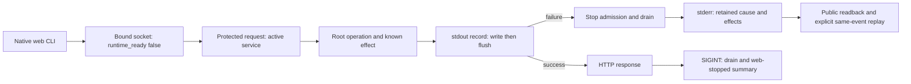
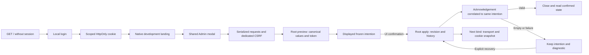

# Recettes permanentes / Permanent verification recipes

Le lanceur Python standard `recipe.py` exécute des commandes explicites sans shell
implicite, relance ni watchdog global. Les recettes JSON version 1 résident dans
`recipes/`. Elles déclarent sources, environnement explicite, commandes, code de
sortie attendu et textes observables obligatoires. Un code zéro sans assertion
est refusé. Ne placer aucun secret dans une recette ni dans les sorties de test.

```sh
python3 tools/verification/recipe.py run --recipe tools/verification/recipes/runner.json --output /CHEMIN/NEUF
python3 tools/verification/recipe.py verify --evidence /CHEMIN/NEUF
```

Le parent du répertoire de preuves doit exister ; le répertoire final doit être
neuf. `{root}` est la seule substitution, dans arguments et valeurs d'environnement.
Les chemins `inputs` sont des globs relatifs au dépôt ; aucun motif vide ou sortant
n'est accepté. Le lanceur conserve recette et runner originaux, archive des sources
déclarées, empreintes avant/après, substitutions d'environnement, exécutable lancé,
arguments, sorties intégrales, durée, code et cause d'échec. Il ne journalise pas
l'environnement hérité. Les processus reçoivent EOF sur stdin. Arrêt à la première
anomalie ; aucun prochain pas après un échec. Écriture exclusive et atomique des
preuves ; une panne disque peut laisser un lot incomplet, jamais un PASS confirmé.

`run` retourne 0 pour PASS, 1 pour FAIL, 2 pour refus/prérequis impossible.
`verify` contrôle empreintes, archive et cohérence ; il retourne 1 pour un FAIL
intact et 2 pour une preuve incohérente. Il ne rejoue rien. Les empreintes locales
ne constituent pas une signature d'auteur. L'inventaire est **déclaratif** : il
ne remplace pas la qualification des entrées effectives Go/Rust, des features,
dépendances, binaires de production, droits ou revues indépendantes. Aucun accès
à une mission, appel fournisseur ou déploiement n'est autorisé par le manifeste.
L'adaptateur de recette doit être relu quand son contrat change.

---

The standard-library Python runner executes explicit argv without an implicit
shell, retries or a global watchdog. Version-1 manifests in `recipes/` declare
source globs, environment overrides, commands, expected exits and required output
assertions. Use the commands above with a **fresh directory and existing parent**.
`{root}` is the only substitution. Never put credentials in recipes or test output.

It retains original manifest/runner, declared source archive and before/after hashes,
explicit environment overrides, launcher hash, argv, complete stdout/stderr, duration,
exit and failure cause. Inherited environment is not recorded; stdin receives EOF.
The first anomaly stops subsequent steps. Atomic exclusive publication preserves
old evidence; disk failure can leave an incomplete batch, never a confirmed PASS.
Run exits: 0 PASS, 1 FAIL, 2 refusal/prerequisite failure. Verify checks archive,
hashes and consistency without executing tests: intact FAIL remains exit 1,
inconsistent evidence exits 2. These are local self-consistency checks, not signed
authorship or independent acceptance. Declared sources do not replace effective
compiler graph, feature, dependency and production-binary qualification. A manifest
grants no live-state, provider or deployment authority. Review a recipe whenever
its consumed contract changes.

### Instantané figé des entrées déclarées / Frozen declared-input snapshot

Quand un autre travail modifie le checkout pendant un run (`source_stable: false`),
`snapshot.py` copie **uniquement** les fichiers sélectionnés par les `inputs` de la
recette (même sélection et mêmes refus que `recipe.py`), la recette et le lanceur,
dans un répertoire neuf ; il lie les dossiers de dépendances nommés (`--link`,
jamais copiés ni déclarés) puis lance `recipe.py run --root <instantané>`. Une
entrée non déclarée échoue visiblement au lieu d'être lue dans le checkout vivant.
Placer l'instantané sur le disque principal (le cache de build de la recette y est
créé ; `/tmp` en tmpfs peut saturer). Codes : 0 PASS, 1 FAIL, 2 refus.

```sh
python3 tools/verification/snapshot.py --recipe tools/verification/recipes/live-monitor-native.json \
  --snapshot .cache/<nom-neuf> --link node_modules --link frontend/node_modules --output /CHEMIN/NEUF
```

When concurrent work changes the checkout during a run, `snapshot.py` copies only
the recipe's declared inputs (same selection/refusals as `recipe.py`), the manifest
and runner into a fresh directory, symlinks named dependency directories and runs
the recipe with `--root` there; an undeclared input fails visibly. Before copying,
it refuses (exit 2, `snapshot-embedded-input-undeclared: <chemins>`) a declared
`.rs` whose literal `include_str!`/`include_bytes!` target is not declared, so a
missing embedded file is named at once instead of after a full build; `concat!`/
`env!` forms are not resolved and still fail at compile time. Use the main disk
(tmpfs may fill up). Tests: `python3 -m unittest tools/verification/test_snapshot.py`.

Pour une qualification Swarm qui retourne3REVIEW_REQUIRED après les tests,
voir [la fermeture différée](QUALIFICATION-CLOSURE.md). Cette phase distincte
vérifie sources, archives, graphes, profils et revue sans rejouer les tests ni
transformer une preuve locale en acceptation indépendante.
For a Swarm qualification returning3/REVIEW_REQUIRED after tests, use the
[deferred closure contract](QUALIFICATION-CLOSURE.md). This separate method
checks inputs/archives/graphs/profiles/review without relabelling old tests as new.

Recette catalogue/coûts : `recipes/pricing-accounting.json` conserve les régressions
Go retenues (pagination, erreur/cause sûre, tarifs, concurrence et historique).
La recette navigateur existante `tests/pricing_ui.cjs` accepte un binaire Go de
fixture construit depuis les sources courantes et un nouveau répertoire de preuve.
Exemple depuis la racine :

```sh
go build -o .cache/swarm-pricing-fixture ./cmd/swarm
PUPPETEER_EXECUTABLE_PATH=/CHEMIN_CHROME_VERIFIE node tests/pricing_ui.cjs .cache/swarm-pricing-fixture NOUVEAU_REPERTOIRE_DE_PREUVE
```

Inspecter le navigateur réellement installé avant de remplacer le chemin ; ne pas
supposer que le cache Puppeteer existe. Aucun watchdog global de cette recette ;
progression par langue/thème/largeur, serveur privé, tarifs fictifs, aucun fournisseur.
Ne modifier aucun des inputs déclarés pendant une capture, même une recette non
exécutée par cette étape : le refus `recipe-declared-inputs-changed` est correct.
Pricing/accounting replay uses the manifest above; the browser command builds its
own fixture binary and requires an observed Chrome path plus fresh evidence output.
Local results are not deployment, effective-graph qualification or acceptance.

Recette Rust tarifaire : `recipes/pricing-native.json` (8tests moteur sous fixtures,
3CLI par défaut). La parité permanente `tools/rust-migration/verify_pricing.py`
compare101cas, dont le témoin numérique de la vraie ancienne source Go. Les
qualifications enregistrent leur référence de parité et vérifient les tests Go
frais/nonvides/nominatifs. Réutiliser une preuve seulement sur ses entrées exactes.
Rust pricing replay:8fixture-engine +3default-CLI tests; the101case parity includes
legacy finite-rounding and rescaled-overflow witnesses. No provider/billing claim.

Recette `recipes/agent-runtime.json` : socle natif (15moteur,4CLI agent, régressions
CLI communes/tarifs), pas mission complète. `verify_agent_runtime.py` compare48cas
Go/natif de données et d'état SQL, sans processus/fournisseur. Les recettes Rust
archivent désormais aussi SQL, JSON et textes réellement incorporés. Vérifier
`python3 -m unittest discover -s tools/verification -p test_rust_recipe_inputs.py -v` :
inventaire nonvide de tous les includes littéraux et de toutes les recettes Rust.
Les anciennes archives ne sont pas réétiquetées ; la qualification effective71
incluait déjà ces assets, contrairement à la sélection déclarée de quatre recettes.
Ce garde de recette n'est pas une qualification des dépendances externes.
Native agent replay is bounded, not full mission acceptance. Literal embedded SQL,
configuration and context sources are archived; existing historical evidence keeps
its original declared scope and effective qualifications remain separate.

Increment73 adds five supervisor-claim and six cancellation tests, including
actual concurrent SQLite connections, partial historical settlement repair and
replay without duplicate events/logs. CLI includes four agent journeys plus
17common and three pricing checks. No provider or full-mission claim.

`recipes/runtime-limits.json` :26engine+26default-CLI checks for saved runtime
settings, hierarchical SQL readback, legacy adoption and strict preview/error
recovery. `agent limits` is diagnostic, never launch admission. Shared Admin
recipe now saves all ten runtime fields and observes each default/ceiling/null
choice through that actual production command, in FR/EN and both themes.
The complete workspace is run only when the changed shared settings contract
justifies it; incremental recipe checks are not a new full dependency qualification.

## Terminal browser states instead of swallowed predicate errors

Swarm75 found a visible Admin refusal while a zero-watchdog Puppeteer wait
remained pending: an optional undefined CDP argument became null and the CLI
correctly refused the extra input. Omit absent arguments at the transport.
A polling predicate must return a terminal success/refusal observation; raise
the error outside polling. Use `tests/helpers/engine_settings_admin_state.cjs`
for settings loaded/preview/saved states, without adding an arbitrary timeout.
`node tests/engine_settings_admin_state_test.cjs` verifies six DOM cases with
valid controls and recovery. Preserve displayed refusal, original CLI streams
and the interrupted run; a closed browser is not a completed acceptance check.
The helper does not detect every possible stall or replace progress diagnosis.

### Apprentissage77 : contrat complet et concurrence

Une lecture tronquée peut masquer une validation plus bas dans une fonction.
Avant de déclarer une protection absente, rechercher le symbole et lire son
producteur, la transaction et les postconditions, puis tenter le contre-exemple.
`epoch-before`77 a falsifié une hypothèse : le garde existait déjà. Conserver le
test et l'apprentissage, pas une correction redondante. La règle commune de
lecture du vrai contrat couvre ce cas ; aucune nouvelle consigne parallèle.

Une attente SQLite finie ne garantit pas que deux appels concurrents réussissent
immédiatement. Vérifier l'unicité, la cause typée d'un épuisement autorisé et le
rejeu après commit réellement confirmé. Pour isoler une contention, tenir un
vrai writer sur fixture avec politique zéro attente/reprises explicites ;
ne pas augmenter un seuil de test pour dissimuler un contrat non consommé.
Les exceptions de commit/cleanup ne sont pas des erreurs BUSY à réessayer.

Native extensions must not inherit Go zero/default projection: retain opaque
values, require nullable-field presence, preserve unknown constraints and refuse
consumption. Snapshot77 regressions cover absent nullable fields, unknown
constraints and deep raw JSON. Fixture Admin flows must respect provider ceilings
and queued workspace ownership; use public cancellation with blocked/unaccepted
tasks, never private SQL cleanup. These are persistent repository lessons; they
do not update already running agent contexts or establish native supervision.

`recipes/agent-controlled-process.json` exercises the shared Linux runner and its
actual Git/validation consumers. Its17selected cases distinguish caller-supplied
wakeups from process deadlines and retain control/signal/cleanup refusals. Input
gating in a local fixture is not durable Agent registration or authorization.
No global watchdog, paid provider, live mission or running-server change occurs.
The core alone remains a prerequisite. `recipes/agent-native-runtime.json` now
covers actual manual Root/CLI supervision, including threshold observation without
automatic stop, private execve refusal, stop/guards, budget and Admin concurrency.
Its execution and limits are recorded in the migration plan.

Signal fixtures must not reenter Python buffered stdout from a TERM handler while
that buffer may still be producing the READY marker. Increment78 reproduces the
reentrancy with a deliberately occupied buffer: safe handler0 → buffered handler1
with RuntimeError → safe handler0, without timed sleeps. Use the owned raw FD for
the fixture handler and explicit fixture exit; the Rust guard keeps READY/TERM,
exit status and actual drain assertions. This is fixture synchronization, not a
provider stop policy. The first isolation attempt blocked again in Python final
flush and needed its identified own child killed; retain that intervention and
never count its -9 as clean exit evidence. The noninstrumented original Rust
failure remains historical without exact status attribution.

Executable fixture writers must not leave writable executable descriptors in a
concurrent test parent that forks other children. The shared-runner recipe now
includes an actual open-writer ETXTBSY refusal between valid controls and prepares
its scripts in a separate writer process that has exited before use. This adds no
product retry and does not identify the lost errno from engine-wide01. Unexpected
valid-control failures preserve stage, IO kind and errno without arbitrary cause
text. Sources and historical failures remain in increment78.

For manual setup outside the recipe runner, abort dependent work immediately
when an edit or prerequisite fails. Stage exact source anchors, check the edit
exit status and changed bytes before launching verification; use separate checked
steps or fail-fast shell execution. An unchanged run accidentally continued after
a failed edit is retained as a method failure, never a fresh recovery attempt.

The native manual recipe now also covers the pure model argv compiler (47engine
units,114Rust tests overall,4generator tests). It preserves sandbox/tool args and
stdin, refuses empty/dangling overrides, and replaces attached short model flags.
The recipe does not qualify routed execution, catalogue availability or billing.
Recover real helper/test paths with an inventory and symbol search before reads;
a failed guessed-path read is a method issue, never production/test evidence.

Increment81 extends the same native recipe with five model-rule integration cases
and two actual CLI checks (121Rust tests expected,4generator and i18n). It tests
explicit adoption, legacy history, empty lists, safe refusals and the read-only
model-check consumer; it does not qualify provider availability or routed launch.
Do not count the expected totals as PASS before the retained execution completes.

A fixture using current installation values must derive its change schema from
those actual values. A historical-generation fixture must exclude later fields
explicitly; do not relabel current data with an inherited numeric version.
Increment81 retained a real pre-lock refusal caused by that mismatch, then verified
actual lock refusal/recovery. Named-test counters must include spaces in doctest
names and agree with suite totals; zero suites do not add passed tests.

Native requested routing83 has a separate permanent Python recipe documented in
the FR/EN replay pages. It uses an explicitly qualified default CLI image and
private program/cache/work/budget roots, retaining requests and original output
atomically. Its scenario count is separate from125Rust tests in the shared recipe.
The CLI named codex is a local script, not a real provider/account/model proof.

Increment83 actual receipts: permanent14 PASS125Rust+4generator/i18n; workspace15 PASS566named; native16 PASS8; browser17 PASS4×23fields. Default profile15/no fixtures and source archives are retained; no native HTTP or deployment is qualified.

84 candidate adds three pure API-namespace units (128Rust total expected) and a ninth permanent native-model Python scenario. Empty/unrelated catalogues permit CLI routing; active collisions and selected APIs refuse. Source guards, no-state-change, secret and recovery checks remain required.

84 actual qualification:128Rust+4generator/i18n,9native journeys, default04 without fixtures, Clippy/private Rustdoc and one Go namespace contract test pass. Sources and binary archived. UI83 and workspace83 remain historical scoped evidence.

85 candidate adds configuration format, real create-only race/refusal, Root fault/uncertainty and CLI output-failure tests. Shared recipe expects140Rust+4generator/i18n, plus10Python native journeys. NOREPLACE fixture tests require test-fixtures; the normal CLI must separately show no fixture feature. Initial verifier03failed to compile (unlisted tempfile), corrected with existing owned-root primitives.

85 actual receipts: permanent07 PASS140Rust+4generator/i18n; all-features workspace08 PASS593named; default08/no fixtures + native09 PASS10. Original03compilationFAIL preserved; corrected04Root3, storage05/CLI06 and same original public program after09 pass. Archives bind source bytes and profile; no installation/native HTTP or new browser proof.

85-cache recovery preserved all886identified example artifacts in a verified retained archive before unlinking only their r25 example-cache copies. Original metadata/hashes and normal CLI identity are retained; no source/mission/dependency-library cache was removed. Do not purge the retained archive as cache.

86 candidate: shared recipe151Rust+4generator/i18n;13native Python journeys, including queued model changes/restoration and malformed config repair. Targeted Root8/CLI4 contracts cover stale token/policy/lock,12update fault stages and output failures. Reuse85global publication evidence only for unchanged consumers; no new full example recompilation is justified by these additive helpers.

Local qualification86 verified:151named Rust permanent-recipe tests,4generator
tests and i18n; workspace/all-targets Clippy and private Rustdoc pass. The rebuilt
normal CLI has no test-fixtures in its73artifacts. All13native journeys pass,
including exact configuration restoration and recovery of the same queued intention/
reservation, malformed-source repair and cross-Root token rejection. The identical
public preview01 and scope09 programs pass after correction. Original150tests06/
12native08 and scope09RED remain historical; pre-fix ELF07 is retained separately.
Eight Root, six storage and four CLI tests cover12backup/replacement fault variants
and output/flush errors. Explicit no-change apply really fsyncs file and directory.
No new count/retry/deadline policy; existing Admin per-file cap is unchanged and the
public token binds source/settings bytes and the actual Root descriptor.
Sources/ELF/profile/review: `docs/plans/migration-rust/evidence/20261019-86/result.json`.
The593workspace85 tests and four Admin83 journeys are scoped historical evidence,
not fresh86 runs. No new Mermaid render or independent review, installation/cutover,
HTTP/auth or authenticated identity is established. APIs/probes, default-model
installation UX, hierarchy and crash/drain recovery, existing data migration,
global qualification, single cutover and RETEX remain open. Overall migration partial.

87 candidate adds strict task-model DTO/binding tests and a permanent native task-model scenario. Selected model must affect actual argv and preserve budget/history; missing/native branch refusal is retained before01.

Local qualification87 verified:155named Rust permanent-recipe tests,4generator
and i18n;10supplemental WorkEngine tests pass, including SQL failure/rollback/same-
event recovery. Workspace/all-targets Clippy and private Rustdoc pass. Normal
profile has no test-fixtures in its73artifacts; all14native journeys pass. The
process really receives the task's simple choice while provider/default auto
would choose standard. Choice/replay/reopening, conflicts and policy drift before
admission/after queueing, active-change refusal, retained reservation and exact
source restoration/recovery are observed. Inherit removes only choice, retaining
attempts and consumption. Only the supplemental Python fixture changed after15/16;
compiled inputs stay byte-identical (rust-evidence-reuse18.json). Identical public before01/after18 and compat-before12/
after17 programs pass. Extracted Go definitions compile as oracle13 and confirm
scalar nulls/case/duplicates; common projection preserves those while refusing
unknown/type/multiple-JSON input. Cli04FAIL1/2 remains: the fixture changed protected
schema, so Root refused before the transaction. Corrected CLI/WorkEngine tests
prove their separate contracts without disabling guards. Original Clippy10FAIL
item ordering remains, corrected without suppressing lint.155tests09 are pre-codec,
not final qualification15. Sources/ELF/review: `docs/plans/migration-rust/evidence/20261019-87/result.json`.
No installation/cutover, new browser/Mermaid-render proof or independent review.
Task choice authenticates neither actor nor model and grants no launch permission.
APIs/probes, initial/default-model UX, hierarchy/selected memory, crash/drain recovery,
HTTP/auth, existing data migration, global qualification/single cutover/RETEX stay
open. Overall migration remains partial.

88 policy-only import/export adds4engine units and2CLI tests to161Rust expected. Python policy-import is the15th native scenario. Browser submit/editor recipe uses shared modal sources and real native CLI with fresh owned roots, FR/EN and both themes; Go tokenless wire bodies are separately parsed by extracted Go definitions. No native HTTP/auth, implicit default-model migration or model/account identity follows from those fixtures.

Local qualification88 verified:161named Rust recipe tests,4generator and i18n;
workspace/all-targets Clippy and private Rustdoc PASS. Normal profile has no fixture
feature in its73artifacts; all15native journeys PASS. Explicit policy preview/apply/
export works for35providers and a99037Bfile without hidden32/64KiB cutoffs. Go DTO
command/env fields are preserved, exact original snapshot bytes retained; invalid
input/cache/rules/stale-token refusals and recovery are observed. Policies can be
stored while execution is denied; separate admission refuses and the actual local
child runs only after explicit restoration of that policy. No paid model call.
Four FR/EN×theme browser journeys pass on that same CLI: actual submission/native
token, visible no-write refusals, save/reopen, retained demanding choice and narrowed
Admin rule refusal/recovery. Import/editor captures at320/1440, focus/Escape and
console/request failures checked. This is a component/fixture CLI bridge, not full
cockpit/native HTTP/auth. Eight legacy tokenless bodies also pass actual extracted
Go strict/PolicyChange; no legacy Go server is launched. Identical before01/after19
passes. Browser11RED retained (demanding shown as simple), fixed without a frontend
policy ceiling; release14RED aggregation retained then corrected Published/causes
PASS, modeling a late release refusal rather than an actual OS failure. Native06
JSON-vs-canonical-DTO verifierFAIL is retained and corrected07 without dropping
exact snapshot checks; browser09 fixtureFAIL remains. Sources/binary/review:
`docs/plans/migration-rust/evidence/20261019-88/result.json`.
No implicit named model, Claude catalogue/installation/HTTP/auth or model/account
identity is established. Export includes saved policies only; an old Go reader may
still reject >32. Unsupported catalogues refuse, never become available by fiat.
Same-session review, not independent; diagrams checked against code, no new Mermaid
render or exhaustive WCAG audit. Old translations are preserved; historical Admin83
styles/assets match except separately verified additions of3translations. The
serving app remains Go; overall migration, data, hierarchy/recovery, full acceptance,
single cutover and RETEX remain open.

89: common `tools/verification/recipes/agent-native-runtime.json` has169named Rust
checks +4generator/i18n (`permanent16`). Actual child complement:
`python3 tests/rust_manual_mission.py --binary NORMAL_CLI --output FRESH_DIRECTORY`
(single line),4scenarios. Isolated roots, exact commands/inputs/diagnostics/sources;
no global watchdog, paid model call or live DB. The actual child produces its report;
gate/operator acceptance are controlled fixture decisions, not independent review.
The alias branch injects/removes one added malformed fixture row only; it never
removes real history or budget. Normal profile18 has no fixtures;15routing,4mission
journeys, corrected counterexamples, Clippy and Rustdoc pass. Results/hashes/limits:
`docs/plans/migration-rust/evidence/20261019-89/result.json`. Original failures and
pre-fix proofs remain distinct from final evidence. Serving app stays Go; overall
migration, HTTP/auth, hierarchy/recovery, data and cutover remain open.

90: the same permanent recipe includes `swarm-web`, late-failure Root/CLI cases
and datastore binding. Verified192named Rust tests, including69engine units,6CLI
units and17HTTP tests;4generator/i18n separate. HTTP requests are typed/in-process
with actual isolated Root, not a TCP/browser server. Actual IPv6 is unavailable
(evidence06), never counted PASS; the synthetic address unit is named separately.
RED08/15/17 and original sources remain; final common qualification is pending in
`docs/plans/migration-rust/evidence/20261020-90`. Persistent AGENTS.md rules are
relayed by CLAUDE.md without changing already-started prompts/processes. Cache14
archive is retained proof, not disposable cache: only29verified old owned rlib/rmeta
copies were removed, preserving all sources/binaries/earlier proof archives.

HTTP90 locally qualified: recipe32 PASS192named Rust tests,4generator and i18n;10additional WorkEngine tests,15native routing and4manual missions PASS. Clippy and private Rustdoc PASS. CLI/HTTP-library builds33 have no transitive test-fixtures; no listener, persisted session or installation. Final proofs: evidence/20261020-90/result.json;23–27 are historical before IO fix30. Actual IPv6 remains unavailable/open; synthetic IPv6 formatting is separate. Same-session Codex review only. Next: secure session creation/reuse then native HTTP transport. Serving application remains Go; global migration and RETEX stay open.

91: permanent recipe additionally runs native session persistence and compile-gated atomic publication faults. Expected202named Rust tests;71engine units and19HTTP tests. Bound listener metadata and typed HTTP request proof remain distinct from actual TCP HTTP traffic/login. Normal builds must exclude test-fixtures. Qualification pending in evidence20261020-91.

Session91 locally qualified: recipe07 PASS202named Rust tests,4generator/i18n;10additional WorkEngine tests,15routing and4manual missions PASS. Clippy/private Rustdoc and normal profiles08 without test-fixtures PASS.5public session tests plus2new engine and2HTTP units cover creation/reuse, refusals/recovery, forced concurrency and bootstrap.1compile-gated test covers6publication faults, not6actual OS incidents. Source/binary/review/limits: evidence/20261020-91/result.json. Persistent session is wired to the typed service, without TCP server/login/expiry or installation. Same-session review, Go still serving. Authorized next: Admin/API journeys then native HTTP transport with persisted policies and actual consumer; global cutover and RETEX stay open.

92: settings-output-state checks real dispatcher/Root with failing output doubles, successful witnesses and replay/readback. Expected206named Rust tests; no provider call/global watchdog/actual OS close fault. Prior failures01–03 retained.

Output92 locally qualified: recipe06 PASS206named Rust tests,4generator/i18n;10WorkEngine tests,15routing and4manual missions PASS. Clippy/private Rustdoc and normal builds07 without test-fixtures PASS. RED01/02/03 now pass: init/apply/replay retain known state after write/flush, while refusals/show/preview do not claim saved operations. Output doubles/close aggregation are separate from actual OS faults. Source/binary/review: evidence/20261020-92/result.json. Initial test01 retained from its generator and identical captured03 prefix with explicit provenance. Go server unchanged; migration/HTTP/Admin/cutover/RETEX stay open. Next: settings API then native transport and persisted policies.

93: protected-http-boundary additionally checks native settings describe/show/preview/apply, saved report-cap consumption, replay/refusal/Root replacement and known-state metadata independent of response body. Expected211named Rust tests. Typed/in-process proof only; no actual HTTP transport/browser delivery. Archived obsolete test executables under cache inventories are retained proof, not disposable archives.

API93 locally qualified: recipe05 PASS211named Rust tests,4generator/i18n, including24HTTP (5units,7access,9service,3settings). Clippy/private Rustdoc and normal builds06 without test-fixtures PASS. WorkEngine10,15routing and4manual missions from92 explicitly reused, not reexecuted:1211relevant inputs and CLI ELF/profile identical. Native Admin routes, saved cap consumed, replay/refusal/replaced Root and state independent of body verified; no network/browser hookup. Source/binary/review: evidence/20261020-93/result.json. Cache archives01–03 retain102obsolete own native tests,926567800B, SHA-read back before removing only derivatives; sources/data/prior proofs preserved. Free space recovered near1GiB; no further cleanup needed. Next: persisted/Admin network policies and real transport. Migration/cutover/RETEX stay open; Go still serves.

94: web-policy-values and actual pinned-library transport probes extend the native recipe to220named Rust tests. Catalogue4/network document20, v19 byte/history preservation, source-only defaults and typed address/count errors. Browser recipe `node tests/rust_web_policy_admin_ui.cjs NATIVE_CLI OUTPUT` verifies the shared editor via CDP/actual CLI, not native TCP/auth or active policy. Fresh evidence directory required; no global watchdog and terminal UI errors end waits. Production profiles must exclude test-fixtures and test-util across artifacts.

Network94 locally qualified at configuration/Admin level: recipe15 PASS220named Rust tests,4generator/i18n,10WorkEngine,15routing and4manual missions. Clippy/private Rustdoc and profiles16 without test-fixtures/test-util PASS. Browser14 PASS4 FR/EN×2themes,5widths/4captures; two mobile captures visually inspected. Normal ELF13=16, original19journal byte-identical. Source/binary/actual dependency bytes/review: evidence/20261020-94/result.json. No TCP enforcement/restart consumer proven. Method limit retained for95: new browser finally may mask a primary error when browser.close fails; not observed14, reproduce/fix before transport faults. Go unchanged, migration/cutover/RETEX remain open.

95: `node tests/verification_cleanup_test.cjs` verifies original/secondary/finalizer failure aggregation before transport fault injection. The shared browser harness attempts every owned cleanup, closes its own Node connections, and retains failed scratch roots. Thrown undefined remains failure. `cleanup-before01` retains the extracted original finally counterexample; doubles are distinct from actual Chrome/OS faults.

95: the permanent native recipe adds ten Rust cases (230 expected total) and six
Node cleanup tests. `cargo test --manifest-path rust/Cargo.toml --locked --offline
-p swarm-web --all-targets` covers real isolated TCP, limits413/431, connection and
Root/Admin saturation/recovery, pre-Root shutdown, same-Root bootstrap and dedicated
CSRF. Read-only native TCP is distinct from the prior CDP/CLI browser bridge; no
network mutation, browser login, actual Root-mutation drain, network deadline, IPv6
or installation claim. Evidence:20261020-95; original failures retained.

Queued refusal diagnostics now retain their connection reservation until the owner consumes them, including after client-future drop. Local ownership regression guard; final qualification pending.

Transport95 locally qualified for reads: composed230Rust proof (193unchanged from
PASS permanent29,37HTTP requalified33 after truthful-capability repair),4generator/
i18n,6cleanup assertion cases; browser04 reused4CDP/CLI journeys with identical input
hashes. Clippy/private Rustdoc/normal web profile34 and embedded-context check34 PASS;
normal profiles exclude test-fixtures/test-util, CLI30 ELF identical94. Dependency31
capture verifies85packages/5236actual files. Source/artifacts/review: evidence/
20261020-95/result.json. No network POST/login/global acceptance or installation.
Open criteria and mutation96 follow-up retained; Go still serves, cutover/RETEX open.

Transport96 locally qualified: recipe13 PASS240named Rust tests, including47web
and8TCP cases,4generator/i18n and6cleanup assertion cases. Clippy/private Rustdoc/
profiles14 PASS; normal graph has no test-fixtures/test-util. CLI14 ELF matches95;
dependency graph unchanged and5236actual source files for85packages rehashed
against31. Source/artifacts/review: evidence/20261020-96/result.json. Task/settings
mutations and effect observation verified; CLIweb command, native login/Admin,
progress-safe sink and precision of Root errors without a document remain open.
Go was not restarted; no global acceptance/cutover/RETEX. Authorized97 continuation:
public CLI consumer with output/shutdown handling, without false readiness or
treating written output as durable receipt.

97storage: current native recipe uses `{root}/rust/target/r97`, presently an owned
symlink to private tmpfs build outputs. Inspect ownership/link/free space before
reuse; tmpfs may disappear. This is disposable build cache, never persistent proof.
Source/binary evidence stays in the repository evidence area. The prior r25 cache
was not moved; only two inventoried obsolete derivatives were persistently archived,
SHA-read back and then removed after the observed ENOSPC. See97/storage05-result.json
and build-cache05.json. No source copy or live Root was cleaned.

CLI97: public driver `tests/rust_native_http_cli.py` passes both scenarios using
normal binary08 (97/public10 evidence). Bound-before-runtime announcement, protected
session, read-only preview, actual apply/exact replay, separate CLI readback and
SIGINT summary are verified. Real broken stdout after commit preserves observer
failure, exact receipt and safe causes in stderr; explicit same-event recovery
does not duplicate history. Pre-Root refusals use fixed-code text/plain; Root
responses use JSON. web-stopped is emitted and its output failure retains known
effects. The stream is not a durable journal; non-returning Write, native UI/login/
Admin, global parity and cutover remain open. Static/permanent qualification97/11–12
is pending; serving Go is unchanged.

CLI97 locally qualified: recipe11 PASS244named Rust tests (48web and2bootstrap),
4generator/i18n and6cleanup assertions;2actual process/HTTP journeys public10 PASS.
CLI/web Clippy, private Rustdoc and normal profile12 PASS; binary12 matches08
exercised by public10, no fixture/test-util features. Retained95dependency sources
rehash successfully (5236files), no new registry package. Method check14 PASS with
isolated Go cache; interrupted13 remains incomplete evidence. Persistent source/
binary archives and SHA-bound semantic review are in97/result.json. Global migration
remains incomplete: native login/Admin, progress-safe output, autonomous supervision,
other routes, global acceptance/cutover/RETEX remain open. Serving Go is unchanged;
no installation/publication/independent review.



Native login98 browser recipe (separate from typed tests):
```sh
python3 tests/rust_native_login_browser.py --binary "$PWD/rust/target/r97/debug/swarm-rust" --output FRESH_DIRECTORY
```
The actual CLI starts on a new0700Root; Chrome receives the key on stdin, never
argv/logs. Outcomes are drained during resource loads. All owned processes close;
failed fixtures survive. Check cargo artifacts for a normal non-fixture profile
before use. Every emitted raw artifact is scanned for the exact key; the private
Chrome profile remains outside evidence. No global/page/CDP watchdog. The recipe
sets next=/api/v1/works to exercise protected access; the / cockpit remains
unported (the form's default redirect is still /).

Login98 locally qualified:53fresh web +10targeted CLI tests,2actual HTTP14 scenarios
and4real browser15 journeys PASS; Clippy/private Rustdoc/normal profile13 PASS, no
fixture/test-util. Prior186kernel/non-web checks remain historical on unchanged
relevant inputs, not a new full recipe run. Binary13 is exercised by14/15;8final
screenshots match09inspected images; measured verified text contrast minimum7.89
light/9.10dark. SHA-bound review/source/binary archives and limits:98/result.json.
Original favicon404, snapshot mix and template400 evidence retained; recovery
verified. Serving Go unchanged. Next99: protected landing/shared Admin modal via
actual native HTTP; the form defaults to / whose cockpit remains unported. The98
recipe chooses /api/v1/works and does not prove that default landing journey.

Native landing/Admin99 recipe:
```sh
python3 tests/rust_native_login_browser.py --binary NORMAL_ELF_PATH --root-workers 1 --scenario admin --output FRESH_DIRECTORY
```
One worker is private fixture input persisted through CLI, not a product default.
CLI readback confirms state/revision; only our fixture server restarts to observe
the session cookie without Max-Age. No Go server/live mission is stopped.21ACK,
5adapter and2helper-failure guards have permanent test files and remain distinct
from actual HTTP journeys.


UI confirmation does not authenticate a human/agent or business decision.

Landing/Admin99 locally qualified:26step recipe PASS253selected Rust tests (57web),
21ACK,5adapter and6cleanup cases, generator/i18n. Two test assertions were clarified
after Clippy19:18units rerun20, production bytes identical and other inputs unchanged;
reused scope is explicit. Clippy/private Rustdoc20 PASS. Separate0500normal-dev ELF
without fixture/test-util, SHA
00e75fb09fb21ba972582c9241444c4cad306192604661a6a88c7087d3a9efe9,
is exercised by2HTTP22journeys,4native Admin23variants(Root1),4component/CLI24
variants and2helper-error25guards. CLI readback and next bind prove null cookie
omits Max-Age; client loss after actual publication replays without duplication.
Empty ACK keeps the dialog; program canonicalization comes from Root. Source/
artifacts/review/profiles:99/result.json. Serving Go unchanged; no installation or
optimized release/performance claim. Supervision, other journeys, complete identity/
authorities, restore/global acceptance/cutover/RETEX remain open. Non-progressing
synchronous Write remains an open limit.

Native runtime batch100: permanent recipe includes9mission lease cases (frozen policy, concurrency, stale epoch, checked SQL rollback/recovery and historical settings). Native Admin browser exercise saves/reopens3v21 values and checks actual CLI readback. Global conductor runtime remains incomplete.

Supervision100: native claim/renew/stop and3v21 settings locally qualified.
27steps/262selected Rust tests(57web) PASS11; after Clippy11 only two commit-cause
representations changed to owned Boxes, without lint suppression. The9mission
tests passed again17;253others reuse byte-identical relevant inputs, not a new
full recipe. All-target Clippy and private engine/CLI/web Rustdoc17 PASS. Separate
normal-dev ELF without fixture/test-util, SHA
4e29d533de6e5c9fd6ef5b3ae2ce14450d840afe22bce09a4b0d014185bd48e7:
4actual Admin19FR/EN×themes journeys(Root1),3v21 values saved/read back by CLI,
2HTTP20journeys PASS. Evidence/source/review:100/result.json. OS account remains
trusted; this lease authenticates no model/human. Cycle journal, recovery reader,
fencing within every business transaction and conductor loop remain open. Kernel
close failures/uncertain commit not injected; no global error-handling conformity
claim. No installation/server replacement, paid calls/commit/push/orchestration.
Global R6/R7 and RETEX remain open.

Reader101 adds5read-only observations to the existing9lease cases. Same permanent step now expects14named tests and validates no-schema-creation, unknown Work refusal, effective/recorded deadlines, legacy absence of policy, original SQL causes and recovery.

Reader101 locally qualified:14lease/reader tests PASS08, including explicit native
Present witness then a view collision at the reserved name, malformed clocks, real
SQL refusal/recovery and readonly no-schema-creation. Initial RED02 had incomplete
source binding; derived07 is byte-bound, removes only the kind guard and restores
it exactly, retaining targeted RED and14GREEN. No exact historical binary claim.
Engine/CLI/web Clippy03, engine08 after stronger test, private Rustdoc03 PASS.
Separate normal-dev CLI without fixture, SHA
369c7d956653a63b7bf88d2c574cbffccad2e07f93a3bba9b68e0126de6b7ceb,
2HTTP05journeys PASS; production source bytes unchanged after derived replay.
No new global recipe:100evidence retained, Admin journeys not rerun because their
sources/contracts did not change. Evidence101/result.json. Trusted Root library
read only, no approved HTTP DTO, authenticated identity or guessed policy revision.
Business fencing, cycle journal/conductor, globalR6/R7 and RETEX remain open.
Serving Go/user data preserved, no installation.

102:18mission lease/reader/fenced-command cases. Shared Work transaction change justifies runtime recipe plus standalone Work/budget checks. Ad hoc normal builds reuse recipe.snapshot and verify every normalized actual depfile path is in the pre-build manifest; Rust directories alone miss embedded resources.

Work fencing102 locally qualified:27runtime steps/271named Rust cases plus22
standalone Work/budget cases (293selected, not the full workspace). Includes18
lease/reader/command cases, exact refusal causes and Send mobility. All-target
Clippy and private engine/CLI/web Rustdoc09 PASS. Separate normal-dev CLI without
fixture/test-util, SHA
c3d81b69e65a989d99f377f258871b7d935745d84194c9f8879696b8d8a0a810,
2HTTP11journeys PASS; actual compiler inputs covered before/after. Assisted stop
run04remains invalid;09 completed autonomously after changing only the fixture
signal rendezvous,2variants. Production runner prefix byte-identical. Negative
Send compile-contract06 and positive09 retained; no lint allow or timed guard.
Evidence102/result.json. Scope is Root SDK and supported controls; separate agent
launch/stop/process paths, per-action journal, persisted policy provenance and
complete conductor remain open, alongside R6/R7/RETEX. Go/user data preserved;
no installation, paid calls, commit/push or orchestration.

Native runtime103:72engine lib tests,23mission cases, including exact claim/command settings provenance, transactional receipt rollback and settings reservation held through SQL read rollback. No global watchdog. Full103 local qualification recorded below.

Provenance103 locally qualified:27steps/277named Rust cases plus22Work/budget
(299selected),23mission cases and72engine units. Engine/CLI/web all-target,
all-feature Clippy and private Rustdoc08 PASS. Isolated normal-dev binary without
transitive fixture/test-util, SHA 6cda663924c7650dae07c059c962d693175453c5c00c32e207e355e78580c4ff. Two real CLI/HTTP11
flows PASS; effective compiler inputs covered. Original RED03/05 retained, refusal
without mutation and recovery verified. Evidence103/result.json. This does not
establish authenticated agents, a complete conductor or installation/cutover;
R6/R7 and RETEX remain open.

104:mission-supervision-leases now expects26named cases including3cycle journal checks; no new global timeout. Local qualification recorded below.

104 locally qualified:26mission and22Work/budget cases PASS02 (48targeted tests,
not a new full recipe run). Equal/changed errors, recovery, first reconciliation,
refusal without mutation, real INSERT fault/recovery and reopen verified. Engine/
CLI/web all-target/all-feature Clippy and private Rustdoc02 PASS. Isolated normal-dev
binary SHA 4fb6946117966dc3d76839a3595819812f66e5b24854d3c7f91bdb8928895d32, no transitive fixture/test-util;
2actual HTTP11 flows PASS,5embedded-context tests/subtests and diff checks PASS.
[Evidence104](../../docs/plans/migration-rust/evidence/20261020-104/result.json). Cycle status
is caller-reported only. Autonomous conductor, agent identity/processes, R6/R7 and
RETEX remain open. No installation, user data or Go modification.

105:manual-admission expects24cases (3new lease-fenced cases); rerun full native runtime recipe because common Root/admission/replay paths changed. No global watchdog; automatic consent/execution remains unwired.

105 locally qualified:27steps/283named Rust cases plus22Work/budget,305selected
(not the full workspace),24admission and26mission cases. Preview/all-table rollback,
ledger failure, expiry after staging/recovery, foreign Root and replay under a
later generation verified. Engine/CLI/web all-target/all-feature Clippy and private
Rustdoc04 PASS. Isolated normal-dev binary SHA 5adb5bc819911cead437dbc471554db578cf73837d857cb9b049ca7f67aa9ab4,
no transitive fixture/test-util.2actual HTTP11 flows and5embedded-context tests/
subtests PASS. [Evidence105](../../docs/plans/migration-rust/evidence/20261020-105/result.json). This qualifies a
manual intention under a lease. Automatic consent, lease-fenced execution gate/
process/stop and complete conductor remain open, along with R6/R7 and RETEX.
No installation.

106:mission-supervision-leases expects29named tests, including3consent/control cases. Targeted replay also covers3leased admissions and1snapshot-reservation unit. No global watchdog; facts remain SDK observations.

106 locally qualified:29mission cases,3leased admissions and1snapshot reservation,
33targeted tests PASS03; no new full recipe run. Missing/revoked/malformed consent,
no fallback to older authorization, corrupt controls, SQL fault/recovery/reopen
and no read mutation verified. Engine/CLI/web all-target/all-feature Clippy and
private Rustdoc03 PASS. Isolated normal-dev binary SHA 181d0249f4a01de591631de4bf8527057b32ade6814ef5eea6ea8a607352c87c,
no transitive fixture/test-util;2actual HTTP11 flows and5embedded-context tests/
subtests PASS. [Evidence106](../../docs/plans/migration-rust/evidence/20261020-106/result.json). Declared facts only,
not authenticated consent or automatic authority. Configuration/capacity, complete
conductor, lease-fenced execution, R6/R7 and RETEX remain open.

### Native context evidence138

`python3 tools/agent-workflows/check.py --evidence NEW_DIRECTORY` uses permanent
recipe `agent-workflows-native.json`: eight checker guards (controlled harness
results and one actual owned signal helper) and nine real native integration
tests. Four named role contracts require the complete engine-built bytes, hashes,
worker-only templates, diagnosis/reviewer separation and PDCA membership. Empty,
incomplete, filtered, duplicate, failed or ignored evidence refuses. No Go/model
runs. Signed signal status is preserved diagnostically and converted to the
conventional POSIX CLI exit code; a compilation exit is retained unchanged.

Cargo uses offline/locked dependencies and the caller's cache/toolchain. The
current Root integration profile needs Linux. The recorder retains declared
native/embedded inputs and original channels before/after; that alone does not
qualify a production binary, external graph, authentication or acceptance.
`--evidence-baseline` explicitly refuses old Go delta reuse: omit it for a complete
native archive. Old Go retention tools and their artifacts remain historical.

### Historical Go107 context evidence

107 locally qualified:4Python retention/replay tests and29Rust consumers
(24admission+5workflow cases) PASS. After an actual body-size regression, exact
sizes are31970/31973/31970/18605bytes with saved32000cap unchanged.5real Go tests/
subtests PASS on1163project sources plus1generated test-main, retained archives/
original JSON and stable before/after inputs. A second run reuses the base with
zero new files.274previously missing inputs are now covered without rewriting
historical evidence. Isolated normal-dev binary has no fixture/test-util;
2actual HTTP flows PASS, no installation. Unsupported GOFLAGS/overlays refuse
this profile; external C/system hermeticity and independent review are unproven.
Original parent-only false coverage and failures retained in107/result.json.
This evidence correction does not complete migration. Next: hierarchical
organization/reviewer guard, configuration/slots/consent and managed actor/gate
before automatic conduction. R6/R7 and RETEX remain open.

108 adds3mission-organization contracts and raises manual-admission to25cases. Hierarchical metadata/typed cause and reviewer consumption checked; no provider/automatic permission implied.

108 locally qualified:30steps,295named Rust cases plus22Work/budget;2HTTP flows and6reference Go tests/subtests PASS. All-target/all-feature Clippy and private Rustdoc PASS; isolated normal-dev binary without fixture/test-util, no installation. Causes and archives: docs/plans/migration-rust/evidence/20261020-108/result.json. Configuration/slots/consent, managed branches and automatic conduction remain open, as do R6/R7/RETEX.

Native replay109 adds two explicit mission-slot policy cases and two Root
consumer cases (31mission-supervision cases);30recipe steps remain. Native Admin
browser recipe edits saved slots17/33, reopens and tests explicit null through
actual HTTP in FR/EN and both themes. No mode/consent or managed dispatch follows.

109 locally qualified:30steps,299named Rust cases plus22Work/budget executions;51targeted cases and4actual Admin flows in FR/EN/both themes with17/33 then null PASS.2HTTP flows and6reference Go tests/subtests PASS. All-target/all-feature Clippy and private Rustdoc PASS; normal-dev binary without fixture/test-util, no installation. Evidence docs/plans/migration-rust/evidence/20261020-109/result.json. Managed execution, runtime verified consent/identity/authority, full conductor and R6/R7/RETEX remain open.

Native replay110 adds3scoped worker fragment unit cases (75library cases).
Root/child metadata isolation, adopted brief and invalid index/ownership/identity
refusal/recovery are pure checks. The public admission case still requires an
unported-hierarchy refusal; no managed execution is enabled by these fragments.

110 locally qualified:75library+25admission cases PASS, including3scoped fragments and public unported-hierarchy refusal. Clippy/Rustdoc, normal-dev binary without fixture/test-util,2HTTP and7Go tests/subtests PASS; stable sources, no installation. Permanent recipe updated without claiming a full110replay; no extra budget rerun. Evidence docs/plans/migration-rust/evidence/20261020-110/result.json. Complete hierarchical prompt/launch, runtime verified authority/identity and managed handoff remain to port, followed by full conductor and R6/R7/RETEX.

111 replay adds strict cooldown clearance, scoped lifecycle/assistant adapter checks and durable completion recovery. Current selection expects80native library cases,26admissions,8lifecycle and3assistant-adapter cases. `tests/rust_native_completion_recovery.py` uses an actual local provider/socket barrier, fixture-only terminal SQL refusal, six invalid/missing receipts, public replay and idempotence with no provider rerun. `tests/rust_scoped_worker.py` exercises scoped completed/handoff, pre-start cancellation, failed provider exit and public operator stop. It requires the separate test-only `cargo build --manifest-path rust/Cargo.toml --offline --locked -p swarm-engine --example scoped_worker_fixture` sidecar via `--seeder PATH`; this sidecar preserves real identity projection/triggers on an explicitly marked owned temporary fixture and is never part of the delivered CLI. Both recipes require `--binary PATH --output FRESH_PATH`, retain original failures and have no global watchdog. Final111 qualification and source review are retained below; fixtures do not prove public plan adoption, automatic dispatch or independent acceptance.

111 locally qualified: explicitly launched scoped worker, terminal/SHA report delivery only to its owning scope, no automatic acceptance.157 selected Rust names (including80library on31),8Go references,5actual scoped flows,6receipt refusals/idempotent recovery and2HTTP flows PASS. Clippy/Rustdoc and normal profiles without fixture/test-util verified; final32 changes only Rustdoc, public33 exercises the new bytes. Sources and original failures retained in evidence/20261020-111/result.json. No installation. Next112: public plan creation/adoption and conduction, then full parity, data migration, R6/R7 and RETEX.


Browser npm evidence reuse (112): `tests/rust_native_login_browser.py` accepts
`--npm-source-baseline PATH_TO_PASS_RUNTIME_INPUTS_JSON`. The shared collector
compares the current installed source map and lock, validates the archived hash,
and reads every tar entry using `verify_npm_archive.py` without extraction.
Mismatch fails rather than silently recollecting. The new report references the
original manifest/archive; Node and Chrome execution are observed anew. This
reduces duplicate archives on constrained disks; it proves neither OS-library
coverage nor global migration acceptance. With no option, a new archive is
collected and its contents are also read back. There is no global watchdog.
Run `node tests/browser_npm_baseline_test.cjs` for six refusal/recovery cases,
including wrong archive content with a matching updated archive digest.
The original failed archive must remain retained as failure evidence.


Migration repository policy: legacy `.go` sources and Go module/workspace files
are ignored for new additions. Existing tracked files remain in Git until an
explicitly authorized index removal; this rule neither deletes local references
nor proves the Rust migration complete. Historical evidence is retained.

112 locally qualified for public provider/reviewer bootstrap and four persisted v23 Admin defaults:9CLI refusals/recovery,22→23 adoption,4actual Admin variants/5consumers without a model,81engine units and remaining selected checks, Clippy/Rustdoc,8Go references and normal profiles pass. Six receipt refusals,5scoped worker flows and2HTTP flows remain verified on the same ELF. No installation/publication; full conduction, runtime identity/authority and parity remain open. Go removed from local index with bytes preserved; publish with the final Rust candidate. Evidence evidence/20261020-112/result.json. Next113: claim/decide, delegation and conduction under verified contracts, then R6/R7 and RETEX.

Planning claim/decision replays: `tests/rust_planning_activation.py` and
`tests/rust_planning_decision.py` accept a normal `--binary` and fresh `--output`.
The optional `--legacy-binary` must actually create the expected historical Root
(v23 for claims, v24 for decisions); they exercise public adoption without SQL
seeding. Both preserve failures and exact CLI records and start no model process.
The permanent native recipe includes named policy tests and native lease/decision
clock guards. Admin browser proof consumes persisted policy through actual CLI
claims/decisions; capability metadata proves no authenticated agent authority.

Explicit scope-lease replay: `tests/rust_planning_lease.py --binary NORMAL --output FRESH`.
Healthy controls precede holder/generation/revision/policy failures; saved bounds,
pause/replacement, replay and counters are observed. No provider or renewal timer
is started. The Root unit fixture for mission pause explicitly seeds legacy
control rows and is distinct from a Rust public pause-writer acceptance test.

Planning financial/cooldown replays: `tests/rust_planning_budget.py` and
`tests/rust_planning_provider_guard.py`, each with `--binary NORMAL --output FRESH`.
The financial test adopts finite policy through public budget operations and
reads the ledger without SQL mutation. The cooldown test seeds only an owned
legacy cooldown fixture; configuration remains available while claims refuse.
Original RED and fixed artifacts are separate under migration evidence116.

Immutable planning inputs: `tests/rust_planning_call_inputs.py --binary NORMAL --output FRESH`
checks complete context/workflow/model documents against their persisted hashes,
renewal/replay preservation and append-only generations. SQL observation is
read-only. Auxiliary-schema corruption and whole-TX rollback are exercised by
the named Root unit `planning_claim_input_schema_refuses_atomically_then_recovers`.
These prove no process identity, launch permission or provider execution.


## Candidat de publication sans références Go / Go publication candidate

`go_publication_inventory.py --repo CHEMIN_DEPOT --output CHEMIN_JSON_NEUF`
contrôle l'index Git effectif et les octets physiques des candidats suivis :
*.go/modules, métadonnées tar/zip et en-têtes de patches/diffs. Il n'extrait ni
n'exécute une archive, ne retire aucun fichier/index et ne réécrit pas l'histoire.
Les bundles de récupération Git restent locaux selon le contrat du dépôt.
Format inconnu/corrompu, symlink, erreur read/close ou index changeant ne valent
jamais PASS ; conteneurs imbriqués restent explicitement non vérifiés.
Sortie0 = PASS dans cette portée ;1 = source legacy/conteneur à revoir ;2 =
inventaire incomplet. Le JSON est écrit exclusivement et atomiquement : choisir
un nouveau chemin, ne pas remplacer une preuve précédente.

```sh
python3 -m unittest discover -s tools/verification -p test_go_publication_inventory.py -v
python3 tools/verification/go_publication_inventory.py --repo . --output /CHEMIN/NEUF/inventory.json
```

Rejouer après le dernier staging avant commit/publication. Ce contrôle n'établit
ni absence d'un encodage arbitraire de code, ni absence dans l'historique, ni
publication effective. Une suppression de l'index conserve les originaux locaux ;
le manifeste de préservation122 donne blobs Git/empreintes et sauvegarde d'index.
Les références Go sources et archives ne doivent pas être réajoutées pour rejouer
un oracle : utiliser les originaux locaux conservés ou l'historique approprié.
Le hook de CI Rust complet reste à intégrer au lot de bascule R7.

The same command inventories the effective Git index and physical tracked
candidate bytes: Go paths/modules, tar/zip member metadata and patch source
headers. It never extracts, executes, untracks or rewrites history. Git recovery
bundles remain local. Malformed/unknown formats, symlinks, read/close errors and
index changes cannot become PASS; nested containers remain unreviewed. Exit0
covers only this scope,1 flags legacy/review and2 incomplete inspection. Output
is fresh exclusive atomic JSON. Run again after final staging before publishing.
This does not prove absence of arbitrary encoded source or erase Git history.
Cached-only retirement preserves original local proofs; preservation122 records
Git blobs/hashes and the original index. Do not re-add Go references to replay an
oracle. Rust cutover CI integration remains an R7 requirement.

Les fixtures refusent les contextes Git hérités avant initialisation : variables
Git de dépôt/index/objets jamais effacées implicitement. Les appels de vérification
désactivent fsmonitor à la commande seulement ; fixtures désactivent aussi hooks,
sans changer la configuration utilisateur. Recette unitaire isolée :
`recipes/go-publication-guard.json` (10tests). Elle ne remplace pas l'inventaire
réel sur l'index final.

Fixtures reject inherited Git repository/index/object contexts before initialization.
Verification calls disable fsmonitor per command; fixtures also disable hooks,
without modifying user configuration. `recipes/go-publication-guard.json` runs
10isolated guards, separate from the real final-index inventory.

Parent-loss replay: `python3 tests/rust_native_parent_death.py --binary NORMAL --output FRESH` uses an inert provider, owned supervisor, Linux pidfd/subreaper and socket credentials. A healthy control precedes SIGKILL. PASS requires actual child reap with SIGKILL; socket EOF/reset alone is insufficient. Reservations remain unchanged; crash settlement, descendants and real-provider isolation remain unproved. Local qualification:123 parent17.

Context evolution replay: `python3 tests/rust_planning_context_evolution.py --binary NORMAL --legacy-binary PRE124_NORMAL --output FRESH` uses an actual old binary and healthy old claim, then requires pure refusal and explicit resume/new claim. It checks unchanged bindings/reservations and a new charged activation. No provider starts.

Shared exec transport125: native library guards verify actual seals/CLOEXEC/input bytes and invalid transport/error layering. Reuse normal-binary manual, completion-recovery and parent-death drivers; qualification125 manual09/recovery10/parent11. These cover the worker gate, not a planner runtime.

Planner wait policy27: `python3 tests/rust_planning_wait.py --binary NORMAL --legacy-binary ACTUAL_NORMAL125 --output FRESH` verifies complete settings, five precise refusals without mutation, explicit lease duration and actual native26 adoption with history. This starts no provider. Recipe `agent-native-runtime` includes five named Rust policy guards. Actual Admin driver additionally rejects renewal100 after a valid preview, shows a translated actionable reason, saves/reopens all four values and distinguishes ownership lease from model maximum. Real clock/runner renewal, Go wait-file adoption and remote cancellation remain unqualified.

Clock127: `cargo test --manifest-path rust/Cargo.toml --locked --offline -p swarm-engine --test planning_boot_clock -- --nocapture` runs three real-kernel guards. Includes a past absolute timerfd deadline, no test-wide watchdog/sleep; the future60s fixture is immediately disarmed, never used as a test stop condition. Tests verify CLOEXEC/NONBLOCK, read-once expiration, disabled readiness and pre-syscall overflow refusal preserving a valid armed deadline. Actual suspend/resume, runner polling, renewal and child cancellation remain separate.

Owned wake128: `cargo test --manifest-path rust/Cargo.toml --locked --offline -p swarm-engine --lib validation_run:: -- --nocapture` selects nine runner tests across TWO modules. The new test is `controlled_process_tests::controlled_kernel_wake_and_bad_descriptor_cleanup_recover_without_timeout`. A filter ending `validation_run::tests::` runs only three older tests and cannot qualify the new path. Valid/HUP/valid actual silent children use no global deadline; check actual named tests, signal/reap, safe cause and recovery. DefaultNone worker behavior is additionally replayed through the normal CLI manual/completion-recovery/parent-death drivers. Planner renewal remains separate.

Planificateur natif : `python3 tests/rust_planning_native_run.py --binary /chemin/swarm-rust --output /dossier/neuf`. Linux, profil normal sans test-fixtures, roots inactives propres et fournisseur Python inerte. Vérifie run réel, cap0/transport régulier refusés, contrôle retenu, verrou SQLite sans modification de données puis reprise sans inference, renouvellement même claim. Cadence observée depuis la politique persistée ; aucun watchdog global. Les sorties originales et le binaire/source hashés restent disponibles ; FAIL n'est jamais installation ou acceptation. Qualification locale129 conservée ; voir le bilan ci-dessous.

129 clôture locale : scripts permanents `rust_planning_native_run.py` (onze
parcours), `rust_planning_call_preview.py`, workers manual/completion_recovery/
parent_death et `rust_native_login_browser.py --scenario admin`. Les scripts
conservent leurs Roots de preuve après succès. Sorties, sources originales,
recettes et hashes sont dans evidence/20261020-129 ; fixture-data44 est une
archive privée vérifiée, sans clés de session ni profils Chrome. Rejouer les
scripts crée de nouvelles fixtures ; l'archive n'est pas une Root active portable.
Ne pas utiliser les dossiers historiques absents comme preuve actuelle. Trois
politiques d'attente ont un consommateur run vérifié ; le défaut de bail a désormais un consommateur `planning step` qualifié130.

Activation130 : `python3 tests/rust_planning_step.py --binary NORMAL --output FRESH`
(cas isolables `--case step|guard|fifo|state`). Quatre scénarios réels inertes,
aucun modèle payant ni watchdog global ; source/binaire exacts et Roots retenus.
Vérifie la politique persistée par son consommateur, FIFO, garde commune de
claim expiré mais appel propriétaire, pause/reprise et non-répétition du refus.
Les trois tests Root incluent le RED/green d'erreur tardive préservant Work connu.
La recette générale attend112 unités réellement collectées. La conduite globale,
les incidents causaux, les données R6 et la livraison R7 restent distincts.

130 qualification : `typed-assertions21` vérifie les résultats originaux de16/20
et leurs octets exacts : quatre scénarios step,15 refus manuels récupérés, suite
run protégée, bail7 persisté. Les recettes16/20 restent FAIL de projection de
résultat, sans réécriture ; ne pas les présenter comme PASS. Default inchangé
après docstring CLI, profil19 réel sans fixture,32 Roots archivées/readback22.
La revue sémantique23 précise les erreurs d'IO tardives non injectées et les
critères globaux encore ouverts. Aucune livraison utilisateur par ces preuves.

Native planner refusal recovery: `python3 tests/rust_planning_rejection_recovery.py
--binary NORMAL --output FRESH` (single command, fresh output required). Four
owned inert-provider groups retain prompts and roots; no paid provider, global
watchdog, live Root or private SQL writes. The next prompt must contain the
original untrusted proposal, correction must create its task, equivalent repeat
and damaged/disabled diagnostics must not spend/start again. See migration
replays131; legacy rows without diagnostics require separate adoption.

Native output failures: `python3 tests/rust_planning_failure_recovery.py --binary NORMAL --output FRESH`.
Five owned Linux groups retain original CLI responses, prompt/source/binary
hashes and Roots; no global watchdog, live data or paid provider. Incomplete
output must stay missing, not become an empty successful proposal. Cap refusal
retains the receipt and unsettled usage for public reconciliation after restoring
the saved report setting. See132 replay contract for renewal observation that
does not itself hold a SQLite reader during zero-busy commits.

Unadmitted native failures: `python3 tests/rust_planning_unadmitted_recovery.py --binary NORMAL --output FRESH`.
Fixture-only strace syscall injection follows a healthy traced control. No grant
attempt plus exact original/current unadmitted row allows atomic revocation;
spawn errors alone prove neither absence of fork nor child termination. The
legacy companion `tests/rust_planning_unadmitted_legacy.py` takes --original
OWNED_OLD_RED; first verify its retaining recipe, never use a live Root. It
asserts missing grant observation is not retroactively invented. Safe causes
carry static labels and numeric errno/SQLite codes, never rendered private text.

Recipe launcher identity: keep the declared invocation name and symlink path,
anchoring relative executable/PATH entries to the fixture Root without resolving
them. Multicall tools such as Cargo proxies and virtual environments consume
that name/path. The resolved target and its SHA are recorded separately as
provenance; they never replace argv0. Absolute, relative, PATH and relative
symlink-directory variants are regression-tested after a real launcher control.

Public delegated workflow: `python3 tests/rust_planning_worker_public_flow.py --binary NORMAL --output FRESH`.
It creates Work, requirement controls, delegation and task through public native
operations; runs one explicitly prepared inert worker, submits its actual report,
and requires the next child prompt to contain exact decoded report text/SHA.
Missing authorized controls must refuse without mutation or reservation. It
neither executes the declared validation control nor proves autonomous dispatch,
independent review or acceptance. No Go-shaped SQL seed is used.

Safe error detail: classify a known error's static code/reason through the shared
projector; never render arbitrary Display text or private recorded failures just
to explain a refusal. Typed privacy/counter/budget guards and actual public
consumer assertions are distinct. After a collection-only failure, verify original
exit/name/count/stdout/stderr/source/archive instead of rerunning an unchanged
product test solely to repair evidence formatting (migration135/typed-red02).

### Native task-control preparation (migration136)

`tests/rust_native_task_validation_preview.py --binary /absolute/swarm-rust
--output /fresh/evidence-directory` replays public delegated planning, a real
inert worker, canonical handoff, preview, invalid authority/revision, missing and
changed artifacts, exact restore and planning pause/resume. It records argv,
raw stdout/stderr, binary/helper hashes and assertions. Choose a fresh output
path; no automatic retry, global watchdog, Go seed or paid provider is used.
The test fails if preview runs its create-only control witness or changes Work.
`tests/rust_native_task_validation.py` retains the full execution target: still
RED while task validate is unavailable. It is not a passing acceptance recipe.
The runtime catalogue records both sources; that inventory does not execute
these Python drivers or establish all116 engine units ran. Local API source
preview and controlled execution are distinct; no automatic conductor or
independent review is established by this fixture. Original pause counterexample
is retained in migration136/pause-red05 and pause-red-recipe05.

141: the broad native recipe no longer requires the tiny Go module used by the
historical archive tool. Its three tests remain in legacy-go-source-archive.json
(Go required; not executed by the native target). Public role-checker routing
migrated to an owned Cargo shim/Go trap, separate from nine actual Rust tests.
Embedded guidance now points to native evidence; rebuild future contexts while
preserving already issued prompts/processes. The change adds8bytes to the
31970-byte worker body under the unchanged saved32000cap. Actual normal142
CLI now measures worker/planner31978, subplanner31981 and reviewer18613 bytes;
these fit without increasing that cap. Existing issued contexts remain distinct.

Native141 portability: `python3 tools/verification/native_no_go.py --recipe
tools/verification/recipes/agent-native-runtime.json --output NEW_DIRECTORY` runs
the declared recipe with owned PATH traps for go/gofmt. Even an ignored Go refusal
blocks this wrapper's claim while preserving the component's original result.
Declared Go commands/inputs refuse before launch. Three finite wrapper guards
cover a positive witness, ignored tools, failed components and exclusive history.
This is PATH observation plus declared dependency checking, not a hermetic process
graph against absolute nested tool paths. No model, deployment or watchdog right
is created. Historical archive tests remain a separate explicit legacy target.

Native141 follow-up: five generator guards now use the versioned32-type wire
contract and exact rustfmt-normalized Rust regeneration, with .go reads denied.
Explicit legacy extraction141/legacy-schema08 remains outside the native target.
Coverage10 retains41 selected checks across bounded source-checked continuations;
original FAIL components remain FAIL. It is not a one-shot/hermetic claim.

`planning-tool-free-native.json` checks13 stream tests, the real CLI fixture
(healthy then four tool-event families), strict Clippy and Rustdoc. Public
fixtures freeze their binary before invoking it. They prove refusal/feedback/
known reap/no decision/no extra invocation on replay, not absence of unreported
tools, OS confinement, reviewer independence or installation. Actual normal
profile142, public-quality06 PASS7 and source-compat08 remain in migration proofs.

`native-review-preview.json` checks registered original controls before a future
reviewer call. It includes eight control units, normal build, six public control
scripts, the new preview fixture, strict Clippy and Rustdoc. The fixture covers
two published jobs/current selection, missing/corrupt originals and normalized
slot fault/recovery, saved workflow-cap preview/apply/reopen/consumer/restore,
/dev/full refusal without saved-mutation claims, and a real live published owner
held on a preconfigured pipe. Readable stdout follows CLI Root closure, so no
SQLite polling/deadline is invented. All roots/processes/faulted data are owned
fixtures; no reviewer model or installation occurs. The DTO grants no invocation.
144/final06 PASS5 plus public-policy10, profile07 and explicit unchanged-control
reuse11 preserve original failed03/05. Latest fixture flags distinguish actual
inert setup processes from absent reviewer/paid-provider calls.

Reviewer CLI normal : `native-reviewer-normal-cli.json` qualifie le binaire sans fixture, puis sept vrais appels inertes (avis favorables/défavorables, domaine/JSONL invalides, durée, source et capture0). Cadres/certificats conservés avant PASS, altérations refusées/restaurées, reprise/rejeu sans exec, stdin régulier refusé. Pas de modèle payant ni d’identité/acceptation/règlement établis.

Diagnostic des transactions : `native-recorded-diagnostics.json` qualifie le profil normal puis exige collision refusée sans mutation, code sûr event_conflict conservé et cycle reviewer normal/reprise/altérations. Les neuf unités Rust restent rejouables par `cargo test --manifest-path rust/Cargo.toml --offline --locked -p swarm-engine --lib native_diagnostics::tests:: -- --nocapture`. Aucun watchdog, retry, donnée privée publiée ni modèle payant.

Acceptation native : `native-reviewer-task-acceptance.json` qualifie le profil normal puis lance tests/rust_native_review_acceptance.py. Témoins worker/contrôles/reviewer réels inertes ; relecture des deux étages privés/publics, rapport, refus puis restauration et non-verdicts. Originaux de contrôles conservés avant toute mutation ; pas d’identité humaine, modèle réel, facture, mission ou installation acceptés. Le lecteur ordinaire sans réglages ne doit pas promouvoir un namespace natif déclaré.

La recette d’acceptation inclut aussi `rust_native_review_acceptance_http.py` : deux serveurs propres, refus/reprise/rejeu de l’action HTTP existante, arrêt contrôlé ; accès local cookie/CSRF distinct d’une identité humaine.

Revue → décision active : `native-reviewer-active-decision.json` qualifie le profil normal puis `rust_native_review_decision.py`. Budget de délégation2 choisi avant production, vrais programmes inertes ; refus de preuve avant nouveau claim, modèle crée une suite dépendante, preuve amont altérée bloque la réservation du worker, restauration et exec/handoff distincts. Originaux planner/worker conservés, aucun modèle réel, conducteur autonome ou acceptation implicite revendiqués.

La même recette vérifie désormais aussi deux décisions actives refusées après avis changes_requested/erreur, sous vrais programmes inertes. Leurs originaux sont conservés, aucune suite n’est créée et aucun reviewer n’est relancé.

Lot166 : `native-scope-closure.json` et `tests/rust_native_scope_closure.py` qualifient un profil normal puis trois recettes. Témoin enfant/racine avec originaux natifs réellement produits et acceptés ; provider retenu par socket/peer/PIDfd, refus de close extérieur/pending/champs/mixage sans mutation puis fin/close du même appel ; racine bloquée sur contrôle descendant altéré, original retenu, refus sans mutation sur wait/grant inconnus, restauration et réconciliation sans nouvelle réserve/process. Chaque clôture rejoue son résultat historique sans exec. Extent SR1 conserve son format20digits ; un simple rejet de framing ne prouve pas une garde de grant. Scripts inertes, pas de modèle réel, d’identité humaine ou d’acceptation globale.

Lot167 : `scoped-worker-retry-admission.json` et `tests/rust_scoped_retry_admission.py` : vrai premier worker/contrôles/revue changes_requested, nouveau preview/prepare refusé explicitement avant tentative/réserve/process et sans mutation. Ce n’est pas une reprise autorisée réussie. Le test Rust `scoped_blocked_worker_requires_retry_gate_without_mutating_history` reproduit séparément la transition commune manquante après start/stop valides, garde pure sans autorité fabriquée ; limites sauvegardées et incidents de protocole restent protégés. Le profil normal02 réutilisé dans04 exige comparaison des270entrées effectives (seul le test change).

Lot168 : `native-production-retry.json` / `tests/rust_native_production_retry.py`. Témoin `control10` sans injection, puis `faults13` sur même binaire/valeurs persistées/contrat : vrai avis défavorable, planner retry sur même tâche, refus sur décision canonique négativement altérée et contrôle privé abîmé avant préparation, puis contrôle antérieur abîmé après archivage avant claim/exécution. Les octets exacts sont restaurés, le même agent queued finit son vrai second worker ; rapport distinct soumis, original/revue/historique préservés, aucune acceptation du nouveau rapport. Planning_calls et réservations worker sont deux registres différents. Les recettes génèrent leur propre témoin sain avant les injections, sans watchdog global ni SQL positif. Origines, prompts, witnesses/completions et causes/restaurations sont conservés. Le rejeu de décision ne crée aucune exécution.

Attribution des fixtures : Fixture publie un marqueur owned-root-SHA.json avant init et crée son output parent, avec binaire/label/Root. Métadonnées de naissance, jamais identité/permission. tests/rust_fixture_ownership.py vérifie CLI réel/chemin chaîne/dossier absent puis init négatif2 avec canaux et owner conservés. Si l’init échoue avant retour du constructeur, exploiter ce marqueur ; pas de recherche/adoption par mtime/préfixe ni d’effacement de travaux d’autrui. Prochains imports seulement ; pas de mise à jour rétroactive de processus actifs.

`native-worker-failure-retry.json` conserve trois parcours natifs propres : premier worker0 témoin, premier worker17 puis vraie décision retry/deuxième worker0/rapport soumis même tâche, puis mêmes préconditions et original négativement altéré avant modèle et au préflight. Un témoin complet du même binaire/politiques/contrat est obligatoire avant les injections. Rejet sans mutation/claim/réserve/exec, restauration exacte et même agent queued vérifiés ; les deux tentatives et leurs originaux/prompts restent conservés. Aucun avis, acceptation ou modèle payé n’est fabriqué.

Qualification et caches Cargo (incident170) : une cible déplacée peut rester « fresh » tout en conservant des chemins absolus d’un ancien instantané dans ses depfiles, même après suppression du seul swarm-rust.d. Ce build ne prouve pas le checkout courant. Pour un graphe modifié/intégration canonique, utiliser une cible vierge ou invalider seulement les paquets locaux du cache identifié après conservation des preuves. Ne pas préadmettre les anciens chemins comme de nouvelles entrées ; vérifier la fermeture réelle et ses octets avant/après. Un cache réutilisé n’est acceptable que pour la fermeture explicitement établie ; conserver tout refus original. Aucun nettoyage des travaux/preuves d’autrui ni installation implicite.

`native-profile-cache-integrity.json` rejoue trois tests nommés (archive exacte, dérive/restauration, ancien depfile sans autorité) puis un vrai profil normal dans une cible neuve. La méthode n’admet plus les entrées récoltées dans un ancien depfile ; un include non découvert impose de diagnostiquer son producteur et de recommencer avec de nouvelles preuves. Le test synthétique ne simule aucune compilation ou permission positive ; le profil effectif est qualifié séparément.

`native-review-protocol-routing.json` produit un vrai contrôle reviewer passed avant un vrai domaine invalide/error, puis vérifie le refus sûr de production avec cause review-recovery, aucune tentative/réserve/appel nouveau ni mutation Work. Il ne prétend pas réussir review-retry : ce chemin de la recette Python reste une garde rouge explicite tant que le port n’est pas vérifié. Les originaux worker/contrôles/reviewer et toute proposition planner déjà exécutée restent conservés.

`native-review-protocol-decision.json` vérifie seulement la décision de correction, pas une deuxième revue : contrôlepassed puis véritable réponse invalide qualifiée, next/décision/acquittement avec mêmes tentative/contrôles/avis/dépenses, trois originaux privés/contrôle/rapport altérés refusés avant modèle puis restauration, et captureJSONL invalide non qualifiée refusée. Rejeu sans exécution, instructions et disponibilité réellement reçues, bodySHA distinct du frameSHA, PID/parent/input liés au témoin réel. Les origines et récits historiques restent conservés ; aucun verdict favorable, acteur authentifié ou appel payé inventé.

`native-review-protocol-full.json` / `tests/rust_native_review_protocol_full.py` vérifient la deuxième revue réelle après correction. Témoin sain puis quatre altérations privées/contrôle/rapport/décision refusées avant claim/réserve ; restauration exacte, appel reviewer compté/réservé, ancien avis archivé et contrôles/tentative préservés. Pause/resume public dans la seule fixture crée un nouvel epoch : admissionSHA recomputé distinct du vieux contrôle, directive et prompt réels/PID/parent/hash reliés. Retourpassed d’abord non accepté, puis acceptation opérateur explicite et rejeu sans nouvel appel. Aucun modèle réel, identité humaine, facture, mission/service utilisateur ou watchdog global.

`native-review-protocol-acknowledged.json` et `--acknowledged` couvrent l’erreur courante déjà acquittée sur entrée fraîche, sans remise de l’ancien ID en input_events. Quatre activations enfant sont explicitement autorisées avant délégation, le défaut historique3 reste inchangé. Témoin complet puis sept altérations privées/contrôle/rapport/décision/contexte reçu/ancien acquittement/entrée fraîche refusées avant claim, exact restore, cap public faible refusé sans consommation puis restauré. Le second prompt reçoit nouvelle décision/SHA, l’ancienne décision est conservée, même tentative/contrôles/rapport et dépenses, aucune acceptation implicite. Sources et originaux figés174 ; la recette écrite ne vaut pas installation ou exécution de tout le manifeste en un appel.

Recette candidate175 `native-review-interruption-recovery.json` : processus reviewer de fixture termine lui-même par SIGTERM, attente/capture/originale connues et rapport inchangé ; nouvelle correction reviewer seule, cas pending puis déjà acquitté. Le signal est une entrée de test ; aucune politique de timeout, retry ou remise à zéro n’est ajoutée. Témoin complet obligatoire avant injections, verdict initialement non accepté et rejeu sans appel. Qualification/exécution encore en cours.

175 : nouvelle classe interruption vérifiée sur binaire normal, sans fixturefeature. Les4/7 altérations avant claim et cap public sont refusés puis restaurés ; même historique/facturation, nouveau reviewer observé et rejeu sans appel. Une source modifiée, expiration, capture défaillante, EOF seul ou attente inconnue ne sont pas assimilés à cette classe. Le reviewer reçoit l’instruction canonique de reprise et les SHA originaux ; le planner reçoit le code/owner typés. Ne pas y lire une authentification des acteurs ou un port complet de toutes les erreurs runtime.

176 candidat `native-review-recovery-cause-context.json` vérifie le nouveau prompt code/owner et étend les fautes de reçu acquitté à neuf : mauvaise classe autorisée mais différente de l’original, et mauvais rôle responsable. Hash recalculé ne vaut pas provenance ni permission ; Root compare l’original réellement enregistré. Les recettes courantes réutilisant cette méthode exécutent désormais neuf fautes en mode acquitté ; les anciennes archives à sept ne sont pas réécrites. Ni actor-authenticity ni succès métier implicite.

176 vérifié : les champs de cause sont comparés aux deux couples réels dans les prompts de nouveaux reviewers, sans les confondre avec une preuve de qualité. Neuf altérations de reçu (classe/owner compris) sont refusées avant nouveau claim puis restaurées exactement ; ancienACK, essai, rapport, contrôles et dépenses conservés. Limite de prompt existante appliquée après sérialisation de tous les champs. Sources figées176 ; aucun acteur authentifié ni service livré revendiqué.

`native-global-judge-cycles.json` exerce le modèle racine réel inerte : ACK sain, continue/renew/continue et raisons5000UTF8bytes sous limite sauvegardée6000 puis historique lisible sous200. Témoin avant sept refus (end non porté, raison/cycle/champ/opmix, quota avec owner actif, quota atteint), pause publique avant modifications de quota puis reprise/nouveauclaim ; aucune consommation réinitialisée. Huit activations sont les entrées initiales calculées pour cinq appels modèle maximum et trois claims opérateur, pas un watchdog. Enfant : vrai motif privé racine puis délégation/ACK valide avant tentative de juge global refusée ; motif absent du prompt enfant. `rust_native_planning_judge_legacy.py` est une recette séparée à deux binaires/profils explicites pour un ancien claim non exécuté : refus sans modification, reprise publique, nouveau contexte réel ; aucune preuve de résultat ancien déjà en vol ni backfill. Manifeste courant validé, étapes exécutées séparément sur profil177 figé.


178 : la recette du juge global inclut désormais `rust_native_planning_judge_direct.py` et `rust_native_planning_judge_held.py` : commandes sans claim/modèle/ACK implicite, quatorze refus ciblés et rejeu ; propriétaire physique attesté par SO_PEERCRED/pidfd puis libération et résultat original appliqué. Aucun seed SQL positif, watchdog global, signal à autrui ou appel payé. Profil normal05 ; preuves direct06/cycles07/held08. Les étapes sont exécutées séparément sur le binaire figé ; manifeste validé, exécution globale sur checkout concurrent non revendiquée.


179 — native-planning-http.json vérifie le vrai endpoint Go /api/v1/planning : lecture/HEAD, huit commandes déjàportées, découverte des capacités,16refus ciblés sans changement de Work/événementcanonique/finance. Le Server de recette a un paramètreenvironment optionnel ; le catalogueisolé doitêtre transmis explicitement, aucunevariablesecrète ne doitêtre enregistrée. L’héritagepardéfaut et EPIPEaprèscommit/rejeu sontrevalidés par ledrivercommun13. Profilnormal11, HTTP14,18testsciblés09. Aucunwatchdogglobal ; stepsfigés exécutésséparément, manifestevalidé, pasderecettenavigateur ouinstallation.


180 — native-mission-controls.json : commandesglobalessansautorisationautomatiquefabriquée, truewaitd’unplannerinerteaprèsrévocationpublique, original/refus/reprisenouveauclaimsansrefund. La recette ne signaleaucunPID etn’ajouteaucunwatchdogglobal. LequalificateurSDKrésoutlesbinairescompagnonsdeCargotestviauniqueinodehashé et.dadjacent ; fichier.dglobalpeutêtrehistoriquemêmeaprèscompilationactuelle. Aucunmtime/substitutiondecheminextérieur/égalitédehashseulenefaitpreuve. Quatretestssynthétiquespuis17vraisCLIrequalifiéssansnouvelleexécution ; preuves sdk-depfile05. Profilnormal08/279inputs,40tests04+Clippy/Rdoc06/public09/held10/HTTP11. Lesfonctionnalitésconducteur/start/autoresume/watch restentouvertes.


180 I180-OUTPUT : tester le consommateur JSON après commit, pas seulement le message humain. Trois wrappers CLI conservaient Work/révision mais le formateur générique omettait recorded_work ; correctif commun typé, aucun parsing de texte. Contre-exemple12 original conservé ; sortie17 (pipe fermé avant exec sans course) puis relecture et rejeu exact, original-root21 sans reset. Normal16/42 tests Rust uniques/4 gardes Python ; native-mission-controls.json inclut cette recette. Encodage et fermeture Root spécifiques non injectés, branches et erreurs composées relues/testées dans leur portée exacte.

### SDK examples for native migration verification

`verify_sdk_example.py --source SNAPSHOT --cargo-log CARGO_STDOUT --normal NORMAL_PROFILE_DIRECTORY --example NAME --invocation PREBUILD_JSON --output FRESH_DIRECTORY` qualifies a verification-only CLI example. The prebuild record must contain exact offline/locked argv, source cwd, explicit debug/incremental environment and absence of compiler overrides. It checks actual default-engine features and source bytes against the normal profile, archives consumed sources and freezes the SDK binary. The invocation record is declared evidence, not execution authenticity. No build, provider, installation or acceptance is performed by this qualifier. The automatic-worker replay is `tests/rust_native_mission_worker.py`; its final native-worker path and invocation guards pass in migration evidence20261022-183/permanent31 (normal26/SDK28); the same-session source review and full-conductor limits remain separate.

Invocation refusal regression: `python3 -m unittest discover -s tests -p test_sdk_example_invocation.py -v`. One named test exercises a valid-shape witness up to the deliberately missing source snapshot, three pre-source refusals (extra all-features argument, compiler wrapper, altered profile environment), then restores the same valid input. The witness is not a qualified SDK; actual qualification and runtime replay remain separate.

### Conductor cycle and private planner gate

The permanent `recipes/native-mission-cycle.json` replays seven actual lease-cycle tests and a descriptor-level provider-lock refusal/recovery case. Set `SWARM_MISSION_CYCLE_SOURCE` to a retained in-repository compiler snapshot; the recipe verifies its path and source bytes before/after, refuses compiler overrides, and requires all eight test names. Guards use explicit exceptions, including under Python optimization. No provider, global watchdog, retry, deployment or acceptance is implied. Actual default-profile graphs remain separate (lot184 normal14/SDK16); cycle-permanent22 and actual-worker permanent17 pass with verified integrity. The caught panic’s diagnostic is expected. Full conductor/watch is still unported. See FR/EN NATIVE-MISSION-CYCLE architecture for the error/result contract.

La recette `native-mission-cycle` exige aussi les deux cas `cycle_diagnostics_*` : toutes phases et branches de fermeture, révisions connues, IO custom/rustix et données privées. Dix noms au total ; le diagnostic est une observation, pas une permission ou preuve de rollback.

`native-mission-worker` vérifie aussi `costs show` via le binaire normal : 25 USD simulés rapportés avec tentatives sans coût explicites, jamais une exécution dite gratuite. `reported-costs` couvre les refus/reprises de la projection stockée et les erreurs de sortie ; profils effectifs restent à qualifier séparément.

Les caches locaux `/.cache/` et `/rust/target/` sont exclus des ajouts Git, y compris les fixtures de compilation gelées. Les recettes et sources maintenues restent dans les répertoires versionnables, les preuves originales restent sur disque. Cela ne retire pas des fichiers déjà suivis, ne nettoie pas les objets `.git` existants et ne stoppe pas une capture déjà démarrée.

Lot187: reported-costs replays nine named tests (read/CLI, exact boundaries, catalog and historical absence/null). native-mission-worker now checks saved thresholds and pre-grant rereads with no paid provider. reported-cost-admin consumes SWARM_REPORTED_COSTS_BINARY (qualified binary) and covers eight FR/EN × themes ×390/1280 combinations, readonly preview, save/reopen, help/focus and overflow. The shared component uses the real CLI; no HTTP authorization or installed delivery is established. Permanent sources are under tests/; fresh evidence and npm/Chrome runtime inputs are retained with no global watchdog.

reported-cost-admin: valid loaded witness then injected JavaScript error → immediate refusal with retained cause, no watchdog; fresh healthy eight-path execution follows. Independent cleanup failures are retained. Admin17 PASS and integrity verified.

Lot188: launch-profile-level consumes SWARM_PROFILE_LEVEL_BINARY pointing to a qualified binary. Three named cases: intentional inheritance, explicit level, task-specific model choice. Each checks readonly preview, task/Work profiles, reopen and replay without duplicate reservations; no provider process. Before02 retains a passing inherited witness then the real lost-standard defect; before01 is a separate recipe mistake about the reserved state label. Failed evidence remains failed.

Embedded resource check: embedded-settings-locale consumes SWARM_EMBEDDED_LOCALE_BINARY and SWARM_EMBEDDED_LOCALE_PROFILE (qualified profile result.json). After a valid protected API witness it reads the actual served English script, compares its hash with after.json and requires cost-setting label/help translations. Current workspace files alone are insufficient. The earlier188/normal03 candidate fails this check, with original evidence retained; no installation is claimed.

embedded-settings-locale also requires SWARM_EMBEDDED_LOCALE_BASELINE: retained English bytes actually served by the previous candidate. This additive change must preserve all its keys. Locale-compat-before18 fails for mixed new translations/older Live consumer. Final fixture188-02 retains5092 previous keys and adds only the two cost-setting keys, generated with scripts/i18n/build.cjs; concurrent canonical Claude sources stay intact. Normal21 is this frozen candidate, not the combined current checkout build. Locale-after24 and profile-after25 PASS on the final binary.

mission-task-profile / lot189: actual saved task-profile precedence and native
automatic retry, separate qualified normal/SDK inputs, parent/task audit-hash
refusal and unchanged configured profiles. See FR/EN migration REPLAYS for the
four required environment paths and negative fixture limits. Neither SQL
corruption nor an opaque binding supplies positive launch authority.

mission-legacy-intent / lot190: historical default-engine SDK qualification
against188 and new normal189. Actual old-created v1 intention with owning live
lease is executed by the new normal CLI; fresh EOF control checks safe cause
retention/owner exit. See migration REPLAYS for the five explicit binary/profile
paths. No metadata SQL conversion, paid provider or implicit acceptance.

mission-task-order / lot191: qualified normal binary/profile, complete read-only
order with exact decimal priority/depth, invalid metadata refusals/recovery and
all-table fixture comparisons. This is ordering, not launch eligibility. See
FR/EN migration REPLAYS for explicit inputs and unported priority setters/UX.

mission-priority / lot192: two steps use qualified normal and frozen qualified
mission_control test binary. Actual audit-trigger rollback/recovery occurs on an
already-open Root; CLI proves persisted exact priority, replay/refusals and
unchanged execution controls. Four explicit environment paths in migration REPLAYS.
The legacy companion now has ready-v2 containing its actual original public
mission.start request, distinct from the internal canonical receipt. Never
relax public validation or reconstruct authority from internal receipt fields.

workspace-root-overlap / lot193: qualified normal binary/profile plus frozen
qualified Rust unit binary/profile, four SWARM_WORKSPACE_GUARD_* input paths
listed in FR/EN REPLAYS. Two actual SQL branches and public native no-mutation
refusal/restoration are distinct proofs. A negative corrupted metadata row does
not establish legitimate root-project authority, process identity or native
integration execution. The common admission dependency is also replayed through
native-mission-worker with a same-core default SDK. No global watchdog or provider.

migration-behavior-matrix: SWARM_MATRIX_INVENTORY and SWARM_MATRIX_NORMAL_DIRECTORY select a retained source inventory and qualified normal-profile directory. Three negative guards (stale source, duplicate entry, empty inventory) precede successful137-entry/45-operation collection. Exact reviewed syntax only; source observations and current normal CLI hashes do not qualify current HTTP or whole migration. FR/EN behavior matrix documents limits.

196 recipes: workspace-queue-observation (SWARM_QUEUE_BINARY/PROFILE/TEST_BINARY/TEST_PROFILE), parallel-migration-inventory (SWARM_HTTP_INVENTORY), source-reference-capture (SWARM_SOURCE_REFERENCE_EVIDENCE). FR/EN REPLAYS document exact profile types and proof boundaries. Queue observation is not turn acquisition; source inventories are not parity. Added-file race has a retained original failure, specific refusal and same-tree recovery guard; publisher source is retained too.

### Native FIFO lifecycle —197

`workspace-fifo-lifecycle.json` binds a retained default-profile Rust unit binary
and an owned SDK example to the qualified normal engine. Set SWARM_FIFO_BINARY,
SWARM_FIFO_PROFILE, SWARM_FIFO_SDK_BINARY, SWARM_FIFO_SDK_PROFILE,
SWARM_FIFO_TEST_BINARY and SWARM_FIFO_TEST_PROFILE to the retained files. Run:

```sh
python3 tools/verification/recipe.py run --recipe tools/verification/recipes/workspace-fifo-lifecycle.json --output FRESH_EVIDENCE
python3 tools/verification/recipe.py verify --evidence FRESH_EVIDENCE
```

The two steps assert5 writer+2candidate+3binding tests and a public two-Work
fixture: true process leases, concurrent Root connections, refusal/rollback,
owned journal ordinal exhaustion, pause cleanup/acquired retention, cancellation,
requeue, inert worker completion and reopened CLI queue. No global watchdog,
paid model, SQL-created permission, installed delivery or task acceptance.
Original failures and exact profiles remain in 20261022-fifo-197. permanent25
passes/stable/integrity VERIFIED on SDK19 before further SDK-only extensions;
never present old evidence as executing modified test inputs. Extended final
proof and historical v2 compatibility have separate retained outputs.
`mission-legacy-v2-intent.json` uses SWARM_LEGACY_NEW_BINARY/NEW_PROFILE and
SWARM_LEGACY_V2_OLD_PROFILE/V2_SDK/V2_SDK_PROFILE. Its SDK must be compiled
against retained engine192 to create a genuine Binding2. New197 cannot manufacture
that historical witness. v1 keeps the existing mission-legacy-intent recipe.
Both use actual live owner heartbeat, exact public request replay and EOF refusal;
neither gains retroactive FIFO protection. Helper --binding-schema 1|2 is an
explicit fixture selector, never a product/operator default.

Final197 retained outputs: final43 FIFO (2steps), final44 worker (2steps),
final45 v1 (1step), final46 v2 (1step), all PASS with verified integrity on
normal39 and SDK40/41, plus separately qualified historical SDKs. quality21's
17 named Rust tests bind pre-comment source19702; five final Rustdoc-only edits
are explicitly compared in doc-only-equivalence37. Changed executable hashes
in binary-equivalence42 caused all public recipes to be replayed. final-quality47
checks final Clippy/Rustdoc. This is scoped candidate qualification, not installed
delivery, full migration or combined concurrent Live/telemetry acceptance.

Additional permanent recipe `workspace-fifo-completion-recovery.json` consumes
SWARM_FIFO_BINARY/PROFILE and SWARM_FIFO_COMPLETION_SDK_BINARY/PROFILE. It
asserts real inert completion, failed SQL settlement with retained ownership,
live-owner refusal, post-exit public recovery, exact release/replay, missing
release-proof refusal and exact restoration. No paid model or global watchdog.
normal65/SDK68: completion-after70 PASS and integrity VERIFIED; final71–74 cover
worker, genuine v1/v2 and FIFO with10 unit guards (18 distinct Rust tests overall
in quality69). Retained nested outputs have their own checked archive/inventory
retained76; recipe verify alone does not include them. Failed52/60 remain original.
`native-production-retry-bound.json` reuses the maintained production retry
control/fault scenario with explicit SWARM_FIFO_BINARY/PROFILE, without rebuilding
the concurrent checkout or using another owner's r97 target. production-retry61
PASS/stable/integrity VERIFIED on normal55; unchanged observer code, not a final65
rerun. Full conductor/watch, unknown/no-receipt crash and global acceptance open.

Recipe `mission-worker-dispatch.json` (198) consumes qualified normal/SDK paths via SWARM_DISPATCH_BINARY/PROFILE/SDK_BINARY/SDK_PROFILE. It checks disjoint selection, exact same-event replay, mission-capacity stop, permission cleanup and3canonical-original conflicts. Setup uses public planning and inert processes; dispatch starts no provider. Nested REPLAY_EVIDENCE needs separate retention (198/retained29); recipe verify alone does not retain those directories. Preserve promised executables before cleaning owned Cargo targets (198 retention incident/recovery13).


Recipe `mission-watch-worker.json` (199): qualified normal/SDK paths through
SWARM_WATCH_BINARY/PROFILE/SDK_BINARY/SDK_PROFILE. Twelve pure harness guards
precede actual graceful/SIGTERM conductor departure after provider entry. Exact
kernel identities, independent supervisor waitpid, completion originals/public
facts, reservation/FIFO settlement and no-second-provider replay are checked.
Public23 PASS/two steps, integrity VERIFIED; retained24 preserves 115 nested
output files without cloning Root databases. No paid call or global watchdog.
The SDK uses example-only pre_exec; this is B1 proof, not product mission watch
or qualification of its eventual safe bootstrap. Compiler/default profiles and
nested retention remain separate from recipe-declared source stability.


Increment200: same mission-watch-worker recipe now uses actual safe private
bootstrap, no SDK pre_exec; normal05/SDK10 profiles required. Public14 has fourteen
guards, four pre-Root public refusals and actual graceful/SIGTERM survival; two
PASS steps, VERIFIED integrity, 129 nested outputs retained15. Keep initial
session-pending distinct from actual independent-session observation after entry.
Moving an owned Cargo target requires invalidating all local workspace packages
before qualification: CLI-only clean reused 41 prior-root paths in normal03;
that original failure and unqualified binary remain preserved. Never normalize
those paths away or silently omit compiler inputs. No product watch claim.


## Increment201 — identity and compatibility with explicit qualified profiles

- `mission-root-instance.json`: normal65/SDK77, Binding4 and probe schema2;
  witness before directory/DB-only replacement;88/89,16 guards, real bootstrap
  refusal before provider, restoration and public cancellation.
- `root-bootstrap-busy.json`: initializer45 + normal65, candidate role;
  12 guards then observed Prepare92 and recovery, without a time threshold.
- `mission-watch-worker.json`: same65/77,14 guards and actual graceful/SIGTERM98;
  129 outputs retained99. The product driver is still unfinished.
- `mission-legacy-intent.json` / `mission-legacy-v2-intent.json`: new65,
  currentSDK77 as fresh v4 control, mandatory old binaries/profiles and bundle95;
  11 guards, actual old grants refused, reading/cancellation/replay/reopening
  and EOF103/104;367+367 outputs105. This establishes neither old completed nor
  v3 behavior. Historical Roots originate from the old normal; current default
  settings would be incompatible with those SDKs.

Exact safe environment values and argv are retained in increment launch JSON;
permanent201 contracts document their variables. A recipe snapshot does not
qualify compiler inputs, and verify alone does not retain nested outputs.
Refusals80/60, zero-test35 and before defects08/26/61 remain historical. Inspect
final commands, counts, profiles and promised effects before deriving a recipe:
an inherited false phase flag was reproduced and corrected before92. Optimized
Python is refused for the assert-based historical setup adapter.

[Retained201 contracts](../../docs/plans/migration-rust/evidence/20261022-root-instance-201/PLAN.md).


Actualisation201, preuves118–125 : la compatibilité historique v3 est maintenant
vérifiée par `legacy-v3-118` (12 gardes et parcours réel), avec 169 sorties
conservées dans `legacy-v3-retained119`. Cela complète les preuves v1/v2 ; cela
ne vérifie ni ancien completed, ni replay public `mission.start` v3, ni nouvelle
admission. Le composant d'identité par descripteurs passe six tests116 mais reste
réservé aux tests Linux, sans raccord aux rôles. Après quatre lints de tests
conservés en FAIL121, les corrections122/123 et le gel124 passent Clippy strict125
(lib/tests engine, sans exécuter le reproducteur reviewer). Ce dernier reste
non exécuté et bloqué par l'outil115. `continuation-plan120.md` est adopté et en
implémentation pour observer les intentions avant dispatch ; pas encore qualifié.
Ces résultats n'avancent pas la baseline199 et ne clôturent aucun lot global par
simple décompte de tests. Les sources/profils65 et124 restent distincts.

### Version native / Native version

`native-version-public.json` vérifie les gardes metadata puis le parcours public
texte/JSON/alias/refus et l’absence de création du Root. Fournir les variables
`SWARM_STATUS_CONTRACT_BINARY` et `SWARM_STATUS_CONTRACT_PROFILE` vers un binaire
figé qualifié et son profil exact ; la recette ne compile et n’installe rien.
Le build explicite `tools/rust-migration/build_native.py` prépare séparément un
candidat avec faits Git/date compilés et preuve de consommation. La présence et
l’empreinte `native_build_metadata` du profil lient une entrée déclarée : elles
ne prouvent seules ni consommation, ni authenticité.

`native-version-public.json` requires an exact frozen qualified binary/profile
in `SWARM_STATUS_CONTRACT_BINARY` and `SWARM_STATUS_CONTRACT_PROFILE`. It verifies
metadata guards, cold text/JSON/alias/refusal and no Root creation without building
or installing. `build_native.py` separately produces a native candidate with
observed Git/date facts and actual compiled-consumption proof. Metadata presence/
hash alone establish neither consumption nor authenticity.

### Restauration en fixture / Fixture restore

`cutover-fixture-restore.json` exécute6gardes puis un parcours natif public de
capture/mutation/restauration sur une Root inactive possédée par le test. Même
variables de binaire/profil exacts que `native-version-public`. Aucun processus
agent, fournisseur, Root live ou écriture directe de données métier par SQL.
La comparaison porte le schéma et toutes les lignes typées du corpus, ainsi que
Work/budget/réglages et les modes/empreintes. La recette ne vaut pas backup actif
ni transfert d’identité ; conserver snapshots et échecs dans un stockage privé.

`cutover-fixture-restore.json` runs6guards and a public native cold Root journey
using the exact binary/profile environment above. No provider, agent, live Root
or direct SQL authority mutation. Full typed row/schema and public data/settings
checks apply only to this idle corpus, not hot backup or identity transfer. Keep
snapshots and failures private.

`recipes/mission-foreground-signals.json` vérifie les trois rôles foreground
(planner, reviewer, contrôles) avec SIGINT et SIGTERM. Fournir les variables
`SWARM_STATUS_CONTRACT_BINARY` et `SWARM_STATUS_CONTRACT_PROFILE` d'un même
profil natif qualifié. Chaque cas commence par son témoin valide puis conserve
traces, reçu d'échec et état public dans un dossier neuf. Aucun délai global ni
retry ; suivre les marqueurs START/PASS et diagnostiquer une absence de progrès.
Cette recette ne prouve ni la parité asynchrone complète Go ni une installation.

`recipes/mission-watch-registered-observer.json` utilise les mêmes variables de
binaire/profil. Un témoin complet précède la reprise : premier watch fermé,
worker réel encore actif, second watch observateur puis arrêté, worker initial
libéré et réellement reaped. Vérifie ressources/financement inchangés et absence
de nouveau lancement/adoption. `children_still_running` décrit les handles du
watch, pas tous les agents actifs. Les fixtures décodent `desired` absent comme
chaîne vide selon le contrat de sérialisation ; ce n’est pas un défaut opérateur.

The registered-observer recipe uses the same exact binary/profile variables.
A full positive precedes first-watch exit, second-watch observation/departure and
actual completion of the same worker. No adoption, relaunch or global liveness
is inferred; evidence and resource comparisons remain explicit.

`recipes/mission-async-planner.json` ajoute à la matrice six signaux le flag
`--require-conductor-progress` pour les deux essais planner. Un témoin complet
précède chaque signal ; deux waits main complets après entrée autorisée encadrent
un tour supplémentaire, provider retenu et permission canonique vérifiée. Le
parser refuse anciennes lignes, lignes partielles, autre futex et délai NULL.
Le nombre deux justifie cet ordre logique ; il ne limite ni essais ni durée.
Interprétation liée au source/binaire qualifié, pas attestation de stack ou SLA.
Même variables SWARM_STATUS_CONTRACT_BINARY/PROFILE que les autres recettes.

The async-planner recipe runs six role/signal cases and requires main-loop
progress for both planner cases. Each has a valid control before the signal.
Two completed main timed waits after granted entry bracket another iteration
in the qualified source with the provider held. No global timeout, retry or
performance claim is introduced; binary/profile and canonical checks still apply.

Le scénario `mission-async-planner` couvre maintenant les trois phases : les six
couples rôle/SIGINT-SIGTERM exigent deux waits main complets postentrée pendant
que leur vrai fournisseur reste retenu. Ce témoin Linux lié aux sources ne prouve
ni une performance garantie, ni la concurrence simultanée des trois rôles.

Pour un conducteur asynchrone, `mission-watch-blocked` prouve une observation de
dispatch, pas la fin d’un rôle. Le helper de cycle exige la synchronisation réelle
et, pour contrôles/reviewer, l’événement métier explicitement demandé par son
appelant avant SIGINT. Un refus attend la sortie réelle et sa cause ; aucun arrêt
précoce ne doit fabriquer un témoin positif. Origine : contre-exemple1067, garde1069.

La recette mission HTTP conserve l’original avant sa substitution d’inode sur
une fixture quiescente possédée. La restauration est tentée indépendamment d’un
échec de conservation de la copie, avec causes groupées. Garde1131 : témoin réel
puis panne de rétention + panne d’observation, original restauré. Aucun fichier
de mission active ne peut être utilisé comme cette fixture.

`native-http-mission.json` rejoue le pont mission sur TCP protégé et le même
binaire/Root CLI. Deux fixtures distinctes : Work ordinaire pour status, puis
organisation ready préparée par commandes publiques inertes pour les écritures.
Quatre gardes utilisent Python3.11+ (BaseExceptionGroup) ;17 assertions publiques
couvrent contenu, rejeu, refus sans mutation, génération révoquée, financement,
inode/restauration et réouverture. Les deux horodatages d’observation et compteurs
libres sont comparés selon une liste explicite de variations, jamais normalisés
dans le produit. Credentials de fixture exclus des archives. Les diagnostics
secondaires d’un DTO valide ne doivent pas être transformés en faux refus.

Native mission HTTP: `native-http-mission.json` now checks the automatic
server-owned consumer using `tests/rust_native_web_conductor.py`, plus the four
existing comparator/restoration guards. The older bridge-only script retains
its1156 historical no-conductor assertions and shared helpers; do not treat those
assertions as the current web execution contract. Session JSONL is not exported
by this server adapter. Paid providers, installation and independent acceptance
remain outside this isolated inert fixture.

### Complete slot recovery without a combined original

`native-partial-validation.json` runs26 targeted native data tests and actual
ordinary/managed public fixtures. A valid batch precedes an owned empty-directory
fault on the future combined receipt. Every slot is waited and durable before
owner departure. Missing/unknown slots and changed managed source refuse; exact
restoration allows source-bound reconstruction, reconciliation, terminal replay
and separate retirement without commands or acceptance. It checks8 ordinary and9
managed named assertions, exact reconstruction provenance and unchanged command
witnesses. Uses `SWARM_STATUS_CONTRACT_BINARY` and `SWARM_STATUS_CONTRACT_PROFILE`
for an explicit immutable normal no-fixture binary. No global watchdog, paid
provider or direct SQL write. `--resume-from` on the helper can reuse an original
failed pre-fix fixture; the final recipe uses fresh Roots. Incomplete/unknown
process observations and historical absent origins remain refused, not solved.

La recette couvre la reconstruction d'un global absent à partir de tous les
créneaux réels, et ses refus/restaurations. L'heure conservée est celle de
l'assemblage ; aucune sortie de processus ni preuve d'acceptation n'est inventée.

### PAEA debt resolution and local delivery

`paea-payment-registry.json` checks four schema cases, seven pure resolution tests,
three public CLI tests (including write/flush causes), and the existing 17 v1
contract/eight CLI regressions: 39 named tests, without a global watchdog.
`paea-pilot-lab.json` now checks eight cases, including unresolved aliases as a
retained two-effect counterexample and resolved aliases as one cooperative effect.

`paea-local-delivery.json` reads the identified managed instance only. Set
`SWARM_PAEA_LIVE_STATUS` to a retained `./swarm.sh status` JSON and
`SWARM_PAEA_LIVE_EVIDENCE` to a fresh browser-output directory, then run/verify
through `recipe.py`. It checks PID/executable hash, ten authenticated asset byte
sets, current notes and Version dialog FR/EN, actual commit/dirty disclosure, focus
and browser diagnostics (30 assertions, FR light/EN dark). It refuses non-GET/HEAD requests, never
restarts the service and does not use a live mission database as a fixture.
Private session material is read through an owned no-follow descriptor and never
logged. Private browser profiles remain excluded from publication. A fixed note
count is not content verification; compare the current catalogue and actual text.
Select binaries from observed service/build identity, not a historical pathname.
None of these recipes establishes a protected business registry or E2/E3.

The live recipe runs a successful control before `--fault-version-script`: this
blocks one script GET only in the owned browser and expects exit 1 with the
original diagnostic. Event-driven rejection interrupts pending DOM waits; no
server restart, sleep or global deadline is injected. Actual service PID changes
make an earlier observation incomplete, even with identical binary bytes.
`paea-payment-public.json` checks the production executable through 33 recorded
calls/two named tests, retaining the exercised binary hash and all fixture bytes.


### Managed candidate inspection before native final review

`native-managed-review-inputs.json` runs actual ordinary input/privacy and reviewer
compatibility journeys, and real
managed workers/three controls followed by full readonly source inspection.
Twelve text-source assertions cover complete retained tracked inventory/cohort,
literal symlink targets, no Root/untracked scan, public persisted cap refusal and
restoration, changed source/missing report, explicit zero limits and actual native
review refusal. Four nontext assertions require a valid control/preview before
UTF8 refusal. No business reviewer is invoked on either managed Root. The separate
ordinary reviewer uses the existing inert provider, never a paid model.
Use immutable normal `SWARM_STATUS_CONTRACT_BINARY` / `SWARM_STATUS_CONTRACT_PROFILE`,
fresh evidence and recipe.py verify. No watchdog, SQL write or acceptance.
The context explicitly remains inspection-only; final cohort verdict/accepted
baseline/acceptance/publication are not established.

La recette vérifie une projection complète du candidat et de la cohorte en
lecture seule, ses plafonds persistés et refus/restaurations. Les liens ne sont
pas suivis ; le binaire refuse avant appel. Le lancement géré reste protégé.

The targeted Rust input-coherence unit is selected separately with `--lib` and its
existing successful proof is reused while relevant executable inputs remain
unchanged; this public-journey recipe does not repeat that compilation.

### PAEA invoice resolution UI (increment 17)

`paea-payment-http.json` runs four schema/four HTTP tests, including the original
receipt boundary. `paea-native-ux.json` now covers both pages on an exact normal
binary: 12 receipt and 12 invoice-resolution configurations, FR/EN, both themes,
1440/390/320 px, protected embedded bytes, i64 maximum values, real completed
downloads and native refusals/recovery. Browser-only corrupt-response injections
are named separately and never establish server/sink correctness. Each follows a
real native control. A second recipe step blocks the script in its owned browser
after valid receipt controls and expects a diagnostic exit 1; event-driven
rejection interrupts DOM waits, without restarting the fixture server or using a
watchdog. Owned child exits are failures until deliberate teardown.

`paea-local-delivery.json` verifies 30 read-only assertions on the managed
instance: menu-to-invoice empty inputs, explicit limits, ten unique asset byte
sets, exact FR/EN notes, actual version/commit/dirty disclosure and focus. The
valid control still precedes its browser-only script failure. No live data POST.
The old component recipe remains a labelled HTTP double; its cockpit navigation
expectation now matches the independently verified increment-15 change. Native
UI and local-delivery proofs remain distinct from component tests and protection.

### PAEA GLM follow-up / Suite de revue GLM (increment 18)

`paea-glm-regressions.json` selects two exact named Rust integration tests:
canary/type and divergent/escaped duplicate envelope fields on both protected
PAEA routes, then i64 overflow and original BOM refusal on registry/request.
Valid controls precede each mutation, safe Display/Debug/HTTP bodies retain the
original typed cause, recovery returns exact previous data and Root bytes stay
unchanged. This checks existing behavior; no product fix or authority is implied.
The complete HTTP recipes now require five tests; the registry target has seven.
The full browser recipe requires 12 cases per view and 38 real expected refusals
(including the two BOM cases); prior increment results retain their old counts.

`paea-invoice-encoding.json` explicitly selects `payment-encoding` in the same
maintained native browser test. Supply `SWARM_PAEA_TEST_BINARY`, its observed
`SWARM_PAEA_TEST_BINARY_SHA256`, and a fresh `SWARM_PAEA_UI_EVIDENCE`. It starts
an isolated Root with that existing normal-profile binary, checks the embedded
PAEA script against current exact bytes, exercises one actual menu/download
journey, then proves both uploaded BOMs survive transport and receive native
refusals followed by recovery. It does not qualify all receipt/presentation
cases or unrelated asset changes. The ordinary full recipe explicitly selects
`full`; a caller's encoding selection cannot turn it into a partial pass.
No live POST, build, provider call, retry or global watchdog is added.

La revue GLM propose ; Codex reproduit ou réfute. Ces recettes conservent les
contre-épreuves, les causes typées et les reprises. La recette d’encodage observe
les octets reçus par l’API réelle du Root isolé ; elle ne remplace pas la matrice
complète FR/EN/thèmes/tailles. Les évolutions de tests/documentation ne changent
aucun octet produit et ne justifient pas de réinstaller des travaux étrangers.

The four broad Rust PAEA manifests now declare command-document, contract/fixture
families and nested `web/lib` assets referenced by current literal includes.
`snapshot.py` preflight refuses missing inputs before copying/Cargo; its lexical
check is conservative and is not effective build/profile qualification. Earlier
proofs keep their original inventories; use a fresh snapshot when shared version
notes change during a recipe.

Les inventaires des quatre recettes Rust PAEA sont complétés sans réécrire les
preuves antérieures. Le précontrôle et l’instantané figé réparent la méthode de
vérification ; ils ne prouvent ni installation ni conformité globale.

### Complete managed citation protocol (readonly)

`native-managed-review-protocol.json` retains four public journeys: ordinary
inputs, ordinary inert reviewer, full managed protocol and nontext refusal. The
managed protocol helper first runs the12 maintained inspection assertions, then
four named context/catalogue/schema/saved-Admin-policy assertions. The catalogue
is reconstructed byte-for-byte; schema shape is checked with jsonschema separately
from actual parser tests. A public minimum-quote mutation removes all admissible
pass references without dropping originals; restoration recovers the same prompt.
Use an immutable normal binary/profile via `SWARM_STATUS_CONTRACT_BINARY` and
`SWARM_STATUS_CONTRACT_PROFILE`. No paid model, SQL write, global watchdog,
managed reviewer call, final verdict or acceptance. New saved-quota fixture
intents use fresh UUID event namespaces when reusing an actual retained Root;
historical event conflict is a correct product refusal, not a reason to erase it.

La recette complète vérifie le protocole exposé par `task review-inputs`, ses
empreintes, les originaux reconstitués, les formes de réponse et la consommation
des réglages Admin avec restauration. Le parseur impose toujours les contraintes
d’octets et d’unicité ; la projection reste sans autorité de lancement/acceptation.
Les tests Rust ciblés du module sont exécutés séparément et leur preuve inchangée
est réutilisée, sans nouvelle compilation dans les quatre parcours publics.

The protocol fixture explicitly configures reviewer prompt quota0 through the
public API because complete context/catalogue/schema representation bytes count
against it. Original131072-byte refusal is preserved; no product default changed.
Saved Admin count requests use their actual decimal-string wire format. The
no-admissible-reference witness measures both literal and Go-escaped quote bytes
before choosing its minimum; a decoded quote length alone is insufficient.
Engine metadata remains in full materials/receipt, outside implementation-source
originals. Seven targeted protocol tests and the metadata regression run separately.

The managed protocol helper requires Python `jsonschema` for the explicitly
structural schema checks (tested with the version retained in the increment's
verification-environment.json). It is a verification dependency only, with no
new runtime/provider dependency. Rust parser tests remain the authority for the
actual byte, unique-cohort and quote-membership contract.
