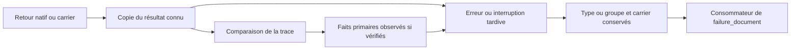

# Faits connus après une erreur tardive

`trace_outcome_custody.raise_with_custody` propage une erreur ou interruption en
conservant les faits natifs que l'appelant a déjà observés. Il ne fait aucune
E/S, exécution, analyse de trace, tentative supplémentaire ou décision métier.
Le helper `native_build_outcome.py` reste inchangé.

Les deux callers `trace_process_witness.observe_case` et
`trace_signal_witness.observe` copient en mémoire le résultat du traceur dès le
retour de l'exécuteur ou de son carrier d'erreur, avant publication et validation
risquées. Ils n'infèrent pas l'issue primaire depuis le code du traceur. Le
primaire reste `UNKNOWN` jusqu'à comparaison exacte du marqueur, PID, argv/env et
terminal ; ensuite les faits lus sont marqués `OBSERVED`, sans admission globale.
Le calcul des hashes de sortie reste dans la zone de conservation des erreurs.

Le carrier `native_outcome` contient le résultat `subprocess` fourni, le reçu
complet `native_executor_receipt` s'il existe, `primary_observation`, le diagnostic
`following_failure` photographié avant mutation, et `earlier_failure` si fourni.
Les dictionnaires internes, JSON-safe, sont des préconditions de l'appelant et
copiés superficiellement. Aucun horodatage, PID, statut de publication ou code0
n'est fabriqué. Un résultat absent est marqué inconnu, jamais « non exécuté ».
L'appelant transmet explicitement le statut primaire UNKNOWN/OBSERVED ; à défaut,
le helper fournit un marqueur `known:false`, sans issue primaire inventée.

L'erreur ordinaire conserve son type et sa cause. Une interruption avec une
erreur antérieure distincte, ou une cause préexistante qu'un nouveau chaînage
effacerait, est propagée dans un `BaseExceptionGroup` avec les objets d'origine.
Le cas sans antérieur ou avec le même objet ne crée pas de cause vers lui-même.
La metadata antérieure du diagnostic reste dans sa photographie, sans lien vers
le nouveau carrier. Le helper lève toujours ; il n'accorde aucune acceptation.

La recette `recipes/trace-caller-custody-inert.json` exige un parent temporaire
explicite `SWARM_TRACE_TEST_PARENT`. Elle couvre huit témoins des deux callers
(résultat connu0/7/-15, puis EIO ou KeyboardInterrupt), avec contrôle valide et
reprise fraîche ; deux témoins purs couvrent inconnus/identité et cause distincte.
Les exécuteurs sont remplacés et les enfants interdits par mocks. Ce sont des
exceptions injectées, pas des signaux système ni des défauts disque réels.
Les anciennes observations réelles restent liées à leurs octets historiques ;
ces tests ne rejouent ni leurs traces ni une compilation. Aucun build, provider,
service ou corps de test Rust. La fermeture des intrants de compilation et
l'admission comportementale demeurent ouvertes.

Lors de l'ajout d'un helper de projet, actualiser aussi les inventaires des
recettes qui importent ses callers : déclarer le caller seul ne couvre pas sa
nouvelle dépendance. CC-01 a été corrigé dans les deux recettes existantes.
Le contrôle des imports locaux aide cette revue ; il n'établit pas la fermeture
complète des imports dynamiques, de Python ou du système.
